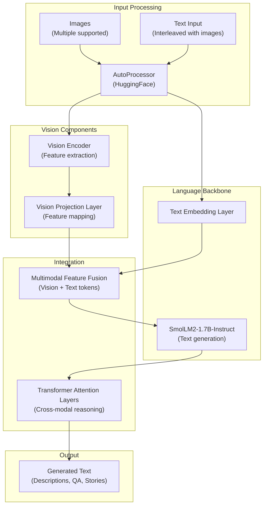
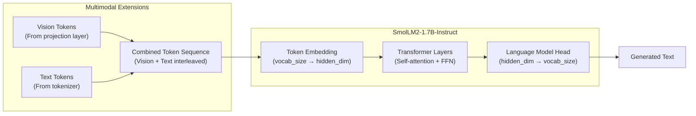
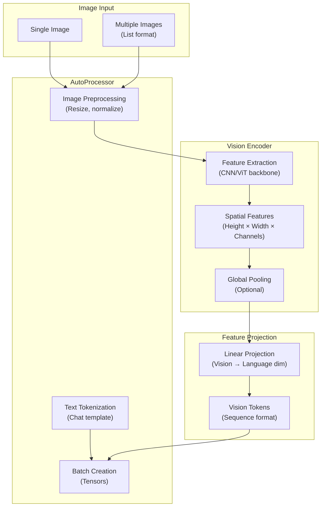
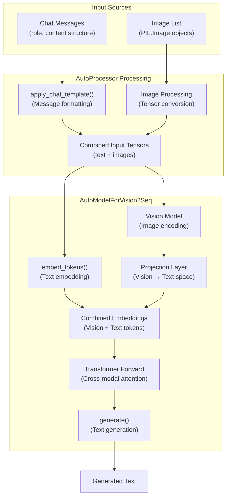
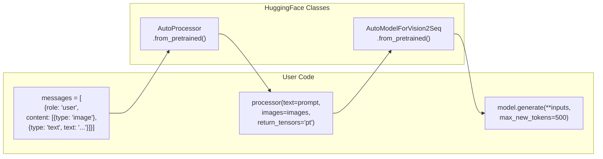
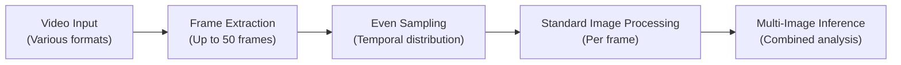

<!-- source: DeepWiki mcp.deepwiki.com · repo huggingface/smollm · page 4.1 SmolVLM Architecture · fetched 2026-10-26 -->

# SmolVLM Architecture

Relevant source files

The following files were used as context for generating this wiki page:

- [README.md](README.md)
- [text/README.md](text/README.md)
- [text/finetuning/README.md](text/finetuning/README.md)
- [vision/README.md](vision/README.md)

This document describes the architecture of SmolVLM, a compact vision-language model that combines visual and textual understanding capabilities. SmolVLM uses SmolLM2-1.7B as its language backbone and is designed for efficient multimodal processing suitable for on-device deployment.

For information about SmolVLM training processes, see [SmolVLM Training](#4.2). For inference setup and deployment, see [SmolVLM Inference](#4.3). For the underlying language model architecture, see [SmolLM2 Models](#3.1).

## Overview

SmolVLM is a multimodal transformer model that accepts arbitrary sequences of images and text as input to produce text outputs. The architecture combines a vision encoder for processing visual content with SmolLM2-1.7B-Instruct as the language backbone, connected through a projection layer that maps visual features into the language model's embedding space.

**SmolVLM High-Level Architecture**

Sources: [README.md:24-28](), [vision/README.md:5-6](), [vision/README.md:39-44]()

## Language Backbone

SmolVLM uses SmolLM2-1.7B-Instruct as its core language processing component. This model serves as the generative foundation, handling text understanding, reasoning, and output generation. The language backbone maintains the full capabilities of SmolLM2, including conversation handling and instruction following.

**Language Backbone Integration**

The language backbone processes both textual and visual tokens through the same transformer architecture, enabling cross-modal attention and reasoning. The model uses the same chat template and conversation structure as SmolLM2-1.7B-Instruct.

Sources: [vision/README.md:5](), [text/README.md:33](), [vision/README.md:59]()

## Vision Processing Pipeline

The vision processing pipeline extracts meaningful features from input images and transforms them into tokens compatible with the language model. This pipeline supports multiple images within a single conversation and can handle various image formats.

**Vision Processing Components**

The vision pipeline supports flexible input formats, including single images, multiple images, and interleaved image-text sequences. The processor handles the coordination between vision and text processing components.

Sources: [vision/README.md:39-44](), [vision/README.md:46-62](), [vision/README.md:59-60]()

## Multimodal Integration

SmolVLM integrates visual and textual information through a unified token sequence approach. Vision tokens are projected into the same embedding space as text tokens, allowing the language model to process both modalities through its standard attention mechanism.

**Multimodal Data Flow**

The integration relies on the `AutoModelForVision2Seq` architecture from HuggingFace Transformers, which provides the framework for combining vision and language components within a single model.

Sources: [vision/README.md:39-44](), [vision/README.md:47-56](), [vision/README.md:59-64]()

## Key Interfaces and Classes

SmolVLM uses standard HuggingFace interfaces for consistency and ease of integration. The primary classes provide high-level APIs for processing multimodal inputs and generating text outputs.

| Class | Purpose | Key Methods |
|-------|---------|-------------|
| `AutoProcessor` | Input preprocessing and tokenization | `apply_chat_template()`, `__call__()` |
| `AutoModelForVision2Seq` | Main model interface | `generate()`, `forward()` |
| `Chat Messages` | Conversation structure | `role`, `content` with type specifications |

**Key Interface Usage Pattern**

The model supports standard transformer generation parameters including `max_new_tokens`, `temperature`, and `top_p`. It can be used with different attention implementations including `flash_attention_2` for improved performance on supported hardware.

Sources: [vision/README.md:39-44](), [vision/README.md:59-64](), [vision/README.md:42-43]()

## Performance Characteristics

SmolVLM is designed for efficient multimodal processing with several architectural choices optimized for resource-constrained environments. The model balances capability with computational requirements suitable for on-device deployment.

**Architecture Efficiency Features**

| Component | Optimization | Benefit |
|-----------|--------------|---------|
| Language Backbone | SmolLM2-1.7B (compact) | Reduced memory footprint |
| Attention | Flash Attention 2 support | Faster inference on GPU |
| Precision | BFloat16 support | Memory efficiency |
| Context | Long context capability | Multi-image conversations |

The model supports video processing through frame sampling, extracting up to 50 evenly distributed frames for analysis. This approach provides a practical balance between temporal coverage and computational efficiency.

**Video Processing Pipeline**

This video processing approach achieved competitive results on the CinePile benchmark with a score of 27.14%, positioning SmolVLM between InterVL2 (2B) and Video LlaVa (7B) models.

Sources: [vision/README.md:5](), [vision/README.md:42-44](), [vision/README.md:88-91](), [tools/smolvlm_local_inference/SmolVLM_video_inference.py]()

---

