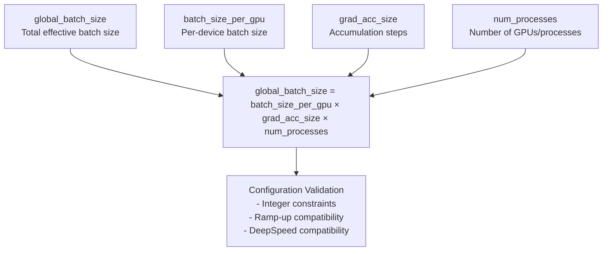
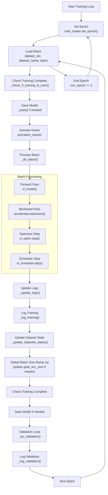
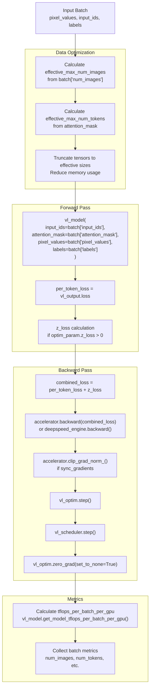
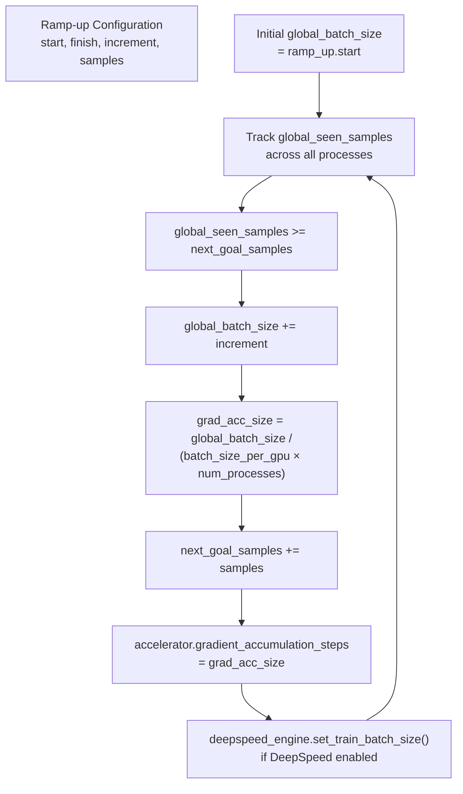
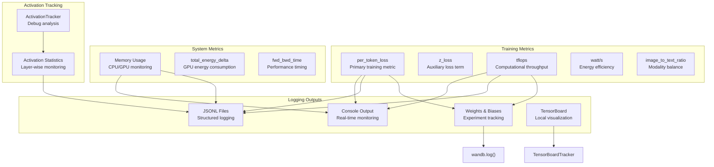
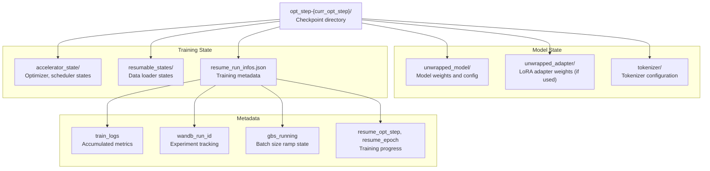

<!-- source: DeepWiki mcp.deepwiki.com · repo huggingface/smollm · page 4.2 SmolVLM Training · fetched 2026-10-26 -->

# SmolVLM Training

Relevant source files

The following files were used as context for generating this wiki page:

- [vision/m4/training/trainer.py](vision/m4/training/trainer.py)

This document covers the training infrastructure for SmolVLM models using the M4 training framework. The training system handles multimodal vision-language model training with distributed computing, mixed precision, and advanced optimization techniques.

For information about SmolVLM model architecture and capabilities, see [SmolVLM Architecture](#4.1). For inference and deployment, see [SmolVLM Inference](#4.3).

## Overview

The SmolVLM training system is built around the `Trainer` class which orchestrates distributed training of vision-language models. The system supports various training modes including full fine-tuning and LoRA-based parameter-efficient fine-tuning, with comprehensive logging, monitoring, and checkpointing capabilities.

**Training Infrastructure Architecture**

```mermaid
graph TB
    subgraph "Core Training"
        Trainer["Trainer<br/>Main orchestrator"]
        VLModel["vl_model<br/>Vision-Language Model"]
        Tokenizer["tokenizer<br/>Text tokenization"]
    end
    
    subgraph "Data Pipeline"
        TrainLoader["train_loader<br/>Training data"]
        ValLoader["val_loader<br/>Validation data"]
        DatasetNames["DatasetNames<br/>Dataset enumeration"]
    end
    
    subgraph "Configuration"
        Parameters["Parameters<br/>Main config"]
        Hparams["Hparams<br/>Hyperparameters"]
        OptimizerParams["OptimizerParams<br/>Optimizer settings"]
        DataParams["DataParams<br/>Data configuration"]
        ResumeParams["ResumeParams<br/>Resume state"]
    end
    
    subgraph "Distributed Training"
        Accelerator["accelerator<br/>HF Accelerate"]
        DeepSpeed["DeepSpeed Engine<br/>Zero optimization"]
        GradAccumulation["Gradient Accumulation<br/>grad_acc_size steps"]
    end
    
    subgraph "Monitoring"
        WandB["wandb<br/>Experiment tracking"]
        TensorBoard["TensorBoard<br/>Local logging"]
        ActivationTracker["ActivationTracker<br/>Debug analysis"]
    end
    
    Trainer --> VLModel
    Trainer --> TrainLoader
    Trainer --> ValLoader
    Trainer --> Accelerator
    Trainer --> Parameters
    
    Parameters --> Hparams
    Parameters --> OptimizerParams
    Parameters --> DataParams
    Parameters --> ResumeParams
    
    Accelerator --> DeepSpeed
    Accelerator --> GradAccumulation
    
    Trainer --> WandB
    Trainer --> TensorBoard
    Trainer --> ActivationTracker
    
    TrainLoader --> DatasetNames
    ValLoader --> DatasetNames
```

Sources: [vision/m4/training/trainer.py:108-241]()

## Training Configuration

The training system uses a hierarchical configuration structure with multiple parameter classes that control different aspects of the training process.

| Configuration Class | Purpose | Key Parameters |
|-------------------|---------|----------------|
| `Hparams` | Core hyperparameters | `batch_size_per_gpu`, `global_batch_size`, `grad_acc_size` |
| `OptimizerParams` | Optimizer settings | `vl_optim`, `vl_lr_scheduler`, `z_loss` |
| `DataParams` | Data configuration | Dataset-specific parameters |
| `ResumeParams` | Resume state | `resume_opt_step`, `train_logs`, `gbs_running` |

The system automatically derives batch size relationships and validates configuration consistency during initialization:

Sources: [vision/m4/training/trainer.py:242-348]()

## Training Loop Architecture

The main training loop handles batch processing, gradient accumulation, logging, validation, and checkpointing in a coordinated manner.

**Training Loop Flow**

Sources: [vision/m4/training/trainer.py:1612-1969]()

## Batch Processing Pipeline

The `_do_batch` method handles the core forward and backward passes with vision-language data processing optimizations.

**Batch Processing Details**

Sources: [vision/m4/training/trainer.py:609-730]()

## Distributed Training Support

The training system leverages HuggingFace Accelerate and DeepSpeed for efficient distributed training across multiple GPUs and nodes.

| Component | Purpose | Implementation |
|-----------|---------|----------------|
| `accelerator` | Distributed coordination | HuggingFace Accelerate library |
| `DeepSpeed` | Memory optimization | Zero-stage optimization |
| `gradient_accumulation_steps` | Effective batch size | Configurable accumulation |
| `mixed_precision` | Memory/speed optimization | bf16 support with validation |

**Mixed Precision Validation**

The system validates mixed precision compatibility:
- BF16 requires CUDA >= 11.0
- BF16 requires NCCL >= 2.10.3

Sources: [vision/m4/training/trainer.py:360-369]()

## Global Batch Size Ramp-Up

The training supports dynamic global batch size scaling during training to improve convergence and GPU utilization.

Sources: [vision/m4/training/trainer.py:826-842]()

## Logging and Monitoring

The system provides comprehensive logging through multiple channels with configurable verbosity levels.

**Logging Architecture**

The logging system uses `LoggingTypes` enum to control output destinations and supports per-dataset logging granularity.

Sources: [vision/m4/training/trainer.py:1108-1186]()

## Checkpointing and Resume

The system provides robust checkpointing with support for resuming training from any saved step.

**Checkpoint Structure**

**DeepSpeed Compatibility**: For DeepSpeed Zero-3, only model configuration is saved rather than full weights due to memory constraints.

Sources: [vision/m4/training/trainer.py:1248-1327]()

## Validation Pipeline

The validation loop evaluates model performance on held-out data with comprehensive metrics collection.

The validation process mirrors training batch processing but disables gradient computation and parameter updates. Metrics are collected per dataset and aggregated across all processes for consistent evaluation.

Key validation metrics:
- `val_per_token_loss`: Average loss across validation batches
- `val_num_images`: Total images processed  
- `val_num_tokens`: Total tokens processed
- `val_image_to_text_ratio`: Modality balance in validation data

Sources: [vision/m4/training/trainer.py:1452-1610]()

## Training Termination Conditions

The system monitors multiple conditions for graceful training termination:

| Condition | Detection Method | Handler |
|-----------|-----------------|---------|
| Maximum steps reached | `curr_opt_step >= max_num_updates` | Normal completion |
| Kill switch activated | File existence check | `_check_kill_switch()` |
| Memory explosion | RAM usage threshold | `_check_jz_time_and_memory()` |
| SIGTERM signal | Signal handler | `SigtermListener` |
| Time limit exceeded | Job time tracking | JZ cluster integration |

Sources: [vision/m4/training/trainer.py:1360-1414]()

---

