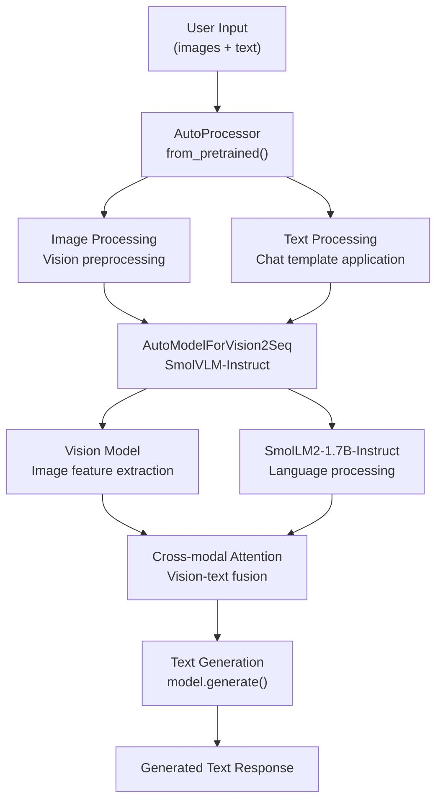
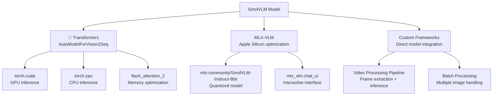
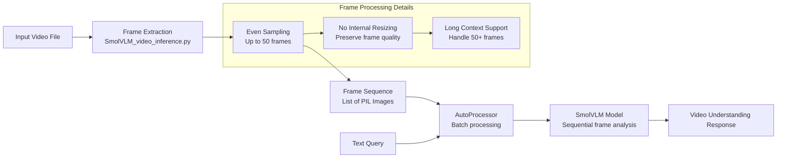

<!-- source: DeepWiki mcp.deepwiki.com · repo huggingface/smollm · page 4.3 SmolVLM Inference · fetched 2026-10-26 -->

# SmolVLM Inference

<details>
<summary>Relevant source files</summary>

The following files were used as context for generating this wiki page:

- [README.md](README.md)
- [text/README.md](text/README.md)
- [text/finetuning/README.md](text/finetuning/README.md)
- [tools/smolvlm_local_inference/README.md](tools/smolvlm_local_inference/README.md)
- [vision/README.md](vision/README.md)
- [vision/finetuning/Smol_VLM_FT.ipynb](vision/finetuning/Smol_VLM_FT.ipynb)

</details>


This document covers running SmolVLM for inference across different frameworks and deployment scenarios. SmolVLM is a compact vision-language model that processes image and text inputs to generate text outputs, supporting both local and cloud-based inference patterns.

For information about SmolVLM architecture and capabilities, see [SmolVLM Architecture](#4.1). For training SmolVLM, see [SmolVLM Training](#4.2).

## Inference Architecture Overview

SmolVLM inference follows a multimodal processing pipeline that handles both visual and textual inputs through specialized components before generating text outputs.



Sources: [vision/README.md:22-77](), [tools/smolvlm_local_inference/README.md:9-64]()

## Core Inference Components

### Model and Processor Loading

SmolVLM inference relies on two primary components: `AutoProcessor` for input preprocessing and `AutoModelForVision2Seq` for the actual model:

```python
processor = AutoProcessor.from_pretrained("HuggingFaceTB/SmolVLM-Instruct")
model = AutoModelForVision2Seq.from_pretrained("HuggingFaceTB/SmolVLM-Instruct")
```

The processor handles both image preprocessing and chat template application, while the model performs the actual vision-language processing using SmolLM2-1.7B as the language backbone.

### Input Format and Processing

SmolVLM accepts structured message formats that can interleave images and text arbitrarily:

| Component | Type | Role |
|-----------|------|------|
| `messages` | List[Dict] | Chat conversation structure |
| `content` | List[Dict] | Mixed image/text content per message |
| `type: "image"` | Dict | Image placeholder in content |
| `type: "text"` | Dict | Text content with `text` field |

Sources: [vision/README.md:46-60](), [tools/smolvlm_local_inference/README.md:33-47]()

## Inference Framework Support

SmolVLM supports multiple inference frameworks for different deployment scenarios and performance requirements.



Sources: [vision/README.md:78-84](), [tools/smolvlm_local_inference/README.md:65-71]()

### Transformers Framework

The primary inference method uses Hugging Face Transformers with `AutoModelForVision2Seq`. Key configuration options include:

- `torch_dtype=torch.bfloat16` for memory efficiency
- `_attn_implementation="flash_attention_2"` for GPU optimization  
- `device_map="auto"` for automatic device placement

### MLX-VLM Framework

For Apple Silicon devices, MLX-VLM provides optimized inference:

```bash
pip install -U mlx-vlm
python -m mlx_vlm.chat_ui --model mlx-community/SmolVLM-Instruct-8bit
```

This framework uses quantized 8-bit models for reduced memory usage while maintaining inference quality.

Sources: [vision/README.md:78-84](), [tools/smolvlm_local_inference/README.md:65-71]()

## Video Processing Pipeline

SmolVLM extends to video understanding through frame extraction and sequential processing, achieving competitive performance on video benchmarks.

### Video Inference Architecture



The video processing implementation extracts up to 50 evenly sampled frames while avoiding internal frame resizing, leveraging SmolVLM's long context capabilities for video understanding tasks.

### Performance Characteristics

| Benchmark | SmolVLM Score | Comparison Models |
|-----------|---------------|-------------------|
| CinePile | 27.14% | Between InterVL2 (2B) and Video LlaVa (7B) |

Sources: [vision/README.md:86-91](), [tools/smolvlm_local_inference/README.md:73-78]()

## Local Deployment Patterns

### Memory and Compute Requirements

SmolVLM's compact architecture enables efficient local deployment across different hardware configurations:

| Configuration | Memory Usage | Performance Notes |
|---------------|--------------|-------------------|
| CPU + bfloat16 | ~4.5GB RAM | Slower inference, broad compatibility |
| GPU + bfloat16 | ~4.5GB VRAM | Fast inference, requires CUDA |
| MLX 8-bit | ~2.7GB RAM | Apple Silicon optimized |

### Device Detection and Configuration

The inference code automatically detects available hardware and configures accordingly:

```python
DEVICE = "cuda" if torch.cuda.is_available() else "cpu"
_attn_implementation = "flash_attention_2" if DEVICE == "cuda" else "eager"
```

This pattern ensures optimal performance across different deployment environments while maintaining compatibility.

Sources: [vision/README.md:32-44](), [tools/smolvlm_local_inference/README.md:19-31]()

## Integration Patterns

### Fine-tuning Integration

SmolVLM supports fine-tuning for domain-specific applications using QLoRA and PEFT integration. The model uses `Idefics3ForConditionalGeneration` as its base class, enabling compatibility with existing vision-language fine-tuning pipelines.

Key integration points include:
- `LoraConfig` with target modules for efficient parameter updates
- `BitsAndBytesConfig` for quantization during fine-tuning
- `prepare_model_for_kbit_training` for QLoRA compatibility

### Processor Configuration

The `AutoProcessor` handles model-specific preprocessing requirements:

- Image preprocessing and normalization
- Chat template application with `apply_chat_template`
- Token management for mixed image-text inputs
- Batch processing for multiple images per conversation

Sources: [vision/finetuning/Smol_VLM_FT.ipynb:288-341](), [vision/finetuning/Smol_VLM_FT.ipynb:440-478]()

---

