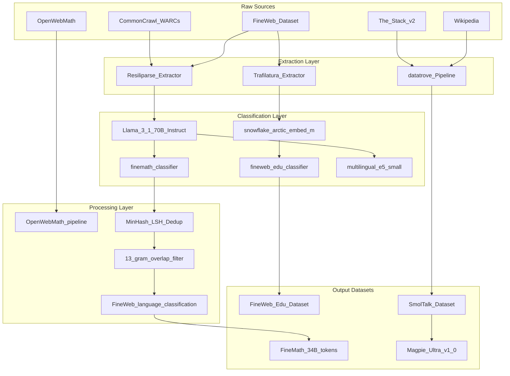
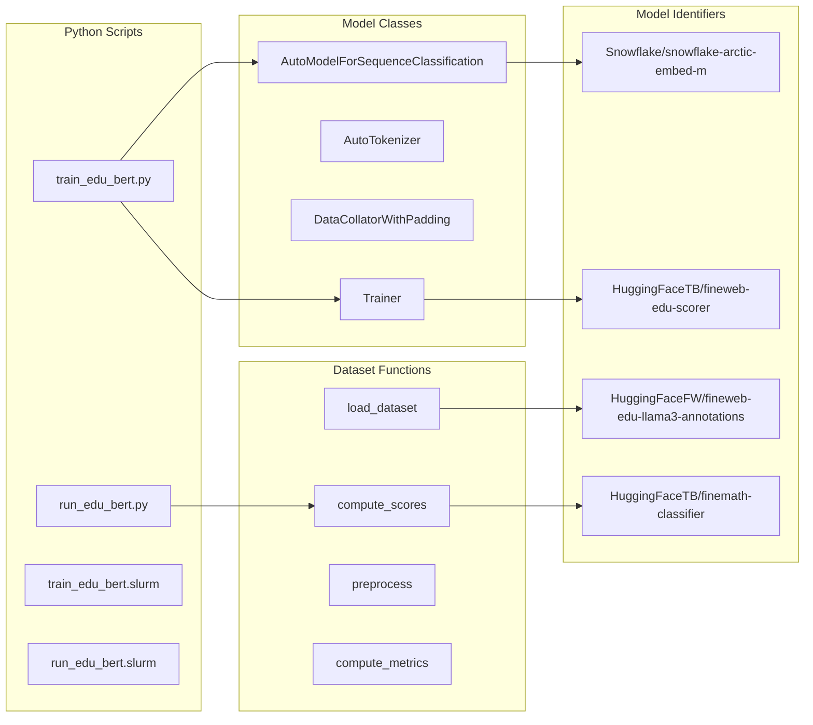
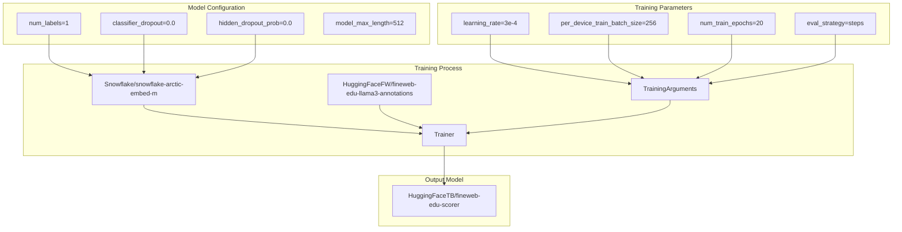

<!-- source: DeepWiki mcp.deepwiki.com · repo huggingface/smollm · page 5 Data and Datasets · fetched 2026-10-26 -->

# Data and Datasets

Relevant source files

The following files were used as context for generating this wiki page:

- [text/data/README.md](text/data/README.md)
- [text/data/finemath/README.md](text/data/finemath/README.md)
- [text/data/fineweb-edu/run_edu_bert.py](text/data/fineweb-edu/run_edu_bert.py)
- [text/data/fineweb-edu/run_edu_bert.slurm](text/data/fineweb-edu/run_edu_bert.slurm)
- [text/data/fineweb-edu/train_edu_bert.py](text/data/fineweb-edu/train_edu_bert.py)
- [text/data/fineweb-edu/train_edu_bert.slurm](text/data/fineweb-edu/train_edu_bert.slurm)

This document covers the comprehensive data curation, processing pipelines, and datasets used for training SmolLM models. It includes the extraction, classification, and quality assessment workflows that produce high-quality training data from raw web sources.

For specific dataset curation details, see [Data Curation Pipeline](#5.1), [FineMath Dataset](#5.2), [FineWeb-Edu Dataset](#5.3), and [SmolTalk Dataset](#5.4). For information about how these datasets are used in training, see [SmolLM3 Pretraining](#2.2) and [SmolLM2 Fine-tuning](#3.2).

## Data Processing Architecture

The SmolLM data pipeline transforms raw web content into high-quality training datasets through a multi-stage process involving extraction, classification, decontamination, and quality assessment.

### Overall Data Flow

Sources: [text/data/finemath/README.md:12-48](), [text/data/fineweb-edu/train_edu_bert.py:63-76]()

### Code Entity Mapping

Sources: [text/data/fineweb-edu/train_edu_bert.py:1-147](), [text/data/fineweb-edu/run_edu_bert.py:1-76]()

## Data Extraction and Sources

### Text Extraction Methods

The pipeline employs different extraction methods optimized for specific content types:

| Extractor | Use Case | Advantages | Source Files |
|-----------|----------|------------|--------------|
| `Resiliparse` | Mathematical content, forums | Preserves QA discussions, reasoning steps | CommonCrawl WARCs |
| `Trafilatura` | General web content | Standard FineWeb extraction | FineWeb pages |
| `datatrove` | Code and structured content | Handles technical documentation | The Stack v2, Wikipedia |

The FineMath pipeline specifically uses `Resiliparse` because it better preserves forum discussions and QA answers that contain crucial reasoning steps and solutions, unlike `Trafilatura` which is used in the standard FineWeb pipeline.

Sources: [text/data/finemath/README.md:13-14]()

### Content Recovery Strategies

The FineMath Phase 2 process implements several strategies to recover filtered mathematical content:

1. **LaTeX Character Recovery**: FineWeb's C4 filter removes pages containing '{' characters, filtering out LaTeX notation
2. **Domain-based Expansion**: Identifies promising domains where ≥10% of pages score ≥2 on mathematical content
3. **Cross-dataset URL Integration**: Incorporates URLs from OpenWebMath and InfiMM-WebMath datasets  
4. **Rejection Log Mining**: Recovers URLs filtered by FineWeb's '{' rule from rejection logs

Sources: [text/data/finemath/README.md:24-30]()

## Quality Assessment and Classification

### Multi-Stage Classification Pipeline

The quality assessment employs a hierarchical approach with increasingly refined scoring:

#### Phase 1: Initial Classification
- **Annotator**: `Llama-3.1-70B-Instruct` 
- **Scale**: 3-point scoring system
- **Classifier**: `multilingual-e5-small`-based model
- **Performance**: Below OpenWebMath baseline, requiring refinement

#### Phase 3: Refined Classification  
- **Annotator**: `Llama-3.1-70B-Instruct`
- **Scale**: 5-point scoring system  
- **Classifier**: `HuggingFaceTB/finemath-classifier`
- **Threshold**: Score ≥3 for inclusion in FineMath-3+

Sources: [text/data/finemath/README.md:16-37]()

### FineWeb-Edu Classification Architecture

Sources: [text/data/fineweb-edu/train_edu_bert.py:63-109]()

### Scoring and Inference Pipeline

The `run_edu_bert.py` script implements distributed scoring across dataset shards:

#### Key Functions:
- **`compute_scores(batch)`**: Processes text batches through the classifier [text/data/fineweb-edu/run_edu_bert.py:26-39]()
- **Score Clipping**: `int(round(max(0, min(score, 5))))` ensures valid 0-5 range [text/data/fineweb-edu/run_edu_bert.py:38]()
- **Batch Processing**: 512 samples per batch for efficient GPU utilization [text/data/fineweb-edu/run_edu_bert.py:41]()

Sources: [text/data/fineweb-edu/run_edu_bert.py:26-41]()

## Decontamination and Quality Control

### 13-gram Overlap Filtering

Following Qwen2.5-Math's approach, the pipeline removes samples with 13-gram overlaps against benchmark test sets:

| Benchmark | Purpose |
|-----------|---------|
| GSM8k | Mathematical reasoning |
| MATH | Advanced mathematics |
| MMLU | Multitask language understanding |
| ARC | Science reasoning |

Decontamination logs are maintained at `HuggingFaceTB/finemath_contamination_report`.

Sources: [text/data/finemath/README.md:43-44]()

### Deduplication Methods

- **Algorithm**: MinHash-LSH with single-band configuration
- **Application**: Applied after quality filtering (score ≥3)
- **Result**: Produces FineMath-3+ with 34B tokens

Sources: [text/data/finemath/README.md:37]()

## Dataset Outputs

### Final Dataset Specifications

| Dataset | Size | Content Type | Quality Threshold |
|---------|------|-------------|-------------------|
| FineMath | 34B tokens | Mathematical reasoning | Score ≥3 |
| FineWeb-Edu | Variable | Educational content | BERT-classified |
| SmolTalk | Variable | Instruction tuning | Curated conversations |
| MagpieUltra v1.0 | Variable | Multi-turn dialogues | Generated conversations |

### Integration with Training Pipelines

The curated datasets feed into different stages of model training:

- **FineMath**: Used in SmolLM3 pretraining for mathematical capabilities
- **FineWeb-Edu**: Provides educational content for general pretraining  
- **SmolTalk**: Powers instruction tuning and fine-tuning phases
- **MagpieUltra**: Supports conversational capabilities development

Sources: [text/data/finemath/README.md:37](), [text/data/README.md:1-6]()

---

