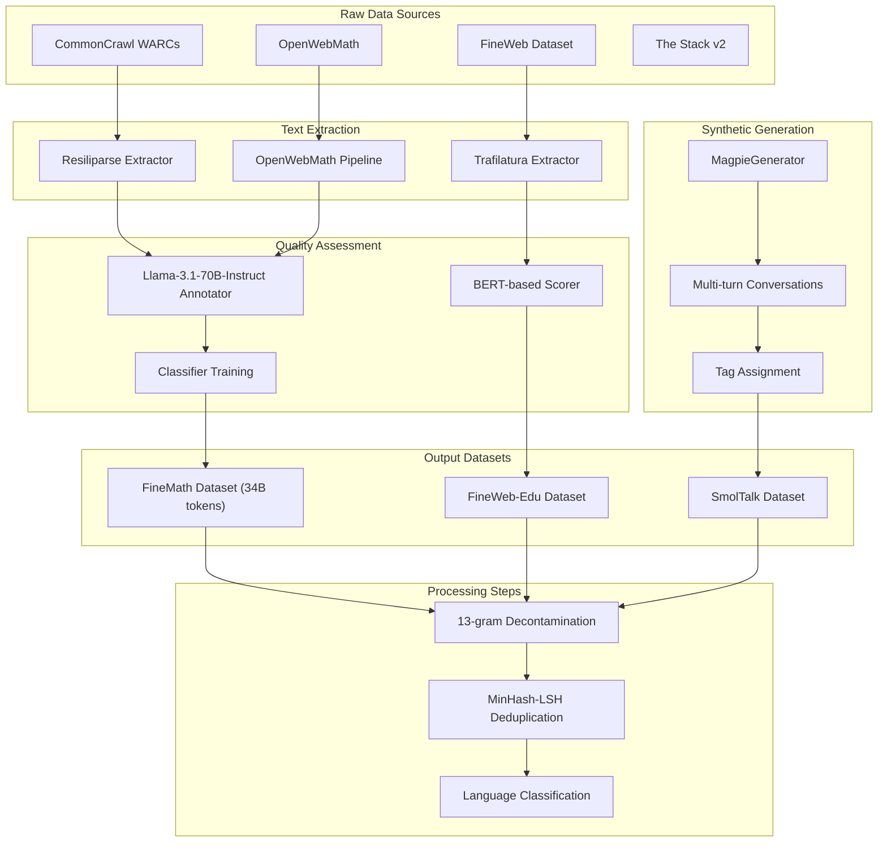
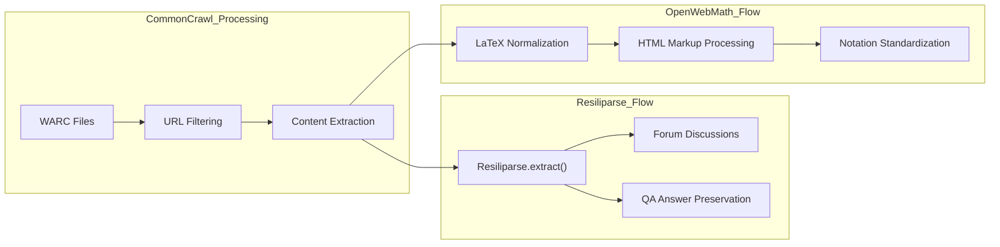
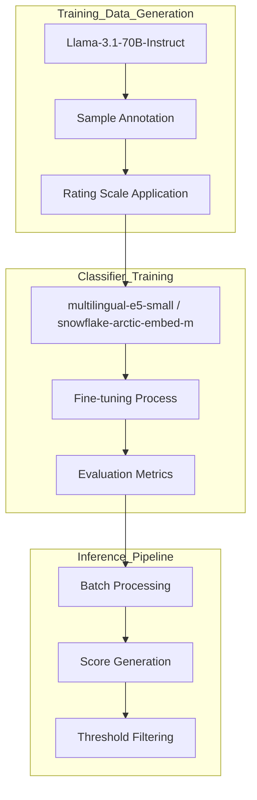
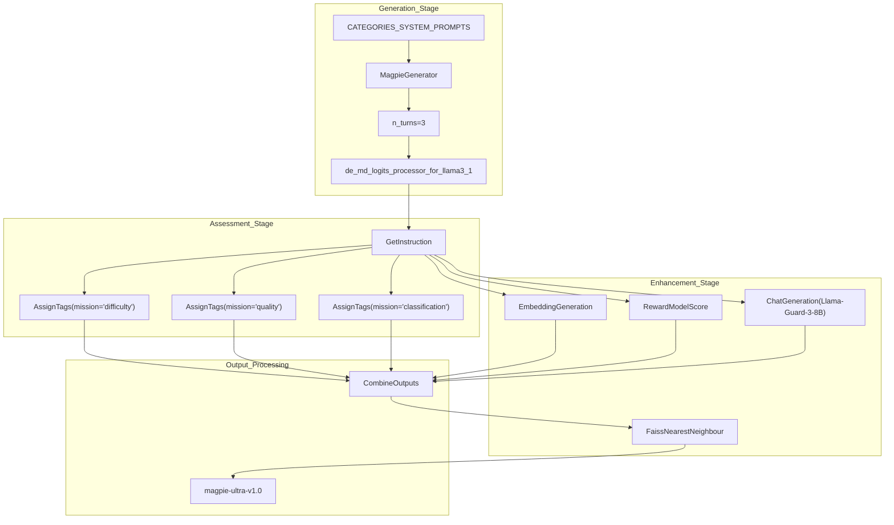

<!-- source: DeepWiki mcp.deepwiki.com · repo huggingface/smollm · page 5.1 Data Curation Pipeline · fetched 2026-10-26 -->

# Data Curation Pipeline

Relevant source files

The following files were used as context for generating this wiki page:

- [text/data/README.md](text/data/README.md)
- [text/data/decontamination/README.md](text/data/decontamination/README.md)
- [text/data/finemath/README.md](text/data/finemath/README.md)
- [text/data/fineweb-edu/README.md](text/data/fineweb-edu/README.md)
- [text/data/fineweb-edu/run_edu_bert.py](text/data/fineweb-edu/run_edu_bert.py)
- [text/data/fineweb-edu/run_edu_bert.slurm](text/data/fineweb-edu/run_edu_bert.slurm)
- [text/data/fineweb-edu/train_edu_bert.py](text/data/fineweb-edu/train_edu_bert.py)
- [text/data/fineweb-edu/train_edu_bert.slurm](text/data/fineweb-edu/train_edu_bert.slurm)
- [text/data/smoltalk/README.md](text/data/smoltalk/README.md)
- [text/data/smoltalk/magpie_ultra_v1/README.md](text/data/smoltalk/magpie_ultra_v1/README.md)
- [text/data/smoltalk/magpie_ultra_v1/pipeline.py](text/data/smoltalk/magpie_ultra_v1/pipeline.py)

This document covers the comprehensive data processing infrastructure used to create high-quality training datasets for SmolLM models. The pipeline encompasses text extraction, quality assessment, classification, decontamination, and synthetic data generation workflows that produce curated datasets including FineMath, FineWeb-Edu, and SmolTalk.

For specific details about individual datasets, see [FineMath Dataset](#5.2), [FineWeb-Edu Dataset](#5.3), and [SmolTalk Dataset](#5.4).

## Overview

The data curation pipeline consists of multiple interconnected processing stages that transform raw web content and synthetic generation into high-quality training data. The system employs a combination of rule-based filtering, machine learning classifiers, and large language model annotations to ensure dataset quality.

Sources: [text/data/finemath/README.md:1-48](), [text/data/fineweb-edu/README.md:1-27](), [text/data/smoltalk/magpie_ultra_v1/README.md:1-11]()

## Text Extraction and Preprocessing

The pipeline employs different text extraction strategies optimized for specific content types. The choice of extractor significantly impacts the quality of mathematical and educational content preservation.

### Extraction Methods

| Method | Use Case | Strengths | Implementation |
|--------|----------|-----------|----------------|
| `Resiliparse` | Mathematical content | Preserves forum discussions and QA answers | Used in FineMath pipeline |
| `Trafilatura` | General web content | Standard web text extraction | Used in FineWeb baseline |
| `OpenWebMath Pipeline` | Mathematical notation | Handles LaTeX across HTML markup formats | Used in FineMath Phase 2 |

The `Resiliparse` extractor is specifically chosen for mathematical content because it better preserves crucial reasoning steps and solutions found in forum discussions, unlike `Trafilatura` which may lose important contextual information.

Sources: [text/data/finemath/README.md:13-15](), [text/data/finemath/README.md:30-31]()

## Classification and Quality Assessment

The pipeline uses a two-tier approach combining large language model annotations with efficient neural classifiers for scalable quality assessment.

### LLM-based Annotation

The initial quality assessment employs `Llama-3.1-70B-Instruct` to generate annotations on structured rating scales. For mathematical content, the system uses both 3-point and 5-point scales depending on the refinement phase.

**FineMath Rating Scales:**
- Phase 1: 3-point scale (general math, logical reasoning, step-by-step solutions)
- Phase 3: 5-point scale (detailed quality assessment with full prompt available)

### Classifier Training Pipeline

The `train_edu_bert.py` implements the training pipeline with the following key components:
- `AutoModelForSequenceClassification` with single output for regression
- `DataCollatorWithPadding` for efficient batching
- Stratified train-test split with 90-10 ratio
- Frozen embedding layers to prevent overfitting

Sources: [text/data/finemath/README.md:16-22](), [text/data/finemath/README.md:35-37](), [text/data/fineweb-edu/train_edu_bert.py:63-89]()

## Decontamination and Deduplication

The pipeline implements comprehensive decontamination to prevent test set leakage and deduplication to reduce redundancy in training data.

### Decontamination Process

Following the Qwen2.5-Math approach, the system removes samples with 13-gram overlaps against standard evaluation benchmarks:
- GSM8k (mathematical reasoning)
- MATH (competition mathematics)
- MMLU (general knowledge)
- ARC (reading comprehension)

### Deduplication Strategy

The system uses `MinHash-LSH` (Locality-Sensitive Hashing) for efficient near-duplicate detection. This approach provides:
- Scalable similarity detection across billions of tokens
- Configurable similarity thresholds
- Single-band implementation for computational efficiency

```mermaid
graph LR
    subgraph "Decontamination_Pipeline"
        InputDataset["Input Dataset"]
        NGramExtraction["13-gram Extraction"]
        TestSetComparison["Test Set Overlap Detection"]
        ContaminatedRemoval["Contaminated Sample Removal"]
    end
    
    subgraph "Deduplication_Pipeline"
        MinHashComputation["MinHash Computation"]
        LSHBucketing["LSH Bucketing"]
        SimilarityThreshold["Similarity Threshold"]
        DuplicateRemoval["Duplicate Removal"]
    end
    
    InputDataset --> NGramExtraction
    NGramExtraction --> TestSetComparison
    TestSetComparison --> ContaminatedRemoval
    ContaminatedRemoval --> MinHashComputation
    MinHashComputation --> LSHBucketing
    LSHBucketing --> SimilarityThreshold
    SimilarityThreshold --> DuplicateRemoval
```

Sources: [text/data/finemath/README.md:43-44](), [text/data/finemath/README.md:37]()

## Synthetic Data Generation

The pipeline includes sophisticated synthetic data generation using the MagPie methodology for creating high-quality instruction-following datasets.

### MagPie Ultra Pipeline

The `pipeline.py` implements a comprehensive synthetic data generation system using the `distilabel` framework. Key components include:

**Core Generation:**
- `MagpieGenerator` with `Meta-Llama-3.1-405B-Instruct-FP8`
- Multi-turn conversation generation (3 turns)
- Category-specific system prompts with probability distribution

**Quality Assessment:**
- `AssignTags` for difficulty, quality, and classification
- `RewardModelScore` using `ArmoRM-Llama3-8B-v0.1`
- `ChatGeneration` safety filtering with `Llama-Guard-3-8B`

**Content Enhancement:**
- `EmbeddingGeneration` with `gte-large-en-v1.5`
- `FaissNearestNeighbour` for similarity analysis
- Structured output with JSON schema validation

### Content Categories

The system generates diverse instruction types with weighted probability distribution:

| Category | Weight | System Prompt | Purpose |
|----------|---------|---------------|---------|
| `reasoning` | 0.125 | `REASONING_PROMPT` | Logical thinking and problem-solving |
| `coding` | 0.125 | `CODING_DEBUGGING_PROMPT` | Programming assistance |
| `math` | 0.125 | `MATH_SYSTEM_PROMPT` | Mathematical problem solving |
| `data-analysis` | 0.125 | `DATA_ANALYSIS_PROMPT` | Statistical analysis and interpretation |
| `editing` | 0.10 | `EDITING_PROMPT` | Writing improvement and refinement |
| `role-playing` | 0.10 | `ROLE_PLAYING_PROMPT` | Character-based interactions |
| `creative-writing` | 0.10 | `CREATIVE_WRITING_PROMPT` | Story and content creation |

Sources: [text/data/smoltalk/magpie_ultra_v1/pipeline.py:215-227](), [text/data/smoltalk/magpie_ultra_v1/pipeline.py:464-602]()

## Infrastructure and Scalability

The data curation pipeline is designed for large-scale processing with distributed computing support and efficient resource utilization.

### Distributed Processing

**SLURM Integration:**
- Job arrays for parallel processing (`--array=0-127%128`)
- Resource allocation with GPU and CPU specifications
- Automatic job requeuing and error handling

**Batch Processing Configuration:**
- `input_batch_size` ranging from 20 to 5000 depending on task complexity
- GPU memory optimization with `bfloat16` precision
- Tensor parallelism for large model inference

### Resource Requirements

| Component | GPU Requirements | Memory | Batch Size |
|-----------|------------------|---------|------------|
| `MagpieGenerator` | 8 GPUs | 8192 max_model_len | 250 |
| `train_edu_bert.py` | 1 GPU | 20GB per CPU | 256 (train), 128 (eval) |
| `RewardModelScore` | 1 GPU (3 replicas) | Auto device map | 20 |
| `EmbeddingGeneration` | 1 GPU | CUDA | 50 |

Sources: [text/data/fineweb-edu/train_edu_bert.slurm:1-24](), [text/data/fineweb-edu/run_edu_bert.slurm:1-30](), [text/data/smoltalk/magpie_ultra_v1/pipeline.py:606-640]()

---

