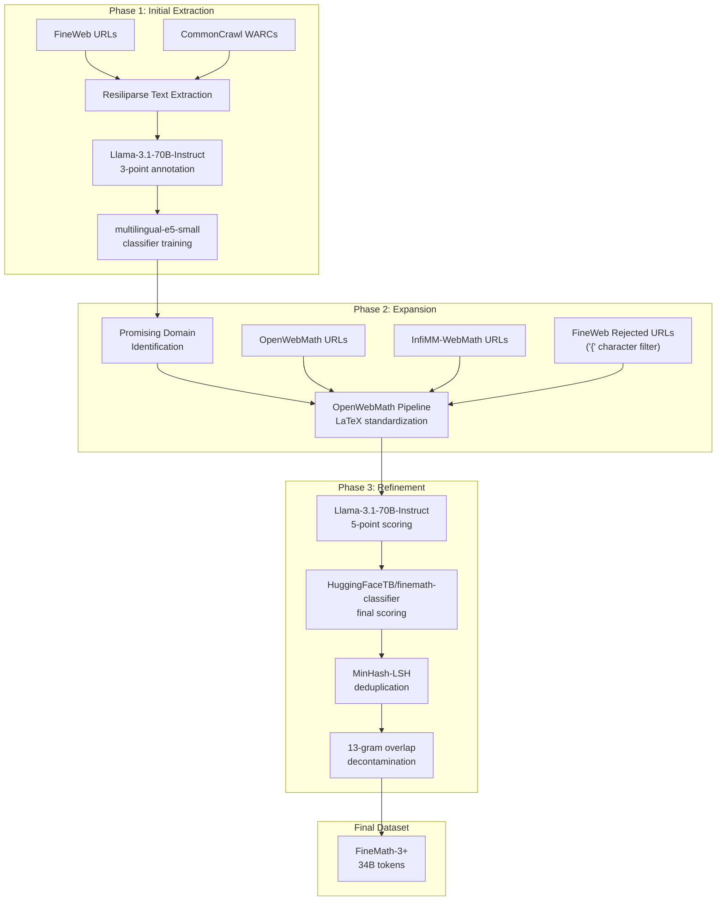
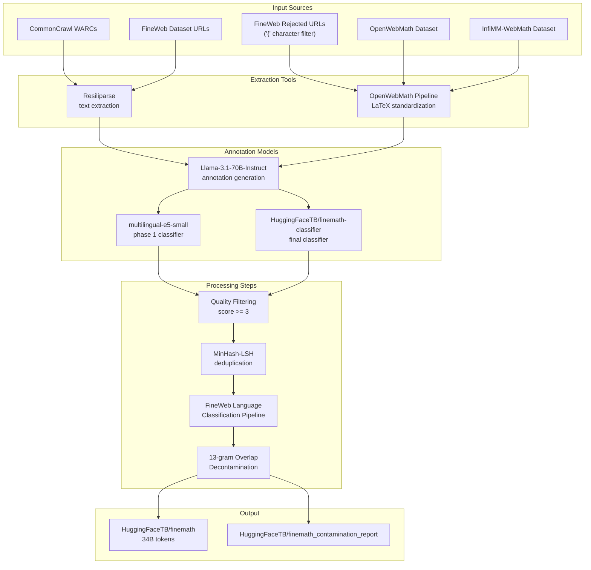

<!-- source: DeepWiki mcp.deepwiki.com · repo huggingface/smollm · page 5.2 FineMath Dataset · fetched 2026-10-26 -->

# FineMath Dataset

Relevant source files

The following files were used as context for generating this wiki page:

- [text/data/README.md](text/data/README.md)
- [text/data/finemath/README.md](text/data/finemath/README.md)
- [text/data/fineweb-edu/run_edu_bert.py](text/data/fineweb-edu/run_edu_bert.py)
- [text/data/fineweb-edu/run_edu_bert.slurm](text/data/fineweb-edu/run_edu_bert.slurm)
- [text/data/fineweb-edu/train_edu_bert.py](text/data/fineweb-edu/train_edu_bert.py)
- [text/data/fineweb-edu/train_edu_bert.slurm](text/data/fineweb-edu/train_edu_bert.slurm)

This document covers the FineMath dataset curation pipeline, a comprehensive system for extracting and classifying high-quality mathematical content from CommonCrawl data. The pipeline uses LLM-based annotation and multi-phase refinement to create a specialized mathematical reasoning dataset.

For information about the broader data curation infrastructure, see [Data Curation Pipeline](#5.1). For details about instruction tuning datasets, see [SmolTalk Dataset](#5.4).

## Overview

FineMath is a curated mathematical content dataset containing 34B tokens, designed to train language models with strong mathematical reasoning capabilities. The dataset was created through a sophisticated 3-phase pipeline that extracts, classifies, and refines mathematical content from CommonCrawl WARCs.

The final dataset, [HuggingFaceTB/finemath](https://huggingface.co/datasets/HuggingFaceTB/finemath), focuses on content with clear step-by-step mathematical solutions and logical reasoning, moving beyond simple mathematical text to emphasize problem-solving approaches.

**FineMath Pipeline Overview**

Sources: [text/data/finemath/README.md:1-48]()

## Three-Phase Curation Process

### Phase 1: Initial Content Extraction and Classification

The first phase establishes the foundation by extracting mathematical content from CommonCrawl and creating an initial quality classifier.

**Text Extraction Strategy**: Unlike FineWeb which uses Trafilatura, FineMath employs `Resiliparse` for text extraction as it better preserves forum discussions and QA answers that contain crucial reasoning steps and solutions.

**LLM-based Annotation**: The pipeline uses `Llama-3.1-70B-Instruct` to generate initial annotations on a 3-point scale:
1. Contains general mathematical content
2. Shows logical reasoning in mathematical context  
3. Contains clear step-by-step solutions at appropriate level

**Initial Classifier Training**: A `multilingual-e5-small`-based classifier is fine-tuned on these LLM annotations to score the initial corpus. However, this first version performed below the OpenWebMath baseline, necessitating the refinement phases.

Sources: [text/data/finemath/README.md:12-22]()

### Phase 2: Recalling More Candidate Pages

Phase 2 addresses coverage gaps identified in the initial extraction, particularly around LaTeX notation handling.

**Domain-based Expansion**: The pipeline identifies promising website domains by selecting those where at least 10% of pages received a classifier score ≥ 2, ensuring focused expansion on mathematically rich sources.

**URL Recovery and Expansion**:
- Adds URLs from `OpenWebMath` and `InfiMM-WebMath` datasets
- Recovers URLs of pages filtered by FineWeb's '{' character rule from rejection logs
- Addresses the issue where FineWeb's C4 filter removes pages containing '{' characters, inadvertently filtering out LaTeX notation

**Enhanced Extraction Pipeline**: All content is re-extracted using the [OpenWebMath pipeline](https://github.com/keirp/OpenWebMath), which properly handles mathematical notation across various HTML markup formats and standardizes them to LaTeX.

Sources: [text/data/finemath/README.md:24-31]()

### Phase 3: Refined Quality Assessment  

The final phase implements more sophisticated quality evaluation and produces the final dataset.

**Enhanced LLM Scoring**: `Llama-3.1-70B-Instruct` scores newly extracted pages on a 5-point scale using a refined prompt for more granular quality assessment.

**Final Classifier**: The `HuggingFaceTB/finemath-classifier` is fine-tuned on the 5-point annotations and applied to score the entire expanded corpus.

**Quality Filtering and Deduplication**:
- Retains only pages with scores of 3 or higher
- Applies simple single-band MinHash-LSH deduplication
- Results in FineMath-3+ with 34B tokens

**Cross-Dataset Application**: The same classifier is applied to InfiMM-WebMath's text content, focusing more on reasoning rather than advanced mathematics.

Sources: [text/data/finemath/README.md:32-41]()

## Data Processing Pipeline Components

**FineMath Processing Architecture**

Sources: [text/data/finemath/README.md:13-14](), [text/data/finemath/README.md:24-31](), [text/data/finemath/README.md:35-37]()

## Quality Assessment and Classification

### LLM-based Annotation Process

The quality assessment relies on `Llama-3.1-70B-Instruct` for generating training data for the mathematical content classifiers.

**Phase 1 Annotation Scale**:
1. Contains general mathematical content
2. Shows logical reasoning in mathematical context
3. Contains clear step-by-step solutions at appropriate level

**Phase 3 Refined Scale**: A more granular 5-point scale is used in the final phase, with the full prompt available in the codebase assets.

### Classifier Architecture and Training

**Base Model**: The final classifier uses the same training approach as the FineWeb-Edu pipeline, leveraging transformer-based models for content scoring.

**Training Process**: The `HuggingFaceTB/finemath-classifier` is fine-tuned on the 5-point LLM annotations to enable automated scoring of the entire mathematical content corpus.

**Cross-Dataset Application**: The trained classifier is applied not only to the FineMath corpus but also to InfiMM-WebMath text content, demonstrating its generalization capabilities across different mathematical content sources.

Sources: [text/data/finemath/README.md:16-19](), [text/data/finemath/README.md:35-39](), [text/data/finemath/README.md:46-48]()

## Decontamination and Quality Assurance

### Contamination Removal Process

The FineMath dataset implements rigorous decontamination following established best practices.

**13-gram Overlap Detection**: Following Qwen2.5-Math's approach, the pipeline removes samples with 13-gram overlaps against test sets from:
- GSM8k
- MATH 
- MMLU
- ARC

**Transparency and Reporting**: Detailed decontamination logs are made available at `HuggingFaceTB/finemath_contamination_report`, ensuring reproducibility and transparency in the cleaning process.

### Language Filtering

The dataset applies `FineWeb's language classification pipeline` to remove non-English content, ensuring consistency with the target training objectives for English mathematical reasoning.

**Final Dataset Characteristics**:
- **Size**: 34B tokens  
- **Quality Threshold**: Score ≥ 3 on the 5-point scale
- **Deduplication**: Single-band MinHash-LSH
- **Language**: English-only content
- **Domain Focus**: Mathematical reasoning and step-by-step solutions

Sources: [text/data/finemath/README.md:43-44](), [text/data/finemath/README.md:37](), [text/data/finemath/README.md:41]()

## Integration with Training Pipelines

The FineMath dataset integrates into the broader SmolLM training ecosystem as a key component for mathematical reasoning capabilities.

**Training Integration Points**:
- **SmolLM3 Pretraining**: FineMath content is incorporated into the multi-stage pretraining pipeline
- **Domain-Specific Training**: Used for mid-training phases focused on mathematical reasoning
- **Cross-Model Application**: Benefits both base model pretraining and instruction-tuned variants

**Dataset Relationships**:
- **Complementary to FineWeb-Edu**: While FineWeb-Edu focuses on general educational content, FineMath specifically targets mathematical reasoning
- **OpenWebMath Integration**: Leverages OpenWebMath's processing pipeline while adding refined quality assessment
- **SmolTalk Synergy**: Mathematical reasoning content complements the instruction-following capabilities developed through SmolTalk

The classifier training approach mirrors the FineWeb-Edu methodology, enabling consistent quality assessment across the different content domains in the SmolLM training data ecosystem.

Sources: [text/data/finemath/README.md:39](), [text/data/finemath/README.md:46-48]()

---

