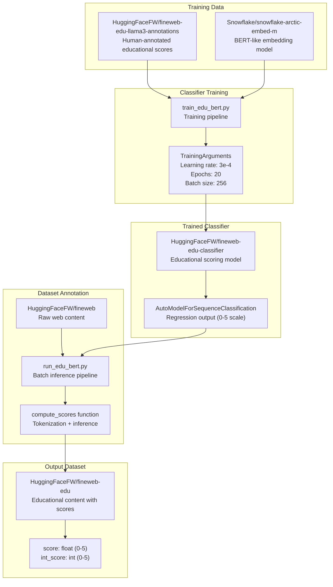
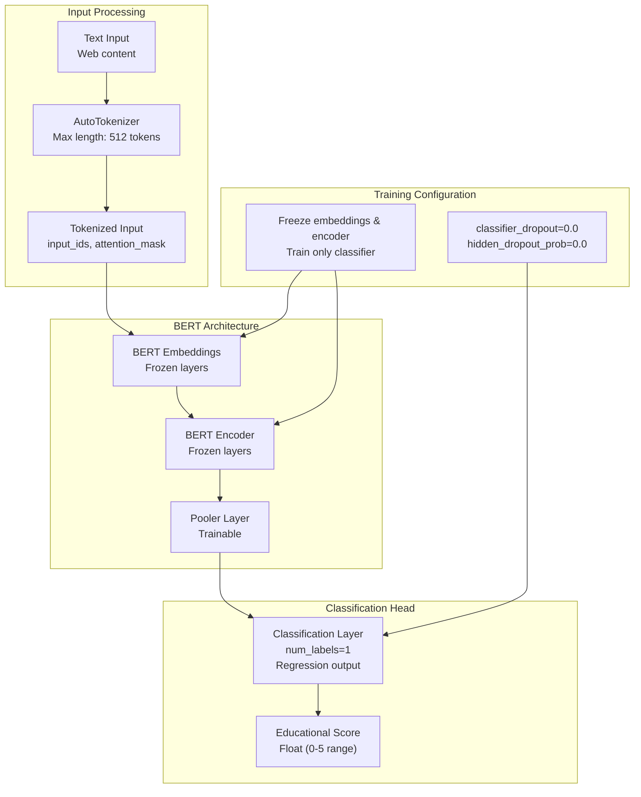
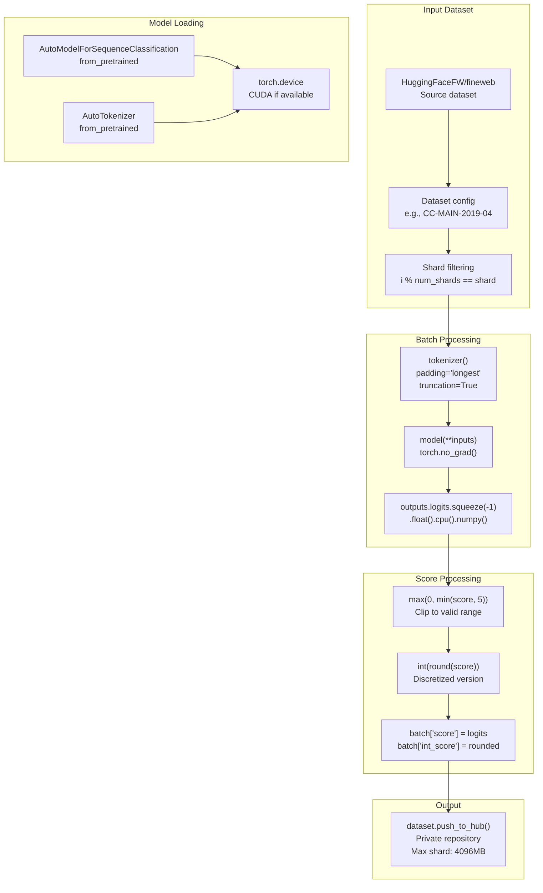

<!-- source: DeepWiki mcp.deepwiki.com · repo huggingface/smollm · page 5.3 FineWeb-Edu Dataset · fetched 2026-10-26 -->

# FineWeb-Edu Dataset

Relevant source files

The following files were used as context for generating this wiki page:

- [text/data/README.md](text/data/README.md)
- [text/data/decontamination/README.md](text/data/decontamination/README.md)
- [text/data/finemath/README.md](text/data/finemath/README.md)
- [text/data/fineweb-edu/README.md](text/data/fineweb-edu/README.md)
- [text/data/fineweb-edu/run_edu_bert.py](text/data/fineweb-edu/run_edu_bert.py)
- [text/data/fineweb-edu/run_edu_bert.slurm](text/data/fineweb-edu/run_edu_bert.slurm)
- [text/data/fineweb-edu/train_edu_bert.py](text/data/fineweb-edu/train_edu_bert.py)
- [text/data/fineweb-edu/train_edu_bert.slurm](text/data/fineweb-edu/train_edu_bert.slurm)
- [text/data/smoltalk/README.md](text/data/smoltalk/README.md)
- [text/data/smoltalk/magpie_ultra_v1/README.md](text/data/smoltalk/magpie_ultra_v1/README.md)
- [text/data/smoltalk/magpie_ultra_v1/pipeline.py](text/data/smoltalk/magpie_ultra_v1/pipeline.py)

This document covers the FineWeb-Edu dataset curation pipeline, which creates educational content scoring models and applies them to annotate web content from FineWeb. The pipeline trains a BERT-based classifier to identify and score educational value in web content, producing the FineWeb-Edu dataset used for training SmolLM models.

For mathematical content curation, see [FineMath Dataset](#5.2). For instruction tuning datasets, see [SmolTalk Dataset](#5.4).

## Overview

The FineWeb-Edu pipeline consists of two main stages: training an educational content classifier and using it to score and filter content from the FineWeb dataset. The classifier is trained on human-annotated educational content scores and deployed to create large-scale educational datasets for language model training.

### Pipeline Architecture

*Sources: text/data/fineweb-edu/README.md, text/data/fineweb-edu/train_edu_bert.py, text/data/fineweb-edu/run_edu_bert.py*

## Classifier Training

The educational classifier is trained using a regression approach on human-annotated data. The training pipeline fine-tunes a pre-trained BERT model to predict educational value scores on a 0-5 scale.

### Training Configuration

| Parameter | Value | Location |
|-----------|-------|----------|
| Base Model | `Snowflake/snowflake-arctic-embed-m` | [train_edu_bert.slurm:19]() |
| Training Dataset | `HuggingFaceFW/fineweb-edu-llama3-annotations` | [train_edu_bert.slurm:20]() |
| Target Column | `score` | [train_edu_bert.slurm:21]() |
| Learning Rate | `3e-4` | [train_edu_bert.py:98]() |
| Epochs | `20` | [train_edu_bert.py:99]() |
| Train Batch Size | `256` | [train_edu_bert.py:101]() |
| Eval Batch Size | `128` | [train_edu_bert.py:102]() |

### Model Architecture

The classifier uses an `AutoModelForSequenceClassification` with specific modifications for regression:

*Sources: text/data/fineweb-edu/train_edu_bert.py:63-75, text/data/fineweb-edu/train_edu_bert.py:85-88*

### Training Metrics

The training process uses multiple evaluation metrics to assess classifier performance:

- **Precision/Recall/F1**: Macro-averaged across discretized score bins
- **Accuracy**: Exact match on rounded integer scores
- **Best Model Selection**: Based on macro F1 score

The `compute_metrics` function [train_edu_bert.py:16-44]() rounds predictions and labels to integers (0-5 range) for evaluation, then generates classification reports and confusion matrices.

*Sources: text/data/fineweb-edu/train_edu_bert.py:16-44, text/data/fineweb-edu/train_edu_bert.py:104-106*

## Dataset Annotation

Once trained, the classifier is applied to score content from the FineWeb dataset. The annotation process runs distributed inference across dataset shards.

### Inference Pipeline

*Sources: text/data/fineweb-edu/run_edu_bert.py:26-52*

### Distributed Processing

The annotation pipeline supports distributed processing through SLURM array jobs. The configuration splits work across multiple shards:

- **Array Jobs**: `--array=0-127%128` for 128 parallel workers
- **Shard Assignment**: Each worker processes `shard_id % num_shards == worker_id`
- **Batch Size**: 512 samples per batch for efficient GPU utilization
- **Resource Allocation**: 12 CPUs, 20GB memory per CPU, 1 GPU per worker

*Sources: text/data/fineweb-edu/run_edu_bert.slurm:14-29, text/data/fineweb-edu/run_edu_bert.py:22-24*

## Output Schema

The annotated FineWeb-Edu dataset extends the original FineWeb schema with educational scoring fields:

| Field | Type | Description | Range |
|-------|------|-------------|-------|
| `text` | string | Original web content | - |
| `score` | float | Raw educational score | 0.0 - 5.0 |
| `int_score` | int | Rounded educational score | 0 - 5 |

The scoring system rates content on educational value:
- **0-1**: Low educational value
- **2-3**: Moderate educational content  
- **4-5**: High educational value

*Sources: text/data/fineweb-edu/run_edu_bert.py:37-38*

## Integration with Training Pipeline

The FineWeb-Edu dataset serves as a key component in the SmolLM training data pipeline. The educational scores enable filtering and weighting of training content based on educational value.

### Usage in Model Training

```mermaid
graph LR
    subgraph "FineWeb-Edu Processing"
        FineWebEdu["FineWeb-Edu Dataset<br/>Scored educational content"]
        ScoreFilter["Score-based filtering<br/>Threshold selection"]
        WeightedSampling["Weighted sampling<br/>Based on educational scores"]
    end
    
    subgraph "Training Data Preparation"
        DataMixing["Data mixing pipeline<br/>Combine with other sources"]
        TokenCounting["Token counting<br/>Training budget allocation"]
        Decontamination["Decontamination<br/>Test set overlap removal"]
    end
    
    subgraph "Model Training"
        SmolLMTraining["SmolLM Training<br/>Pretraining pipeline"]
        DataLoading["DataLoader<br/>Efficient batch loading"]
    end
    
    FineWebEdu --> ScoreFilter
    ScoreFilter --> WeightedSampling
    WeightedSampling --> DataMixing
    DataMixing --> TokenCounting
    TokenCounting --> Decontamination
    Decontamination --> DataLoading
    DataLoading --> SmolLMTraining
```

*Sources: text/data/fineweb-edu/README.md*

---

