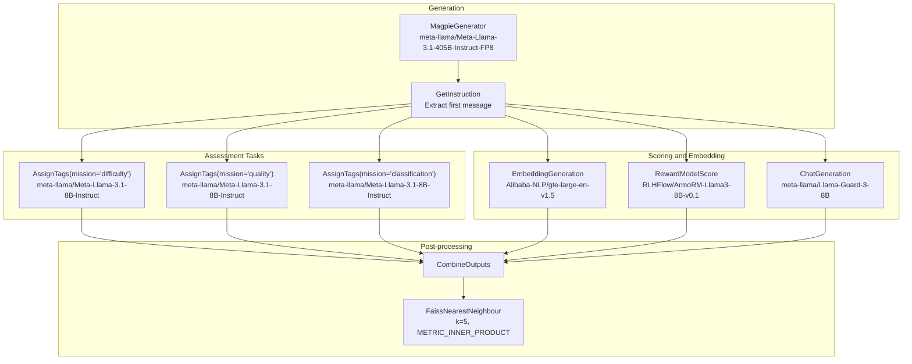
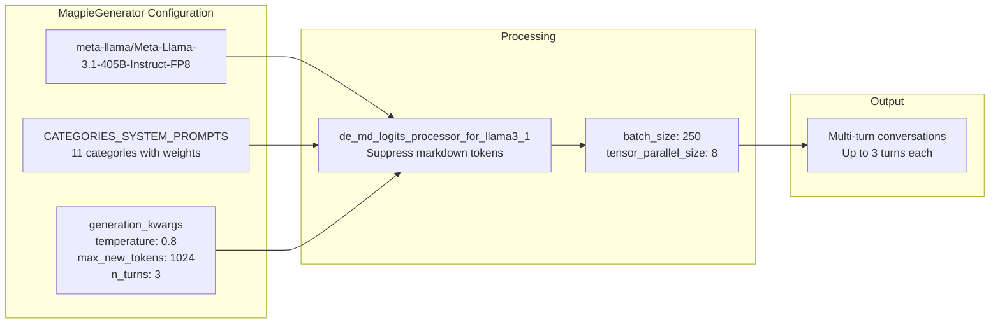
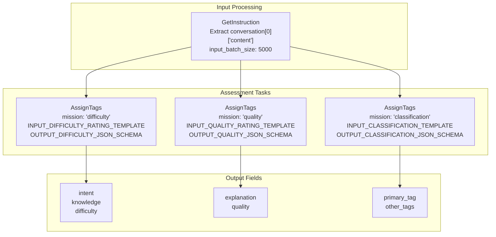
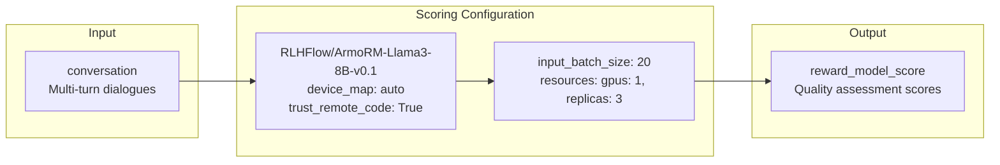
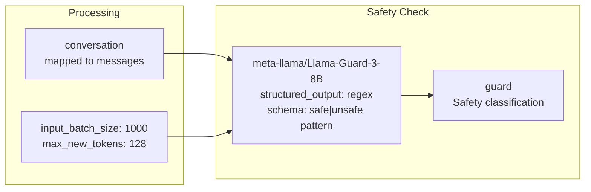
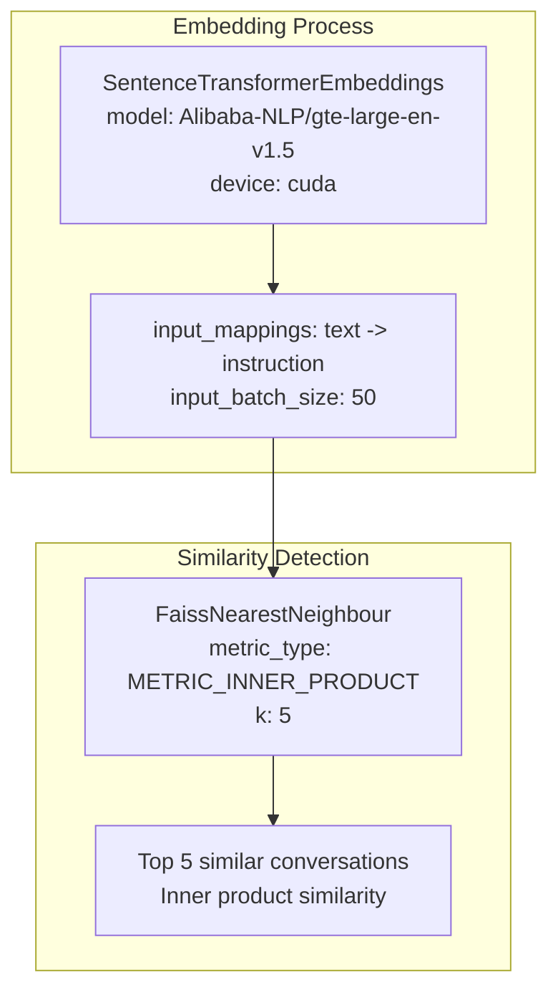
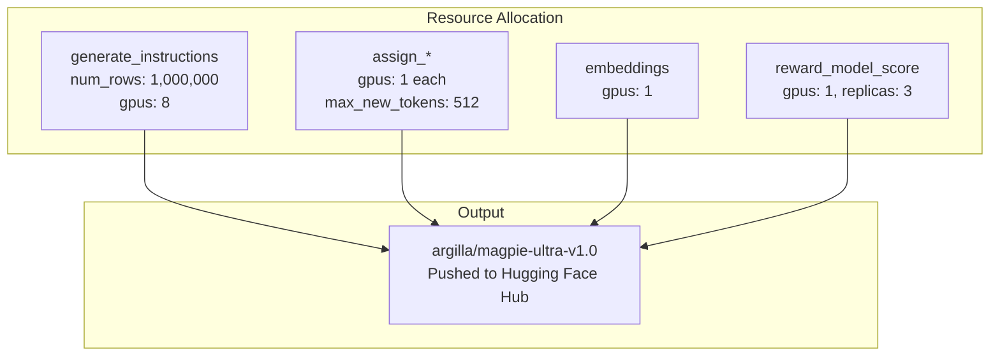

<!-- source: DeepWiki mcp.deepwiki.com · repo huggingface/smollm · page 5.4 SmolTalk Dataset · fetched 2026-10-26 -->

# SmolTalk Dataset

Relevant source files

The following files were used as context for generating this wiki page:

- [text/data/decontamination/README.md](text/data/decontamination/README.md)
- [text/data/fineweb-edu/README.md](text/data/fineweb-edu/README.md)
- [text/data/smoltalk/README.md](text/data/smoltalk/README.md)
- [text/data/smoltalk/magpie_ultra_v1/README.md](text/data/smoltalk/magpie_ultra_v1/README.md)
- [text/data/smoltalk/magpie_ultra_v1/pipeline.py](text/data/smoltalk/magpie_ultra_v1/pipeline.py)

This document covers the SmolTalk dataset, a supervised fine-tuning (SFT) dataset used for building SmolLM2 instruct models. SmolTalk was created using synthetic data generation pipelines built with the distilabel framework. The dataset consists of high-quality multi-turn conversations generated using Llama-3.1-405B-Instruct and includes comprehensive quality assessment and classification metadata.

For information about other datasets in the SmolLM ecosystem, see [FineMath Dataset](#5.2) and [FineWeb-Edu Dataset](#5.3). For details on how SmolTalk is used in model training, see [SmolLM2 Fine-tuning](#3.2).

## Dataset Overview

SmolTalk is a comprehensive instruction-tuning dataset that powers the conversational capabilities of SmolLM2 models. The dataset was generated using the MagPie (Machine-Generated Preference-Aligned Instruction Enhancement) approach, which creates synthetic multi-turn conversations across diverse task categories.

The dataset generation process involves several key components:
- **Conversation Generation**: Multi-turn dialogues created using system-specific prompts
- **Quality Assessment**: Automated scoring for conversation quality and difficulty
- **Content Classification**: Categorical tagging based on task types
- **Safety Filtering**: Content moderation using Llama Guard 3
- **Deduplication**: Nearest neighbor detection to avoid redundancy

**Sources**: [text/data/smoltalk/README.md:1-12](), [text/data/smoltalk/magpie_ultra_v1/README.md:1-11]()

## MagPie Ultra Pipeline Architecture

The MagPie Ultra v1.0 pipeline represents the core data generation system for SmolTalk. The pipeline orchestrates multiple components in a distributed processing workflow.

### Pipeline Components Overview

**Sources**: [text/data/smoltalk/magpie_ultra_v1/pipeline.py:464-641]()

### System Prompt Categories

The MagPie pipeline generates conversations across 11 distinct task categories, each with specialized system prompts designed to elicit high-quality responses in specific domains.

| Category | Weight | Purpose |
|----------|---------|---------|
| `information-seeking` | 0.05 | Factual information and explanations |
| `reasoning` | 0.125 | Logical thinking and problem-solving |
| `planning` | 0.05 | Strategy and organization assistance |
| `editing` | 0.10 | Text improvement and refinement |
| `coding` | 0.125 | Programming and debugging help |
| `math` | 0.125 | Mathematical concepts and calculations |
| `role-playing` | 0.10 | Character adoption and scenario engagement |
| `data-analysis` | 0.125 | Statistical interpretation and insights |
| `creative-writing` | 0.10 | Story and content creation |
| `advice-seeking` | 0.05 | Personal and professional guidance |
| `brainstorming` | 0.05 | Idea generation and exploration |

The system prompts are defined in the `CATEGORIES_SYSTEM_PROMPTS` dictionary, with each category receiving a specific probability weight for balanced dataset generation.

**Sources**: [text/data/smoltalk/magpie_ultra_v1/pipeline.py:215-227]()

## Data Generation Workflow

### Conversation Generation Process

The conversation generation begins with the `MagpieGenerator` component, which uses a 405B parameter Llama model to create multi-turn dialogues.

The generator includes a custom logits processor that suppresses markdown formatting tokens to ensure cleaner conversational output. The `de_md_logits_processor_for_llama3_1` function prevents the model from generating markdown headers and bold text.

**Sources**: [text/data/smoltalk/magpie_ultra_v1/pipeline.py:465-497](), [text/data/smoltalk/magpie_ultra_v1/pipeline.py:449-461]()

### Quality Assessment Pipeline

Each generated conversation undergoes comprehensive quality assessment through three parallel `AssignTags` tasks, each configured with different mission parameters.

The `AssignTags` class implements a flexible task framework that can handle different assessment types based on the `mission` parameter. Each mission uses specialized prompts and JSON schemas for structured output.

**Sources**: [text/data/smoltalk/magpie_ultra_v1/pipeline.py:400-447](), [text/data/smoltalk/magpie_ultra_v1/pipeline.py:499-547]()

## Content Scoring and Safety

### Reward Model Scoring

The pipeline incorporates `RewardModelScore` using the ArmoRM model for automated quality assessment of generated conversations.

### Safety Filtering

Content safety is ensured through `ChatGeneration` using Llama Guard 3, which classifies conversations as safe or unsafe according to predefined safety categories.

**Sources**: [text/data/smoltalk/magpie_ultra_v1/pipeline.py:560-583]()

## Deduplication and Similarity Detection

The pipeline implements sophisticated deduplication using `FaissNearestNeighbour` with sentence embeddings to identify similar conversations.

### Embedding Generation

The system uses the GTE-Large-EN model for generating high-quality embeddings, followed by FAISS indexing with inner product similarity for efficient nearest neighbor search.

**Sources**: [text/data/smoltalk/magpie_ultra_v1/pipeline.py:549-587]()

## Pipeline Execution and Output

### Distributed Processing Configuration

The pipeline supports distributed execution with specific resource allocation for each component:

The pipeline generates up to 1 million conversations with comprehensive metadata, including quality scores, difficulty ratings, task classifications, and safety assessments.

**Sources**: [text/data/smoltalk/magpie_ultra_v1/pipeline.py:605-641]()

## Integration with SmolLM Models

SmolTalk serves as the primary instruction-tuning dataset for SmolLM2 models, providing high-quality conversational examples that enhance the models' ability to follow instructions and engage in multi-turn dialogues. The dataset's comprehensive metadata enables selective training on high-quality samples and balanced representation across task categories.

The synthetic nature of SmolTalk, combined with its rigorous quality assessment pipeline, ensures that SmolLM2 models receive consistent, high-quality training data that improves their conversational abilities while maintaining safety and helpfulness standards.

**Sources**: [text/data/smoltalk/README.md:1-12]()

---

