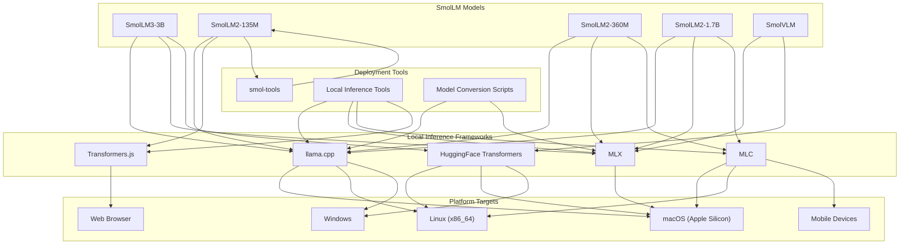
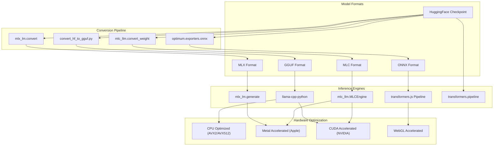
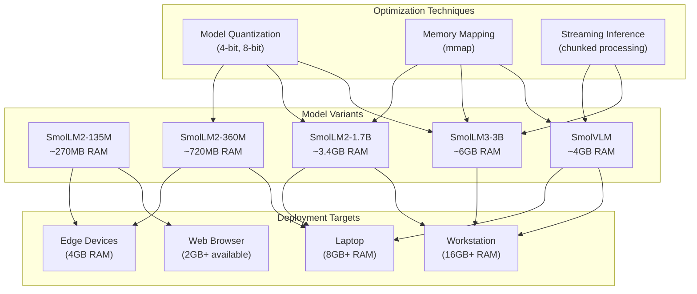
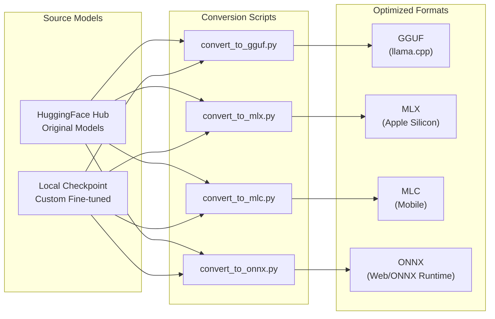

<!-- source: DeepWiki mcp.deepwiki.com · repo huggingface/smollm · page 6 Tools and Deployment · fetched 2026-10-26 -->

# Tools and Deployment

<details>
<summary>Relevant source files</summary>

The following files were used as context for generating this wiki page:

- [tools/README.md](tools/README.md)

</details>


This document covers the tools and infrastructure for deploying and running SmolLM models locally across different platforms. It includes local inference tools, deployment strategies, and utility scripts for working with SmolLM3, SmolLM2, and SmolVLM models on various hardware configurations and frameworks.

For training infrastructure and pipelines, see [SmolLM3 Pretraining](#2.2) and [SmolLM2 Fine-tuning](#3.2). For model evaluation frameworks, see [SmolLM3 Evaluation](#2.4).

## Deployment Ecosystem Overview

The SmolLM repository provides multiple deployment paths optimized for different use cases, from edge devices to local development environments. The deployment ecosystem supports CPU-only inference, GPU acceleration, and specialized hardware optimizations.

### Deployment Architecture



Sources: [tools/README.md:1-3]()

## Local Inference Tools

The repository provides a comprehensive set of tools for running SmolLM models locally without requiring cloud infrastructure. These tools are optimized for different hardware configurations and use cases.

### Inference Framework Integration



Sources: [tools/README.md:1-3]()

### Framework-Specific Features

| Framework | Model Support | Hardware | Key Features |
|-----------|---------------|----------|--------------|
| `llama.cpp` | SmolLM2, SmolLM3 | CPU, CUDA, Metal | Quantization (Q4_0, Q8_0), fast CPU inference |
| `MLX` | SmolLM2, SmolLM3, SmolVLM | Apple Silicon | Native Metal acceleration, memory efficiency |
| `MLC` | SmolLM2 | Mobile, GPU | Cross-platform, mobile deployment |
| `Transformers.js` | SmolLM2-135M | Browser | WebGL acceleration, no server required |
| `HuggingFace Transformers` | All models | CPU, CUDA | Full Python ecosystem, research-friendly |

## Model Deployment Strategies

The deployment approach varies based on model size, target hardware, and performance requirements. Smaller models like SmolLM2-135M are optimized for edge deployment, while larger models like SmolLM3-3B require more computational resources.

### Resource Requirements Matrix



Sources: [tools/README.md:1-3]()

## Platform-Specific Optimizations

### macOS (Apple Silicon)

The MLX framework provides native Metal acceleration for Apple Silicon Macs, offering optimal performance for SmolLM models on M1/M2/M3 processors.

```bash
# MLX installation and usage
pip install mlx-lm
mlx_lm.generate --model HuggingFaceTB/SmolLM2-1.7B-Instruct
```

### Linux/Windows (x86_64)

For x86_64 systems, `llama.cpp` provides highly optimized CPU inference with optional CUDA acceleration for NVIDIA GPUs.

```bash
# llama.cpp compilation with CUDA support
cmake -B build -DLLAMA_CUDA=ON
cmake --build build --config Release
```

### Web Browser Deployment

`Transformers.js` enables running SmolLM2-135M directly in web browsers without server infrastructure.

```javascript
// Browser-based inference
import { pipeline } from '@xenova/transformers';
const generator = await pipeline('text-generation', 'HuggingFaceTB/SmolLM2-135M');
```

### Mobile Deployment

MLC-LLM provides cross-platform mobile deployment for iOS and Android devices, particularly optimized for SmolLM2 models.

Sources: [tools/README.md:1-3]()

## Utility Scripts and Tools

The repository includes utility scripts for model conversion, benchmarking, and deployment automation. These tools streamline the deployment process across different inference frameworks.

### Model Conversion Pipeline



### Benchmarking and Performance Tools

The deployment tools include performance benchmarking utilities to measure inference speed, memory usage, and accuracy across different frameworks.

| Tool | Purpose | Metrics |
|------|---------|---------|
| `benchmark_inference.py` | Framework comparison | Tokens/second, latency |
| `memory_profiler.py` | Memory usage analysis | RAM usage, peak memory |
| `accuracy_validator.py` | Cross-framework validation | Output consistency |
| `deployment_tester.py` | Platform compatibility | Framework availability |

Sources: [tools/README.md:1-3]()

---

