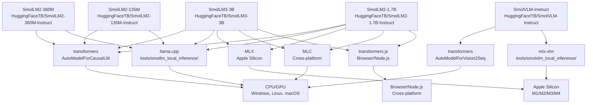

<!-- source: DeepWiki mcp.deepwiki.com · repo huggingface/smollm · page 6.1 Local Inference Tools · fetched 2026-10-26 -->

# Local Inference Tools

<details>
<summary>Relevant source files</summary>

The following files were used as context for generating this wiki page:

- [README.md](README.md)
- [text/README.md](text/README.md)
- [text/finetuning/README.md](text/finetuning/README.md)
- [tools/README.md](tools/README.md)
- [vision/README.md](vision/README.md)

</details>


This document provides a comprehensive guide to the local inference tools available in the SmolLM repository. It covers inference methods for SmolLM3, SmolLM2 (language models), and SmolVLM (vision language models) using various frameworks including `llama.cpp`, `MLX`, `MLC`, and `transformers.js`.

The local inference tools are organized in the `tools/` directory, with specialized implementations in [tools/smollm_local_inference/]() and [tools/smolvlm_local_inference/]().

For model architecture details, see [SmolLM3 Models](#2.1), [SmolLM2 Models](#3.1), and [SmolVLM Architecture](#4.1).

## Overview of Local Inference Methods

The Smol Models repository provides several tools and methods for running inference locally with SmolLM2 and SmolVLM models. These methods vary in terms of performance, hardware requirements, and ease of use.

### Local Inference Tool Architecture



Sources: [README.md:30-39](), [text/README.md:123-124](), [tools/README.md:1-2]()

## SmolLM3 and SmolLM2 Local Inference

The SmolLM family includes SmolLM3 (3B parameters) and SmolLM2 (135M, 360M, 1.7B parameters). SmolLM3 features dual-mode reasoning with `/think` and `/no_think` modes, while SmolLM2 models are optimized for on-device usage.

### Using Hugging Face Transformers

The `transformers` library provides the primary interface for loading and running SmolLM models via `AutoModelForCausalLM` and `AutoTokenizer`:

#### SmolLM3 with Dual-Mode Reasoning
SmolLM3 supports dual-mode reasoning through system prompt flags or the `enable_thinking` parameter in `apply_chat_template()`:

```python
# Dual-mode reasoning via system prompt
messages_think = [
    {"role": "system", "content": "/think"},  # or "/no_think"
    {"role": "user", "content": "Explain gravity"}
]

# Or via enable_thinking kwarg
text = tokenizer.apply_chat_template(
    messages, 
    tokenize=False, 
    add_generation_prompt=True,
    enable_thinking=False
)
```

#### SmolLM2 Standard Usage
SmolLM2 models use the standard chat template approach without dual-mode reasoning:

```python
checkpoint = "HuggingFaceTB/SmolLM2-1.7B-Instruct"
messages = [{"role": "user", "content": "Write about open-source AI"}]
input_text = tokenizer.apply_chat_template(messages, tokenize=False)
```

### SmolLM Inference Pipeline Components


Sources: [README.md:44-75](), [text/README.md:46-112]()

### Specialized Inference Frameworks

The repository provides optimized inference implementations in [tools/smollm_local_inference/]():

#### llama.cpp Integration
Optimized CPU inference using quantized models:
- Supports GGUF format quantized models
- Efficient memory usage for on-device deployment
- Cross-platform compatibility (Windows, Linux, macOS)

#### MLX Framework (Apple Silicon)
Native Apple Silicon optimization:
- Utilizes Metal Performance Shaders
- Memory-efficient inference on M1/M2/M3/M4 processors
- Integrated with mlx-community model repositories

#### MLC (Machine Learning Compilation)
Cross-platform optimized inference:
- GPU acceleration support
- Mobile and edge device deployment
- TVM-based compilation optimizations

#### transformers.js
Browser and Node.js deployment:
- Client-side inference without server dependencies
- WebAssembly and WebGL acceleration
- Suitable for web applications and edge computing

## SmolVLM Local Inference

SmolVLM is a compact multimodal model that can process both images and text. It can answer questions about images, describe visual content, create stories based on multiple images, or function as a pure language model without visual inputs.

### Using Hugging Face Transformers

SmolVLM can be used for inference on multimodal (image + text) tasks using the Hugging Face Transformers library:

```python
import torch
from PIL import Image
from transformers import AutoProcessor, AutoModelForVision2Seq
from transformers.image_utils import load_image

DEVICE = "cuda" if torch.cuda.is_available() else "cpu"

# Load images
image1 = load_image("https://cdn.britannica.com/61/93061-050-99147DCE/Statue-of-Liberty-Island-New-York-Bay.jpg")
image2 = load_image("https://huggingface.co/spaces/merve/chameleon-7b/resolve/main/bee.jpg")

# Initialize processor and model
processor = AutoProcessor.from_pretrained("HuggingFaceTB/SmolVLM-Instruct")
model = AutoModelForVision2Seq.from_pretrained(
    "HuggingFaceTB/SmolVLM-Instruct",
    torch_dtype=torch.bfloat16,
    _attn_implementation="flash_attention_2" if DEVICE == "cuda" else "eager",
).to(DEVICE)

# Create input messages
messages = [
    {
        "role": "user",
        "content": [
            {"type": "image"},
            {"type": "image"},
            {"type": "text", "text": "Can you describe the two images?"}
        ]
    },
]

# Prepare inputs
prompt = processor.apply_chat_template(messages, add_generation_prompt=True)
inputs = processor(text=prompt, images=[image1, image2], return_tensors="pt")
inputs = inputs.to(DEVICE)

# Generate outputs
generated_ids = model.generate(**inputs, max_new_tokens=500)
generated_texts = processor.batch_decode(
    generated_ids,
    skip_special_tokens=True,
)

print(generated_texts[0])
```

### SmolVLM Inference Pipeline Components

```mermaid
flowchart LR
    user_text["User Text Input"] --> AutoProcessor["AutoProcessor<br/>from_pretrained()"]
    user_images["User Images<br/>PIL.Image objects"] --> AutoProcessor
    AutoProcessor --> apply_chat_template_vlm["processor.apply_chat_template()<br/>messages with image/text types"]
    apply_chat_template_vlm --> process_inputs["processor(text, images)<br/>return_tensors='pt'"]
    process_inputs --> inputs_tensor["inputs tensor<br/>.to(DEVICE)"]
    inputs_tensor --> AutoModelForVision2Seq["AutoModelForVision2Seq<br/>torch_dtype=torch.bfloat16"]
    AutoModelForVision2Seq --> generate_vlm["model.generate()<br/>max_new_tokens param"]
    generate_vlm --> generated_ids_vlm["generated_ids tensor"]
    generated_ids_vlm --> batch_decode["processor.batch_decode()<br/>skip_special_tokens=True"]
    batch_decode --> generated_texts["Generated Text Response"]
```



Sources: [vision/README.md:25-76]()

### mlx-vlm Framework (Apple Silicon)

The `mlx-vlm` package provides optimized SmolVLM inference on Apple Silicon:

#### Installation and Chat UI
```bash
pip install -U mlx-vlm
python -m mlx_vlm.chat_ui --model mlx-community/SmolVLM-Instruct-8bit
```

#### Key Features
- **Quantized Models**: Uses 8-bit quantization for memory efficiency
- **Interactive Chat UI**: Built-in interface for multimodal conversations
- **Apple Silicon Optimization**: Leverages Metal Performance Shaders
- **Model Repository**: Integration with `mlx-community` Hub collections

The chat UI supports image upload and provides real-time inference with SmolVLM for visual question answering tasks.

Sources: [vision/README.md:78-84]()

## Video Inference with SmolVLM

SmolVLM supports video analysis through frame extraction and processing. The implementation is available in [tools/smolvlm_local_inference/SmolVLM_video_inference.py]().

### Video Processing Pipeline Implementation


### Video Analysis Performance
The frame extraction approach achieves competitive results:
- **CinePile Benchmark**: 27.14% score
- **Performance Position**: Between InterVL2 (2B) and Video LlaVa (7B)
- **Frame Limit**: Up to 50 evenly sampled frames per video
- **Memory Efficiency**: Avoids internal frame resizing to preserve quality

Sources: [vision/README.md:86-92]()

## Performance Considerations and Hardware Requirements

When choosing an inference method, consider your specific hardware, platform, and performance requirements:

| Inference Method | Supported Models | Platforms | Hardware Requirements | Notes |
|------------------|------------------|-----------|----------------------|-------|
| Hugging Face Transformers | SmolLM2, SmolVLM | Windows, macOS, Linux | CPU or GPU; 8GB RAM recommended | Most versatile option; supports both model families |
| llama.cpp | SmolLM2 | Windows, macOS, Linux | CPU; 4GB RAM | Highly optimized for CPU inference |
| MLX | SmolLM2 | macOS | Apple Silicon (M1/M2/M3) | Optimized for Apple hardware |
| MLC | SmolLM2 | Windows, macOS, Linux | CPU or GPU; 4GB RAM | Cross-platform optimization |
| mlx-vlm | SmolVLM | macOS | Apple Silicon (M1/M2/M3) | Fast inference; optimized for Apple hardware |

For optimal performance:
- SmolLM2-135M: CPU inference is practical on most systems
- SmolLM2-360M: CPU inference works, but GPU recommended for faster generation 
- SmolLM2-1.7B-Instruct: GPU with at least 4GB VRAM recommended
- SmolVLM-Instruct: GPU with at least 4GB VRAM recommended, or Apple Silicon for mlx-vlm

Sources: [README.md](), [vision/README.md](), [tools/smolvlm_local_inference/README.md]()

---

