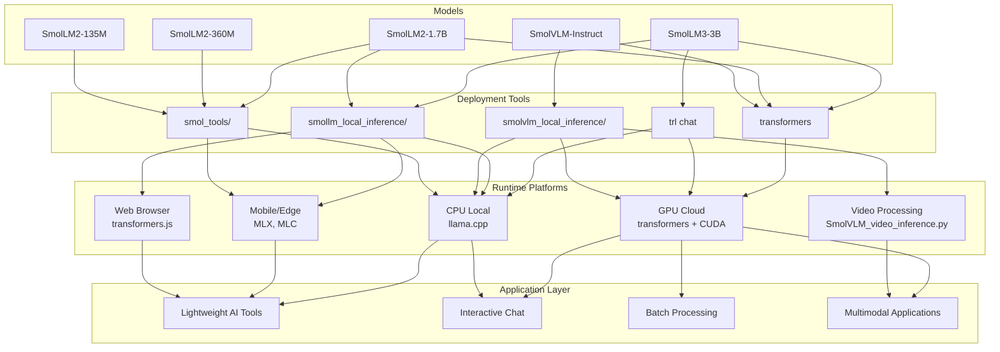
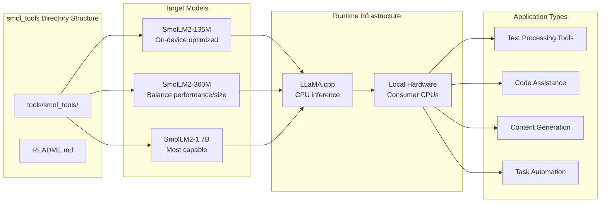
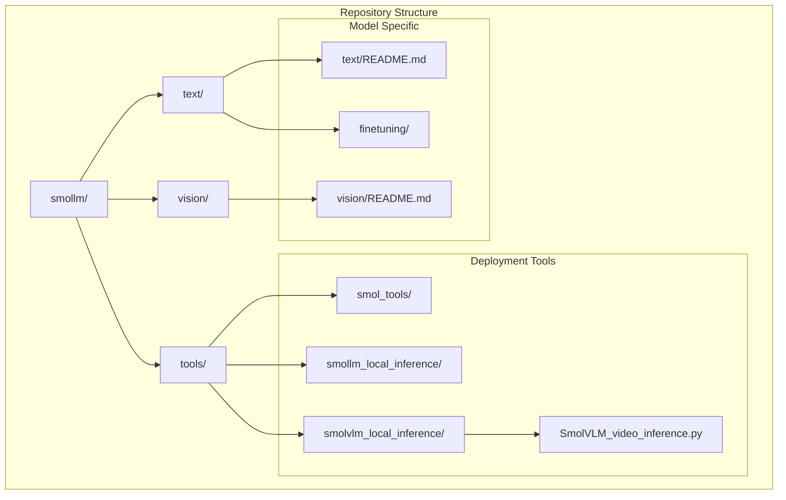

<!-- source: DeepWiki mcp.deepwiki.com · repo huggingface/smollm · page 6.2 Model Deployment · fetched 2026-10-26 -->

# Model Deployment

<details>
<summary>Relevant source files</summary>

The following files were used as context for generating this wiki page:

- [README.md](README.md)
- [text/README.md](text/README.md)
- [text/finetuning/README.md](text/finetuning/README.md)
- [tools/README.md](tools/README.md)
- [vision/README.md](vision/README.md)

</details>


This page covers deployment strategies, tools, and platform-specific optimizations for SmolLM models in production and development environments. It focuses on the architectural patterns and deployment ecosystem surrounding SmolLM3, SmolLM2, and SmolVLM models.

For technical details on running models locally with specific inference frameworks, see [Local Inference Tools](#6.1). For training and fine-tuning deployment, see [SmolLM3 Post-training](#2.3) and [SmolLM2 Fine-tuning](#3.2).

## Deployment Architecture Overview

The SmolLM ecosystem supports multiple deployment strategies ranging from cloud-based inference to on-device applications. The architecture is designed around modularity and efficiency, with different deployment paths optimized for specific use cases.



Sources: [README.md:30-39](), [text/README.md:41-129](), [vision/README.md:16-91]()

## smol-tools Ecosystem

The `smol-tools` collection provides lightweight AI-powered utilities designed for local deployment without requiring expensive GPU resources. This ecosystem is specifically tailored for the smaller SmolLM2 models that can run efficiently on consumer hardware.



Sources: [README.md:36](), [text/README.md:126-128]()

## Platform-Specific Deployment Options

Different SmolLM models are optimized for specific deployment scenarios based on computational constraints and performance requirements.

| Model | Primary Use Case | Deployment Platforms | Key Optimizations |
|-------|------------------|---------------------|-------------------|
| SmolLM3-3B | High-performance chat, reasoning | GPU cloud, high-end local | Dual-mode reasoning, long context |
| SmolLM2-1.7B | General-purpose assistant | GPU/CPU local, edge devices | Balance of capability and efficiency |
| SmolLM2-360M | Lightweight applications | Mobile, embedded, web | Minimal memory footprint |
| SmolLM2-135M | Ultra-lightweight tasks | IoT, constrained environments | Maximum efficiency |
| SmolVLM | Multimodal applications | GPU local/cloud, video processing | Vision-language integration |

Sources: [text/README.md:32-43](), [README.md:15-30]()

### Transformers Integration

The primary deployment method uses the `transformers` library for direct model loading and inference. This provides the most straightforward deployment path with full feature support.

Key deployment patterns from [text/README.md:51-112]():

- **Standard Inference**: Using `AutoModelForCausalLM` and `AutoTokenizer`
- **Dual-Mode Reasoning**: SmolLM3 supports `/think` and `/no_think` system prompts
- **Chat Template Integration**: Leveraging `apply_chat_template` for conversation formatting
- **Device Optimization**: Automatic GPU/CPU selection based on availability

### TRL Chat Interface

The TRL (Transformers Reinforcement Learning) library provides a command-line chat interface for interactive deployment scenarios.

Deployment command from [text/README.md:117-118]():
```bash
trl chat --model_name_or_path HuggingFaceTB/SmolLM2-1.7B-Instruct --device cpu
```

Sources: [text/README.md:114-121]()

### MLX-VLM Integration

For SmolVLM deployment on Apple Silicon, the `mlx-vlm` framework provides optimized inference capabilities.

Deployment pattern from [vision/README.md:78-84]():
```bash
pip install -U mlx-vlm
python -m mlx_vlm.chat_ui --model mlx-community/SmolVLM-Instruct-8bit
```

## Deployment Strategies by Use Case

### On-Device Applications

Small SmolLM2 models (135M, 360M) are specifically designed for on-device deployment where computational resources are limited.

**Recommended Architecture:**
- Model: SmolLM2-135M or SmolLM2-360M
- Runtime: `llama.cpp` for CPU optimization
- Tools: `smol_tools` ecosystem
- Target: Consumer hardware without GPU requirements

### Cloud-Based Services

Larger models (SmolLM3-3B, SmolLM2-1.7B) provide enhanced capabilities suitable for cloud deployment scenarios.

**Recommended Architecture:**
- Model: SmolLM3-3B or SmolLM2-1.7B-Instruct  
- Runtime: `transformers` with CUDA support
- Interface: TRL chat or custom API endpoints
- Target: GPU-accelerated cloud instances

### Multimodal Applications

SmolVLM enables vision-language applications with specialized deployment considerations.

**Video Processing Pipeline:**
The video inference capability uses a frame sampling approach implemented in `SmolVLM_video_inference.py`:
- Extracts up to 50 evenly sampled frames
- Avoids internal frame resizing for better performance
- Achieves competitive results on CinePile benchmark (27.14%)

Sources: [vision/README.md:86-90]()

### Web Browser Deployment

The `transformers.js` integration enables client-side model deployment for web applications.

**Architecture Characteristics:**
- Model: Quantized SmolLM2 variants
- Runtime: WebAssembly/WebGPU through transformers.js
- Benefits: No server dependency, privacy preservation
- Limitations: Model size constraints, browser compatibility

Sources: [text/README.md:124]()

## Integration Patterns

### Repository Structure for Deployment

The SmolLM repository organizes deployment tools in a modular structure:



Sources: [README.md:30-39](), [tools/README.md:1-3]()

### Cross-Platform Compatibility

The deployment ecosystem supports multiple platforms through standardized interfaces:

| Framework | Platform Support | Model Compatibility | Use Case |
|-----------|------------------|-------------------|-----------|
| `transformers` | Linux, Windows, macOS | All SmolLM variants | Development, prototyping |
| `llama.cpp` | Cross-platform | SmolLM2, SmolLM3 | Production deployment |
| `MLX` | Apple Silicon | All variants | macOS optimization |
| `MLC` | Mobile platforms | Quantized variants | Mobile applications |
| `transformers.js` | Web browsers | Quantized SmolLM2 | Client-side inference |

The modular design enables developers to choose appropriate deployment strategies based on their specific requirements while maintaining consistent model behavior across platforms.

Sources: [text/README.md:124](), [vision/README.md:78-84]()