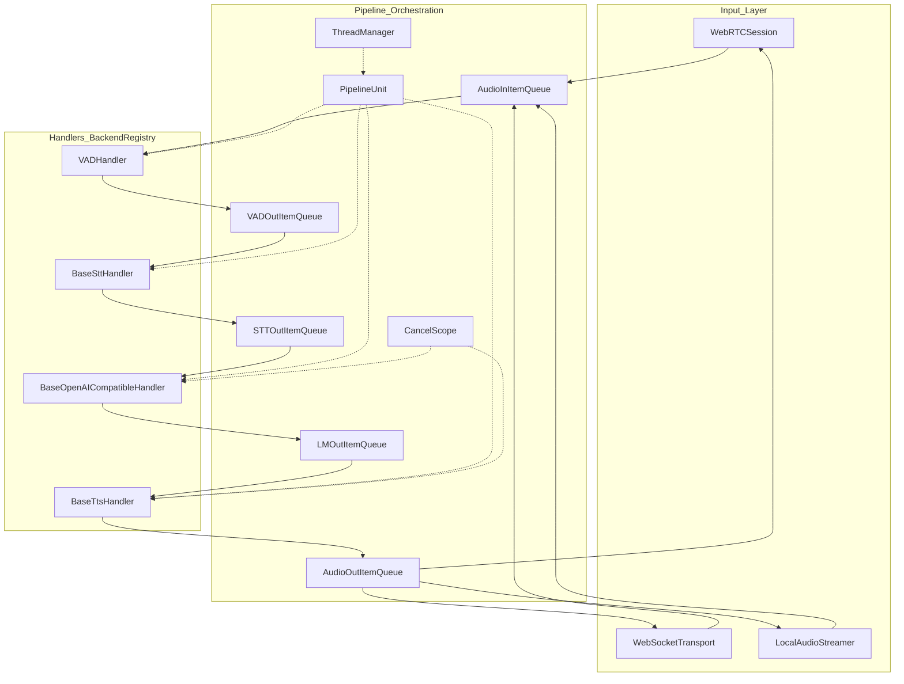
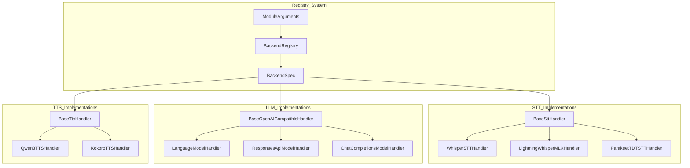

<!-- source: DeepWiki mcp.deepwiki.com · repo huggingface/speech-to-speech · page 1 Overview · fetched 2026-10-26 -->

# Overview

Relevant source files

The following files were used as context for generating this wiki page:

- [AGENTS.md](AGENTS.md)
- [README.md](README.md)
- [docs/releases/v1.0.0.md](docs/releases/v1.0.0.md)
- [pyproject.toml](pyproject.toml)
- [src/speech_to_speech/__init__.py](src/speech_to_speech/__init__.py)
- [src/speech_to_speech/arguments_classes/module_arguments.py](src/speech_to_speech/arguments_classes/module_arguments.py)
- [src/speech_to_speech/s2s_pipeline.py](src/speech_to_speech/s2s_pipeline.py)
- [tests/test_cli_defaults.py](tests/test_cli_defaults.py)

## Purpose and Scope

This document provides a high-level introduction to the speech-to-speech system, an open-source, modular pipeline that enables real-time conversational AI by processing audio input through voice activity detection, speech recognition, language model inference, and speech synthesis [README.md:17](). It is designed as a flexible, low-latency alternative to closed systems, featuring pluggable backends and an OpenAI Realtime-compatible API layer [README.md:17]().

**Scope of this document:** This page covers the system's high-level architecture, cascaded pipeline stages, deployment modes, hardware targets, and the OpenAI Realtime compatibility layer. For installation instructions, environment setup, and CLI usage, see [Getting Started](#1.1). For dependency layouts and platform-conditional stacks, see [Dependencies and Requirements](#1.2).

Sources: [README.md:17](), [src/speech_to_speech/arguments_classes/module_arguments.py:1-104]()

## System Purpose and Capabilities

The speech-to-speech system implements a cascaded processing pipeline designed for real-time voice interactions:

- **Audio Ingestion:** Accepts live audio input via WebSocket (OpenAI Realtime API), WebRTC, or local sound device streams [src/speech_to_speech/s2s_pipeline.py:173-174](), [README.md:31-46]().
- **Voice Activity Detection (VAD):** Segments continuous microphone audio into discrete speech utterances using `VADHandler` powered by Silero VAD v5 [src/speech_to_speech/VAD/vad_handler.py:1-50](), [README.md:85]().
- **Speech-to-Text (STT):** Transcribes speech utterances into text using models such as Parakeet TDT or Whisper [README.md:161-171]().
- **Language Model (LLM):** Processes transcribed text to generate contextual assistant responses, supporting tool calling and conversation compaction [README.md:87](), [src/speech_to_speech/arguments_classes/module_arguments.py:35-41]().
- **Text-to-Speech (TTS):** Converts text responses into streaming PCM audio chunks using engines like Qwen3-TTS or Kokoro [README.md:88](), [README.md:104]().

**Design Principles:**
- **Modularity:** Each stage is managed by `BackendRegistry` and supports swappable backend implementations [src/speech_to_speech/backend_registry.py:29-37](), [README.md:17]().
- **Concurrency & Interruption:** Coordinated by `ThreadManager` and `CancelScope`, enabling low-latency "barge-in" handling where assistant speech halts immediately when user speech is detected [src/speech_to_speech/s2s_pipeline.py:51](), [src/speech_to_speech/pipeline/cancel_scope.py:38]().

Sources: [README.md:17-19](), [src/speech_to_speech/backend_registry.py:29-37](), [src/speech_to_speech/arguments_classes/module_arguments.py:13-94]()

## High-Level Architecture

The system is initialized and orchestrated by `s2s_pipeline.py`, routing data between threads via typed queues and pipeline units [src/speech_to_speech/s2s_pipeline.py:21-55]().

### Pipeline Data Flow and Code Entities

The diagram below bridges natural language pipeline concepts to their concrete code entities in the codebase.

**Figure 1: Pipeline Data Flow and Code Entities**

Sources: [src/speech_to_speech/s2s_pipeline.py:21-55](), [src/speech_to_speech/pipeline/queue_types.py:39-46](), [src/speech_to_speech/pipeline/cancel_scope.py:38]()

### Component Registry and Handler Hierarchy

Model selection and instantiation are handled dynamically through the backend registry pattern.

**Figure 2: Component Registry and Handler Hierarchy**

Sources: [src/speech_to_speech/backend_registry.py:29-37](), [src/speech_to_speech/arguments_classes/module_arguments.py:13-94]()

## Deployment Modes

The system provides three primary CLI commands for running the pipeline [pyproject.toml:116-117](), [docs/releases/v1.0.0.md:9-11]():

1. **Serve (`speech-to-speech serve`):** Starts a FastAPI server exposing the OpenAI Realtime API via WebSockets (`/v1/realtime`) and WebRTC (`/v1/realtime/calls`) [docs/releases/v1.0.0.md:9-11]().
2. **Talk (`speech-to-speech talk`):** A command-line client connecting to a running server instance over WebSocket with local microphone and speaker capture [docs/releases/v1.0.0.md:9-11]().
3. **Local (`speech-to-speech local`):** Runs both the server and the audio client in-process over a local loopback connection, ideal for desktop usage [docs/releases/v1.0.0.md:9-11]().

**OpenAI Realtime Compatibility Layer:**
The server implements the core OpenAI Realtime GA event set over WebSockets and WebRTC, enabling drop-in compatibility with existing Realtime clients, SDKs, and browser demo applications [README.md:17](), [docs/releases/v1.0.0.md:16-19]().

Sources: [README.md:17](), [pyproject.toml:116-117](), [docs/releases/v1.0.0.md:9-28]()

## Hardware Targets

- **Apple Silicon (Mac):** Optimized via the **MLX** framework (`mlx-lm`, `mlx-audio`, `lightning-whisper-mlx`) utilizing unified memory and MPS execution [src/speech_to_speech/s2s_pipeline.py:76-92](), [pyproject.toml:59-67]().
- **NVIDIA (Linux/CUDA):** Utilizes PyTorch CUDA acceleration and GGML/CUDA runtimes (`faster-qwen3-tts`) for high throughput [README.md:71-84](), [pyproject.toml:53-56]().
- **CPU Fallback:** Fully supported across components for testing or constrained environments [README.md:123-124]().

Sources: [src/speech_to_speech/s2s_pipeline.py:76-92](), [README.md:71-124](), [pyproject.toml:33-68]()

## Child Pages

For detailed information on getting started and dependencies, refer to the child pages:
- [Getting Started](#1.1)
- [Dependencies and Requirements](#1.2)

Sources: [README.md:29-105](), [pyproject.toml:27-110]()

---

