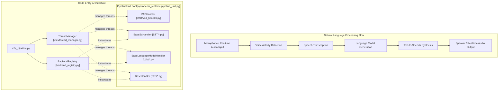

<!-- source: DeepWiki mcp.deepwiki.com · repo huggingface/speech-to-speech · page 2 Architecture · fetched 2026-10-26 -->

# Architecture

Relevant source files

The following files were used as context for generating this wiki page:

- [src/speech_to_speech/arguments_classes/module_arguments.py](src/speech_to_speech/arguments_classes/module_arguments.py)
- [src/speech_to_speech/pipeline/__init__.py](src/speech_to_speech/pipeline/__init__.py)
- [src/speech_to_speech/s2s_pipeline.py](src/speech_to_speech/s2s_pipeline.py)
- [tests/test_cli_defaults.py](tests/test_cli_defaults.py)

## Purpose and Scope

This page provides a high-level overview of the speech-to-speech system's overall architecture, core design patterns, and structural layers. It connects the natural language data flow to the underlying code entities. 

Because this is a parent page, technical details are summarized briefly with links to dedicated child pages:
- [Pipeline Orchestration](#2.1) — How `s2s_pipeline.py` builds and runs the pipeline, including argument parsing, `PipelineUnit` pools, concurrency limits, and thread lifecycles.
- [Threading and Concurrency](#2.2) — Multi-threaded coordination using `ThreadManager`, `stop_event`, `CancelScope` generation counters for barge-in, and MLX synchronization.
- [Queue-Based Communication](#2.3) — Typed `PipelineEvent` hierarchies, `PipelineMessage` types, control sentinels (`PIPELINE_END`/`SESSION_END`), and side channels.
- [Handler Plugin System and Backend Registry](#2.4) — `BaseHandler` lifecycle, `BackendSpec`, `BackendKind`, `HandlerContext`, and lazy module loading across STT, LLM, and TTS registries.
- [Speculative Turns and Turn Management](#2.5) — Deep dive into `SpeculativeTurnTracker`, turn revisions, reopen grace windows, and stale event discarding.

Sources: [src/speech_to_speech/s2s_pipeline.py:1-52]()

## System Overview

The speech-to-speech system implements a cascaded producer-consumer pipeline architecture where audio and text flow through sequential processing stages: Voice Activity Detection (VAD), Speech-to-Text (STT), Language Model (LLM), and Text-to-Speech (TTS). The application is orchestrated by `s2s_pipeline.py` [src/speech_to_speech/s2s_pipeline.py:1-52](), utilizing a dynamic `BackendRegistry` [src/speech_to_speech/backend_registry.py:1-40]() and managed concurrency via `ThreadManager` [src/speech_to_speech/utils/thread_manager.py:9-12]().

**Key Architectural Characteristics:**

| Characteristic | Implementation | Code Pointer |
|----------------|----------------|--------------|
| **Pipeline Concurrency** | Multi-threaded pipeline workers | [src/speech_to_speech/utils/thread_manager.py:9-39]() |
| **Component Selection** | Dynamic backend registries | [src/speech_to_speech/backend_registry.py:149-193]() |
| **Inter-stage Transport** | Python thread-safe `Queue` and typed messages | [src/speech_to_speech/pipeline/queue_types.py:1-46]() |
| **Interruption & Barge-In** | `CancelScope` generation counters | [src/speech_to_speech/pipeline/cancel_scope.py:1-30]() |

Sources: [src/speech_to_speech/s2s_pipeline.py:1-52](), [src/speech_to_speech/backend_registry.py:1-193](), [src/speech_to_speech/utils/thread_manager.py:9-39]()

---

## Core Architectural Subsystems

### Pipeline Orchestration
The pipeline is initialized and coordinated from `s2s_pipeline.py`. It handles configuration parsing via `HfArgumentParser`, instantiates handler instances through the backend registry, and manages pool instances (`PipelineUnit`). 

For details, see [Pipeline Orchestration](#2.1).

Sources: [src/speech_to_speech/s2s_pipeline.py:1-190]()

### Threading and Concurrency
Handlers operate concurrently in dedicated background threads managed by `ThreadManager`. Coordination relies on shared `threading.Event` objects (`stop_event`) and `CancelScope` counters to handle rapid user barge-in requests and stale generation cancellation.

For details, see [Threading and Concurrency](#2.2).

Sources: [src/speech_to_speech/utils/thread_manager.py:9-39]()

### Queue-Based Communication
Sequential stages communicate via thread-safe queues transporting strongly-typed items defined in the `pipeline` package. Control flow utilizes designated sentinels such as `PIPELINE_END` and `SESSION_END`.

For details, see [Queue-Based Communication](#2.3).

Sources: [src/speech_to_speech/pipeline/queue_types.py:1-46]()

### Handler Plugin System and Backend Registry
Handlers inherit from `BaseHandler` and implement setup, warmup, process, and cleanup lifecycle hooks. The backend registry maps string selectors (e.g., `"parakeet-tdt"`, `"mlx-lm"`, `"qwen3"`) to implementation specs via `BackendSpec` and `HandlerContext`.

For details, see [Handler Plugin System and Backend Registry](#2.4).

Sources: [src/speech_to_speech/backend_registry.py:1-193]()

### Speculative Turns and Turn Management
The `SpeculativeTurnTracker` coordinates turn IDs, revision numbers, reopen candidates, and grace windows across STT, LLM, and Realtime service layers to safely discard stale asynchronous events.

For details, see [Speculative Turns and Turn Management](#2.5).

Sources: [src/speech_to_speech/pipeline/speculative_turns.py:1-50]()

---

