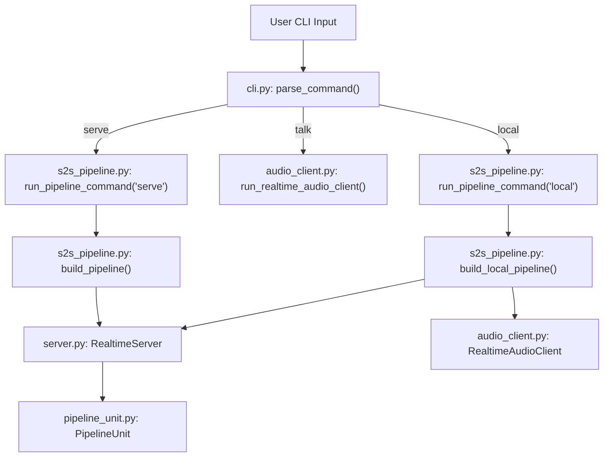
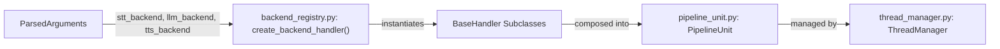

<!-- source: DeepWiki mcp.deepwiki.com · repo huggingface/speech-to-speech · page 2.1 Pipeline Orchestration · fetched 2026-10-26 -->

# Pipeline Orchestration

Relevant source files

The following files were used as context for generating this wiki page:

- [src/speech_to_speech/api/openai_realtime/pipeline_unit.py](src/speech_to_speech/api/openai_realtime/pipeline_unit.py)
- [src/speech_to_speech/arguments_classes/local_audio_arguments.py](src/speech_to_speech/arguments_classes/local_audio_arguments.py)
- [src/speech_to_speech/arguments_classes/module_arguments.py](src/speech_to_speech/arguments_classes/module_arguments.py)
- [src/speech_to_speech/cli.py](src/speech_to_speech/cli.py)
- [src/speech_to_speech/pipeline/transcript_logging.py](src/speech_to_speech/pipeline/transcript_logging.py)
- [src/speech_to_speech/s2s_pipeline.py](src/speech_to_speech/s2s_pipeline.py)
- [tests/openai_realtime/test_pipeline_builder.py](tests/openai_realtime/test_pipeline_builder.py)
- [tests/test_cli_defaults.py](tests/test_cli_defaults.py)
- [tests/test_transcript_log_hygiene.py](tests/test_transcript_log_hygiene.py)

## Purpose and Scope

This document details how [src/speech_to_speech/s2s_pipeline.py]() orchestrates the entire speech-to-speech execution flow. It covers argument parsing (`parse_arguments`), pipeline construction (`build_pipeline` and `build_local_pipeline`), handler assembly (`_build_handlers`), the `PipelineUnit` pool abstraction for multi-tenant concurrency (`num_pipelines`), thread lifecycle management via `ThreadManager`, and operational signal handling.

For details on thread synchronization, see [2.2 Threading and Concurrency](). For information on queue communication, see [2.3 Queue-Based Communication](). For plugin and registry mechanisms, see [2.4 Handler Plugin System and Backend Registry]().

Sources: [src/speech_to_speech/s2s_pipeline.py:1-696]()

## Overview

The [src/speech_to_speech/s2s_pipeline.py]() module serves as the core orchestration coordinator for runtime execution. Its primary responsibilities include:
- Parsing and validating configuration arguments via `HfArgumentParser` and backend registries [src/speech_to_speech/s2s_pipeline.py:100-190]() [src/speech_to_speech/arguments_classes/module_arguments.py:1-104]().
- Dispatching execution flows across CLI commands (`serve`, `talk`, `local`) [src/speech_to_speech/cli.py:18-35]().
- Instantiating and wiring processing handler chains (VAD, STT, LLM, TTS) into isolated `PipelineUnit` pools [src/speech_to_speech/api/openai_realtime/pipeline_unit.py:53-76]().
- Managing thread lifecycles using `ThreadManager` [src/speech_to_speech/utils/thread_manager.py:9-39]().
- Handling OS signals for graceful shutdown [src/speech_to_speech/s2s_pipeline.py:657-673]().

Sources: [src/speech_to_speech/s2s_pipeline.py:1-696](), [src/speech_to_speech/cli.py:1-35](), [src/speech_to_speech/arguments_classes/module_arguments.py:1-104]()

## CLI Commands and Entry Points

The top-level entry point [src/speech_to_speech/cli.py]() parses user intents and dispatches them to appropriate execution routines.

| Command | Function | Target Entity | Description |
|:---|:---|:---|:---|
| `serve` | `run_pipeline_command` | `RealtimeServer` / `RealtimeService` | Starts a FastAPI/uvicorn server hosting a pool of isolated `PipelineUnit` instances [src/speech_to_speech/api/openai_realtime/pipeline_unit.py:53-76](). |
| `talk` | `run_realtime_audio_client` | `RealtimeAudioClient` | Connects local audio hardware (mic/speaker) to a running `serve` endpoint [src/speech_to_speech/cli.py:98-170](). |
| `local` | `run_pipeline_command` | `build_local_pipeline` | In-process execution of both server pool and local loopback audio client [src/speech_to_speech/s2s_pipeline.py:636-654](). |

### CLI to Code Entity Mapping
This diagram maps user-facing CLI commands directly to the underlying Python functions and classes responsible for their execution.

Sources: [src/speech_to_speech/cli.py:18-95](), [src/speech_to_speech/s2s_pipeline.py:593-654]()

## Argument Parsing and Configuration

The `parse_arguments` function in [src/speech_to_speech/s2s_pipeline.py:175-230]() processes raw command-line arguments or JSON config files. It uses [src/speech_to_speech/arguments_classes/module_arguments.py]() and backend-specific argument dataclasses via `HfArgumentParser`.

- **Platform Presets**: On macOS, `_mac_preset_defaults` injects platform-optimized defaults (such as `mlx-lm` and `mps` device targets) unless explicitly overridden [src/speech_to_speech/s2s_pipeline.py:81-97]().
- **Inactive Backend Handling**: `_parse_selected_cli_configs` parses active component settings while gracefully absorbing or ignoring arguments belonging to unselected backends [src/speech_to_speech/s2s_pipeline.py:135-173]().

Sources: [src/speech_to_speech/s2s_pipeline.py:81-230](), [src/speech_to_speech/arguments_classes/module_arguments.py:1-104]()

## Pipeline Construction and Component Wiring

Pipelines are assembled by constructing isolated units containing instances of VAD, STT, LLM, and TTS handlers linked together via thread-safe queues.

### Pipeline Construction Flow
The following diagram illustrates how argument specs are transformed into instantiated handlers and queued interconnects within [src/speech_to_speech/s2s_pipeline.py]().

Sources: [src/speech_to_speech/s2s_pipeline.py:243-329](), [src/speech_to_speech/backend_registry.py:173-201]()

- **`_build_handlers`**: Instantiates the complete sequence of handlers—including `VADHandler`, STT handlers, `TranscriptionNotifier`, LLM handlers, `LMOutputProcessor`, and TTS handlers—wiring their input/output queues [src/speech_to_speech/s2s_pipeline.py:243-329]().
- **`build_pipeline`**: Constructs a collection of `PipelineUnit` instances according to `num_pipelines`, wrapping them into a `RealtimeServer` managed by a `ThreadManager` [src/speech_to_speech/s2s_pipeline.py:593-633]().
- **`build_local_pipeline`**: Extends local execution by composing the server pool with a loopback `RealtimeAudioClient` connected via sounddevice streams [src/speech_to_speech/s2s_pipeline.py:636-654]() [src/speech_to_speech/arguments_classes/local_audio_arguments.py:1-45]().

Sources: [src/speech_to_speech/s2s_pipeline.py:243-329](), [src/speech_to_speech/s2s_pipeline.py:593-654](), [src/speech_to_speech/arguments_classes/local_audio_arguments.py:1-45]()

## PipelineUnit Pool and Concurrency

To support multiple simultaneous clients without state interference, the system maintains a pool of `PipelineUnit` objects [src/speech_to_speech/api/openai_realtime/pipeline_unit.py:53-76]().

- **`num_pipelines`**: Controls the size of the unit pool. Each unit maintains dedicated queues (`input_queue`, `output_queue`, `text_output_queue`, `text_prompt_queue`), synchronization primitives (`should_listen`, `response_playing`, `cancel_scope`), and handler instances [src/speech_to_speech/api/openai_realtime/pipeline_unit.py:53-76]() [src/speech_to_speech/arguments_classes/module_arguments.py:96-104]().
- **Claim and Release**: When a client connects via WebSocket or WebRTC, the server claims the next available free unit (`session is None`). Upon disconnection, the unit is drained, reset, and returned to the pool [src/speech_to_speech/api/openai_realtime/pipeline_unit.py:13-51]().

Sources: [src/speech_to_speech/api/openai_realtime/pipeline_unit.py:13-76](), [src/speech_to_speech/arguments_classes/module_arguments.py:96-104]()

## Lifecycle Management and Signal Handling

### ThreadManager
The `ThreadManager` class [src/speech_to_speech/utils/thread_manager.py:9-39]() oversees background execution threads:
- **`start()`**: Spawns independent threads for each pipeline handler targeting their `run()` methods [src/speech_to_speech/utils/thread_manager.py:18-23]().
- **`stop()`**: Sets a coordination stop event (`stop_event`) and joins all worker threads with defined timeouts to ensure clean resource release [src/speech_to_speech/utils/thread_manager.py:29-39]().

### Signal Handling
Graceful shutdown during execution is managed via OS signal handlers registered in [src/speech_to_speech/s2s_pipeline.py:657-673](). Upon receiving `SIGINT` or `SIGTERM`, the orchestrator triggers the stop event, signals the active `RealtimeServer` to drain and close, and waits for `ThreadManager` to finalize all component threads [src/speech_to_speech/s2s_pipeline.py:657-676]().

Sources: [src/speech_to_speech/utils/thread_manager.py:9-39](), [src/speech_to_speech/s2s_pipeline.py:657-676]()

---

