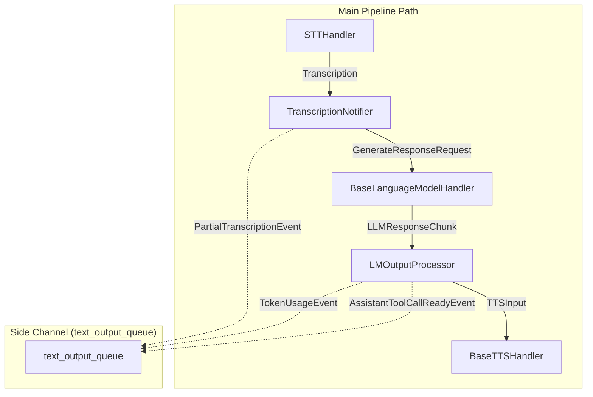

<!-- source: DeepWiki mcp.deepwiki.com · repo huggingface/speech-to-speech · page 2.3 Queue-Based Communication · fetched 2026-10-26 -->

# Queue-Based Communication

Relevant source files

The following files were used as context for generating this wiki page:

- [src/speech_to_speech/LLM/lm_output_processor.py](src/speech_to_speech/LLM/lm_output_processor.py)
- [src/speech_to_speech/pipeline/control.py](src/speech_to_speech/pipeline/control.py)
- [src/speech_to_speech/pipeline/events.py](src/speech_to_speech/pipeline/events.py)
- [src/speech_to_speech/pipeline/messages.py](src/speech_to_speech/pipeline/messages.py)
- [src/speech_to_speech/pipeline/queue_types.py](src/speech_to_speech/pipeline/queue_types.py)
- [tests/test_lm_output_processor.py](tests/test_lm_output_processor.py)
- [tests/test_pipeline_messages.py](tests/test_pipeline_messages.py)

This page covers the queue-based architecture connecting pipeline stages in the speech-to-speech codebase. It details the typed message hierarchy (`pipeline/messages.py`), the typed event hierarchy (`pipeline/events.py`), queue type aliases (`pipeline/queue_types.py`), control sentinels (`pipeline/control.py`), and the `text_output_queue` side channel managed by `LMOutputProcessor`.

## 1. Overview and Queue Architecture

The speech-to-speech pipeline implements a multi-threaded, queue-based architecture for inter-component communication. This design enables asynchronous processing where each processing stage (VAD, STT, LLM, TTS) operates independently in its own thread while maintaining data sequencing through thread-safe `Queue` objects.

Each queue acts as a buffer allowing components to process data at varying speeds without blocking downstream operations. Data integrity across thread boundaries is enforced via strongly-typed Pydantic models and control sentinels.

Title: Queue Architecture and Code Entities

```mermaid
graph LR
    RecvQ["recv_audio_chunks_queue"]
    VAD["VADHandler"]
    SpokenQ["spoken_prompt_queue"]
    STT["STTHandler"]
    TransNot["TranscriptionNotifier"]
    TextQ["text_prompt_queue"]
    LLM["BaseLanguageModelHandler"]
    LMOutProc["LMOutputProcessor"]
    LMRespQ["lm_response_queue"]
    TTS["BaseTTSHandler"]
    SendQ["send_audio_chunks_queue"]
    TextSide["text_output_queue"]
    
    RecvQ --> VAD
    VAD -->|"VADAudio"| SpokenQ
    SpokenQ --> STT
    STT -->|"Transcription"| TransNot
    TransNot -->|"GenerateResponseRequest"| TextQ
    TextQ --> LLM
    LLM -->|"LLMResponseChunk"| LMOutProc
    LMOutProc -->|"TTSInput"| LMRespQ
    LMRespQ --> TTS
    TTS -->|"AudioOutput"| SendQ
    
    TransNot -.->|"PipelineEvent"| TextSide
    LMOutProc -.->|"PipelineEvent"| TextSide
```

Sources: [src/speech_to_speech/pipeline/queue_types.py:15-46](), [src/speech_to_speech/LLM/lm_output_processor.py:41-48]()

---

## 2. Typed Message Hierarchy (`pipeline/messages.py`)

Inter-component communication relies on subclasses of `PipelineMessage` defined in `src/speech_to_speech/pipeline/messages.py`. These models use Pydantic discriminators via the `tag` field to support serialization and validation.

### Key Pipeline Messages

| Class | Stage | Description |
|-------|-------|-------------|
| `VADAudio` | VAD → STT | Audio segment containing raw arrays, `turn_id`, `turn_revision`, and `mode` (progressive/final). [src/speech_to_speech/pipeline/messages.py:46-56]() |
| `PartialTranscription` | STT → TranscriptionNotifier | Live partial transcription text for internal notifications. [src/speech_to_speech/pipeline/messages.py:62-69]() |
| `Transcription` | STT → LLM | Final transcription result including `language_code` and `speech_stopped_at_s`. [src/speech_to_speech/pipeline/messages.py:71-80]() |
| `TranscriptionFailure` | STT → LLM | Failure notification when an STT operation fails. [src/speech_to_speech/pipeline/messages.py:82-90]() |
| `LLMResponseChunk` | LLM → LMOutputProcessor | Ordered group of `AssistantOutputPart` items (text or tool call parts) with generation metadata. [src/speech_to_speech/pipeline/messages.py:138-159]() |
| `TokenUsage` | LLM → Side Channel | Token count report for input and output tokens. [src/speech_to_speech/pipeline/messages.py:168-178]() |
| `EndOfResponse` | LLM → TTS / Router | Sentinel marking the end of a response generation. [src/speech_to_speech/pipeline/messages.py:180-192]() |

Sources: [src/speech_to_speech/pipeline/messages.py:1-192]()

---

## 3. Control Sentinels and Queue Type Aliases

To coordinate thread lifecycles and session resets without passing arbitrary exceptions, the pipeline uses specific control mechanisms defined in `src/speech_to_speech/pipeline/control.py` and `src/speech_to_speech/pipeline/queue_types.py`.

### Sentinels and Control Messages
*   **`PIPELINE_END`**: A plain `bytes` sentinel (`b"END"`) placed into queues to instruct worker threads to terminate gracefully. [src/speech_to_speech/pipeline/queue_types.py:20-22]()
*   **`SESSION_END`**: A `PipelineControlMessage` with `ControlKind.SESSION_END` used to reset per-session state across queues without shutting down handler threads. [src/speech_to_speech/pipeline/control.py:7-22]()
*   **`AUDIO_RESPONSE_DONE`**: A binary sentinel signaling completion of an audio chunk stream. [src/speech_to_speech/pipeline/queue_types.py:20-22]()

### Queue Type Aliases (`queue_types.py`)
`src/speech_to_speech/pipeline/queue_types.py` centralizes payload union types for type checkers:
*   `PipelineInternalItem`: `PipelineControlMessage | bytes` [src/speech_to_speech/pipeline/queue_types.py:22-22]()
*   `AudioInItem`: `VADIn | PipelineControlMessage` [src/speech_to_speech/pipeline/queue_types.py:25-25]()
*   `VADOutItem`: `VADOut | PipelineInternalItem` [src/speech_to_speech/pipeline/queue_types.py:28-28]()
*   `STTOutItem`: `STTOut | PipelineInternalItem` [src/speech_to_speech/pipeline/queue_types.py:31-31]()
*   `TextPromptItem`: `LLMIn | PipelineInternalItem` [src/speech_to_speech/pipeline/queue_types.py:34-34]()
*   `LMOutItem`: `LLMOut | PipelineInternalItem` [src/speech_to_speech/pipeline/queue_types.py:37-37]()
*   `TTSInItem`: `TTSIn | PipelineEvent | PipelineInternalItem` [src/speech_to_speech/pipeline/queue_types.py:40-40]()
*   `AudioOutItem`: `bytes | np.ndarray | AudioOutput | PipelineEvent | PipelineControlMessage` [src/speech_to_speech/pipeline/queue_types.py:43-43]()
*   `TextEventItem`: `PipelineEvent | PipelineInternalItem` [src/speech_to_speech/pipeline/queue_types.py:46-46]()

Sources: [src/speech_to_speech/pipeline/control.py:1-26](), [src/speech_to_speech/pipeline/queue_types.py:1-46]()

---

## 4. Side-Channel Communication (`text_output_queue`)

The `text_output_queue` is a dedicated channel for non-audio metadata. It enables events like transcriptions, tool readiness notifications, and token usage reports to reach the client immediately without being blocked by sequential audio synthesis in the TTS stage.

### PipelineEvent Hierarchy (`pipeline/events.py`)
Protocol-neutral events consumed by the realtime router are defined in `src/speech_to_speech/pipeline/events.py`:

| Event Class | Source | Purpose |
|-------------|--------|---------|
| `SpeechStartedEvent` | VAD | Signals speech onset, used for barge-in detection. [src/speech_to_speech/pipeline/events.py:36-43]() |
| `SpeechStoppedEvent` | VAD | Signals the end of a speech segment. [src/speech_to_speech/pipeline/events.py:45-51]() |
| `PartialTranscriptionEvent` | STT | Cumulative STT hypothesis for live UI updates. [src/speech_to_speech/pipeline/events.py:56-67]() |
| `TranscriptionCompletedEvent` | STT | Final confirmed user transcript and language code. [src/speech_to_speech/pipeline/events.py:69-76]() |
| `TranscriptionFailedEvent` | STT | Notification of an STT failure. [src/speech_to_speech/pipeline/events.py:78-83]() |
| `AudioInputCompletedEvent` | AudioInputNotifier | Wraps raw audio arrays when STT is bypassed. [src/speech_to_speech/pipeline/events.py:88-100]() |
| `AssistantOutputEvent` | LLMOutputProcessor | Ordered assistant text/tool parts awaiting serialization. [src/speech_to_speech/pipeline/events.py:105-131]() |
| `AssistantToolCallReadyEvent` | LLMOutputProcessor | Side-channel event exposing tool calls early for client execution. [src/speech_to_speech/pipeline/events.py:137-153]() |
| `TokenUsageEvent` | LLMOutputProcessor | Reports token consumption metrics. [src/speech_to_speech/pipeline/events.py:155-163]() |
| `AssistantResponseDoneEvent` | LLMOutputProcessor | Marks the end of ordered assistant output for a response. [src/speech_to_speech/pipeline/events.py:165-173]() |
| `ResponseGenerationDoneEvent` | LLMOutputProcessor | Internal side-channel signal tracking completed generation call IDs. [src/speech_to_speech/pipeline/events.py:175-184]() |

### LMOutputProcessor Logic
The `LMOutputProcessor` bridges the main TTS audio path and the side channel (`text_output_queue`). It processes `LLMResponseChunk`, `TokenUsage`, and `EndOfResponse` items:
*   **TTS Path**: Yields `TTSInput` and `EndOfResponse` objects to the downstream TTS queue. [src/speech_to_speech/LLM/lm_output_processor.py:117-163]()
*   **Side Channel**: Pushes `TokenUsageEvent`, `AssistantToolCallReadyEvent`, and `ResponseGenerationDoneEvent` into `text_output_queue`. [src/speech_to_speech/LLM/lm_output_processor.py:72-90]()

Title: Side-Channel Data Flow

Sources: [src/speech_to_speech/pipeline/events.py:1-205](), [src/speech_to_speech/LLM/lm_output_processor.py:42-163]()

---

## 5. Cancellation and Interruption Mechanics

To support barge-in scenarios where users interrupt the assistant mid-speech, the pipeline coordinates generation versions using `CancelScope` and `SpeculativeTurnTracker`.

*   **Stale Data Filtering**: Handlers inspect incoming items against the active `CancelScope` via `should_process_input`. Stale items are dropped to prevent outdated text or audio from propagating. [src/speech_to_speech/LLM/lm_output_processor.py:92-96]()
*   **Cleanup Exemptions**: Terminal messages like `TokenUsageEvent` and `EndOfResponse` are permitted through or transformed into cleanup markers (`cleanup_only=True`) so resource tracking and response revocation complete correctly. [src/speech_to_speech/LLM/lm_output_processor.py:117-138]()

Sources: [src/speech_to_speech/LLM/lm_output_processor.py:42-181](), [src/speech_to_speech/pipeline/events.py:1-205]()

---

