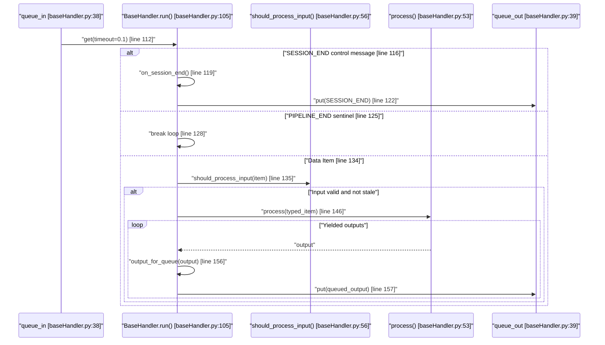
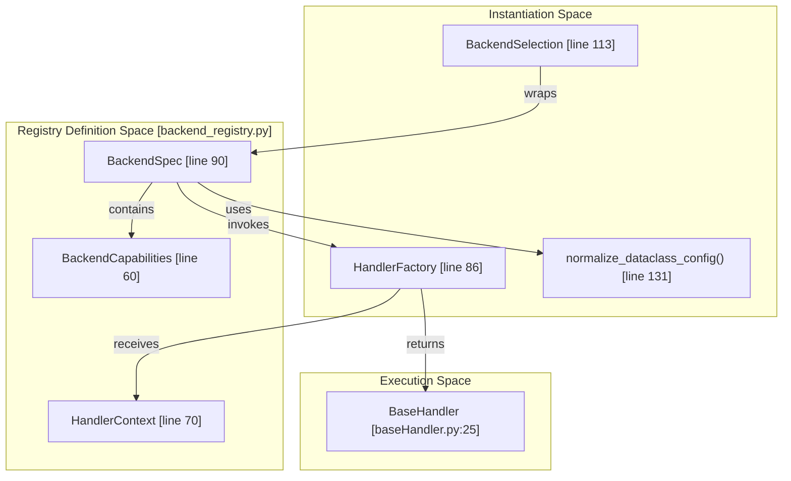

<!-- source: DeepWiki mcp.deepwiki.com · repo huggingface/speech-to-speech · page 2.4 Handler Plugin System and Backend Registry · fetched 2026-10-26 -->

# Handler Plugin System and Backend Registry

Relevant source files

The following files were used as context for generating this wiki page:

- [src/speech_to_speech/api/openai_realtime/websocket_router.py](src/speech_to_speech/api/openai_realtime/websocket_router.py)
- [src/speech_to_speech/backend_registry.py](src/speech_to_speech/backend_registry.py)
- [src/speech_to_speech/baseHandler.py](src/speech_to_speech/baseHandler.py)
- [src/speech_to_speech/pipeline/handler_types.py](src/speech_to_speech/pipeline/handler_types.py)
- [tests/openai_realtime/test_websocket_router.py](tests/openai_realtime/test_websocket_router.py)
- [tests/test_backend_registry.py](tests/test_backend_registry.py)

This page documents the plugin architecture that enables runtime selection and lifecycle management of Speech-to-Text (STT), Language Model (LLM), and Text-to-Speech (TTS) implementations. The system relies on a centralized `BackendRegistry`, factory-based instantiation via `BackendSpec`, and a unified `BaseHandler` abstract execution model.

## Purpose and Scope

The handler plugin system decouples pipeline orchestration from specific machine learning frameworks and APIs. By defining abstract contracts (`BaseHandler`) and declarative metadata (`BackendSpec`, `BackendCapabilities`, `HandlerContext`), the system supports swapping local model families (e.g., Transformers, MLX, Whisper, Parakeet) and remote APIs (e.g., OpenAI-compatible endpoints) without altering orchestration logic.

Sources: [src/speech_to_speech/baseHandler.py:25-33](), [src/speech_to_speech/backend_registry.py:48-112]()

---

## BaseHandler and Lifecycle

All pipeline stages inherit from `BaseHandler`, which manages thread execution, queue polling, input filtering, and session control [src/speech_to_speech/baseHandler.py:25-33]().

### Lifecycle Hooks and Execution Flow

| Method / Hook | File:Line | Role |
|---------------|-----------|------|
| `__init__` | [src/speech_to_speech/baseHandler.py:35-48]() | Binds threading primitives, input/output queues, and calls `setup()`. |
| `setup()` | [src/speech_to_speech/baseHandler.py:50-51]() | Overridable initialization hook for loading models or configuring state. |
| `process()` | [src/speech_to_speech/baseHandler.py:53-54]() | Abstract generator method implementing core stage logic (inference/transformation). |
| `should_process_input()` | [src/speech_to_speech/baseHandler.py:56-81]() | Filters items based on `CancelScope` generation numbers and prefetch transaction resolution. |
| `output_for_queue()` | [src/speech_to_speech/baseHandler.py:89-103]() | Wraps raw audio outputs into `AudioOutput` dataclasses carrying metadata like `cancel_generation` and `response_key`. |
| `run()` | [src/speech_to_speech/baseHandler.py:105-157]() | Main thread loop polling `queue_in`, handling `SESSION_END`, `PIPELINE_END`, and dispatching results. |

Title: BaseHandler Execution and Filtering Flow

Sources: [src/speech_to_speech/baseHandler.py:25-157]()

---

## Backend Registry and Core Dataclasses

The backend registry system uses explicit dataclasses to describe plugin properties, runtime contexts, and capabilities [src/speech_to_speech/backend_registry.py:48-112]().

### Core Registry Structures

*   **`BackendKind`**: A literal type restricting backends to `"stt"`, `"llm"`, or `"tts"` [src/speech_to_speech/backend_registry.py:48]()
*   **`BackendCapabilities`**: Construction flags affecting stage composition, such as `bypasses_transcription_notifier`, `supports_audio_input`, `supports_llm_proxy`, and `streams_audio_chunks` [src/speech_to_speech/backend_registry.py:60-67]()
*   **`HandlerContext`**: Pipeline-local state passed to factory functions, including `stop_event`, `queue_in`, `queue_out`, `text_output_queue`, `should_listen`, `cancel_scope`, `speculative_turns`, `pipeline_index`, and `sample_rate` [src/speech_to_speech/backend_registry.py:70-84]()
*   **`BackendSpec`**: Static metadata linking backend names to their config types, factories, prefixes, and capabilities [src/speech_to_speech/backend_registry.py:90-102]()
*   **`BackendSelection`**: Represents a selected `BackendSpec` paired with its normalized configuration dictionary [src/speech_to_speech/backend_registry.py:113-130]()

Title: Backend Registry Component Mapping

Sources: [src/speech_to_speech/backend_registry.py:48-130](), [src/speech_to_speech/baseHandler.py:25]()

---

## Configuration Normalization and Prefixes

Command-line arguments parsed via `HfArgumentParser` use backend-specific prefixes (e.g., `--whisper_stt_...` or `--omnivoice_...`). The registry normalizes these dataclass arguments into clean keyword arguments for handler factories [src/speech_to_speech/backend_registry.py:131-151]().

The function `normalize_dataclass_config(config, prefix)` iterates over dataclass fields, strips the matching prefix marker, collects parameters starting with `gen_` into a nested `gen_kwargs` dictionary, and preserves remaining configuration options [src/speech_to_speech/backend_registry.py:131-151](). Custom normalizers like `_normalize_facebook_mms_config` handle backend-specific remapping (e.g., mapping `tts_language` to `language`) [src/speech_to_speech/backend_registry.py:154-158]().

Sources: [src/speech_to_speech/backend_registry.py:131-158]()

---

## STT, LLM, and TTS Registries

Registries are constructed using `build_backend_registry()`, which validates backend kinds and rejects duplicate names eagerly [src/speech_to_speech/backend_registry.py:160-170](). 

The built-in registries (`STT_BACKENDS`, `LLM_BACKENDS`, `TTS_BACKENDS`) expose capabilities that govern pipeline construction:
*   `STT_BACKENDS` includes backends like `parakeet-tdt`, `whisper`, `faster-whisper`, `openai`, and `openai-realtime` [tests/test_backend_registry.py:65-79]()
*   `LLM_BACKENDS` includes backends like `transformers`, `mlx-lm`, `responses-api`, and `chat-completions` [tests/test_backend_registry.py:70-77]()
*   `TTS_BACKENDS` includes backends like `qwen3`, `kokoro`, `omnivoice`, and `supertonic` [tests/test_backend_registry.py:71-73]()

Sources: [tests/test_backend_registry.py:59-80](), [src/speech_to_speech/backend_registry.py:160-170]()

---

Sources:
- [src/speech_to_speech/baseHandler.py:25-157]()
- [src/speech_to_speech/backend_registry.py:48-170]()
- [tests/test_backend_registry.py:59-80]()

---

