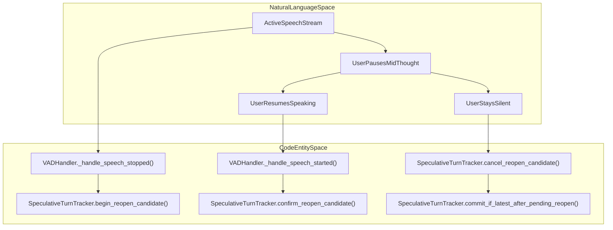
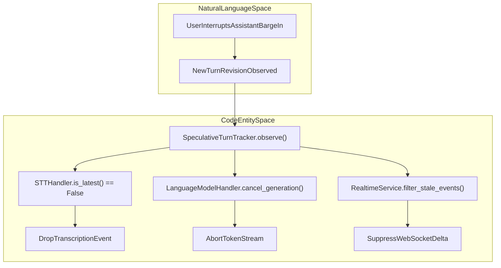

<!-- source: DeepWiki mcp.deepwiki.com · repo huggingface/speech-to-speech · page 2.5 Speculative Turns and Turn Management · fetched 2026-10-26 -->

# Speculative Turns and Turn Management

<details>
<summary>Relevant source files</summary>

The following files were used as context for generating this wiki page:

- [src/speech_to_speech/VAD/smart_turn.py](src/speech_to_speech/VAD/smart_turn.py)
- [src/speech_to_speech/VAD/vad_handler.py](src/speech_to_speech/VAD/vad_handler.py)
- [src/speech_to_speech/api/openai_realtime/service.py](src/speech_to_speech/api/openai_realtime/service.py)
- [src/speech_to_speech/arguments_classes/vad_arguments.py](src/speech_to_speech/arguments_classes/vad_arguments.py)
- [src/speech_to_speech/pipeline/speculative_turns.py](src/speech_to_speech/pipeline/speculative_turns.py)
- [tests/openai_realtime/test_realtime_service.py](tests/openai_realtime/test_realtime_service.py)
- [tests/test_smart_turn.py](tests/test_smart_turn.py)
- [tests/test_speculative_turns.py](tests/test_speculative_turns.py)

</details>


## Purpose and Scope

This page provides a deep dive into the speculative turn architecture of the `huggingface/speech-to-speech` codebase. In real-time conversational streaming, users frequently pause briefly mid-thought or trail off. Traditional Voice Activity Detection (VAD) systems treat any short pause as an absolute end of turn, triggering downstream Speech-to-Text (STT), Language Model (LLM), and Text-to-Speech (TTS) pipelines prematurely. 

The speculative turn subsystem—anchored by `SpeculativeTurnTracker` [src/speech_to_speech/pipeline/speculative_turns.py:24-416]() and integrated with VAD endpointing [src/speech_to_speech/VAD/vad_handler.py:56-175]() and Smart Turn classification [src/speech_to_speech/VAD/smart_turn.py:36-153]()—allows the system to generate or stream assistant output speculatively while retaining the ability to seamlessly reopen the user turn if speech resumes within a grace window.

---

## Core Data Structures: `SpeculativeTurnTracker`

The `SpeculativeTurnTracker` class is a thread-safe revision tracker implemented in `src/speech_to_speech/pipeline/speculative_turns.py`. It coordinates state across concurrent threads (VAD, STT workers, LLM stream loops, and the Realtime WebSocket/WebRTC service).

```
+-------------------------------------------------------------------------+
|                       SpeculativeTurnTracker                            |
+-------------------------------------------------------------------------+
| - _condition: threading.Condition                                       |
| - _latest_revision: OrderedDict[str, int]                               |
| - _committed_revision: dict[str, int]                                   |
| - _pending_reopen: dict[str, _PendingReopen]                            |
| - _reopen_grace: dict[str, _ReopenGrace]                                |
+-------------------------------------------------------------------------+
```

### Internal Data Classes and Dictionaries

* **`_PendingReopen`**: Tracks a candidate turn revision that is currently evaluating whether a user pause is an actual end-of-turn or a brief hesitation. It holds a `base_revision` and a `candidate_revision` [src/speech_to_speech/pipeline/speculative_turns.py:12-16]().
* **`_ReopenGrace`**: Defines a time-bounded window (`revision` and `deadline` timestamp) during which new audio input will increment the turn revision rather than instantiating a fresh conversation turn [src/speech_to_speech/pipeline/speculative_turns.py:18-22]().
* **`_latest_revision`**: An `OrderedDict` mapping `turn_id` strings to their highest observed integer revision counter, bounded by `_MAX_TRACKED_TURNS` (default 2048) [src/speech_to_speech/pipeline/speculative_turns.py:28-33]().
* **`_committed_revision`**: A mapping tracking which `revision` for a given `turn_id` has been permanently committed by assistant output or explicit client commit [src/speech_to_speech/pipeline/speculative_turns.py:34]().

Sources: [src/speech_to_speech/pipeline/speculative_turns.py:1-416]()

---

## Turn Identifiers, Revisions, and Reopen Candidates

When a user speaks, VAD segments audio into logical turns. Each turn possesses a unique identifier (`turn_id`) and an incremental revision number (`revision`).

### Turn Revision Lifecycle

1. **Observation**: When speech starts or progresses, `SpeculativeTurnTracker.observe(turn_id, revision)` records or updates the latest revision [src/speech_to_speech/pipeline/speculative_turns.py:38-49](). If the new revision exceeds the current entry, the tracker updates `_latest_revision`, moves it to the end of the `OrderedDict`, prunes old turns if exceeding `max_tracked_turns`, and notifies all waiting threads via `_condition.notify_all()` [src/speech_to_speech/pipeline/speculative_turns.py:43-48]().
2. **Reopen Candidacy**: When a soft VAD boundary occurs (silence detected, but within the speculative grace window), the handler calls `begin_reopen_candidate()`. This defers absolute commitment of the turn [tests/test_speculative_turns.py:19-33]().
3. **Confirmation vs. Cancellation**:
   * If the user remains silent past the grace window, the candidate is cancelled or expires, allowing downstream workers to commit the turn.
   * If the user resumes speaking, `confirm_reopen_candidate()` increments the revision, marking the prior revision stale [tests/test_speculative_turns.py:35-44]().

### Diagram: Natural Language Space to Code Entity Space (Turn Lifecycle)

The following diagram bridges conceptual user conversational states to their concrete Python implementations and tracking methods within `SpeculativeTurnTracker`:


Sources: [src/speech_to_speech/pipeline/speculative_turns.py:38-168](), [src/speech_to_speech/VAD/vad_handler.py:56-175](), [tests/test_speculative_turns.py:19-116]()

---

## Reopen Grace Windows and Smart Turn Integration

Turn management relies on two primary configurable grace intervals managed via `VADHandlerArguments` and `SpeculativeTurnTracker`:

* `speculative_reopen_ms`: The default window (default 800 ms) during which a soft-ended Realtime turn remains reopenable unless an assistant response commits it [src/speech_to_speech/arguments_classes/vad_arguments.py:80-84]().
* `unanswered_reopen_ms`: A sanity cap (default 7000 ms) for reopening an uncommitted speculative turn that has not yet received assistant output [src/speech_to_speech/arguments_classes/vad_arguments.py:86-90]().

### Smart Turn v3.2 ONNX Integration

When `smart_turn` is enabled (default `True`), `VADHandler` delegates end-of-turn confidence scoring to `SmartTurnAnalyzer` [src/speech_to_speech/VAD/vad_handler.py:80-122](), [src/speech_to_speech/VAD/smart_turn.py:36-153](). 

* Once Silero VAD detects a speech-to-silence boundary, `SmartTurnAnalyzer.predict()` runs a CPU-bound ONNX inference session (`smart-turn-v3.2-cpu.onnx`) over up to 8 seconds of accumulated audio features extracted via `WhisperFeatureExtractor` [src/speech_to_speech/VAD/smart_turn.py:37-145]().
* If `SmartTurnResult.complete` is `False` (indicating an incomplete sentence or ambiguous pause), the system extends the reopen grace window up to `smart_turn_max_wait_ms` (default 2000 ms) and delays STT/LLM execution by `smart_turn_incomplete_delay_ms` (default 600 ms) [src/speech_to_speech/arguments_classes/vad_arguments.py:116-126](), [tests/test_smart_turn.py:54-61]().

Sources: [src/speech_to_speech/VAD/vad_handler.py:56-122](), [src/speech_to_speech/VAD/smart_turn.py:36-153](), [src/speech_to_speech/arguments_classes/vad_arguments.py:80-131]()

---

## Commit Semantics and Stale Turn Discarding

To prevent stale transcription or LLM generation results from polluting the conversation history or audio output channels when a user interrupts (barge-in) or reopens a turn, the system enforces strict commit and discard semantics.

### Blocking vs. Non-Blocking Query Methods

`SpeculativeTurnTracker` exposes two families of verification methods:

1. **Blocking (with Timeout)**:
   * `is_latest_after_pending_reopen(turn_id, revision)` [src/speech_to_speech/pipeline/speculative_turns.py:56-62]()
   * `commit_if_latest_after_pending_reopen(turn_id, revision)` [src/speech_to_speech/pipeline/speculative_turns.py:98-104]()
   * These methods wait up to `_PENDING_REOPEN_WAIT_TIMEOUT_S` (2.0s) for pending reopens to resolve before rendering a decision [src/speech_to_speech/pipeline/speculative_turns.py:27]().
2. **Non-Blocking (`try_*`)**:
   * `try_is_latest_after_pending_reopen()` [src/speech_to_speech/pipeline/speculative_turns.py:63-75]()
   * `try_commit_if_latest_after_pending_reopen()` [src/speech_to_speech/pipeline/speculative_turns.py:112-124]()
   * These return `None` if a reopen candidate is still pending, instructing asynchronous worker threads to yield or retry without blocking execution threads [src/speech_to_speech/pipeline/speculative_turns.py:63-68]().

### Discarding Stale Events Across Pipeline Stages

When a newer turn revision is observed or a reopen occurs:
* **STT Stage**: Progressive transcription events belonging to older revisions fail `is_latest()` checks and are dropped before hitting downstream queues.
* **LLM Stage**: If an assistant response is actively streaming for `turn_id` revision `N`, and revision `N+1` is observed (barge-in), token generation is cancelled via threading events and `CancelScope` counters [see section 2.2]().
* **Realtime Service**: `RealtimeService` checks session state and turn validity [src/speech_to_speech/api/openai_realtime/service.py:1-193]() before dispatching `ConversationItemInputAudioTranscriptionDeltaEvent` or `ResponseAudioDeltaEvent` to clients.

### Diagram: Multi-Service Stale Event Discarding Architecture


Sources: [src/speech_to_speech/pipeline/speculative_turns.py:38-124](), [src/speech_to_speech/api/openai_realtime/service.py:1-193]()

---

## Summary Table of Tracker API Methods

| Method Name | Return Type | Description |
| :--- | :--- | :--- |
| `observe(turn_id, revision)` | `None` | Updates the highest known revision for a turn and wakes waiting threads [src/speech_to_speech/pipeline/speculative_turns.py:38-49](). |
| `is_latest(turn_id, revision)` | `bool` | Checks if `revision` matches the current latest revision for `turn_id` [src/speech_to_speech/pipeline/speculative_turns.py:50-55](). |
| `begin_reopen_candidate(...)` | `int` | Initiates a speculative reopen window, returning the candidate revision [tests/test_speculative_turns.py:19-33](). |
| `confirm_reopen_candidate(...)` | `bool` | Confirms that a reopen occurred, invalidating the previous revision [src/speech_to_speech/pipeline/speculative_turns.py:170-210](). |
| `cancel_reopen_candidate(...)` | `None` | Cancels a pending reopen candidate, allowing commitment [tests/test_speculative_turns.py:29-32](). |
| `commit_if_latest_after_pending_reopen(...)` | `bool` | Waits for pending reopens and commits the revision if it remains latest [src/speech_to_speech/pipeline/speculative_turns.py:98-104](). |

Sources: [src/speech_to_speech/pipeline/speculative_turns.py:24-416]()

---

