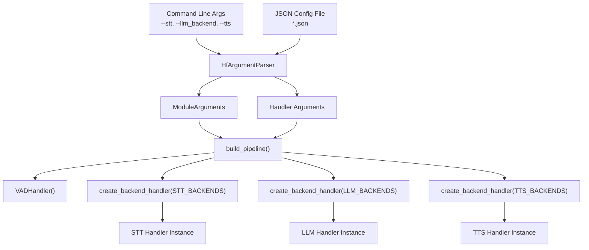

<!-- source: DeepWiki mcp.deepwiki.com · repo huggingface/speech-to-speech · page 3 Core Components · fetched 2026-10-26 -->

# Core Components

Relevant source files

The following files were used as context for generating this wiki page:

- [src/speech_to_speech/LLM/lm_output_processor.py](src/speech_to_speech/LLM/lm_output_processor.py)
- [src/speech_to_speech/arguments_classes/module_arguments.py](src/speech_to_speech/arguments_classes/module_arguments.py)
- [src/speech_to_speech/pipeline/events.py](src/speech_to_speech/pipeline/events.py)
- [src/speech_to_speech/pipeline/messages.py](src/speech_to_speech/pipeline/messages.py)
- [src/speech_to_speech/s2s_pipeline.py](src/speech_to_speech/s2s_pipeline.py)
- [tests/test_cli_defaults.py](tests/test_cli_defaults.py)
- [tests/test_lm_output_processor.py](tests/test_lm_output_processor.py)

This page provides an overview of the primary processing components within the speech-to-speech pipeline system: VAD (Voice Activity Detection), STT (Speech-to-Text), LLM (Language Model), and TTS (Text-to-Speech). It also introduces intermediate stages like the `TranscriptionNotifier`, `AudioInputNotifier`, and `LMOutputProcessor`. For details on how these components are managed, see [Architecture](#2).

## Component Architecture

The speech-to-speech pipeline processes audio in a sequential manner through four major components, connected by thread-safe queues.

### Pipeline Data Flow

```mermaid
flowchart LR
    AudioIn["Audio Input"] --> Q1["recv_audio_chunks_queue"]
    Q1 --> VAD["VADHandler<br/>(Silero VAD v5)"]
    VAD --> Q2["spoken_prompt_queue<br/>(VADOutItem)"]
    Q2 --> STT["STT Handler<br/>(BaseSttHandler)"]
    STT --> Q3["text_prompt_queue<br/>(STTOutItem)"]
    Q3 --> LLM["LLM Handler<br/>(BaseLanguageModelHandler)"]
    LLM --> Q4["lm_response_queue<br/>(LMOutItem)"]
    Q4 --> TTS["TTS Handler<br/>(BaseTtsHandler)"]
    TTS --> Q5["send_audio_chunks_queue<br/>(AudioOutItem)"]
    Q5 --> AudioOut["Audio Output"]
```

Sources: [src/speech_to_speech/s2s_pipeline.py:1-57](), [src/speech_to_speech/pipeline/queue_types.py:39-46]()

Each component fulfills a specific function:
1. **Voice Activity Detection (VAD)**: Detects speech segments in the incoming audio stream using `VADHandler` [src/speech_to_speech/s2s_pipeline.py:56-56]().
2. **Speech-to-Text (STT)**: Transcribes detected speech segments into text using one of several handler implementations.
3. **Language Model (LLM)**: Processes the transcribed text and generates responses, managing chat history and tool calls.
4. **Text-to-Speech (TTS)**: Converts the language model's text response into 16kHz int16 PCM audio chunks.

Sources: [src/speech_to_speech/s2s_pipeline.py:1-57]()

## Component Selection System

The pipeline uses a factory pattern to instantiate the appropriate handler implementations. Selection is driven by `ModuleArguments` [src/speech_to_speech/arguments_classes/module_arguments.py:13-104]() and executed during pipeline building [src/speech_to_speech/s2s_pipeline.py:29-37]().

### Component Instantiation Flow

Sources: [src/speech_to_speech/s2s_pipeline.py:1-190](), [src/speech_to_speech/arguments_classes/module_arguments.py:13-104]()

All components inherit from `BaseHandler`, which provides the standard lifecycle and queue management logic. Selection logic is centralized in the backend registry [src/speech_to_speech/backend_registry.py:33-37]().

Sources: [src/speech_to_speech/backend_registry.py:33-37](), [src/speech_to_speech/arguments_classes/module_arguments.py:13-104]()

## Voice Activity Detection (VAD)

The `VADHandler` uses **Silero VAD v5** or **FireRed Stream-VAD** to identify speech segments. It supports progressive mode, deep filter enhancements, and smart turn endpointing.

For details, see [Voice Activity Detection (VAD)](#3.1).

Sources: [src/speech_to_speech/s2s_pipeline.py:56-56]()

## Speech-to-Text (STT)

STT handlers transcribe audio segments into text. The system introduces a `TranscriptionNotifier` stage [src/speech_to_speech/s2s_pipeline.py:54-54]() that pushes partial or final transcriptions to a text output queue for client visibility and UI display.

For details, see [Speech-to-Text (STT)](#3.2).

Sources: [src/speech_to_speech/s2s_pipeline.py:54-54]()

## Language Models (LLM)

LLM handlers process transcriptions and generate text responses. The `LMOutputProcessor` intermediate stage handles ordered event yielding, tool extraction, and response sequencing [src/speech_to_speech/LLM/lm_output_processor.py:42-49]().

For details, see [Language Models (LLM)](#3.3).

Sources: [src/speech_to_speech/LLM/lm_output_processor.py:42-49]()

## Text-to-Speech (TTS)

TTS handlers convert text to 16kHz mono PCM audio chunks using backends like Qwen3-TTS or OpenAI-compatible streaming endpoints.

For details, see [Text-to-Speech (TTS)](#3.4).

Sources: [src/speech_to_speech/backend_registry.py:30-37]()

## Intermediate Stages

Beyond the core four stages, the pipeline includes utility components that normalize data flow:

| Component | Role | Code Entity |
|-----------|------|-------------|
| **Transcription Notifier** | Routes STT results to side-channels (e.g. Web UI) | `TranscriptionNotifier` [src/speech_to_speech/s2s_pipeline.py:54-54]() |
| **Audio Input Notifier** | Handles the direct audio path for audio-input LLMs | `AudioInputCompletedEvent` [src/speech_to_speech/pipeline/events.py:88-100]() |
| **LM Output Processor** | Handles ordered event yielding and tool extraction | `LMOutputProcessor` [src/speech_to_speech/LLM/lm_output_processor.py:42-49]() |

Sources: [src/speech_to_speech/s2s_pipeline.py:54-54](), [src/speech_to_speech/pipeline/events.py:88-100](), [src/speech_to_speech/LLM/lm_output_processor.py:42-49]()

---

