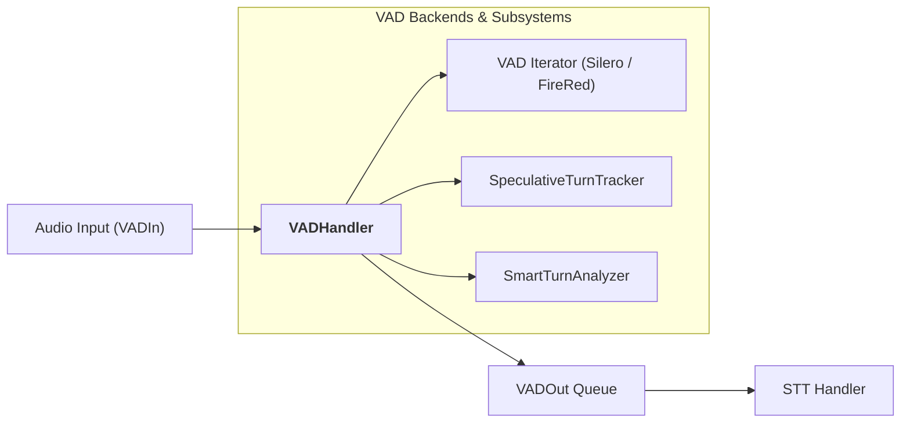

<!-- source: DeepWiki mcp.deepwiki.com · repo huggingface/speech-to-speech · page 3.1 Voice Activity Detection (VAD) · fetched 2026-10-26 -->

# Voice Activity Detection (VAD)

Relevant source files

The following files were used as context for generating this wiki page:

- [src/speech_to_speech/VAD/README.md](src/speech_to_speech/VAD/README.md)
- [src/speech_to_speech/VAD/firered_vad_iterator.py](src/speech_to_speech/VAD/firered_vad_iterator.py)
- [src/speech_to_speech/VAD/smart_turn.py](src/speech_to_speech/VAD/smart_turn.py)
- [src/speech_to_speech/VAD/vad_handler.py](src/speech_to_speech/VAD/vad_handler.py)
- [src/speech_to_speech/VAD/vad_iterator.py](src/speech_to_speech/VAD/vad_iterator.py)
- [src/speech_to_speech/arguments_classes/vad_arguments.py](src/speech_to_speech/arguments_classes/vad_arguments.py)
- [src/speech_to_speech/pipeline/speculative_turns.py](src/speech_to_speech/pipeline/speculative_turns.py)
- [tests/test_firered_vad_iterator.py](tests/test_firered_vad_iterator.py)
- [tests/test_smart_turn.py](tests/test_smart_turn.py)
- [tests/test_speculative_turns.py](tests/test_speculative_turns.py)
- [tests/test_vad_iterator.py](tests/test_vad_iterator.py)

## Purpose and Scope

The Voice Activity Detection (VAD) component serves as the initial processing stage in the speech-to-speech pipeline. Its primary role is to ingest incoming audio streams, distinguish speech from silence or background noise, segment active speech into discrete utterances, and manage turn-taking semantics. 

`VADHandler` coordinates backend detection, audio enhancement, progressive streaming, short segment stitching, and dynamic reconfiguration. For low-level iterator mechanics and backend selection guidance, see [VAD Iterators and FireRed Stream-VAD](#3.1.2). For advanced end-of-turn classification using the Smart Turn analyzer, see [Smart Turn Endpointing](#3.1.1).

Sources: [src/speech_to_speech/VAD/vad_handler.py:56-60](), [src/speech_to_speech/arguments_classes/vad_arguments.py:5-131]()

## Pipeline Integration and Processing Modes

`VADHandler` inherits from `BaseHandler` and processes incoming audio streams (`VADIn`) into speech chunks or final utterances (`VADOut`) [src/speech_to_speech/VAD/vad_handler.py:56](). It operates in two primary modes:

- **Normal Mode**: Accumulates audio upon speech trigger and yields the complete utterance as a final `VADAudio` message once silence is detected [src/speech_to_speech/VAD/vad_handler.py:488-511]().
- **Progressive Mode**: Enabled via `enable_realtime_transcription`, this mode periodically yields intermediate audio chunks (`final=False`) at configured intervals (`realtime_processing_pause`) to feed live streaming STT sinks [src/speech_to_speech/VAD/vad_handler.py:99-100](), [src/speech_to_speech/VAD/vad_handler.py:456-486]().

Sources: [src/speech_to_speech/VAD/vad_handler.py:56-60](), [src/speech_to_speech/VAD/vad_handler.py:99-100](), [src/speech_to_speech/VAD/vad_handler.py:456-511]()

## VAD Backends

`VADHandler` supports pluggable speech probability backends selected via the `vad` argument:
- **Silero VAD v5** (`silero`): The default backend utilizing a Torch Hub model wrapped by `VADIterator` [src/speech_to_speech/VAD/vad_handler.py:86](), [src/speech_to_speech/VAD/vad_handler.py:150-163]().
- **FireRed Stream-VAD** (`firered`): An alternative streaming backend driven by `FireRedStreamVad` start and end events, requiring the `fireredvad` extra and model weights [src/speech_to_speech/VAD/vad_handler.py:87-88](), [src/speech_to_speech/VAD/README.md:5-12]().

For detailed frame handling, state machine rules, and backend trade-offs, see [VAD Iterators and FireRed Stream-VAD](#3.1.2).

Sources: [src/speech_to_speech/VAD/vad_handler.py:86-165](), [src/speech_to_speech/VAD/README.md:1-33]()

## Smart Turn and Endpointing

When an utterance completes, `VADHandler` can invoke the ONNX-based **Smart Turn v3.2** analyzer (`SmartTurnAnalyzer`) to evaluate whether the user's turn is linguistically and acoustically complete [src/speech_to_speech/VAD/vad_handler.py:80-84](), [src/speech_to_speech/VAD/smart_turn.py:1-7](). 

If the model classifies a turn as incomplete, the system extends the speculative reopen grace window (`smart_turn_max_wait_ms`) and introduces a delay (`smart_turn_incomplete_delay_ms`) to allow for user continuation before expensive downstream processing occurs [src/speech_to_speech/VAD/vad_handler.py:107-115](). For full details on Whisper feature extraction, result dataclasses, and endpointing flags, see [Smart Turn Endpointing](#3.1.1).

Sources: [src/speech_to_speech/VAD/vad_handler.py:80-85](), [src/speech_to_speech/VAD/smart_turn.py:1-35]()

## Audio Enhancement, Stitching, and Turn Management

### Audio Enhancement via DeepFilterNet
If `audio_enhancement` is enabled, `VADHandler` initializes DeepFilterNet (`init_df`) to apply noise reduction and equalization to incoming audio segments prior to downstream processing [src/speech_to_speech/VAD/vad_handler.py:73](), [src/speech_to_speech/VAD/vad_handler.py:167-175](). If the library is unavailable, it gracefully logs an error and disables the feature [src/speech_to_speech/VAD/vad_handler.py:168-173]().

### Short Segment Stitching
To mitigate false barge-ins and phantom triggers from transient noise, segments shorter than `min_speech_ms` can be held and stitched if subsequent speech arrives within `short_segment_merge_ms` [src/speech_to_speech/VAD/vad_handler.py:79](), [src/speech_to_speech/VAD/vad_handler.py:92-97](). Fragments with less active speech than `_SHORT_SEGMENT_MIN_FRAGMENT_MS` (100 ms) are discarded as noise and never held [src/speech_to_speech/VAD/vad_handler.py:40-44]().

### Speculative Turns and Reopening
`VADHandler` integrates with `SpeculativeTurnTracker` to support soft-ended turns [src/speech_to_speech/VAD/vad_handler.py:65](). If a user resumes speaking within `speculative_reopen_ms` or `unanswered_reopen_ms`, the handler reopens the existing turn revision rather than instantiating a new session turn [src/speech_to_speech/VAD/vad_handler.py:77-79](), [src/speech_to_speech/VAD/vad_handler.py:343-348]().

Sources: [src/speech_to_speech/VAD/vad_handler.py:40-54](), [src/speech_to_speech/VAD/vad_handler.py:73-79](), [src/speech_to_speech/VAD/vad_handler.py:167-175]()

## Configuration and `VADHandlerArguments`

VAD parameters are exposed via `VADHandlerArguments` and can be reconfigured dynamically at runtime using `RuntimeConfig` payloads in the input stream [src/speech_to_speech/arguments_classes/vad_arguments.py:5-131](), [src/speech_to_speech/api/openai_realtime/runtime_config.py:14]().

| Parameter | Default | Description |
| :--- | :--- | :--- |
| `vad` | `"silero"` | Backend selector (`"silero"` or `"firered"`). |
| `thresh` | `0.6` | Confidence threshold for speech detection [0–1]. |
| `min_silence_ms` | `64` | Minimum silence interval (ms) marking end of speech. |
| `min_speech_ms` | `384` | Minimum speech duration (ms) for a valid segment. |
| `speech_pad_ms` | `500` | Audio padding (ms) retained before VAD triggers. |
| `audio_enhancement` | `False` | Enables DeepFilterNet noise reduction. |
| `enable_realtime_transcription` | `False` | Enables progressive audio chunk yielding for live STT. |
| `short_segment_merge_ms` | `0` | Stitching window for adjacent short segments. |
| `smart_turn` | `True` | Enables Smart Turn v3.2 end-of-turn classification. |

Sources: [src/speech_to_speech/arguments_classes/vad_arguments.py:5-131](), [src/speech_to_speech/api/openai_realtime/runtime_config.py:14]()

---

