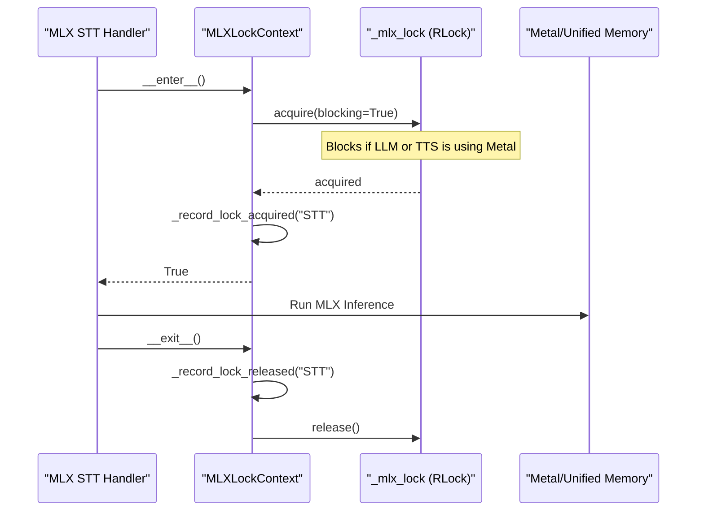

<!-- source: DeepWiki mcp.deepwiki.com · repo huggingface/speech-to-speech · page 3.2 Speech-to-Text (STT) · fetched 2026-10-26 -->

# Speech-to-Text (STT)

<details>
<summary>Relevant source files</summary>

The following files were used as context for generating this wiki page:

- [src/speech_to_speech/STT/README.md](src/speech_to_speech/STT/README.md)
- [src/speech_to_speech/STT/base_stt_handler.py](src/speech_to_speech/STT/base_stt_handler.py)
- [src/speech_to_speech/STT/transcription_notifier.py](src/speech_to_speech/STT/transcription_notifier.py)
- [src/speech_to_speech/api/openai_realtime/handlers/conversation.py](src/speech_to_speech/api/openai_realtime/handlers/conversation.py)
- [src/speech_to_speech/utils/mlx_lock.py](src/speech_to_speech/utils/mlx_lock.py)
- [tests/test_stt_stale_filter.py](tests/test_stt_stale_filter.py)
- [tests/test_transcription_notifier.py](tests/test_transcription_notifier.py)

</details>


## Purpose and Role

The Speech-to-Text (STT) component is responsible for converting audio input into text transcripts within the speech-to-speech pipeline. It serves as the second major step in the pipeline after Voice Activity Detection (VAD) and before Language Model (LLM) processing. The STT component not only transcribes spoken content but also identifies the language being spoken, which is crucial for subsequent processing steps.

The STT system supports an intermediate stage called **live transcription** (or progressive streaming), where partial results are emitted before the user finishes speaking. This is primarily facilitated by the `TranscriptionNotifier` (for UI updates) and specific streaming-capable handlers.

### STT Pipeline Context

```mermaid
flowchart LR
    ["VADAudio"] --> STT["BaseSTTHandler"]
    STT -- "PartialTranscription" --> TN["TranscriptionNotifier"]
    STT -- "Transcription" --> TN
    TN -- "PartialTranscriptionEvent" --> SOUT["text_output_queue"]
    TN -- "TranscriptionCompletedEvent" --> SOUT
    TN -- "LLMIn (Yielded)" --> LLM["LLM Handler"]
    
    subgraph "Natural Language Space"
    TN["TranscriptionNotifier"]
    SOUT["text_output_queue"]
    end

    subgraph "Code Entity Space"
    STT["BaseSTTHandler"]
    LLM["BaseHandler[LLMIn, LLMOut]"]
    end
```
Sources: [src/speech_to_speech/STT/transcription_notifier.py:17-33](), [src/speech_to_speech/STT/base_stt_handler.py:16-17](), [src/speech_to_speech/pipeline/messages.py:10-11]()

## TranscriptionNotifier

The `TranscriptionNotifier` sits between the STT and LLM stages [src/speech_to_speech/STT/transcription_notifier.py:17-18](). It performs two primary roles:
1. **Real-time Updates**: It converts `PartialTranscription` and `Transcription` messages into `PartialTranscriptionEvent` and `TranscriptionCompletedEvent` objects, which are pushed to the `text_output_queue` for external clients (e.g., WebSockets) [src/speech_to_speech/STT/transcription_notifier.py:34-72]().
2. **LLM Signaling**: It yields `LLMIn` items to the next stage. If a transcript is empty, it can re-enable the VAD listener via the `should_listen` event instead of triggering the LLM [src/speech_to_speech/STT/transcription_notifier.py:74-86]().

Sources: [src/speech_to_speech/STT/transcription_notifier.py:17-87](), [tests/test_transcription_notifier.py:19-36]()

## Speculative Turn Filtering

STT handlers inherit from `BaseSTTHandler`, which implements sophisticated logic to handle "speculative turns"—situations where the VAD may reopen a turn or provide revised audio segments.

- **Stale Input Filtering**: `should_process_input` checks the `turn_id` and `turn_revision` against a `SpeculativeTurnTracker`. It drops audio chunks that belong to outdated revisions or turns that have already been finalized [src/speech_to_speech/STT/base_stt_handler.py:24-61]().
- **Stability Windows**: For final transcriptions, the handler can wait for a `final_revision_settle_s` window to ensure no further VAD revisions are pending before committing to processing [src/speech_to_speech/STT/base_stt_handler.py:91-97]().
- **Queue Management**: The handler proactively clears its input queue of stale `VADAudio` items (e.g., progressive audio for a revision that already has a final audio chunk queued) to minimize latency and avoid processing redundant data [src/speech_to_speech/STT/base_stt_handler.py:104-128]().

Sources: [src/speech_to_speech/STT/base_stt_handler.py:16-128](), [tests/test_stt_stale_filter.py:74-109]()

## Implementation Families

The system provides multiple STT handler families, selectable via `--stt`. Because this is a parent page, details for each family are documented in their respective child pages:

- **Parakeet and NeMo ASR Handlers**: Covered in detail on [Parakeet and NeMo ASR Handlers](#3.2.1), including Parakeet TDT 0.6B v3 (mlx-audio vs nano-parakeet backends), `SmartProgressiveStreamingHandler`, `lingua-py` language detection, and NeMo ASR handlers [src/speech_to_speech/STT/README.md:11-12,60-70,108-117]().
- **Whisper-Family STT Handlers**: Covered in detail on [Whisper-Family STT Handlers](#3.2.2), including Transformers Whisper, Faster Whisper, Lightning Whisper MLX, and MLX Audio Whisper handlers [src/speech_to_speech/STT/README.md:7-10,19-59]().
- **OpenAI-Compatible HTTP STT Handler**: Covered in detail on [OpenAI-Compatible HTTP STT Handler](#3.2.3), detailing `OpenAICompatibleSTTHandler`, WAV encoding, cancellable `httpx`/`anyio` requests, progressive vs final lanes, and session generation fencing [src/speech_to_speech/STT/README.md:15,95-106]().
- **Streaming Realtime STT Handlers**: Covered in detail on [Streaming Realtime STT Handlers](#3.2.4), covering `StatefulStreamingSTTHandler` with `OpenAIRealtimeProtocol` and `VLLMRealtimeProtocol` [src/speech_to_speech/STT/README.md:5-15]().
- **Other STT Handlers and Audio-Input Mode**: Covered in detail on [Other STT Handlers and Audio-Input Mode](#3.2.5), covering Qwen3-ASR (`qwen3-asr`), Paraformer (`paraformer`), language reset behavior, and `AudioInputNotifier` [src/speech_to_speech/STT/README.md:13-14,71-94]().

Sources: [src/speech_to_speech/STT/README.md:1-117]()

## Language Detection and Fallback

Language handling is critical for downstream components and is managed uniformly across handlers via `BaseSTTHandler` properties and specific backend parsers.

1. **Detection Strategy**: 
   - Whisper handlers use internal model probability distributions [src/speech_to_speech/STT/README.md:19-50]().
   - Parakeet uses `lingua-py` for detection from generated text [src/speech_to_speech/STT/README.md:60-70]().
2. **SUPPORTED_LANGUAGES Fallback**: Handlers maintain supported language lists. If a model detects an unsupported language, the system falls back to a default or the `last_language` to prevent pipeline disruption [src/speech_to_speech/STT/base_stt_handler.py:24-27]().
3. **The `-auto` Suffix**: When automatic detection is active (`--language auto`), certain handlers append `-auto` to the detected code (e.g., `en-auto`) to instruct downstream LLMs to mirror the spoken language [src/speech_to_speech/STT/README.md:90-91]().

Sources: [src/speech_to_speech/STT/README.md:17-152](), [src/speech_to_speech/STT/base_stt_handler.py:24-28]()

## Apple Silicon Optimization (MLX)

For handlers running on macOS (such as Lightning Whisper MLX or MLX Audio Whisper), the system uses a global `MLXLockContext`. This prevents concurrent Metal/MLX model access across different pipeline stages (STT, LLM, TTS), which can lead to command buffer limitations or performance degradation [src/speech_to_speech/utils/mlx_lock.py:1-7]().

### MLX Lock Coordination


Sources: [src/speech_to_speech/utils/mlx_lock.py:17-25](), [src/speech_to_speech/utils/mlx_lock.py:151-171]()

---

