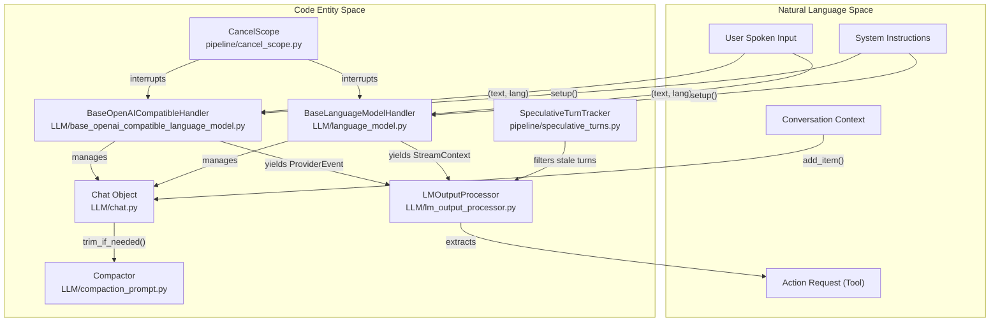
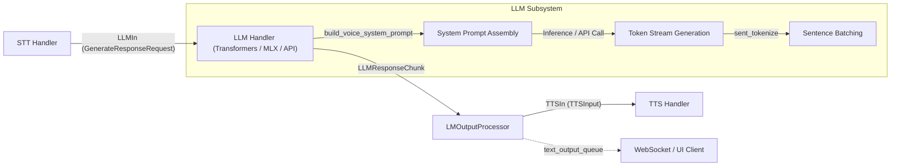

<!-- source: DeepWiki mcp.deepwiki.com · repo huggingface/speech-to-speech · page 3.3 Language Models (LLM) · fetched 2026-10-26 -->

# Language Models (LLM)

Relevant source files

The following files were used as context for generating this wiki page:

- [src/speech_to_speech/LLM/README.md](src/speech_to_speech/LLM/README.md)
- [src/speech_to_speech/LLM/base_openai_compatible_language_model.py](src/speech_to_speech/LLM/base_openai_compatible_language_model.py)
- [src/speech_to_speech/LLM/language_model.py](src/speech_to_speech/LLM/language_model.py)
- [src/speech_to_speech/arguments_classes/facebookmms_tts_arguments.py](src/speech_to_speech/arguments_classes/facebookmms_tts_arguments.py)
- [src/speech_to_speech/arguments_classes/language_model_arguments.py](src/speech_to_speech/arguments_classes/language_model_arguments.py)
- [src/speech_to_speech/arguments_classes/language_model_base_arguments.py](src/speech_to_speech/arguments_classes/language_model_base_arguments.py)
- [tests/test_responses_api_language_model.py](tests/test_responses_api_language_model.py)

## Purpose and Scope

This page provides a high-level overview of the Language Model (LLM) subsystem within the speech-to-speech pipeline. LLM handlers receive transcribed text or direct audio requests, maintain conversational context via history management, execute reasoning or tool calls, stream sentence-batched text chunks, and pass outputs through the `LMOutputProcessor` down to the text-to-speech (TTS) stage.

As a parent page, this document summarizes the core architecture, handler abstractions, and supporting modules. For deep technical details, refer to the following child pages:
- **Local Model Handlers**: [Local Model Handlers (Transformers and MLX)](#3.3.1) — covers `LanguageModelHandler`, `VisionLanguageModelHandler`, `TextIteratorStreamer`, caching, and MLX locks.
- **OpenAI-Compatible APIs**: [OpenAI-Compatible API Language Model Handlers](#3.3.2) — covers `BaseOpenAICompatibleHandler`, `/v1/responses`, `/v1/chat/completions`, streaming, and thinking modes.
- **Tool Calling**: [Tool Calling](#3.3.3) — covers code-block tool injection, signature parsing, and extraction via `LMOutputProcessor`.
- **Chat History & Compaction**: [Chat History and Conversation Compaction](#3.3.4) — covers bounded history, turn eviction, and background summarization via `Compactor`.
- **Prompts & Directives**: [Prompts: Voice, Text and Language Directives](#3.3.5) — covers system prompt construction (`voice_prompt.py`, `text_prompt.py`) and language injection.

Sources: [src/speech_to_speech/LLM/base_openai_compatible_language_model.py:145-155](), [src/speech_to_speech/LLM/language_model.py:164-170]()

## Architecture and Core Entities

The LLM architecture bridges natural language and structured control flow with concrete Python entities across local runtimes and remote API clients.

**Key Code Entities:**
- `BaseOpenAICompatibleHandler`: Shared orchestration layer for remote OpenAI-compatible backends (Responses and Chat Completions APIs) [src/speech_to_speech/LLM/base_openai_compatible_language_model.py:145-155]().
- `BaseLanguageModelHandler`: Abstract base class for local Transformers and MLX inference handlers [src/speech_to_speech/LLM/language_model.py:164-170]().
- `Chat`: Managesbounded conversation history, turn-based eviction, and re-injection of function call items [src/speech_to_speech/LLM/chat.py:77-103]().
- `Compactor`: Background summarizer using `CompactGenerateFn` to compress older dialogue history without losing semantic context [src/speech_to_speech/LLM/compaction_prompt.py:22-26]().
- `LMOutputProcessor`: Intercepts generation outputs to extract tool calls, handle side-channel events, and forward sentence-batched text to TTS [src/speech_to_speech/LLM/language_model.py:130-162]().

Sources: [src/speech_to_speech/LLM/base_openai_compatible_language_model.py:145-155](), [src/speech_to_speech/LLM/language_model.py:164-170](), [src/speech_to_speech/LLM/chat.py:77-103](), [src/speech_to_speech/LLM/compaction_prompt.py:22-26]()

## Role in the Pipeline

The LLM stage sits downstream of STT (or direct audio input) and upstream of TTS, coordinating prompt assembly, streaming token consumption, sentence batching, and cancellation.

**Pipeline Integration Responsibilities:**
- **Sentence-Level Streaming**: Accumulates generated tokens into sentence batches via NLTK tokenization (`sent_tokenize`) to balance latency and TTS naturalness [src/speech_to_speech/LLM/base_openai_compatible_language_model.py:19-19](), [src/speech_to_speech/LLM/language_model.py:11-11]().
- **Barge-in and Cancellation**: Coordinates with `CancelScope` and `SpeculativeTurnTracker` to instantly abort token generation or drop stale chunks when a new user turn interrupts the model [src/speech_to_speech/LLM/base_openai_compatible_language_model.py:182-183](), [src/speech_to_speech/LLM/language_model.py:183-184]().
- **System and Language Directives**: Injects voice-optimized personas and optional language directives (`--enable_lang_prompt`) into system prompts [src/speech_to_speech/LLM/base_openai_compatible_language_model.py:187-187](), [src/speech_to_speech/LLM/language_model.py:188-188]().

Sources: [src/speech_to_speech/LLM/base_openai_compatible_language_model.py:19-19](), [src/speech_to_speech/LLM/language_model.py:11-11](), [src/speech_to_speech/LLM/base_openai_compatible_language_model.py:182-187]()

## Handler Implementation Family

The framework supports multiple backend families selected via `--llm_backend`:

| Backend Identifier | Handler Class | Primary Target | Key Capabilities |
| :--- | :--- | :--- | :--- |
| `transformers` | `LanguageModelHandler` | Local GPU/CPU | Hugging Face models, `torch.compile`, stopping criteria [src/speech_to_speech/LLM/language_model.py:164-170]() |
| `mlx-lm` | `LanguageModelHandler` | Apple Silicon | MLX acceleration, unified memory locking [src/speech_to_speech/LLM/language_model.py:164-170]() |
| `responses-api` | `ResponsesApiModelHandler` | Remote API | `/v1/responses` endpoint, thinking modes, prefetch transactions [src/speech_to_speech/LLM/base_openai_compatible_language_model.py:145-155]() |
| `chat-completions` | `ChatCompletionsModelHandler` | Remote API | `/v1/chat/completions` endpoint, standard tool calling [src/speech_to_speech/LLM/base_openai_compatible_language_model.py:145-155]() |

Sources: [src/speech_to_speech/LLM/language_model.py:164-170](), [src/speech_to_speech/LLM/base_openai_compatible_language_model.py:145-155]()

## Summary of Child Topics

- For local execution details, caching, and stream iteration, see [Local Model Handlers (Transformers and MLX)](#3.3.1).
- For remote HTTP endpoints, event normalization, and timeout handling, see [OpenAI-Compatible API Language Model Handlers](#3.3.2).
- For function tool execution and code-block parsing, see [Tool Calling](#3.3.3).
- For bounded conversation history and background summarization, see [Chat History and Conversation Compaction](#3.3.4).
- For system prompt generation and voice styling, see [Prompts: Voice, Text and Language Directives](#3.3.5).

---

