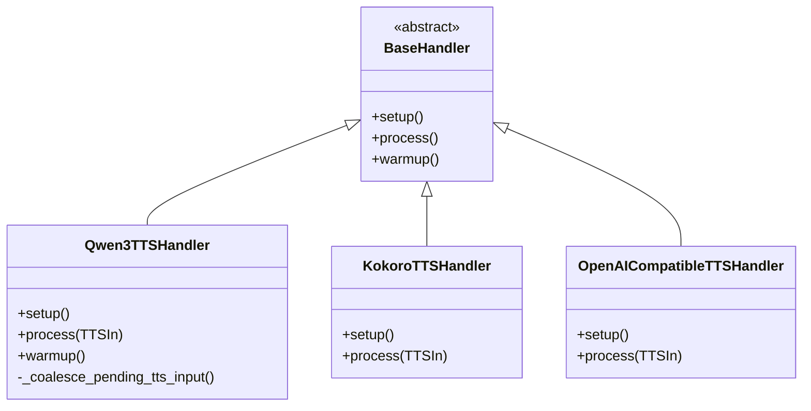

<!-- source: DeepWiki mcp.deepwiki.com · repo huggingface/speech-to-speech · page 3.4 Text-to-Speech (TTS) · fetched 2026-10-26 -->

# Text-to-Speech (TTS)

<details>
<summary>Relevant source files</summary>

The following files were used as context for generating this wiki page:

- [src/speech_to_speech/TTS/README.md](src/speech_to_speech/TTS/README.md)
- [src/speech_to_speech/TTS/kokoro_handler.py](src/speech_to_speech/TTS/kokoro_handler.py)
- [src/speech_to_speech/TTS/qwen3_tts_handler.py](src/speech_to_speech/TTS/qwen3_tts_handler.py)
- [src/speech_to_speech/arguments_classes/qwen3_tts_arguments.py](src/speech_to_speech/arguments_classes/qwen3_tts_arguments.py)
- [src/speech_to_speech/arguments_classes/realtime_server_arguments.py](src/speech_to_speech/arguments_classes/realtime_server_arguments.py)
- [tests/test_qwen3_tts_handler_backend.py](tests/test_qwen3_tts_handler_backend.py)
- [tests/test_tts_input_coalescing.py](tests/test_tts_input_coalescing.py)

</details>


## Purpose and Scope

The Text-to-Speech (TTS) component is the final processing stage of the speech-to-speech pipeline. It is responsible for converting text responses generated by the Language Model (LLM) into audible speech. This component is designed for low-latency, streaming performance, typically outputting **int16 PCM audio at 16kHz** [src/speech_to_speech/TTS/qwen3_tts_handler.py:57-57]().

The system utilizes a handler-based architecture, allowing users to switch between various TTS engines (e.g., Qwen3, Kokoro, OpenAI-compatible, Pocket) depending on hardware availability (CUDA vs. Apple Silicon) and language requirements.

Sources: [src/speech_to_speech/TTS/README.md:1-13](), [src/speech_to_speech/TTS/qwen3_tts_handler.py:57-57]()

## TTS Component Architecture

The TTS handlers follow a consistent lifecycle managed by the `ThreadManager`. They receive text chunks (often single sentences) via `TTSInput` [src/speech_to_speech/pipeline/messages.py:38-38]() and yield audio buffers.

### TTS in the Pipeline

The TTS component bridges the "Natural Language Space" (text) to the "Audio Space" (PCM bytes).

```mermaid
flowchart LR
    subgraph "Natural Language Space"
        LLM["LLM Handler"] -- "Text Sentence" --> LMOP["LMOutputProcessor"]
    end

    subgraph "Code Entity Space (TTS)"
        LMOP -- "TTSInput" --> TTSH["TTS Handler (BaseHandler)"]
        TTSH -- "_coalesce_pending_tts_input" --> Model["TTS Model Engine"]
        Model -- "Raw Tensor" --> Proc["Post-Processor (int16 PCM)"]
    end

    subgraph "Audio Space"
        Proc -- "AudioOutput (np.ndarray)" --> Out["Audio Output Queue"]
        Out -- "Signal" --> DONE["AUDIO_RESPONSE_DONE"]
    end
```



Sources: [src/speech_to_speech/TTS/qwen3_tts_handler.py:92-104](), [tests/test_tts_input_coalescing.py:19-32](), [src/speech_to_speech/pipeline/messages.py:34-38]()

### Handler Class Hierarchy

All TTS implementations inherit from `BaseHandler` to ensure the pipeline can swap them dynamically based on `ModuleArguments.tts`.



Sources: [src/speech_to_speech/TTS/qwen3_tts_handler.py:92-92](), [src/speech_to_speech/TTS/README.md:7-13]()

## Common Patterns and Requirements

Across all handlers, several technical patterns are strictly followed to maintain pipeline stability:

1. **Audio Format**: Outputs must be mono, 16kHz, signed 16-bit PCM (int16) [src/speech_to_speech/TTS/qwen3_tts_handler.py:57-57]().
2. **Interruption**: Handlers check the `CancelScope` or `stop_event` to immediately halt audio generation if a user "barges in" (interrupts) [src/speech_to_speech/TTS/qwen3_tts_handler.py:136-138]().
3. **Speculative Execution**: Handlers use `SpeculativeTurnTracker` to verify if the incoming text belongs to the latest turn revision before processing, dropping stale generations [src/speech_to_speech/TTS/qwen3_tts_handler.py:40-40]().
4. **Input Coalescing**: To improve prosody and efficiency, handlers like `Qwen3TTSHandler` use `_coalesce_pending_tts_input` to merge multiple small text fragments into larger synthesis units while respecting response boundaries [tests/test_tts_input_coalescing.py:19-32]().
5. **Blocksize Chunking**: Audio is yielded in fixed sizes (e.g., 512 samples) to match the playback buffer requirements [src/speech_to_speech/arguments_classes/qwen3_tts_arguments.py:131-134]().
6. **Signaling**: Once the final chunk of a response is processed (triggered by `EndOfResponse`), the handler must yield `AUDIO_RESPONSE_DONE` [src/speech_to_speech/pipeline/messages.py:13-13]().

Sources: [src/speech_to_speech/TTS/qwen3_tts_handler.py:133-140](), [tests/test_tts_input_coalescing.py:19-32](), [src/speech_to_speech/arguments_classes/qwen3_tts_arguments.py:131-134]()

## Available TTS Engines and Child Pages

The pipeline supports multiple engine families, detailed in the child pages below:

- **[Qwen3 TTS Handler](#3.4.1)** — Qwen3-TTS dual-backend handler (`mlx-audio` on Apple Silicon, `qwentts-cpp/faster` on CUDA): voice cloning, custom voice, voice design, quantization variants, reference audio preprocessing, input coalescing, TTFA/RTF metrics, and warmup.
- **[OpenAI-Compatible TTS Handler](#3.4.2)** — The OpenAI-compatible HTTP TTS backend: streaming audio responses, arguments class, cancellation, and format/rate handling as documented in `docs/openai-compatible-tts.md`.
- **[Other TTS Engines](#3.4.3)** — Kokoro-82M, OmniVoice, Supertonic, Pocket TTS, FacebookMMS, ChatTTS, and archived MeloTTS/Parler handlers: arguments, language support, streaming capabilities, and backend selection guidance.

Sources: [src/speech_to_speech/TTS/README.md:3-16]()

## Configuration and Selection

TTS engines are configured via prefix-based arguments (e.g., `--qwen3_tts_model_name` or `--kokoro_voice`).

```bash
# Example: Running with Kokoro TTS
speech-to-speech serve --tts kokoro --kokoro_voice bm_fable --kokoro_device auto

# Example: Running with Qwen3 TTS on Linux with GGML quantization
speech-to-speech serve --tts qwen3 --qwen3_tts_backend ggml --qwen3_tts_ggml_quantization Q4_K_M
```

Sources: [src/speech_to_speech/TTS/README.md:62-66](), [src/speech_to_speech/TTS/README.md:118-124]()

---

