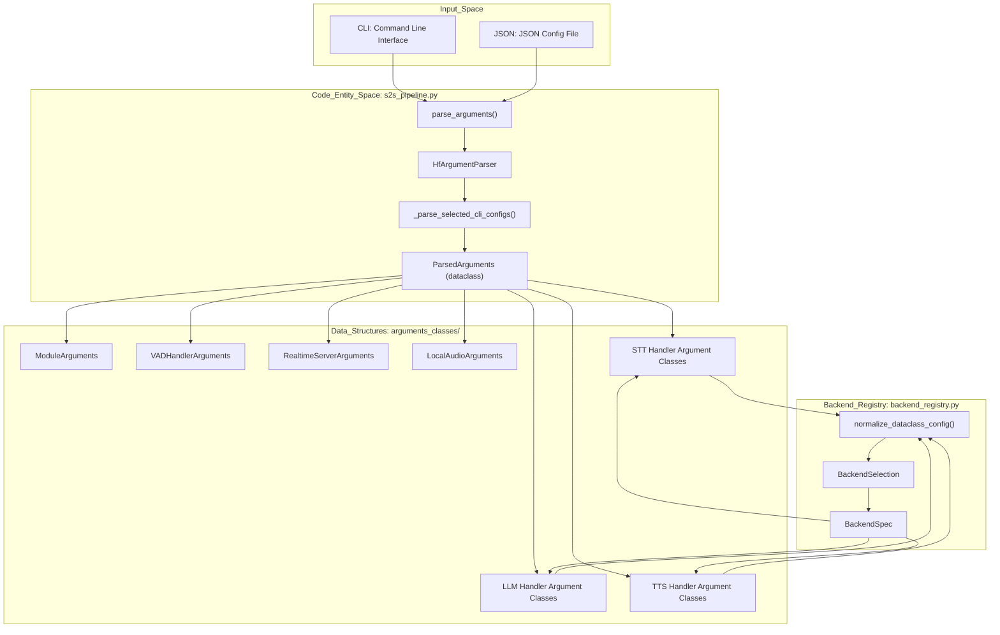

<!-- source: DeepWiki mcp.deepwiki.com · repo huggingface/speech-to-speech · page 4 Configuration System · fetched 2026-10-26 -->

# Configuration System

<details>
<summary>Relevant source files</summary>

The following files were used as context for generating this wiki page:

- [src/speech_to_speech/arguments_classes/module_arguments.py](src/speech_to_speech/arguments_classes/module_arguments.py)
- [src/speech_to_speech/backend_registry.py](src/speech_to_speech/backend_registry.py)
- [src/speech_to_speech/s2s_pipeline.py](src/speech_to_speech/s2s_pipeline.py)
- [tests/test_backend_registry.py](tests/test_backend_registry.py)
- [tests/test_cli_defaults.py](tests/test_cli_defaults.py)

</details>


The speech-to-speech pipeline utilizes a comprehensive argument-based configuration system powered by `HfArgumentParser`. This allows for granular control over every stage of the pipeline—VAD, STT, LLM, and TTS—through either command-line arguments or JSON configuration files.

## Configuration Architecture

The system is organized into namespaced dataclasses. High-level decisions (like which STT engine or LLM backend to use) are defined in `ModuleArguments`, while engine-specific parameters (like model names or generation temperatures) are isolated in dedicated argument classes.

### Argument Parsing Flow
The `parse_arguments` function in `s2s_pipeline.py` [src/speech_to_speech/s2s_pipeline.py:175-282]() initializes the `HfArgumentParser` with a tuple of all supported handler argument classes. Notably, it performs a pre-parse of the `--llm_backend` argument to determine which specific LLM argument class (e.g., `ResponsesApiLanguageModelHandlerArguments` vs `LanguageModelHandlerArguments`) to register, preventing field name collisions [src/speech_to_speech/s2s_pipeline.py:209-228]().

### Configuration Mapping
This diagram maps the natural language configuration concepts to the specific code entities that manage them.


Sources: [src/speech_to_speech/s2s_pipeline.py:101-109](), [src/speech_to_speech/s2s_pipeline.py:135-172](), [src/speech_to_speech/s2s_pipeline.py:175-282](), [src/speech_to_speech/backend_registry.py:90-110](), [src/speech_to_speech/backend_registry.py:113-129](), [src/speech_to_speech/backend_registry.py:131-152]()

## Key Configuration Mechanisms

### Prefix-Based Namespacing and Normalization
To avoid naming collisions when multiple handlers are loaded, arguments often use prefixes (e.g., `stt_`, `llm_`, `tts_`). The `normalize_dataclass_config` function [src/speech_to_speech/backend_registry.py:131-152]() processes these at runtime:
1. It strips the specified prefix from the argument keys.
2. It identifies keys starting with `gen_` and moves them into a nested `gen_kwargs` dictionary, which is typically passed directly to model generation methods like `model.generate()`.

This normalization is part of creating a `BackendSelection` object, which encapsulates the `BackendSpec` and its normalized configuration [src/speech_to_speech/backend_registry.py:113-129]().

### Selective Loading of Argument Classes
The `_parse_selected_cli_configs` function [src/speech_to_speech/s2s_pipeline.py:135-172]() is crucial for handling the dynamic nature of backend selection. It first parses arguments for the core `ModuleArguments` and other common dataclasses. Then, based on the selected STT, LLM, and TTS backends, it identifies and loads only the argument classes relevant to those active backends. This prevents `HfArgumentParser` from raising errors for unrecognized arguments that belong to *inactive* backends. Arguments for inactive backends are logged as warnings and ignored [src/speech_to_speech/s2s_pipeline.py:167-171]().

### Module-Level Macros and Overrides
The system provides "macros" and global settings to simplify complex setups:
*   **`mac_optimal_settings`**: A boolean flag in `ModuleArguments` [src/speech_to_speech/arguments_classes/module_arguments.py:18-25]() that, when enabled, triggers a configuration override. This automatically sets the pipeline to use Apple Silicon-optimized handlers: `parakeet-tdt` (STT), `mlx-lm` (LLM), and `qwen3` (TTS) on the `mps` device [src/speech_to_speech/s2s_pipeline.py:81-92]().
*   **Global Device Override**: The `device` argument in `ModuleArguments` [src/speech_to_speech/arguments_classes/module_arguments.py:14-17]() acts as a global override. If set, it is propagated to all individual handler device settings (e.g., `stt_device`, `llm_device`, `qwen3_tts_device`) during the pipeline build process.

### LLM Proxy Configuration
The system can expose the configured LLM backend as an OpenAI-compatible proxy endpoint. This is configured via `build_llm_proxy_config` [src/speech_to_speech/s2s_pipeline.py:111-132](), which extracts connection details from the selected LLM backend's configuration to populate an `LLMProxyConfig`. Validation ensures that only backends supporting the proxy feature can be used [src/speech_to_speech/s2s_pipeline.py:118-123]().

## Configuration Categories

### Module-Level Configuration
This category covers arguments that define the overall behavior of the application, including the selection of core components (STT, LLM, TTS), global device settings, and operational modes.

For details, see [Module-Level Configuration](#4.1).

| Class | Key Responsibilities |
|-------|----------------------|
| `ModuleArguments` | Handler selection (`stt`, `llm_backend`, `tts`), `mac_optimal_settings` macro, `num_pipelines` for scaling, `log_level`, `log_transcripts`, `enable_live_transcription`, and `enable_llm_proxy`. |
| `VADHandlerArguments` | Voice Activity Detection thresholds (`thresh`), silence durations (`min_silence_ms`), and audio enhancement toggles. |
| `RealtimeServerArguments` | Host and port configuration for the FastAPI/uvicorn server. |
| `LocalAudioArguments` | Configuration for local audio input/output devices. |

Sources: [src/speech_to_speech/arguments_classes/module_arguments.py:13-104](), [src/speech_to_speech/arguments_classes/vad_arguments.py:1-40](), [src/speech_to_speech/arguments_classes/realtime_server_arguments.py:1-20](), [src/speech_to_speech/arguments_classes/local_audio_arguments.py:1-20]()

### Handler-Specific Configuration
Each plugin in the system (STT, LLM, TTS) has a corresponding dataclass defining its specific requirements, such as model repository IDs, quantization settings, and generation parameters. The `HfArgumentParser` dynamically loads only the relevant argument classes based on the selected backends [src/speech_to_speech/s2s_pipeline.py:135-172]().

For details, see [Handler-Specific Configuration](#4.2).

| Handler Type | Argument Classes (Examples) |
|--------------|-----------------------------|
| **STT** | `WhisperSTTHandlerArguments`, `ParakeetTDTSTTHandlerArguments`, `OpenAICompatibleSTTHandlerArguments`, `OpenAIRealtimeSTTHandlerArguments` |
| **LLM** | `LanguageModelHandlerArguments` (Transformers/MLX), `ResponsesApiLanguageModelHandlerArguments`, `ChatCompletionsLanguageModelHandlerArguments` |
| **TTS** | `Qwen3TTSHandlerArguments`, `KokoroTTSHandlerArguments`, `OpenAICompatibleTTSHandlerArguments`, `OmniVoiceTTSHandlerArguments` |

Sources: [src/speech_to_speech/s2s_pipeline.py:135-172](), [src/speech_to_speech/backend_registry.py:12-44]()

## Usage Examples

### Command Line
```bash
python s2s_pipeline.py serve --stt parakeet-tdt --llm_backend mlx-lm --tts qwen3 --device mps
```

### JSON Configuration
The parser can also ingest a JSON file if it is the only argument provided [src/speech_to_speech/s2s_pipeline.py:187-190]():
```bash
python s2s_pipeline.py config.json
```

### Automatic Mac Optimization
```bash
python s2s_pipeline.py serve --mac_optimal_settings True
```
This single flag internally reconfigures the pipeline for the best performance on macOS by applying presets for STT, LLM, and TTS handlers [src/speech_to_speech/s2s_pipeline.py:81-92]().

Sources: [src/speech_to_speech/s2s_pipeline.py:187-190](), [src/speech_to_speech/arguments_classes/module_arguments.py:18-25]()

---

