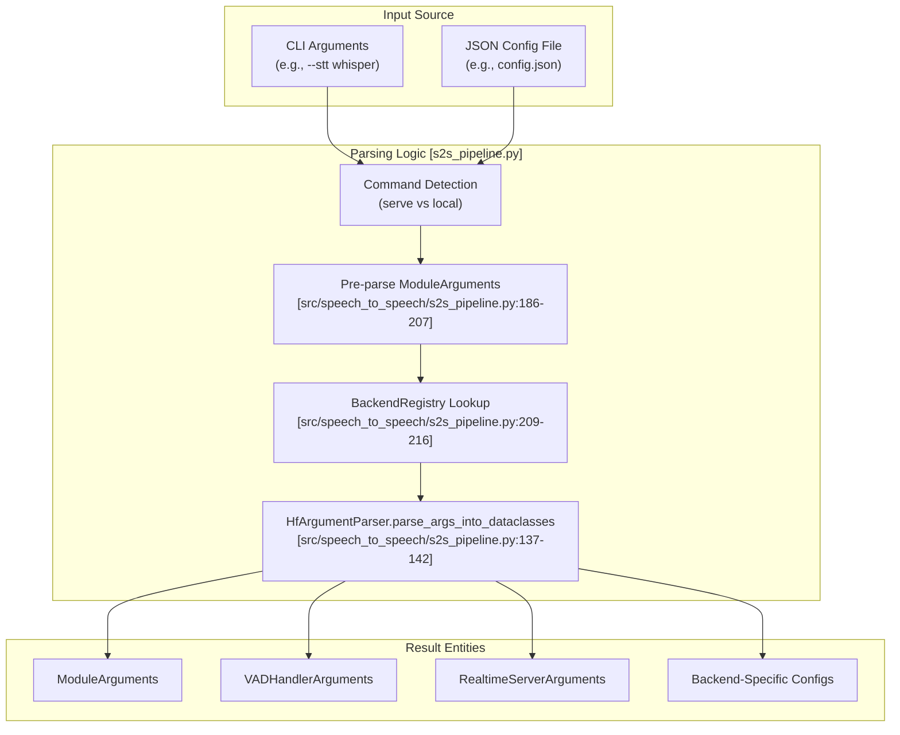
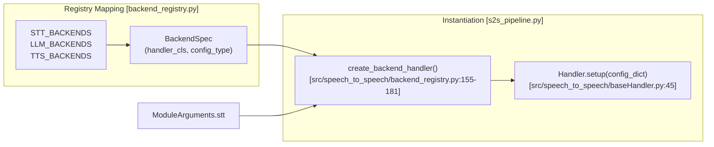

<!-- source: DeepWiki mcp.deepwiki.com · repo huggingface/speech-to-speech · page 4.1 Module-Level Configuration · fetched 2026-10-26 -->

# Module-Level Configuration

Relevant source files

The following files were used as context for generating this wiki page:

- [src/speech_to_speech/VAD/smart_turn.py](src/speech_to_speech/VAD/smart_turn.py)
- [src/speech_to_speech/VAD/vad_handler.py](src/speech_to_speech/VAD/vad_handler.py)
- [src/speech_to_speech/arguments_classes/local_audio_arguments.py](src/speech_to_speech/arguments_classes/local_audio_arguments.py)
- [src/speech_to_speech/arguments_classes/module_arguments.py](src/speech_to_speech/arguments_classes/module_arguments.py)
- [src/speech_to_speech/arguments_classes/vad_arguments.py](src/speech_to_speech/arguments_classes/vad_arguments.py)
- [src/speech_to_speech/cli.py](src/speech_to_speech/cli.py)
- [src/speech_to_speech/pipeline/speculative_turns.py](src/speech_to_speech/pipeline/speculative_turns.py)
- [src/speech_to_speech/pipeline/transcript_logging.py](src/speech_to_speech/pipeline/transcript_logging.py)
- [src/speech_to_speech/s2s_pipeline.py](src/speech_to_speech/s2s_pipeline.py)
- [tests/openai_realtime/test_pipeline_builder.py](tests/openai_realtime/test_pipeline_builder.py)
- [tests/test_cli_defaults.py](tests/test_cli_defaults.py)
- [tests/test_smart_turn.py](tests/test_smart_turn.py)
- [tests/test_speculative_turns.py](tests/test_speculative_turns.py)
- [tests/test_transcript_log_hygiene.py](tests/test_transcript_log_hygiene.py)

This document describes the module-level configuration system controlled by the `ModuleArguments` class. These arguments define the high-level behavior of the speech-to-speech pipeline, including deployment mode, handler selection, device configuration, and concurrency settings.

## Overview

The `ModuleArguments` class in [src/speech_to_speech/arguments_classes/module_arguments.py:13-94]() provides the top-level configuration interface for the speech-to-speech pipeline. These arguments control:

- **Handler selection**: Selection of specific STT, LLM, and TTS implementations via backend strings [src/speech_to_speech/arguments_classes/module_arguments.py:26-48]().
- **Device configuration**: Global device override (CPU, CUDA, MPS) [src/speech_to_speech/arguments_classes/module_arguments.py:14-17]().
- **Logging verbosity**: Control over system-wide log levels [src/speech_to_speech/arguments_classes/module_arguments.py:49-52]().
- **Platform-specific optimizations**: Macro for macOS defaults (`mac_optimal_settings`) [src/speech_to_speech/arguments_classes/module_arguments.py:18-25]().
- **Live transcription features**: Toggling progressive transcription and its timing parameters [src/speech_to_speech/arguments_classes/module_arguments.py:53-68]().
- **Pipeline Scaling**: The `num_pipelines` parameter defines the size of the `PipelineUnit` pool for concurrent sessions [src/speech_to_speech/arguments_classes/module_arguments.py:85-93]().
- **LLM Proxy**: Exposing the LLM backend as an OpenAI-compatible HTTP endpoint [src/speech_to_speech/arguments_classes/module_arguments.py:69-84]().

The configuration system is integrated into the pipeline orchestration in [src/speech_to_speech/s2s_pipeline.py](), where arguments are parsed, validated, and used to construct the appropriate handlers via the `BackendRegistry`.

Sources: [src/speech_to_speech/arguments_classes/module_arguments.py:13-94](), [src/speech_to_speech/s2s_pipeline.py:95-104]()

## Configuration Sources

The system supports specification via CLI flags or JSON files. It uses a multi-stage parsing strategy to handle the dynamic nature of backend-specific arguments.

Sources: [src/speech_to_speech/s2s_pipeline.py:137-142](), [src/speech_to_speech/s2s_pipeline.py:186-216]()

### Macro: mac_optimal_settings
The `mac_optimal_settings` flag is a configuration macro. When enabled, it applies a set of optimized defaults for Apple Silicon [src/speech_to_speech/s2s_pipeline.py:81-97]():
- **STT**: `parakeet-tdt`
- **LLM**: `mlx-lm`
- **TTS**: `qwen3`
- **Devices**: `mps` (Metal Performance Shaders)
- **LLM Model**: `mlx-community/Qwen3-4B-Instruct-2507-4bit`

Sources: [src/speech_to_speech/s2s_pipeline.py:81-97](), [src/speech_to_speech/arguments_classes/module_arguments.py:18-25]()

## Module and Server Arguments

### ModuleArguments
The `ModuleArguments` dataclass [src/speech_to_speech/arguments_classes/module_arguments.py:13-94]() defines the core, high-level configuration for the entire speech-to-speech system.

| Parameter | Default | Description |
|-----------|---------|-------------|
| `device` | `None` | If specified, overrides the device for all handlers (e.g., `cpu`, `cuda`, `mps`) [src/speech_to_speech/arguments_classes/module_arguments.py:14-17](). |
| `mac_optimal_settings` | `False` | Applies macOS defaults for STT, LLM, TTS, and MPS device settings [src/speech_to_speech/arguments_classes/module_arguments.py:18-25](). |
| `stt` | `parakeet-tdt` | The STT backend to use. Use `'none'` to send VAD audio directly to an audio-input LLM [src/speech_to_speech/arguments_classes/module_arguments.py:26-34](). |
| `llm_backend` | `responses-api` | The LLM backend to use [src/speech_to_speech/arguments_classes/module_arguments.py:35-41](). |
| `tts` | `qwen3` | The TTS backend to use [src/speech_to_speech/arguments_classes/module_arguments.py:42-48](). |
| `log_level` | `info` | Logging level (e.g., `debug`, `info`, `warning`) [src/speech_to_speech/arguments_classes/module_arguments.py:49-52](). |
| `log_transcripts` | `False` | Writes full user and assistant transcript text to the application log for debugging [src/speech_to_speech/arguments_classes/module_arguments.py:53-62](). This is `False` by default to prevent sensitive conversation content from being retained in logs [src/speech_to_speech/pipeline/transcript_logging.py:1-85](). |
| `enable_live_transcription` | `True` | Enables progressive audio release for live transcription during speech [src/speech_to_speech/arguments_classes/module_arguments.py:63-68](). |
| `live_transcription_update_interval` | `0.5` | Update interval for live transcription in seconds [src/speech_to_speech/arguments_classes/module_arguments.py:69-72](). |
| `live_transcription_min_silence_ms` | `500` | Minimum silence duration (ms) before ending speech when live transcription is enabled [src/speech_to_speech/arguments_classes/module_arguments.py:73-78](). |
| `enable_llm_proxy` | `False` | Exposes a proxy-capable LLM backend as an OpenAI-compatible HTTP endpoint on the realtime server [src/speech_to_speech/arguments_classes/module_arguments.py:79-84](). |
| `llm_proxy_connect_timeout_s` | `10.0` | Connect timeout in seconds for LLM proxy requests to the upstream provider [src/speech_to_speech/arguments_classes/module_arguments.py:85-90](). |
| `num_pipelines` | `1` | Number of isolated pipeline instances in the pool, determining max concurrent WebSocket sessions [src/speech_to_speech/arguments_classes/module_arguments.py:91-97](). |

### RealtimeServerArguments
The `RealtimeServerArguments` dataclass [src/speech_to_speech/arguments_classes/realtime_server_arguments.py:5-17]() configures the FastAPI/WebSocket server for the `serve` command.

| Parameter | Default | Description |
|-----------|---------|-------------|
| `host` | `127.0.0.1` | The host address for the Realtime server [src/speech_to_speech/arguments_classes/realtime_server_arguments.py:6-9](). |
| `port` | `8765` | The port for the Realtime server [src/speech_to_speech/arguments_classes/realtime_server_arguments.py:10-13](). |
| `workers` | `1` | The number of Uvicorn worker processes to run [src/speech_to_speech/arguments_classes/realtime_server_arguments.py:14-17](). |

### LocalAudioArguments
The `LocalAudioArguments` dataclass [src/speech_to_speech/arguments_classes/local_audio_arguments.py:5-45]() configures direct audio device access for the `local` command, which runs the server and client in the same process.

| Parameter | Default | Description |
|-----------|---------|-------------|
| `local_audio_tool_module` | `None` | Importable module defining `TOOLS` and `async execute_tool(name, arguments)` [src/speech_to_speech/arguments_classes/local_audio_arguments.py:7-13](). |
| `local_audio_input_device` | `None` | Optional sounddevice input device index used by the local command [src/speech_to_speech/arguments_classes/local_audio_arguments.py:14-17](). |
| `local_audio_output_device` | `None` | Optional sounddevice output device index used by the local command [src/speech_to_speech/arguments_classes/local_audio_arguments.py:18-21](). |
| `local_audio_chunk_size` | `1024` | Microphone and speaker callback block size in samples [src/speech_to_speech/arguments_classes/local_audio_arguments.py:22-25](). |
| `local_audio_playback_buffer_ms` | `None` | Audio to buffer before local playback starts, in milliseconds. Defaults to 196 for OpenAI-compatible TTS and 0 otherwise [src/speech_to_speech/arguments_classes/local_audio_arguments.py:26-35](). |
| `local_audio_block_mic_during_playback` | `False` | Pauses local microphone capture while audio is playing. Disabled by default for barge-in [src/speech_to_speech/arguments_classes/local_audio_arguments.py:36-41](). |
| `local_audio_print_json` | `False` | Prints raw Realtime events received by the packaged local audio client [src/speech_to_speech/arguments_classes/local_audio_arguments.py:42-45](). |

Sources: [src/speech_to_speech/arguments_classes/module_arguments.py:13-94](), [src/speech_to_speech/arguments_classes/realtime_server_arguments.py:5-24](), [src/speech_to_speech/arguments_classes/local_audio_arguments.py:5-45]()

## VAD Handler Configuration

The `VADHandlerArguments` class [src/speech_to_speech/arguments_classes/vad_arguments.py:5-131]() defines the sensitivity and turn-taking logic for the `VADHandler` [src/speech_to_speech/VAD/vad_handler.py:61-175]().

### Core Parameters
| Parameter | Default | Description |
|-----------|---------|-------------|
| `vad` | `silero` | Voice activity detector. Choices are `silero` or `firered`. `firered` requires `--vad_firered_model_dir` [src/speech_to_speech/arguments_classes/vad_arguments.py:6-12](). |
| `vad_firered_model_dir` | `None` | Directory of FireRed Stream-VAD weights. Required when `--vad firered` [src/speech_to_speech/arguments_classes/vad_arguments.py:13-17](). |
| `vad_firered_use_gpu` | `False` | Run FireRedVAD on GPU [src/speech_to_speech/arguments_classes/vad_arguments.py:18-21](). |
| `thresh` | `0.6` | The threshold value for VAD. Higher values require higher confidence in speech detection [src/speech_to_speech/arguments_classes/vad_arguments.py:22-27](). |
| `sample_rate` | `16000` | The sample rate of the audio in Hertz [src/speech_to_speech/arguments_classes/vad_arguments.py:28-32](). |
| `min_silence_ms` | `64` | Minimum length of silence intervals to be used for segmenting speech [src/speech_to_speech/arguments_classes/vad_arguments.py:33-37](). |
| `min_speech_ms` | `384` | Minimum length of speech segments to be considered valid speech [src/speech_to_speech/arguments_classes/vad_arguments.py:38-42](). |
| `min_speech_continuation_ms` | `192` | Hysteresis threshold for accepting speech that continues a reopenable turn. Clamped to `[100, min_speech_ms]` [src/speech_to_speech/arguments_classes/vad_arguments.py:43-50](). |
| `max_speech_ms` | `inf` | Maximum length of continuous speech before forcing a split [src/speech_to_speech/arguments_classes/vad_arguments.py:51-55](). |
| `speech_pad_ms` | `500` | Amount of audio retained before VAD triggers and prepended to detected speech segments [src/speech_to_speech/arguments_classes/vad_arguments.py:56-61](). |
| `audio_enhancement` | `False` | Improves sound quality by applying techniques like noise reduction and equalization using DeepFilterNet [src/speech_to_speech/arguments_classes/vad_arguments.py:62-69](). |
| `enable_realtime_transcription` | `False` | Enable progressive audio release for live transcription during speech [src/speech_to_speech/arguments_classes/vad_arguments.py:70-73](). |
| `realtime_processing_pause` | `0.5` | Interval (in seconds) for releasing progressive audio chunks during speech [src/speech_to_speech/arguments_classes/vad_arguments.py:74-78](). |
| `short_segment_merge_ms` | `0` | When greater than 0, adjacent VAD segments below `min_speech_ms` are held and stitched for this many milliseconds [src/speech_to_speech/arguments_classes/vad_arguments.py:92-97](). |

### Smart Turn and Speculative Reopening
The VAD system manages "soft-ended" turns that can be reopened if the user resumes speaking within a specific window [src/speech_to_speech/VAD/vad_handler.py:59-166](). This is managed by the `SpeculativeTurnTracker` [src/speech_to_speech/pipeline/speculative_turns.py:30-37]().

| Parameter | Default | Description |
|-----------|---------|-------------|
| `speculative_reopen_ms` | `800` | Keep a soft-ended Realtime turn reopenable for this many milliseconds unless a response commits it [src/speech_to_speech/arguments_classes/vad_arguments.py:79-83](). |
| `unanswered_reopen_ms` | `7000` | Sanity cap (ms) for reopening a soft-ended speculative turn that has not yet been answered by any assistant output. Clamped to `smart_turn_max_wait_ms` when Smart Turn is enabled [src/speech_to_speech/arguments_classes/vad_arguments.py:84-91](). |
| `smart_turn` | `True` | Use Smart Turn v3.2 after Silero finalizes a Realtime turn to choose how long assistant output remains speculative [src/speech_to_speech/arguments_classes/vad_arguments.py:98-102](). |
| `smart_turn_model_path` | `None` | Optional path to a Smart Turn v3.x CPU ONNX model. If omitted, the latest v3.2 CPU model is downloaded [src/speech_to_speech/arguments_classes/vad_arguments.py:103-108](). |
| `smart_turn_threshold` | `0.5` | Smart Turn completion probability threshold. Higher values wait more readily on ambiguous pauses [src/speech_to_speech/arguments_classes/vad_arguments.py:109-113](). |
| `smart_turn_max_wait_ms` | `2000` | Speculative reopen grace used when Smart Turn reports an incomplete turn. Resumed speech creates a newer turn revision; otherwise output may commit after this delay [src/speech_to_speech/arguments_classes/vad_arguments.py:114-119](). |
| `smart_turn_incomplete_delay_ms` | `600` | Delay STT and LLM processing after Smart Turn reports an incomplete turn, allowing resumed speech to invalidate the revision before expensive work begins [src/speech_to_speech/arguments_classes/vad_arguments.py:120-126](). |
| `smart_turn_cpu_count` | `1` | Number of CPU threads ONNX Runtime may use for each Smart Turn inference [src/speech_to_speech/arguments_classes/vad_arguments.py:127-130](). |

Sources: [src/speech_to_speech/arguments_classes/vad_arguments.py:5-131](), [src/speech_to_speech/VAD/vad_handler.py:59-166](), [src/speech_to_speech/pipeline/speculative_turns.py:30-37]()

## Data Flow and Argument Application

The pipeline orchestrator uses the `BackendRegistry` to map configuration strings to concrete classes and their respective argument definitions.

1. **Selection**: `ModuleArguments` defines which backend to use (e.g., `stt="whisper"`) [src/speech_to_speech/arguments_classes/module_arguments.py:26-34]().
2. **Registry Lookup**: The system looks up the `BackendSpec` to find the corresponding `Handler` class and its specific `Arguments` class [src/speech_to_speech/backend_registry.py:108-153]().
3. **Setup**: The orchestrator calls `create_backend_handler`, which instantiates the handler and applies the parsed configuration via the `setup()` method [src/speech_to_speech/backend_registry.py:155-181]().

Sources: [src/speech_to_speech/backend_registry.py:108-181](), [src/speech_to_speech/s2s_pipeline.py:243-329]()

---

