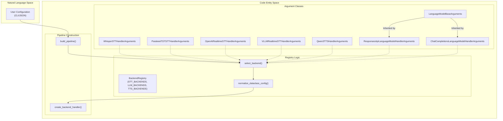
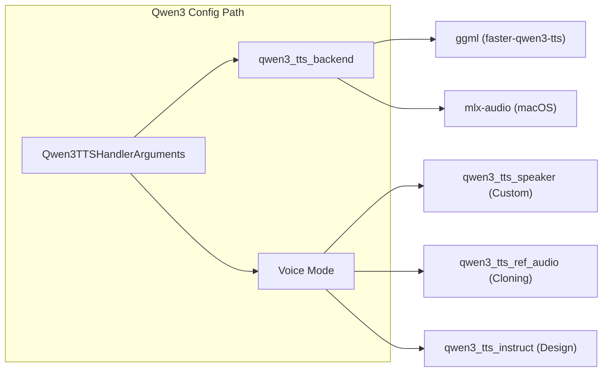

<!-- source: DeepWiki mcp.deepwiki.com · repo huggingface/speech-to-speech · page 4.2 Handler-Specific Configuration · fetched 2026-10-26 -->

# Handler-Specific Configuration

Relevant source files

The following files were used as context for generating this wiki page:

- [src/speech_to_speech/LLM/README.md](src/speech_to_speech/LLM/README.md)
- [src/speech_to_speech/STT/streaming_handler.py](src/speech_to_speech/STT/streaming_handler.py)
- [src/speech_to_speech/TTS/README.md](src/speech_to_speech/TTS/README.md)
- [src/speech_to_speech/arguments_classes/facebookmms_tts_arguments.py](src/speech_to_speech/arguments_classes/facebookmms_tts_arguments.py)
- [src/speech_to_speech/arguments_classes/language_model_arguments.py](src/speech_to_speech/arguments_classes/language_model_arguments.py)
- [src/speech_to_speech/arguments_classes/language_model_base_arguments.py](src/speech_to_speech/arguments_classes/language_model_base_arguments.py)
- [src/speech_to_speech/arguments_classes/openai_realtime_stt_arguments.py](src/speech_to_speech/arguments_classes/openai_realtime_stt_arguments.py)
- [src/speech_to_speech/arguments_classes/qwen3_tts_arguments.py](src/speech_to_speech/arguments_classes/qwen3_tts_arguments.py)
- [src/speech_to_speech/arguments_classes/realtime_server_arguments.py](src/speech_to_speech/arguments_classes/realtime_server_arguments.py)
- [src/speech_to_speech/arguments_classes/vllm_realtime_stt_arguments.py](src/speech_to_speech/arguments_classes/vllm_realtime_stt_arguments.py)
- [src/speech_to_speech/backend_registry.py](src/speech_to_speech/backend_registry.py)
- [tests/test_backend_registry.py](tests/test_backend_registry.py)
- [tests/test_streaming_stt_handler.py](tests/test_streaming_stt_handler.py)

## Purpose and Scope

This document details the configuration parameters for individual STT, LLM, and TTS handlers in the speech-to-speech system. Each handler implementation has its own set of configuration options that control model selection, performance optimization, and behavior-specific settings.

The system utilizes `HfArgumentParser` to dynamically load only the argument classes corresponding to the backends selected by the user. For information about the handler plugin system architecture and how these backends are registered, see [Handler Plugin System and Backend Registry (3.4)]().

## Configuration Architecture

The system uses Python dataclasses to define type-safe configuration schemas for each handler. The `BackendRegistry` maps backend names to their respective `BackendSpec`, which includes the `config_type` (the dataclass) and a `create_handler` factory.

### Configuration Entity Mapping

The following diagram bridges the "Natural Language Space" (how users think of configuration) to the "Code Entity Space" (the actual classes and functions used).

**Configuration Flow Diagram**: Handler-specific arguments flow from CLI/JSON configuration through the `select_backend` function to be normalized before being passed to `create_backend_handler`.

Sources: [src/speech_to_speech/backend_registry.py:80-99](), [src/speech_to_speech/backend_registry.py:120-140](), [src/speech_to_speech/backend_registry.py:162-168](), [src/speech_to_speech/backend_registry.py:182-192]()

### Argument Normalization

The `normalize_dataclass_config` function converts the flat dataclass fields (often prefixed with the backend name) into a nested dictionary suitable for handler initialization. It specifically handles `gen_kwargs` by grouping any field starting with `gen_` into a sub-dictionary.

Sources: [src/speech_to_speech/backend_registry.py:120-140]()

## STT Handler Configuration

### Whisper STT
`WhisperSTTHandlerArguments` configures the standard Transformers-based Whisper implementation.

| Parameter | Type | Default | Description |
|-----------|------|---------|-------------|
| `whisper_stt_model_name` | str | `openai/whisper-tiny.en` | Hugging Face model ID. |
| `whisper_stt_device` | str | `cuda` | Execution device. |
| `whisper_stt_dtype` | str | `float16` | Data type for weights. |

Sources: [src/speech_to_speech/arguments_classes/whisper_stt_arguments.py:5-20]()

### Parakeet TDT STT
`ParakeetTDTSTTHandlerArguments` supports the NVIDIA Parakeet TDT 0.6B v3 model.

| Parameter | Type | Default | Description |
|-----------|------|---------|-------------|
| `parakeet_tdt_model_name` | str | `None` | Defaults to MLX or PyTorch variants based on device. |
| `parakeet_tdt_device` | str | `auto` | Auto-selects MPS on macOS, CUDA otherwise. |
| `parakeet_tdt_language` | str | `None` | Language code; triggers auto-detection if None. |

Sources: [src/speech_to_speech/arguments_classes/parakeet_tdt_arguments.py:6-39]()

### OpenAI Realtime STT
`OpenAIRealtimeSTTHandlerArguments` configures the connection to an OpenAI Realtime transcription session.

| Parameter | Type | Default | Description |
|-----------|------|---------|-------------|
| `openai_realtime_stt_base_url` | str | `wss://api.openai.com/v1` | Base URL for the OpenAI Realtime API. |
| `openai_realtime_stt_api_key` | Optional[str] | `None` | Optional bearer token. `OPENAI_API_KEY` is used for the official endpoint when unset. |
| `openai_realtime_stt_model` | str | `gpt-live-transcribe` | Realtime transcription model identifier. |
| `openai_realtime_stt_language` | Optional[str] | `None` | Optional language hint for the transcription session. |
| `openai_realtime_stt_audio_sample_rate` | int | `24000` | PCM sample rate; hosted OpenAI Realtime requires 24000. |
| `openai_realtime_stt_connect_timeout` | float | `10.0` | WebSocket connection and session-setup timeout in seconds. |
| `openai_realtime_stt_final_timeout` | float | `60.0` | Maximum wait for the committed final transcript in seconds. |

Sources: [src/speech_to_speech/arguments_classes/openai_realtime_stt_arguments.py:6-36]()

### VLLM Realtime STT
`VLLMRealtimeSTTHandlerArguments` configures the connection to vLLM's experimental Realtime transcription API.

| Parameter | Type | Default | Description |
|-----------|------|---------|-------------|
| `vllm_realtime_stt_base_url` | str | `ws://localhost:8000/v1` | Base URL for vLLM's Realtime API, including /v1. |
| `vllm_realtime_stt_api_key` | Optional[str] | `None` | Optional bearer token for the vLLM endpoint. |
| `vllm_realtime_stt_model` | str | `Qwen/Qwen3-ASR-1.7B` | Realtime-capable model identifier; must match a model served by the vLLM endpoint. |
| `vllm_realtime_stt_audio_sample_rate` | int | `16000` | PCM sample rate; current vLLM Realtime requires 16000. |
| `vllm_realtime_stt_connect_timeout` | float | `10.0` | WebSocket connection and session-setup timeout in seconds. |
| `vllm_realtime_stt_final_timeout` | float | `60.0` | Maximum wait for transcription.done after the final commit in seconds. |

Sources: [src/speech_to_speech/arguments_classes/vllm_realtime_stt_arguments.py:5-32]()

## LLM Handler Configuration

### OpenAI-Compatible API LLM
The system provides two primary API backends: `responses-api` and `chat-completions`. Both share connection arguments defined in `ResponsesApiLanguageModelHandlerArguments`.

| Parameter | Type | Default | Description |
|-----------|------|---------|-------------|
| `responses_api_base_url` | str | `None` | Base URL for the API endpoint. |
| `responses_api_api_key` | str | `None` | API key for authentication. |
| `responses_api_stream` | bool | `True` | Whether to use streaming responses. |
| `responses_api_disable_thinking` | bool | `True` | Disables provider-side reasoning (e.g., Together Qwen3.5). |
| `responses_api_audio_max_tokens`| int | `256` | Token limit for audio-input requests. |

Sources: [src/speech_to_speech/arguments_classes/responses_api_language_model_arguments.py:8-60]()

### Chat Completions Specifics
`ChatCompletionsLanguageModelHandlerArguments` inherits from the Responses API arguments and adds specific controls for reasoning models.

| Parameter | Type | Default | Description |
|-----------|------|---------|-------------|
| `responses_api_reasoning_effort` | str | `None` | Sets `reasoning_effort` in `extra_body` (e.g., 'low', 'high'). |

Sources: [src/speech_to_speech/arguments_classes/chat_completions_language_model_arguments.py:10-29]()

### Language Model Handler Arguments (Transformers and MLX)
`LanguageModelHandlerArguments` defines common arguments for local LLM backends like `transformers` and `mlx-lm`.

| Parameter | Type | Default | Description |
|-----------|------|---------|-------------|
| `llm_device` | str | `cuda` | The device type on which the model will run. Default is 'cuda' for GPU acceleration. |
| `llm_torch_dtype` | str | `float16` | The PyTorch data type for the model and input tensors. |
| `llm_gen_max_new_tokens` | int | `1024` | Maximum number of new tokens to generate. |
| `llm_gen_min_new_tokens` | int | `0` | Minimum number of new tokens to generate. |
| `llm_gen_temperature` | float | `0.0` | Controls the randomness of the output. |
| `llm_gen_do_sample` | bool | `False` | Whether to use sampling; set to False for deterministic outputs. |
| `llm_is_vlm` | bool | `False` | Set to True when using a Vision Language Model (VLM). |

Sources: [src/speech_to_speech/arguments_classes/language_model_arguments.py:7-43]()

### Language Model Base Arguments
`LanguageModelBaseArguments` provides common arguments shared across all LLM handlers.

| Parameter | Type | Default | Description |
|-----------|------|---------|-------------|
| `model_name` | str | `Qwen/Qwen3-4B-Instruct-2507` | The pretrained language model to use. |
| `user_role` | str | `user` | Role assigned to the user in the chat context. |
| `init_chat_role` | str | `system` | Initial role for setting up the chat context. |
| `init_chat_prompt` | str | `You are a helpful and friendly AI assistant...` | The initial chat prompt to establish context. |
| `chat_size` | int | `30` | Number of interactions assistant-user to keep for the chat. |
| `stream_batch_sentences` | int | `3` | Number of sentences to accumulate before yielding a batch during streaming. |
| `enable_lang_prompt` | bool | `False` | When True, add a language instruction to the system prompt. |
| `compact_history` | bool | `True` | When True, summarize older turns in the background. |

Sources: [src/speech_to_speech/arguments_classes/language_model_base_arguments.py:4-46]()

## TTS Handler Configuration

### Qwen3-TTS Handler
`Qwen3TTSHandlerArguments` configures the Qwen3-TTS engine, supporting custom voices and MLX optimizations.

**Qwen3-TTS Configuration Flow**: Illustrates how `Qwen3TTSHandlerArguments` fields map to backend selection and voice configuration.

| Parameter | Type | Default | Description |
|-----------|------|---------|-------------|
| `qwen3_tts_model_name` | str | `Qwen/Qwen3-TTS-12Hz-1.7B-CustomVoice` | The Qwen3-TTS model to use. |
| `qwen3_tts_device` | str | `cuda` | Preferred device for Qwen3-TTS. |
| `qwen3_tts_dtype` | str | `auto` | Data type for inference. |
| `qwen3_tts_attn_implementation` | str | `eager` | Attention implementation. |
| `qwen3_tts_backend` | Literal["ggml", "torch"] | `ggml` | faster-qwen3-tts backend on non-macOS platforms. |
| `qwen3_tts_ggml_quantization` | str | `BF16` | GGUF quantization for the GGML backend. |
| `qwen3_tts_gguf_talker_path` | Optional[str] | `None` | Optional local qwentts.cpp talker GGUF path. |
| `qwen3_tts_gguf_codec_path` | Optional[str] | `None` | Optional local qwentts.cpp codec GGUF path. |
| `qwen3_tts_ref_cache_dir` | Optional[str] | `None` | Optional directory for automatically cached GGML voice references. |
| `qwen3_tts_ref_audio` | Optional[str] | `None` | Optional path to reference audio file for voice cloning. |
| `qwen3_tts_ref_spk` | Optional[str] | `None` | Optional precomputed qwentts.cpp .spk speaker embedding. |
| `qwen3_tts_ref_rvq` | Optional[str] | `None` | Optional precomputed qwentts.cpp .rvq acoustic codes. |
| `qwen3_tts_ref_text` | str | `I'm confused why some people...` | Transcription of the reference audio for voice cloning. |
| `qwen3_tts_speaker` | Optional[str] | `Aiden` | Speaker name for CustomVoice models. |
| `qwen3_tts_instruct` | Optional[str] | `None` | Instruction text for VoiceDesign models. |
| `qwen3_tts_xvec_only` | bool | `False` | Use x-vector only voice cloning mode. |
| `qwen3_tts_parity_mode` | bool | `False` | Disable CUDA-graph streaming path and use parity mode. |
| `qwen3_tts_non_streaming_mode` | Optional[bool] | `True` | Optional override for Qwen3-TTS text prefill behavior. |
| `qwen3_tts_mlx_quantization` | Optional[str] | `6bit` | Optional MLX quantization override on Apple Silicon. |
| `qwen3_tts_language` | str | `auto` | Target language for synthesis. |
| `qwen3_tts_streaming_chunk_size` | Optional[int] | `None` | Codec steps per streaming chunk. |
| `qwen3_tts_max_new_tokens` | int | `1536` | Upper cap for Qwen3-TTS codec tokens. |
| `qwen3_tts_blocksize` | int | `512` | Audio chunk size in samples for streaming output. |

Sources: [src/speech_to_speech/arguments_classes/qwen3_tts_arguments.py:6-134]()

### Kokoro TTS
`KokoroTTSHandlerArguments` provides a lightweight TTS option.

| Parameter | Type | Default | Description |
|-----------|------|---------|-------------|
| `kokoro_voice` | str | `af_heart` | The voice ID to use. |
| `kokoro_lang_code` | str | `a` | Language code (e.g., 'a' for American English). |

Sources: [src/speech_to_speech/arguments_classes/kokoro_tts_arguments.py:5-25]()

### Facebook MMS TTS
`FacebookMMSTTSHandlerArguments` configures the Facebook MMS TTS model.

| Parameter | Type | Default | Description |
|-----------|------|---------|-------------|
| `facebook_mms_model_name` | str \| None | `None` | Optional model override. By default, selects the Facebook MMS model from `--tts_language`. |
| `tts_language` | str | `en` | The language code for the TTS model. Default is 'en' for English. |
| `facebook_mms_device` | str | `cuda` | The device to use for the TTS model. Default is 'cuda'. |
| `facebook_mms_torch_dtype` | str | `float32` | The torch data type to use for the TTS model. Default is 'float32'. |

Sources: [src/speech_to_speech/arguments_classes/facebookmms_tts_arguments.py:5-21]()

## Connection and Socket Arguments

When running in `serve` or `talk` modes, the system uses connection arguments to establish communication between the audio client and the pipeline server.

- **RealtimeServerArguments**: Configures the FastAPI/Uvicorn server host and port.
- **LocalAudioArguments**: Configures the local microphone/speaker devices and sample rates.

Sources: [src/speech_to_speech/arguments_classes/realtime_server_arguments.py](), [src/speech_to_speech/s2s_pipeline.py:28-31](), [src/speech_to_speech/backend_registry.py:59-73]()

---

