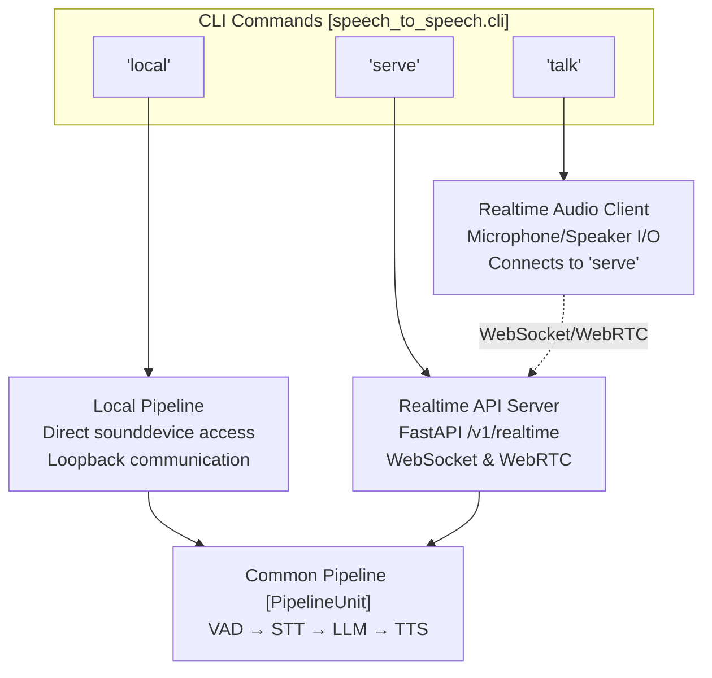
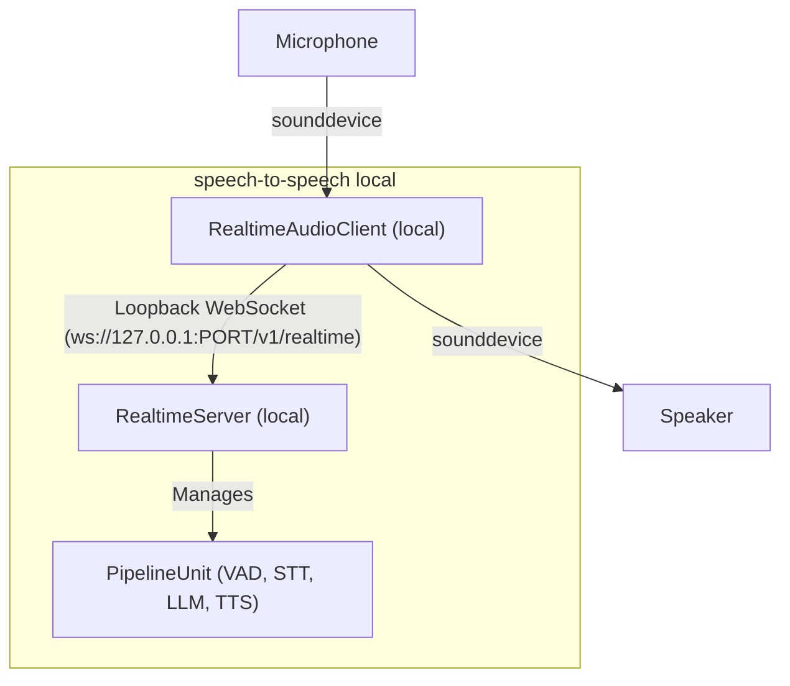
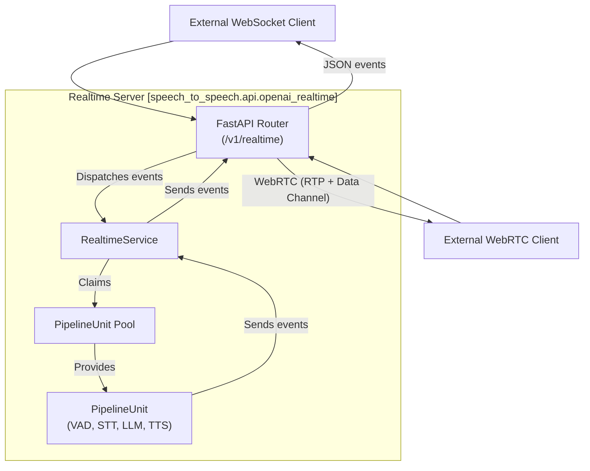

<!-- source: DeepWiki mcp.deepwiki.com · repo huggingface/speech-to-speech · page 5 Realtime API and Deployment Modes · fetched 2026-10-26 -->

# Realtime API and Deployment Modes

Relevant source files

The following files were used as context for generating this wiki page:

- [src/speech_to_speech/api/openai_realtime/README.md](src/speech_to_speech/api/openai_realtime/README.md)
- [src/speech_to_speech/api/openai_realtime/audio_client.py](src/speech_to_speech/api/openai_realtime/audio_client.py)
- [src/speech_to_speech/arguments_classes/local_audio_arguments.py](src/speech_to_speech/arguments_classes/local_audio_arguments.py)
- [src/speech_to_speech/cli.py](src/speech_to_speech/cli.py)
- [src/speech_to_speech/pipeline/transcript_logging.py](src/speech_to_speech/pipeline/transcript_logging.py)
- [tests/openai_realtime/test_audio_client.py](tests/openai_realtime/test_audio_client.py)
- [tests/openai_realtime/test_openai_client.py](tests/openai_realtime/test_openai_client.py)
- [tests/openai_realtime/test_pipeline_builder.py](tests/openai_realtime/test_pipeline_builder.py)
- [tests/test_transcript_log_hygiene.py](tests/test_transcript_log_hygiene.py)

This page provides a high-level overview of the Realtime API and the various deployment modes supported by the `speech-to-speech` codebase. It covers the `serve`, `talk`, and `local` CLI commands, the OpenAI Realtime server implementation, the Python audio client, and Docker deployment. Detailed information for each topic is provided in linked child pages.

The system supports multiple deployment architectures that determine how audio data flows between input devices, the processing pipeline, and output devices. These architectures are accessed via three primary CLI commands: `serve`, `talk`, and `local` [src/speech_to_speech/cli.py:27-31]().

All modes utilize the same internal queue-based processing pipeline (`VAD → STT → LLM → TTS`), differing only in the audio I/O mechanism and protocol wrapping. This clean separation enables flexible deployment without modifying core processing logic.

## Overview of Deployment Commands

The system provides three main entry points for different deployment scenarios:

**Diagram: Deployment Architecture Overview**

Sources: [src/speech_to_speech/cli.py:27-31](), [src/speech_to_speech/api/openai_realtime/README.md:3-48]()

## Serve, Talk and Local Commands

The `speech-to-speech` CLI offers three primary commands: `serve`, `talk`, and `local`.
- The `serve` command launches the Realtime API server, which hosts the speech-to-speech pipeline.
- The `talk` command acts as a client, connecting your local microphone and speakers to a specified Realtime API URL.
- The `local` command combines both, running the server and a client in the same process, communicating over a loopback WebSocket connection. This mode is ideal for local development and testing, providing a self-contained environment.

The `local` command also allows for the selection of audio input and output devices using `LocalAudioArguments` [src/speech_to_speech/arguments_classes/local_audio_arguments.py:14-21](). It supports loading client-side tool modules and enables transcript logging for debugging [src/speech_to_speech/arguments_classes/local_audio_arguments.py:7-13]().

For details, see [Serve, Talk and Local Commands](#5.1).

**Diagram: `local` Command Internal Structure**

Sources: [src/speech_to_speech/cli.py:34](), [src/speech_to_speech/s2s_pipeline.py:42-63](), [src/speech_to_speech/api/openai_realtime/audio_client.py:51-60](), [src/speech_to_speech/arguments_classes/local_audio_arguments.py:6-45]()

## OpenAI Realtime API Server

The Realtime API server is a FastAPI application, created by the `create_app` factory [tests/openai_realtime/test_openai_client.py:111](). It exposes several endpoints, including `/v1/realtime` for WebSocket connections, `/v1/realtime/calls` for WebRTC, `/v1/usage` for metrics, and `/v1/pool` for managing `PipelineUnit` instances. The server manages the lifecycle of connections, including claiming `PipelineUnit` instances from a pool, handling audio batching, and output gating. It also implements mechanisms for draining and quarantining connections, and tracks usage metrics.

The server's architecture is designed to be compatible with the OpenAI Realtime API specification, allowing for seamless integration with OpenAI's SDKs and other compatible clients.

For details, see [OpenAI Realtime API Server](#5.2).

**Diagram: Realtime Server Architecture**

Sources: [src/speech_to_speech/api/openai_realtime/README.md:3-48](), [tests/openai_realtime/test_openai_client.py:111]()

## Python Audio Client

The Python audio client, implemented in `src/speech_to_speech/api/openai_realtime/audio_client.py` [src/speech_to_speech/api/openai_realtime/audio_client.py:1-2](), is used by both the `talk` and `local` commands. Key functions include `listen_and_play_realtime` and `run_realtime_audio_client`. It uses `RealtimeAudioClientConfig` for configuration [src/speech_to_speech/api/openai_realtime/audio_client.py:49-70](), `sounddevice` for audio capture and playback, and a `PlaybackBuffer` to manage audio output. The client also provides friendly event rendering, supports client-side tool execution via `load_realtime_tool_module` [src/speech_to_speech/api/openai_realtime/audio_client.py:76-93](), and can be used for synthetic conversation load testing.

For details, see [Python Audio Client](#5.3).

## Docker Deployment

The codebase provides Docker support for easy deployment. `Dockerfile` and `Dockerfile.arm64` define images for different architectures, including GPU passthrough for CUDA-enabled systems and ARM64/Apple Silicon. The `docker-compose.yml` file simplifies the orchestration of services, managing environment variables and dependencies. The `.dockerignore` file ensures that only necessary files are included in the build context.

For details, see [Docker Deployment](#5.4).

## Browser Demo Application

A browser-based demo application is available in the `demo/` directory. It features a FastAPI server and a JavaScript client. The client supports both WebSocket and WebRTC modes for real-time communication. It integrates with Hugging Face OAuth for authentication, includes a per-day usage limiter, and uses `main.js` and `ui/` modules for its frontend logic. Audio worklets are employed for efficient audio processing in the browser, and an agents SDK adapter facilitates interaction with the Realtime API. The demo also includes node tests and Docker packaging for easy deployment.

For details, see [Browser Demo Application](#5.5).

## Summary Comparison

| Command | Architecture | Communication | Primary Use Case |
| :--- | :--- | :--- | :--- |
| **`local`** | Standalone | Loopback WebSocket | Local development / Single-machine use |
| **`serve`** | Server | WS/WebRTC | GPU Offloading / API Provider |
| **`talk`** | Client | WS to Remote Server | Low-power client I/O (Microphone/Speaker) |

Sources: [src/speech_to_speech/cli.py:27-31]()

---

