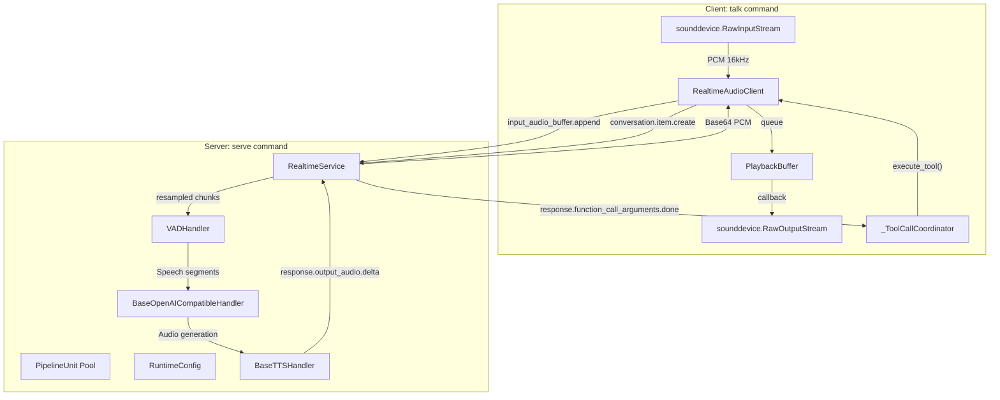

<!-- source: DeepWiki mcp.deepwiki.com · repo huggingface/speech-to-speech · page 5.1 Serve, Talk and Local Commands · fetched 2026-10-26 -->

# Serve, Talk and Local Commands

Relevant source files

The following files were used as context for generating this wiki page:

- [src/speech_to_speech/arguments_classes/local_audio_arguments.py](src/speech_to_speech/arguments_classes/local_audio_arguments.py)
- [src/speech_to_speech/arguments_classes/module_arguments.py](src/speech_to_speech/arguments_classes/module_arguments.py)
- [src/speech_to_speech/cli.py](src/speech_to_speech/cli.py)
- [src/speech_to_speech/pipeline/transcript_logging.py](src/speech_to_speech/pipeline/transcript_logging.py)
- [src/speech_to_speech/s2s_pipeline.py](src/speech_to_speech/s2s_pipeline.py)
- [tests/openai_realtime/test_pipeline_builder.py](tests/openai_realtime/test_pipeline_builder.py)
- [tests/test_cli_defaults.py](tests/test_cli_defaults.py)
- [tests/test_transcript_log_hygiene.py](tests/test_transcript_log_hygiene.py)

The system utilizes a client-server architecture to separate compute-intensive model execution from local audio hardware interaction. This is primarily implemented through the `serve` and `talk` commands. The `serve` command starts a Realtime pipeline server, while the `talk` command launches a lightweight Python audio client that connects to the server via a WebSocket or WebRTC transport. This split allows offloading heavy models (e.g., large LLMs or TTS engines) to GPU-accelerated servers while maintaining a low-latency voice interface on a local machine. The `local` command combines both server and client into a single process, communicating over a loopback interface.

---

## Architecture Overview

The communication between the `talk` client and the `serve` backend follows the OpenAI Realtime API protocol. The client handles microphone capture, speaker playback, and client-side tool execution, while the server manages the VAD → STT → LLM → TTS pipeline orchestration.

### System Data Flow: Code Entities

The following diagram associates system components with their corresponding code entities and data paths.

**Sources:** [src/speech_to_speech/api/openai_realtime/README.md:7-48](), [src/speech_to_speech/api/openai_realtime/audio_client.py:46-65](), [src/speech_to_speech/api/openai_realtime/pipeline_unit.py:53-76]()

---

## The 'serve' Command

The `serve` command initializes the `RealtimeServer`, which hosts the speech-to-speech pipeline and exposes it via FastAPI/uvicorn.

### Key Implementation Details
*   **Pipeline Pooling**: The server manages a pool of `PipelineUnit` objects. Each unit contains an isolated instance of the full handler chain (VAD, STT, LLM, TTS) and its own `RealtimeService` [src/speech_to_speech/api/openai_realtime/pipeline_unit.py:53-76]().
*   **Session Management**: When a client connects via WebSocket (`/v1/realtime`) or WebRTC (`/v1/realtime/calls`), a `PipelineUnit` is claimed and a `SessionState` is initialized [src/speech_to_speech/api/openai_realtime/pipeline_unit.py:13-30]().
*   **Dynamic Configuration**: Server-side components read from a `RuntimeConfig` that is updated dynamically via `session.update` events from the client [src/speech_to_speech/api/openai_realtime/README.md:57-58]().

**Sources:** [src/speech_to_speech/api/openai_realtime/pipeline_unit.py:53-76](), [src/speech_to_speech/api/openai_realtime/README.md:1-58](), [src/speech_to_speech/cli.py:28-28]()

---

## The 'talk' Command

The `talk` command launches the `run_realtime_audio_client` entrypoint, which uses the `RealtimeAudioClient` to bridge local hardware to the remote server.

### Configuration: RealtimeAudioClientConfig
The client is configured via `RealtimeAudioClientConfig`, which includes:
*   `url`: The full Realtime WebSocket endpoint (e.g., `ws://127.0.0.1:8765/v1/realtime`) [src/speech_to_speech/cli.py:108-110]().
*   `send_rate` / `recv_rate`: Audio sampling rates, defaulting to 16kHz for the native pipeline [src/speech_to_speech/cli.py:111-112]().
*   `input_device` / `output_device`: `sounddevice` indices for specific hardware [src/speech_to_speech/cli.py:129-130]().

### Tool Execution and --tool-module
The `talk` command supports client-side tool execution via the `--tool-module` argument.
1.  **Loading**: `load_realtime_tool_module` imports a Python module that must define `TOOLS` (a list of JSON schemas) and a callable `execute_tool` [src/speech_to_speech/cli.py:162-166]().
2.  **Coordination**: The `_ToolCallCoordinator` manages the ordering of tool calls and ensures that results are sent back to the server in the correct sequence.
3.  **Flow**: When the LLM emits a tool call, the server sends `response.function_call_arguments.done`. The client executes the local code and returns the output via `conversation.item.create` [src/speech_to_speech/api/openai_realtime/README.md:69-69]().

**Sources:** [src/speech_to_speech/cli.py:98-170](), [src/speech_to_speech/api/openai_realtime/audio_client.py:62-64](), [src/speech_to_speech/api/openai_realtime/README.md:69-69]()

---

## The 'local' Command

The `local` command runs both the Realtime server and a client in the same process, communicating over a loopback interface. This is useful for local development and testing without network overhead.

### Implementation Details
The `build_local_pipeline` function in `s2s_pipeline.py` orchestrates the creation of the server and client components.
1.  **Pipeline Unit**: A single `PipelineUnit` is created, containing the VAD, STT, LLM, and TTS handlers [tests/openai_realtime/test_pipeline_builder.py:48-49]().
2.  **RealtimeServer**: A `RealtimeServer` instance is initialized, using the created `PipelineUnit` in its pool. The server's host is set to `127.0.0.1` for loopback communication [tests/openai_realtime/test_pipeline_builder.py:59-60]().
3.  **RealtimeAudioClient**: A `RealtimeAudioClient` is configured to connect to the local server's URL (e.g., `ws://127.0.0.1:8765/v1/realtime`) [tests/openai_realtime/test_pipeline_builder.py:61-62](). The `api_key` is set to "local" for unauthenticated loopback communication [tests/openai_realtime/test_pipeline_builder.py:63-63]().

### LocalAudioArguments
The `local` command uses `LocalAudioArguments` to configure audio input/output and client-side behavior [src/speech_to_speech/arguments_classes/local_audio_arguments.py:6-45]().
*   `local_audio_tool_module`: Similar to `talk`'s `--tool-module`, this allows specifying a module for client-side tool execution [src/speech_to_speech/arguments_classes/local_audio_arguments.py:7-13]().
*   `local_audio_input_device` / `local_audio_output_device`: Optional `sounddevice` indices for local microphone and speaker selection [src/speech_to_speech/arguments_classes/local_audio_arguments.py:14-21]().
*   `local_audio_playback_buffer_ms`: Controls the audio buffering before playback starts. This defaults to `196` for OpenAI-compatible TTS and `0` otherwise, but can be explicitly overridden [src/speech_to_speech/arguments_classes/local_audio_arguments.py:26-34](), [tests/openai_realtime/test_pipeline_builder.py:71-82]().
*   `local_audio_block_mic_during_playback`: When enabled, pauses microphone capture during audio playback, which can affect barge-in functionality [src/speech_to_speech/arguments_classes/local_audio_arguments.py:36-40]().

### Transcript Logging
Both `serve`, `talk`, and `local` commands support the `--log_transcripts` flag (or `--log-transcripts` for `talk`) [src/speech_to_speech/arguments_classes/module_arguments.py:53-63](), [src/speech_to_speech/cli.py:148-154](). By default, conversation content (transcripts, LLM responses, tool arguments) is *not* written to application logs to prevent sensitive data exposure [src/speech_to_speech/pipeline/transcript_logging.py:1-17](). When `--log_transcripts` is enabled, a prominent warning is issued, and full conversation content is logged [src/speech_to_speech/pipeline/transcript_logging.py:27-32](), [src/speech_to_speech/pipeline/transcript_logging.py:47-50](). Otherwise, only character counts are logged for content fields [src/speech_to_speech/pipeline/transcript_logging.py:52-65]().

**Sources:** [src/speech_to_speech/s2s_pipeline.py:600-600](), [src/speech_to_speech/arguments_classes/local_audio_arguments.py:6-45](), [src/speech_to_speech/cli.py:148-154](), [src/speech_to_speech/pipeline/transcript_logging.py:1-65](), [tests/openai_realtime/test_pipeline_builder.py:42-64]()

---

## Use Cases for Client-Server Split

| Use Case | Implementation Strategy |
| :--- | :--- |
| **GPU Offloading** | Run `serve` on an NVIDIA A100 server and `talk --url ws://<server-ip>:8765/v1/realtime` on a laptop. |
| **Local Tool Integration** | Use `--tool-module` with `talk` or `local_audio_tool_module` with `local` to allow a remote LLM to control local hardware (e.g., smart home, local file system). |
| **Cross-Platform** | Run the server on Linux (CUDA) and the client on macOS (Apple Silicon) or Windows. |
| **Multimodal Interaction** | Offload Vision-Language Models (VLM) to a server while streaming local camera snapshots through the client. |

### URL Normalization
The client uses `normalize_realtime_url` to ensure the provided `--url` is converted into the base URLs required by the underlying OpenAI Python SDK [src/speech_to_speech/api/openai_realtime/audio_client.py:113-132](). It validates that the URL ends in `/realtime` and uses the appropriate `ws/wss` or `http/https` schemes [src/speech_to_speech/api/openai_realtime/audio_client.py:122-130]().

**Sources:** [src/speech_to_speech/api/openai_realtime/audio_client.py:113-132](), [src/speech_to_speech/cli.py:102-142](), [src/speech_to_speech/arguments_classes/local_audio_arguments.py:7-13]()

---

