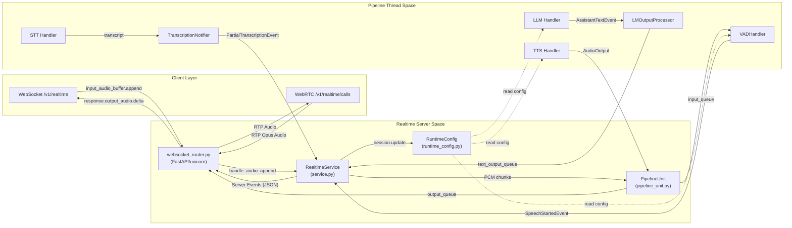
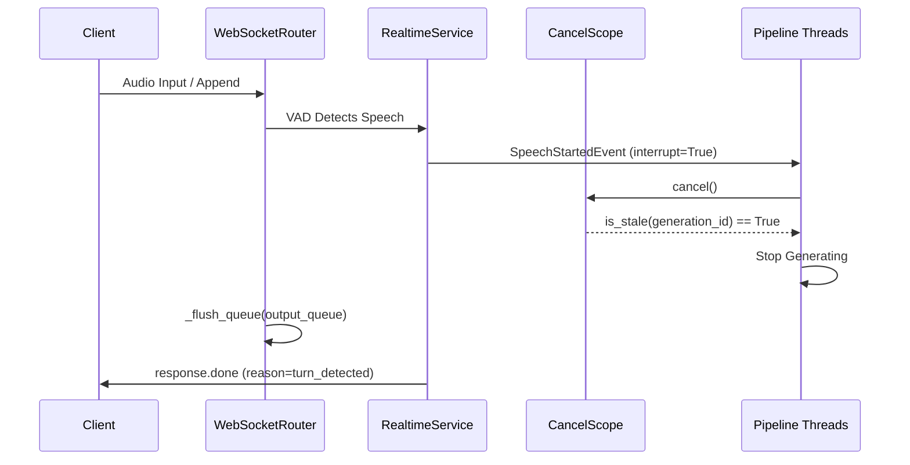

<!-- source: DeepWiki mcp.deepwiki.com · repo huggingface/speech-to-speech · page 5.2 OpenAI Realtime API Server · fetched 2026-10-26 -->

# OpenAI Realtime API Server

Relevant source files

The following files were used as context for generating this wiki page:

- [scripts/synthetic_conversation_realtime_client.py](scripts/synthetic_conversation_realtime_client.py)
- [src/speech_to_speech/api/openai_realtime/README.md](src/speech_to_speech/api/openai_realtime/README.md)
- [src/speech_to_speech/api/openai_realtime/audio_client.py](src/speech_to_speech/api/openai_realtime/audio_client.py)
- [src/speech_to_speech/api/openai_realtime/handlers/session.py](src/speech_to_speech/api/openai_realtime/handlers/session.py)
- [src/speech_to_speech/api/openai_realtime/llm_proxy.py](src/speech_to_speech/api/openai_realtime/llm_proxy.py)
- [src/speech_to_speech/api/openai_realtime/server.py](src/speech_to_speech/api/openai_realtime/server.py)
- [src/speech_to_speech/api/openai_realtime/websocket_router.py](src/speech_to_speech/api/openai_realtime/websocket_router.py)
- [src/speech_to_speech/baseHandler.py](src/speech_to_speech/baseHandler.py)
- [src/speech_to_speech/pipeline/log_context.py](src/speech_to_speech/pipeline/log_context.py)
- [tests/openai_realtime/test_audio_client.py](tests/openai_realtime/test_audio_client.py)
- [tests/openai_realtime/test_openai_client.py](tests/openai_realtime/test_openai_client.py)
- [tests/openai_realtime/test_websocket_router.py](tests/openai_realtime/test_websocket_router.py)

## Purpose and Scope

The OpenAI Realtime API Mode implements a server-side interface compatible with the OpenAI Realtime protocol. This mode allows the speech-to-speech pipeline to act as a drop-in replacement or a local alternative to OpenAI's realtime services. It serves a FastAPI/uvicorn application providing both WebSocket (`/v1/realtime`) and WebRTC (`/v1/realtime/calls`) transports, handling JSON-based control events and high-performance audio streaming.

Unlike standard streaming modes, this mode implements full stateful session management, event dispatching, and tool-calling protocols. It utilizes a `PipelineUnit` pooling strategy to handle concurrent sessions while maintaining strict resource isolation and session cleanup.

Sources: [src/speech_to_speech/api/openai_realtime/README.md:1-5](), [src/speech_to_speech/api/openai_realtime/websocket_router.py:11-20](), [src/speech_to_speech/api/openai_realtime/websocket_router.py:50-64]()

---

## High-Level Architecture

The system runs a `RealtimeServer` [src/speech_to_speech/api/openai_realtime/server.py:14]() which owns a pool of `PipelineUnit` objects. Each `PipelineUnit` encapsulates a full instance of the cascaded pipeline (VAD → STT → LLM → TTS). A `RealtimeService` instance translates between protocol events and internal queue messages.

### System Data Flow and Entity Mapping

The following diagram bridges the protocol events to the internal code entities and pipeline stages.

**Diagram: Realtime API Data Flow and Code Entities**

Sources: [src/speech_to_speech/api/openai_realtime/README.md:7-48](), [src/speech_to_speech/api/openai_realtime/service.py:169-202](), [src/speech_to_speech/api/openai_realtime/websocket_router.py:124-162]()

---

## Core Components

### FastAPI Application Factory (`create_app`)

The FastAPI application is created by the `create_app` function [src/speech_to_speech/api/openai_realtime/websocket_router.py:106](). This factory function takes a pool of `PipelineUnit` instances and a global `stop_event` to manage the server's lifecycle. It sets up the WebSocket and WebRTC endpoints, as well as the `/v1/usage` and `/v1/pool` endpoints for monitoring.

Sources: [src/speech_to_speech/api/openai_realtime/websocket_router.py:106](), [src/speech_to_speech/api/openai_realtime/server.py:41]()

### PipelineUnit and Session Management
The `PipelineUnit` [src/speech_to_speech/api/openai_realtime/pipeline_unit.py:53-76]() is the unit of concurrency. When a client connects via WebSocket or WebRTC, the router attempts to claim an available unit from the pool. Each unit maintains its own `SessionState` [src/speech_to_speech/api/openai_realtime/pipeline_unit.py:13-30](), which tracks the transport, session ID, and whether the pipeline has been fully drained after a disconnect. For details, see [RealtimeService and Connection State](#5.2.3).

### RealtimeService and Handlers
The `RealtimeService` [src/speech_to_speech/api/openai_realtime/service.py:246-260]() manages the translation logic. It delegates domain-specific tasks to four specialized handlers:
- **AudioHandler**: Manages base64 decoding, resampling, and PCM chunking [src/speech_to_speech/api/openai_realtime/handlers/audio.py:31]().
- **ConversationHandler**: Manages item injection and transcription event translation [src/speech_to_speech/api/openai_realtime/handlers/conversation.py:27]().
- **ResponseHandler**: Owns the response lifecycle, including ID generation, status tracking, and speculative turn handling [src/speech_to_speech/api/openai_realtime/handlers/response.py:51]().
- **SessionHandler**: Handles `session.update` events and config synchronization [src/speech_to_speech/api/openai_realtime/handlers/session.py:18]().

For details on these handlers, see [Realtime Event Handlers](#5.2.4).

### Transports: WebSocket and WebRTC
The server supports two primary transport layers:
- **WebSocket Transport**: Standard bidirectional JSON and base64 audio streaming. For details, see [WebSocket Transport](#5.2.1).
- **WebRTC Transport**: High-performance transport using Opus audio tracks and a data channel for events. For details, see [WebRTC Transport](#5.2.2).

### RuntimeConfig
The `RuntimeConfig` [src/speech_to_speech/api/openai_realtime/runtime_config.py:26-35]() acts as the source of truth for dynamic session parameters. It is updated via `session.update` events which are deep-merged into the configuration, allowing real-time changes to instructions, tools, and voice parameters [src/speech_to_speech/api/openai_realtime/service.py:365-367]().

Sources: [src/speech_to_speech/api/openai_realtime/service.py:185-202](), [src/speech_to_speech/api/openai_realtime/pipeline_unit.py:53-76](), [src/speech_to_speech/api/openai_realtime/websocket_router.py:28-32]()

---

## Endpoints

The FastAPI application exposes several endpoints:

- **`/v1/realtime`**: The WebSocket endpoint for real-time communication. This is the primary interface for clients streaming audio and receiving events. For details, see [WebSocket Transport](#5.2.1).
- **`/v1/realtime/calls`**: The WebRTC endpoint for establishing peer-to-peer connections for audio and data. For details, see [WebRTC Transport](#5.2.2).
- **`/v1/usage`**: Provides usage metrics for the server, including LLM proxy usage if enabled [src/speech_to_speech/api/openai_realtime/llm_proxy.py:44]().
- **`/v1/pool`**: Exposes the status of the `PipelineUnit` pool, showing available, in-use, and quarantined units.

Sources: [src/speech_to_speech/api/openai_realtime/websocket_router.py:106](), [src/speech_to_speech/api/openai_realtime/llm_proxy.py:44]()

---

## Unit Claiming and Release

When a new client connects, the server attempts to claim an available `PipelineUnit` from its pool. If no units are available, the connection is rejected with a `session_limit_reached` error [tests/openai_realtime/test_websocket_router.py:181](). Upon client disconnect, the unit is released back to the pool after a draining and quarantine process.

Sources: [tests/openai_realtime/test_websocket_router.py:172-183]()

---

## Send Loop with Audio Batching and Output Gating

The `_send_loop` function [src/speech_to_speech/api/openai_realtime/websocket_router.py:400]() continuously monitors the `output_queue` of the claimed `PipelineUnit`. It batches outgoing audio chunks up to `MAX_AUDIO_BATCH_BYTES` [src/speech_to_speech/api/openai_realtime/websocket_router.py:70]() to optimize network traffic. Output gating ensures that events and audio are sent in the correct order and that stale or cancelled responses do not reach the client.

Sources: [src/speech_to_speech/api/openai_realtime/websocket_router.py:70](), [src/speech_to_speech/api/openai_realtime/websocket_router.py:400]()

---

## Session Draining and Quarantine

When a client disconnects, the unit must be safely reset. This is managed by the `release_unit` task [src/speech_to_speech/api/openai_realtime/websocket_router.py:302-332]():
1. **Cleanup**: Cancels the `CancelScope` and flushes internal queues [src/speech_to_speech/api/openai_realtime/websocket_router.py:166-184]().
2. **Draining**: A `SESSION_END` control message is sent through the pipeline [src/speech_to_speech/api/openai_realtime/websocket_router.py:318](). This simulates the handler chain processing the end of the session. The `_simulate_session_end_drain` helper in tests demonstrates this [tests/openai_realtime/test_websocket_router.py:120-135]().
3. **Quarantine**: If `SESSION_END` does not propagate within a timeout (`SESSION_END_QUARANTINE_TIMEOUT_S` [src/speech_to_speech/api/openai_realtime/websocket_router.py:85]()), the unit is quarantined. This prevents cross-session leaks where stale transcripts from a previous session might appear in a new one. Quarantined units are visible in `/v1/pool` as "stuck".

Sources: [src/speech_to_speech/api/openai_realtime/websocket_router.py:82-85](), [src/speech_to_speech/api/openai_realtime/websocket_router.py:302-332](), [tests/openai_realtime/test_websocket_router.py:120-135]()

---

## Interruption and Barge-in Handling

Interruption is coordinated between the `RealtimeService` and the router's `_send_loop`.

**Diagram: Interruption Logic Flow**

1. **Detection**: When VAD detects speech, it emits a `SpeechStartedEvent` [src/speech_to_speech/api/openai_realtime/handlers/audio.py:96]().
2. **Cancellation**: `AudioHandler` triggers `finish_response(status="cancelled")` [src/speech_to_speech/api/openai_realtime/handlers/audio.py:101-102]().
3. **Queue Flushing**: The router calls `_flush_queue` to purge pending audio chunks from the `output_queue` [src/speech_to_speech/api/openai_realtime/websocket_router.py:186-202]().

Sources: [src/speech_to_speech/api/openai_realtime/handlers/audio.py:96-102](), [src/speech_to_speech/api/openai_realtime/websocket_router.py:186-202]()

---

## LLM Proxy

The LLM proxy [src/speech_to_speech/api/openai_realtime/llm_proxy.py:1]() provides an OpenAI-compatible passthrough for remote LLM backends. It can mount `POST /v1/chat/completions` or `POST /v1/responses` as a proxy to an upstream provider. This allows the server to expose its configured LLM as a standard OpenAI endpoint, with usage tracking. Proxied generations run concurrently with the speech pipeline and are not interrupted by new speech.

Sources: [src/speech_to_speech/api/openai_realtime/llm_proxy.py:1-10](), [src/speech_to_speech/api/openai_realtime/llm_proxy.py:138-147]()

---

## Python Audio Client

The `RealtimeAudioClient` [src/speech_to_speech/api/openai_realtime/audio_client.py:46]() provides a reference implementation for the `talk` and `local` CLI commands.

- **Audio I/O**: Uses `sounddevice` for microphone capture and speaker playback [src/speech_to_speech/api/openai_realtime/audio_client.py:1-6]().
- **Tool Coordination**: Includes a `_ToolCallCoordinator` to manage client-side tool execution and ordered response injection [src/speech_to_speech/api/openai_realtime/audio_client.py:16-17]().
- **Playback Buffer**: Implements a `PlaybackBuffer` to handle audio jitter and synchronization [src/speech_to_speech/api/openai_realtime/audio_client.py:12-12]().
- **Synthetic Conversation Client**: The `scripts/synthetic_conversation_realtime_client.py` [scripts/synthetic_conversation_realtime_client.py:1]() script uses this client to perform load testing and soak tests against the Realtime API server.

For details, see [Python Audio Client](#5.3).

Sources: [src/speech_to_speech/api/openai_realtime/audio_client.py:1-47](), [tests/openai_realtime/test_audio_client.py:11-23](), [scripts/synthetic_conversation_realtime_client.py:1]()

---

