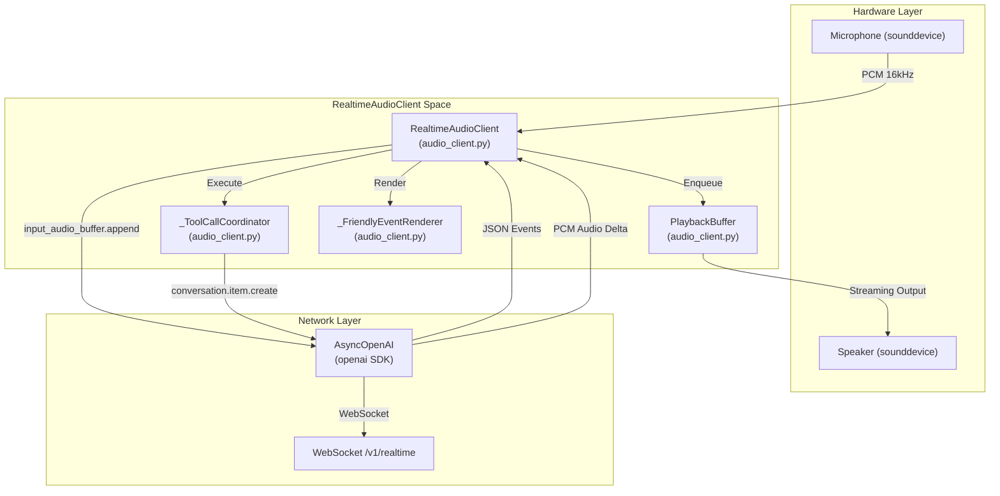
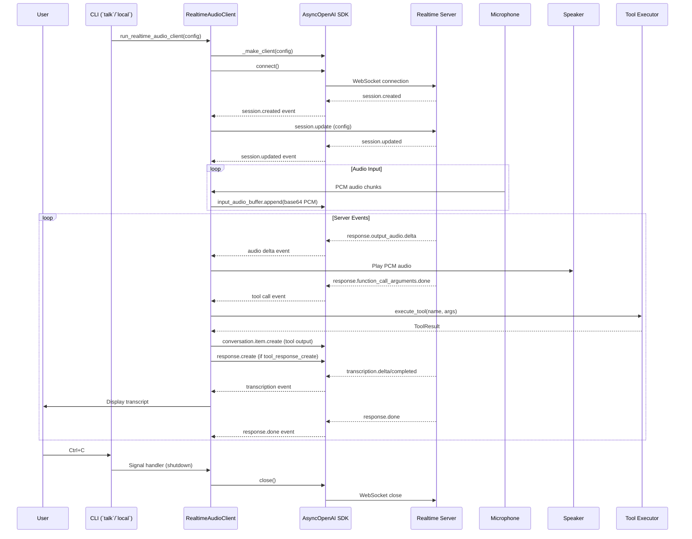

<!-- source: DeepWiki mcp.deepwiki.com · repo huggingface/speech-to-speech · page 5.3 Python Audio Client · fetched 2026-10-26 -->

# Python Audio Client (listen_and_play_realtime)

Relevant source files

The following files were used as context for generating this wiki page:

- [scripts/synthetic_conversation_realtime_client.py](scripts/synthetic_conversation_realtime_client.py)
- [src/speech_to_speech/api/openai_realtime/README.md](src/speech_to_speech/api/openai_realtime/README.md)
- [src/speech_to_speech/api/openai_realtime/audio_client.py](src/speech_to_speech/api/openai_realtime/audio_client.py)
- [src/speech_to_speech/api/openai_realtime/handlers/session.py](src/speech_to_speech/api/openai_realtime/handlers/session.py)
- [src/speech_to_speech/api/openai_realtime/llm_proxy.py](src/speech_to_speech/api/openai_realtime/llm_proxy.py)
- [src/speech_to_speech/api/openai_realtime/server.py](src/speech_to_speech/api/openai_realtime/server.py)
- [src/speech_to_speech/pipeline/log_context.py](src/speech_to_speech/pipeline/log_context.py)
- [tests/openai_realtime/test_audio_client.py](tests/openai_realtime/test_audio_client.py)
- [tests/openai_realtime/test_openai_client.py](tests/openai_realtime/test_openai_client.py)

## Overview
The Python native audio client provides a reference implementation for interacting with the Realtime API server using a local microphone and speaker. It is the core engine behind the `talk` and `local` CLI commands [src/speech_to_speech/api/openai_realtime/audio_client.py:1-6](). The client manages full-duplex audio I/O, stateful session updates, client-side tool execution, and console visualization of the conversation.

Sources: [src/speech_to_speech/api/openai_realtime/audio_client.py:1-6]()

---

## High-Level Architecture

The client is built around the `RealtimeAudioClient` class, which wraps the `openai` Python SDK's `AsyncOpenAI.realtime.connect` interface. It bridges the asynchronous network events to blocking hardware audio streams using a `PlaybackBuffer` ring buffer and `sounddevice`.

### Client Logic and Entity Mapping

**Diagram: Python Audio Client Architecture**

Sources: [src/speech_to_speech/api/openai_realtime/audio_client.py:46-65](), [src/speech_to_speech/api/openai_realtime/audio_client.py:348-360](), [src/speech_to_speech/api/openai_realtime/audio_client.py:730-760]()

---

## Core Components

### RealtimeAudioClientConfig
The `RealtimeAudioClientConfig` dataclass [src/speech_to_speech/api/openai_realtime/audio_client.py:49-75]() defines the configuration parameters for the client, including:
- `url`: The WebSocket URL of the Realtime API server.
- `model`: The model to use (e.g., "local").
- `api_key`: Optional API key for authentication.
- `send_rate`, `recv_rate`: Audio sample rates for input and output.
- `playback_buffer_ms`: Initial buffering for playback.
- `chunk_size`: Audio chunk size for processing.
- `input_device`, `output_device`: `sounddevice` device IDs.
- `instructions`, `voice`: Session-level instructions and voice for the LLM/TTS.
- `print_json`: Flag to print raw JSON events.
- `block_mic_during_playback`: Whether to pause mic input during assistant speech.
- `log_transcripts`: Flag to enable transcript logging.
- `connection_retry_timeout_s`: Timeout for connection retries.
- `tools`: List of tool definitions.
- `tool_executor`: Callable for executing client-side tools.
- `tool_response_create`: Whether to automatically create a response after tool execution.

The `__post_init__` method [src/speech_to_speech/api/openai_realtime/audio_client.py:71-75]() performs basic validation on `playback_buffer_ms`.

### RealtimeAudioClient
This class manages the lifecycle of the connection. It handles the `session.update` logic using `build_session_update` [src/speech_to_speech/api/openai_realtime/audio_client.py:164-168]() and orchestrates the two main loops:
1. **Audio Send Loop**: Captures mic data and sends `input_audio_buffer.append` events [src/speech_to_speech/api/openai_realtime/audio_client.py:730-745]().
2. **Event Receive Loop**: Processes server events like `response.output_audio.delta` and `response.function_call_arguments.done` [src/speech_to_speech/api/openai_realtime/audio_client.py:747-810]().

### PlaybackBuffer
A thread-safe ring buffer implementation that manages incoming PCM audio chunks from the server [src/speech_to_speech/api/openai_realtime/audio_client.py:348-360]().
- **Barge-in Support**: When an `input_audio_buffer.speech_started` event is received, the client calls `playback.clear()` [src/speech_to_speech/api/openai_realtime/audio_client.py:433]() to immediately stop speaker output.
- **Pacing**: It ensures smooth playback by providing a `sounddevice` callback with continuous data, falling back to silence when the buffer is empty [src/speech_to_speech/api/openai_realtime/audio_client.py:382-390]().

### _ToolCallCoordinator
Manages client-side tool execution. It handles the ordering of tool calls using `output_index` to ensure that multi-tool responses are processed correctly [src/speech_to_speech/api/openai_realtime/audio_client.py:533-535]().
- **ToolResult**: Tools can return a `ToolResult` [src/speech_to_speech/api/openai_realtime/audio_client.py:40-43]() to specify if a follow-up LLM response should be triggered automatically.
- **Validation**: It uses `jsonschema` to validate tool arguments against the provided schema before execution [src/speech_to_speech/api/openai_realtime/audio_client.py:104-110]().

### _FriendlyEventRenderer
Provides a real-time console display of the conversation [src/speech_to_speech/api/openai_realtime/audio_client.py:578-715](). It handles:
- **Streaming Transcripts**: Renders both user and assistant transcription deltas [src/speech_to_speech/api/openai_realtime/audio_client.py:596-620]().
- **Status Indicators**: Displays VAD status (listening/speaking) and tool execution progress [src/speech_to_speech/api/openai_realtime/audio_client.py:630-650]().

Sources: [src/speech_to_speech/api/openai_realtime/audio_client.py:49-75](), [src/speech_to_speech/api/openai_realtime/audio_client.py:348-500](), [src/speech_to_speech/api/openai_realtime/audio_client.py:503-575](), [src/speech_to_speech/api/openai_realtime/audio_client.py:578-715]()

---

## Data Flow: listen_and_play_realtime and run_realtime_audio_client

The `listen_and_play_realtime` function [src/speech_to_speech/api/openai_realtime/audio_client.py:828-999]() is the main asynchronous entry point for the client, while `run_realtime_audio_client` [src/speech_to_speech/api/openai_realtime/audio_client.py:1002-1025]() provides a synchronous wrapper. This function orchestrates the connection and audio streams.

**Diagram: Client-Server Interaction Flow**

Sources: [src/speech_to_speech/api/openai_realtime/audio_client.py:718-825](), [src/speech_to_speech/api/openai_realtime/audio_client.py:440-460](), [src/speech_to_speech/api/openai_realtime/audio_client.py:1002-1025]()

---

## Tool Execution System

Tools are loaded via `load_realtime_tool_module` [src/speech_to_speech/api/openai_realtime/audio_client.py:76-93](), which expects a Python module defining `TOOLS` (a list of JSON schemas) and an `execute_tool` callable. It also supports an optional `CREATE_RESPONSE` boolean to control automatic follow-up responses.

Key behaviors:
1. **Module Loading**: `import_module` is used to dynamically load the specified tool module [src/speech_to_speech/api/openai_realtime/audio_client.py:81]().
2. **Contract Enforcement**: The loaded module must define `TOOLS` (a list of function tool definitions) and a callable `execute_tool(name, arguments)` [src/speech_to_speech/api/openai_realtime/audio_client.py:82-88]().
3. **Validation**: `_validate_tool_config` [src/speech_to_speech/api/openai_realtime/audio_client.py:96-119]() ensures that tool definitions are valid JSON schemas and that an executor is provided if tools are configured.
4. **Ordering**: The `_ToolCallCoordinator` tracks `output_index` to ensure tool outputs are injected into the conversation in the same order the LLM generated the calls [src/speech_to_speech/api/openai_realtime/audio_client.py:533-540]().
5. **Response Triggering**: If `tool_response_create` is enabled (or `CREATE_RESPONSE` in the tool module is `True`), the client automatically sends a `response.create` event after injecting tool results [src/speech_to_speech/api/openai_realtime/audio_client.py:465-470]().

Sources: [src/speech_to_speech/api/openai_realtime/audio_client.py:67-110](), [src/speech_to_speech/api/openai_realtime/audio_client.py:503-575](), [tests/openai_realtime/test_audio_client.py:204-219]()

---

## Load Testing with synthetic_conversation_realtime_client.py

The `synthetic_conversation_realtime_client.py` script [scripts/synthetic_conversation_realtime_client.py:1-140]() serves as a load-testing and benchmarking utility. It bypasses physical hardware and instead:
- Streams pre-recorded or synthetic audio files to the server.
- Measures end-to-end latency (Time-to-First-Byte of audio).
- Simulates multiple concurrent sessions to stress-test the `PipelineUnit` pool.
- Uses macOS `say` to synthesize prompts into WAV files [scripts/synthetic_conversation_realtime_client.py:148-161]().
- Logs per-client transcripts and concatenated assistant audio for analysis [scripts/synthetic_conversation_realtime_client.py:39-43]().
- Employs a prompt offset strategy to ensure concurrent clients send distinct prompts, aiding in leak detection [scripts/synthetic_conversation_realtime_client.py:74-75]().

This script is crucial for:
- **Capacity Testing**: Determining the maximum number of concurrent clients a server can handle.
- **Soak Testing**: Running long-duration tests to identify memory leaks or stability issues.
- **Performance Benchmarking**: Measuring response times and throughput under various loads.

Sources: [scripts/synthetic_conversation_realtime_client.py:1-140](), [scripts/synthetic_conversation_realtime_client.py:148-161](), [src/speech_to_speech/api/openai_realtime/README.md:1-5]()

---

