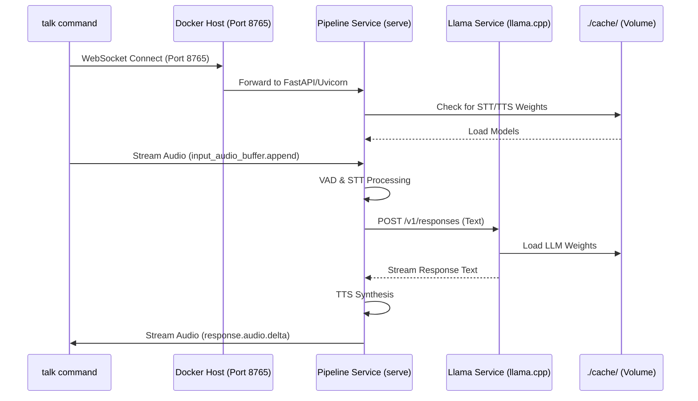

<!-- source: DeepWiki mcp.deepwiki.com · repo huggingface/speech-to-speech · page 5.4 Docker Deployment · fetched 2026-10-26 -->

# Docker Deployment

<details>
<summary>Relevant source files</summary>

The following files were used as context for generating this wiki page:

- [.dockerignore](.dockerignore)
- [.gitignore](.gitignore)
- [Dockerfile](Dockerfile)
- [Dockerfile.arm64](Dockerfile.arm64)
- [docker-compose.yml](docker-compose.yml)

</details>


This page documents deploying the speech-to-speech pipeline using Docker containers with GPU support. The system provides configurations for both standard Linux environments (NVIDIA GPUs) and ARM64 architectures.

## Overview

Docker deployment packages the entire speech-to-speech pipeline into a containerized environment. This approach is designed for:

- **Server deployments** requiring isolation and reproducibility.
- **GPU-accelerated inference** using NVIDIA CUDA or specialized ARM64 images.
- **Realtime API architectures** where the pipeline runs on a GPU server while clients connect via WebSocket or WebRTC.
- **Simplified dependency management** using `uv` for fast, reproducible environment sync.

The Docker deployment runs the `speech-to-speech` orchestrator as a service, typically in `serve` mode to handle remote client connections.

**Sources:** [docker-compose.yml:32-40](), [Dockerfile:1-15]()

## Docker Deployment Architecture

```mermaid
graph TB
    subgraph "Host Machine"
        CLIENT["Audio Client (talk command)"]
        NETWORK["Network Interface Port 8765/8080"]
    end
    
    subgraph "Docker Compose Stack"
        subgraph "LLM Service (llama.cpp)"
            LLM_SRV["llama-server --hf gemma-4"]
            LLM_GPU["NVIDIA GPU (Device 0)"]
        end

        subgraph "Pipeline Service (speech-to-speech)"
            PIPELINE["speech-to-speech serve --llm_backend responses-api"]
            
            subgraph "Processing Stages"
                VAD["VADHandler (Silero VAD v5)"]
                STT["STT Handler (Whisper/Parakeet)"]
                LLM_STUB["ResponsesApiModelHandler"]
                TTS["TTS Handler (Qwen3-TTS)"]
            end
            
            PIPELINE_GPU["NVIDIA GPU (Device 0)"]
        end
        
        CACHE["./cache/ (Persistent Volume)"]
    end
    
    CLIENT -->|WebSocket/WebRTC| NETWORK
    NETWORK -->|Port Mapping| PIPELINE
    
    PIPELINE --> VAD
    VAD --> STT
    STT --> LLM_STUB
    LLM_STUB -->|HTTP/V1 Responses| LLM_SRV
    LLM_STUB --> TTS
    TTS -->|Audio Output| NETWORK
    
    LLM_GPU -.->|capabilities: [gpu]| LLM_SRV
    PIPELINE_GPU -.->|capabilities: [gpu]| PIPELINE
    CACHE -.->|Volume Mount| LLM_SRV
    CACHE -.->|Volume Mount| PIPELINE
```

**Diagram: Docker Container Architecture**

The Docker setup encapsulates the pipeline and its backends. In the default `docker-compose.yml`, a separate `llama` service runs `llama.cpp` to serve the LLM via an OpenAI-compatible API, while the `pipeline` service handles audio processing, orchestration, and the Realtime API server.

**Sources:** [docker-compose.yml:4-69](), [Dockerfile:1-27](), [src/speech_to_speech/LLM/README.md:56-62]()

## Dockerfile Variants

The repository provides two distinct Dockerfiles to support different hardware architectures:

### 1. Standard Linux (NVIDIA CUDA)
The default `Dockerfile` is based on `nvidia/cuda:12.8.1-cudnn-runtime-ubuntu24.04`. It is optimized for NVIDIA GPUs.
- **Base Image**: [Dockerfile:1-1]()
- **Dependency Manager**: Uses `uv` to sync dependencies from `pyproject.toml` [Dockerfile:20-23]().
- **Environment**: Sets `PYTHONUNBUFFERED=1` and adds the `.venv` to the system `PATH` [Dockerfile:4-5]().
- **NLP Setup**: Downloads required NLTK data (`punkt_tab`, `averaged_perceptron_tagger_eng`) during build [Dockerfile:27-27]().

### 2. ARM64
The `Dockerfile.arm64` provides support for ARM64 Linux environments.
- **Base Image**: `nvidia/cuda:12.8.1-cudnn-runtime-ubuntu24.04` with `--platform=linux/arm64` [Dockerfile.arm64:1-2]().
- **Dependency Manager**: Uses `uv` for dependency resolution [Dockerfile.arm64:21-24]().
- **NLP Setup**: Downloads required NLTK data (`punkt_tab`, `averaged_perceptron_tagger_eng`) during build [Dockerfile.arm64:28-28]().

**Sources:** [Dockerfile:1-27](), [Dockerfile.arm64:1-28]()

## Docker Compose Configuration

The `docker-compose.yml` file orchestrates a multi-service deployment.

### 1. Llama Service
Runs `llama.cpp` server to host the language model, providing an external backend for the pipeline.
- **Image**: `ghcr.io/ggml-org/llama.cpp:server-cuda` [docker-compose.yml:5-5]().
- **Model**: Defaults to `ggml-org/gemma-4-E4B-it-GGUF` [docker-compose.yml:8-8]().
- **GPU**: Reserved via `driver: nvidia` with `device_ids: ['0']` [docker-compose.yml:27-30]().

### 2. Pipeline Service
The main speech-to-speech orchestrator running in `serve` mode.
- **Build**: Context is the root directory, using the environment variable `DOCKERFILE` or defaulting to `Dockerfile` [docker-compose.yml:36-37]().
- **GPU Passthrough**: Explicitly reserves NVIDIA GPU resources for local STT/TTS processing [docker-compose.yml:64-69]().
- **Port Mapping**: Maps port `8765` for the Realtime API server [docker-compose.yml:59-60]().

### Volume Mounts
To prevent re-downloading large models on every restart, the host's `./cache/` directory is mounted to `/root/.cache/` inside both containers [docker-compose.yml:23-23](), [docker-compose.yml:62-62]().

**Sources:** [docker-compose.yml:4-69]()

## Pipeline Execution Command

The default command in `docker-compose.yml` launches the `speech-to-speech` CLI with arguments for a distributed LLM setup:

| Argument | Value | Purpose |
|----------|-------|---------|
| `serve` | Command | Starts the Realtime API server [docker-compose.yml:40-40]() |
| `--host` | `0.0.0.0` | Listen for incoming connections on all interfaces [docker-compose.yml:41-42]() |
| `--port` | `8765` | Server port for WebSocket/WebRTC [docker-compose.yml:43-44]() |
| `--llm_backend` | `responses-api` | Uses the OpenAI-compatible `/v1/responses` endpoint [docker-compose.yml:45-46]() |
| `--responses_api_base_url`| `http://llama:8080/v1`| Points to the `llama` service in the Docker network [docker-compose.yml:49-50]() |
| `--init_chat_prompt` | `"You are a helpful assistant"` | System prompt for the LLM [docker-compose.yml:55-56]() |

**Sources:** [docker-compose.yml:38-56](), [src/speech_to_speech/LLM/README.md:56-62]()

## Deployment Steps

### 1. Prerequisites
- **NVIDIA Container Toolkit**: Must be installed on the host to support the `nvidia` driver in Docker.
- **Docker Compose**: Version 2.0+ recommended.

### 2. Building and Starting
To start the pipeline with the default NVIDIA configuration:
```bash
docker compose up --build
```

To deploy using the ARM64 Dockerfile:
```bash
DOCKERFILE=Dockerfile.arm64 docker compose up --build
```

### 3. Verification
Once the container is running, the pipeline will warm up the models. You can verify the status via logs:
```bash
docker compose logs -f pipeline
```

**Sources:** [docker-compose.yml:35-37](), [Dockerfile:27]()

## Data Flow in Docker Deployment



**Diagram: Docker Deployment Data Flow**

The volume mount ensures that model weights stored in `~/.cache/` are persistent across container restarts, significantly reducing startup time after the initial download.

**Sources:** [docker-compose.yml:23-23](), [docker-compose.yml:49-50](), [docker-compose.yml:62-62]()

## .dockerignore Layout

The `.dockerignore` file specifies patterns for files and directories that should be excluded when building Docker images. This helps to keep image sizes small and build times fast by not including unnecessary files like local development artifacts, caches, or version control metadata.

The key exclusions include:
- **Temporary and Cache Files**: `tmp`, `cache`, `.mypy_cache`, `.pytest_cache`, `.ruff_cache`, `__pycache__`, `*.py[cod]` [ .dockerignore:1-10]()
- **Virtual Environments**: `.venv` [ .dockerignore:3]()
- **Version Control**: `.git` [ .dockerignore:4]()
- **Build Artifacts**: `dist`, `build`, `*.egg-info` [ .dockerignore:11-13]()
- **Docker-related Files**: `Dockerfile`, `docker-compose.yml`, `.dockerignore` itself [ .dockerignore:14-16]()
- **Git Ignore**: `.gitignore` [ .dockerignore:17]()

This selective inclusion ensures that only the necessary source code and configuration files are copied into the Docker image.

**Sources:** [ .dockerignore:1-18]()

---

