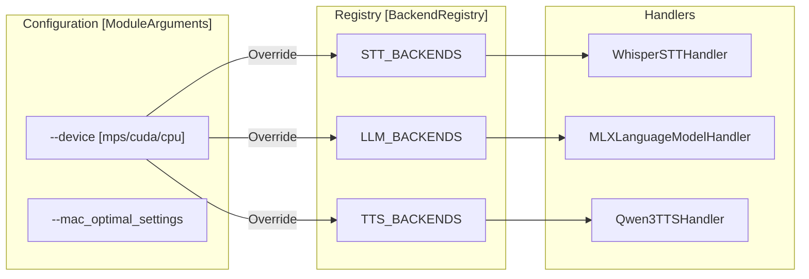
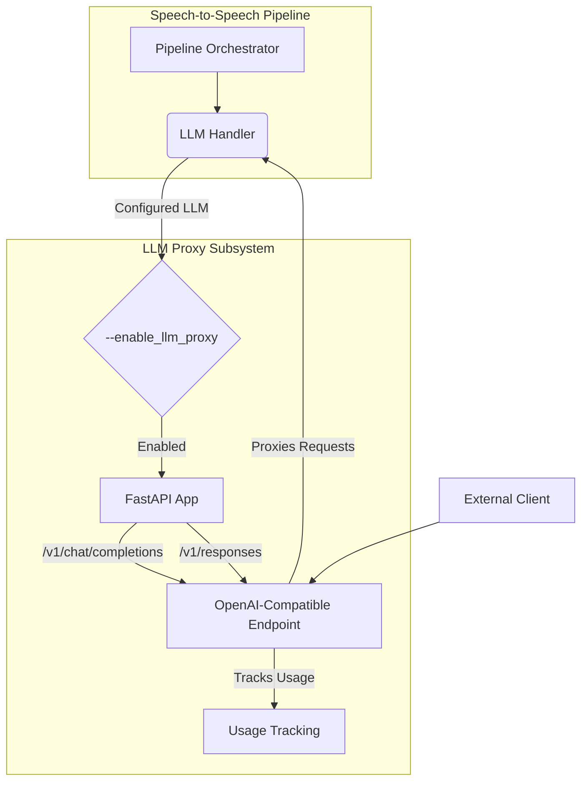

<!-- source: DeepWiki mcp.deepwiki.com · repo huggingface/speech-to-speech · page 6 Advanced Features · fetched 2026-10-26 -->

# Advanced Features

<details>
<summary>Relevant source files</summary>

The following files were used as context for generating this wiki page:

- [README.md](README.md)
- [pyproject.toml](pyproject.toml)

</details>


This page documents the advanced capabilities and optimizations available in the speech-to-speech system beyond basic pipeline operation. These features enable enhanced performance, multilingual conversations, real-time feedback, and platform-specific optimizations for NVIDIA and Apple Silicon hardware.

For basic configuration and deployment options, see [Configuration System](#4) and [Realtime API and Deployment Modes](#5). For core pipeline functionality, see [Core Components](#3).

## Overview

The system provides several categories of advanced features:

- **Multilingual Support** - Automatic language detection and cross-component language coordination. For details, see [Multilingual Support](#6.1).
- **Performance Tuning and Mac/MLX Optimizations** - `torch.compile` usage, CUDA graph capture, streaming generation, and Apple Silicon specifics like MLX integration and unified memory management. For details, see [Performance Tuning and Mac/MLX Optimizations](#6.2).
- **Benchmarking and Load Testing** - Utilities for measuring RTF (Real-Time Factor), TTFC (Time-to-First-Chunk), and end-to-end load testing. For details, see [Benchmarking and Load Testing](#6.3).
- **LLM Proxy and Example Integrations** - Exposing the LLM backend as an OpenAI-compatible endpoint with usage tracking, and custom tool integrations. For details, see [LLM Proxy and Example Integrations](#6.4).

## Multilingual Support

The system is designed to handle multiple languages throughout the speech-to-speech pipeline. This includes language detection at the STT stage, mapping language codes across different models, and injecting language directives into the LLM prompt. This ensures a consistent language experience from input speech to output speech.

For a detailed explanation of language detection mechanisms, code mapping, and how language directives are managed across components like Whisper, Parakeet, and the LLM, see [Multilingual Support](#6.1).

Sources: [src/speech_to_speech/arguments_classes/module_arguments.py:53-68]()

## Performance Tuning and Mac/MLX Optimizations

Optimizing performance is crucial for real-time voice agents. This system incorporates several techniques, including `torch.compile` for general PyTorch model acceleration and specific optimizations for Apple Silicon hardware using the MLX framework. These optimizations aim to reduce latency and improve throughput.

### Torch Compile Optimization

The system leverages PyTorch's `torch.compile` feature for optimizing model inference. Compilation can significantly reduce latency through kernel fusion and optimization. The system configures a persistent compilation cache to reduce startup time on subsequent runs.

```python
# From s2s_pipeline.py lines 64-67
# caching allows ~50% compilation time reduction
CURRENT_DIR = Path(__file__).resolve().parent
os.environ["TORCHINDUCTOR_CACHE_DIR"] = os.path.join(CURRENT_DIR, "tmp")
```

Sources: [src/speech_to_speech/s2s_pipeline.py:64-67]()

### Platform-Specific Optimization Paths

The system provides specific optimizations for different hardware platforms.

#### One-Click Mac Optimization

The `--mac-optimal-settings` flag in `ModuleArguments` provides automatic configuration for Apple Silicon devices, selecting handlers optimized for the MLX framework. This preset configures `parakeet-tdt` for STT, `mlx-lm` for the LLM backend, `qwen3` for TTS, and `mps` as the device.

Sources: [src/speech_to_speech/arguments_classes/module_arguments.py:18-25](), [src/speech_to_speech/s2s_pipeline.py:76-92]()

#### Unified Device Management

The `--device` parameter in `ModuleArguments` provides centralized device configuration across all handlers. If specified, it overrides individual handler device settings.

Title: Device Propagation and Backend Registry


Sources: [src/speech_to_speech/arguments_classes/module_arguments.py:14-17](), [src/speech_to_speech/backend_registry.py:1-50](), [src/speech_to_speech/s2s_pipeline.py:76-92]()

For a comprehensive guide on `torch.compile` modes, CUDA graph warmup, streaming generation, and specific details regarding Apple Silicon's MLX lock, unified memory, and MPS cache management, see [Performance Tuning and Mac/MLX Optimizations](#6.2).

## Benchmarking and Load Testing

To ensure the system meets performance requirements, a suite of benchmarking and load testing tools is provided. These tools allow developers to measure key metrics like Real-Time Factor (RTF), Time-to-First-Chunk (TTFC), and warmup times for individual components, as well as conduct end-to-end load tests for the Realtime server.

For detailed usage of `scripts/benchmark_tts.py`, `scripts/benchmark_stt.py`, and `synthetic_conversation_realtime_client.py`, including how to interpret their outputs and configure various metrics, see [Benchmarking and Load Testing](#6.3).

Sources: [scripts/benchmark_tts.py:1-100](), [scripts/benchmark_stt.py:1-100](), [examples/synthetic_conversation_realtime_client.py:1-100]()

## LLM Proxy and Example Integrations

The system includes an LLM proxy subsystem that exposes the configured Language Model as an OpenAI-compatible HTTP endpoint. This allows other applications or internal services to interact with the LLM using a standard API, complete with usage tracking. Additionally, the codebase provides examples of how to integrate custom tools with the LLM, demonstrating its extensibility.

### LLM Proxy Subsystem

The system can expose its configured LLM backend as an OpenAI-compatible HTTP endpoint using the `--enable_llm_proxy` flag. This allows external tools or background tasks (like summarization) to utilize the same model instance and memory context as the voice pipeline. The configuration is managed by `build_llm_proxy_config`, which extracts `base_url`, `api_key`, and `model_name` from the selected LLM backend's configuration.

Title: LLM Proxy Architecture


Sources: [src/speech_to_speech/s2s_pipeline.py:106-127](), [src/speech_to_speech/arguments_classes/module_arguments.py:69-77]()

For a detailed explanation of the `--enable_llm_proxy` subsystem, its exposed endpoints (`/v1/chat/completions`, `/v1/responses`), usage tracking, and examples like `examples/realtime_web_search_tool.py` and the `gemma4-12b-macos` integration, see [LLM Proxy and Example Integrations](#6.4).

Sources: [src/speech_to_speech/s2s_pipeline.py:106-127](), [src/speech_to_speech/arguments_classes/module_arguments.py:69-77](), [examples/realtime_web_search_tool.py:1-100](), [examples/gemma4-12b-macos/README.md:1-100]()

---

