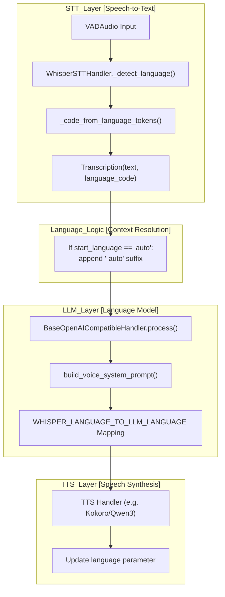
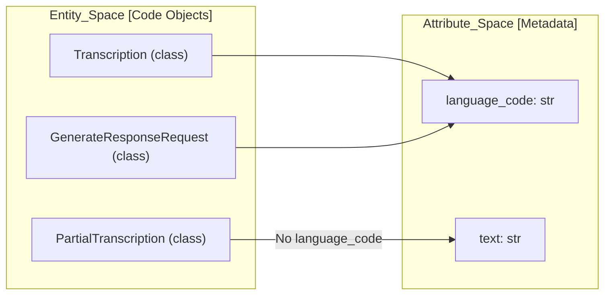

<!-- source: DeepWiki mcp.deepwiki.com · repo huggingface/speech-to-speech · page 6.1 Multilingual Support · fetched 2026-10-26 -->

# Multilingual Support

<details>
<summary>Relevant source files</summary>

The following files were used as context for generating this wiki page:

- [src/speech_to_speech/LLM/text_prompt.py](src/speech_to_speech/LLM/text_prompt.py)
- [tests/test_facebookmms_language_map.py](tests/test_facebookmms_language_map.py)
- [tests/test_faster_whisper_language_code.py](tests/test_faster_whisper_language_code.py)
- [tests/test_language_prompt.py](tests/test_language_prompt.py)
- [tests/test_parakeet_language_detection.py](tests/test_parakeet_language_detection.py)
- [tests/test_text_prompt.py](tests/test_text_prompt.py)

</details>


## Purpose and Scope

This page explains how the speech-to-speech system handles multiple languages throughout the pipeline, from automatic language detection in speech-to-text through language-aware response generation to multi-language speech synthesis. The system supports various language detection strategies including Whisper's native detection and `lingua-py` integration for the Parakeet TDT handler.

Key features include the `-auto` suffix convention for dynamic prompt injection, ISO-to-natural-language mapping for LLM directives, and the use of specialized system prompts (voice vs. text) to guide the model's behavior in different conversational contexts.

---

## Supported Languages

The system maintains canonical lists of supported languages that serve as validation references. Language codes generally follow ISO 639-1 two-letter format.

### Standard Whisper Support
The standard Whisper implementation supports 12 core languages for validation [src/speech_to_speech/STT/whisper_stt_handler.py:19-32]().

| Code | Language | Code | Language |
|------|----------|------|----------|
| en | English | hi | Hindi |
| fr | French | de | German |
| es | Spanish | pt | Portuguese |
| zh | Chinese | pl | Polish |
| ja | Japanese | it | Italian |
| ko | Korean | nl | Dutch |

### Whisper Token Mapping
Whisper-based handlers identify languages by scanning the first few tokens of the decoder prefix for language-specific tokens like `<|de|>` or `<|en|>` [src/speech_to_speech/STT/whisper_stt_handler.py:36-43](). The `WhisperSTTHandler` uses a regex `_LANGUAGE_TOKEN_RE` to map these special tokens to ISO codes [src/speech_to_speech/STT/whisper_stt_handler.py:39-43]().

**Sources:** [src/speech_to_speech/STT/whisper_stt_handler.py:19-43]()

---

## Multilingual Architecture Overview

The multilingual system operates through three key mechanisms: language detection in STT, language code propagation through the pipeline as `Transcription` objects, and language-specific model/configuration selection in TTS.

### Pipeline Language Flow
The following diagram bridges the natural language space to the code entities managing the flow.



**Sources:** [src/speech_to_speech/STT/whisper_stt_handler.py:146-180](), [src/speech_to_speech/LLM/voice_prompt.py:33-42](), [tests/test_whisper_language_detection.py:180-186]()

---

## Language Detection Mechanisms

### 1. Whisper-based Detection
In `WhisperSTTHandler`, the model natively predicts the language. If `start_language` is set to `"auto"`, the handler extracts the language code from the Whisper special tokens [src/speech_to_speech/STT/whisper_stt_handler.py:128-144]().

- **Detection Efficiency**: The handler computes encoder outputs once and reuses them for both detection and generation to avoid redundant computation [src/speech_to_speech/STT/whisper_stt_handler.py:174-177]().
- **Forced Language**: If a specific language is provided (e.g., "de"), the handler skips detection and forces the decoder prefix to that language [src/speech_to_speech/STT/whisper_stt_handler.py:67-69]().

### 2. Lingua-py Integration
For handlers utilizing `lingua-py`, detection is performed on the transcribed text rather than the audio features. This is notably used by the `ParakeetTDTSTTHandler`.

- **Detector Construction**: The system builds a detector preloaded with language models [tests/test_parakeet_language_detection.py:7-32](). The `_build_lingua_detector` function in `parakeet_tdt_handler.py` initializes `LanguageDetectorBuilder` with a predefined set of languages (`_lingua_languages`) and preloads their models [tests/test_parakeet_language_detection.py:31-32]().
- **Thresholding**: Detection is bypassed for very short text (e.g., "Okay.") to prevent noise from misclassifying the session language [tests/test_parakeet_language_detection.py:35-45](). The `_detect_language_from_text` method in `ParakeetTDTSTTHandler` checks the length of the input text before querying the `lingua-py` detector [tests/test_parakeet_language_detection.py:35-45]().
- **Mapping**: Lingua's Norwegian Bokmål (`nb`) is mapped to the standard `no` code for pipeline consistency [tests/test_parakeet_language_detection.py:66-77]().

### 3. Faster Whisper Language Propagation
The `FasterWhisperSTTHandler` ensures that the detected language from `model.transcribe()` is propagated as the `language_code` in the `Transcription` object [tests/test_faster_whisper_language_code.py:38-57](). This is crucial for downstream components like the LLM and TTS to correctly handle the language. `PartialTranscription` objects, however, do not carry a `language_code` [tests/test_faster_whisper_language_code.py:68-87]().

**Sources:** [src/speech_to_speech/STT/whisper_stt_handler.py:128-180](), [tests/test_parakeet_language_detection.py:7-77](), [tests/test_faster_whisper_language_code.py:38-87]()

---

## Prompt Engineering and Language Directives

The system uses specialized system prompts to ensure the LLM respects the detected language and the "voice-first" nature of the conversation.

### Voice System Prompt
The `build_voice_system_prompt` function assembles a prompt that prioritizes natural, brief speech over formatted text [src/speech_to_speech/LLM/voice_prompt.py:33-42]().

- **Rules**: The prompt explicitly forbids markdown, bullets, and action text like `*laughs*` [src/speech_to_speech/LLM/voice_prompt.py:11]().
- **Robustness**: It instructs the model to treat transcripts as noisy and only correct mishearings if the meaning depends on it [src/speech_to_speech/LLM/voice_prompt.py:12]().
- **Language Injection**: When `enable_lang_prompt` is active and a `language_name` is provided, a directive like "Please reply to my message in [language]." is injected into the system prompt [tests/test_language_prompt.py:93-100](), [src/speech_to_speech/LLM/voice_prompt.py:39-40](). This ensures the LLM responds in the detected language. This instruction is only added once per turn to avoid breaking strict chat templates [tests/test_language_prompt.py:6-7]().

### Text System Prompt
The `build_text_system_prompt` function is used for text-only interactions. It includes different rules compared to the voice prompt, allowing markdown and omitting voice-specific instructions [src/speech_to_speech/LLM/text_prompt.py:10-17]().

- **Language Hint**: Similar to the voice prompt, a `language_name` can be included to instruct the LLM to reply in a specific language [src/speech_to_speech/LLM/text_prompt.py:34-40](), [tests/test_text_prompt.py:14-17]().
- **Tool Rules**: The text prompt's tool rules differ, for example, stating "no preamble sentence is required" before a tool call [src/speech_to_speech/LLM/text_prompt.py:14](), [tests/test_text_prompt.py:44-45]().

### Tool Call Language Handling
When tools are used, the system ensures the language context is preserved. The `build_tool_system_prompt` can be configured for text-only or voice channels, with the latter requiring a brief acknowledgement before a tool call [src/speech_to_speech/LLM/tool_call/tool_prompt.py:76-97]().

```python
# src/speech_to_speech/LLM/tool_call/tool_prompt.py:62
"Call a tool directly when it helps fulfill the request; no preamble sentence is required."
```

**Sources:** [src/speech_to_speech/LLM/voice_prompt.py:1-42](), [src/speech_to_speech/LLM/tool_call/tool_prompt.py:29-97](), [tests/test_voice_prompt.py:55-90](), [src/speech_to_speech/LLM/text_prompt.py:1-55](), [tests/test_text_prompt.py:1-59](), [tests/test_language_prompt.py:1-128]()

---

## Language Code Propagation

The system uses a specific data model for passing transcribed text and its associated language through the pipeline.

### Data Flow Diagram



- **Transcription**: Contains the final text and the detected `language_code` [src/speech_to_speech/STT/whisper_stt_handler.py:13]().
- **Dynamic Switching**: The LLM uses the `language_code` from the `GenerateResponseRequest` to adjust its response. If the code ends in `-auto`, it triggers a specific logic to match the user's spoken language [tests/test_language_prompt.py:83-84]().
- **Facebook MMS Language Mapping**: The `FacebookMMSTTSHandler` uses a `WHISPER_LANGUAGE_TO_FACEBOOK_LANGUAGE` map to convert Whisper-style ISO 639-1 codes (e.g., "pl") to Facebook MMS's internal language codes (e.g., "pol") [tests/test_facebookmms_language_map.py:7-8](). This ensures that the correct TTS model is loaded based on the detected STT language [tests/test_facebookmms_language_map.py:58-66]().

**Sources:** [src/speech_to_speech/STT/whisper_stt_handler.py:13](), [src/speech_to_speech/LLM/voice_prompt.py:23-30](), [tests/test_text_prompt.py:1-24](), [tests/test_language_prompt.py:83-84](), [tests/test_facebookmms_language_map.py:7-66]()

---

