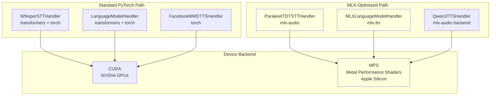
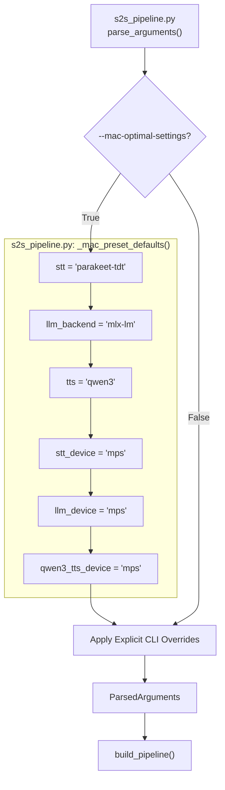

<!-- source: DeepWiki mcp.deepwiki.com · repo huggingface/speech-to-speech · page 6.2 Performance Tuning and Mac/MLX Optimizations · fetched 2026-10-26 -->

# Performance Tuning and Mac/MLX Optimizations

<details>
<summary>Relevant source files</summary>

The following files were used as context for generating this wiki page:

- [examples/gemma4-12b-macos/README.md](examples/gemma4-12b-macos/README.md)
- [src/speech_to_speech/STT/base_stt_handler.py](src/speech_to_speech/STT/base_stt_handler.py)
- [src/speech_to_speech/arguments_classes/module_arguments.py](src/speech_to_speech/arguments_classes/module_arguments.py)
- [src/speech_to_speech/s2s_pipeline.py](src/speech_to_speech/s2s_pipeline.py)
- [src/speech_to_speech/utils/mlx_lock.py](src/speech_to_speech/utils/mlx_lock.py)
- [tests/test_cli_defaults.py](tests/test_cli_defaults.py)
- [tests/test_stt_stale_filter.py](tests/test_stt_stale_filter.py)

</details>


This page documents performance tuning strategies, including `torch.compile` modes, CUDA graph warmup, and streaming generation. It also covers Apple Silicon (M-series chip) specific optimizations using the MLX framework, which provides accelerated machine learning on Mac hardware. This includes the `mac_optimal_settings` preset, MLX-specific component implementations, device management with Metal Performance Shaders (MPS), unified memory management strategies, and thread safety mechanisms using `MLXLockContext`. Finally, it explains why live transcription might be disabled or perform poorly with multiple pipelines on macOS.

For general configuration options, see [Module-Level Configuration](). For deployment modes, see [Serve, Talk and Local Commands](). For individual handler documentation, see [Speech-to-Text (STT)](), [Language Models (LLM)](), and [Text-to-Speech (TTS)]().

## General Performance Tuning

### `torch.compile` Modes

`torch.compile` can significantly accelerate PyTorch models by compiling them into optimized kernels. The system leverages this for CUDA-enabled backends where applicable.

- **Caching**: To reduce compilation time, `TORCHINDUCTOR_CACHE_DIR` is set to a local directory [src/speech_to_speech/s2s_pipeline.py:70-71](). This allows compiled graphs to be reused across runs.

### CUDA Graph Warmup

For CUDA-enabled models, "warmup" refers to running a few inference steps before actual processing begins. This allows the CUDA driver to optimize kernel launches and allocate necessary memory, leading to more consistent and faster subsequent inferences. This is particularly important for `torch.compile` to generate efficient CUDA graphs.

### Streaming Generation

Many components in the pipeline are designed for streaming generation, which reduces latency by processing and emitting output in small chunks rather than waiting for a complete response. This is crucial for real-time conversational AI.

- **STT**: Progressive transcription modes allow partial results to be sent to the LLM before the user finishes speaking.
- **LLM**: Language models often stream token by token or sentence by sentence to the TTS.
- **TTS**: Text-to-speech engines generate audio in blocks, which are then streamed to the audio output.

Sources: [src/speech_to_speech/s2s_pipeline.py:70-71]()

## MLX Framework Overview

MLX is Apple's machine learning framework optimized for Apple Silicon, providing unified memory architecture and Metal acceleration. The speech-to-speech system leverages MLX for its core cascaded pipeline components to achieve low-latency performance on Mac hardware.

**Key Characteristics:**

| Feature | Description |
|---------|-------------|
| **Unified Memory** | Shared memory between CPU and GPU eliminates data transfer overhead. |
| **Metal Acceleration** | Native Metal Performance Shaders (MPS) backend. |
| **MLXLockContext** | Thread-safety mechanism for concurrent model access [src/speech_to_speech/utils/mlx_lock.py:151-172](). |
| **Ecosystem** | Integration with `mlx-lm`, `mlx-vlm`, and `mlx-audio`. |

### Hardware Acceleration Architecture



**Diagram: MLX Optimization Path vs Standard PyTorch Path**

Sources: [src/speech_to_speech/utils/mlx_lock.py:1-7](), [src/speech_to_speech/arguments_classes/module_arguments.py:18-25](), [src/speech_to_speech/s2s_pipeline.py:76-92]()

## The `mac_optimal_settings` Preset

The `mac_optimal_settings` argument [src/speech_to_speech/arguments_classes/module_arguments.py:18-25]() provides a one-click optimization for Apple Silicon. It triggers specific overrides in the argument parsing logic to select the most efficient handlers and devices for macOS.

### Automatic Configuration

When this flag is enabled, the `_mac_preset_defaults` function [src/speech_to_speech/s2s_pipeline.py:81-96]() applies the following defaults:

| Argument | Value | Description |
|----------|-------|-------------|
| `stt` | `parakeet-tdt` | Selects the MLX-optimized Parakeet TDT handler [src/speech_to_speech/s2s_pipeline.py:82](). |
| `llm_backend` | `mlx-lm` | Uses the `mlx-lm` backend for local inference [src/speech_to_speech/s2s_pipeline.py:83](). |
| `tts` | `qwen3` | Selects the MLX-compatible Qwen3-TTS handler [src/speech_to_speech/s2s_pipeline.py:84](). |
| `stt_device` | `mps` | Overrides the STT device to Metal Performance Shaders [src/speech_to_speech/s2s_pipeline.py:85](). |
| `llm_device` | `mps` | Sets the LLM device to MPS (if not using cloud APIs) [src/speech_to_speech/s2s_pipeline.py:90](). |
| `qwen3_tts_device`| `mps` | Sets the TTS device to MPS [src/speech_to_speech/s2s_pipeline.py:87](). |

It's important to note that `mac_optimal_settings` does not select a command (`serve`, `talk`, `local`) but rather applies these defaults to the chosen command [src/speech_to_speech/arguments_classes/module_arguments.py:24-25](). Explicit component, model, global-device, and component-device flags will override these defaults [src/speech_to_speech/arguments_classes/module_arguments.py:23-24]().

### Configuration Flow



**Diagram: Configuration Flow for `mac_optimal_settings`**

Sources: [src/speech_to_speech/s2s_pipeline.py:81-96](), [src/speech_to_speech/s2s_pipeline.py:175-200](), [src/speech_to_speech/arguments_classes/module_arguments.py:18-25](), [tests/test_cli_defaults.py:80-91]()

## MLX-Optimized Components

### STT: Parakeet TDT and MLX Audio Whisper

The system supports multiple MLX-based STT backends. While standard Whisper models can run via `whisper-mlx`, the optimal setting defaults to `parakeet-tdt` for superior latency on Mac hardware [src/speech_to_speech/s2s_pipeline.py:82]().

**Key Features:**
- **MLX Audio Backend**: Utilizes the `mlx-audio` ecosystem for hardware acceleration.
- **Compute Locking**: MLX models (STT, LLM, TTS) cannot be used concurrently from multiple threads due to Metal command buffer limitations [src/speech_to_speech/utils/mlx_lock.py:4-6]().
- **Live Transcription**: Supported by `parakeet-tdt` [src/speech_to_speech/arguments_classes/module_arguments.py:64-69](), but performance is sensitive to lock contention.

### LLM: MLX Language Model

The `MLXLanguageModelHandler` leverages `mlx-lm` for inference. It is the recommended LLM backend for local Mac execution [src/speech_to_speech/s2s_pipeline.py:83]().

**Key Implementation Details:**
- **MLXLockContext**: All inference calls should be wrapped in a global reentrant lock to prevent concurrent Metal access [src/speech_to_speech/utils/mlx_lock.py:151-172]().
- **Memory Management**: The system uses `mx.clear_cache()` within MLX-specific loops to maintain a stable memory footprint in unified memory environments.

### TTS: Qwen3

- **Qwen3TTSHandler**: Implements a dual-backend architecture. On Apple Silicon, it utilizes the `mlx-audio` backend for accelerated speech generation [src/speech_to_speech/s2s_pipeline.py:84]().

Sources: [src/speech_to_speech/s2s_pipeline.py:82-84](), [src/speech_to_speech/arguments_classes/module_arguments.py:64-69](), [src/speech_to_speech/utils/mlx_lock.py:4-6](), [src/speech_to_speech/utils/mlx_lock.py:151-172]()

## Memory and Thread Management

### Unified Memory and MPS Cache

On Apple Silicon, memory is shared between CPU and GPU. The pipeline manages this by explicitly freeing resources and synchronizing kernels:

1.  **MPS Cache Management**: Handlers may call `torch.mps.empty_cache()` to free allocated Metal memory.
2.  **MLX Cache**: `mx.clear_cache()` is used within MLX-specific generation loops.

### MLXLockContext for Thread Safety

MLX models (STT, LLM, TTS) cannot be used concurrently from multiple threads on Apple Silicon due to Metal command buffer limitations [src/speech_to_speech/utils/mlx_lock.py:4-6](). The `MLXLockContext` class provides a context manager for the global `RLock`.

```mermaid
graph TD
    subgraph "Pipeline Threads"
        STT_T["STT Handler Thread"]
        LLM_T["LLM Handler Thread"]
        TTS_T["TTS Handler Thread"]
    end
    
    subgraph "src/speech_to_speech/utils/mlx_lock.py"
        LOCK["_mlx_lock (RLock)"]
        CONTEXT["MLXLockContext"]
    end
    
    STT_T -->|acquire_mlx_lock()| CONTEXT
    LLM_T -->|acquire_mlx_lock()| CONTEXT
    TTS_T -->|acquire_mlx_lock()| CONTEXT
    CONTEXT -->|acquires| LOCK
    
    LOCK -.->|"Exclusive Access"| METAL["Metal / MPS Hardware"]
```

**Diagram: MLX Lock Synchronization for Unified Memory Access**

| Code Entity | Role |
|-------------|------|
| `_mlx_lock` | The global `threading.RLock` instance used for reentrant access [src/speech_to_speech/utils/mlx_lock.py:27](). |
| `acquire_mlx_lock` | Function to acquire the lock with optional timeout and logging [src/speech_to_speech/utils/mlx_lock.py:87-134](). |
| `release_mlx_lock` | Function to release the lock and track holding duration [src/speech_to_speech/utils/mlx_lock.py:137-157](). |
| `MLXLockContext` | Context manager that handles `__enter__` and `__exit__` for the lock [src/speech_to_speech/utils/mlx_lock.py:160-179](). |

Sources: [src/speech_to_speech/utils/mlx_lock.py:1-179]()

## Multi-Pipeline Contention and Live Transcription

When running in `serve` mode with `num_pipelines > 1` [src/speech_to_speech/arguments_classes/module_arguments.py:96-104]() on macOS, the system faces significant lock contention. Since all MLX operations (STT, LLM, and TTS) across all pipelines must share the same global `_mlx_lock` [src/speech_to_speech/utils/mlx_lock.py:27](), performance can degrade.

**Behavioral Observations:**
- **Contention Logging**: The `acquire_mlx_lock` function logs warnings if a thread fails to acquire the lock within the timeout or if the wait time is excessive (>= 0.25s) [src/speech_to_speech/utils/mlx_lock.py:101-134]().
- **Live Transcription**: In high-concurrency scenarios on Mac, live transcription updates may be delayed as the STT handler waits for the LLM or TTS to release the Metal lock. This can lead to a poor user experience, which is why live transcription might be effectively disabled or perform poorly with multiple pipelines.

Sources: [src/speech_to_speech/utils/mlx_lock.py:101-134](), [src/speech_to_speech/arguments_classes/module_arguments.py:96-104]()

## Gemma 4 12B Example (Audio-to-LLM)

The codebase includes an example of direct audio-to-LLM processing on macOS using Gemma 4 12B via `llama.cpp` [examples/gemma4-12b-macos/README.md:1-15](). This example demonstrates a scenario where the STT component is bypassed for performance and direct audio input to the LLM is utilized.

**Architecture:**
- **No STT**: Bypasses the STT stage entirely (`--stt none`) [examples/gemma4-12b-macos/README.md:71]().
- **Direct Audio**: VAD segments are sent directly to the LLM as native audio payloads [examples/gemma4-12b-macos/README.md:10-14]().
- **Backend**: Uses `llama.cpp`'s OpenAI-compatible `/v1/chat/completions` endpoint which supports the `input_audio` content type [examples/gemma4-12b-macos/README.md:111-118]().
- **Memory Considerations**: The example highlights that the Q4 model is about 7.2 GB and recommends 24 GB or more of unified memory for comfortable headroom alongside Qwen3-TTS [examples/gemma4-12b-macos/README.md:17-18](). It also suggests using `--qwen3_tts_mlx_quantization 4bit` if the 6-bit TTS model leaves too little headroom [examples/gemma4-12b-macos/README.md:153-154]().

Sources: [examples/gemma4-12b-macos/README.md:1-154]()

---

