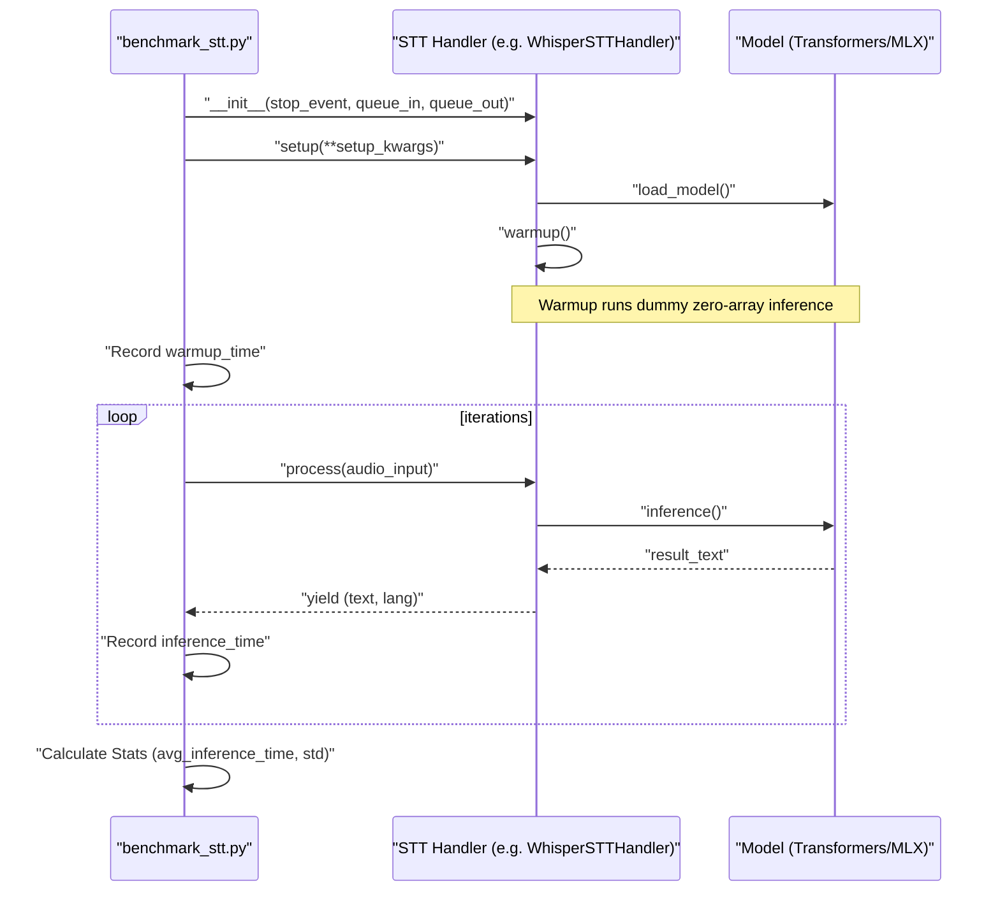

<!-- source: DeepWiki mcp.deepwiki.com · repo huggingface/speech-to-speech · page 6.3 Benchmarking and Load Testing · fetched 2026-10-26 -->

# Benchmarking and Load Testing

<details>
<summary>Relevant source files</summary>

The following files were used as context for generating this wiki page:

- [scripts/benchmark_tts.py](scripts/benchmark_tts.py)
- [scripts/synthetic_conversation_realtime_client.py](scripts/synthetic_conversation_realtime_client.py)
- [src/speech_to_speech/TTS/supertonic_tts_handler.py](src/speech_to_speech/TTS/supertonic_tts_handler.py)
- [src/speech_to_speech/api/openai_realtime/handlers/session.py](src/speech_to_speech/api/openai_realtime/handlers/session.py)
- [src/speech_to_speech/api/openai_realtime/llm_proxy.py](src/speech_to_speech/api/openai_realtime/llm_proxy.py)
- [src/speech_to_speech/api/openai_realtime/server.py](src/speech_to_speech/api/openai_realtime/server.py)
- [src/speech_to_speech/arguments_classes/supertonic_tts_arguments.py](src/speech_to_speech/arguments_classes/supertonic_tts_arguments.py)
- [src/speech_to_speech/pipeline/log_context.py](src/speech_to_speech/pipeline/log_context.py)
- [tests/test_supertonic_tts_handler.py](tests/test_supertonic_tts_handler.py)

</details>


The speech-to-speech pipeline includes dedicated utilities for measuring the performance of Speech-to-Text (STT) and Text-to-Speech (TTS) components, as well as end-to-end load testing for the Realtime API. These tools allow developers to quantify inference latency, throughput, and resource utilization across different hardware backends and model configurations.

## Overview of Benchmarking Utilities

The system provides three primary scripts: `benchmark_stt.py`, `benchmark_tts.py`, and `synthetic_conversation_realtime_client.py`. These scripts simulate the handler lifecycle used in the main pipeline, including initialization, warmup, and iterative processing, to provide realistic performance metrics [scripts/benchmark_tts.py:1-10]().

### Key Metrics Measured
- **Warmup Time**: The time taken to initialize the model and perform the first "dummy" inference to populate caches and/or capture CUDA graphs [scripts/benchmark_tts.py:39](), [scripts/benchmark_tts.py:170]().
- **Inference Time**: The wall-clock time required to process a single input [scripts/benchmark_tts.py:40](), [scripts/benchmark_tts.py:193]().
- **TTFC (Time to First Chunk)**: For streaming handlers, the latency between sending the input and receiving the first segment of output [scripts/benchmark_tts.py:41](), [scripts/benchmark_tts.py:183]().
- **RTF (Real-Time Factor)**: Specifically for TTS, the ratio of audio duration produced to the time taken to produce it ($RTF = \text{Audio Duration} / \text{Inference Time}$). An RTF > 1.0 indicates faster-than-real-time generation [scripts/benchmark_tts.py:64]().

Sources: [scripts/benchmark_tts.py:1-10](), [scripts/benchmark_tts.py:39-41](), [scripts/benchmark_tts.py:64](), [scripts/benchmark_tts.py:170](), [scripts/benchmark_tts.py:183](), [scripts/benchmark_tts.py:193]()

## STT Benchmarking (`benchmark_stt.py`)

The STT benchmark tool supports comparing multiple handlers (e.g., standard Whisper, MLX-optimized Whisper, Parakeet TDT) against a consistent audio source.

### Execution Flow
1. **Audio Loading**: Loads a WAV file and resamples it to 16kHz (the standard for most Whisper-based models).
2. **Handler Initialization**: Instantiates the selected handler and triggers the `setup()` method.
3. **Warmup**: Measures the time for the handler to become ready.
4. **Iteration**: Runs the `process()` method for a specified number of iterations to calculate average and standard deviation of latency.

### Implementation Diagram: STT Benchmark
The following diagram illustrates how `benchmark_stt.py` interacts with the `BaseHandler` lifecycle.

**STT Benchmark Lifecycle**

Sources: [scripts/benchmark_tts.py:91-171](), [scripts/benchmark_tts.py:173-200]()

## TTS Benchmarking (`benchmark_tts.py`)

The TTS benchmark tool focuses on streaming performance, measuring how quickly audio chunks are yielded to the output queue [scripts/benchmark_tts.py:181-187]().

### Qwen3 TTS Quantization Comparison
A key feature of `benchmark_tts.py` is the ability to compare different quantization levels for the Qwen3 TTS model on Apple Silicon (MLX). The tool supports `bf16`, `4bit`, `6bit`, and `8bit` to help users find the optimal balance between quality and TTFC [scripts/benchmark_tts.py:31]().

### Implementation Diagram: TTS Benchmark
This diagram shows the relationship between the benchmark script and the internal chunking mechanism of TTS handlers.

**TTS Benchmark Data Flow**
```mermaid
graph TD
    subgraph "Natural Language Space"
        InputText["'Hello world' (String)"]
    end

    subgraph "Code Entity Space"
        Script["benchmark_tts.py"]
        Handler["Qwen3TTSHandler / KokoroTTSHandler / SupertonicTTSHandler"]
        Queue["queue_out (Queue)"]
        Result["BenchmarkResult"]
        TTSInput["TTSInput object"]
    end

    InputText -->|"--text argument"| Script
    Script -->| "TTSInput(text=text)" | TTSInput
    TTSInput -->| "handler.process(tts_input)" | Handler
    Handler -->| "yield chunk" | Script
    Script -->| "total_samples / 16000" | AudioDur["Audio Duration"]
    Script -->| "time.perf_counter()" | TTFC["Time to First Chunk"]
    AudioDur --> Result
    TTFC --> Result
    Result -->| "get_stats()" | JSON["Final Report (JSON)"]
```
The `SupertonicTTSHandler` is one of the handlers that can be benchmarked, as seen in its `setup` method [src/speech_to_speech/TTS/supertonic_tts_handler.py:61-102]() and `process` method [src/speech_to_speech/TTS/supertonic_tts_handler.py:138-204](). Its configuration is defined by `SupertonicTTSHandlerArguments` [src/speech_to_speech/arguments_classes/supertonic_tts_arguments.py:1-21]().

Sources: [scripts/benchmark_tts.py:31](), [scripts/benchmark_tts.py:34-88](), [scripts/benchmark_tts.py:180-184](), [src/speech_to_speech/TTS/supertonic_tts_handler.py:61-102](), [src/speech_to_speech/TTS/supertonic_tts_handler.py:138-204](), [src/speech_to_speech/arguments_classes/supertonic_tts_arguments.py:1-21]()

## End-to-End Load Testing (`synthetic_conversation_realtime_client.py`)

For system-level benchmarking of the OpenAI Realtime API implementation, the `synthetic_conversation_realtime_client.py` script provides a high-concurrency test harness. It uses the `RealtimeAudioClient` logic to simulate multiple users interacting with the server simultaneously [scripts/synthetic_conversation_realtime_client.py:1-43]().

### Capabilities
- **Parallel Clients**: Opens multiple simultaneous WebSocket connections to `/v1/realtime` to test the `PipelineUnit` pool capacity [scripts/synthetic_conversation_realtime_client.py:1-43](). The `RealtimeServer` manages a pool of `PipelineUnit` instances [src/speech_to_speech/api/openai_realtime/server.py:25-26]().
- **Multi-turn Conversations**: Cycles through prompts to simulate long-running sessions, testing `RealtimeService` session management and `ConversationHandler` state [scripts/synthetic_conversation_realtime_client.py:1-43](). The `SessionHandler` is responsible for managing session lifecycle and configuration updates [src/speech_to_speech/api/openai_realtime/handlers/session.py:21-53]().
- **Audio Synthesis**: Generates consistent input audio using macOS `say` (cached on disk) to ensure the server-side VAD (`VADHandler`) is triggered correctly [scripts/synthetic_conversation_realtime_client.py:148-161]().
- **Transcript Logging**: Saves per-client transcripts and assistant audio for offline quality and latency analysis [scripts/synthetic_conversation_realtime_client.py:39-40]().
- **LLM Proxy Testing**: The `LLMProxyConfig` and `LLMProxyUsage` classes are used to configure and track usage for the LLM proxy, which can be enabled during load testing to simulate external LLM calls [src/speech_to_speech/api/openai_realtime/llm_proxy.py:35-57]().

### Load Testing Flow
1. **Connection**: Client connects via `websockets` to the `/v1/realtime` endpoint [scripts/synthetic_conversation_realtime_client.py:61]().
2. **Session Configuration**: Sends `session.update` with specific instructions and voice settings [src/speech_to_speech/api/openai_realtime/handlers/session.py:24-53]().
3. **Audio Streaming**: The client streams base64 PCM audio chunks [scripts/synthetic_conversation_realtime_client.py:61]().
4. **Response Handling**: The client processes `response.output_audio.delta` and `response.done` events [scripts/synthetic_conversation_realtime_client.py:1-43]().

**Realtime Load Testing Architecture**
```mermaid
graph TD
    subgraph "Client Side (synthetic_conversation_realtime_client.py)"
        C[Client N] -->|WebSocket Connection| WS["/v1/realtime"]
        C -->|Synthesize Prompt (say)| A[Prompt Audio (WAV)]
        A -->|Encode Base64 PCM| B[Audio Chunks (Base64)]
        B -->|Send input_audio_buffer.append| WS
        WS -->|Receive response.output_audio.delta| C
        WS -->|Receive response.done| C
        C -->|Log Transcript & Audio| L[Client N Logs]
    end

    subgraph "Server Side (RealtimeServer)"
        WS -->|FastAPI App (create_app)| R[RealtimeService]
        R -->|Claim PipelineUnit| P[PipelineUnit Pool]
        P -->|Dispatch Events| H[Handlers (VAD, STT, LLM, TTS)]
        H -->|Generate Audio| O[Output Audio]
        O -->|Send audio_batch| WS
        R -->|Update RuntimeConfig| RC[RuntimeConfig]
        R -->|LLM Proxy (if enabled)| LP[LLMProxy]
        LP -->|Upstream LLM API| ULLM[External LLM]
    end

    style C fill:#ace,stroke:#333,stroke-width:2px
    style WS fill:#f9f,stroke:#333,stroke-width:2px
    style R fill:#afa,stroke:#333,stroke-width:2px
    style P fill:#fcc,stroke:#333,stroke-width:2px
    style H fill:#cfa,stroke:#333,stroke-width:2px
    style O fill:#eef,stroke:#333,stroke-width:2px
    style L fill:#ffe,stroke:#333,stroke-width:2px
    style A fill:#eef,stroke:#333,stroke-width:2px
    style B fill:#eef,stroke:#333,stroke-width:2px
    style RC fill:#fcf,stroke:#333,stroke-width:2px
    style LP fill:#fcf,stroke:#333,stroke-width:2px
    style ULLM fill:#fcf,stroke:#333,stroke-width:2px
```
The `pipeline_log_ctx` context variable is used to tag log records with a `[pipeline N]` prefix, which is useful for debugging multi-client scenarios [src/speech_to_speech/pipeline/log_context.py:16-24]().

Sources: [scripts/synthetic_conversation_realtime_client.py:1-43](), [scripts/synthetic_conversation_realtime_client.py:61](), [scripts/synthetic_conversation_realtime_client.py:148-161](), [src/speech_to_speech/api/openai_realtime/server.py:25-26](), [src/speech_to_speech/api/openai_realtime/handlers/session.py:24-53](), [src/speech_to_speech/api/openai_realtime/llm_proxy.py:35-57](), [src/speech_to_speech/pipeline/log_context.py:16-24]()

## Handler Lifecycle Simulation

Benchmarking tools simulate the exact environment handlers encounter in the `s2s_pipeline.py` by providing the necessary synchronization primitives:
- **`stop_event`**: A `threading.Event` used to signal shutdown [scripts/benchmark_tts.py:102]().
- **`queue_in` / `queue_out`**: Queues for cross-thread communication [scripts/benchmark_tts.py:104-105]().
- **`should_listen`**: An `Event` passed in `setup_args` to coordinate the handler's internal state [scripts/benchmark_tts.py:119]().

### Metrics Calculation Logic

The `BenchmarkResult` class encapsulates the logic for deriving performance statistics.

| Metric | Calculation Method | File Reference |
| :--- | :--- | :--- |
| **Average RTF** | `avg_audio_duration / avg_inference_time` | [scripts/benchmark_tts.py:64]() |
| **TTFC** | `time.perf_counter() - start_time` (at first yield) | [scripts/benchmark_tts.py:183]() |
| **Audio Duration** | `total_samples / 16000` | [scripts/benchmark_tts.py:47](), [scripts/benchmark_tts.py:188]() |
| **Warmup** | Time elapsed during `handler` initialization and setup | [scripts/benchmark_tts.py:170]()

Sources: [scripts/benchmark_tts.py:34-88](), [scripts/benchmark_tts.py:102-105](), [scripts/benchmark_tts.py:119](), [scripts/benchmark_tts.py:170](), [scripts/benchmark_tts.py:173-194]()

---

