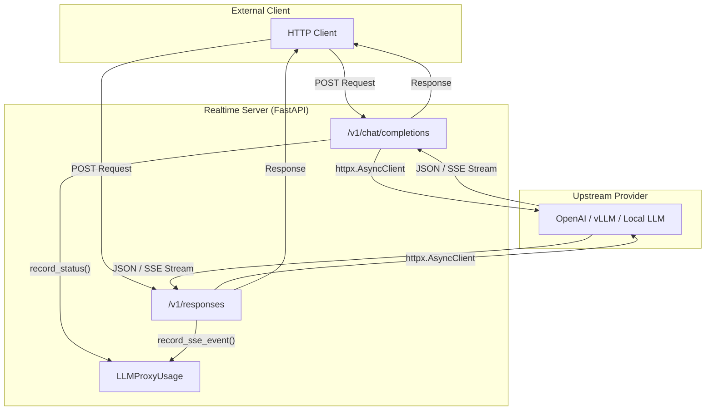
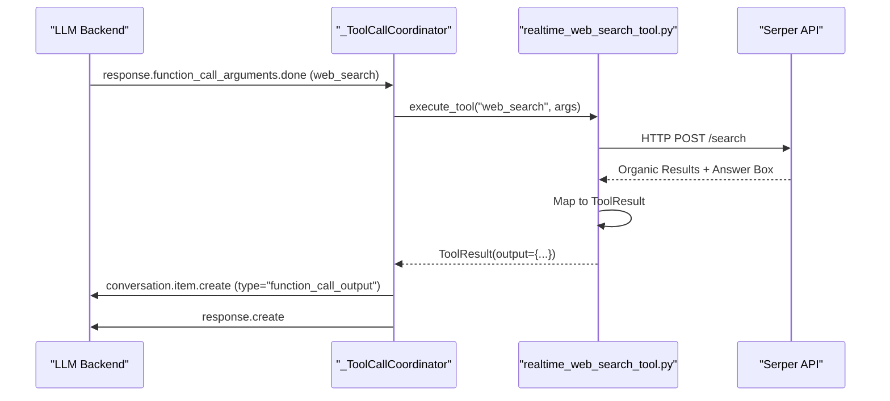

<!-- source: DeepWiki mcp.deepwiki.com · repo huggingface/speech-to-speech · page 6.4 LLM Proxy and Example Integrations · fetched 2026-10-26 -->

# LLM Proxy and Example Integrations

<details>
<summary>Relevant source files</summary>

The following files were used as context for generating this wiki page:

- [examples/gemma4-12b-macos/README.md](examples/gemma4-12b-macos/README.md)
- [examples/realtime_web_search_tool.py](examples/realtime_web_search_tool.py)
- [scripts/synthetic_conversation_realtime_client.py](scripts/synthetic_conversation_realtime_client.py)
- [src/speech_to_speech/api/openai_realtime/handlers/session.py](src/speech_to_speech/api/openai_realtime/handlers/session.py)
- [src/speech_to_speech/api/openai_realtime/llm_proxy.py](src/speech_to_speech/api/openai_realtime/llm_proxy.py)
- [src/speech_to_speech/api/openai_realtime/server.py](src/speech_to_speech/api/openai_realtime/server.py)
- [src/speech_to_speech/pipeline/log_context.py](src/speech_to_speech/pipeline/log_context.py)
- [tests/openai_realtime/test_web_search_tool_example.py](tests/openai_realtime/test_web_search_tool_example.py)

</details>


The speech-to-speech system includes a dedicated subsystem for exposing its configured Large Language Model (LLM) backend as a standard HTTP API. This allows the same models powering the realtime voice conversation to be used for background tasks like summarization, translation, or structured data extraction without interrupting the low-latency pipeline. Additionally, the system provides example integrations for extending the realtime client with external tools.

## LLM Proxy Subsystem

The LLM proxy is an OpenAI-compatible passthrough that mounts standard endpoints on the FastAPI server when enabled via the `--enable_llm_proxy` flag [src/speech_to_speech/api/openai_realtime/llm_proxy.py:151-152](). It acts as a bridge between the system's internal LLM configuration and external HTTP clients.

### Key Characteristics
- **Concurrency**: Proxied generations run fully concurrent with the speech pipeline and are never interrupted by new speech or barge-in events [src/speech_to_speech/api/openai_realtime/llm_proxy.py:8-10]().
- **Compatibility**: Supports two primary backends: `chat-completions` (targeting `/v1/chat/completions`) and `responses-api` (targeting `/v1/responses`) [src/speech_to_speech/api/openai_realtime/llm_proxy.py:28-31]().
- **Statelessness**: The proxy does not maintain conversation history; it passes the incoming request body directly to the upstream provider [src/speech_to_speech/api/openai_realtime/llm_proxy.py:197-199]().

### LLM Proxy Data Flow

The following diagram illustrates how an external HTTP request is routed through the proxy to an upstream LLM provider.

**LLM Proxy Request Routing**

Sources: [src/speech_to_speech/api/openai_realtime/llm_proxy.py:192-205](), [src/speech_to_speech/api/openai_realtime/llm_proxy.py:59-104]()

### Implementation Details

#### LLMProxyConfig
The proxy is configured via the `LLMProxyConfig` Pydantic model, which defines the upstream URL, API key, and target model name [src/speech_to_speech/api/openai_realtime/llm_proxy.py:34-40]().

#### mount_llm_proxy
The `mount_llm_proxy` function is responsible for attaching the proxy routes to the FastAPI `app` instance [src/speech_to_speech/api/openai_realtime/llm_proxy.py:138-147](). It performs validation to ensure the requested proxy path matches the currently active `llm_backend` [src/speech_to_speech/api/openai_realtime/llm_proxy.py:166-176](). If misconfigured, it mounts "unavailable" endpoints that return a `501 Not Implemented` error with a descriptive message [src/speech_to_speech/api/openai_realtime/llm_proxy.py:180-184]().

#### Usage Tracking
The `LLMProxyUsage` class tracks metrics for the proxy subsystem [src/speech_to_speech/api/openai_realtime/llm_proxy.py:43-58]():
- **Request Counters**: Tracks 2xx, 4xx, 429 (Rate Limit), and 5xx responses [src/speech_to_speech/api/openai_realtime/llm_proxy.py:59-68]().
- **Token Accounting**: For both standard JSON responses and Server-Sent Events (SSE) streams, the proxy parses the `usage` payload to accumulate `input_tokens` and `output_tokens` [src/speech_to_speech/api/openai_realtime/llm_proxy.py:70-104]().

Sources: [src/speech_to_speech/api/openai_realtime/llm_proxy.py:1-205]()

---

## Example Integrations

### Realtime Web Search Tool

The codebase includes a reference implementation for a custom tool integration in `examples/realtime_web_search_tool.py`. This example demonstrates how to extend the system's capabilities using the `ToolResult` pattern and the `execute_tool` callback.

#### Serper Web Search Tool
The `web_search` tool uses the Serper.dev API to perform Google searches and return factual information to the LLM [examples/realtime_web_search_tool.py:1-18]().

#### Data Flow for Tool Execution
When the LLM decides to call a tool, the request is routed back to the client-side `_ToolCallCoordinator`, which executes the logic defined in the tool module.

**Tool Execution Sequence**

Sources: [examples/realtime_web_search_tool.py:44-117](), [src/speech_to_speech/api/openai_realtime/audio_client.py:12-13]() (ToolResult reference)

### Key Components

| Component | Description |
| :--- | :--- |
| `TOOLS` | A list of OpenAI-formatted function definitions describing the tool's purpose and JSON schema for parameters [examples/realtime_web_search_tool.py:20-41](). |
| `execute_tool` | The primary entry point for tool logic. It validates arguments, performs the async HTTP request via `httpx`, and parses the results [examples/realtime_web_search_tool.py:44-68](). |
| `ToolResult` | A wrapper class that standardizes the output returned to the LLM, handling both successful data and error messages [examples/realtime_web_search_tool.py:103-117](). |

### Error Handling
The example implementation includes robust error handling for common failure modes:
- **Missing API Keys**: Returns a `ToolResult` with an error message if `SERPER_API_KEY` is not configured [examples/realtime_web_search_tool.py:53-59]().
- **Network Timeouts**: Uses a 12-second timeout for search requests [examples/realtime_web_search_tool.py:63]().
- **Provider Errors**: Captures non-200 HTTP status codes and surfaces them as errors to the LLM so it can inform the user [examples/realtime_web_search_tool.py:78-89]().

Sources: [examples/realtime_web_search_tool.py:1-117](), [tests/openai_realtime/test_web_search_tool_example.py:31-69]()

### Gemma 4 12B on macOS Example

The `examples/gemma4-12b-macos` directory provides a comprehensive example of running a complete realtime voice loop locally on an Apple Silicon Mac using Gemma 4 12B. This setup demonstrates a unique configuration where Speech-to-Text (STT) is bypassed, and audio is directly fed to the LLM.

#### Architecture Overview

The example leverages `llama.cpp`'s OpenAI-compatible Chat Completions endpoint to process audio directly.

**Gemma 4 12B macOS Pipeline**
```mermaid
graph TD
    A[Microphone] --> B{Browser Demo};
    B --> C[Realtime Server];
    C --> D[VAD];
    D --> E[Gemma 4 12B (llama.cpp)];
    E --> F[Assistant Response];
    F --> G[Qwen3-TTS];
    G --> H[Audio Deltas];
    H --> I[Speakers];
```
Sources: [examples/gemma4-12b-macos/README.md:6-8]()

#### Key Features
- **Native Audio Input**: The `--stt none` flag bypasses traditional STT models, sending captured WAV audio directly to Gemma 4 12B via `llama.cpp`'s `/v1/chat/completions` endpoint [examples/gemma4-12b-macos/README.md:111-112]().
- **OpenAI Realtime API Compatibility**: The speech-to-speech server and microphone client communicate using the OpenAI Realtime-compatible WebSocket API, supporting turn revisions, cancellation, and barge-in [examples/gemma4-12b-macos/README.md:15-17]().
- **Local Execution**: The entire pipeline, including the LLM and TTS, runs locally on an Apple Silicon Mac, utilizing MLX for Qwen3-TTS [examples/gemma4-12b-macos/README.md:3-4]().
- **Configuration**:
    - `llama-server`: Configured to load the Gemma 4 12B GGUF model and its multimodal projector [examples/gemma4-12b-macos/README.md:47-54]().
    - `speech-to-speech serve`: Configured with `--llm_backend chat-completions`, `--responses_api_base_url "http://127.0.0.1:8080/v1"`, and `--responses_api_audio_content_type input_audio` to integrate with `llama.cpp` [examples/gemma4-12b-macos/README.md:70-77]().
    - `--min_silence_ms`: Adjusted to `300` to fine-tune turn endpointing responsiveness [examples/gemma4-12b-macos/README.md:79]().

#### Setup and Execution
The example provides detailed instructions for setting up `llama.cpp`, installing dependencies, and running the three main components in separate terminals:
1.  **Terminal 1**: Serve Gemma with `llama.cpp` using `llama-server` [examples/gemma4-12b-macos/README.md:44-54]().
2.  **Terminal 2**: Start the realtime speech pipeline using `uv run speech-to-speech serve` [examples/gemma4-12b-macos/README.md:68-79]().
3.  **Terminal 3**: Start the browser demo using `uvicorn` or a headless client using `speech-to-speech talk` [examples/gemma4-12b-macos/README.md:87-91](), [examples/gemma4-12b-macos/README.md:127-129]().

Sources: [examples/gemma4-12b-macos/README.md:1-154]()

---

