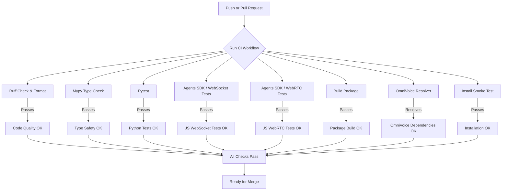
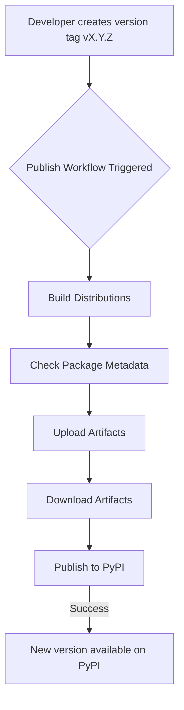

<!-- source: DeepWiki mcp.deepwiki.com · repo huggingface/speech-to-speech · page 7 Development and Project Infrastructure · fetched 2026-10-26 -->

# Development and Project Infrastructure

<details>
<summary>Relevant source files</summary>

The following files were used as context for generating this wiki page:

- [.github/scripts/star_history.py](.github/scripts/star_history.py)
- [.github/workflows/ci.yml](.github/workflows/ci.yml)
- [.github/workflows/publish.yml](.github/workflows/publish.yml)
- [.github/workflows/star-history.yml](.github/workflows/star-history.yml)
- [AGENTS.md](AGENTS.md)
- [MANIFEST.in](MANIFEST.in)
- [archive/README.md](archive/README.md)
- [archive/TTS/melo_handler.py](archive/TTS/melo_handler.py)
- [archive/arguments_classes/melo_tts_arguments.py](archive/arguments_classes/melo_tts_arguments.py)
- [docs/releases/v1.0.0.md](docs/releases/v1.0.0.md)
- [src/speech_to_speech/__init__.py](src/speech_to_speech/__init__.py)

</details>


This page provides an overview of the contributor-facing infrastructure for the `speech-to-speech` codebase. It covers the testing strategy, continuous integration and deployment (CI/CD) processes, linting and typing configurations, the archive directory for retired handlers, and how release notes are managed. Detailed information for each of these topics can be found in their respective child pages.

## Testing Strategy

A robust testing strategy is crucial for maintaining code quality and ensuring the reliability of the `speech-to-speech` system. The codebase employs various types of tests, including unit tests, integration tests, and specific tests for the OpenAI Realtime API compatibility layer. These tests cover aspects like protocol contract adherence, handler logging hygiene, transcript log integrity, and a smoke test for installation. The `tests/` and `tests/openai_realtime/` directories house these tests, utilizing `conftest` fixtures for common setup. For details on the layout of tests, how to run them, and specific test types, see [Testing Strategy](#7.1).

Sources:
- [tests/]()

## CI/CD and Release Process

The project leverages GitHub Actions for continuous integration and deployment, automating checks and releases. The `.github/workflows/ci.yml` workflow runs linting (Ruff), type checking (Mypy), Python tests (Pytest), and JavaScript tests for the demo application's Agents SDK. The `.github/workflows/publish.yml` workflow handles the release process, triggered by version tags, building distributions, and publishing to PyPI. Additionally, `dependabot` helps manage dependencies, and `MANIFEST.in` defines packaging rules. Release notes are maintained in `docs/releases/`. For a comprehensive look at the CI/CD pipelines, `mypy` configuration, `AGENTS.md` conventions, and release notes, see [CI/CD and Release Process](#7.2).

### CI Workflow Overview

The CI workflow ensures code quality and functionality before merging to `main`.


Sources:
- [.github/workflows/ci.yml:1-184]()

### Release Process Overview

The release process is triggered by version tags and automates publishing to PyPI.


Sources:
- [.github/workflows/publish.yml:1-48]()
- [AGENTS.md:9-27]()
- [src/speech_to_speech/__init__.py:3]()

### Star History Chart

The project also maintains a star history chart, automatically updated via a GitHub Actions workflow. This workflow fetches stargazer data from the GitHub API and renders it as an SVG image, which is then committed back to the repository.

```mermaid
graph TD
    A[Workflow Dispatch] --> B{Update Star History Chart};
    B --> C[Checkout Repository];
    C --> D[Generate Chart (star_history.py)];
    D -- "Creates/Updates" --> E[assets/star-history.svg];
    E --> F{Check for Changes};
    F -- "Changes Found" --> G[Commit Changes];
    G --> H[Push to Update Branch];
    H --> I[Create Pull Request];
    F -- "No Changes" --> J[No Action];
```
Sources:
- [.github/workflows/star-history.yml:1-40]()
- [.github/scripts/star_history.py:1-194]()

## Archived Handlers

The `archive/` directory serves as a repository for handlers that have been retired from active use in the `s2s_pipeline.py`. This includes older implementations of STT and TTS models, such as `MeloTTSHandler` [archive/TTS/melo_handler.py:42-130]() and `Parler TTS`, along with their corresponding argument classes. These handlers are kept for historical reference or in case they need to be revived in the future. The `archive/README.md` [archive/README.md:1-11]() provides a list of these archived components and notes on their dependencies. For detailed information on which handlers are archived, why they were moved, and how to potentially reintroduce them, see [Archived Handlers](#7.3).

Sources:
- [archive/README.md:1-11]()
- [archive/TTS/melo_handler.py:42-130]()
- [archive/arguments_classes/melo_tts_arguments.py:1-17]()

---

