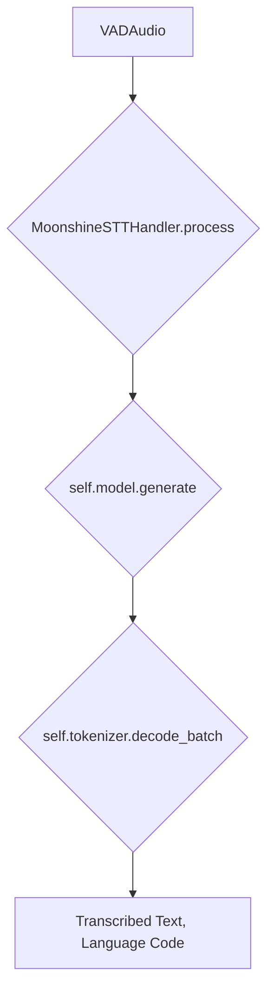

<!-- source: DeepWiki mcp.deepwiki.com · repo huggingface/speech-to-speech · page 7.3 Archived Handlers · fetched 2026-10-26 -->

# Archived Handlers

<details>
<summary>Relevant source files</summary>

The following files were used as context for generating this wiki page:

- [.github/scripts/star_history.py](.github/scripts/star_history.py)
- [.github/workflows/ci.yml](.github/workflows/ci.yml)
- [.github/workflows/publish.yml](.github/workflows/publish.yml)
- [.github/workflows/star-history.yml](.github/workflows/star-history.yml)
- [MANIFEST.in](MANIFEST.in)
- [archive/README.md](archive/README.md)
- [archive/STT/__init__.py](archive/STT/__init__.py)
- [archive/STT/moonshine_handler.py](archive/STT/moonshine_handler.py)
- [archive/TTS/__init__.py](archive/TTS/__init__.py)
- [archive/TTS/melo_handler.py](archive/TTS/melo_handler.py)
- [archive/TTS/parler_handler.py](archive/TTS/parler_handler.py)
- [archive/__init__.py](archive/__init__.py)
- [archive/arguments_classes/__init__.py](archive/arguments_classes/__init__.py)
- [archive/arguments_classes/melo_tts_arguments.py](archive/arguments_classes/melo_tts_arguments.py)
- [archive/arguments_classes/parler_tts_arguments.py](archive/arguments_classes/parler_tts_arguments.py)

</details>


This page details the handlers that have been retired from the main `speech-to-speech` codebase and moved to the `archive/` directory. It covers the reasons for their archiving and provides guidance on how to re-enable them if needed. The archived handlers include:

*   **STT:** Moonshine
*   **TTS:** Parler TTS
*   **TTS:** MeloTTS

These handlers are no longer actively maintained or included in the default dependencies, but their code and associated argument classes are preserved for historical reference and potential future use.

## Archived Handlers Overview

The `archive/` directory serves as a repository for model implementations that are no longer integrated into the primary `s2s_pipeline.py` [src/s2s_pipeline.py](). This includes both the handler logic and their corresponding argument classes.

Sources:
* [archive/README.md:1-10]()

### Reasons for Archiving

Handlers are typically archived for several reasons, including:

*   **Performance:** Newer models or implementations offer superior performance (speed, accuracy, resource usage).
*   **Maintenance Burden:** The handler requires significant effort to maintain compatibility with evolving dependencies or system architecture.
*   **Lack of Features:** The handler lacks critical features (e.g., streaming, language support) compared to alternatives.
*   **Dependency Issues:** The handler relies on complex or problematic external dependencies.

### How to Revive an Archived Handler

To revive an archived handler, you would generally need to:

1.  **Move the handler files:** Transfer the handler's Python file (e.g., `moonshine_handler.py`) and its argument class file (if applicable) from `archive/` to their respective active directories (e.g., `src/speech_to_speech/STT/` and `src/speech_to_speech/arguments_classes/`).
2.  **Update `s2s_pipeline.py`:** Modify `s2s_pipeline.py` to import and register the handler with the appropriate backend registry (STT, LLM, or TTS). This involves adding the handler to the `_build_handlers` function [src/s2s_pipeline.py]() and potentially updating the argument parsing.
3.  **Install dependencies:** Manually install any specific dependencies required by the handler, as they are removed from the default `pyproject.toml` [archive/README.md:11]().
4.  **Address compatibility issues:** Resolve any code changes or API incompatibilities that may have arisen since the handler was archived.

## Archived STT Handlers

### Moonshine STT Handler

The `MoonshineSTTHandler` [archive/STT/moonshine_handler.py:18-20]() provided Speech-to-Text capabilities using a Moonshine model. It was responsible for loading the Moonshine tokenizer and model, performing inference on audio input, and yielding the transcribed text.

**Implementation Details:**

*   **Setup:** The `setup` method [archive/STT/moonshine_handler.py:27-34]() initializes the Moonshine tokenizer and model based on the provided `model_name` and `torch_dtype`.
*   **Warmup:** The `warmup` method [archive/STT/moonshine_handler.py:37-61]() performs dummy inference to pre-load the model and optimize performance, especially on CUDA devices.
*   **Processing:** The `process` method [archive/STT/moonshine_handler.py:63-72]() takes `VADAudio` as input, generates predictions using `self.model.generate()`, decodes the predictions into text using `self.tokenizer.decode_batch()`, and yields the transcribed text along with a language code (hardcoded to "en").

**Data Flow:**



**Key Classes and Functions:**

*   `MoonshineSTTHandler` [archive/STT/moonshine_handler.py:18-20](): The main handler class.
*   `setup()` [archive/STT/moonshine_handler.py:27-34](): Initializes the model and tokenizer.
*   `warmup()` [archive/STT/moonshine_handler.py:37-61](): Pre-loads the model for performance.
*   `process(vad_audio: VADAudio)` [archive/STT/moonshine_handler.py:63-72](): Performs STT inference.
*   `moonshine.load_tokenizer()` [archive/STT/moonshine_handler.py:32](): Loads the Moonshine tokenizer.
*   `moonshine.load_model()` [archive/STT/moonshine_handler.py:33](): Loads the Moonshine model.

Sources:
* [archive/STT/moonshine_handler.py:1-72]()
* [archive/README.md:5]()

## Archived TTS Handlers

### Parler TTS Handler

The `ParlerTTSHandler` [archive/TTS/parler_handler.py:52-52]() was responsible for generating speech from text using the ParlerTTS model. It supported streaming audio output and language-specific speaker selection.

**Implementation Details:**

*   **Setup:** The `setup` method [archive/TTS/parler_handler.py:54-109]() initializes the `ParlerTTSForConditionalGeneration` model and `AutoTokenizer` for both description and prompt. It also handles device placement, `torch_dtype`, and compilation. It includes a warning about Flash Attention 2 [archive/TTS/parler_handler.py:32-37]() for CUDA.
*   **Speaker Mapping:** It uses `WHISPER_LANGUAGE_TO_PARLER_SPEAKER` [archive/TTS/parler_handler.py:40-49]() to map Whisper language codes to Parler TTS speaker names.
*   **Warmup:** The `warmup` method [archive/TTS/parler_handler.py:146-178]() performs dummy generations to warm up the model, especially for compiled modes.
*   **Processing:** The `process` method [archive/TTS/parler_handler.py:180-191]() takes `TTSInput` or `EndOfResponse` messages. For `TTSInput`, it prepares model inputs, generates audio using `self.model.generate()`, and streams the audio in chunks. It also handles cancellation via `self.cancel_response` [archive/TTS/parler_handler.py:71]().

**Data Flow:**

```mermaid
graph TD
    A[TTSInput] --> B{ParlerTTSHandler.process};
    B -- "Prepare model inputs" --> C{self.prepare_model_inputs};
    C --> D{self.model.generate};
    D -- "Stream audio chunks" --> E[Audio Output (PCM int16)];
    B -- "EndOfResponse" --> F[AUDIO_RESPONSE_DONE];
```

**Key Classes and Functions:**

*   `ParlerTTSHandler` [archive/TTS/parler_handler.py:52-52](): The main handler class.
*   `setup()` [archive/TTS/parler_handler.py:54-109](): Initializes the ParlerTTS model and tokenizers.
*   `prepare_model_inputs()` [archive/TTS/parler_handler.py:111-145](): Prepares input tensors for generation.
*   `warmup()` [archive/TTS/parler_handler.py:146-178](): Warms up the model.
*   `process(tts_input: TTSInput | EndOfResponse)` [archive/TTS/parler_handler.py:180-191](): Generates and streams speech.
*   `ParlerTTSForConditionalGeneration` [archive/TTS/parler_handler.py:85](): The core ParlerTTS model.
*   `AutoTokenizer` [archive/TTS/parler_handler.py:88,90](): Used for tokenizing text.
*   `WHISPER_LANGUAGE_TO_PARLER_SPEAKER` [archive/TTS/parler_handler.py:40-49](): Maps languages to speakers.

**Argument Class:**

The `ParlerTTSHandlerArguments` dataclass [archive/arguments_classes/parler_tts_arguments.py]() defined the configurable parameters for the Parler TTS handler.

Sources:
* [archive/TTS/parler_handler.py:1-244]()
* [archive/README.md:6]()
* [archive/arguments_classes/parler_tts_arguments.py]()

### MeloTTS Handler

The `MeloTTSHandler` [archive/TTS/melo_handler.py:42-42]() provided Text-to-Speech functionality using the MeloTTS model. It supported language detection and dynamic model loading for different languages.

**Implementation Details:**

*   **Setup:** The `setup` method [archive/TTS/melo_handler.py:44-63]() initializes the `TTS` model from `melo.api` for a specified language and device. It also sets up the `speaker_id` based on language mapping.
*   **Language Mapping:** It uses `WHISPER_LANGUAGE_TO_MELO_LANGUAGE` [archive/TTS/melo_handler.py:23-30]() and `WHISPER_LANGUAGE_TO_MELO_SPEAKER` [archive/TTS/melo_handler.py:32-39]() to map Whisper language codes to MeloTTS languages and speakers.
*   **Warmup:** The `warmup` method [archive/TTS/melo_handler.py:65-68]() performs a dummy `tts_to_file` call to warm up the model.
*   **Processing:** The `process` method [archive/TTS/melo_handler.py:70-124]() handles `TTSIn` and `EndOfResponse` messages. For `TTSIn`, it checks for stale turns using `SpeculativeTurnTracker` [archive/TTS/melo_handler.py:75-81](), dynamically reloads the model if the language changes [archive/TTS/melo_handler.py:89-98](), generates audio using `self.model.tts_to_file()`, resamples the audio, converts it to `int16`, and yields it in `blocksize` chunks. It also supports cancellation via `CancelScope` [archive/TTS/melo_handler.py:116-119]().
*   **Session End:** The `on_session_end` method [archive/TTS/melo_handler.py:126-130]() resets the language and model to their initial state.

**Data Flow:**

```mermaid
graph TD
    A[TTSIn] --> B{MeloTTSHandler.process};
    B -- "Check stale turn" --> C{SpeculativeTurnTracker.is_latest};
    C -- "Not latest" --> D[Drop input];
    C -- "Is latest" --> E{Language check};
    E -- "Language changed" --> F{Reload MeloTTS model};
    F --> G{self.model.tts_to_file};
    G -- "Resample & Convert" --> H[Audio Chunks (PCM int16)];
    H --> I[Yield Audio];
    B -- "EndOfResponse" --> J[AUDIO_RESPONSE_DONE];
```

**Key Classes and Functions:**

*   `MeloTTSHandler` [archive/TTS/melo_handler.py:42-42](): The main handler class.
*   `setup()` [archive/TTS/melo_handler.py:44-63](): Initializes the MeloTTS model.
*   `warmup()` [archive/TTS/melo_handler.py:65-68](): Warms up the model.
*   `process(tts_input: TTSIn)` [archive/TTS/melo_handler.py:70-124](): Generates and streams speech.
*   `on_session_end()` [archive/TTS/melo_handler.py:126-130](): Resets session state.
*   `TTS` [archive/TTS/melo_handler.py:59](): The core MeloTTS model from `melo.api`.
*   `WHISPER_LANGUAGE_TO_MELO_LANGUAGE` [archive/TTS/melo_handler.py:23-30](): Maps languages.
*   `WHISPER_LANGUAGE_TO_MELO_SPEAKER` [archive/TTS/melo_handler.py:32-39](): Maps speakers.
*   `CancelScope` [archive/TTS/melo_handler.py:51,116-119](): Used for cancellation.
*   `SpeculativeTurnTracker` [archive/TTS/melo_handler.py:52,75-81](): Manages speculative turns.

**Argument Class:**

The `MeloTTSHandlerArguments` dataclass [archive/arguments_classes/melo_tts_arguments.py]() defined the configurable parameters for the MeloTTS handler.

Sources:
* [archive/TTS/melo_handler.py:1-130]()
* [archive/README.md:7]()
* [archive/arguments_classes/melo_tts_arguments.py]()

---

