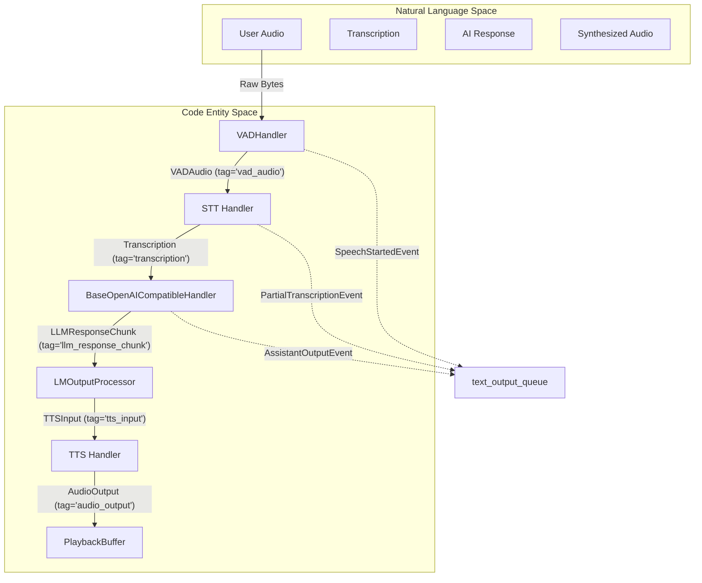
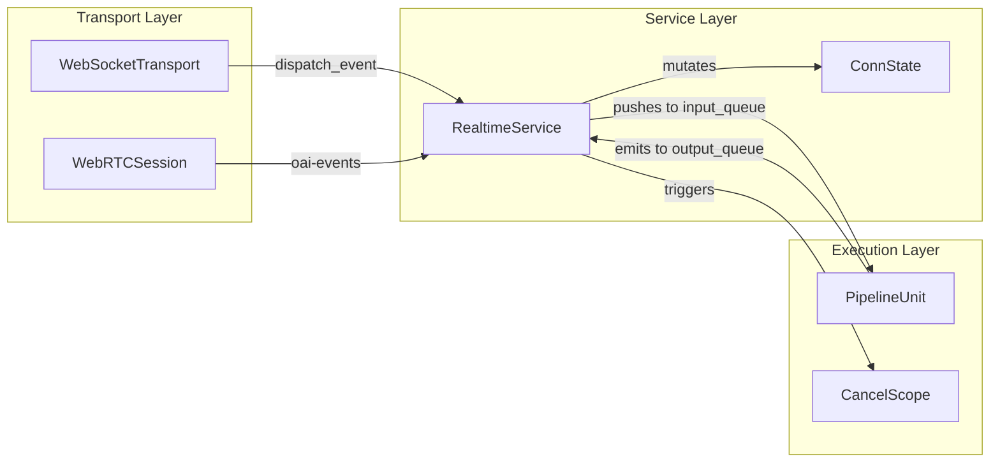
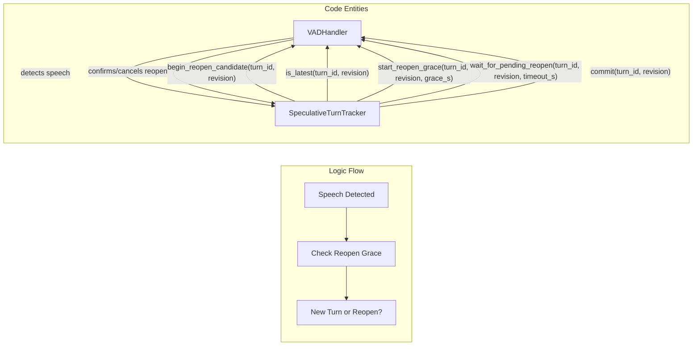

<!-- source: DeepWiki mcp.deepwiki.com · repo huggingface/speech-to-speech · page 8 Glossary · fetched 2026-10-26 -->

# Glossary

Relevant source files

The following files were used as context for generating this wiki page:

- [README.md](README.md)
- [pyproject.toml](pyproject.toml)
- [src/speech_to_speech/LLM/base_openai_compatible_language_model.py](src/speech_to_speech/LLM/base_openai_compatible_language_model.py)
- [src/speech_to_speech/LLM/language_model.py](src/speech_to_speech/LLM/language_model.py)
- [src/speech_to_speech/VAD/smart_turn.py](src/speech_to_speech/VAD/smart_turn.py)
- [src/speech_to_speech/VAD/vad_handler.py](src/speech_to_speech/VAD/vad_handler.py)
- [src/speech_to_speech/api/openai_realtime/websocket_router.py](src/speech_to_speech/api/openai_realtime/websocket_router.py)
- [src/speech_to_speech/arguments_classes/vad_arguments.py](src/speech_to_speech/arguments_classes/vad_arguments.py)
- [src/speech_to_speech/backend_registry.py](src/speech_to_speech/backend_registry.py)
- [src/speech_to_speech/baseHandler.py](src/speech_to_speech/baseHandler.py)
- [src/speech_to_speech/pipeline/speculative_turns.py](src/speech_to_speech/pipeline/speculative_turns.py)
- [tests/openai_realtime/test_websocket_router.py](tests/openai_realtime/test_websocket_router.py)
- [tests/test_backend_registry.py](tests/test_backend_registry.py)
- [tests/test_responses_api_language_model.py](tests/test_responses_api_language_model.py)
- [tests/test_smart_turn.py](tests/test_smart_turn.py)
- [tests/test_speculative_turns.py](tests/test_speculative_turns.py)

This page provides definitions for codebase-specific terminology, architectural concepts, and message protocol constants used throughout the speech-to-speech pipeline.

## Pipeline Architecture Terms

### Handler
A "Handler" is the fundamental unit of processing in the pipeline. Every major stage (VAD, STT, LLM, TTS) is implemented as a class inheriting from `BaseHandler` [src/speech_to_speech/baseHandler.py:23-31](). Handlers run in their own dedicated threads and communicate via input and output queues.

### ThreadManager
The `ThreadManager` is responsible for the lifecycle of all handler threads. It handles starting threads, monitoring their health, and coordinating a graceful shutdown using a `stop_event` [src/speech_to_speech/s2s_pipeline.py:68]().

### CancelScope
A mechanism used to handle "barge-in" (interruption). When a user starts speaking while the system is still generating or playing audio, the `CancelScope` is triggered to abort current processing. It uses a `generation` counter to identify and discard stale tasks [src/speech_to_speech/pipeline/cancel_scope.py:12-20]().

### PipelineUnit
A container class used in `realtime` mode that encapsulates a complete set of handlers (VAD, STT, LLM, TTS) and their associated queues. `PipelineUnit` instances are pooled to support multiple concurrent WebSocket sessions [src/speech_to_speech/api/openai_realtime/pipeline_unit.py:22-45]().

### Draining
The process of gracefully shutting down a `PipelineUnit`. When a session ends, the unit is "drained" by sending `SESSION_END` through the pipeline to ensure all pending outputs are processed and states are reset before the unit is returned to the pool [src/speech_to_speech/api/openai_realtime/websocket_router.py:71-75]().

### BackendRegistry & BackendSpec
The `BackendRegistry` manages the mapping of string identifiers (e.g., `qwen3`) to specific implementation classes. A `BackendSpec` defines the metadata for a backend, including its `BackendKind` (STT, LLM, TTS) and its argument configuration class [src/speech_to_speech/backend_registry.py:90-110]().

### BackendCapabilities
A dataclass within `BackendSpec` that describes static construction details affecting pipeline composition, such as whether a backend bypasses the transcription notifier, supports audio input, or streams audio chunks [src/speech_to_speech/backend_registry.py:60-67]().

### HandlerContext
A dataclass that bundles pipeline-local state (e.g., `stop_event`, `queue_in`, `cancel_scope`, `speculative_turns`) and makes it available to every registered handler factory during setup [src/speech_to_speech/backend_registry.py:70-84]().

## Handler Lifecycle Concepts

| Phase | Description | Code Pointer |
| :--- | :--- | :--- |
| **Setup** | Initialization of models, devices, and stateful variables. | `BaseHandler.setup` [src/speech_to_speech/baseHandler.py:48-49]() |
| **Warmup** | Running a dummy inference pass to initialize CUDA kernels or MLX graphs. | `BaseOpenAICompatibleHandler.warmup` [src/speech_to_speech/LLM/base_openai_compatible_language_model.py:159]() |
| **Process** | The core logic loop that consumes items from `queue_in` and yields results. | `BaseHandler.run` [src/speech_to_speech/baseHandler.py:84-138]() |
| **Cleanup** | Logic executed when the thread receives a `PIPELINE_END` sentinel. | `BaseHandler.cleanup` [src/speech_to_speech/baseHandler.py:157-158]() |
| **On Session End** | Soft reset of handler state (e.g., clearing buffers) without killing the thread. | `BaseHandler.on_session_end` [src/speech_to_speech/baseHandler.py:160-161]() |

**Sources:** [src/speech_to_speech/baseHandler.py:23-161](), [src/speech_to_speech/LLM/base_openai_compatible_language_model.py:109-160]()

## Audio Processing & VAD Terminology

### VAD (Voice Activity Detection)
The process of detecting speech boundaries. This system uses **Silero VAD v5** [src/speech_to_speech/VAD/vad_handler.py:122-127]() or **FireRed Stream-VAD** [src/speech_to_speech/VAD/vad_handler.py:131-149]().

### SpeculativeTurnTracker
A class that manages the lifecycle of user turns, including tracking revisions, handling reopen candidates, and determining if a turn is committed or stale. It's crucial for barge-in and responsive turn management [src/speech_to_speech/pipeline/speculative_turns.py:12-40]().

### Turn Revision
An integer counter associated with a user turn. When a turn is reopened (e.g., due to continued speech after a speculative end), its revision is incremented. This allows downstream handlers to discard events belonging to older, stale revisions of the same turn [src/speech_to_speech/pipeline/speculative_turns.py:12-40]().

### Reopen Grace
A time window during which a speculatively ended user turn can be reopened if new speech is detected. This prevents starting a new turn for a brief pause in a single utterance [src/speech_to_speech/VAD/vad_handler.py:103](). The `speculative_reopen_ms` argument controls this duration [src/speech_to_speech/arguments_classes/vad_arguments.py:80-83]().

### Smart Turn
A feature that uses the `SmartTurnAnalyzer` to intelligently determine the end of a user's turn, rather than relying solely on fixed silence thresholds. It considers acoustic features to predict if a turn is complete or incomplete [src/speech_to_speech/VAD/vad_handler.py:109-122]().

### SmartTurnAnalyzer
An ONNX-based model used to predict if a user has finished speaking based on the acoustic features of the pause. It provides a more intelligent alternative to fixed silence timeouts [src/speech_to_speech/VAD/smart_turn.py:30-50]().

### Short Segment Stitching
A VAD feature where very short speech segments (below `min_speech_ms`) are held and merged with subsequent segments if they occur within a `short_segment_merge_ms` window. This helps capture fragmented speech that might otherwise be discarded as noise [src/speech_to_speech/VAD/vad_handler.py:104]().

### Progressive vs Final Transcription
*   **Progressive Transcription**: Intermediate, often incomplete, transcription results emitted by STT handlers while the user is still speaking. These are used for live display and can be updated or replaced by later progressive or final transcriptions [src/speech_to_speech/pipeline/events.py:41-44]().
*   **Final Transcription**: The complete and stable transcription of a user's utterance, emitted once the STT handler determines the speech segment has ended [src/speech_to_speech/pipeline/events.py:45-48]().

### Session Generation Fencing
A mechanism to prevent events from a previous session (or an older generation within the same session) from interfering with the current processing. This is achieved by associating a `generation` counter with events and discarding those that do not match the current active generation [src/speech_to_speech/pipeline/cancel_scope.py:12-20]().

### Discarding
The act of ignoring or dropping pipeline events or messages that are no longer relevant, typically due to cancellation, a new turn revision, or session fencing. This ensures that stale data does not affect current processing [src/speech_to_speech/api/openai_realtime/websocket_router.py:185-187]().

### AudioInputNotifier
A specialized handler used when `--stt none` is selected. It passes raw audio directly to LLMs that support native audio input (e.g., GPT-4o) by wrapping segments into `AudioInputCompletedEvent` [src/speech_to_speech/pipeline/events.py:75-87]().

### PlaybackBuffer
A client-side buffer used by the `RealtimeAudioClient` to manage the playback of synthesized audio chunks, ensuring smooth and continuous audio output [src/speech_to_speech/api/openai_realtime/listen_and_play_realtime.py:200-201]().

## LLM & API Terms

### STT (Speech-to-Text)
The process of converting spoken language into written text.

### LLM (Large Language Model)
A type of AI model capable of understanding and generating human-like text.

### TTS (Text-to-Speech)
The process of converting written text into spoken language.

### BaseOpenAICompatibleHandler
An abstract base class for LLM handlers that communicate with OpenAI-compatible APIs. It handles the orchestration of requests, sentence-level batching for TTS, and tool calling [src/speech_to_speech/LLM/base_openai_compatible_language_model.py:109-119]().

### ProviderEvent
A normalized internal protocol (including `TextDelta`, `AssistantMessage`, `ToolCall`, and `Usage`) that allows the pipeline to interact with different LLM backends (Responses API vs. Chat Completions) using a single interface [src/speech_to_speech/LLM/base_openai_compatible_language_model.py:104-107]().

### ResponsePrefetchTransaction
A mechanism in the `ResponsesApiModelHandler` to start generating a response before the previous turn's processing is fully finalized, reducing latency [src/speech_to_speech/pipeline/messages.py:147](). This allows the LLM to begin thinking and generating output while the STT is still finalizing the user's utterance.

### Out-of-Band Response
A response from the LLM that is not directly tied to the current user turn. This can happen if the LLM decides to generate a response proactively or if a tool call triggers an asynchronous response [src/speech_to_speech/LLM/base_openai_compatible_language_model.py:60]().

### Deferred Items
In the `RealtimeService`, these are events or messages that are temporarily held back from being processed immediately, often to ensure correct ordering or to wait for a specific condition (e.g., a turn to commit) [src/speech_to_speech/api/openai_realtime/service.py:300-301]().

### StreamContext
A mutable accumulator passed through LLM generation functions to collect state (e.g., generated text, tool calls, token usage) as tokens are streamed. It allows the caller to read back the generation state after the iterator is exhausted [src/speech_to_speech/LLM/language_model.py:130-162]().

### Chat Compaction
The process of summarizing long conversation histories into a dense format to stay within the LLM's context window. This is handled by the `Chat` class [src/speech_to_speech/LLM/chat.py:12-14]().

### CompactFn
A type alias for the function that performs the summarization of chat history [src/speech_to_speech/LLM/base_openai_compatible_language_model.py:105]().

### voice_prompt
A module responsible for assembling system prompts specifically tailored for spoken-style output, often including language directives and instructions for the LLM to generate natural-sounding speech [src/speech_to_speech/LLM/voice_prompt.py:1-5]().

### LLM Proxy
A subsystem that exposes the configured LLM backend as a standard OpenAI-compatible HTTP endpoint (`/v1/chat/completions`, `/v1/responses`), allowing other local services to use the same model [src/speech_to_speech/api/openai_realtime/llm_proxy.py:20-40]().

### ToolResult
Encapsulates the output of a function call, including its ID and content [src/speech_to_speech/LLM/tool_call/function_tool.py:12-16]().

## Realtime Service & Session Management

### ConnState
Per-connection mutable state managed by the `RealtimeService`, including `session_id`, `conversation_id`, and tracking for `pending_response_keys` [src/speech_to_speech/api/openai_realtime/service.py:169-210]().

### RuntimeConfig
A configuration object that can be updated dynamically mid-session via `session.update` events, affecting VAD thresholds, TTS voices, or LLM instructions [src/speech_to_speech/api/openai_realtime/runtime_config.py:15-35]().

### Quarantine
A state for a `PipelineUnit` that failed to drain properly. It is kept out of the pool to prevent cross-session data leaks. Units in quarantine are visible in `/v1/pool` as "stuck" [src/speech_to_speech/api/openai_realtime/websocket_router.py:83-85]().

### oai-events
The WebRTC DataChannel label used for the JSON-based OpenAI Realtime protocol messages [src/speech_to_speech/api/openai_realtime/webrtc_session.py:110]().

## Performance Metrics

### RTF (Real-Time Factor)
A measure of how much faster or slower a process runs compared to real-time. An RTF of 1.0 means it runs in real-time; 0.5 means it's twice as fast; 2.0 means it's half as fast.

### TTFA (Time To First Audio)
The latency from the start of an LLM's response generation to the first audio chunk being available for playback.

### TTFC (Time To First Chunk)
Similar to TTFA, but can refer to the time until the first chunk of any type (e.g., text, audio) is available.

## Message Protocol Constants

| Constant / Tag | Purpose | Code Pointer |
| :--- | :--- | :--- |
| `PIPELINE_END` | Binary sentinel signaling a handler thread to terminate. | [src/speech_to_speech/pipeline/messages.py:48]() |
| `SESSION_END` | Control message to trigger `on_session_end` for unit reuse. | [src/speech_to_speech/pipeline/control.py:24]() |
| `AUDIO_RESPONSE_DONE` | Sentinel sent by TTS to signal the end of audio playback. | [src/speech_to_speech/pipeline/messages.py:48]() |
| `vad_audio` | Tag for audio segments flowing from VAD to STT. | [src/speech_to_speech/pipeline/messages.py:48]() |
| `tts_input` | Tag for text chunks flowing from LLM/Processor to TTS. | [src/speech_to_speech/pipeline/messages.py:190]() |
| `PROVIDER_FAILURE_FALLBACK` | Internal sentinel used when a primary LLM provider fails. | [src/speech_to_speech/LLM/base_openai_compatible_language_model.py:70]() |

**Sources:** [src/speech_to_speech/pipeline/messages.py:1-220](), [src/speech_to_speech/api/openai_realtime/service.py:71-120]()

## System Architecture Diagrams

### Pipeline Data Flow and Code Entity Mapping
This diagram maps the conceptual data flow to the specific classes and message tags used in the code.

**Sources:** [src/speech_to_speech/pipeline/messages.py:45-210](), [src/speech_to_speech/pipeline/events.py:36-110](), [src/speech_to_speech/LLM/lm_output_processor.py:41-48]()

### Realtime Session Lifecycle
This diagram illustrates how a `WebRTCSession` or `WebSocketTransport` interacts with the `RealtimeService` and `PipelineUnit`.

**Sources:** [src/speech_to_speech/api/openai_realtime/service.py:169-250](), [src/speech_to_speech/api/openai_realtime/websocket_router.py:28-45](), [src/speech_to_speech/api/openai_realtime/pipeline_unit.py:22-45]()

### Speculative Turn Management
This diagram illustrates the interaction between the `VADHandler` and the `SpeculativeTurnTracker` during turn detection.

**Sources:** [src/speech_to_speech/VAD/vad_handler.py:103](), [src/speech_to_speech/pipeline/speculative_turns.py:12-40](), [tests/test_speculative_turns.py:17-40]()