# Page: Overview

# Overview

<details>
<summary>Relevant source files</summary>

The following files were used as context for generating this wiki page:

- [AGENTS.md](AGENTS.md)
- [README.md](README.md)
- [docs/releases/v1.0.0.md](docs/releases/v1.0.0.md)
- [pyproject.toml](pyproject.toml)
- [src/speech_to_speech/__init__.py](src/speech_to_speech/__init__.py)
- [src/speech_to_speech/arguments_classes/module_arguments.py](src/speech_to_speech/arguments_classes/module_arguments.py)
- [src/speech_to_speech/s2s_pipeline.py](src/speech_to_speech/s2s_pipeline.py)
- [tests/test_cli_defaults.py](tests/test_cli_defaults.py)

</details>


## Purpose and Scope

This document provides a high-level introduction to the speech-to-speech system, an open-source, modular pipeline that enables real-time conversational AI by processing audio input through voice activity detection, speech recognition, language model inference, and speech synthesis [README.md:17](). It is designed as a flexible, low-latency alternative to closed systems, featuring pluggable backends and an OpenAI Realtime-compatible API layer [README.md:17]().

**Scope of this document:** This page covers the system's high-level architecture, cascaded pipeline stages, deployment modes, hardware targets, and the OpenAI Realtime compatibility layer. For installation instructions, environment setup, and CLI usage, see [Getting Started](#1.1). For dependency layouts and platform-conditional stacks, see [Dependencies and Requirements](#1.2).

Sources: [README.md:17](), [src/speech_to_speech/arguments_classes/module_arguments.py:1-104]()

## System Purpose and Capabilities

The speech-to-speech system implements a cascaded processing pipeline designed for real-time voice interactions:

- **Audio Ingestion:** Accepts live audio input via WebSocket (OpenAI Realtime API), WebRTC, or local sound device streams [src/speech_to_speech/s2s_pipeline.py:173-174](), [README.md:31-46]().
- **Voice Activity Detection (VAD):** Segments continuous microphone audio into discrete speech utterances using `VADHandler` powered by Silero VAD v5 [src/speech_to_speech/VAD/vad_handler.py:1-50](), [README.md:85]().
- **Speech-to-Text (STT):** Transcribes speech utterances into text using models such as Parakeet TDT or Whisper [README.md:161-171]().
- **Language Model (LLM):** Processes transcribed text to generate contextual assistant responses, supporting tool calling and conversation compaction [README.md:87](), [src/speech_to_speech/arguments_classes/module_arguments.py:35-41]().
- **Text-to-Speech (TTS):** Converts text responses into streaming PCM audio chunks using engines like Qwen3-TTS or Kokoro [README.md:88](), [README.md:104]().

**Design Principles:**
- **Modularity:** Each stage is managed by `BackendRegistry` and supports swappable backend implementations [src/speech_to_speech/backend_registry.py:29-37](), [README.md:17]().
- **Concurrency & Interruption:** Coordinated by `ThreadManager` and `CancelScope`, enabling low-latency "barge-in" handling where assistant speech halts immediately when user speech is detected [src/speech_to_speech/s2s_pipeline.py:51](), [src/speech_to_speech/pipeline/cancel_scope.py:38]().

Sources: [README.md:17-19](), [src/speech_to_speech/backend_registry.py:29-37](), [src/speech_to_speech/arguments_classes/module_arguments.py:13-94]()

## High-Level Architecture

The system is initialized and orchestrated by `s2s_pipeline.py`, routing data between threads via typed queues and pipeline units [src/speech_to_speech/s2s_pipeline.py:21-55]().

### Pipeline Data Flow and Code Entities

The diagram below bridges natural language pipeline concepts to their concrete code entities in the codebase.

**Figure 1: Pipeline Data Flow and Code Entities**
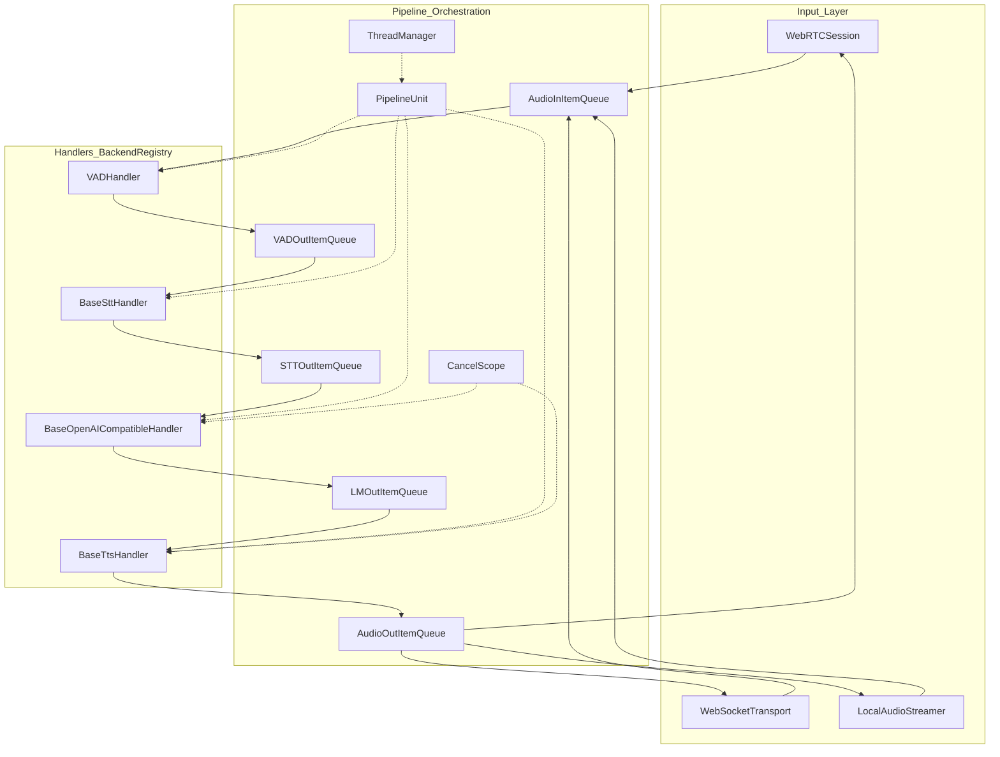

Sources: [src/speech_to_speech/s2s_pipeline.py:21-55](), [src/speech_to_speech/pipeline/queue_types.py:39-46](), [src/speech_to_speech/pipeline/cancel_scope.py:38]()

### Component Registry and Handler Hierarchy

Model selection and instantiation are handled dynamically through the backend registry pattern.

**Figure 2: Component Registry and Handler Hierarchy**
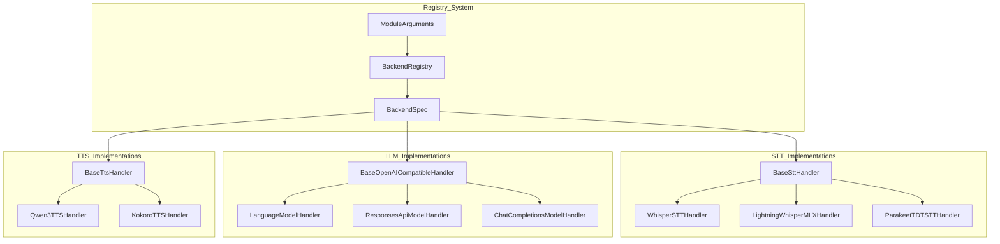

Sources: [src/speech_to_speech/backend_registry.py:29-37](), [src/speech_to_speech/arguments_classes/module_arguments.py:13-94]()

## Deployment Modes

The system provides three primary CLI commands for running the pipeline [pyproject.toml:116-117](), [docs/releases/v1.0.0.md:9-11]():

1. **Serve (`speech-to-speech serve`):** Starts a FastAPI server exposing the OpenAI Realtime API via WebSockets (`/v1/realtime`) and WebRTC (`/v1/realtime/calls`) [docs/releases/v1.0.0.md:9-11]().
2. **Talk (`speech-to-speech talk`):** A command-line client connecting to a running server instance over WebSocket with local microphone and speaker capture [docs/releases/v1.0.0.md:9-11]().
3. **Local (`speech-to-speech local`):** Runs both the server and the audio client in-process over a local loopback connection, ideal for desktop usage [docs/releases/v1.0.0.md:9-11]().

**OpenAI Realtime Compatibility Layer:**
The server implements the core OpenAI Realtime GA event set over WebSockets and WebRTC, enabling drop-in compatibility with existing Realtime clients, SDKs, and browser demo applications [README.md:17](), [docs/releases/v1.0.0.md:16-19]().

Sources: [README.md:17](), [pyproject.toml:116-117](), [docs/releases/v1.0.0.md:9-28]()

## Hardware Targets

- **Apple Silicon (Mac):** Optimized via the **MLX** framework (`mlx-lm`, `mlx-audio`, `lightning-whisper-mlx`) utilizing unified memory and MPS execution [src/speech_to_speech/s2s_pipeline.py:76-92](), [pyproject.toml:59-67]().
- **NVIDIA (Linux/CUDA):** Utilizes PyTorch CUDA acceleration and GGML/CUDA runtimes (`faster-qwen3-tts`) for high throughput [README.md:71-84](), [pyproject.toml:53-56]().
- **CPU Fallback:** Fully supported across components for testing or constrained environments [README.md:123-124]().

Sources: [src/speech_to_speech/s2s_pipeline.py:76-92](), [README.md:71-124](), [pyproject.toml:33-68]()

## Child Pages

For detailed information on getting started and dependencies, refer to the child pages:
- [Getting Started](#1.1)
- [Dependencies and Requirements](#1.2)

Sources: [README.md:29-105](), [pyproject.toml:27-110]()

---

# Page: Getting Started

# Getting Started

<details>
<summary>Relevant source files</summary>

The following files were used as context for generating this wiki page:

- [README.md](README.md)
- [pyproject.toml](pyproject.toml)
- [src/speech_to_speech/arguments_classes/local_audio_arguments.py](src/speech_to_speech/arguments_classes/local_audio_arguments.py)
- [src/speech_to_speech/cli.py](src/speech_to_speech/cli.py)
- [src/speech_to_speech/pipeline/transcript_logging.py](src/speech_to_speech/pipeline/transcript_logging.py)
- [tests/openai_realtime/test_pipeline_builder.py](tests/openai_realtime/test_pipeline_builder.py)
- [tests/test_transcript_log_hygiene.py](tests/test_transcript_log_hygiene.py)

</details>


## Purpose and Scope

This page provides a technical guide for installing, configuring, and executing the `speech-to-speech` pipeline. It covers dependency management via `pyproject.toml`, environment setup, the three primary CLI commands (`serve`, `talk`, and `local`) [src/speech_to_speech/cli.py:18-35](), and platform-specific operational notes for Apple Silicon (macOS) versus Linux/CUDA environments.

Sources: [pyproject.toml:1-68](), [src/speech_to_speech/cli.py:18-35](), [README.md:29-56]()

---

## Prerequisites and Platform Requirements

The system targets Python 3.10 through 3.12 [pyproject.toml:10-23]() and depends on platform-accelerated tensor and audio libraries. 

- **Python Version**: `>=3.10` [pyproject.toml:10-10]()
- **Hardware Targets**: 
  - **Apple Silicon (M1/M2/M3/M4)**: Requires macOS with unified memory (16 GB recommended for fully local execution) [README.md:35-37]()
  - **Linux / Windows**: Requires an NVIDIA GPU with CUDA support (budget 24 GB VRAM for unquantized local models) [README.md:36-36]()
- **Package Manager**: `uv` or standard `pip` / `setuptools` [pyproject.toml:1-3](), [pyproject.toml:131-134]()

Sources: [pyproject.toml:10-23](), [README.md:33-40]()

---

## Installation and Dependency Management

The project defines its dependency graph in `pyproject.toml` with strict platform markers (`platform_system == 'Darwin'` vs `platform_system != 'Darwin'`) to segregate Apple MLX libraries from CUDA/GGML packages [pyproject.toml:27-68]().

```bash
git clone https://github.com/huggingface/speech-to-speech.git
cd speech-to-speech
python3 -m venv .venv
source .venv/bin/activate
pip install .
```

### Installation Dependency Flow

The following diagram maps the installation and conditional dependency selection defined in `pyproject.toml` to their underlying code modules and package targets:

```mermaid
graph TB
    subgraph "pyproject.toml Configuration Space"
        PYPROJECT["pyproject.toml"] -->|Platform Check: Darwin| MAC_DEPS["macOS Conditional Dependencies"]
        PYPROJECT -->|Platform Check: Linux/Windows| CUDA_DEPS["Linux/Windows Conditional Dependencies"]
    end
    
    subgraph "Code Entity and Package Target Space"
        MAC_DEPS --> MLX["mlx==0.32.0 (mlx)"]
        MAC_DEPS --> MLX_AUDIO["mlx-audio==0.4.7 (speech_to_speech.TTS.qwen3_handler)"]
        MAC_DEPS --> MLX_LM["mlx-lm==0.31.3 (speech_to_speech.LLM.language_model_handler)"]
        
        CUDA_DEPS --> TORCH["torch>=2.4.0 (torch)"]
        CUDA_DEPS --> NANO_PARAKEET["nano-parakeet>=0.2.0 (speech_to_speech.STT.nano_parakeet)"]
        CUDA_DEPS --> FASTER_QWEN3["faster-qwen3-tts[ggml]>=0.4.0 (speech_to_speech.TTS.qwen3_handler)"]
    end

    PYPROJECT ["pyproject.toml:27-68"]
    MAC_DEPS ["pyproject.toml:44-68"]
    CUDA_DEPS ["pyproject.toml:47-56"]
    MLX ["pyproject.toml:60-60"]
    MLX_AUDIO ["pyproject.toml:61-61"]
    MLX_LM ["pyproject.toml:62-62"]
    TORCH ["pyproject.toml:47-47"]
    NANO_PARAKEET ["pyproject.toml:54-54"]
    FASTER_QWEN3 ["pyproject.toml:55-55"]
```

Sources: [pyproject.toml:27-68]()

### Optional Extras

Additional speech engines and transport layers can be installed via optional dependency groups:

```bash
pip install ".[kokoro]"    # Kokoro-82M TTS engine
pip install ".[whisper-mlx]" # Lightning Whisper MLX for macOS
pip install ".[webrtc]"    # WebRTC transport support via aiortc
```

Sources: [pyproject.toml:70-109]()

---

## CLI Commands and Basic Usage

The system exposes a single entrypoint script (`speech-to-speech`) registered via `pyproject.toml` [pyproject.toml:116-117](). The command line interface splits execution into three main actions defined in `src/speech_to_speech/cli.py`: `serve`, `talk`, and `local` [src/speech_to_speech/cli.py:18-35]().

### 1. `serve`
Runs the **Realtime Pipeline Server**. This instantiates the `PipelineUnit` worker pool and the `RealtimeServer`, exposing an OpenAI Realtime-compatible WebSocket and WebRTC endpoint [tests/openai_realtime/test_pipeline_builder.py:19-40]().
```bash
speech-to-speech serve --host 0.0.0.0 --port 8765
```
Sources: [src/speech_to_speech/cli.py:32-32](), [tests/openai_realtime/test_pipeline_builder.py:19-40]()

### 2. `talk`
Runs the lightweight **Audio Client** (`RealtimeAudioClient`). Connects local sounddevice-based audio capture and playback to an existing Realtime server URL [src/speech_to_speech/cli.py:33-33](), [tests/openai_realtime/test_pipeline_builder.py:52-64]().
```bash
speech-to-speech talk --url ws://localhost:8765/v1/realtime
```
Sources: [src/speech_to_speech/cli.py:33-33](), [tests/openai_realtime/test_pipeline_builder.py:52-64]()

### 3. `local`
Composes both the server (`RealtimeServer`) and the local audio client (`RealtimeAudioClient`) into a single process communicating over a loopback connection [tests/openai_realtime/test_pipeline_builder.py:42-64]().
```bash
speech-to-speech local
```
Sources: [src/speech_to_speech/cli.py:34-34](), [tests/openai_realtime/test_pipeline_builder.py:42-64]()

### CLI Command Routing and Pipeline Construction

The following diagram maps CLI command parsing to internal server and client builder functions:

```mermaid
graph TD
    subgraph "CLI Entrypoint"
        CLI_MAIN["speech_to_speech.cli:main()"] --> PARSE_CMD["speech_to_speech.cli:parse_command()"]
    end
    
    subgraph "Command Dispatch Space"
        PARSE_CMD -->|serve| SERVE_ROUTE["serve command branch"]
        PARSE_CMD -->|talk| TALK_ROUTE["speech_to_speech.cli:parse_talk_arguments()"]
        PARSE_CMD -->|local| LOCAL_ROUTE["local command branch"]
    end
    
    subgraph "Pipeline Builder and Component Space"
        SERVE_ROUTE --> BUILD_PIPE["speech_to_speech.s2s_pipeline:build_pipeline()"]
        LOCAL_ROUTE --> BUILD_LOCAL["speech_to_speech.s2s_pipeline:build_local_pipeline()"]
        TALK_ROUTE --> RUN_CLIENT["speech_to_speech.api.openai_realtime.audio_client:run_realtime_audio_client()"]
        
        BUILD_PIPE --> SERVER["speech_to_speech.api.openai_realtime.server:RealtimeServer"]
        BUILD_LOCAL --> LOOPBACK_CLIENT["speech_to_speech.api.openai_realtime.audio_client:RealtimeAudioClient"]
    end

    CLI_MAIN ["src/speech_to_speech/cli.py:117"]
    PARSE_CMD ["src/speech_to_speech/cli.py:67-95"]
    TALK_ROUTE ["src/speech_to_speech/cli.py:98-170"]
    BUILD_PIPE ["src/speech_to_speech/s2s_pipeline.py"]
    BUILD_LOCAL ["src/speech_to_speech/s2s_pipeline.py"]
    SERVER ["src/speech_to_speech/api/openai_realtime/server.py"]
    LOOPBACK_CLIENT ["src/speech_to_speech/api/openai_realtime/audio_client.py"]
```

Sources: [src/speech_to_speech/cli.py:18-35](), [tests/openai_realtime/test_pipeline_builder.py:6-7]()

---

## Running the Pipeline for the First Time

Choose the configuration corresponding to your hardware environment. All options default to local Parakeet TDT speech recognition and Qwen3-TTS speech output [README.md:31-38]().

### Apple Silicon (Fully Local)
Runs all models locally using Apple MLX optimization without requiring an API key [README.md:57-68]():
```bash
speech-to-speech local \
    --mac-optimal-settings \
    --model_name mlx-community/Qwen3-4B-Instruct-2507-4bit
```
Sources: [README.md:57-68]()

### NVIDIA GPU (Fully Local)
Runs transformer-based local generation on Linux with a CUDA-capable GPU [README.md:71-86]():
```bash
speech-to-speech local \
    --device cuda \
    --stt parakeet-tdt \
    --llm_backend transformers \
    --model_name Qwen/Qwen3-4B-Instruct-2507 \
    --llm_torch_dtype float16 \
    --tts qwen3 \
    --qwen3_tts_backend ggml
```
Sources: [README.md:71-86]()

### Local Speech with a Hosted LLM
Executes speech recognition and synthesis locally while querying a remote OpenAI-compatible API for text generation [README.md:88-102]():
```bash
export OPENAI_API_KEY=...
speech-to-speech local \
    --stt parakeet-tdt \
    --llm_backend responses-api \
    --tts qwen3
```
Sources: [README.md:88-102]()

---

## Platform-Specific Notes

- **macOS / Apple Silicon**: Use `--mac-optimal-settings` to engage `mlx-lm`, MPS device targets, and memory-mapped weight loading [README.md:62-63](). Ensure that PortAudio and soundfile dependencies are available (`brew install portaudio libsndfile`).
- **Linux (Ubuntu/Debian)**: System audio libraries must be installed prior to running client audio capture:
  ```bash
  sudo apt-get install libportaudio2 libsndfile1
  ```
  The default Linux Qwen3-TTS binary targets CUDA 12.8 and glibc 2.39 [README.md:45-45]().

Sources: [README.md:45-56]()

---

# Page: Dependencies and Requirements

# Dependencies and Requirements

<details>
<summary>Relevant source files</summary>

The following files were used as context for generating this wiki page:

- [README.md](README.md)
- [pyproject.toml](pyproject.toml)
- [tests/install_smoke.py](tests/install_smoke.py)

</details>


This page details the external libraries, packaging configuration, and environment requirements needed to run the Speech-to-Speech system. It covers the dependency layout in `pyproject.toml`, platform-conditional stacks separating Apple Silicon (Darwin/MLX) from Linux/CUDA/GGML deployments, optional extras for specialized handler backends, and the installation smoke test verification suite.

Sources: [pyproject.toml:1-110](), [tests/install_smoke.py:1-168]()

## Unified Dependency Management

The project uses `pyproject.toml` via `uv` or standard `pip` to manage core runtime requirements and platform-conditional installations [pyproject.toml:1-68](). Core dependencies include network libraries (`fastapi`, `uvicorn`, `websockets`, `httpx`, `openai`), foundational data structures (`pydantic`, `jsonschema`, `numpy`, `scipy`), language tools (`lingua-language-detector`, `nltk`, `spacy`), and core deep learning runtimes (`torch`, `torchaudio`, `transformers`) [pyproject.toml:27-68]().

```mermaid
graph TD
    subgraph "NaturalLanguageSpace"
        CoreStack["CoreRuntimeStack"]
        DarwinStack["AppleSiliconMLXStack"]
        LinuxStack["LinuxCUDAGGGMLStack"]
        Extras["OptionalBackendExtras"]
    end

    subgraph "CodeEntitySpace"
        PyProj["pyproject.toml"]
        AnyIO["anyio>=4.0,<5 [pyproject.toml:28]"]
        FastAPI["fastapi>=0.115.0 [pyproject.toml:29]"]
        MLX["mlx==0.32.0 [pyproject.toml:60]"]
        NanoParakeet["nano-parakeet>=0.2.0 [pyproject.toml:54]"]
        FasterQwen["faster-qwen3-tts[ggml]>=0.4.0 [pyproject.toml:55]"]
    end

    CoreStack --> PyProj
    PyProj --> AnyIO
    PyProj --> FastAPI
    DarwinStack --> MLX
    LinuxStack --> NanoParakeet
    LinuxStack --> FasterQwen

    Sources: [pyproject.toml:27-68]()
```

Sources: [pyproject.toml:1-68]()

## Platform-Conditional Stacks

The dependency specification leverages PEP 508 environment markers (`platform_system`) to automatically configure the appropriate acceleration backend without manual environment bifurcation [pyproject.toml:27-68]().

### Apple Silicon (Darwin) Stack
When installed on macOS (`platform_system == 'Darwin'`), the package installs Apple's native MLX framework along with optimized tokenizers, text processors, and audio drivers [pyproject.toml:34-67]().
- **Framework & Acceleration**: `mlx==0.32.0`, `mlx-metal==0.32.0`, `mlx-audio==0.4.7`, `mlx-lm==0.31.3` [pyproject.toml:60-63]().
- **Pinned Core Runtimes**: `torch==2.11.0`, `torchaudio==2.11.0`, `transformers==5.14.1`, `numpy>=1.26.0,<2.4.4` [pyproject.toml:34,46,48,50]().
- **Text & Audio Processing**: `sounddevice==0.5.3`, `soundfile==0.13.0`, `miniaudio==1.61`, `misaki>=0.9.4`, `espeakng-loader>=0.2.4`, `phonemizer-fork>=3.3.2`, `spacy==3.8.4` [pyproject.toml:34,42,44,59-67]().

### Linux / CUDA / CPU Stack
When installed on non-Darwin platforms (`platform_system != 'Darwin'`), the package pulls standard PyTorch alongside high-performance C++ and CUDA inference backends [pyproject.toml:27-56]().
- **Core Runtimes**: `torch>=2.4.0`, `torchaudio>=2.4.0`, `transformers>=5.15.1,<6`, `numpy>=1.26.0` [pyproject.toml:35,47,49,51]().
- **STT & TTS Backends**: `nano-parakeet>=0.2.0`, `faster-qwen3-tts[ggml]>=0.4.0` [pyproject.toml:54-55]().
- **Audio I/O**: `sounddevice>=0.5.0` [pyproject.toml:43]().

Sources: [pyproject.toml:27-68]()

## Optional Extras and Backend Mapping

Optional features and specialized handler integrations are defined in `[project.optional-dependencies]` [pyproject.toml:70-110](). They are loaded on-demand when specific handlers are invoked via CLI arguments or configuration files.

```mermaid
graph LR
    subgraph "NaturalLanguageSpace"
        STTBack["SpeechToTextBackends"]
        TTSBack["TextToSpeechBackends"]
        Transports["NetworkTransports"]
    end

    subgraph "CodeEntitySpace"
        FasterWhisper["faster-whisper>=1.0.3 [pyproject.toml:74]"]
        FireRedVad["fireredvad [pyproject.toml:77]"]
        ChatTTS["ChatTTS>=0.1.1 [pyproject.toml:71]"]
        Kokoro["kokoro>=0.9.2 [pyproject.toml:80]"]
        Aiortc["aiortc>=1.9.0 [pyproject.toml:104]"]
    end

    STTBack --> FasterWhisper
    STTBack --> FireRedVad
    TTSBack --> ChatTTS
    TTSBack --> Kokoro
    Transports --> Aiortc

    Sources: [pyproject.toml:70-110]()
```

### Optional Dependency Matrix

| Extra Name | Defining Block | Target Library / Package | Purpose & Handlers |
| :--- | :--- | :--- | :--- |
| `chattts` | [pyproject.toml:71-73]() | `ChatTTS>=0.1.1` | Enables ChatTTS integration |
| `faster-whisper` | [pyproject.toml:74-76]() | `faster-whisper>=1.0.3` | CTranslate2-accelerated Whisper STT |
| `fireredvad` | [pyproject.toml:77-79]() | `fireredvad` | FireRed Stream-VAD backend |
| `kokoro` | [pyproject.toml:80-82]() | `kokoro>=0.9.2` | Kokoro-82M TTS engine (Linux) |
| `mlx-lm` | [pyproject.toml:83-86]() | `mlx-lm==0.31.3`, `mlx-vlm==0.4.1` | Apple Silicon MLX Language Models |
| `nemo` | [pyproject.toml:87-89]() | `nemo_toolkit[asr]` | NVIDIA NeMo ASR stack |
| `omnivoice` | [pyproject.toml:90-92]() | `omnivoice>=0.2.1` | OmniVoice TTS backend |
| `paraformer` | [pyproject.toml:93-97]() | `funasr`, `modelscope`, `onnxruntime` | FunASR Paraformer STT |
| `pocket` | [pyproject.toml:98-100]() | `pocket-tts>=2.0.0` | Pocket TTS engine |
| `supertonic` | [pyproject.toml:101-103]() | `supertonic>=1.3.1` | Supertonic TTS engine |
| `webrtc` | [pyproject.toml:104-106]() | `aiortc>=1.9.0` | WebRTC transport support (`/v1/realtime/calls`) |
| `whisper-mlx` | [pyproject.toml:107-109]() | `lightning-whisper-mlx>=0.0.10` | MLX Whisper implementation |

Sources: [pyproject.toml:70-110]()

## Install Smoke Test

The integrity of the packaging, environment setup, and CLI entry points is verified via an automated install smoke test script (`tests/install_smoke.py`) [tests/install_smoke.py:1-168]().

The test executes the following validation steps:
- **CLI Entry Point & Subcommands**: Invokes `speech-to-speech --help` to verify that root commands (`serve`, `talk`, `local`) are registered correctly [tests/install_smoke.py:23-37]().
- **Server Flags**: Validates that `speech-to-speech serve --help` exposes expected server configuration flags (`--host`, `--port`, `--stt`, `--llm_backend`, `--tts`) [tests/install_smoke.py:38-50]().
- **Client Flags**: Confirms that `speech-to-speech talk --help` exposes `--url` without conflicting or deprecated flags [tests/install_smoke.py:51-69]().
- **Deprecated Mode Mapping**: Verifies that legacy `--mode realtime` and `--mode local` issue appropriate deprecation warnings while mapping correctly to `serve` and `local`, and that removed modes like `socket` are strictly rejected [tests/install_smoke.py:70-95]().
- **Default Argument Initialization**: Inspects `ModuleArguments`, `ResponsesApiLanguageModelHandlerArguments`, `Qwen3TTSHandlerArguments`, and `VADHandlerArguments` to ensure default values (such as `stt = "parakeet-tdt"`, `llm_backend = "responses-api"`, `tts = "qwen3"`) match specifications [tests/install_smoke.py:104-146]().
- **Packaged Asset Verification**: Checks that required static files such as the default Qwen3-TTS reference audio (`speech_to_speech/TTS/ref_audio.wav`) are present in the package distribution [tests/install_smoke.py:147-151]().

Sources: [tests/install_smoke.py:1-168]()

---

# Page: Architecture

# Architecture

<details>
<summary>Relevant source files</summary>

The following files were used as context for generating this wiki page:

- [src/speech_to_speech/arguments_classes/module_arguments.py](src/speech_to_speech/arguments_classes/module_arguments.py)
- [src/speech_to_speech/pipeline/__init__.py](src/speech_to_speech/pipeline/__init__.py)
- [src/speech_to_speech/s2s_pipeline.py](src/speech_to_speech/s2s_pipeline.py)
- [tests/test_cli_defaults.py](tests/test_cli_defaults.py)

</details>


## Purpose and Scope

This page provides a high-level overview of the speech-to-speech system's overall architecture, core design patterns, and structural layers. It connects the natural language data flow to the underlying code entities. 

Because this is a parent page, technical details are summarized briefly with links to dedicated child pages:
- [Pipeline Orchestration](#2.1) — How `s2s_pipeline.py` builds and runs the pipeline, including argument parsing, `PipelineUnit` pools, concurrency limits, and thread lifecycles.
- [Threading and Concurrency](#2.2) — Multi-threaded coordination using `ThreadManager`, `stop_event`, `CancelScope` generation counters for barge-in, and MLX synchronization.
- [Queue-Based Communication](#2.3) — Typed `PipelineEvent` hierarchies, `PipelineMessage` types, control sentinels (`PIPELINE_END`/`SESSION_END`), and side channels.
- [Handler Plugin System and Backend Registry](#2.4) — `BaseHandler` lifecycle, `BackendSpec`, `BackendKind`, `HandlerContext`, and lazy module loading across STT, LLM, and TTS registries.
- [Speculative Turns and Turn Management](#2.5) — Deep dive into `SpeculativeTurnTracker`, turn revisions, reopen grace windows, and stale event discarding.

Sources: [src/speech_to_speech/s2s_pipeline.py:1-52]()

## System Overview

The speech-to-speech system implements a cascaded producer-consumer pipeline architecture where audio and text flow through sequential processing stages: Voice Activity Detection (VAD), Speech-to-Text (STT), Language Model (LLM), and Text-to-Speech (TTS). The application is orchestrated by `s2s_pipeline.py` [src/speech_to_speech/s2s_pipeline.py:1-52](), utilizing a dynamic `BackendRegistry` [src/speech_to_speech/backend_registry.py:1-40]() and managed concurrency via `ThreadManager` [src/speech_to_speech/utils/thread_manager.py:9-12]().

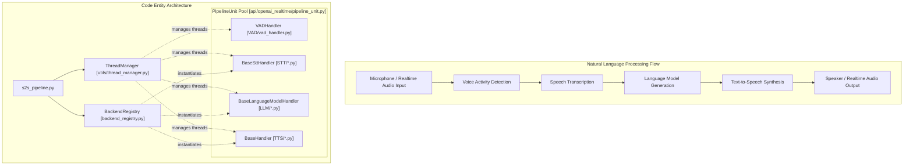

**Key Architectural Characteristics:**

| Characteristic | Implementation | Code Pointer |
|----------------|----------------|--------------|
| **Pipeline Concurrency** | Multi-threaded pipeline workers | [src/speech_to_speech/utils/thread_manager.py:9-39]() |
| **Component Selection** | Dynamic backend registries | [src/speech_to_speech/backend_registry.py:149-193]() |
| **Inter-stage Transport** | Python thread-safe `Queue` and typed messages | [src/speech_to_speech/pipeline/queue_types.py:1-46]() |
| **Interruption & Barge-In** | `CancelScope` generation counters | [src/speech_to_speech/pipeline/cancel_scope.py:1-30]() |

Sources: [src/speech_to_speech/s2s_pipeline.py:1-52](), [src/speech_to_speech/backend_registry.py:1-193](), [src/speech_to_speech/utils/thread_manager.py:9-39]()

---

## Core Architectural Subsystems

### Pipeline Orchestration
The pipeline is initialized and coordinated from `s2s_pipeline.py`. It handles configuration parsing via `HfArgumentParser`, instantiates handler instances through the backend registry, and manages pool instances (`PipelineUnit`). 

For details, see [Pipeline Orchestration](#2.1).

Sources: [src/speech_to_speech/s2s_pipeline.py:1-190]()

### Threading and Concurrency
Handlers operate concurrently in dedicated background threads managed by `ThreadManager`. Coordination relies on shared `threading.Event` objects (`stop_event`) and `CancelScope` counters to handle rapid user barge-in requests and stale generation cancellation.

For details, see [Threading and Concurrency](#2.2).

Sources: [src/speech_to_speech/utils/thread_manager.py:9-39]()

### Queue-Based Communication
Sequential stages communicate via thread-safe queues transporting strongly-typed items defined in the `pipeline` package. Control flow utilizes designated sentinels such as `PIPELINE_END` and `SESSION_END`.

For details, see [Queue-Based Communication](#2.3).

Sources: [src/speech_to_speech/pipeline/queue_types.py:1-46]()

### Handler Plugin System and Backend Registry
Handlers inherit from `BaseHandler` and implement setup, warmup, process, and cleanup lifecycle hooks. The backend registry maps string selectors (e.g., `"parakeet-tdt"`, `"mlx-lm"`, `"qwen3"`) to implementation specs via `BackendSpec` and `HandlerContext`.

For details, see [Handler Plugin System and Backend Registry](#2.4).

Sources: [src/speech_to_speech/backend_registry.py:1-193]()

### Speculative Turns and Turn Management
The `SpeculativeTurnTracker` coordinates turn IDs, revision numbers, reopen candidates, and grace windows across STT, LLM, and Realtime service layers to safely discard stale asynchronous events.

For details, see [Speculative Turns and Turn Management](#2.5).

Sources: [src/speech_to_speech/pipeline/speculative_turns.py:1-50]()

---

# Page: Pipeline Orchestration

# Pipeline Orchestration

<details>
<summary>Relevant source files</summary>

The following files were used as context for generating this wiki page:

- [src/speech_to_speech/api/openai_realtime/pipeline_unit.py](src/speech_to_speech/api/openai_realtime/pipeline_unit.py)
- [src/speech_to_speech/arguments_classes/local_audio_arguments.py](src/speech_to_speech/arguments_classes/local_audio_arguments.py)
- [src/speech_to_speech/arguments_classes/module_arguments.py](src/speech_to_speech/arguments_classes/module_arguments.py)
- [src/speech_to_speech/cli.py](src/speech_to_speech/cli.py)
- [src/speech_to_speech/pipeline/transcript_logging.py](src/speech_to_speech/pipeline/transcript_logging.py)
- [src/speech_to_speech/s2s_pipeline.py](src/speech_to_speech/s2s_pipeline.py)
- [tests/openai_realtime/test_pipeline_builder.py](tests/openai_realtime/test_pipeline_builder.py)
- [tests/test_cli_defaults.py](tests/test_cli_defaults.py)
- [tests/test_transcript_log_hygiene.py](tests/test_transcript_log_hygiene.py)

</details>


## Purpose and Scope

This document details how [src/speech_to_speech/s2s_pipeline.py]() orchestrates the entire speech-to-speech execution flow. It covers argument parsing (`parse_arguments`), pipeline construction (`build_pipeline` and `build_local_pipeline`), handler assembly (`_build_handlers`), the `PipelineUnit` pool abstraction for multi-tenant concurrency (`num_pipelines`), thread lifecycle management via `ThreadManager`, and operational signal handling.

For details on thread synchronization, see [2.2 Threading and Concurrency](). For information on queue communication, see [2.3 Queue-Based Communication](). For plugin and registry mechanisms, see [2.4 Handler Plugin System and Backend Registry]().

Sources: [src/speech_to_speech/s2s_pipeline.py:1-696]()

## Overview

The [src/speech_to_speech/s2s_pipeline.py]() module serves as the core orchestration coordinator for runtime execution. Its primary responsibilities include:
- Parsing and validating configuration arguments via `HfArgumentParser` and backend registries [src/speech_to_speech/s2s_pipeline.py:100-190]() [src/speech_to_speech/arguments_classes/module_arguments.py:1-104]().
- Dispatching execution flows across CLI commands (`serve`, `talk`, `local`) [src/speech_to_speech/cli.py:18-35]().
- Instantiating and wiring processing handler chains (VAD, STT, LLM, TTS) into isolated `PipelineUnit` pools [src/speech_to_speech/api/openai_realtime/pipeline_unit.py:53-76]().
- Managing thread lifecycles using `ThreadManager` [src/speech_to_speech/utils/thread_manager.py:9-39]().
- Handling OS signals for graceful shutdown [src/speech_to_speech/s2s_pipeline.py:657-673]().

Sources: [src/speech_to_speech/s2s_pipeline.py:1-696](), [src/speech_to_speech/cli.py:1-35](), [src/speech_to_speech/arguments_classes/module_arguments.py:1-104]()

## CLI Commands and Entry Points

The top-level entry point [src/speech_to_speech/cli.py]() parses user intents and dispatches them to appropriate execution routines.

| Command | Function | Target Entity | Description |
|:---|:---|:---|:---|
| `serve` | `run_pipeline_command` | `RealtimeServer` / `RealtimeService` | Starts a FastAPI/uvicorn server hosting a pool of isolated `PipelineUnit` instances [src/speech_to_speech/api/openai_realtime/pipeline_unit.py:53-76](). |
| `talk` | `run_realtime_audio_client` | `RealtimeAudioClient` | Connects local audio hardware (mic/speaker) to a running `serve` endpoint [src/speech_to_speech/cli.py:98-170](). |
| `local` | `run_pipeline_command` | `build_local_pipeline` | In-process execution of both server pool and local loopback audio client [src/speech_to_speech/s2s_pipeline.py:636-654](). |

### CLI to Code Entity Mapping
This diagram maps user-facing CLI commands directly to the underlying Python functions and classes responsible for their execution.

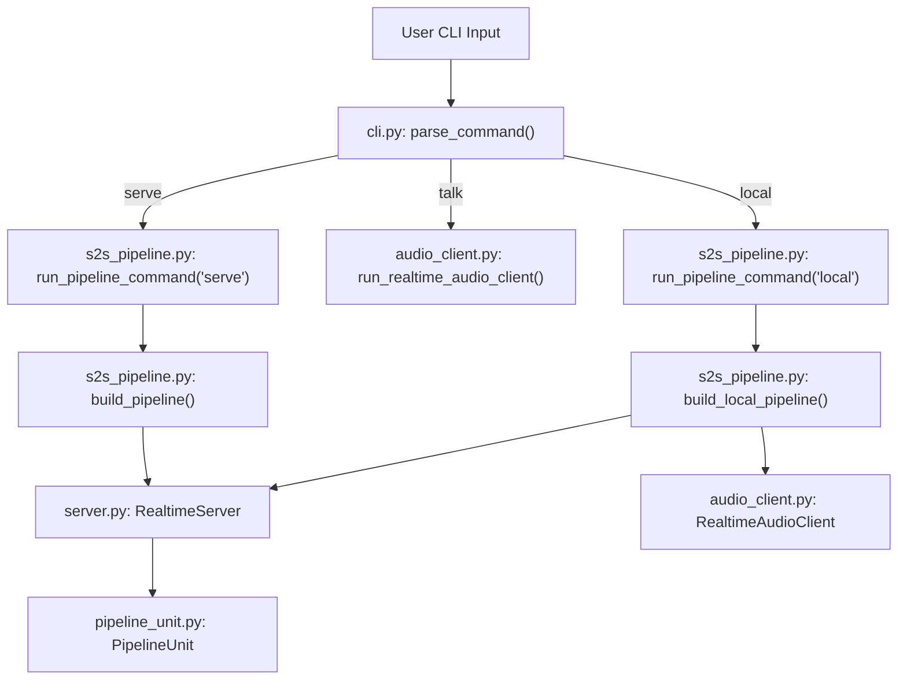
Sources: [src/speech_to_speech/cli.py:18-95](), [src/speech_to_speech/s2s_pipeline.py:593-654]()

## Argument Parsing and Configuration

The `parse_arguments` function in [src/speech_to_speech/s2s_pipeline.py:175-230]() processes raw command-line arguments or JSON config files. It uses [src/speech_to_speech/arguments_classes/module_arguments.py]() and backend-specific argument dataclasses via `HfArgumentParser`.

- **Platform Presets**: On macOS, `_mac_preset_defaults` injects platform-optimized defaults (such as `mlx-lm` and `mps` device targets) unless explicitly overridden [src/speech_to_speech/s2s_pipeline.py:81-97]().
- **Inactive Backend Handling**: `_parse_selected_cli_configs` parses active component settings while gracefully absorbing or ignoring arguments belonging to unselected backends [src/speech_to_speech/s2s_pipeline.py:135-173]().

Sources: [src/speech_to_speech/s2s_pipeline.py:81-230](), [src/speech_to_speech/arguments_classes/module_arguments.py:1-104]()

## Pipeline Construction and Component Wiring

Pipelines are assembled by constructing isolated units containing instances of VAD, STT, LLM, and TTS handlers linked together via thread-safe queues.

### Pipeline Construction Flow
The following diagram illustrates how argument specs are transformed into instantiated handlers and queued interconnects within [src/speech_to_speech/s2s_pipeline.py]().

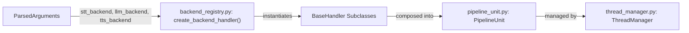
Sources: [src/speech_to_speech/s2s_pipeline.py:243-329](), [src/speech_to_speech/backend_registry.py:173-201]()

- **`_build_handlers`**: Instantiates the complete sequence of handlers—including `VADHandler`, STT handlers, `TranscriptionNotifier`, LLM handlers, `LMOutputProcessor`, and TTS handlers—wiring their input/output queues [src/speech_to_speech/s2s_pipeline.py:243-329]().
- **`build_pipeline`**: Constructs a collection of `PipelineUnit` instances according to `num_pipelines`, wrapping them into a `RealtimeServer` managed by a `ThreadManager` [src/speech_to_speech/s2s_pipeline.py:593-633]().
- **`build_local_pipeline`**: Extends local execution by composing the server pool with a loopback `RealtimeAudioClient` connected via sounddevice streams [src/speech_to_speech/s2s_pipeline.py:636-654]() [src/speech_to_speech/arguments_classes/local_audio_arguments.py:1-45]().

Sources: [src/speech_to_speech/s2s_pipeline.py:243-329](), [src/speech_to_speech/s2s_pipeline.py:593-654](), [src/speech_to_speech/arguments_classes/local_audio_arguments.py:1-45]()

## PipelineUnit Pool and Concurrency

To support multiple simultaneous clients without state interference, the system maintains a pool of `PipelineUnit` objects [src/speech_to_speech/api/openai_realtime/pipeline_unit.py:53-76]().

- **`num_pipelines`**: Controls the size of the unit pool. Each unit maintains dedicated queues (`input_queue`, `output_queue`, `text_output_queue`, `text_prompt_queue`), synchronization primitives (`should_listen`, `response_playing`, `cancel_scope`), and handler instances [src/speech_to_speech/api/openai_realtime/pipeline_unit.py:53-76]() [src/speech_to_speech/arguments_classes/module_arguments.py:96-104]().
- **Claim and Release**: When a client connects via WebSocket or WebRTC, the server claims the next available free unit (`session is None`). Upon disconnection, the unit is drained, reset, and returned to the pool [src/speech_to_speech/api/openai_realtime/pipeline_unit.py:13-51]().

Sources: [src/speech_to_speech/api/openai_realtime/pipeline_unit.py:13-76](), [src/speech_to_speech/arguments_classes/module_arguments.py:96-104]()

## Lifecycle Management and Signal Handling

### ThreadManager
The `ThreadManager` class [src/speech_to_speech/utils/thread_manager.py:9-39]() oversees background execution threads:
- **`start()`**: Spawns independent threads for each pipeline handler targeting their `run()` methods [src/speech_to_speech/utils/thread_manager.py:18-23]().
- **`stop()`**: Sets a coordination stop event (`stop_event`) and joins all worker threads with defined timeouts to ensure clean resource release [src/speech_to_speech/utils/thread_manager.py:29-39]().

### Signal Handling
Graceful shutdown during execution is managed via OS signal handlers registered in [src/speech_to_speech/s2s_pipeline.py:657-673](). Upon receiving `SIGINT` or `SIGTERM`, the orchestrator triggers the stop event, signals the active `RealtimeServer` to drain and close, and waits for `ThreadManager` to finalize all component threads [src/speech_to_speech/s2s_pipeline.py:657-676]().

Sources: [src/speech_to_speech/utils/thread_manager.py:9-39](), [src/speech_to_speech/s2s_pipeline.py:657-676]()

---

# Page: Threading and Concurrency

# Threading and Concurrency

<details>
<summary>Relevant source files</summary>

The following files were used as context for generating this wiki page:

- [src/speech_to_speech/STT/base_stt_handler.py](src/speech_to_speech/STT/base_stt_handler.py)
- [src/speech_to_speech/arguments_classes/faster_whisper_stt_arguments.py](src/speech_to_speech/arguments_classes/faster_whisper_stt_arguments.py)
- [src/speech_to_speech/arguments_classes/mlx_audio_whisper_arguments.py](src/speech_to_speech/arguments_classes/mlx_audio_whisper_arguments.py)
- [src/speech_to_speech/arguments_classes/parakeet_tdt_arguments.py](src/speech_to_speech/arguments_classes/parakeet_tdt_arguments.py)
- [src/speech_to_speech/pipeline/cancel_scope.py](src/speech_to_speech/pipeline/cancel_scope.py)
- [src/speech_to_speech/utils/mlx_lock.py](src/speech_to_speech/utils/mlx_lock.py)
- [src/speech_to_speech/utils/thread_manager.py](src/speech_to_speech/utils/thread_manager.py)
- [tests/openai_realtime/test_llm_proxy.py](tests/openai_realtime/test_llm_proxy.py)
- [tests/test_faster_whisper_language_reporting.py](tests/test_faster_whisper_language_reporting.py)
- [tests/test_stt_stale_filter.py](tests/test_stt_stale_filter.py)

</details>


This document details the multi-threaded architecture of the speech-to-speech pipeline. The system utilizes a thread-per-handler model coordinated by a central `ThreadManager`, shared synchronization primitives, the `CancelScope` mechanism for handling barge-in interruptions, a global reentrant lock for MLX model access, and speculative turn stale-filtering logic.

## ThreadManager and Lifecycle

The `ThreadManager` class is the central orchestrator for thread lifecycle management. It is instantiated during the pipeline construction process and manages the execution of all pipeline stages.

### Thread Lifecycle Flow

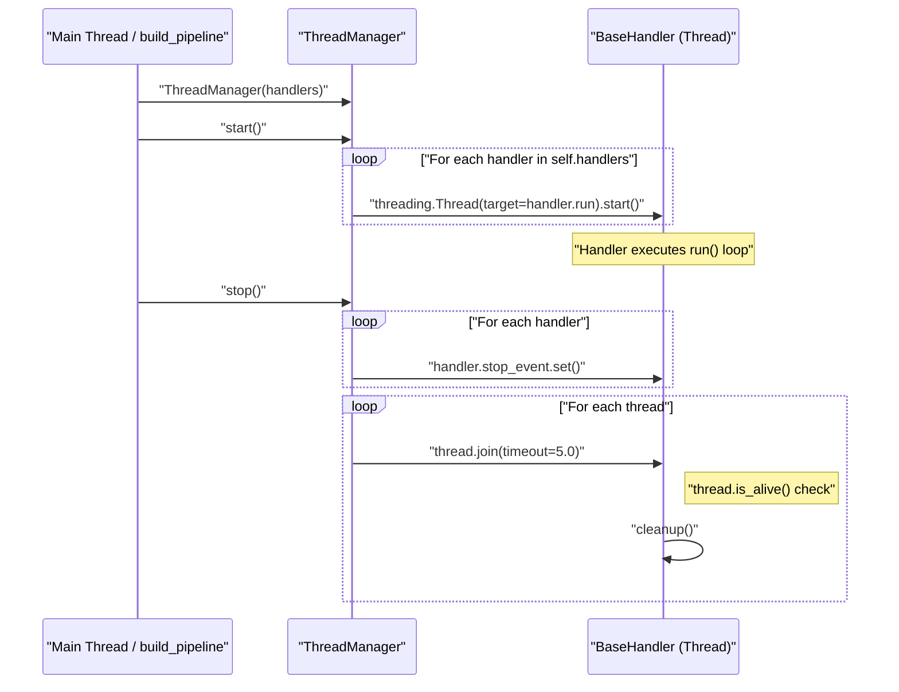

The `ThreadManager` ensures that threads are not daemonic [src/speech_to_speech/utils/thread_manager.py:21](), meaning the main process will wait for them to finish their `cleanup()` routines before exiting. The `stop()` method specifically signals all handlers via their `stop_event` before attempting to join the threads [src/speech_to_speech/utils/thread_manager.py:29-39]().

Sources: [src/speech_to_speech/utils/thread_manager.py:9-39]()

## Multi-Threaded Architecture and Coordination

The system operates as a cascaded pipeline where each stage (VAD, STT, LLM, TTS) is implemented as a handler. Each handler runs a continuous loop in its own thread, monitoring its input queue for work.

### Pipeline Thread Coordination

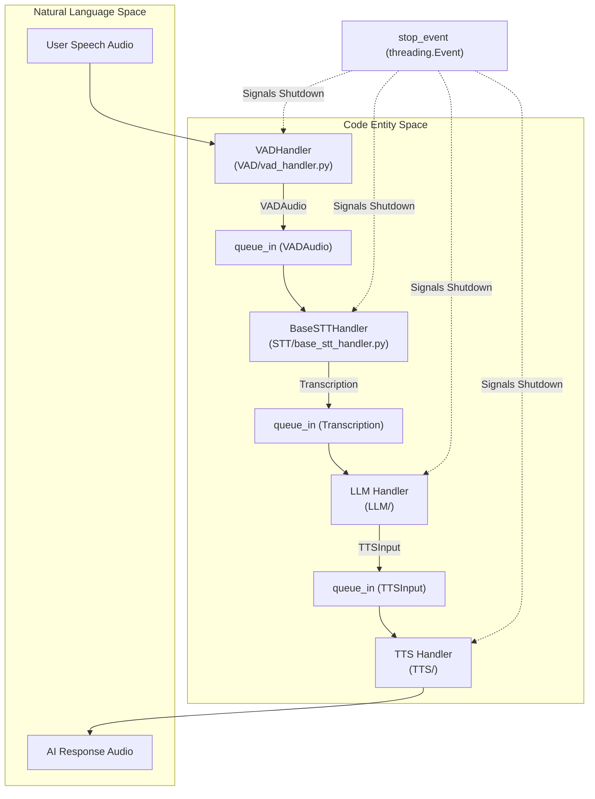

Each handler receives a handler context during construction containing the shared `stop_event`, `cancel_scope`, and input/output queues [src/speech_to_speech/utils/thread_manager.py:14-23](). This ensures that all stages within a pipeline unit are synchronized and respond uniformly to pipeline termination and cancellation signals.

Sources: [src/speech_to_speech/utils/thread_manager.py:9-39](), [src/speech_to_speech/STT/base_stt_handler.py:16-67]()

## Interruption and Barge-in Handling

A critical challenge in speech-to-speech systems is "barge-in," where the user speaks while the AI is still generating audio. The system uses the `CancelScope` mechanism to coordinate this across the multi-threaded pipeline.

### The CancelScope Mechanism

The `CancelScope` [src/speech_to_speech/pipeline/cancel_scope.py:1]() provides a unified cancellation signal using a generation counter and discard flag.

| Feature | Implementation | Purpose |
| :--- | :--- | :--- |
| **Generation Counter** | `self._gen` [src/speech_to_speech/pipeline/cancel_scope.py:14]() | Incremented on every `cancel()` call to mark previous work as stale. |
| **Stale Detection** | `is_stale(gen)` [src/speech_to_speech/pipeline/cancel_scope.py:52-54]() | Pipeline threads capture the current `generation` at start and check this periodically. |
| **Discard Guard** | `discarding` [src/speech_to_speech/pipeline/cancel_scope.py:57-59]() | Signals the final output loop to silently drop any remaining audio from a cancelled turn. |

The `cancel()` method increments the generation using a bitwise AND mask to prevent integer overflow [src/speech_to_speech/pipeline/cancel_scope.py:31-33](). It also sets the `_discarding` flag to `True`, which can be cleared once a response is acknowledged as done or a new explicit response is created [src/speech_to_speech/pipeline/cancel_scope.py:35-51]().

Sources: [src/speech_to_speech/pipeline/cancel_scope.py:1-64]()

## MLX Lock Contention and Cross-Handler Serialization

On Apple Silicon platforms, pipeline models (STT, LLM, and TTS) share unified Metal hardware resources. Although individual runtimes may support parallel execution, unrestricted concurrent multi-way load can cause Metal MMU GPU restarts or decoder errors [src/speech_to_speech/utils/mlx_lock.py:4-15]().

### MLXLockContext Architecture

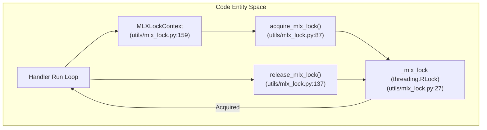

The module provides a global reentrant lock (`_mlx_lock`) along with helper functions and the `MLXLockContext` context manager [src/speech_to_speech/utils/mlx_lock.py:25-179](). Handlers acquire this lock before invoking inference routines on Apple Silicon to ensure thread safety across different model families [src/speech_to_speech/utils/mlx_lock.py:1-15](). State tracking logs lock hold durations and identifies lock owners when contention occurs [src/speech_to_speech/utils/mlx_lock.py:36-85]().

Sources: [src/speech_to_speech/utils/mlx_lock.py:1-179]()

## Stale Generation Detection and Speculative Turn Filtering

Pipeline stages, particularly STT handlers inheriting from `BaseSTTHandler`, implement rigorous stale-turn input and output filtering to discard obsolete frames or transcripts [src/speech_to_speech/STT/base_stt_handler.py:16-76]().

### Stale Filtering Flow

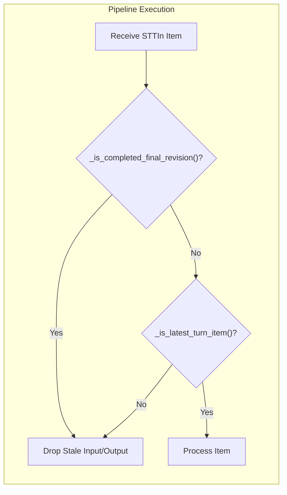

Key validation rules in `BaseSTTHandler` include:
1. **Completed Final Revision Check**: Inputs or partial transcriptions belonging to a turn revision that has already reached final completion are immediately dropped [src/speech_to_speech/STT/base_stt_handler.py:33-36, 69-71]().
2. **Progressive vs Final Ordering**: Progressive inputs are filtered out if a final transcription for the same revision is already queued or processed [src/speech_to_speech/STT/base_stt_handler.py:37-39]().
3. **Turn Stability Windows**: When evaluating latest turn items, handlers respect pending reopen candidates and stability settle windows (`final_revision_settle_s`) to prevent race conditions during rapid turn mutations [src/speech_to_speech/STT/base_stt_handler.py:82-107]().
4. **Queue Flushing**: Stale items remaining in `queue_in` are bulk-dropped during input gating checks [src/speech_to_speech/STT/base_stt_handler.py:109-133]().

Sources: [src/speech_to_speech/STT/base_stt_handler.py:16-175](), [tests/test_stt_stale_filter.py:1-208]()

---

# Page: Queue-Based Communication

# Queue-Based Communication

<details>
<summary>Relevant source files</summary>

The following files were used as context for generating this wiki page:

- [src/speech_to_speech/LLM/lm_output_processor.py](src/speech_to_speech/LLM/lm_output_processor.py)
- [src/speech_to_speech/pipeline/control.py](src/speech_to_speech/pipeline/control.py)
- [src/speech_to_speech/pipeline/events.py](src/speech_to_speech/pipeline/events.py)
- [src/speech_to_speech/pipeline/messages.py](src/speech_to_speech/pipeline/messages.py)
- [src/speech_to_speech/pipeline/queue_types.py](src/speech_to_speech/pipeline/queue_types.py)
- [tests/test_lm_output_processor.py](tests/test_lm_output_processor.py)
- [tests/test_pipeline_messages.py](tests/test_pipeline_messages.py)

</details>


This page covers the queue-based architecture connecting pipeline stages in the speech-to-speech codebase. It details the typed message hierarchy (`pipeline/messages.py`), the typed event hierarchy (`pipeline/events.py`), queue type aliases (`pipeline/queue_types.py`), control sentinels (`pipeline/control.py`), and the `text_output_queue` side channel managed by `LMOutputProcessor`.

## 1. Overview and Queue Architecture

The speech-to-speech pipeline implements a multi-threaded, queue-based architecture for inter-component communication. This design enables asynchronous processing where each processing stage (VAD, STT, LLM, TTS) operates independently in its own thread while maintaining data sequencing through thread-safe `Queue` objects.

Each queue acts as a buffer allowing components to process data at varying speeds without blocking downstream operations. Data integrity across thread boundaries is enforced via strongly-typed Pydantic models and control sentinels.

Title: Queue Architecture and Code Entities
```mermaid
graph LR
    RecvQ["recv_audio_chunks_queue"]
    VAD["VADHandler"]
    SpokenQ["spoken_prompt_queue"]
    STT["STTHandler"]
    TransNot["TranscriptionNotifier"]
    TextQ["text_prompt_queue"]
    LLM["BaseLanguageModelHandler"]
    LMOutProc["LMOutputProcessor"]
    LMRespQ["lm_response_queue"]
    TTS["BaseTTSHandler"]
    SendQ["send_audio_chunks_queue"]
    TextSide["text_output_queue"]
    
    RecvQ --> VAD
    VAD -->|"VADAudio"| SpokenQ
    SpokenQ --> STT
    STT -->|"Transcription"| TransNot
    TransNot -->|"GenerateResponseRequest"| TextQ
    TextQ --> LLM
    LLM -->|"LLMResponseChunk"| LMOutProc
    LMOutProc -->|"TTSInput"| LMRespQ
    LMRespQ --> TTS
    TTS -->|"AudioOutput"| SendQ
    
    TransNot -.->|"PipelineEvent"| TextSide
    LMOutProc -.->|"PipelineEvent"| TextSide
```
Sources: [src/speech_to_speech/pipeline/queue_types.py:15-46](), [src/speech_to_speech/LLM/lm_output_processor.py:41-48]()

---

## 2. Typed Message Hierarchy (`pipeline/messages.py`)

Inter-component communication relies on subclasses of `PipelineMessage` defined in `src/speech_to_speech/pipeline/messages.py`. These models use Pydantic discriminators via the `tag` field to support serialization and validation.

### Key Pipeline Messages

| Class | Stage | Description |
|-------|-------|-------------|
| `VADAudio` | VAD → STT | Audio segment containing raw arrays, `turn_id`, `turn_revision`, and `mode` (progressive/final). [src/speech_to_speech/pipeline/messages.py:46-56]() |
| `PartialTranscription` | STT → TranscriptionNotifier | Live partial transcription text for internal notifications. [src/speech_to_speech/pipeline/messages.py:62-69]() |
| `Transcription` | STT → LLM | Final transcription result including `language_code` and `speech_stopped_at_s`. [src/speech_to_speech/pipeline/messages.py:71-80]() |
| `TranscriptionFailure` | STT → LLM | Failure notification when an STT operation fails. [src/speech_to_speech/pipeline/messages.py:82-90]() |
| `LLMResponseChunk` | LLM → LMOutputProcessor | Ordered group of `AssistantOutputPart` items (text or tool call parts) with generation metadata. [src/speech_to_speech/pipeline/messages.py:138-159]() |
| `TokenUsage` | LLM → Side Channel | Token count report for input and output tokens. [src/speech_to_speech/pipeline/messages.py:168-178]() |
| `EndOfResponse` | LLM → TTS / Router | Sentinel marking the end of a response generation. [src/speech_to_speech/pipeline/messages.py:180-192]() |

Sources: [src/speech_to_speech/pipeline/messages.py:1-192]()

---

## 3. Control Sentinels and Queue Type Aliases

To coordinate thread lifecycles and session resets without passing arbitrary exceptions, the pipeline uses specific control mechanisms defined in `src/speech_to_speech/pipeline/control.py` and `src/speech_to_speech/pipeline/queue_types.py`.

### Sentinels and Control Messages
*   **`PIPELINE_END`**: A plain `bytes` sentinel (`b"END"`) placed into queues to instruct worker threads to terminate gracefully. [src/speech_to_speech/pipeline/queue_types.py:20-22]()
*   **`SESSION_END`**: A `PipelineControlMessage` with `ControlKind.SESSION_END` used to reset per-session state across queues without shutting down handler threads. [src/speech_to_speech/pipeline/control.py:7-22]()
*   **`AUDIO_RESPONSE_DONE`**: A binary sentinel signaling completion of an audio chunk stream. [src/speech_to_speech/pipeline/queue_types.py:20-22]()

### Queue Type Aliases (`queue_types.py`)
`src/speech_to_speech/pipeline/queue_types.py` centralizes payload union types for type checkers:
*   `PipelineInternalItem`: `PipelineControlMessage | bytes` [src/speech_to_speech/pipeline/queue_types.py:22-22]()
*   `AudioInItem`: `VADIn | PipelineControlMessage` [src/speech_to_speech/pipeline/queue_types.py:25-25]()
*   `VADOutItem`: `VADOut | PipelineInternalItem` [src/speech_to_speech/pipeline/queue_types.py:28-28]()
*   `STTOutItem`: `STTOut | PipelineInternalItem` [src/speech_to_speech/pipeline/queue_types.py:31-31]()
*   `TextPromptItem`: `LLMIn | PipelineInternalItem` [src/speech_to_speech/pipeline/queue_types.py:34-34]()
*   `LMOutItem`: `LLMOut | PipelineInternalItem` [src/speech_to_speech/pipeline/queue_types.py:37-37]()
*   `TTSInItem`: `TTSIn | PipelineEvent | PipelineInternalItem` [src/speech_to_speech/pipeline/queue_types.py:40-40]()
*   `AudioOutItem`: `bytes | np.ndarray | AudioOutput | PipelineEvent | PipelineControlMessage` [src/speech_to_speech/pipeline/queue_types.py:43-43]()
*   `TextEventItem`: `PipelineEvent | PipelineInternalItem` [src/speech_to_speech/pipeline/queue_types.py:46-46]()

Sources: [src/speech_to_speech/pipeline/control.py:1-26](), [src/speech_to_speech/pipeline/queue_types.py:1-46]()

---

## 4. Side-Channel Communication (`text_output_queue`)

The `text_output_queue` is a dedicated channel for non-audio metadata. It enables events like transcriptions, tool readiness notifications, and token usage reports to reach the client immediately without being blocked by sequential audio synthesis in the TTS stage.

### PipelineEvent Hierarchy (`pipeline/events.py`)
Protocol-neutral events consumed by the realtime router are defined in `src/speech_to_speech/pipeline/events.py`:

| Event Class | Source | Purpose |
|-------------|--------|---------|
| `SpeechStartedEvent` | VAD | Signals speech onset, used for barge-in detection. [src/speech_to_speech/pipeline/events.py:36-43]() |
| `SpeechStoppedEvent` | VAD | Signals the end of a speech segment. [src/speech_to_speech/pipeline/events.py:45-51]() |
| `PartialTranscriptionEvent` | STT | Cumulative STT hypothesis for live UI updates. [src/speech_to_speech/pipeline/events.py:56-67]() |
| `TranscriptionCompletedEvent` | STT | Final confirmed user transcript and language code. [src/speech_to_speech/pipeline/events.py:69-76]() |
| `TranscriptionFailedEvent` | STT | Notification of an STT failure. [src/speech_to_speech/pipeline/events.py:78-83]() |
| `AudioInputCompletedEvent` | AudioInputNotifier | Wraps raw audio arrays when STT is bypassed. [src/speech_to_speech/pipeline/events.py:88-100]() |
| `AssistantOutputEvent` | LLMOutputProcessor | Ordered assistant text/tool parts awaiting serialization. [src/speech_to_speech/pipeline/events.py:105-131]() |
| `AssistantToolCallReadyEvent` | LLMOutputProcessor | Side-channel event exposing tool calls early for client execution. [src/speech_to_speech/pipeline/events.py:137-153]() |
| `TokenUsageEvent` | LLMOutputProcessor | Reports token consumption metrics. [src/speech_to_speech/pipeline/events.py:155-163]() |
| `AssistantResponseDoneEvent` | LLMOutputProcessor | Marks the end of ordered assistant output for a response. [src/speech_to_speech/pipeline/events.py:165-173]() |
| `ResponseGenerationDoneEvent` | LLMOutputProcessor | Internal side-channel signal tracking completed generation call IDs. [src/speech_to_speech/pipeline/events.py:175-184]() |

### LMOutputProcessor Logic
The `LMOutputProcessor` bridges the main TTS audio path and the side channel (`text_output_queue`). It processes `LLMResponseChunk`, `TokenUsage`, and `EndOfResponse` items:
*   **TTS Path**: Yields `TTSInput` and `EndOfResponse` objects to the downstream TTS queue. [src/speech_to_speech/LLM/lm_output_processor.py:117-163]()
*   **Side Channel**: Pushes `TokenUsageEvent`, `AssistantToolCallReadyEvent`, and `ResponseGenerationDoneEvent` into `text_output_queue`. [src/speech_to_speech/LLM/lm_output_processor.py:72-90]()

Title: Side-Channel Data Flow
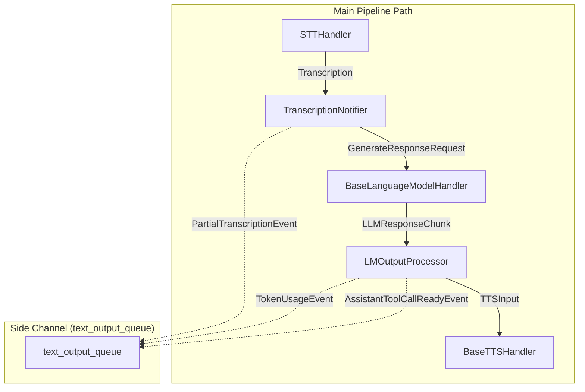
Sources: [src/speech_to_speech/pipeline/events.py:1-205](), [src/speech_to_speech/LLM/lm_output_processor.py:42-163]()

---

## 5. Cancellation and Interruption Mechanics

To support barge-in scenarios where users interrupt the assistant mid-speech, the pipeline coordinates generation versions using `CancelScope` and `SpeculativeTurnTracker`.

*   **Stale Data Filtering**: Handlers inspect incoming items against the active `CancelScope` via `should_process_input`. Stale items are dropped to prevent outdated text or audio from propagating. [src/speech_to_speech/LLM/lm_output_processor.py:92-96]()
*   **Cleanup Exemptions**: Terminal messages like `TokenUsageEvent` and `EndOfResponse` are permitted through or transformed into cleanup markers (`cleanup_only=True`) so resource tracking and response revocation complete correctly. [src/speech_to_speech/LLM/lm_output_processor.py:117-138]()

Sources: [src/speech_to_speech/LLM/lm_output_processor.py:42-181](), [src/speech_to_speech/pipeline/events.py:1-205]()

---

# Page: Handler Plugin System and Backend Registry

# Handler Plugin System and Backend Registry

<details>
<summary>Relevant source files</summary>

The following files were used as context for generating this wiki page:

- [src/speech_to_speech/api/openai_realtime/websocket_router.py](src/speech_to_speech/api/openai_realtime/websocket_router.py)
- [src/speech_to_speech/backend_registry.py](src/speech_to_speech/backend_registry.py)
- [src/speech_to_speech/baseHandler.py](src/speech_to_speech/baseHandler.py)
- [src/speech_to_speech/pipeline/handler_types.py](src/speech_to_speech/pipeline/handler_types.py)
- [tests/openai_realtime/test_websocket_router.py](tests/openai_realtime/test_websocket_router.py)
- [tests/test_backend_registry.py](tests/test_backend_registry.py)

</details>


This page documents the plugin architecture that enables runtime selection and lifecycle management of Speech-to-Text (STT), Language Model (LLM), and Text-to-Speech (TTS) implementations. The system relies on a centralized `BackendRegistry`, factory-based instantiation via `BackendSpec`, and a unified `BaseHandler` abstract execution model.

## Purpose and Scope

The handler plugin system decouples pipeline orchestration from specific machine learning frameworks and APIs. By defining abstract contracts (`BaseHandler`) and declarative metadata (`BackendSpec`, `BackendCapabilities`, `HandlerContext`), the system supports swapping local model families (e.g., Transformers, MLX, Whisper, Parakeet) and remote APIs (e.g., OpenAI-compatible endpoints) without altering orchestration logic.

Sources: [src/speech_to_speech/baseHandler.py:25-33](), [src/speech_to_speech/backend_registry.py:48-112]()

---

## BaseHandler and Lifecycle

All pipeline stages inherit from `BaseHandler`, which manages thread execution, queue polling, input filtering, and session control [src/speech_to_speech/baseHandler.py:25-33]().

### Lifecycle Hooks and Execution Flow

| Method / Hook | File:Line | Role |
|---------------|-----------|------|
| `__init__` | [src/speech_to_speech/baseHandler.py:35-48]() | Binds threading primitives, input/output queues, and calls `setup()`. |
| `setup()` | [src/speech_to_speech/baseHandler.py:50-51]() | Overridable initialization hook for loading models or configuring state. |
| `process()` | [src/speech_to_speech/baseHandler.py:53-54]() | Abstract generator method implementing core stage logic (inference/transformation). |
| `should_process_input()` | [src/speech_to_speech/baseHandler.py:56-81]() | Filters items based on `CancelScope` generation numbers and prefetch transaction resolution. |
| `output_for_queue()` | [src/speech_to_speech/baseHandler.py:89-103]() | Wraps raw audio outputs into `AudioOutput` dataclasses carrying metadata like `cancel_generation` and `response_key`. |
| `run()` | [src/speech_to_speech/baseHandler.py:105-157]() | Main thread loop polling `queue_in`, handling `SESSION_END`, `PIPELINE_END`, and dispatching results. |

Title: BaseHandler Execution and Filtering Flow
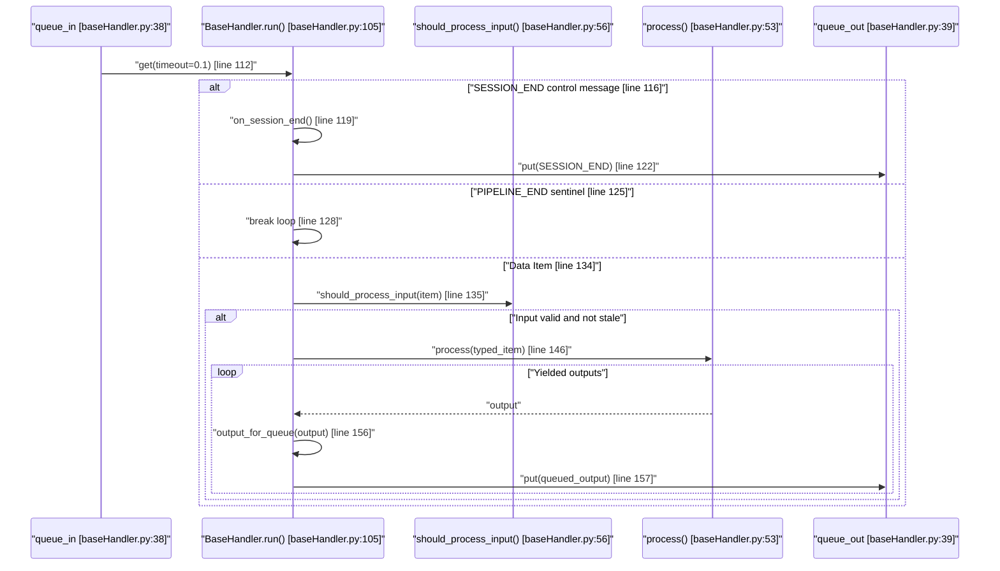

Sources: [src/speech_to_speech/baseHandler.py:25-157]()

---

## Backend Registry and Core Dataclasses

The backend registry system uses explicit dataclasses to describe plugin properties, runtime contexts, and capabilities [src/speech_to_speech/backend_registry.py:48-112]().

### Core Registry Structures

*   **`BackendKind`**: A literal type restricting backends to `"stt"`, `"llm"`, or `"tts"` [src/speech_to_speech/backend_registry.py:48]()
*   **`BackendCapabilities`**: Construction flags affecting stage composition, such as `bypasses_transcription_notifier`, `supports_audio_input`, `supports_llm_proxy`, and `streams_audio_chunks` [src/speech_to_speech/backend_registry.py:60-67]()
*   **`HandlerContext`**: Pipeline-local state passed to factory functions, including `stop_event`, `queue_in`, `queue_out`, `text_output_queue`, `should_listen`, `cancel_scope`, `speculative_turns`, `pipeline_index`, and `sample_rate` [src/speech_to_speech/backend_registry.py:70-84]()
*   **`BackendSpec`**: Static metadata linking backend names to their config types, factories, prefixes, and capabilities [src/speech_to_speech/backend_registry.py:90-102]()
*   **`BackendSelection`**: Represents a selected `BackendSpec` paired with its normalized configuration dictionary [src/speech_to_speech/backend_registry.py:113-130]()

Title: Backend Registry Component Mapping
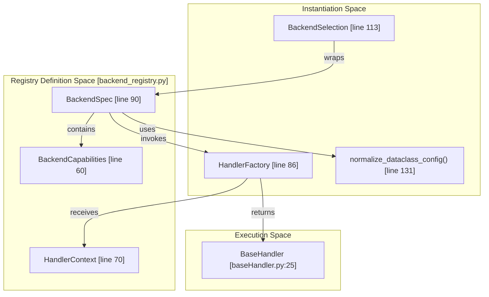

Sources: [src/speech_to_speech/backend_registry.py:48-130](), [src/speech_to_speech/baseHandler.py:25]()

---

## Configuration Normalization and Prefixes

Command-line arguments parsed via `HfArgumentParser` use backend-specific prefixes (e.g., `--whisper_stt_...` or `--omnivoice_...`). The registry normalizes these dataclass arguments into clean keyword arguments for handler factories [src/speech_to_speech/backend_registry.py:131-151]().

The function `normalize_dataclass_config(config, prefix)` iterates over dataclass fields, strips the matching prefix marker, collects parameters starting with `gen_` into a nested `gen_kwargs` dictionary, and preserves remaining configuration options [src/speech_to_speech/backend_registry.py:131-151](). Custom normalizers like `_normalize_facebook_mms_config` handle backend-specific remapping (e.g., mapping `tts_language` to `language`) [src/speech_to_speech/backend_registry.py:154-158]().

Sources: [src/speech_to_speech/backend_registry.py:131-158]()

---

## STT, LLM, and TTS Registries

Registries are constructed using `build_backend_registry()`, which validates backend kinds and rejects duplicate names eagerly [src/speech_to_speech/backend_registry.py:160-170](). 

The built-in registries (`STT_BACKENDS`, `LLM_BACKENDS`, `TTS_BACKENDS`) expose capabilities that govern pipeline construction:
*   `STT_BACKENDS` includes backends like `parakeet-tdt`, `whisper`, `faster-whisper`, `openai`, and `openai-realtime` [tests/test_backend_registry.py:65-79]()
*   `LLM_BACKENDS` includes backends like `transformers`, `mlx-lm`, `responses-api`, and `chat-completions` [tests/test_backend_registry.py:70-77]()
*   `TTS_BACKENDS` includes backends like `qwen3`, `kokoro`, `omnivoice`, and `supertonic` [tests/test_backend_registry.py:71-73]()

Sources: [tests/test_backend_registry.py:59-80](), [src/speech_to_speech/backend_registry.py:160-170]()

---

Sources:
- [src/speech_to_speech/baseHandler.py:25-157]()
- [src/speech_to_speech/backend_registry.py:48-170]()
- [tests/test_backend_registry.py:59-80]()

---

# Page: Speculative Turns and Turn Management

# Speculative Turns and Turn Management

<details>
<summary>Relevant source files</summary>

The following files were used as context for generating this wiki page:

- [src/speech_to_speech/VAD/smart_turn.py](src/speech_to_speech/VAD/smart_turn.py)
- [src/speech_to_speech/VAD/vad_handler.py](src/speech_to_speech/VAD/vad_handler.py)
- [src/speech_to_speech/api/openai_realtime/service.py](src/speech_to_speech/api/openai_realtime/service.py)
- [src/speech_to_speech/arguments_classes/vad_arguments.py](src/speech_to_speech/arguments_classes/vad_arguments.py)
- [src/speech_to_speech/pipeline/speculative_turns.py](src/speech_to_speech/pipeline/speculative_turns.py)
- [tests/openai_realtime/test_realtime_service.py](tests/openai_realtime/test_realtime_service.py)
- [tests/test_smart_turn.py](tests/test_smart_turn.py)
- [tests/test_speculative_turns.py](tests/test_speculative_turns.py)

</details>


## Purpose and Scope

This page provides a deep dive into the speculative turn architecture of the `huggingface/speech-to-speech` codebase. In real-time conversational streaming, users frequently pause briefly mid-thought or trail off. Traditional Voice Activity Detection (VAD) systems treat any short pause as an absolute end of turn, triggering downstream Speech-to-Text (STT), Language Model (LLM), and Text-to-Speech (TTS) pipelines prematurely. 

The speculative turn subsystem—anchored by `SpeculativeTurnTracker` [src/speech_to_speech/pipeline/speculative_turns.py:24-416]() and integrated with VAD endpointing [src/speech_to_speech/VAD/vad_handler.py:56-175]() and Smart Turn classification [src/speech_to_speech/VAD/smart_turn.py:36-153]()—allows the system to generate or stream assistant output speculatively while retaining the ability to seamlessly reopen the user turn if speech resumes within a grace window.

---

## Core Data Structures: `SpeculativeTurnTracker`

The `SpeculativeTurnTracker` class is a thread-safe revision tracker implemented in `src/speech_to_speech/pipeline/speculative_turns.py`. It coordinates state across concurrent threads (VAD, STT workers, LLM stream loops, and the Realtime WebSocket/WebRTC service).

```
+-------------------------------------------------------------------------+
|                       SpeculativeTurnTracker                            |
+-------------------------------------------------------------------------+
| - _condition: threading.Condition                                       |
| - _latest_revision: OrderedDict[str, int]                               |
| - _committed_revision: dict[str, int]                                   |
| - _pending_reopen: dict[str, _PendingReopen]                            |
| - _reopen_grace: dict[str, _ReopenGrace]                                |
+-------------------------------------------------------------------------+
```

### Internal Data Classes and Dictionaries

* **`_PendingReopen`**: Tracks a candidate turn revision that is currently evaluating whether a user pause is an actual end-of-turn or a brief hesitation. It holds a `base_revision` and a `candidate_revision` [src/speech_to_speech/pipeline/speculative_turns.py:12-16]().
* **`_ReopenGrace`**: Defines a time-bounded window (`revision` and `deadline` timestamp) during which new audio input will increment the turn revision rather than instantiating a fresh conversation turn [src/speech_to_speech/pipeline/speculative_turns.py:18-22]().
* **`_latest_revision`**: An `OrderedDict` mapping `turn_id` strings to their highest observed integer revision counter, bounded by `_MAX_TRACKED_TURNS` (default 2048) [src/speech_to_speech/pipeline/speculative_turns.py:28-33]().
* **`_committed_revision`**: A mapping tracking which `revision` for a given `turn_id` has been permanently committed by assistant output or explicit client commit [src/speech_to_speech/pipeline/speculative_turns.py:34]().

Sources: [src/speech_to_speech/pipeline/speculative_turns.py:1-416]()

---

## Turn Identifiers, Revisions, and Reopen Candidates

When a user speaks, VAD segments audio into logical turns. Each turn possesses a unique identifier (`turn_id`) and an incremental revision number (`revision`).

### Turn Revision Lifecycle

1. **Observation**: When speech starts or progresses, `SpeculativeTurnTracker.observe(turn_id, revision)` records or updates the latest revision [src/speech_to_speech/pipeline/speculative_turns.py:38-49](). If the new revision exceeds the current entry, the tracker updates `_latest_revision`, moves it to the end of the `OrderedDict`, prunes old turns if exceeding `max_tracked_turns`, and notifies all waiting threads via `_condition.notify_all()` [src/speech_to_speech/pipeline/speculative_turns.py:43-48]().
2. **Reopen Candidacy**: When a soft VAD boundary occurs (silence detected, but within the speculative grace window), the handler calls `begin_reopen_candidate()`. This defers absolute commitment of the turn [tests/test_speculative_turns.py:19-33]().
3. **Confirmation vs. Cancellation**:
   * If the user remains silent past the grace window, the candidate is cancelled or expires, allowing downstream workers to commit the turn.
   * If the user resumes speaking, `confirm_reopen_candidate()` increments the revision, marking the prior revision stale [tests/test_speculative_turns.py:35-44]().

### Diagram: Natural Language Space to Code Entity Space (Turn Lifecycle)

The following diagram bridges conceptual user conversational states to their concrete Python implementations and tracking methods within `SpeculativeTurnTracker`:

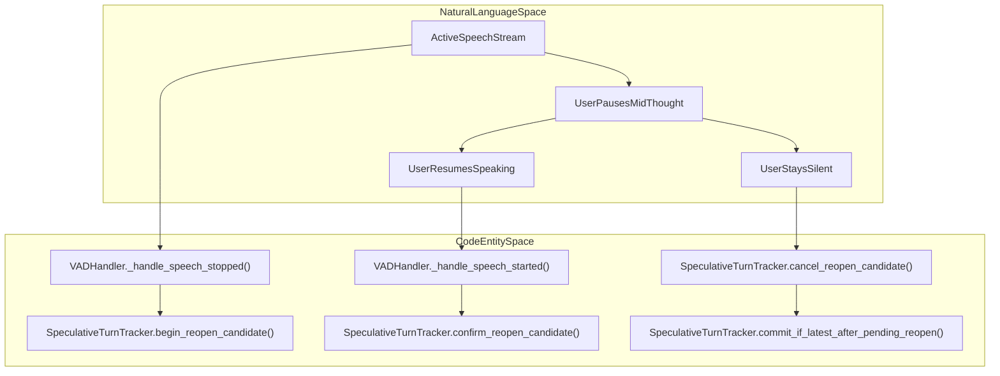
Sources: [src/speech_to_speech/pipeline/speculative_turns.py:38-168](), [src/speech_to_speech/VAD/vad_handler.py:56-175](), [tests/test_speculative_turns.py:19-116]()

---

## Reopen Grace Windows and Smart Turn Integration

Turn management relies on two primary configurable grace intervals managed via `VADHandlerArguments` and `SpeculativeTurnTracker`:

* `speculative_reopen_ms`: The default window (default 800 ms) during which a soft-ended Realtime turn remains reopenable unless an assistant response commits it [src/speech_to_speech/arguments_classes/vad_arguments.py:80-84]().
* `unanswered_reopen_ms`: A sanity cap (default 7000 ms) for reopening an uncommitted speculative turn that has not yet received assistant output [src/speech_to_speech/arguments_classes/vad_arguments.py:86-90]().

### Smart Turn v3.2 ONNX Integration

When `smart_turn` is enabled (default `True`), `VADHandler` delegates end-of-turn confidence scoring to `SmartTurnAnalyzer` [src/speech_to_speech/VAD/vad_handler.py:80-122](), [src/speech_to_speech/VAD/smart_turn.py:36-153](). 

* Once Silero VAD detects a speech-to-silence boundary, `SmartTurnAnalyzer.predict()` runs a CPU-bound ONNX inference session (`smart-turn-v3.2-cpu.onnx`) over up to 8 seconds of accumulated audio features extracted via `WhisperFeatureExtractor` [src/speech_to_speech/VAD/smart_turn.py:37-145]().
* If `SmartTurnResult.complete` is `False` (indicating an incomplete sentence or ambiguous pause), the system extends the reopen grace window up to `smart_turn_max_wait_ms` (default 2000 ms) and delays STT/LLM execution by `smart_turn_incomplete_delay_ms` (default 600 ms) [src/speech_to_speech/arguments_classes/vad_arguments.py:116-126](), [tests/test_smart_turn.py:54-61]().

Sources: [src/speech_to_speech/VAD/vad_handler.py:56-122](), [src/speech_to_speech/VAD/smart_turn.py:36-153](), [src/speech_to_speech/arguments_classes/vad_arguments.py:80-131]()

---

## Commit Semantics and Stale Turn Discarding

To prevent stale transcription or LLM generation results from polluting the conversation history or audio output channels when a user interrupts (barge-in) or reopens a turn, the system enforces strict commit and discard semantics.

### Blocking vs. Non-Blocking Query Methods

`SpeculativeTurnTracker` exposes two families of verification methods:

1. **Blocking (with Timeout)**:
   * `is_latest_after_pending_reopen(turn_id, revision)` [src/speech_to_speech/pipeline/speculative_turns.py:56-62]()
   * `commit_if_latest_after_pending_reopen(turn_id, revision)` [src/speech_to_speech/pipeline/speculative_turns.py:98-104]()
   * These methods wait up to `_PENDING_REOPEN_WAIT_TIMEOUT_S` (2.0s) for pending reopens to resolve before rendering a decision [src/speech_to_speech/pipeline/speculative_turns.py:27]().
2. **Non-Blocking (`try_*`)**:
   * `try_is_latest_after_pending_reopen()` [src/speech_to_speech/pipeline/speculative_turns.py:63-75]()
   * `try_commit_if_latest_after_pending_reopen()` [src/speech_to_speech/pipeline/speculative_turns.py:112-124]()
   * These return `None` if a reopen candidate is still pending, instructing asynchronous worker threads to yield or retry without blocking execution threads [src/speech_to_speech/pipeline/speculative_turns.py:63-68]().

### Discarding Stale Events Across Pipeline Stages

When a newer turn revision is observed or a reopen occurs:
* **STT Stage**: Progressive transcription events belonging to older revisions fail `is_latest()` checks and are dropped before hitting downstream queues.
* **LLM Stage**: If an assistant response is actively streaming for `turn_id` revision `N`, and revision `N+1` is observed (barge-in), token generation is cancelled via threading events and `CancelScope` counters [see section 2.2]().
* **Realtime Service**: `RealtimeService` checks session state and turn validity [src/speech_to_speech/api/openai_realtime/service.py:1-193]() before dispatching `ConversationItemInputAudioTranscriptionDeltaEvent` or `ResponseAudioDeltaEvent` to clients.

### Diagram: Multi-Service Stale Event Discarding Architecture

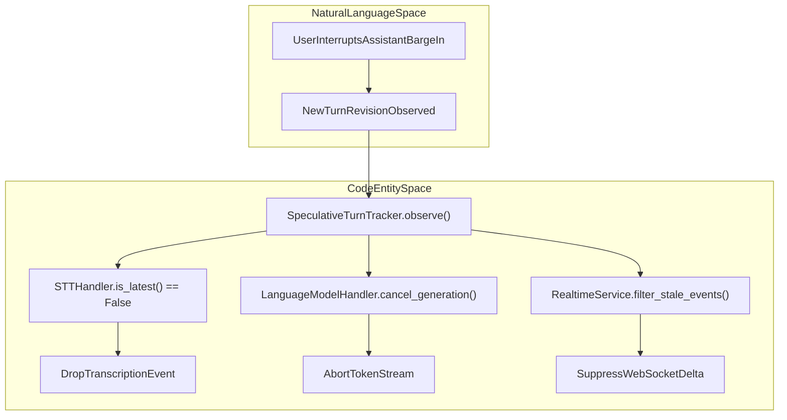
Sources: [src/speech_to_speech/pipeline/speculative_turns.py:38-124](), [src/speech_to_speech/api/openai_realtime/service.py:1-193]()

---

## Summary Table of Tracker API Methods

| Method Name | Return Type | Description |
| :--- | :--- | :--- |
| `observe(turn_id, revision)` | `None` | Updates the highest known revision for a turn and wakes waiting threads [src/speech_to_speech/pipeline/speculative_turns.py:38-49](). |
| `is_latest(turn_id, revision)` | `bool` | Checks if `revision` matches the current latest revision for `turn_id` [src/speech_to_speech/pipeline/speculative_turns.py:50-55](). |
| `begin_reopen_candidate(...)` | `int` | Initiates a speculative reopen window, returning the candidate revision [tests/test_speculative_turns.py:19-33](). |
| `confirm_reopen_candidate(...)` | `bool` | Confirms that a reopen occurred, invalidating the previous revision [src/speech_to_speech/pipeline/speculative_turns.py:170-210](). |
| `cancel_reopen_candidate(...)` | `None` | Cancels a pending reopen candidate, allowing commitment [tests/test_speculative_turns.py:29-32](). |
| `commit_if_latest_after_pending_reopen(...)` | `bool` | Waits for pending reopens and commits the revision if it remains latest [src/speech_to_speech/pipeline/speculative_turns.py:98-104](). |

Sources: [src/speech_to_speech/pipeline/speculative_turns.py:24-416]()

---

# Page: Core Components

# Core Components

<details>
<summary>Relevant source files</summary>

The following files were used as context for generating this wiki page:

- [src/speech_to_speech/LLM/lm_output_processor.py](src/speech_to_speech/LLM/lm_output_processor.py)
- [src/speech_to_speech/arguments_classes/module_arguments.py](src/speech_to_speech/arguments_classes/module_arguments.py)
- [src/speech_to_speech/pipeline/events.py](src/speech_to_speech/pipeline/events.py)
- [src/speech_to_speech/pipeline/messages.py](src/speech_to_speech/pipeline/messages.py)
- [src/speech_to_speech/s2s_pipeline.py](src/speech_to_speech/s2s_pipeline.py)
- [tests/test_cli_defaults.py](tests/test_cli_defaults.py)
- [tests/test_lm_output_processor.py](tests/test_lm_output_processor.py)

</details>


This page provides an overview of the primary processing components within the speech-to-speech pipeline system: VAD (Voice Activity Detection), STT (Speech-to-Text), LLM (Language Model), and TTS (Text-to-Speech). It also introduces intermediate stages like the `TranscriptionNotifier`, `AudioInputNotifier`, and `LMOutputProcessor`. For details on how these components are managed, see [Architecture](#2).

## Component Architecture

The speech-to-speech pipeline processes audio in a sequential manner through four major components, connected by thread-safe queues.

### Pipeline Data Flow

```mermaid
flowchart LR
    AudioIn["Audio Input"] --> Q1["recv_audio_chunks_queue"]
    Q1 --> VAD["VADHandler<br/>(Silero VAD v5)"]
    VAD --> Q2["spoken_prompt_queue<br/>(VADOutItem)"]
    Q2 --> STT["STT Handler<br/>(BaseSttHandler)"]
    STT --> Q3["text_prompt_queue<br/>(STTOutItem)"]
    Q3 --> LLM["LLM Handler<br/>(BaseLanguageModelHandler)"]
    LLM --> Q4["lm_response_queue<br/>(LMOutItem)"]
    Q4 --> TTS["TTS Handler<br/>(BaseTtsHandler)"]
    TTS --> Q5["send_audio_chunks_queue<br/>(AudioOutItem)"]
    Q5 --> AudioOut["Audio Output"]
```
Sources: [src/speech_to_speech/s2s_pipeline.py:1-57](), [src/speech_to_speech/pipeline/queue_types.py:39-46]()

Each component fulfills a specific function:
1. **Voice Activity Detection (VAD)**: Detects speech segments in the incoming audio stream using `VADHandler` [src/speech_to_speech/s2s_pipeline.py:56-56]().
2. **Speech-to-Text (STT)**: Transcribes detected speech segments into text using one of several handler implementations.
3. **Language Model (LLM)**: Processes the transcribed text and generates responses, managing chat history and tool calls.
4. **Text-to-Speech (TTS)**: Converts the language model's text response into 16kHz int16 PCM audio chunks.

Sources: [src/speech_to_speech/s2s_pipeline.py:1-57]()

## Component Selection System

The pipeline uses a factory pattern to instantiate the appropriate handler implementations. Selection is driven by `ModuleArguments` [src/speech_to_speech/arguments_classes/module_arguments.py:13-104]() and executed during pipeline building [src/speech_to_speech/s2s_pipeline.py:29-37]().

### Component Instantiation Flow

```mermaid
flowchart TD
    CLI["Command Line Args<br/>--stt, --llm_backend, --tts"] --> Parser["HfArgumentParser"]
    JSON["JSON Config File<br/>*.json"] --> Parser
    
    Parser --> ModuleArgs["ModuleArguments"]
    Parser --> HandlerArgs["Handler Arguments"]
    
    ModuleArgs --> BuildFunc["build_pipeline()"]
    HandlerArgs --> BuildFunc
    
    BuildFunc --> VADInit["VADHandler()"]
    BuildFunc --> GetSTT["create_backend_handler(STT_BACKENDS)"]
    BuildFunc --> GetLLM["create_backend_handler(LLM_BACKENDS)"]
    BuildFunc --> GetTTS["create_backend_handler(TTS_BACKENDS)"]
    
    GetSTT --> STTInstance["STT Handler Instance"]
    GetLLM --> LLMInstance["LLM Handler Instance"]
    GetTTS --> TTSInstance["TTS Handler Instance"]
```
Sources: [src/speech_to_speech/s2s_pipeline.py:1-190](), [src/speech_to_speech/arguments_classes/module_arguments.py:13-104]()

All components inherit from `BaseHandler`, which provides the standard lifecycle and queue management logic. Selection logic is centralized in the backend registry [src/speech_to_speech/backend_registry.py:33-37]().

Sources: [src/speech_to_speech/backend_registry.py:33-37](), [src/speech_to_speech/arguments_classes/module_arguments.py:13-104]()

## Voice Activity Detection (VAD)

The `VADHandler` uses **Silero VAD v5** or **FireRed Stream-VAD** to identify speech segments. It supports progressive mode, deep filter enhancements, and smart turn endpointing.

For details, see [Voice Activity Detection (VAD)](#3.1).

Sources: [src/speech_to_speech/s2s_pipeline.py:56-56]()

## Speech-to-Text (STT)

STT handlers transcribe audio segments into text. The system introduces a `TranscriptionNotifier` stage [src/speech_to_speech/s2s_pipeline.py:54-54]() that pushes partial or final transcriptions to a text output queue for client visibility and UI display.

For details, see [Speech-to-Text (STT)](#3.2).

Sources: [src/speech_to_speech/s2s_pipeline.py:54-54]()

## Language Models (LLM)

LLM handlers process transcriptions and generate text responses. The `LMOutputProcessor` intermediate stage handles ordered event yielding, tool extraction, and response sequencing [src/speech_to_speech/LLM/lm_output_processor.py:42-49]().

For details, see [Language Models (LLM)](#3.3).

Sources: [src/speech_to_speech/LLM/lm_output_processor.py:42-49]()

## Text-to-Speech (TTS)

TTS handlers convert text to 16kHz mono PCM audio chunks using backends like Qwen3-TTS or OpenAI-compatible streaming endpoints.

For details, see [Text-to-Speech (TTS)](#3.4).

Sources: [src/speech_to_speech/backend_registry.py:30-37]()

## Intermediate Stages

Beyond the core four stages, the pipeline includes utility components that normalize data flow:

| Component | Role | Code Entity |
|-----------|------|-------------|
| **Transcription Notifier** | Routes STT results to side-channels (e.g. Web UI) | `TranscriptionNotifier` [src/speech_to_speech/s2s_pipeline.py:54-54]() |
| **Audio Input Notifier** | Handles the direct audio path for audio-input LLMs | `AudioInputCompletedEvent` [src/speech_to_speech/pipeline/events.py:88-100]() |
| **LM Output Processor** | Handles ordered event yielding and tool extraction | `LMOutputProcessor` [src/speech_to_speech/LLM/lm_output_processor.py:42-49]() |

Sources: [src/speech_to_speech/s2s_pipeline.py:54-54](), [src/speech_to_speech/pipeline/events.py:88-100](), [src/speech_to_speech/LLM/lm_output_processor.py:42-49]()

---

# Page: Voice Activity Detection (VAD)

# Voice Activity Detection (VAD)

<details>
<summary>Relevant source files</summary>

The following files were used as context for generating this wiki page:

- [src/speech_to_speech/VAD/README.md](src/speech_to_speech/VAD/README.md)
- [src/speech_to_speech/VAD/firered_vad_iterator.py](src/speech_to_speech/VAD/firered_vad_iterator.py)
- [src/speech_to_speech/VAD/smart_turn.py](src/speech_to_speech/VAD/smart_turn.py)
- [src/speech_to_speech/VAD/vad_handler.py](src/speech_to_speech/VAD/vad_handler.py)
- [src/speech_to_speech/VAD/vad_iterator.py](src/speech_to_speech/VAD/vad_iterator.py)
- [src/speech_to_speech/arguments_classes/vad_arguments.py](src/speech_to_speech/arguments_classes/vad_arguments.py)
- [src/speech_to_speech/pipeline/speculative_turns.py](src/speech_to_speech/pipeline/speculative_turns.py)
- [tests/test_firered_vad_iterator.py](tests/test_firered_vad_iterator.py)
- [tests/test_smart_turn.py](tests/test_smart_turn.py)
- [tests/test_speculative_turns.py](tests/test_speculative_turns.py)
- [tests/test_vad_iterator.py](tests/test_vad_iterator.py)

</details>


## Purpose and Scope

The Voice Activity Detection (VAD) component serves as the initial processing stage in the speech-to-speech pipeline. Its primary role is to ingest incoming audio streams, distinguish speech from silence or background noise, segment active speech into discrete utterances, and manage turn-taking semantics. 

`VADHandler` coordinates backend detection, audio enhancement, progressive streaming, short segment stitching, and dynamic reconfiguration. For low-level iterator mechanics and backend selection guidance, see [VAD Iterators and FireRed Stream-VAD](#3.1.2). For advanced end-of-turn classification using the Smart Turn analyzer, see [Smart Turn Endpointing](#3.1.1).

```mermaid
flowchart LR
    AudioInput["Audio Input (VADIn)"] --> VAD["VADHandler"]
    VAD --> SpeechSegments["VADOut Queue"]
    SpeechSegments --> STT["STT Handler"]
    
    subgraph "VAD Backends & Subsystems"
        VAD --> Iterator["VAD Iterator (Silero / FireRed)"]
        VAD --> Tracker["SpeculativeTurnTracker"]
        VAD --> STA["SmartTurnAnalyzer"]
    end
    
    style VAD font-weight:bold
```

Sources: [src/speech_to_speech/VAD/vad_handler.py:56-60](), [src/speech_to_speech/arguments_classes/vad_arguments.py:5-131]()

## Pipeline Integration and Processing Modes

`VADHandler` inherits from `BaseHandler` and processes incoming audio streams (`VADIn`) into speech chunks or final utterances (`VADOut`) [src/speech_to_speech/VAD/vad_handler.py:56](). It operates in two primary modes:

- **Normal Mode**: Accumulates audio upon speech trigger and yields the complete utterance as a final `VADAudio` message once silence is detected [src/speech_to_speech/VAD/vad_handler.py:488-511]().
- **Progressive Mode**: Enabled via `enable_realtime_transcription`, this mode periodically yields intermediate audio chunks (`final=False`) at configured intervals (`realtime_processing_pause`) to feed live streaming STT sinks [src/speech_to_speech/VAD/vad_handler.py:99-100](), [src/speech_to_speech/VAD/vad_handler.py:456-486]().

Sources: [src/speech_to_speech/VAD/vad_handler.py:56-60](), [src/speech_to_speech/VAD/vad_handler.py:99-100](), [src/speech_to_speech/VAD/vad_handler.py:456-511]()

## VAD Backends

`VADHandler` supports pluggable speech probability backends selected via the `vad` argument:
- **Silero VAD v5** (`silero`): The default backend utilizing a Torch Hub model wrapped by `VADIterator` [src/speech_to_speech/VAD/vad_handler.py:86](), [src/speech_to_speech/VAD/vad_handler.py:150-163]().
- **FireRed Stream-VAD** (`firered`): An alternative streaming backend driven by `FireRedStreamVad` start and end events, requiring the `fireredvad` extra and model weights [src/speech_to_speech/VAD/vad_handler.py:87-88](), [src/speech_to_speech/VAD/README.md:5-12]().

For detailed frame handling, state machine rules, and backend trade-offs, see [VAD Iterators and FireRed Stream-VAD](#3.1.2).

Sources: [src/speech_to_speech/VAD/vad_handler.py:86-165](), [src/speech_to_speech/VAD/README.md:1-33]()

## Smart Turn and Endpointing

When an utterance completes, `VADHandler` can invoke the ONNX-based **Smart Turn v3.2** analyzer (`SmartTurnAnalyzer`) to evaluate whether the user's turn is linguistically and acoustically complete [src/speech_to_speech/VAD/vad_handler.py:80-84](), [src/speech_to_speech/VAD/smart_turn.py:1-7](). 

If the model classifies a turn as incomplete, the system extends the speculative reopen grace window (`smart_turn_max_wait_ms`) and introduces a delay (`smart_turn_incomplete_delay_ms`) to allow for user continuation before expensive downstream processing occurs [src/speech_to_speech/VAD/vad_handler.py:107-115](). For full details on Whisper feature extraction, result dataclasses, and endpointing flags, see [Smart Turn Endpointing](#3.1.1).

Sources: [src/speech_to_speech/VAD/vad_handler.py:80-85](), [src/speech_to_speech/VAD/smart_turn.py:1-35]()

## Audio Enhancement, Stitching, and Turn Management

### Audio Enhancement via DeepFilterNet
If `audio_enhancement` is enabled, `VADHandler` initializes DeepFilterNet (`init_df`) to apply noise reduction and equalization to incoming audio segments prior to downstream processing [src/speech_to_speech/VAD/vad_handler.py:73](), [src/speech_to_speech/VAD/vad_handler.py:167-175](). If the library is unavailable, it gracefully logs an error and disables the feature [src/speech_to_speech/VAD/vad_handler.py:168-173]().

### Short Segment Stitching
To mitigate false barge-ins and phantom triggers from transient noise, segments shorter than `min_speech_ms` can be held and stitched if subsequent speech arrives within `short_segment_merge_ms` [src/speech_to_speech/VAD/vad_handler.py:79](), [src/speech_to_speech/VAD/vad_handler.py:92-97](). Fragments with less active speech than `_SHORT_SEGMENT_MIN_FRAGMENT_MS` (100 ms) are discarded as noise and never held [src/speech_to_speech/VAD/vad_handler.py:40-44]().

### Speculative Turns and Reopening
`VADHandler` integrates with `SpeculativeTurnTracker` to support soft-ended turns [src/speech_to_speech/VAD/vad_handler.py:65](). If a user resumes speaking within `speculative_reopen_ms` or `unanswered_reopen_ms`, the handler reopens the existing turn revision rather than instantiating a new session turn [src/speech_to_speech/VAD/vad_handler.py:77-79](), [src/speech_to_speech/VAD/vad_handler.py:343-348]().

Sources: [src/speech_to_speech/VAD/vad_handler.py:40-54](), [src/speech_to_speech/VAD/vad_handler.py:73-79](), [src/speech_to_speech/VAD/vad_handler.py:167-175]()

## Configuration and `VADHandlerArguments`

VAD parameters are exposed via `VADHandlerArguments` and can be reconfigured dynamically at runtime using `RuntimeConfig` payloads in the input stream [src/speech_to_speech/arguments_classes/vad_arguments.py:5-131](), [src/speech_to_speech/api/openai_realtime/runtime_config.py:14]().

| Parameter | Default | Description |
| :--- | :--- | :--- |
| `vad` | `"silero"` | Backend selector (`"silero"` or `"firered"`). |
| `thresh` | `0.6` | Confidence threshold for speech detection [0–1]. |
| `min_silence_ms` | `64` | Minimum silence interval (ms) marking end of speech. |
| `min_speech_ms` | `384` | Minimum speech duration (ms) for a valid segment. |
| `speech_pad_ms` | `500` | Audio padding (ms) retained before VAD triggers. |
| `audio_enhancement` | `False` | Enables DeepFilterNet noise reduction. |
| `enable_realtime_transcription` | `False` | Enables progressive audio chunk yielding for live STT. |
| `short_segment_merge_ms` | `0` | Stitching window for adjacent short segments. |
| `smart_turn` | `True` | Enables Smart Turn v3.2 end-of-turn classification. |

Sources: [src/speech_to_speech/arguments_classes/vad_arguments.py:5-131](), [src/speech_to_speech/api/openai_realtime/runtime_config.py:14]()

---

# Page: Smart Turn Endpointing

# Smart Turn Endpointing

<details>
<summary>Relevant source files</summary>

The following files were used as context for generating this wiki page:

- [src/speech_to_speech/VAD/smart_turn.py](src/speech_to_speech/VAD/smart_turn.py)
- [src/speech_to_speech/VAD/vad_handler.py](src/speech_to_speech/VAD/vad_handler.py)
- [src/speech_to_speech/arguments_classes/vad_arguments.py](src/speech_to_speech/arguments_classes/vad_arguments.py)
- [src/speech_to_speech/pipeline/speculative_turns.py](src/speech_to_speech/pipeline/speculative_turns.py)
- [tests/test_smart_turn.py](tests/test_smart_turn.py)
- [tests/test_speculative_turns.py](tests/test_speculative_turns.py)

</details>


## Purpose and Scope

Smart Turn endpointing complements conventional Voice Activity Detection (VAD) by evaluating the acoustic and linguistic content of completed user utterances. Rather than processing every incoming audio frame, the `SmartTurnAnalyzer` is invoked exclusively after Silero VAD detects a speech-to-silence boundary. By running a quantized ONNX model (smart-turn v3.2), it classifies whether an utterance represents a complete conversational turn or an incomplete pause (e.g., when a user is pausing to think mid-sentence). This prevents premature assistant responses, extends grace windows, and orchestrates speculative turn reopening via `SpeculativeTurnTracker`.

Sources:
- `src/speech_to_speech/VAD/smart_turn.py:1-7` ()
- `src/speech_to_speech/VAD/vad_handler.py:109-122` ()

---

## 1. Smart Turn Architecture and ONNX Inference

The core inference logic is implemented in `SmartTurnAnalyzer` (`src/speech_to_speech/VAD/smart_turn.py`), which loads a CPU-optimized ONNX model (`smart-turn-v3.2-cpu.onnx`) from Hugging Face (`pipecat-ai/smart-turn-v3`) or a local path. 

### Key Classes and Functions
- `SmartTurnAnalyzer`: Manages the ONNX `InferenceSession`, Whisper feature extractor, and execution options. It enforces a strict `CPUExecutionProvider` configuration with single inter-op and configurable intra-op threads (`cpu_count`).
- `SmartTurnResult`: A frozen dataclass storing prediction outputs: `complete` (boolean flag), `probability` (float confidence), and `inference_ms` (execution latency).

```mermaid
graph TD
    A["RawAudioInput"] -->|_prepare_audio| B["SmartTurnAnalyzer"]
    B -->|WhisperFeatureExtractor| C["WhisperFeatureExtractor"]
    C -->|input_features| D["InferenceSession"]
    D -->|CPUExecutionProvider| E["SmartTurnResult"]
    
    classDef default fill:#fff,stroke:#000,stroke-width:1px;
```
*Figure 1: Natural Language Space to Code Entity Space mapping for `SmartTurnAnalyzer` processing.*

Sources:
- `src/speech_to_speech/VAD/smart_turn.py:27-86` ()

---

## 2. Feature Extraction and Audio Preparation

Before running inference, `SmartTurnAnalyzer._prepare_audio` normalizes raw audio arrays. It validates mono 1-D shape, resamples audio if the incoming sample rate differs from `MODEL_SAMPLE_RATE` (16,000 Hz) using `scipy.signal.resample_poly`, and pads or truncates the array to fit exactly `MAX_AUDIO_SECONDS` (8 seconds, or 128,000 samples).

The prepared audio tensor is passed to `WhisperFeatureExtractor` with `return_tensors="np"`, `padding="max_length"`, and `do_normalize=True`. The extracted log-Mel filterbank features are fed into the ONNX model, producing a scalar probability score evaluated against `threshold` (default `0.5`).

```mermaid
graph TD
    A["AudioArray"] -->|_prepare_audio| B["ResampleAndPad"]
    B -->|WhisperFeatureExtractor| C["FeatureExtractor"]
    C -->|InputFeatures| D["SessionRun"]
    D -->|Probability| E[("SmartTurnResult")]
    
    classDef default fill:#fff,stroke:#000,stroke-width:1px;
```
*Figure 2: Data flow from raw audio bytes to model evaluation inside `SmartTurnAnalyzer.predict`.*

Sources:
- `src/speech_to_speech/VAD/smart_turn.py:103-154` ()

---

## 3. Turn Timing, Grace Windows, and Incomplete Delays

When Silero VAD flags a speech stop, `VADHandler` delegates turn evaluation to `SmartTurnAnalyzer`. Based on the resulting `SmartTurnResult`, the handler determines the speculative turn parameters:

- **Complete Turn**: If `complete=True` (probability > threshold), the system uses standard speculative grace windows (e.g., `speculative_reopen_ms`, default 800 ms) allowing quick assistant response commitment while remaining open to barge-in.
- **Incomplete Turn**: If `complete=False`, the system extends the grace window up to `smart_turn_max_wait_ms` (default 2000 ms) and applies an `smart_turn_incomplete_delay_ms` (default 600 ms). This delay postpones expensive STT and LLM execution, allowing resumed speech to invalidate the turn revision via `SpeculativeTurnTracker` before heavy downstream processing begins.

```mermaid
graph TD
    A["VADSpeechStopped"] --> B["SmartTurnAnalyzer.predict"]
    B --> C{"Result.complete?"}
    C -->|Yes| D["StandardGrace: speculative_reopen_ms"]
    C -->|No| E["ExtendedWait: smart_turn_max_wait_ms"]
    E --> F["DelayProcessing: smart_turn_incomplete_delay_ms"]
    D --> G["SpeculativeTurnTracker"]
    F --> G
    
    classDef default fill:#fff,stroke:#000,stroke-width:1px;
```
*Figure 3: Turn timing adjustment flow in `VADHandler` based on `SmartTurnResult` completeness.*

Sources:
- `src/speech_to_speech/VAD/vad_handler.py:106-127` ()
- `src/speech_to_speech/pipeline/speculative_turns.py:159-180` ()
- `tests/test_smart_turn.py:44-70` ()

---

## 4. CLI Arguments and Configuration

Smart Turn behavior is fully configurable via `VADHandlerArguments` (`src/speech_to_speech/arguments_classes/vad_arguments.py`). The associated CLI flags expose control over thresholds, model paths, and CPU threading:

| Argument | Type | Default | Description |
| :--- | :--- | :--- | :--- |
| `--smart_turn` | `bool` | `True` | Enables Smart Turn v3.2 classification after Silero VAD finalizes a turn. Pass `--no_smart_turn` to disable. |
| `--smart_turn_model_path` | `str \| None` | `None` | Optional path to a local CPU ONNX model file. Defaults to downloading `smart-turn-v3.2-cpu.onnx`. |
| `--smart_turn_threshold` | `float` | `0.5` | Completion probability threshold. Higher values require higher confidence before declaring a turn complete. |
| `--smart_turn_max_wait_ms` | `int` | `2000` | Speculative reopen grace window used when an incomplete turn is detected. |
| `--smart_turn_incomplete_delay_ms` | `int` | `600` | Delay applied to STT and LLM execution on incomplete turns to allow barge-in cancellation. |
| `--smart_turn_cpu_count` | `int` | `1` | Number of CPU threads allocated to ONNX Runtime inference sessions. |

Sources:
- `src/speech_to_speech/arguments_classes/vad_arguments.py:98-131` ()

---

# Page: VAD Iterators and FireRed Stream-VAD

# VAD Iterators and FireRed Stream-VAD

<details>
<summary>Relevant source files</summary>

The following files were used as context for generating this wiki page:

- [src/speech_to_speech/VAD/README.md](src/speech_to_speech/VAD/README.md)
- [src/speech_to_speech/VAD/firered_vad_iterator.py](src/speech_to_speech/VAD/firered_vad_iterator.py)
- [src/speech_to_speech/VAD/vad_iterator.py](src/speech_to_speech/VAD/vad_iterator.py)
- [tests/test_firered_vad_iterator.py](tests/test_firered_vad_iterator.py)
- [tests/test_vad_iterator.py](tests/test_vad_iterator.py)

</details>


## Purpose and Scope

This document details the Voice Activity Detection (VAD) iterator backends implemented in the codebase: the Silero VAD v5 iterator (`VADIterator`) and the FireRed streaming VAD alternative (`FireRedVadIterator`) [src/speech_to_speech/VAD/vad_iterator.py:6-170](), [src/speech_to_speech/VAD/firered_vad_iterator.py:28-171](). It covers frame handling, state machine logic, pre-speech padding, PCM audio transformations, and operational guidance for choosing between backends based on `src/speech_to_speech/VAD/README.md` [src/speech_to_speech/VAD/README.md:1-33]().

---

## 1. Silero VADIterator Implementation

The Silero VAD iterator (`VADIterator`) provides stream imitation using preloaded ONNX or JIT Silero VAD models [src/speech_to_speech/VAD/vad_iterator.py:6-36](). It processes incoming audio chunks, tracks speech probabilities against a configured threshold, manages pre-speech padding buffers, and applies hysteresis to determine utterance boundaries [src/speech_to_speech/VAD/vad_iterator.py:38-170]().

### Core Parameters and State Machine

`VADIterator` is initialized with a VAD model, a detection `threshold` (default `0.5`), `sampling_rate` (`8000` or `16000` Hz), `min_silence_duration_ms` (default `300` ms), and `speech_pad_ms` (default `30` ms) [src/speech_to_speech/VAD/vad_iterator.py:7-54](). 

The internal state machine operates across three primary phases:
1. **Pre-Speech Buffering**: While `triggered` is `false`, incoming chunks are passed to `_remember_pre_speech()` [src/speech_to_speech/VAD/vad_iterator.py:141-143](). This maintains a rolling `_pre_speech_buffer` capped at `speech_pad_samples` via `_trim_pre_speech_buffer()` [src/speech_to_speech/VAD/vad_iterator.py:71-101]().
2. **Triggering**: When `speech_prob >= self.threshold` and `triggered` is `false`, the iterator sets `triggered = True`, copies the pre-speech buffer into `prefix_buffer`, records the triggering chunk, and initializes `active_speech_samples` [src/speech_to_speech/VAD/vad_iterator.py:131-139]().
3. **Active Speech and Hangover**: While `triggered` is `true`, chunks are appended to `buffer` [src/speech_to_speech/VAD/vad_iterator.py:145-146](). A hysteresis band (`threshold - 0.15`) prevents premature chunking during momentary dips in speech probability [src/speech_to_speech/VAD/vad_iterator.py:147-151](). If speech probability drops below `threshold - 0.15`, a silence timer (`temp_end`) starts [src/speech_to_speech/VAD/vad_iterator.py:153-157](). If the silence persists longer than `min_silence_samples`, the utterance is finalized, returning a combined list of tensors via `_speech_buffer()` and resetting internal states [src/speech_to_speech/VAD/vad_iterator.py:159-168]().

```mermaid
title "Silero VAD State Machine and Data Flow"
graph TD
    Input["IncomingAudioChunk (torch.Tensor)"] --> Call["VADIterator.__call__(x)"]
    Call --> Model["SileroModel(x, sampling_rate)"]
    Model --> ProbCheck{"speech_prob >= threshold?"}

    ProbCheck -- "No (Not Triggered)" --> PreSpeech["_remember_pre_speech(x)"]
    PreSpeech --> Trim["_trim_pre_speech_buffer()"]
    Trim --> ReturnNone1["Return None"]

    ProbCheck -- "Yes (Triggered False)" --> Trigger["triggered = True, prefix_buffer = _pre_speech_buffer"]
    Trigger --> Append1["buffer.append(x)"]
    Append1 --> ReturnNone2["Return None"]

    ProbCheck -- "Already Triggered" --> Append2["buffer.append(x)"]
    Append2 --> Hysteresis{"speech_prob >= threshold - 0.15?"}

    Hysteresis -- "Yes" --> ResetTemp["temp_end = 0, active_speech_samples += N"]
    Hysteresis -- "No" --> CheckSilence{"temp_end elapsed >= min_silence_samples?"}

    CheckSilence -- "No" --> ReturnNone3["Return None"]
    CheckSilence -- "Yes" --> Finalize["_speech_buffer() -> list[torch.Tensor]"]
    Finalize --> ResetState["Reset triggered = False, buffer = []"]
```

Sources:
- `src/speech_to_speech/VAD/vad_iterator.py`

---

## 2. FireRed Stream-VAD Iterator Implementation

The FireRed streaming VAD backend (`FireRedVadIterator`) interfaces with `FireRedStreamVad` start and end events [src/speech_to_speech/VAD/firered_vad_iterator.py:1-29](). Unlike Silero, FireRed relies on discrete frame-level indicators (`is_speech_start`, `is_speech_end`, `is_speech`) produced by a streaming feature extractor and detection network [src/speech_to_speech/VAD/firered_vad_iterator.py:15-26]().

### Frame Handling and PCM Transformation

`FireRedVadIterator` enforces a strict `16000` Hz sampling rate [src/speech_to_speech/VAD/firered_vad_iterator.py:40-41](). Incoming audio tensors (scaled to Silero range `[-1, 1]`) are converted to `int16` PCM range by multiplying by `32768.0` and concatenated with any residual waveform `_tail` [src/speech_to_speech/VAD/firered_vad_iterator.py:146-148](). 

The processor feeds fixed-size `400`-sample windows (`_FIRERED_WINDOW_SAMPLES`) with a `160`-sample hop (`_FIRERED_HOP_SAMPLES`) into the `FireRedStreamer` backend via `_detect_frames()` [src/speech_to_speech/VAD/firered_vad_iterator.py:11-12, 145-157](). Unconsumed trailing samples are preserved in `self._tail` for subsequent calls [src/speech_to_speech/VAD/firered_vad_iterator.py:156]().

```mermaid
title "FireRed Stream-VAD Frame Processing and Event Flow"
graph TD
    InputChunk["Incoming Audio Chunk (torch.Tensor)"] --> DetFrames["_detect_frames(x)"]
    DetFrames --> Scale["Convert [-1, 1] to int16 PCM (* 32768.0)"]
    Scale --> TailMerge["Concatenate with self._tail"]
    TailMerge --> WindowCheck{"Audio Length >= 400 samples?"}

    WindowCheck -- "No" --> StoreTail["Update self._tail and Return []"]
    WindowCheck -- "Yes" --> ExtractWindows["Slide 400-sample windows at 160-sample hop"]
    ExtractWindows --> StreamerCall["FireRedStreamer.detect_chunk(audio)"]
    StreamerCall --> SaveTail["Update self._tail with remaining samples"]
    SaveTail --> ReturnResults["Return list[FireRedFrameResult]"]
```

Sources:
- `src/speech_to_speech/VAD/firered_vad_iterator.py`

---

## 3. Backend Selection and Operational Guidance

The pipeline supports selecting the VAD backend via the `--vad` command-line argument [src/speech_to_speech/VAD/README.md:5-9](). 

| Backend Flag (`--vad`) | Implementation Class | Description & Characteristics |
| :--- | :--- | :--- |
| `silero` (default) | `VADIterator` [src/speech_to_speech/VAD/vad_iterator.py:6]() | Silero VAD v5 model with standard thresholding, hysteresis band, and min-silence hangover logic [src/speech_to_speech/VAD/README.md:7](). |
| `firered` | `FireRedVadIterator` [src/speech_to_speech/VAD/firered_vad_iterator.py:28]() | FireRed streaming VAD using explicit start and end events from `FireRedStreamVad` [src/speech_to_speech/VAD/README.md:8](). Bypasses Silero trigger/min-silence hangover logic [src/speech_to_speech/VAD/README.md:10](). |

### Installation and Configuration for FireRed VAD

Using the FireRed VAD backend requires installing optional project extras and downloading model weights locally [src/speech_to_speech/VAD/README.md:16-21]():

```bash
pip install "speech-to-speech[fireredvad]"
hf download FireRedTeam/FireRedVAD --local-dir ./pretrained_models/FireRedVAD
```

To run the local pipeline with FireRed VAD [src/speech_to_speech/VAD/README.md:25-29]():

```bash
speech-to-speech local \
  --vad firered \
  --vad_firered_model_dir ./pretrained_models/FireRedVAD/Stream-VAD
```

The `--vad_firered_use_gpu` flag executes the detector on CUDA [src/speech_to_speech/VAD/README.md:31](). If the optional extra is missing or `--vad_firered_model_dir` is invalid, the handler fails during setup before accepting any client sessions [src/speech_to_speech/VAD/README.md:33]().

Sources:
- `src/speech_to_speech/VAD/README.md`

---

# Page: Speech-to-Text (STT)

# Speech-to-Text (STT)

<details>
<summary>Relevant source files</summary>

The following files were used as context for generating this wiki page:

- [src/speech_to_speech/STT/README.md](src/speech_to_speech/STT/README.md)
- [src/speech_to_speech/STT/base_stt_handler.py](src/speech_to_speech/STT/base_stt_handler.py)
- [src/speech_to_speech/STT/transcription_notifier.py](src/speech_to_speech/STT/transcription_notifier.py)
- [src/speech_to_speech/api/openai_realtime/handlers/conversation.py](src/speech_to_speech/api/openai_realtime/handlers/conversation.py)
- [src/speech_to_speech/utils/mlx_lock.py](src/speech_to_speech/utils/mlx_lock.py)
- [tests/test_stt_stale_filter.py](tests/test_stt_stale_filter.py)
- [tests/test_transcription_notifier.py](tests/test_transcription_notifier.py)

</details>


## Purpose and Role

The Speech-to-Text (STT) component is responsible for converting audio input into text transcripts within the speech-to-speech pipeline. It serves as the second major step in the pipeline after Voice Activity Detection (VAD) and before Language Model (LLM) processing. The STT component not only transcribes spoken content but also identifies the language being spoken, which is crucial for subsequent processing steps.

The STT system supports an intermediate stage called **live transcription** (or progressive streaming), where partial results are emitted before the user finishes speaking. This is primarily facilitated by the `TranscriptionNotifier` (for UI updates) and specific streaming-capable handlers.

### STT Pipeline Context

```mermaid
flowchart LR
    ["VADAudio"] --> STT["BaseSTTHandler"]
    STT -- "PartialTranscription" --> TN["TranscriptionNotifier"]
    STT -- "Transcription" --> TN
    TN -- "PartialTranscriptionEvent" --> SOUT["text_output_queue"]
    TN -- "TranscriptionCompletedEvent" --> SOUT
    TN -- "LLMIn (Yielded)" --> LLM["LLM Handler"]
    
    subgraph "Natural Language Space"
    TN["TranscriptionNotifier"]
    SOUT["text_output_queue"]
    end

    subgraph "Code Entity Space"
    STT["BaseSTTHandler"]
    LLM["BaseHandler[LLMIn, LLMOut]"]
    end
```
Sources: [src/speech_to_speech/STT/transcription_notifier.py:17-33](), [src/speech_to_speech/STT/base_stt_handler.py:16-17](), [src/speech_to_speech/pipeline/messages.py:10-11]()

## TranscriptionNotifier

The `TranscriptionNotifier` sits between the STT and LLM stages [src/speech_to_speech/STT/transcription_notifier.py:17-18](). It performs two primary roles:
1. **Real-time Updates**: It converts `PartialTranscription` and `Transcription` messages into `PartialTranscriptionEvent` and `TranscriptionCompletedEvent` objects, which are pushed to the `text_output_queue` for external clients (e.g., WebSockets) [src/speech_to_speech/STT/transcription_notifier.py:34-72]().
2. **LLM Signaling**: It yields `LLMIn` items to the next stage. If a transcript is empty, it can re-enable the VAD listener via the `should_listen` event instead of triggering the LLM [src/speech_to_speech/STT/transcription_notifier.py:74-86]().

Sources: [src/speech_to_speech/STT/transcription_notifier.py:17-87](), [tests/test_transcription_notifier.py:19-36]()

## Speculative Turn Filtering

STT handlers inherit from `BaseSTTHandler`, which implements sophisticated logic to handle "speculative turns"—situations where the VAD may reopen a turn or provide revised audio segments.

- **Stale Input Filtering**: `should_process_input` checks the `turn_id` and `turn_revision` against a `SpeculativeTurnTracker`. It drops audio chunks that belong to outdated revisions or turns that have already been finalized [src/speech_to_speech/STT/base_stt_handler.py:24-61]().
- **Stability Windows**: For final transcriptions, the handler can wait for a `final_revision_settle_s` window to ensure no further VAD revisions are pending before committing to processing [src/speech_to_speech/STT/base_stt_handler.py:91-97]().
- **Queue Management**: The handler proactively clears its input queue of stale `VADAudio` items (e.g., progressive audio for a revision that already has a final audio chunk queued) to minimize latency and avoid processing redundant data [src/speech_to_speech/STT/base_stt_handler.py:104-128]().

Sources: [src/speech_to_speech/STT/base_stt_handler.py:16-128](), [tests/test_stt_stale_filter.py:74-109]()

## Implementation Families

The system provides multiple STT handler families, selectable via `--stt`. Because this is a parent page, details for each family are documented in their respective child pages:

- **Parakeet and NeMo ASR Handlers**: Covered in detail on [Parakeet and NeMo ASR Handlers](#3.2.1), including Parakeet TDT 0.6B v3 (mlx-audio vs nano-parakeet backends), `SmartProgressiveStreamingHandler`, `lingua-py` language detection, and NeMo ASR handlers [src/speech_to_speech/STT/README.md:11-12,60-70,108-117]().
- **Whisper-Family STT Handlers**: Covered in detail on [Whisper-Family STT Handlers](#3.2.2), including Transformers Whisper, Faster Whisper, Lightning Whisper MLX, and MLX Audio Whisper handlers [src/speech_to_speech/STT/README.md:7-10,19-59]().
- **OpenAI-Compatible HTTP STT Handler**: Covered in detail on [OpenAI-Compatible HTTP STT Handler](#3.2.3), detailing `OpenAICompatibleSTTHandler`, WAV encoding, cancellable `httpx`/`anyio` requests, progressive vs final lanes, and session generation fencing [src/speech_to_speech/STT/README.md:15,95-106]().
- **Streaming Realtime STT Handlers**: Covered in detail on [Streaming Realtime STT Handlers](#3.2.4), covering `StatefulStreamingSTTHandler` with `OpenAIRealtimeProtocol` and `VLLMRealtimeProtocol` [src/speech_to_speech/STT/README.md:5-15]().
- **Other STT Handlers and Audio-Input Mode**: Covered in detail on [Other STT Handlers and Audio-Input Mode](#3.2.5), covering Qwen3-ASR (`qwen3-asr`), Paraformer (`paraformer`), language reset behavior, and `AudioInputNotifier` [src/speech_to_speech/STT/README.md:13-14,71-94]().

Sources: [src/speech_to_speech/STT/README.md:1-117]()

## Language Detection and Fallback

Language handling is critical for downstream components and is managed uniformly across handlers via `BaseSTTHandler` properties and specific backend parsers.

1. **Detection Strategy**: 
   - Whisper handlers use internal model probability distributions [src/speech_to_speech/STT/README.md:19-50]().
   - Parakeet uses `lingua-py` for detection from generated text [src/speech_to_speech/STT/README.md:60-70]().
2. **SUPPORTED_LANGUAGES Fallback**: Handlers maintain supported language lists. If a model detects an unsupported language, the system falls back to a default or the `last_language` to prevent pipeline disruption [src/speech_to_speech/STT/base_stt_handler.py:24-27]().
3. **The `-auto` Suffix**: When automatic detection is active (`--language auto`), certain handlers append `-auto` to the detected code (e.g., `en-auto`) to instruct downstream LLMs to mirror the spoken language [src/speech_to_speech/STT/README.md:90-91]().

Sources: [src/speech_to_speech/STT/README.md:17-152](), [src/speech_to_speech/STT/base_stt_handler.py:24-28]()

## Apple Silicon Optimization (MLX)

For handlers running on macOS (such as Lightning Whisper MLX or MLX Audio Whisper), the system uses a global `MLXLockContext`. This prevents concurrent Metal/MLX model access across different pipeline stages (STT, LLM, TTS), which can lead to command buffer limitations or performance degradation [src/speech_to_speech/utils/mlx_lock.py:1-7]().

### MLX Lock Coordination

```mermaid
sequenceDiagram
    participant STT as "MLX STT Handler"
    participant Lock as "MLXLockContext"
    participant RLock as "_mlx_lock (RLock)"
    participant Metal as "Metal/Unified Memory"

    STT->>Lock: __enter__()
    Lock->>RLock: acquire(blocking=True)
    Note over RLock: Blocks if LLM or TTS is using Metal
    RLock-->>Lock: acquired
    Lock->>Lock: _record_lock_acquired("STT")
    Lock-->>STT: True
    STT->>Metal: Run MLX Inference
    STT->>Lock: __exit__()
    Lock->>Lock: _record_lock_released("STT")
    Lock->>RLock: release()
```
Sources: [src/speech_to_speech/utils/mlx_lock.py:17-25](), [src/speech_to_speech/utils/mlx_lock.py:151-171]()

---

# Page: Parakeet and NeMo ASR Handlers

# Parakeet and NeMo ASR Handlers

<details>
<summary>Relevant source files</summary>

The following files were used as context for generating this wiki page:

- [src/speech_to_speech/STT/nemo_asr_handler.py](src/speech_to_speech/STT/nemo_asr_handler.py)
- [src/speech_to_speech/STT/parakeet_tdt_handler.py](src/speech_to_speech/STT/parakeet_tdt_handler.py)
- [src/speech_to_speech/STT/smart_progressive_streaming.py](src/speech_to_speech/STT/smart_progressive_streaming.py)
- [src/speech_to_speech/arguments_classes/parakeet_unified_stt_arguments.py](src/speech_to_speech/arguments_classes/parakeet_unified_stt_arguments.py)
- [tests/test_nemo_asr_handler.py](tests/test_nemo_asr_handler.py)
- [tests/test_parakeet_language_detection.py](tests/test_parakeet_language_detection.py)
- [tests/test_parakeet_transcription_events.py](tests/test_parakeet_transcription_events.py)

</details>


## Purpose and Scope

The Parakeet and NeMo ASR handlers provide high-performance speech-to-text capabilities within the pipeline. This section covers two primary implementations:
1. **Parakeet TDT 0.6B v3 Handler (`ParakeetTDTSTTHandler`)**: An optimized transducer supporting 25 European languages with automatic language detection, dual-backend execution (`mlx-audio` for Apple Silicon and `nano-parakeet` for CUDA/CPU), and smart progressive streaming [src/speech_to_speech/STT/parakeet_tdt_handler.py:1-10]().
2. **NeMo ASR / Parakeet Unified Handler (`NemoASRSTTHandler`)**: A PyTorch-based integration using NeMo checkpoints through `ASRModel.transcribe`, paired with `ParakeetUnifiedSTTHandlerArguments` [src/speech_to_speech/STT/nemo_asr_handler.py:66-67](), [src/speech_to_speech/arguments_classes/parakeet_unified_stt_arguments.py:5-17]().

Sources: [src/speech_to_speech/STT/parakeet_tdt_handler.py:1-10](), [src/speech_to_speech/STT/nemo_asr_handler.py:66-67](), [src/speech_to_speech/arguments_classes/parakeet_unified_stt_arguments.py:5-17]()

---

## Parakeet TDT Dual-Backend Architecture

The `ParakeetTDTSTTHandler` dynamically selects its backend during the `setup` phase based on the detected hardware device [src/speech_to_speech/STT/parakeet_tdt_handler.py:133-158]().

| Backend | Platform | Library | Model Identifier |
| :--- | :--- | :--- | :--- |
| **MLX** | Apple Silicon (MPS) | `mlx-audio` | `mlx-community/parakeet-tdt-0.6b-v3` [src/speech_to_speech/STT/parakeet_tdt_handler.py:5-5]() |
| **nano-parakeet** | CUDA / CPU | `nano-parakeet` | `nvidia/parakeet-tdt-0.6b-v3` [src/speech_to_speech/STT/parakeet_tdt_handler.py:6-6]() |

### Implementation Logic
The handler checks platform constraints in `setup()` [src/speech_to_speech/STT/parakeet_tdt_handler.py:133-141](). On Darwin (`platform == "darwin"`), it defaults to `mps` and invokes `_setup_mlx()` [src/speech_to_speech/STT/parakeet_tdt_handler.py:134-136](). Otherwise, it selects `cuda` (if available) or `cpu` and calls `_setup_nano_parakeet()` [src/speech_to_speech/STT/parakeet_tdt_handler.py:137-139]().

```mermaid
graph TD
    subgraph "Code Entity Space"
        START["ParakeetTDTSTTHandler::setup"]
        PLATFORM{"platform == 'darwin'"}
        MLX_SETUP["ParakeetTDTSTTHandler::_setup_mlx"]
        NANO_SETUP["ParakeetTDTSTTHandler::_setup_nano_parakeet"]
        WARMUP["ParakeetTDTSTTHandler::warmup"]
        
        MLX_LIB["mlx_audio.stt.generate::load_model"]
        NANO_LIB["nano_parakeet::from_pretrained"]
    end

    START --> PLATFORM
    PLATFORM -- "Yes (MPS)" --> MLX_SETUP
    PLATFORM -- "No (CUDA/CPU)" --> NANO_SETUP
    MLX_SETUP --> MLX_LIB
    NANO_SETUP --> NANO_LIB
    MLX_LIB --> WARMUP
    NANO_LIB --> WARMUP
```
Sources: [src/speech_to_speech/STT/parakeet_tdt_handler.py:102-192]()

---

## Smart Progressive Streaming

When `enable_live_transcription` is enabled, `ParakeetTDTSTTHandler` instantiates `SmartProgressiveStreamingHandler` to emit partial transcriptions incrementally [src/speech_to_speech/STT/parakeet_tdt_handler.py:162-172]().

### Window Management Strategy
The streaming handler manages a growing audio window up to 15 seconds [src/speech_to_speech/STT/smart_progressive_streaming.py:33-34](). When the window exceeds this duration, it uses sentence boundaries to slide the window:
1. Completed sentences are designated as `fixed_sentences` and excluded from re-transcription [src/speech_to_speech/STT/smart_progressive_streaming.py:36-37]().
2. The active decoding window starts immediately following the last fixed sentence, incorporating a `sentence_buffer` [src/speech_to_speech/STT/smart_progressive_streaming.py:44-52]().

```mermaid
graph LR
    subgraph "Code Entity Space"
        VAD["VADAudio (mode='progressive')"]
        HANDLER["ParakeetTDTSTTHandler::process"]
        STREAMING["SmartProgressiveStreamingHandler::transcribe_incremental"]
        DECODE["SmartProgressiveStreamingHandler::_decode_window"]
        PARTIAL["PartialTranscription"]
    end

    VAD --> HANDLER
    HANDLER --> STREAMING
    STREAMING --> DECODE
    DECODE --> PARTIAL
```
Sources: [src/speech_to_speech/STT/smart_progressive_streaming.py:28-157](), [tests/test_parakeet_transcription_events.py:101-120]()

---

## Language Detection via Lingua

`ParakeetTDTSTTHandler` integrates the `lingua-py` library for automatic language detection across 25 supported European languages [src/speech_to_speech/STT/parakeet_tdt_handler.py:30-88]().

1. **Preloading:** `_build_lingua_detector()` preloads language models during initialization to avoid latency spikes on initial requests [src/speech_to_speech/STT/parakeet_tdt_handler.py:82-88]().
2. **Length Threshold:** Short text segments bypass language detection to prevent classification errors [tests/test_parakeet_language_detection.py:35-46]().
3. **Code Mapping:** Maps ISO codes such as Norwegian Bokmål (`nb` to `no`) to align with model expectations [src/speech_to_speech/STT/parakeet_tdt_handler.py:69-70]().

Sources: [src/speech_to_speech/STT/parakeet_tdt_handler.py:30-89](), [tests/test_parakeet_language_detection.py:7-77]()

---

## Parakeet Unified / NeMo ASR Handler

The `NemoASRSTTHandler` provides Speech-to-Text inference via NVIDIA NeMo ASR checkpoints (`ASRModel.from_pretrained`) [src/speech_to_speech/STT/nemo_asr_handler.py:66-87]().

### Configuration and Arguments
Configured via `ParakeetUnifiedSTTHandlerArguments`, which defines:
- `parakeet_unified_model_name`: Checkpoint identifier (default `"nvidia/parakeet-unified-en-0.6b"`) [src/speech_to_speech/arguments_classes/parakeet_unified_stt_arguments.py:6-9]().
- `parakeet_unified_device`: Execution device (`"auto"`, `"cuda"`, `"cpu"`) [src/speech_to_speech/arguments_classes/parakeet_unified_stt_arguments.py:10-13]().
- `parakeet_unified_language`: Language code reported with final transcriptions (default `"en"`) [src/speech_to_speech/arguments_classes/parakeet_unified_stt_arguments.py:14-17]().

### Execution Flow
1. **Setup:** Resolves the compute device, validates the language parameter, and loads the `ASRModel` [src/speech_to_speech/STT/nemo_asr_handler.py:69-87]().
2. **Warmup:** Runs a zero-tensor dummy transcription via `_transcribe()` to initialize CUDA kernels [src/speech_to_speech/STT/nemo_asr_handler.py:92-98]().
3. **Processing:** The `process()` method handles `VADAudio` inputs, generating either `PartialTranscription` (for progressive mode) or `Transcription` events [src/speech_to_speech/STT/nemo_asr_handler.py:105-122]().

```mermaid
graph TD
    subgraph "Code Entity Space"
        ARGS["ParakeetUnifiedSTTHandlerArguments"]
        SETUP["NemoASRSTTHandler::setup"]
        MODEL["nemo.collections.asr.models::ASRModel::from_pretrained"]
        WARMUP["NemoASRSTTHandler::warmup"]
        PROC["NemoASRSTTHandler::process"]
        TRANSCRIBE["NemoASRSTTHandler::_transcribe"]
    end

    ARGS --> SETUP
    SETUP --> MODEL
    MODEL --> WARMUP
    WARMUP --> PROC
    PROC --> TRANSCRIBE
```
Sources: [src/speech_to_speech/STT/nemo_asr_handler.py:66-122](), [src/speech_to_speech/arguments_classes/parakeet_unified_stt_arguments.py:1-17](), [tests/test_nemo_asr_handler.py:84-145]()

---

# Page: Whisper-Family STT Handlers

# Whisper-Family STT Handlers

<details>
<summary>Relevant source files</summary>

The following files were used as context for generating this wiki page:

- [src/speech_to_speech/STT/faster_whisper_handler.py](src/speech_to_speech/STT/faster_whisper_handler.py)
- [src/speech_to_speech/STT/lightning_whisper_mlx_handler.py](src/speech_to_speech/STT/lightning_whisper_mlx_handler.py)
- [src/speech_to_speech/STT/mlx_audio_whisper_handler.py](src/speech_to_speech/STT/mlx_audio_whisper_handler.py)
- [src/speech_to_speech/STT/whisper_stt_handler.py](src/speech_to_speech/STT/whisper_stt_handler.py)
- [tests/test_faster_whisper_language_code.py](tests/test_faster_whisper_language_code.py)
- [tests/test_mlx_audio_whisper_handler.py](tests/test_mlx_audio_whisper_handler.py)
- [tests/test_whisper_language_detection.py](tests/test_whisper_language_detection.py)
- [tests/test_whisper_progressive_transcription.py](tests/test_whisper_progressive_transcription.py)

</details>


## Purpose and Scope
This page details the Whisper-family Speech-to-Text (STT) handlers in the speech-to-speech codebase. These handlers convert speech input into text using various implementations of OpenAI's Whisper model, catering to different hardware targets (CUDA, CPU, and Apple Silicon MLX). Specifically, this covers:
- Transformers Whisper (`WhisperSTTHandler`) with `torch.compile` and static cache support [src/speech_to_speech/STT/whisper_stt_handler.py:46-81]()
- Faster Whisper (`FasterWhisperSTTHandler`) using CTranslate2 [src/speech_to_speech/STT/faster_whisper_handler.py:36-63]()
- Lightning Whisper MLX (`LightningWhisperSTTHandler`) for Apple Silicon [src/speech_to_speech/STT/lightning_whisper_mlx_handler.py:36-54]()
- MLX Audio Whisper (`MLXAudioWhisperSTTHandler`) using MLX Audio [src/speech_to_speech/STT/mlx_audio_whisper_handler.py:36-61]()

Sources: [src/speech_to_speech/STT/whisper_stt_handler.py:46-81](), [src/speech_to_speech/STT/faster_whisper_handler.py:36-63](), [src/speech_to_speech/STT/lightning_whisper_mlx_handler.py:36-54](), [src/speech_to_speech/STT/mlx_audio_whisper_handler.py:36-61]()

---

## Handler Ecosystem and Backend Mapping
To bridge natural language STT processing to code entities, the following diagram maps the logical Whisper execution paths to their respective handler classes across backends.

```mermaid
graph TB
    subgraph "Natural Language Space"
        ["Speech Audio Stream"]
        ["Language Detection / Auto"]
        ["Progressive & Final Transcription"]
    end

    subgraph "Code Entity Space (speech_to_speech/STT/)"
        ["BaseSTTHandler"]
        ["WhisperSTTHandler"]
        ["FasterWhisperSTTHandler"]
        ["LightningWhisperSTTHandler"]
        ["MLXAudioWhisperSTTHandler"]

        ["WhisperSTTHandler"] -- "inherits" --> ["BaseSTTHandler"]
        ["FasterWhisperSTTHandler"] -- "inherits" --> ["BaseSTTHandler"]
        ["LightningWhisperSTTHandler"] -- "inherits" --> ["BaseSTTHandler"]
        ["MLXAudioWhisperSTTHandler"] -- "inherits" --> ["BaseSTTHandler"]
    end

    ["Speech Audio Stream"] --> ["WhisperSTTHandler"]
    ["Speech Audio Stream"] --> ["FasterWhisperSTTHandler"]
    ["Speech Audio Stream"] --> ["LightningWhisperSTTHandler"]
    ["Speech Audio Stream"] --> ["MLXAudioWhisperSTTHandler"]
```

Sources: [src/speech_to_speech/STT/base_stt_handler.py:1-20](), [src/speech_to_speech/STT/whisper_stt_handler.py:46-51](), [src/speech_to_speech/STT/faster_whisper_handler.py:36-40](), [src/speech_to_speech/STT/lightning_whisper_mlx_handler.py:36-40](), [src/speech_to_speech/STT/mlx_audio_whisper_handler.py:36-41]()

---

## 1. Transformers Whisper Handler (`WhisperSTTHandler`)
The standard Hugging Face Transformers implementation uses `AutoModelForSpeechSeq2Seq` and `AutoProcessor` [src/speech_to_speech/STT/whisper_stt_handler.py:10-11]().

### Setup and Compilation
The `setup` method configures device, dtype, and optional `torch.compile` optimization [src/speech_to_speech/STT/whisper_stt_handler.py:53-81](). When `compile_mode` is provided, it configures a static cache and compiles `model.forward` with `fullgraph=True` [src/speech_to_speech/STT/whisper_stt_handler.py:78-80]().

```mermaid
graph TD
    subgraph "WhisperSTTHandler Setup"
        ["setup()"] --> ["Load AutoProcessor & AutoModelForSpeechSeq2Seq"]
        ["Load AutoProcessor & AutoModelForSpeechSeq2Seq"] --> CHECK{"compile_mode set?"}
        CHECK -- "Yes" --> ["Set cache_implementation = 'static'"]
        ["Set cache_implementation = 'static'"] --> ["torch.compile(model.forward, mode=compile_mode, fullgraph=True)"]
        CHECK -- "No" --> WARM["warmup()"]
        ["torch.compile(...)"] --> WARM
    end
```

Sources: [src/speech_to_speech/STT/whisper_stt_handler.py:53-81]()

### Language Detection and Warmup
Language detection uses `detect_language()` via encoder outputs when available [src/speech_to_speech/STT/whisper_stt_handler.py:166-177](). Warmup adapts the number of steps based on compilation mode and runs dummy forward/generate passes to prevent cold-start latency [src/speech_to_speech/STT/whisper_stt_handler.py:89-127]().

Sources: [src/speech_to_speech/STT/whisper_stt_handler.py:89-127](), [src/speech_to_speech/STT/whisper_stt_handler.py:166-177]()

---

## 2. Faster Whisper Handler (`FasterWhisperSTTHandler`)
The `FasterWhisperSTTHandler` integrates `faster_whisper.WhisperModel` backed by CTranslate2 [src/speech_to_speech/STT/faster_whisper_handler.py:7-62]().

### Configuration and Language Normalization
`setup()` normalizes `gen_kwargs` and language requests, mapping `"auto"` or `None` to auto-detection while passing through explicit ISO language codes [src/speech_to_speech/STT/faster_whisper_handler.py:45-74]().

### Processing Flow
During `process()`, audio chunks are transcribed via `self.model.transcribe()`, returning segments and an `info` object containing detected language metadata [src/speech_to_speech/STT/faster_whisper_handler.py:107-115](). Detected language fallback is resolved using `_resolve_language(info)` [src/speech_to_speech/STT/faster_whisper_handler.py:76-105]().

Sources: [src/speech_to_speech/STT/faster_whisper_handler.py:36-115]()

---

## 3. Lightning Whisper MLX Handler (`LightningWhisperSTTHandler`)
Optimized for Apple Silicon via `lightning_whisper_mlx` [src/speech_to_speech/STT/lightning_whisper_mlx_handler.py:8-53]().

### Execution and MLX Locking
`setup()` initializes `LightningWhisperMLX` with a batch size of 6 [src/speech_to_speech/STT/lightning_whisper_mlx_handler.py:53](). `process()` and `warmup()` utilize `MLXLockContext` to prevent concurrent Metal queue violations across pipeline threads [src/speech_to_speech/STT/lightning_whisper_mlx_handler.py:67](), [src/speech_to_speech/STT/lightning_whisper_mlx_handler.py:75](). MPS cache is cleared using `torch.mps.empty_cache()` when running on MPS [src/speech_to_speech/STT/lightning_whisper_mlx_handler.py:89-90]().

Sources: [src/speech_to_speech/STT/lightning_whisper_mlx_handler.py:36-94]()

---

## 4. MLX Audio Whisper Handler (`MLXAudioWhisperSTTHandler`)
`MLXAudioWhisperSTTHandler` integrates MLX Audio's Whisper generation pipeline [src/speech_to_speech/STT/mlx_audio_whisper_handler.py:36-60]().

### Model and Processor Fallback
If the loaded MLX model lacks a built-in processor (`self.model._processor is None`), the handler maps model names to their original OpenAI Whisper counterparts and loads `WhisperProcessor` from pretrained weights [src/speech_to_speech/STT/mlx_audio_whisper_handler.py:63-80]().

### Thread Safety and Language Resolution
Inference is serialized using `MLXLockContext` [src/speech_to_speech/STT/mlx_audio_whisper_handler.py:149](). `_resolve_language()` checks forced languages, detected language codes against `SUPPORTED_LANGUAGES`, and sticky fallbacks [src/speech_to_speech/STT/mlx_audio_whisper_handler.py:110-128]().

Sources: [src/speech_to_speech/STT/mlx_audio_whisper_handler.py:36-128]()

---

## 5. Progressive Transcription Support
All Whisper handlers support progressive transcription modes (`vad_audio.mode == "progressive"`), yielding `PartialTranscription` messages during active speech rather than prematurely closing turns with final `Transcription` outputs [src/speech_to_speech/STT/lightning_whisper_mlx_handler.py:99-105](), [src/speech_to_speech/STT/faster_whisper_handler.py:123-129](), [src/speech_to_speech/STT/mlx_audio_whisper_handler.py:168-174](), [tests/test_whisper_progressive_transcription.py:1-16]().

Sources: [src/speech_to_speech/STT/lightning_whisper_mlx_handler.py:99-105](), [src/speech_to_speech/STT/faster_whisper_handler.py:123-129](), [src/speech_to_speech/STT/mlx_audio_whisper_handler.py:168-174](), [tests/test_whisper_progressive_transcription.py:1-16]()

---

# Page: OpenAI-Compatible HTTP STT Handler

# OpenAI-Compatible HTTP STT Handler

<details>
<summary>Relevant source files</summary>

The following files were used as context for generating this wiki page:

- [docs/openai-compatible-stt.md](docs/openai-compatible-stt.md)
- [src/speech_to_speech/STT/openai_compatible_handler.py](src/speech_to_speech/STT/openai_compatible_handler.py)
- [src/speech_to_speech/arguments_classes/openai_stt_arguments.py](src/speech_to_speech/arguments_classes/openai_stt_arguments.py)
- [tests/test_openai_stt_handler.py](tests/test_openai_stt_handler.py)
- [tests/test_openai_stt_lifecycle.py](tests/test_openai_stt_lifecycle.py)

</details>


This page documents the OpenAI-compatible HTTP Speech-to-Text (STT) handler (`OpenAICompatibleSTTHandler`) and its underlying request execution primitives (`HttpTranscriptionOperation`). This backend delegates speech recognition to an external HTTP server while managing voice activity detection (VAD), conversational turns, session fencing, and transcription queuing locally [docs/openai-compatible-stt.md:3-6]().

---

## 1. Core Architecture and Component Mapping

The HTTP STT handler bridges pipeline audio frames to remote HTTP transcription endpoints via multipart WAV uploads [docs/openai-compatible-stt.md:11-14](). The subsystem is structured around `OpenAICompatibleSTTHandler`, which inherits from `BaseSTTHandler` [src/speech_to_speech/STT/openai_compatible_handler.py:30-30](), and `HttpTranscriptionOperation`, which encapsulates a single cancellable HTTP request transaction [src/speech_to_speech/STT/openai_compatible_handler.py:54-56]().

```mermaid
graph TD
    subgraph NaturalLanguageSpace["Natural Language Space"]
        VADAudioStream["VAD Audio Chunk Stream"]
        ProgressiveLane["Progressive Transcription Lane"]
        FinalLane["Final Utterance Commit Lane"]
        RemoteServer["OpenAI-Compatible STT Server /v1/audio/transcriptions"]
    end

    subgraph CodeEntitySpace["Code Entity Space"]
        Handler["OpenAICompatibleSTTHandler"]
        Operation["HttpTranscriptionOperation"]
        AsyncClient["httpx.AsyncClient"]
        WorkerThread["Thread(target=self._run_http)"]
    end

    VADAudioStream --> Handler
    Handler -->|"builds operation"| Operation
    Operation -->|"spawns daemon thread"| WorkerThread
    WorkerThread -->|"invokes request"| AsyncClient
    AsyncClient -->|"POST multipart WAV"| RemoteServer

    style NaturalLanguageSpace fill:#f9f,stroke:#333,stroke-width:2px
    style CodeEntitySpace fill:#bbf,stroke:#333,stroke-width:2px
```

*Sources: [src/speech_to_speech/STT/openai_compatible_handler.py:30-78](), [docs/openai-compatible-stt.md:3-14]()*

---

## 2. WAV Encoding and HTTP Request Lifecycle

When audio chunks arrive from the VAD stage, the handler encodes them into mono 16kHz PCM16 WAV buffers before dispatch [docs/openai-compatible-stt.md:11-14](). WAV byte serialization is implemented via `OpenAICompatibleSTTHandler._encode_wav` [src/speech_to_speech/STT/openai_compatible_handler.py:168-176]().

HTTP transmission is performed asynchronously within an isolated event loop running on a dedicated daemon thread (`stt-http-reader`) [src/speech_to_speech/STT/openai_compatible_handler.py:77-97](). `HttpTranscriptionOperation.run()` manages this thread boundary, polling for cancellation flags and returning a completed `HttpTranscriptionResult` dataclass [src/speech_to_speech/STT/openai_compatible_handler.py:54-88]().

```mermaid
graph TD
    subgraph NaturalLanguageSpace["Request Transmission & Parsing"]
        InputWAV["In-Memory WAV Buffer"]
        HTTPPost["Multipart POST Request"]
        ResponseParse["JSON or Plain-Text Parsing"]
    end

    subgraph CodeEntitySpace["Code Entity Implementation"]
        EncodeWAV["OpenAICompatibleSTTHandler._encode_wav()"]
        RequestAsync["HttpTranscriptionOperation._request_async()"]
        ParseResp["HttpTranscriptionOperation._parse_response()"]
    end

    InputWAV --> EncodeWAV
    EncodeWAV --> RequestAsync
    RequestAsync --> HTTPPost
    HTTPPost --> ParseResp
    ParseResp --> ResponseParse

    style NaturalLanguageSpace fill:#f9f,stroke:#333,stroke-width:2px
    style CodeEntitySpace fill:#bbf,stroke:#333,stroke-width:2px
```

The payload structure adapts depending on the selected model identifier:
* Standard models send a singular `language` parameter [src/speech_to_speech/STT/openai_compatible_handler.py:157-161]().
* The `gpt-transcribe` model uses the plural `languages[]` contract [src/speech_to_speech/STT/openai_compatible_handler.py:158-159]().
* Response handling parses standard JSON `text`/`language` fields or reads plain-text formats depending on `--openai_stt_response_format` [docs/openai-compatible-stt.md:64-70](), [tests/test_openai_stt_handler.py:133-166]().

*Sources: [src/speech_to_speech/STT/openai_compatible_handler.py:73-176](), [docs/openai-compatible-stt.md:11-14](), [tests/test_openai_stt_handler.py:133-176]()*

---

## 3. Concurrency, Cancellation, and Fencing

To ensure real-time responsiveness and avoid blocking pipeline shutdown or session teardown, the handler implements robust request lifecycle controls:

* **Progressive vs. Final Lanes**: Progressive requests operate on a best-effort basis where only the latest waiting cumulative window is retained per pipeline [docs/openai-compatible-stt.md:89-93](). Final requests maintain strict turn ordering [docs/openai-compatible-stt.md:81-83]().
* **Pending-Request Bounds**: Each pipeline retains at most eight pending final requests [docs/openai-compatible-stt.md:83-84](). If the queue reaches capacity, excess final requests receive a sanitized `TranscriptionFailure` without triggering network overhead [docs/openai-compatible-stt.md:84-86]().
* **Cancellation Scopes**: Requests are wrapped in `anyio.CancelScope` instances linked via thread-safe transport locks, allowing immediate interruption across connection establishment, upload, and response reading phases [src/speech_to_speech/STT/openai_compatible_handler.py:112-146](), [docs/openai-compatible-stt.md:104-107]().
* **Session Generation Fencing**: Results and failures carry a session generation stamp checked atomically with queue publication to prevent stale completions from surfacing after teardown or session reuse [docs/openai-compatible-stt.md:97-100]().

*Sources: [src/speech_to_speech/STT/openai_compatible_handler.py:112-146](), [docs/openai-compatible-stt.md:81-110]()*

---

## 4. Configuration Arguments

The handler configuration is defined by `OpenAICompatibleSTTHandlerArguments` [src/speech_to_speech/arguments_classes/openai_stt_arguments.py:6-38]():

| Argument | Default | Description |
| :--- | :--- | :--- |
| `openai_stt_base_url` | `"http://localhost:8000/v1"` | Base URL of the OpenAI-compatible server, including `/v1` [src/speech_to_speech/arguments_classes/openai_stt_arguments.py:9-12]() |
| `openai_stt_api_key` | `None` | Optional bearer token (`OPENAI_API_KEY` fallback for OpenAI hosted endpoints) [src/speech_to_speech/arguments_classes/openai_stt_arguments.py:13-19]() |
| `openai_stt_model` | `"nvidia/parakeet-tdt-0.6b-v3"` | Model identifier sent to transcription endpoints [src/speech_to_speech/arguments_classes/openai_stt_arguments.py:20-26]() |
| `openai_stt_language` | `None` | Optional ISO language hint sent with transcription requests [src/speech_to_speech/arguments_classes/openai_stt_arguments.py:27-30]() |
| `openai_stt_response_format` | `"json"` | Response format adapter (`json` or `text`) [src/speech_to_speech/arguments_classes/openai_stt_arguments.py:31-34]() |
| `openai_stt_timeout` | `60.0` | HTTP request timeout in seconds [src/speech_to_speech/arguments_classes/openai_stt_arguments.py:35-38]() |

*Sources: [src/speech_to_speech/arguments_classes/openai_stt_arguments.py:6-38]()*

---

# Page: Streaming Realtime STT Handlers

# Streaming Realtime STT Handlers

<details>
<summary>Relevant source files</summary>

The following files were used as context for generating this wiki page:

- [src/speech_to_speech/STT/streaming_handler.py](src/speech_to_speech/STT/streaming_handler.py)
- [src/speech_to_speech/arguments_classes/openai_realtime_stt_arguments.py](src/speech_to_speech/arguments_classes/openai_realtime_stt_arguments.py)
- [src/speech_to_speech/arguments_classes/vllm_realtime_stt_arguments.py](src/speech_to_speech/arguments_classes/vllm_realtime_stt_arguments.py)
- [tests/test_streaming_stt_handler.py](tests/test_streaming_stt_handler.py)

</details>


## Purpose and Scope

This page details the implementation of stateful streaming Speech-to-Text (STT) handlers within the speech-to-speech framework [src/speech_to_speech/STT/streaming_handler.py:1-1078](). These handlers bridge the pipeline's local voice activity detection (VAD) audio stream with remote WebSocket-based Realtime APIs (such as the OpenAI Realtime API and vLLM's experimental Realtime transcription API). Key aspects covered include WebSocket session management, PCM audio resampling via `soxr` [src/speech_to_speech/STT/streaming_handler.py:16-16](), turn start/commit lifecycle boundaries, protocol event parsing, timeouts, and argument configuration dataclasses [src/speech_to_speech/arguments_classes/openai_realtime_stt_arguments.py:1-36](), [src/speech_to_speech/arguments_classes/vllm_realtime_stt_arguments.py:1-32]().

Sources: [src/speech_to_speech/STT/streaming_handler.py:1-1078](), [src/speech_to_speech/arguments_classes/openai_realtime_stt_arguments.py:1-36](), [src/speech_to_speech/arguments_classes/vllm_realtime_stt_arguments.py:1-32]()

---

## Architecture of Stateful Streaming STT

The streaming STT subsystem maintains a persistent WebSocket connection to a remote Realtime server. It ingests pipeline audio frames (`VADAudio`), resamples them to match the target server's required sample rate, packages them into protocol-specific JSON/binary frames, and translates incoming server messages back into pipeline transcription events (`PartialTranscription`, `Transcription`, `TranscriptionFailure`) [tests/test_streaming_stt_handler.py:21-21]().

```mermaid
graph TD
    subgraph "Natural Language Space"
        A["Pipeline Audio Stream"] --> B["PCM Resampling"]
        B --> C["WebSocket Transport Session"]
        C --> D["Protocol Event Parsing"]
        D --> E["Partial & Final Transcripts"]
    end

    subgraph "Code Entity Space"
        F["VADAudio"] --> G["_StreamingPCMResampler"]
        G --> H["_WebSocket Protocol"]
        H --> I["OpenAIRealtimeProtocol / VLLMRealtimeProtocol"]
        I --> J["OpenAIRealtimeSTTHandler / VLLMRealtimeSTTHandler"]
    end

    A -.-> F
    B -.-> G
    C -.-> H
    D -.-> I
    E -.-> J

    style A fill:#none,stroke:#333,stroke-width:2px
    style F fill:#none,stroke:#333,stroke-width:2px
```
Sources: [src/speech_to_speech/STT/streaming_handler.py:1-1078](), [tests/test_streaming_stt_handler.py:1-2080]()

---

## Protocol Abstractions

To support multiple server dialects without duplicating connection logic, the codebase defines a `StreamingSTTProtocol` interface [src/speech_to_speech/STT/streaming_handler.py:55-70]() and concrete implementations for OpenAI [src/speech_to_speech/STT/streaming_handler.py:73-172]() and vLLM [src/speech_to_speech/STT/streaming_handler.py:175-230]().

### Protocol Interface

| Method / Property | Return Type | Description |
| :--- | :--- | :--- |
| `name` | `str` | Identifier string for logging and diagnostics [src/speech_to_speech/STT/streaming_handler.py:56-56]() |
| `requires_session_updated` | `bool` | Indicates if the server requires an explicit `session.updated` acknowledgment [src/speech_to_speech/STT/streaming_handler.py:57-57]() |
| `session_update()` | `dict[str, Any]` | Generates the initial session configuration payload [src/speech_to_speech/STT/streaming_handler.py:59-59]() |
| `start_utterance()` | `dict[str, Any] \| None` | Optional payload sent when speech segment begins [src/speech_to_speech/STT/streaming_handler.py:61-61]() |
| `append_audio(audio)` | `dict[str, Any]` | Packages raw PCM bytes for transmission [src/speech_to_speech/STT/streaming_handler.py:63-63]() |
| `finish_utterance()` | `dict[str, Any]` | Commits the active audio buffer (end of turn) [src/speech_to_speech/STT/streaming_handler.py:65-65]() |
| `discard_utterance()` | `dict[str, Any] \| None` | Clears or cancels the current audio buffer [src/speech_to_speech/STT/streaming_handler.py:67-67]() |
| `parse_event(event)` | `_ProtocolEvent` | Normalizes incoming wire events into internal `_ProtocolEvent` structures [src/speech_to_speech/STT/streaming_handler.py:69-69]() |

### Concrete Protocols

*   **`OpenAIRealtimeProtocol`**: Configures transcription sessions for OpenAI's endpoint (`openai-realtime`), defaulting to 24kHz audio input rates, supporting `input_audio_buffer.append`, `input_audio_buffer.commit`, and `input_audio_buffer.clear` [src/speech_to_speech/STT/streaming_handler.py:73-172]().
*   **`VLLMRealtimeProtocol`**: Targets vLLM's experimental Realtime API (`vllm-realtime`), requiring 16kHz PCM audio and distinct commit flags (`final: false` vs `final: true`) [src/speech_to_speech/STT/streaming_handler.py:175-230]().

Sources: [src/speech_to_speech/STT/streaming_handler.py:55-230]()

---

## Audio Resampling via `soxr`

Pipeline audio arrives at `PIPELINE_SAMPLE_RATE` (16,000 Hz) [src/speech_to_speech/STT/streaming_handler.py:26-26](), whereas hosted APIs (e.g., OpenAI Realtime) may require alternative rates like 24,000 Hz [src/speech_to_speech/arguments_classes/openai_realtime_stt_arguments.py:25-28](). The `_StreamingPCMResampler` class handles stateful sample-rate conversion using the `soxr` library to avoid clipping or temporal artifacts across audio chunk boundaries [src/speech_to_speech/STT/streaming_handler.py:16-16]().

```mermaid
graph TD
    subgraph "Audio Resampling Flow"
        H1["Incoming VADAudio (16kHz)"] --> H2["_StreamingPCMResampler"]
        H2 --> H3["soxr Resample Buffer"]
        H3 --> H4["Target Rate PCM (e.g., 24kHz)"]
        H4 --> H5["Protocol append_audio()"]
    end

    style H1 fill:#none,stroke:#333,stroke-width:2px
    style H5 fill:#none,stroke:#333,stroke-width:2px
```
Sources: [src/speech_to_speech/STT/streaming_handler.py:16-26]()

---

## Turn Management, Boundaries, and Timeouts

The streaming handlers interact closely with turn management boundaries (`VADAudio` chunks tagged with `mode="partial"` vs `mode="final"`) [tests/test_streaming_stt_handler.py:102-108]() and `SpeculativeTurnTracker` [src/speech_to_speech/STT/streaming_handler.py:21-21]().

```mermaid
sequenceDiagram
    participant Pipeline as "PipelineUnit"
    participant Handler as "OpenAIRealtimeSTTHandler"
    participant Socket as "_WebSocket"
    participant Server as "Realtime Server"

    Pipeline->>Handler: VADAudio (mode=partial)
    Handler->>Socket: input_audio_buffer.append (base64)
    Socket->>Server: Send PCM Chunk
    Server-->>Socket: conversation.item.input_audio_transcription.delta
    Socket-->>Handler: Parse Delta Event
    Handler-->>Pipeline: PartialTranscription

    Pipeline->>Handler: VADAudio (mode=final)
    Handler->>Socket: input_audio_buffer.commit
    Socket->>Server: Commit Utterance
    Server-->>Socket: conversation.item.input_audio_transcription.completed
    Socket-->>Handler: Parse Completed Event
    Handler-->>Pipeline: Transcription (Final)
```
Sources: [src/speech_to_speech/STT/streaming_handler.py:1-1078](), [tests/test_streaming_stt_handler.py:1-2080]()

### Timeout and Error Handling
*   **Connection Timeout**: Bounded by `connect_timeout` (default 10s) during WebSocket handshake and session negotiation [src/speech_to_speech/arguments_classes/openai_realtime_stt_arguments.py:29-32](), [src/speech_to_speech/arguments_classes/vllm_realtime_stt_arguments.py:25-28]().
*   **Final Transcription Timeout**: Bounded by `final_timeout` (default 60s) when waiting for the terminal commit acknowledgment from the server [src/speech_to_speech/arguments_classes/openai_realtime_stt_arguments.py:33-36](), [src/speech_to_speech/arguments_classes/vllm_realtime_stt_arguments.py:29-32]().
*   **Sanitized Errors**: Remote failures are caught and wrapped in `StreamingTranscriptionError` to prevent raw server exception leakage [src/speech_to_speech/STT/streaming_handler.py:30-32]().

Sources: [src/speech_to_speech/STT/streaming_handler.py:30-32](), [src/speech_to_speech/arguments_classes/openai_realtime_stt_arguments.py:29-36](), [src/speech_to_speech/arguments_classes/vllm_realtime_stt_arguments.py:25-32]()

---

## Argument Classes

Configuration options for each streaming STT backend are encapsulated in dedicated dataclasses processed via `HfArgumentParser`.

### `OpenAIRealtimeSTTHandlerArguments`
Defined in `src/speech_to_speech/arguments_classes/openai_realtime_stt_arguments.py` [src/speech_to_speech/arguments_classes/openai_realtime_stt_arguments.py:1-36]():
*   `openai_realtime_stt_base_url`: WebSocket base URL (default `wss://api.openai.com/v1`) [src/speech_to_speech/arguments_classes/openai_realtime_stt_arguments.py:9-12]().
*   `openai_realtime_stt_api_key`: Optional bearer token (falls back to `OPENAI_API_KEY` environment variable) [src/speech_to_speech/arguments_classes/openai_realtime_stt_arguments.py:13-16]().
*   `openai_realtime_stt_model`: Model identifier (default `gpt-live-transcribe`) [src/speech_to_speech/arguments_classes/openai_realtime_stt_arguments.py:17-20]().
*   `openai_realtime_stt_language`: Optional language hint [src/speech_to_speech/arguments_classes/openai_realtime_stt_arguments.py:21-24]().
*   `openai_realtime_stt_audio_sample_rate`: Sample rate (default `24000`) [src/speech_to_speech/arguments_classes/openai_realtime_stt_arguments.py:25-28]().
*   `openai_realtime_stt_connect_timeout`: Connection timeout in seconds (default `10.0`) [src/speech_to_speech/arguments_classes/openai_realtime_stt_arguments.py:29-32]().
*   `openai_realtime_stt_final_timeout`: Final commit timeout in seconds (default `60.0`) [src/speech_to_speech/arguments_classes/openai_realtime_stt_arguments.py:33-36]().

### `VLLMRealtimeSTTHandlerArguments`
Defined in `src/speech_to_speech/arguments_classes/vllm_realtime_stt_arguments.py` [src/speech_to_speech/arguments_classes/vllm_realtime_stt_arguments.py:1-32]():
*   `vllm_realtime_stt_base_url`: WebSocket base URL including `/v1` (default `ws://localhost:8000/v1`) [src/speech_to_speech/arguments_classes/vllm_realtime_stt_arguments.py:9-12]().
*   `vllm_realtime_stt_api_key`: Optional bearer token [src/speech_to_speech/arguments_classes/vllm_realtime_stt_arguments.py:13-16]().
*   `vllm_realtime_stt_model`: Model identifier (default `Qwen/Qwen3-ASR-1.7B`) [src/speech_to_speech/arguments_classes/vllm_realtime_stt_arguments.py:17-20]().
*   `vllm_realtime_stt_audio_sample_rate`: PCM sample rate (default `16000`) [src/speech_to_speech/arguments_classes/vllm_realtime_stt_arguments.py:21-24]().
*   `vllm_realtime_stt_connect_timeout`: Connection timeout in seconds (default `10.0`) [src/speech_to_speech/arguments_classes/vllm_realtime_stt_arguments.py:25-28]().
*   `vllm_realtime_stt_final_timeout`: Final commit timeout in seconds (default `60.0`) [src/speech_to_speech/arguments_classes/vllm_realtime_stt_arguments.py:29-32]().

Sources: [src/speech_to_speech/arguments_classes/openai_realtime_stt_arguments.py:1-36](), [src/speech_to_speech/arguments_classes/vllm_realtime_stt_arguments.py:1-32]()

---

# Page: Other STT Handlers and Audio-Input Mode

# Other STT Handlers and Audio-Input Mode

<details>
<summary>Relevant source files</summary>

The following files were used as context for generating this wiki page:

- [src/speech_to_speech/LLM/audio_input_notifier.py](src/speech_to_speech/LLM/audio_input_notifier.py)
- [src/speech_to_speech/STT/paraformer_handler.py](src/speech_to_speech/STT/paraformer_handler.py)
- [src/speech_to_speech/STT/qwen3_asr_handler.py](src/speech_to_speech/STT/qwen3_asr_handler.py)
- [src/speech_to_speech/arguments_classes/qwen3_asr_stt_arguments.py](src/speech_to_speech/arguments_classes/qwen3_asr_stt_arguments.py)
- [tests/test_audio_input_notifier.py](tests/test_audio_input_notifier.py)
- [tests/test_paraformer_transcription_events.py](tests/test_paraformer_transcription_events.py)
- [tests/test_qwen3_asr_transcription_events.py](tests/test_qwen3_asr_transcription_events.py)
- [tests/test_stt_session_language_reset.py](tests/test_stt_session_language_reset.py)

</details>


## Purpose and Scope

This page documents the technical implementation and architecture of alternative Speech-to-Text (STT) handlers in the speech-to-speech system, specifically the **Qwen3-ASR** handler and the **Paraformer** (FunASR) handler. It also details the **session language reset behavior** ensuring state hygiene across connections, and the **AudioInputNotifier** which manages the direct audio-to-LLM path when the STT stage is disabled (`--stt none`).

---

## Qwen3-ASR STT Handler

### Implementation Details

The `Qwen3ASRSTTHandler` integrates Qwen3-ASR speech recognition checkpoints through the Hugging Face `transformers` library [src/speech_to_speech/STT/qwen3_asr_handler.py:68-75](). It handles device resolution (`auto`, `cuda`, `mps`, `cpu`), dtype selection, language fallback policies, and optional contextual prompt injection [src/speech_to_speech/STT/qwen3_asr_handler.py:41-98]().

```mermaid
graph TD
    subgraph "Qwen3ASRSTTHandler [src/speech_to_speech/STT/qwen3_asr_handler.py]"
        "Qwen3ASRSTTHandler.setup()"["setup()"]
        "Qwen3ASRSTTHandler.configure_language()"["configure_language()"]
        "Qwen3ASRSTTHandler.warmup()"["warmup()"]
        "Qwen3ASRSTTHandler._transcribe()"["_transcribe()"]
        "Qwen3ASRSTTHandler.process()"["process(vad_audio)"]
    end
    
    subgraph "Transformers Integration"
        PROC["transformers.AutoProcessor"]
        REQ["processor.apply_transcription_request()"]
        GEN["model.generate()"]
    end
    
    "Qwen3ASRSTTHandler.setup()" -->|"Load processor & model"| PROC
    "Qwen3ASRSTTHandler.setup()" --> "Qwen3ASRSTTHandler.configure_language()"
    "Qwen3ASRSTTHandler.setup()" --> "Qwen3ASRSTTHandler.warmup()"
    "Qwen3ASRSTTHandler.process()" --> "Qwen3ASRSTTHandler._transcribe()"
    "_transcribe()" --> REQ
    REQ --> GEN
```

**Key Mechanisms:**
- **Language Policy (`auto` vs Forced):** In `auto` mode, the model identifies the language on every final turn, reporting it with the `-auto` suffix (e.g., `en-auto`) [src/speech_to_speech/STT/qwen3_asr_handler.py:71-74](), [src/speech_to_speech/STT/qwen3_asr_handler.py:145](). Because progressive windows are short and may compromise language identification, they reuse `self.last_language` from the preceding final turn [src/speech_to_speech/STT/qwen3_asr_handler.py:71-74](), [src/speech_to_speech/STT/qwen3_asr_handler.py:150-151]().
- **Prompt Bias:** If provided via `qwen3_asr_prompt`, optional context or hotwords are passed to `apply_transcription_request` (requiring `transformers>=5.15.1`) [src/speech_to_speech/STT/qwen3_asr_handler.py:63-66](), [src/speech_to_speech/STT/qwen3_asr_handler.py:94-96]().
- **Configuration Dataclass:** Configured via `Qwen3ASRSTTHandlerArguments`, exposing parameters such as `qwen3_asr_model_name`, `qwen3_asr_device`, `qwen3_asr_torch_dtype`, `qwen3_asr_language`, and `qwen3_asr_prompt` [src/speech_to_speech/arguments_classes/qwen3_asr_stt_arguments.py:6-52]().

**Sources:** [src/speech_to_speech/STT/qwen3_asr_handler.py:1-159](), [src/speech_to_speech/arguments_classes/qwen3_asr_stt_arguments.py:1-52]()

---

## Paraformer (FunASR) STT Handler

### Implementation Details

The `ParaformerSTTHandler` uses the `funasr` library to execute Paraformer models [src/speech_to_speech/STT/paraformer_handler.py:38-44](). Paraformer is a non-autoregressive speech recognition model, predicting tokens in parallel to achieve high throughput, primarily optimized for Chinese transcription [src/speech_to_speech/STT/paraformer_handler.py:19-24]().

```mermaid
graph TB
    subgraph "ParaformerSTTHandler [src/speech_to_speech/STT/paraformer_handler.py]"
        "ParaformerSTTHandler.setup()"["setup()"]
        "ParaformerSTTHandler.warmup()"["warmup()"]
        "ParaformerSTTHandler.process()"["process(vad_audio)"]
    end
    
    subgraph "FunASR Library"
        AUTO["funasr.AutoModel"]
        GEN["AutoModel.generate()"]
    end
    
    "ParaformerSTTHandler.setup()" -->|"Load model"| AUTO
    "ParaformerSTTHandler.setup()" --> "ParaformerSTTHandler.warmup()"
    "ParaformerSTTHandler.warmup()" -->|"Dummy inference"| GEN
    "ParaformerSTTHandler.process()" -->|"Generate transcription"| GEN
    GEN -->|"MPS cache clear (Apple Silicon)"| "ParaformerSTTHandler.process()"
```

**Key Mechanisms:**
- **Language Extraction:** Automatically parses the language code from the model name (e.g., `paraformer-en` sets `self.language = "en"`, defaulting to `"zh"` if unspecified) [src/speech_to_speech/STT/paraformer_handler.py:33-35]().
- **Progressive vs. Final Lanes:** If `vad_audio.mode == "progressive"`, it yields a `PartialTranscription` event [src/speech_to_speech/STT/paraformer_handler.py:67-72](). Otherwise, it yields a final `Transcription` message containing the `language_code` and `speech_stopped_at_s` [src/speech_to_speech/STT/paraformer_handler.py:74-80]().
- **Device Memory Management:** Explicitly invokes `torch.mps.empty_cache()` if `self.device == "mps"` after inference [src/speech_to_speech/STT/paraformer_handler.py:60-62]().

**Sources:** [src/speech_to_speech/STT/paraformer_handler.py:1-80](), [tests/test_paraformer_transcription_events.py:1-131]()

---

## Session Language Reset Behavior

Because pipeline units and STT handlers are reused across client connections, transient conversation state—specifically `last_language`—must not leak into subsequent sessions [tests/test_stt_session_language_reset.py:1-11]().

**Key Mechanisms:**
- **Base Handler Contract:** `BaseSTTHandler` defines `start_language` and `last_language` attributes [tests/test_stt_session_language_reset.py:163-166]().
- **Session Cleanup (`on_session_end`):** When a session terminates (`SESSION_END`), handlers invoke `on_session_end()`, which restores `self.last_language` to its initial configured state (`self.start_language`) [tests/test_stt_session_language_reset.py:80-116](). This prevents a previous client's detected language from incorrectly biasing the next conversation session [tests/test_stt_session_language_reset.py:1-11]().

**Sources:** [tests/test_stt_session_language_reset.py:1-168]()

---

## Audio-Input Mode: AudioInputNotifier

When the speech-to-speech system is configured with `--stt none`, the transcription stage is bypassed entirely. In this mode, raw VAD-gated audio is routed directly to the LLM via the `AudioInputNotifier` [src/speech_to_speech/LLM/audio_input_notifier.py:18-19]().

```mermaid
graph LR
    subgraph "AudioInputNotifier [src/speech_to_speech/LLM/audio_input_notifier.py]"
        VAD["VADAudio (final)"]
        CHECK["should_process_input()"]
        PROC["process()"]
    end
    
    subgraph "Infrastructure"
        TRACKER["SpeculativeTurnTracker"]
        Q["text_output_queue"]
    end
    
    VAD --> CHECK
    CHECK -->|"Check stability window"| TRACKER
    CHECK -->|"If Valid"| PROC
    PROC -->|"AudioInputCompletedEvent"| Q
```

**Key Mechanisms:**
- **Stability Window Filtering:** `should_process_input` inspects `VADAudio` frames, ignoring `progressive` updates and verifying that the final audio chunk has cleared the stability window via `SpeculativeTurnTracker.is_latest_after_stability_window` [src/speech_to_speech/LLM/audio_input_notifier.py:31-41]().
- **Side-Channel Event Dispatch:** Instead of yielding standard transcription messages through the primary pipeline queue, `process()` emits an `AudioInputCompletedEvent` directly into the `text_output_queue` for the `RealtimeService` to build native audio prompts [src/speech_to_speech/LLM/audio_input_notifier.py:52-63]().

**Sources:** [src/speech_to_speech/LLM/audio_input_notifier.py:1-63](), [tests/test_audio_input_notifier.py:1-80]()

---

# Page: Language Models (LLM)

# Language Models (LLM)

<details>
<summary>Relevant source files</summary>

The following files were used as context for generating this wiki page:

- [src/speech_to_speech/LLM/README.md](src/speech_to_speech/LLM/README.md)
- [src/speech_to_speech/LLM/base_openai_compatible_language_model.py](src/speech_to_speech/LLM/base_openai_compatible_language_model.py)
- [src/speech_to_speech/LLM/language_model.py](src/speech_to_speech/LLM/language_model.py)
- [src/speech_to_speech/arguments_classes/facebookmms_tts_arguments.py](src/speech_to_speech/arguments_classes/facebookmms_tts_arguments.py)
- [src/speech_to_speech/arguments_classes/language_model_arguments.py](src/speech_to_speech/arguments_classes/language_model_arguments.py)
- [src/speech_to_speech/arguments_classes/language_model_base_arguments.py](src/speech_to_speech/arguments_classes/language_model_base_arguments.py)
- [tests/test_responses_api_language_model.py](tests/test_responses_api_language_model.py)

</details>


## Purpose and Scope

This page provides a high-level overview of the Language Model (LLM) subsystem within the speech-to-speech pipeline. LLM handlers receive transcribed text or direct audio requests, maintain conversational context via history management, execute reasoning or tool calls, stream sentence-batched text chunks, and pass outputs through the `LMOutputProcessor` down to the text-to-speech (TTS) stage.

As a parent page, this document summarizes the core architecture, handler abstractions, and supporting modules. For deep technical details, refer to the following child pages:
- **Local Model Handlers**: [Local Model Handlers (Transformers and MLX)](#3.3.1) — covers `LanguageModelHandler`, `VisionLanguageModelHandler`, `TextIteratorStreamer`, caching, and MLX locks.
- **OpenAI-Compatible APIs**: [OpenAI-Compatible API Language Model Handlers](#3.3.2) — covers `BaseOpenAICompatibleHandler`, `/v1/responses`, `/v1/chat/completions`, streaming, and thinking modes.
- **Tool Calling**: [Tool Calling](#3.3.3) — covers code-block tool injection, signature parsing, and extraction via `LMOutputProcessor`.
- **Chat History & Compaction**: [Chat History and Conversation Compaction](#3.3.4) — covers bounded history, turn eviction, and background summarization via `Compactor`.
- **Prompts & Directives**: [Prompts: Voice, Text and Language Directives](#3.3.5) — covers system prompt construction (`voice_prompt.py`, `text_prompt.py`) and language injection.

Sources: [src/speech_to_speech/LLM/base_openai_compatible_language_model.py:145-155](), [src/speech_to_speech/LLM/language_model.py:164-170]()

## Architecture and Core Entities

The LLM architecture bridges natural language and structured control flow with concrete Python entities across local runtimes and remote API clients.

```mermaid
graph TD
    subgraph "Natural Language Space"
        USR_IN["User Spoken Input"]
        SYS_PRMPT["System Instructions"]
        CHAT_HIST["Conversation Context"]
        TOOL_REQ["Action Request (Tool)"]
    end

    subgraph "Code Entity Space"
        BOCH["BaseOpenAICompatibleHandler<br/>LLM/base_openai_compatible_language_model.py"]
        BLMH["BaseLanguageModelHandler<br/>LLM/language_model.py"]
        CHAT["Chat Object<br/>LLM/chat.py"]
        COMP["Compactor<br/>LLM/compaction_prompt.py"]
        LMOP["LMOutputProcessor<br/>LLM/lm_output_processor.py"]
        CSCOPE["CancelScope<br/>pipeline/cancel_scope.py"]
        STRACK["SpeculativeTurnTracker<br/>pipeline/speculative_turns.py"]
    end

    USR_IN -->|"(text, lang)"| BOCH
    USR_IN -->|"(text, lang)"| BLMH
    SYS_PRMPT -->|"setup()"| BOCH
    SYS_PRMPT -->|"setup()"| BLMH
    CHAT_HIST -->|"add_item()"| CHAT
    CHAT -->|"trim_if_needed()"| COMP
    BOCH -->|"manages"| CHAT
    BLMH -->|"manages"| CHAT
    BOCH -->|"yields ProviderEvent"| LMOP
    BLMH -->|"yields StreamContext"| LMOP
    LMOP -->|"extracts"| TOOL_REQ
    CSCOPE -->|"interrupts"| BOCH
    CSCOPE -->|"interrupts"| BLMH
    STRACK -->|"filters stale turns"| LMOP
```

**Key Code Entities:**
- `BaseOpenAICompatibleHandler`: Shared orchestration layer for remote OpenAI-compatible backends (Responses and Chat Completions APIs) [src/speech_to_speech/LLM/base_openai_compatible_language_model.py:145-155]().
- `BaseLanguageModelHandler`: Abstract base class for local Transformers and MLX inference handlers [src/speech_to_speech/LLM/language_model.py:164-170]().
- `Chat`: Managesbounded conversation history, turn-based eviction, and re-injection of function call items [src/speech_to_speech/LLM/chat.py:77-103]().
- `Compactor`: Background summarizer using `CompactGenerateFn` to compress older dialogue history without losing semantic context [src/speech_to_speech/LLM/compaction_prompt.py:22-26]().
- `LMOutputProcessor`: Intercepts generation outputs to extract tool calls, handle side-channel events, and forward sentence-batched text to TTS [src/speech_to_speech/LLM/language_model.py:130-162]().

Sources: [src/speech_to_speech/LLM/base_openai_compatible_language_model.py:145-155](), [src/speech_to_speech/LLM/language_model.py:164-170](), [src/speech_to_speech/LLM/chat.py:77-103](), [src/speech_to_speech/LLM/compaction_prompt.py:22-26]()

## Role in the Pipeline

The LLM stage sits downstream of STT (or direct audio input) and upstream of TTS, coordinating prompt assembly, streaming token consumption, sentence batching, and cancellation.

```mermaid
graph LR
    STT["STT Handler"] -->|"LLMIn (GenerateResponseRequest)"| LLM["LLM Handler (Transformers / MLX / API)"]
    LLM -->|"LLMResponseChunk"| LMOP["LMOutputProcessor"]
    LMOP -->|"TTSIn (TTSInput)"| TTS["TTS Handler"]
    LMOP -.->|"text_output_queue"| UI["WebSocket / UI Client"]
    
    subgraph "LLM Subsystem"
        LLM -->|"build_voice_system_prompt"| PROMPT["System Prompt Assembly"]
        PROMPT -->|"Inference / API Call"| GEN["Token Stream Generation"]
        GEN -->|"sent_tokenize"| BATCH["Sentence Batching"]
    end
```

**Pipeline Integration Responsibilities:**
- **Sentence-Level Streaming**: Accumulates generated tokens into sentence batches via NLTK tokenization (`sent_tokenize`) to balance latency and TTS naturalness [src/speech_to_speech/LLM/base_openai_compatible_language_model.py:19-19](), [src/speech_to_speech/LLM/language_model.py:11-11]().
- **Barge-in and Cancellation**: Coordinates with `CancelScope` and `SpeculativeTurnTracker` to instantly abort token generation or drop stale chunks when a new user turn interrupts the model [src/speech_to_speech/LLM/base_openai_compatible_language_model.py:182-183](), [src/speech_to_speech/LLM/language_model.py:183-184]().
- **System and Language Directives**: Injects voice-optimized personas and optional language directives (`--enable_lang_prompt`) into system prompts [src/speech_to_speech/LLM/base_openai_compatible_language_model.py:187-187](), [src/speech_to_speech/LLM/language_model.py:188-188]().

Sources: [src/speech_to_speech/LLM/base_openai_compatible_language_model.py:19-19](), [src/speech_to_speech/LLM/language_model.py:11-11](), [src/speech_to_speech/LLM/base_openai_compatible_language_model.py:182-187]()

## Handler Implementation Family

The framework supports multiple backend families selected via `--llm_backend`:

| Backend Identifier | Handler Class | Primary Target | Key Capabilities |
| :--- | :--- | :--- | :--- |
| `transformers` | `LanguageModelHandler` | Local GPU/CPU | Hugging Face models, `torch.compile`, stopping criteria [src/speech_to_speech/LLM/language_model.py:164-170]() |
| `mlx-lm` | `LanguageModelHandler` | Apple Silicon | MLX acceleration, unified memory locking [src/speech_to_speech/LLM/language_model.py:164-170]() |
| `responses-api` | `ResponsesApiModelHandler` | Remote API | `/v1/responses` endpoint, thinking modes, prefetch transactions [src/speech_to_speech/LLM/base_openai_compatible_language_model.py:145-155]() |
| `chat-completions` | `ChatCompletionsModelHandler` | Remote API | `/v1/chat/completions` endpoint, standard tool calling [src/speech_to_speech/LLM/base_openai_compatible_language_model.py:145-155]() |

Sources: [src/speech_to_speech/LLM/language_model.py:164-170](), [src/speech_to_speech/LLM/base_openai_compatible_language_model.py:145-155]()

## Summary of Child Topics

- For local execution details, caching, and stream iteration, see [Local Model Handlers (Transformers and MLX)](#3.3.1).
- For remote HTTP endpoints, event normalization, and timeout handling, see [OpenAI-Compatible API Language Model Handlers](#3.3.2).
- For function tool execution and code-block parsing, see [Tool Calling](#3.3.3).
- For bounded conversation history and background summarization, see [Chat History and Conversation Compaction](#3.3.4).
- For system prompt generation and voice styling, see [Prompts: Voice, Text and Language Directives](#3.3.5).

---

# Page: Local Model Handlers (Transformers and MLX)

# Local Model Handlers (Transformers and MLX)

<details>
<summary>Relevant source files</summary>

The following files were used as context for generating this wiki page:

- [src/speech_to_speech/LLM/README.md](src/speech_to_speech/LLM/README.md)
- [src/speech_to_speech/LLM/base_openai_compatible_language_model.py](src/speech_to_speech/LLM/base_openai_compatible_language_model.py)
- [src/speech_to_speech/LLM/language_model.py](src/speech_to_speech/LLM/language_model.py)
- [src/speech_to_speech/STT/base_stt_handler.py](src/speech_to_speech/STT/base_stt_handler.py)
- [src/speech_to_speech/arguments_classes/facebookmms_tts_arguments.py](src/speech_to_speech/arguments_classes/facebookmms_tts_arguments.py)
- [src/speech_to_speech/arguments_classes/language_model_arguments.py](src/speech_to_speech/arguments_classes/language_model_arguments.py)
- [src/speech_to_speech/arguments_classes/language_model_base_arguments.py](src/speech_to_speech/arguments_classes/language_model_base_arguments.py)
- [src/speech_to_speech/utils/mlx_lock.py](src/speech_to_speech/utils/mlx_lock.py)
- [tests/test_responses_api_language_model.py](tests/test_responses_api_language_model.py)
- [tests/test_stt_stale_filter.py](tests/test_stt_stale_filter.py)

</details>


## Purpose and Scope

This document provides detailed technical information about local language model handlers (`LanguageModelHandler` and `VisionLanguageModelHandler`), which process text transcripts and multimodal inputs using either Hugging Face's `transformers` library or Apple's `mlx-lm` / `mlx-vlm` backends. It covers asynchronous streaming via `TextIteratorStreamer`, mid-generation cancellation via `_CancelCriteria`, global MLX lock and cache management for Apple Silicon, automatic sentence tokenization, and unspeechable token filtering.

Sources: [src/speech_to_speech/LLM/language_model.py:107-163](), [src/speech_to_speech/LLM/language_model.py:185-195]()

## Architecture and Class Hierarchy

The system uses an abstract base class hierarchy (`BaseLanguageModelHandler`) inheriting from `BaseHandler` to unify text-only and vision-language model execution across both PyTorch (`transformers`) and Apple Silicon (`mlx` / `mlx-vlm`) backends.

### Entity Mapping Diagram

```mermaid
classDiagram
    class BaseHandler {
        <<interface>>
        +setup()
        +process()
    }
    class BaseLanguageModelHandler {
        <<abstract>>
        #Chat chat
        #StreamContext ctx
        #_CancelCriteria _cancel_criteria
        #_load_model()*
        #_generate()*
        +_apply_runtime_instructions()
    }
    class LanguageModelHandler {
        +PreTrainedModel model
        +_Tokenizer tokenizer
        +str backend
        #_load_model()
        #_generate()
    }
    class VisionLanguageModelHandler {
        +PreTrainedModel model
        +_Processor processor
        +str backend
        #_load_model()
        #_generate()
    }

    BaseHandler <|-- BaseLanguageModelHandler
    BaseLanguageModelHandler <|-- LanguageModelHandler
    BaseLanguageModelHandler <|-- VisionLanguageModelHandler
```

Sources: [src/speech_to_speech/LLM/language_model.py:97-195](), [src/speech_to_speech/LLM/language_model.py:330-360](), [src/speech_to_speech/LLM/language_model.py:463-510]()

## Transformers vs. MLX/MLX-VLM Backends

The handler determines the execution backend via the `backend` configuration parameter (`"transformers"` or `"mlx"` / `"mlx-lm"` / `"mlx-vlm"`).

- **Transformers Backend**: Loads models using `AutoModelForCausalLM.from_pretrained` (or `AutoModelForImageTextToText` for VLMs) with PyTorch dtypes (`float16`, `bfloat16`, or `float32`) on CUDA or CPU devices [src/speech_to_speech/LLM/language_model.py:180-195]().
- **MLX Backend**: Utilizes `mlx_lm.load` or `mlx_vlm.load` when `HAS_MLX` or `HAS_MLX_VLM` are available, executing quantized weights efficiently on Apple Silicon Unified Memory (`mps` or `mlx`) [src/speech_to_speech/LLM/language_model.py:74-93]().

Sources: [src/speech_to_speech/LLM/language_model.py:74-93](), [src/speech_to_speech/LLM/language_model.py:180-195]()

## Threading, Streaming, and MLX Lock Management

To prevent blocking the speech pipeline during generation, local language model handlers execute inference in a background thread while streaming tokens via `TextIteratorStreamer` (for transformers) or generator functions (for MLX).

### MLX Lock and Cache Management
When running MLX models on Apple Silicon, concurrent access to Metal resources across different pipeline stages (STT, LLM, TTS) is serialized using `MLXLockContext` to prevent GPU memory faults or MMU resets [src/speech_to_speech/utils/mlx_lock.py:1-179]().

### Data Flow Diagram

```mermaid
sequenceDiagram
    participant P as "Pipeline Thread"
    participant H as "LanguageModelHandler"
    participant L as "MLXLockContext"
    participant T as "Background Gen Thread"
    participant S as "TextIteratorStreamer"

    P->>H: "process(GenerateResponseRequest)"
    alt "MLX Backend"
        H->>L: "__enter__()"
        L-->>H: "acquire_mlx_lock()"
    end
    H->>T: "Start Thread(target=model.generate)"
    loop "Token Generation"
        T->>S: "Put tokens"
        H->>S: "Get tokens (iterator)"
        H->>H: "sent_tokenize_preserving_markdown_code()"
        alt "Sentence Boundary"
            H->>P: "yield LLMResponseChunk(text)"
        end
    end
    T-->>H: "Join Thread"
    alt "MLX Backend"
        H->>L: "__exit__()"
        L-->>H: "release_mlx_lock()"
    end
    H->>P: "yield EndOfResponse"
```

Sources: [src/speech_to_speech/LLM/language_model.py:320-430](), [src/speech_to_speech/utils/mlx_lock.py:159-179]()

## Interruption and Cancel Criteria

Barge-in handling (when a user interrupts the assistant mid-speech) is implemented via `_CancelCriteria`, which subclasses transformers `StoppingCriteria` [src/speech_to_speech/LLM/language_model.py:114-128]().

- **`_CancelCriteria`**: Maintains an internal `_cancelled` flag that is checked at each token generation step by `model.generate()` [src/speech_to_speech/LLM/language_model.py:114-128]().
- **`CancelScope`**: Coordinates cancellation signals across the pipeline threads, invoking `cancel()` on the criteria to abort token generation immediately [src/speech_to_speech/LLM/language_model.py:58](), [src/speech_to_speech/LLM/language_model.py:183]().

Sources: [src/speech_to_speech/LLM/language_model.py:114-128](), [src/speech_to_speech/LLM/language_model.py:183]()

## Sentence Tokenization and Unspeechable Token Filtering

Generated text chunks undergo rigorous sanitization and sentence boundary detection before being passed to downstream TTS handlers:

1. **Sentence Tokenization**: Uses `sent_tokenize_preserving_markdown_code` to split text into sentences while protecting code blocks and punctuation [src/speech_to_speech/LLM/utils.py:47-48]().
2. **Batching**: The `stream_batch_sentences` configuration parameter determines how many sentences are accumulated before yielding an `LLMResponseChunk` [src/speech_to_speech/LLM/language_model.py:187]().
3. **Unspeechable Token Filtering**: `remove_unspeechable` strips visual-only characters, markdown symbols, or emojis that could cause artifacts in audio synthesis [src/speech_to_speech/LLM/utils.py:45]().
4. **Tool and Thought Extraction**: Internal thought blocks (`enable_thinking`) and function call markers (`ENTER_CODE` / `END_CODE`) are filtered out of the audio path [src/speech_to_speech/LLM/language_model.py:46-48](), [src/speech_to_speech/LLM/language_model.py:186]().

Sources: [src/speech_to_speech/LLM/utils.py:45-48](), [src/speech_to_speech/LLM/language_model.py:186-187]()

## Summary of Key Functions and Classes

| Class / Function | Role | File Reference |
| :--- | :--- | :--- |
| `BaseLanguageModelHandler` | Abstract base handling chat history, prompt construction, and streaming iteration. | [src/speech_to_speech/LLM/language_model.py:164-195]() |
| `LanguageModelHandler` | Causal LM handler supporting transformers and mlx-lm backends. | [src/speech_to_speech/LLM/language_model.py:330-462]() |
| `VisionLanguageModelHandler` | Multimodal VLM handler supporting image-text inputs and processors. | [src/speech_to_speech/LLM/language_model.py:463-510]() |
| `_CancelCriteria` | Stopping criteria for interrupting transformer generation. | [src/speech_to_speech/LLM/language_model.py:114-128]() |
| `StreamContext` | Mutable accumulator tracking tokens, sentences, and generation metadata. | [src/speech_to_speech/LLM/language_model.py:130-163]() |
| `MLXLockContext` | Context manager serializing Apple Silicon Metal execution across handlers. | [src/speech_to_speech/utils/mlx_lock.py:159-179]() |

Sources: [src/speech_to_speech/LLM/language_model.py:114-510](), [src/speech_to_speech/utils/mlx_lock.py:159-179]()

---

# Page: OpenAI-Compatible API Language Model Handlers

# OpenAI-Compatible API Language Model Handlers

<details>
<summary>Relevant source files</summary>

The following files were used as context for generating this wiki page:

- [src/speech_to_speech/LLM/chat_completions_language_model.py](src/speech_to_speech/LLM/chat_completions_language_model.py)
- [src/speech_to_speech/LLM/responses_api_language_model.py](src/speech_to_speech/LLM/responses_api_language_model.py)
- [src/speech_to_speech/LLM/utils.py](src/speech_to_speech/LLM/utils.py)
- [src/speech_to_speech/arguments_classes/chat_completions_language_model_arguments.py](src/speech_to_speech/arguments_classes/chat_completions_language_model_arguments.py)
- [src/speech_to_speech/arguments_classes/responses_api_language_model_arguments.py](src/speech_to_speech/arguments_classes/responses_api_language_model_arguments.py)
- [tests/test_chat_completions_backend.py](tests/test_chat_completions_backend.py)
- [tests/test_llm_utils.py](tests/test_llm_utils.py)

</details>


The OpenAI-compatible API Language Model Handlers provide remote language model integration for the speech-to-speech pipeline via the OpenAI client SDK. The core architecture centers around the abstract base class `BaseOpenAICompatibleHandler`, which implements protocol translation, event normalisation, cancellation scoping, prefetch transaction handling, and conversation compaction [src/speech_to_speech/LLM/base_openai_compatible_language_model.py:40-100](). Two primary concrete subclasses implement remote endpoint interactions: `ResponsesApiModelHandler` targeting `/v1/responses` endpoints [src/speech_to_speech/LLM/responses_api_language_model.py:43](), and `ChatCompletionsModelHandler` targeting standard `/v1/chat/completions` endpoints [src/speech_to_speech/LLM/chat_completions_language_model.py:36]().

## Component Architecture and Implementation Hierarchy

The system establishes a normalised provider event abstraction so that distinct remote API payloads (such as `ResponseTextDeltaEvent` or `ChatCompletionChunk`) map into unified internal representations (`TextDelta`, `AssistantMessage`, `ToolCall`, and `Usage`).

```mermaid
classDiagram
    class BaseHandler {
        <<abstract>>
        +setup()
        +process()
        +warmup()
    }
    class BaseOpenAICompatibleHandler {
        <<abstract>>
        #client: OpenAI
        #cancel_scope: CancelScope
        #request_timeout: float
        #_request()*
        #_iter_stream_events()*
        #_serialize()*
    }
    class ResponsesApiModelHandler {
        +warmup()
        #_request()
        #_iter_stream_events()
        #_serialize()
    }
    class ChatCompletionsModelHandler {
        +warmup()
        #_request()
        #_iter_stream_events()
        #_serialize()
    }

    BaseHandler <|-- BaseOpenAICompatibleHandler
    BaseOpenAICompatibleHandler <|-- ResponsesApiModelHandler
    BaseOpenAICompatibleHandler <|-- ChatCompletionsModelHandler
```

Sources: [src/speech_to_speech/LLM/base_openai_compatible_language_model.py:40-98](), [src/speech_to_speech/LLM/responses_api_language_model.py:43-178](), [src/speech_to_speech/LLM/chat_completions_language_model.py:36-181]()

The following diagram bridges natural language configuration and invocation concepts (Natural Language Space) to the actual classes, methods, and modules handling request dispatch and normalisation (Code Entity Space).

```mermaid
flowchart TD
    subgraph NaturalLanguageSpace ["Natural Language & Request Space"]
        REQ["GenerateResponseRequest"]
        CHAT["ChatHistory"]
        PROMPT["Voice System Prompt & Language Directives"]
    end

    subgraph CodeEntitySpace ["Code Entity Space"]
        BASE["BaseOpenAICompatibleHandler._serialize()"]
        VOICE_UTIL["voice_prompt.py / build_voice_system_prompt()"]
        RESP_SUB["ResponsesApiModelHandler._request()"]
        CHAT_SUB["ChatCompletionsModelHandler._request()"]
        NORM["BaseOpenAICompatibleHandler._iter_stream_events()"]
        CHUNK["LLMResponseChunk"]
    end

    REQ --> BASE
    CHAT --> BASE
    PROMPT --> VOICE_UTIL
    VOICE_UTIL --> BASE
    BASE --> RESP_SUB
    BASE --> CHAT_SUB
    RESP_SUB --> NORM
    CHAT_SUB --> NORM
    NORM --> CHUNK
```

Sources: [src/speech_to_speech/LLM/base_openai_compatible_language_model.py:255-300](), [src/speech_to_speech/LLM/responses_api_language_model.py:129-170](), [src/speech_to_speech/LLM/chat_completions_language_model.py:139-181]()

## BaseOpenAICompatibleHandler and Event Normalisation

`BaseOpenAICompatibleHandler` manages the overarching lifecycle of remote API calls within the pipeline framework [src/speech_to_speech/LLM/base_openai_compatible_language_model.py:40-100](). When `process(request)` is invoked, it validates cancellation state via `CancelScope`, serialises the active conversation, applies system prompts, dispatches the request to the client SDK, and iterates over incoming stream events [src/speech_to_speech/LLM/base_openai_compatible_language_model.py:317-360]().

Event normalisation converts provider-native streaming objects into internal dataclasses:
- `TextDelta`: Encapsulates incremental textual content generated by the model [src/speech_to_speech/LLM/base_openai_compatible_language_model.py:25-28]().
- `ToolCall`: Represents structured function tool invocations requested by the model [src/speech_to_speech/LLM/base_openai_compatible_language_model.py:25-28]().
- `AssistantMessage`: Represents the complete assembled assistant response content [src/speech_to_speech/LLM/base_openai_compatible_language_model.py:22-28]().
- `Usage`: Captures token consumption statistics (`input_tokens`, `output_tokens`) [src/speech_to_speech/LLM/base_openai_compatible_language_model.py:27]().

Sources: [src/speech_to_speech/LLM/base_openai_compatible_language_model.py:22-38](), [src/speech_to_speech/LLM/base_openai_compatible_language_model.py:317-360]()

## Concrete Handlers: ResponsesApiModelHandler and ChatCompletionsModelHandler

### ResponsesApiModelHandler (`/v1/responses`)
`ResponsesApiModelHandler` implements endpoints adhering to the OpenAI Realtime-style Responses API specification [src/speech_to_speech/LLM/responses_api_language_model.py:43]().
- **Serialization**: Utilizes `active_chat.to_responses_api_chat()` [src/speech_to_speech/LLM/responses_api_language_model.py:151-152]().
- **Streaming Events**: Processes `ResponseTextDeltaEvent` for text deltas and `ResponseOutputItemDoneEvent` containing `ResponseFunctionToolCall` objects, generating unique call identifiers via `_generate_id("call")` [src/speech_to_speech/LLM/responses_api_language_model.py:178-186]().
- **Compaction**: Implements `_build_compaction_generate_fn()` to issue summary requests directly through `client.responses.create()` [src/speech_to_speech/LLM/responses_api_language_model.py:84-111]().

### ChatCompletionsModelHandler (`/v1/chat/completions`)
`ChatCompletionsModelHandler` interfaces with standard chat completion routers such as vLLM and remote OpenAI-compatible proxies [src/speech_to_speech/LLM/chat_completions_language_model.py:36]().
- **Tool Transformation**: `_to_chat_tools()` converts flat Responses-API tool structures into the nested format expected by Chat Completions [src/speech_to_speech/LLM/chat_completions_language_model.py:43-64]().
- **Tool Choice Mapping**: `_to_chat_tool_choice()` ensures forced-function parameter objects map correctly [src/speech_to_speech/LLM/chat_completions_language_model.py:67-83]().
- **Multimodal Content Parts**: `_to_chat_content_part()` converts text, image URLs, and audio inputs into `ChatCompletionContentPartParam` representations [src/speech_to_speech/LLM/chat_completions_language_model.py:96-136]().

Sources: [src/speech_to_speech/LLM/responses_api_language_model.py:43-186](), [src/speech_to_speech/LLM/chat_completions_language_model.py:36-181]()

## Streaming, Prefetch Transactions, and Timeouts

To optimize latency (specifically Time-to-First-Audio, TTFA), the handlers employ advanced streaming and buffering mechanics:

```mermaid
sequenceDiagram
    participant Pipeline as PipelineUnit
    participant Handler as BaseOpenAICompatibleHandler
    participant Client as OpenAI API Client
    participant TTS as TTS Stage

    Pipeline->>Handler: process(GenerateResponseRequest)
    Handler->>Client: create(stream=True, timeout=request_timeout)
    activate Client
    Client-->>Handler: Stream[ProviderEvent]
    
    loop Stream Iteration
        Client-->>Handler: TextDelta chunk
        Handler->>Handler: Accumulate in buffer & sent_tokenize()
        alt Sentence batch threshold reached (stream_batch_sentences)
            Handler->>Handler: remove_unspeechable()
            Handler-->>TTS: LLMResponseChunk(sentence)
        end
        opt CancelScope check
            Handler->>Handler: cancel_scope.is_stale(gen)
            Note over Handler,Client: Abort stream on barge-in / stale turn
        end
    end
    deactivate Client
    Handler-->>Pipeline: EndOfResponse / TokenUsage
```

Sources: [src/speech_to_speech/LLM/base_openai_compatible_language_model.py:317-385]()

- **Prefetch Transactions**: A `ResponsePrefetchTransaction` allows the pipeline to initiate speculative LLM requests before speech-to-text finalization is complete [src/speech_to_speech/LLM/base_openai_compatible_language_model.py:118](). If a prefetch transaction becomes invalid due to intervening user input, the handler aborts the underlying network stream immediately [src/speech_to_speech/LLM/base_openai_compatible_language_model.py:330-335]().
- **Timeouts**: Requests enforce `request_timeout` (defaulting typically to 20 seconds) passed directly into the OpenAI client SDK options [src/speech_to_speech/LLM/base_openai_compatible_language_model.py:163](). Warmup calls utilize `WARMUP_MAX_RETRIES` to ensure connection readiness [src/speech_to_speech/LLM/base_openai_compatible_language_model.py:21]().

Sources: [src/speech_to_speech/LLM/base_openai_compatible_language_model.py:118-125](), [src/speech_to_speech/LLM/base_openai_compatible_language_model.py:317-385]()

## Thinking Mode, Out-of-Band Responses, and LLM Utilities (`LLM/utils.py`)

- **Thinking Suppression**: Controlled via `disable_thinking` and `reasoning_effort`. For models supporting provider-side reasoning (such as Together Qwen3.5), it injects `chat_template_kwargs.enable_thinking=false` into `extra_body` or configures `reasoning` payloads to prevent reasoning tokens from inflating TTFA [src/speech_to_speech/LLM/base_openai_compatible_language_model.py:161](), [src/speech_to_speech/LLM/responses_api_language_model.py:47-63]().
- **Out-of-Band Responses**: Detects when generated content is out-of-band (e.g., system-level acknowledgements or tool return executions) and suppresses downstream audio generation to avoid vocalizing internal state [src/speech_to_speech/LLM/base_openai_compatible_language_model.py:252-253]().
- **LLM Utility Helpers (`src/speech_to_speech/LLM/utils.py`)**:
  - `remove_unspeechable(text)`: Strips out non-speechable characters, emojis, and unpronounceable symbols while preserving Unicode punctuation across languages [src/speech_to_speech/LLM/utils.py:127-136]().
  - `remove_markdown(text)`: Strips markdown headings, bullets, and emphasis formatting once complete sentences are formed [src/speech_to_speech/LLM/utils.py:114-124]().
  - `sent_tokenize_preserving_markdown_code(text, tokenizer)`: Tokenizes text into sentences without splitting inline or fenced code blocks [src/speech_to_speech/LLM/utils.py:99-111]().
  - `resolve_auto_language(code)`: Resolves auto language flags (e.g., `sv-auto`) into language codes and human-readable names [src/speech_to_speech/LLM/utils.py:139-160]().
  - `WHISPER_LANGUAGE_TO_LLM_LANGUAGE`: Maps STT language codes to language names for prompt injection [src/speech_to_speech/LLM/utils.py:146-182]().

Sources: [src/speech_to_speech/LLM/base_openai_compatible_language_model.py:161-253](), [src/speech_to_speech/LLM/utils.py:1-182]()

## Argument Classes and Configuration

The handlers are configured via dedicated argument dataclasses inheriting from `LanguageModelBaseArguments`:
- `ResponsesApiLanguageModelHandlerArguments`: Defines `responses_api_base_url`, `responses_api_api_key`, `responses_api_stream`, `responses_api_disable_thinking`, `responses_api_reasoning_effort`, `responses_api_audio_max_tokens`, `responses_api_audio_temperature`, `responses_api_audio_content_type`, and `responses_api_audio_history_turns` [src/speech_to_speech/arguments_classes/responses_api_language_model_arguments.py:8-67]().
- `ChatCompletionsLanguageModelHandlerArguments`: Inherits connection fields from Responses-API arguments while overriding reasoning defaults to ensure provider compatibility [src/speech_to_speech/arguments_classes/chat_completions_language_model_arguments.py:10-29]().

| Argument | Type | Default | Description |
| :--- | :--- | :--- | :--- |
| `responses_api_base_url` | `Optional[str]` | `None` | Base URL for the OpenAI-compatible API endpoint [src/speech_to_speech/arguments_classes/responses_api_language_model_arguments.py:20-23]() |
| `responses_api_api_key` | `Optional[str]` | `None` | API key used for authentication [src/speech_to_speech/arguments_classes/responses_api_language_model_arguments.py:16-19]() |
| `responses_api_stream` | `bool` | `True` | Enables streaming transmission for low-latency delivery [src/speech_to_speech/arguments_classes/responses_api_language_model_arguments.py:24-30]() |
| `responses_api_disable_thinking` | `bool` | `True` | Disables provider-side thinking/reasoning modes [src/speech_to_speech/arguments_classes/responses_api_language_model_arguments.py:31-37]() |
| `responses_api_audio_history_turns` | `int` | `1` | Number of recent completed audio user turns retained in conversation history [src/speech_to_speech/arguments_classes/responses_api_language_model_arguments.py:61-67]() |

Sources: [src/speech_to_speech/arguments_classes/responses_api_language_model_arguments.py:8-67](), [src/speech_to_speech/arguments_classes/chat_completions_language_model_arguments.py:10-29]()

---

# Page: Tool Calling

# Tool Calling

<details>
<summary>Relevant source files</summary>

The following files were used as context for generating this wiki page:

- [src/speech_to_speech/LLM/lm_output_processor.py](src/speech_to_speech/LLM/lm_output_processor.py)
- [src/speech_to_speech/LLM/tool_call/function_call.py](src/speech_to_speech/LLM/tool_call/function_call.py)
- [src/speech_to_speech/LLM/tool_call/signature_from_schema.py](src/speech_to_speech/LLM/tool_call/signature_from_schema.py)
- [src/speech_to_speech/LLM/tool_call/tool_prompt.py](src/speech_to_speech/LLM/tool_call/tool_prompt.py)
- [src/speech_to_speech/LLM/voice_prompt.py](src/speech_to_speech/LLM/voice_prompt.py)
- [src/speech_to_speech/pipeline/events.py](src/speech_to_speech/pipeline/events.py)
- [src/speech_to_speech/pipeline/messages.py](src/speech_to_speech/pipeline/messages.py)
- [tests/test_lm_output_processor.py](tests/test_lm_output_processor.py)
- [tests/test_voice_prompt.py](tests/test_voice_prompt.py)
- [tests/tool_call/test_function_parser.py](tests/tool_call/test_function_parser.py)
- [tests/tool_call/test_signature_from_schema.py](tests/tool_call/test_signature_from_schema.py)

</details>


## Purpose and Scope
This page details the tool calling architecture within the speech-to-speech codebase. It covers both cloud-based native tool calling through OpenAI-compatible APIs and local LLM tool calling via code-block injection. It documents schema translation (`signature_from_schema`), AST-based parsing (`function_call.py`), sequence and side-channel extraction via `LMOutputProcessor`, and client-side tool execution coordination.

---

## 1. Overview of Tool Calling Paths

The speech-to-speech system bifurcates tool execution into two primary execution models based on the active backend configuration:

1. **Native Path**: Utilized by remote and OpenAI-compatible API language model handlers (e.g., `BaseOpenAICompatibleHandler`), leveraging the underlying API's native `tools` and `tool_choice` schema parameters directly.
2. **Local/Code Path**: Utilized by local handlers (e.g., `LanguageModelHandler`), injecting a structured system prompt that instructs models to output Python-style function calls enclosed within explicit delimiters (e.g., `<code>` tags). These are intercepted and parsed before reaching the text-to-speech (TTS) pipeline.

### Architectural Data Flow

The following diagram bridges the natural language space where the model generates textual tool representations to the code entity space where internal components process them.

**Natural Language to Code Entity Space: LLM Tool Flow**
```mermaid
graph TD
    subgraph "Natural_Language_Space"
        A["LanguageModelHandler"]
        B["BaseOpenAICompatibleHandler"]
    end

    subgraph "Code_Entity_Space"
        C["LMOutputProcessor.process()"]
        D["LMOutputProcessor.text_output_queue"]
        E["RealtimeService"]
    end

    A -- "LLMResponseChunk(parts=[AssistantToolCallPart])" --> C
    B -- "LLMResponseChunk(parts=[AssistantToolCallPart])" --> C
    C -- "AssistantToolCallReadyEvent" --> D
    D -- "RealtimeService.send_loop" --> E
```
Sources: [src/speech_to_speech/LLM/lm_output_processor.py:179-190](), [src/speech_to_speech/pipeline/events.py:124-140](), [src/speech_to_speech/pipeline/messages.py:127-146]()

---

## 2. Local LLM Tool Calling and Code-Block Injection

For local models lacking native tool-calling interfaces, the framework relies on dynamic prompt injection and AST parsing housed under `src/speech_to_speech/LLM/tool_call/`.

### Schema and Signature Translation
Tools are modeled via `FunctionTool` [src/speech_to_speech/LLM/tool_call/function_tool.py:13](). To supply local models with accurate syntax guidelines, `signature_from_schema` converts JSON Schema properties into Python `inspect.Signature` objects [src/speech_to_speech/LLM/tool_call/signature_from_schema.py:79-124]().
- `_annotation_from_spec` maps JSON Schema types (`string`, `number`, `boolean`, `integer`, `object`, `array`, `null`, `enum`, `anyOf`, `oneOf`) to Python type annotations such as `str`, `float`, `int`, `list`, `Literal`, and `Union` [src/speech_to_speech/LLM/tool_call/signature_from_schema.py:23-76]().
- `FunctionTool.to_code_prompt()` renders these into clean Python-style definitions included in system prompts [src/speech_to_speech/LLM/tool_call/function_tool.py:34]().

### Prompt Construction
The system prompt builder `build_tool_system_prompt` injects available tools and enforces syntactic constraints [src/speech_to_speech/LLM/tool_call/tool_prompt.py:76-97]().
- **Delimiters**: Defaults to `<code>` (`ENTER_CODE`) and `</code>` (`END_CODE`) blocks [src/speech_to_speech/LLM/tool_call/tool_prompt.py:18-19]().
- **Argument Rules**: Requires named arguments only, quoted strings, and omission of optional arguments instead of null placeholders [src/speech_to_speech/LLM/tool_call/tool_prompt.py:42-42]().
- **Order Preservation**: Instructs the model to keep every tool call in a separate block while preserving the intended text and tool interleaving order [src/speech_to_speech/LLM/tool_call/tool_prompt.py:43-43]().

Sources: [src/speech_to_speech/LLM/tool_call/function_tool.py:13](), [src/speech_to_speech/LLM/tool_call/signature_from_schema.py:23-124](), [src/speech_to_speech/LLM/tool_call/tool_prompt.py:18-97]()

---

## 3. Parsing and Execution Architecture

Extraction of structured function calls from raw generated text streams is handled by `src/speech_to_speech/LLM/tool_call/function_call.py`.

### Tokenization and AST Parsing
1. **Top-Level Splitting**: `_split_top_level_calls` uses Python's built-in `tokenize` module to walk source tokens and track parenthesis depth, correctly managing nested structures, strings containing `)` characters, tuples, and dictionaries [src/speech_to_speech/LLM/tool_call/function_call.py:36-85]().
2. **AST Evaluation**: `_parse_call_expr` invokes `ast.parse(expr, mode="eval")` to convert expressions into valid Python AST nodes, extracting target function names (`_extract_function_name`) and literal arguments (`_literal_from_ast`) into an ordered dictionary [src/speech_to_speech/LLM/tool_call/function_call.py:117-178]().
3. **Validation**: `FunctionToolCall.to_realtime_function_tool_call` cleans up positional placeholders (`__arg_n__`) and validates parameters against known `FunctionTool` definitions [src/speech_to_speech/LLM/tool_call/function_call.py:191-208]().

### Tool Parsing Pipeline

**Natural Language to Code Entity Space: Execution Pipeline**
```mermaid
sequenceDiagram
    participant LLM as "LanguageModelHandler"
    participant ST as "_split_top_level_calls"
    participant AST as "_parse_call_expr"
    participant OP as "LMOutputProcessor"
    participant Client as "_ToolCallCoordinator"

    LLM->>LLM: Generate "<code>search(q='weather')</code>"
    LLM->>ST: tokenize source string
    ST-->>LLM: List of call expressions
    LLM->>AST: ast.parse(expr, mode="eval")
    AST-->>LLM: FunctionToolCall instance
    LLM->>OP: LLMResponseChunk(parts=[AssistantToolCallPart])
    OP->>Client: AssistantToolCallReadyEvent (via side channel)
    Client->>Client: Execute function call
    Client->>Server: conversation.item.create (function_call_output)
```
Sources: [src/speech_to_speech/LLM/tool_call/function_call.py:36-85](), [src/speech_to_speech/LLM/tool_call/function_call.py:117-178](), [src/speech_to_speech/LLM/lm_output_processor.py:179-191]()

---

## 4. LMOutputProcessor Integration

`LMOutputProcessor` acts as an event multiplexer, taking mixed text and tool chunks from LLM handlers and routing them appropriately [src/speech_to_speech/LLM/lm_output_processor.py:42-49]().

| Feature | Implementation Role | Code Reference |
| :--- | :--- | :--- |
| **Part Sequencing** | Assigns monotonic `output_sequence` counters to parts to preserve model generation order. | [src/speech_to_speech/LLM/lm_output_processor.py:180-181]() |
| **Side-Channel Dispatch** | Emits `AssistantToolCallReadyEvent` to `text_output_queue`, enabling client-side tool invocation concurrently with TTS audio generation for preceding text. | [src/speech_to_speech/LLM/lm_output_processor.py:185-191]() |
| **Stale Turn Filtering** | Integrates with `SpeculativeTurnTracker` to drop tool calls and responses associated with stale or barged-in conversational turns. | [src/speech_to_speech/LLM/lm_output_processor.py:92-96](), [src/speech_to_speech/LLM/lm_output_processor.py:168-174]() |
| **Generation Finalization** | Yields `ResponseGenerationDoneEvent` and `AssistantResponseDoneEvent` upon completion of an LLM turn. | [src/speech_to_speech/LLM/lm_output_processor.py:72-90](), [src/speech_to_speech/LLM/lm_output_processor.py:140-155]() |

Sources: [src/speech_to_speech/LLM/lm_output_processor.py:42-191](), [src/speech_to_speech/pipeline/events.py:124-178]()

---

## 5. Client-Side Execution

In client runtime modes (`talk` or `local`), the `_ToolCallCoordinator` handles response handling:
1. **Sequencing Verification**: Orders incoming `AssistantToolCallReadyEvent` items using their `output_sequence` property.
2. **Execution**: Dispatches arguments to registered client-side Python executables.
3. **Response Relay**: Submits tool outputs back to the realtime server via `conversation.item.create` events containing `function_call_output` payloads.

Sources: [src/speech_to_speech/pipeline/events.py:137-153]()

---

# Page: Chat History and Conversation Compaction

# Chat History and Conversation Compaction

<details>
<summary>Relevant source files</summary>

The following files were used as context for generating this wiki page:

- [src/speech_to_speech/LLM/chat.py](src/speech_to_speech/LLM/chat.py)
- [src/speech_to_speech/LLM/compaction_prompt.py](src/speech_to_speech/LLM/compaction_prompt.py)
- [tests/test_chat.py](tests/test_chat.py)
- [tests/test_chat_turn_order.py](tests/test_chat_turn_order.py)

</details>


This page covers the `Chat` management subsystem in `src/speech_to_speech/LLM/chat.py` [src/speech_to_speech/LLM/chat.py:1-1248]() and conversation compaction via `src/speech_to_speech/LLM/compaction_prompt.py` [src/speech_to_speech/LLM/compaction_prompt.py:1-181](). Together, these modules manage bounded conversation history, turn-based eviction, tool call reinjection, image stripping, turn ordering, and asynchronous background history summarization using the LLM.

---

## The Chat Class and Bounded History

The `Chat` class [src/speech_to_speech/LLM/chat.py:93-139]() manages bounded conversation state to prevent context window overflows and out-of-memory (OOM) errors during long-running streaming sessions. 

### Core Attributes and Data Structures
*   **Buffer**: Stores a list of `SupportedItem` objects [src/speech_to_speech/LLM/chat.py:73-79](), which include system, user, and assistant messages, function calls, and function call outputs.
*   **System Messages**: Stored separately in `init_chat_message` [src/speech_to_speech/LLM/chat.py:113]() and excluded from the sliding buffer.
*   **Thread Safety**: All mutations, trims, and serializations are protected by a re-entrant-safe `threading.Lock` (`_lock`) [src/speech_to_speech/LLM/chat.py:133]() and controlled via internal `_locked` helper methods.
*   **Pending Tool Calls**: Tracks unresolved function calls using `_pending_tool_calls` and `_ordered_pending_call_ids` [src/speech_to_speech/LLM/chat.py:118-122]().

### Turn-Based Eviction and Tool Reinjection
When the user turn count exceeds the configured `size` parameter [src/speech_to_speech/LLM/chat.py:111](), history bounding takes effect:
1.  **Synchronous Eviction**: When `compactor=None`, the oldest complete turn (starting from the oldest user message up to the boundary of the next user message) is popped in place [src/speech_to_speech/LLM/chat.py:142-158]().
2.  **Orphaned Tool Result Protection**: If a function call is evicted but its result arrives later, `append_tool_output` checks pending records and re-injects the missing `FunctionCall` item back into the buffer to preserve schema validity [src/speech_to_speech/LLM/chat.py:118-122]().
3.  **Image Stripping**: The `strip_images` method removes `input_image` content parts from older user messages while retaining text transcripts to conserve token capacity.

**Chat History Management Flow**
```mermaid
graph TD
    subgraph "ChatManagement"
        A["add_item()"] --> B{"_user_turn_count > size?"}
        B -- "No" --> C["Append to buffer"]
        B -- "Yes" --> D{"Compactor provided?"}
        
        D -- "No (Sync Eviction)" --> E["_evict_oldest_turn()"]
        E --> C
        
        D -- "Yes (Async Compaction)" --> F["trim_if_needed()"]
        F --> G{"_compact_in_flight?"}
        G -- "Yes" --> C
        G -- "No" --> H["Spawn _compact_thread"]
        H --> I["Call CompactFn"]
        I --> J["_apply_compaction_locked()"]
        J --> K["Replace old turns with CompactionResult"]
    end

    subgraph "ToolHandling"
        L["append_tool_output()"] --> M{"_has_call_id_in_buffer()?"}
        M -- "No" --> N{"In _pending_tool_calls?"}
        N -- "Yes" --> O["Re-inject FunctionCall"]
        O --> P["Append FunctionCallOutput"]
    end
```
Sources: [src/speech_to_speech/LLM/chat.py:93-139](), [src/speech_to_speech/LLM/chat.py:142-158]()

---

## Conversation Compaction via compaction_prompt.py

When an asynchronous compactor is configured, older history is summarized rather than dropped. This is implemented via `src/speech_to_speech/LLM/compaction_prompt.py` [src/speech_to_speech/LLM/compaction_prompt.py:1-181]().

### Interfaces and Types
*   **`CompactGenerateFn`**: A backend-agnostic text generation signature defined as `Callable[[str, str], str]` taking `(system_prompt, user_prompt)` and returning the generated response text [src/speech_to_speech/LLM/compaction_prompt.py:27]().
*   **`CompactFn`**: A callable signature `Callable[[ResponseInputParam], CompactionResult]` [src/speech_to_speech/LLM/chat.py:82]() that converts a history snapshot into a `CompactionResult` containing `user_summary` and `assistant_summary` fields [src/speech_to_speech/LLM/chat.py:58-63]().

### Compaction Execution Flow
1.  **Snapshot Generation**: `Chat` captures a history snapshot under lock containing system instructions, old messages, and pending function states.
2.  **Transcript Rendering**: `_render_transcript` turns the raw parameter list into a readable plain-text transcript, ignoring system prompts while preserving tool calls and outputs [src/speech_to_speech/LLM/compaction_prompt.py:69-109]().
3.  **Model Prompting**: The transcript is formatted into `COMPACTION_USER_TEMPLATE` [src/speech_to_speech/LLM/compaction_prompt.py:56-62]() and evaluated against `COMPACTION_SYSTEM_PROMPT` [src/speech_to_speech/LLM/compaction_prompt.py:33-54]() using single-flight background threading (`_compact_thread`) [src/speech_to_speech/LLM/chat.py:135]().
4.  **JSON Extraction**: `_extract_json` parses the model output, handling markdown fences and loose JSON blocks robustly [src/speech_to_speech/LLM/compaction_prompt.py:115-131]().

**Compaction Entity Mapping**
```mermaid
graph LR
    subgraph "NaturalLanguageSpace"
        NLS1["SummarizeHistory"]
        NLS2["MaintainContextWindow"]
        NLS3["JSONSummaryOutput"]
    end

    subgraph "CodeEntitySpace"
        CE1["Chat.trim_if_needed"]
        CE2["build_compactor"]
        CE3["COMPACTION_SYSTEM_PROMPT"]
        CE4["CompactionResult"]
        CE5["CompactGenerateFn"]
    end

    NLS1 -.-> CE1
    NLS1 -.-> CE2
    CE2 --> CE3
    NLS3 -.-> CE4
    NLS2 -.-> CE1
    CE2 -- "wraps" --> CE5
```
Sources: [src/speech_to_speech/LLM/chat.py:82-90](), [src/speech_to_speech/LLM/compaction_prompt.py:27-62](), [src/speech_to_speech/LLM/compaction_prompt.py:139-156]()

---

## Key Methods and Operations Summary

The following table details the primary methods exposed by `Chat` for history and turn management:

| Method / Attribute | Role / Purpose | Source Location |
| :--- | :--- | :--- |
| `Chat.__init__` | Initializes buffer limits, lock primitives, and background event flags. | [src/speech_to_speech/LLM/chat.py:111-139]() |
| `Chat.add_item` | Appends a conversation item, validates IDs, and triggers trimming. | [src/speech_to_speech/LLM/chat.py:237-271]() |
| `Chat.append_tool_output` | Adds function outputs and handles re-injection of evicted calls. | [src/speech_to_speech/LLM/chat.py:172-235]() |
| `Chat.strip_images` | Strips base64 or URL image contents from older messages. | [src/speech_to_speech/LLM/chat.py:273-290]() |
| `Chat.trim_if_needed` | Evaluates size thresholds and kicks off synchronous eviction or background compaction. | [src/speech_to_speech/LLM/chat.py:313-350]() |
| `build_compactor` | Factory creating a `CompactFn` wrapped around `CompactGenerateFn`. | [src/speech_to_speech/LLM/compaction_prompt.py:139-180]() |

Sources: [src/speech_to_speech/LLM/chat.py:111-350](), [src/speech_to_speech/LLM/compaction_prompt.py:139-180]()

---

# Page: Prompts: Voice, Text and Language Directives

# Prompts: Voice, Text and Language Directives

<details>
<summary>Relevant source files</summary>

The following files were used as context for generating this wiki page:

- [src/speech_to_speech/LLM/text_prompt.py](src/speech_to_speech/LLM/text_prompt.py)
- [src/speech_to_speech/LLM/tool_call/function_call.py](src/speech_to_speech/LLM/tool_call/function_call.py)
- [src/speech_to_speech/LLM/tool_call/tool_prompt.py](src/speech_to_speech/LLM/tool_call/tool_prompt.py)
- [src/speech_to_speech/LLM/voice_prompt.py](src/speech_to_speech/LLM/voice_prompt.py)
- [tests/test_language_prompt.py](tests/test_language_prompt.py)
- [tests/test_text_prompt.py](tests/test_text_prompt.py)
- [tests/test_voice_prompt.py](tests/test_voice_prompt.py)
- [tests/tool_call/test_function_parser.py](tests/tool_call/test_function_parser.py)

</details>


## Purpose and Scope

This page details the system-prompt assembly infrastructure across the `speech_to_speech` codebase, focusing on `src/speech_to_speech/LLM/voice_prompt.py` and `src/speech_to_speech/LLM/text_prompt.py`. It covers how spoken-style conversation constraints are enforced, how text-channel prompts differ, how language directives are dynamically injected into active turns via `--enable_lang_prompt`, and how tool-calling instructions are structured via `src/speech_to_speech/LLM/tool_call/tool_prompt.py`.

Sources: `src/speech_to_speech/LLM/voice_prompt.py:1-53`, `src/speech_to_speech/LLM/text_prompt.py:1-49`, `src/speech_to_speech/LLM/tool_call/tool_prompt.py:1-98`

---

## 1. Voice Prompt Architecture (`voice_prompt.py`)

The voice-channel system prompt structures the interaction for low-latency audio conversations where the model's output is synthesized into speech via Text-to-Speech (TTS). 

### Structure and Assembly

`src/speech_to_speech/LLM/voice_prompt.py` constructs prompts using a strict structural sandwich: a lead block, session prompt context, optional tool definitions, optional language hints, and a tail rules block (`VOICE_SYSTEM_PROMPT_TAIL`) containing the strongest constraints [src/speech_to_speech/LLM/voice_prompt.py:1-53]().

```mermaid
graph TD
    A["build_voice_system_prompt()"] --> B["VOICE_SYSTEM_PROMPT_LEAD"]
    A --> C["Session Prompt (Persona/Facts)"]
    A --> D["optional_tools (tool_section)"]
    A --> E["optional_language (format_language_instruction)"]
    A --> F["VOICE_SYSTEM_PROMPT_TAIL"]
    B --> G["_VOICE_SYSTEM_PROMPT_FULL"]
    C --> G
    D --> G
    E --> G
    F --> G
```
Sources: `src/speech_to_speech/LLM/voice_prompt.py:5-53`

### Key Voice Rules
* **Conciseness:** Replies are restricted by default to one spoken sentence (two if needed) [src/speech_to_speech/LLM/voice_prompt.py:12]().
* **Formatting Restrictions:** Markdown, bullets, headings, and visual action/emote text (e.g., `*laughs*`) are explicitly forbidden [src/speech_to_speech/LLM/voice_prompt.py:13]().
* **Noisy Transcript Handling:** Transcripts from STT are treated as noisy; the model is instructed to correct likely mishearings only when explicitly asked or when meaning strictly depends on it [src/speech_to_speech/LLM/voice_prompt.py:14]().
* **Tool Choreography:** 
  * Information tools require immediate action with at most one brief acknowledgement before the first call, followed by silent subsequent calls [src/speech_to_speech/LLM/voice_prompt.py:17]().
  * Expression, background, or physical-action tools require speaking first (e.g., using a short pattern like `"Sure, here's my best <emotion>."`), and prohibit a second spoken comment unless the result contains user-facing information [src/speech_to_speech/LLM/voice_prompt.py:18]().
  * Tool names and function tags must never appear in spoken output [src/speech_to_speech/LLM/voice_prompt.py:16]().

Sources: `src/speech_to_speech/LLM/voice_prompt.py:10-22`, `tests/test_voice_prompt.py:56-99`

---

## 2. Text Prompt Architecture (`text_prompt.py`)

When operating in text-only channels or interfaces, `src/speech_to_speech/LLM/text_prompt.py` bypasses voice-specific constraints in favor of written-channel conventions.

### Structure and Assembly

`build_text_system_prompt()` uses a parallel layout to the voice prompt, substituting written rules (`TEXT_SYSTEM_PROMPT_TAIL`) [src/speech_to_speech/LLM/text_prompt.py:1-48]().

| Prompt Component | Voice Variant (`voice_prompt.py`) | Text Variant (`text_prompt.py`) |
| :--- | :--- | :--- |
| **Lead Statement** | "You are in a spoken conversation. The user speaks and hears you." [src/speech_to_speech/LLM/voice_prompt.py:6]() | "You are a helpful assistant in a text conversation." [src/speech_to_speech/LLM/text_prompt.py:6]() |
| **Formatting Policy** | No markdown, bullets, or visual formatting [src/speech_to_speech/LLM/voice_prompt.py:13]() | Markdown encouraged when helpful (lists, tables, code blocks) [src/speech_to_speech/LLM/text_prompt.py:12]() |
| **Tool Pre-amble** | Strict speech choreography (speak first vs silent calls) [src/speech_to_speech/LLM/voice_prompt.py:17-18]() | Direct execution; no preamble sentence required [src/speech_to_speech/LLM/text_prompt.py:14]() |

Sources: `src/speech_to_speech/LLM/voice_prompt.py:5-22`, `src/speech_to_speech/LLM/text_prompt.py:5-17`, `tests/test_text_prompt.py:1-30`

---

## 3. Language Directive Injection

Language directives are dynamically appended to system prompts when `--enable_lang_prompt` is active. This ensures that models targeted via STT backends (such as Parakeet TDT or Whisper) respond in the detected input language without injecting a second consecutive user message into the chat history (which would violate strict chat templates such as Ministral) [tests/test_language_prompt.py:1-14]().

### Flow of Language Directives

```mermaid
graph TD
    A["STT Output (language_code)"] -->| "--enable_lang_prompt=True" | B["Format Language Instruction"]
    B --> C["format_language_instruction(language_name)"]
    C --> D["Optional Language Hint Added to System Prompt"]
    D --> E["build_voice_system_prompt / build_text_system_prompt"]
```
Sources: `tests/test_language_prompt.py:1-129`, `src/speech_to_speech/LLM/utils.py:1`

If an unknown or unnameable language code is received, the directive is omitted rather than formatting invalid strings like `reply in None` [tests/test_language_prompt.py:122-128]().

Sources: `tests/test_language_prompt.py:1-129`

---

## 4. Tool Prompt Integration (`tool_prompt.py`)

When local models or backends require delimited code-block tool calling, `src/speech_to_speech/LLM/tool_call/tool_prompt.py` provides template renderers that append tool signatures to the system prompt [src/speech_to_speech/LLM/tool_call/tool_prompt.py:1-98]().

### Templates and Delimiters
* **`ENTER_CODE` / `END_CODE`:** Defaults to `<code>` and `</code>` [src/speech_to_speech/LLM/tool_call/tool_prompt.py:18-19]().
* **`TOOL_PROMPT_TEMPLATE`:** Injects tool definitions via `FunctionTool.to_code_prompt()` and enforces single-block separation and strict named argument rules for voice/local modes [src/speech_to_speech/LLM/tool_call/tool_prompt.py:29-46]().
* **`TEXT_TOOL_PROMPT_TEMPLATE`:** Variant used when `text_only=True`, dropping voice choreography guidance and explicitly permitting direct tool calls without preamble sentences [src/speech_to_speech/LLM/tool_call/tool_prompt.py:50-68]().

```python
def build_tool_system_prompt(
    tools: list[FunctionTool],
    enter_code: str = ENTER_CODE,
    end_code: str = END_CODE,
    *,
    text_only: bool = False,
) -> str:
    ...
```
Sources: `src/speech_to_speech/LLM/tool_call/tool_prompt.py:76-98`

Sources: `src/speech_to_speech/LLM/tool_call/tool_prompt.py:1-98`, `tests/test_voice_prompt.py:100-135`

---

## 5. Natural Language Space to Code Entity Mapping

The following diagrams bridge natural language concepts to their concrete code entities within the prompt construction subsystem.

### System-Prompt Construction Mapping

```mermaid
graph TD
    NL1[""Voice Conversation Persona""] --> CE1["VOICE_SYSTEM_PROMPT_LEAD"]
    NL2[""Text Conversation Channel""] --> CE2["TEXT_SYSTEM_PROMPT_LEAD"]
    NL3[""Session Persona & Rules""] --> CE3["build_voice_system_prompt() / build_text_system_prompt()"]
    NL4[""Language Directive Injection""] --> CE4["format_language_instruction()"]
    NL5[""Tool Code-Block Definitions""] --> CE5["build_tool_system_prompt()"]
    
    CE1 --> CE6["_VOICE_SYSTEM_PROMPT_FULL"]
    CE2 --> CE7["_TEXT_SYSTEM_PROMPT_FULL"]
    CE3 --> CE6
    CE3 --> CE7
    CE4 --> CE6
    CE4 --> CE7
    CE5 --> CE6
    CE5 --> CE7
```
Sources: `src/speech_to_speech/LLM/voice_prompt.py:5-53`, `src/speech_to_speech/LLM/text_prompt.py:5-48`, `src/speech_to_speech/LLM/tool_call/tool_prompt.py:76-98`

### Tool Prompt and Parsing Mapping

```mermaid
graph TD
    NL1[""Tool Definition & Signature""] --> CE1["FunctionTool.to_code_prompt()"]
    NL2[""Delimited Code Block Template""] --> CE2["TOOL_PROMPT_TEMPLATE"]
    NL3[""Text-Only Tool Prompt""] --> CE3["TEXT_TOOL_PROMPT_TEMPLATE"]
    NL4[""Block Regular Expression""] --> CE4["build_block_regex()"]
    NL5[""Function Call AST Extraction""] --> CE5["_parse_call_expr()"]

    CE1 --> CE2
    CE1 --> CE3
    CE2 --> CE6["build_tool_system_prompt()"]
    CE3 --> CE6
    CE4 --> CE7["extract_function_calls_from_text()"]
    CE5 --> CE7
```
Sources: `src/speech_to_speech/LLM/tool_call/tool_prompt.py:1-110`, `src/speech_to_speech/LLM/tool_call/function_call.py:157-178`

---

# Page: Text-to-Speech (TTS)

# Text-to-Speech (TTS)

<details>
<summary>Relevant source files</summary>

The following files were used as context for generating this wiki page:

- [src/speech_to_speech/TTS/README.md](src/speech_to_speech/TTS/README.md)
- [src/speech_to_speech/TTS/kokoro_handler.py](src/speech_to_speech/TTS/kokoro_handler.py)
- [src/speech_to_speech/TTS/qwen3_tts_handler.py](src/speech_to_speech/TTS/qwen3_tts_handler.py)
- [src/speech_to_speech/arguments_classes/qwen3_tts_arguments.py](src/speech_to_speech/arguments_classes/qwen3_tts_arguments.py)
- [src/speech_to_speech/arguments_classes/realtime_server_arguments.py](src/speech_to_speech/arguments_classes/realtime_server_arguments.py)
- [tests/test_qwen3_tts_handler_backend.py](tests/test_qwen3_tts_handler_backend.py)
- [tests/test_tts_input_coalescing.py](tests/test_tts_input_coalescing.py)

</details>


## Purpose and Scope

The Text-to-Speech (TTS) component is the final processing stage of the speech-to-speech pipeline. It is responsible for converting text responses generated by the Language Model (LLM) into audible speech. This component is designed for low-latency, streaming performance, typically outputting **int16 PCM audio at 16kHz** [src/speech_to_speech/TTS/qwen3_tts_handler.py:57-57]().

The system utilizes a handler-based architecture, allowing users to switch between various TTS engines (e.g., Qwen3, Kokoro, OpenAI-compatible, Pocket) depending on hardware availability (CUDA vs. Apple Silicon) and language requirements.

Sources: [src/speech_to_speech/TTS/README.md:1-13](), [src/speech_to_speech/TTS/qwen3_tts_handler.py:57-57]()

## TTS Component Architecture

The TTS handlers follow a consistent lifecycle managed by the `ThreadManager`. They receive text chunks (often single sentences) via `TTSInput` [src/speech_to_speech/pipeline/messages.py:38-38]() and yield audio buffers.

### TTS in the Pipeline

The TTS component bridges the "Natural Language Space" (text) to the "Audio Space" (PCM bytes).

```mermaid
flowchart LR
    subgraph "Natural Language Space"
        LLM["LLM Handler"] -- "Text Sentence" --> LMOP["LMOutputProcessor"]
    end

    subgraph "Code Entity Space (TTS)"
        LMOP -- "TTSInput" --> TTSH["TTS Handler (BaseHandler)"]
        TTSH -- "_coalesce_pending_tts_input" --> Model["TTS Model Engine"]
        Model -- "Raw Tensor" --> Proc["Post-Processor (int16 PCM)"]
    end

    subgraph "Audio Space"
        Proc -- "AudioOutput (np.ndarray)" --> Out["Audio Output Queue"]
        Out -- "Signal" --> DONE["AUDIO_RESPONSE_DONE"]
    end
```

Sources: [src/speech_to_speech/TTS/qwen3_tts_handler.py:92-104](), [tests/test_tts_input_coalescing.py:19-32](), [src/speech_to_speech/pipeline/messages.py:34-38]()

### Handler Class Hierarchy

All TTS implementations inherit from `BaseHandler` to ensure the pipeline can swap them dynamically based on `ModuleArguments.tts`.

```mermaid
classDiagram
    class BaseHandler {
        <<abstract>>
        +setup()
        +process()
        +warmup()
    }
    class Qwen3TTSHandler {
        +setup()
        +process(TTSIn)
        +warmup()
        -_coalesce_pending_tts_input()
    }
    class KokoroTTSHandler {
        +setup()
        +process(TTSIn)
    }
    class OpenAICompatibleTTSHandler {
        +setup()
        +process(TTSIn)
    }

    BaseHandler <|-- Qwen3TTSHandler
    BaseHandler <|-- KokoroTTSHandler
    BaseHandler <|-- OpenAICompatibleTTSHandler
```

Sources: [src/speech_to_speech/TTS/qwen3_tts_handler.py:92-92](), [src/speech_to_speech/TTS/README.md:7-13]()

## Common Patterns and Requirements

Across all handlers, several technical patterns are strictly followed to maintain pipeline stability:

1. **Audio Format**: Outputs must be mono, 16kHz, signed 16-bit PCM (int16) [src/speech_to_speech/TTS/qwen3_tts_handler.py:57-57]().
2. **Interruption**: Handlers check the `CancelScope` or `stop_event` to immediately halt audio generation if a user "barges in" (interrupts) [src/speech_to_speech/TTS/qwen3_tts_handler.py:136-138]().
3. **Speculative Execution**: Handlers use `SpeculativeTurnTracker` to verify if the incoming text belongs to the latest turn revision before processing, dropping stale generations [src/speech_to_speech/TTS/qwen3_tts_handler.py:40-40]().
4. **Input Coalescing**: To improve prosody and efficiency, handlers like `Qwen3TTSHandler` use `_coalesce_pending_tts_input` to merge multiple small text fragments into larger synthesis units while respecting response boundaries [tests/test_tts_input_coalescing.py:19-32]().
5. **Blocksize Chunking**: Audio is yielded in fixed sizes (e.g., 512 samples) to match the playback buffer requirements [src/speech_to_speech/arguments_classes/qwen3_tts_arguments.py:131-134]().
6. **Signaling**: Once the final chunk of a response is processed (triggered by `EndOfResponse`), the handler must yield `AUDIO_RESPONSE_DONE` [src/speech_to_speech/pipeline/messages.py:13-13]().

Sources: [src/speech_to_speech/TTS/qwen3_tts_handler.py:133-140](), [tests/test_tts_input_coalescing.py:19-32](), [src/speech_to_speech/arguments_classes/qwen3_tts_arguments.py:131-134]()

## Available TTS Engines and Child Pages

The pipeline supports multiple engine families, detailed in the child pages below:

- **[Qwen3 TTS Handler](#3.4.1)** — Qwen3-TTS dual-backend handler (`mlx-audio` on Apple Silicon, `qwentts-cpp/faster` on CUDA): voice cloning, custom voice, voice design, quantization variants, reference audio preprocessing, input coalescing, TTFA/RTF metrics, and warmup.
- **[OpenAI-Compatible TTS Handler](#3.4.2)** — The OpenAI-compatible HTTP TTS backend: streaming audio responses, arguments class, cancellation, and format/rate handling as documented in `docs/openai-compatible-tts.md`.
- **[Other TTS Engines](#3.4.3)** — Kokoro-82M, OmniVoice, Supertonic, Pocket TTS, FacebookMMS, ChatTTS, and archived MeloTTS/Parler handlers: arguments, language support, streaming capabilities, and backend selection guidance.

Sources: [src/speech_to_speech/TTS/README.md:3-16]()

## Configuration and Selection

TTS engines are configured via prefix-based arguments (e.g., `--qwen3_tts_model_name` or `--kokoro_voice`).

```bash
# Example: Running with Kokoro TTS
speech-to-speech serve --tts kokoro --kokoro_voice bm_fable --kokoro_device auto

# Example: Running with Qwen3 TTS on Linux with GGML quantization
speech-to-speech serve --tts qwen3 --qwen3_tts_backend ggml --qwen3_tts_ggml_quantization Q4_K_M
```

Sources: [src/speech_to_speech/TTS/README.md:62-66](), [src/speech_to_speech/TTS/README.md:118-124]()

---

# Page: Qwen3 TTS Handler

# Qwen3 TTS Handler

<details>
<summary>Relevant source files</summary>

The following files were used as context for generating this wiki page:

- [src/speech_to_speech/TTS/README.md](src/speech_to_speech/TTS/README.md)
- [src/speech_to_speech/TTS/kokoro_handler.py](src/speech_to_speech/TTS/kokoro_handler.py)
- [src/speech_to_speech/TTS/qwen3_tts_handler.py](src/speech_to_speech/TTS/qwen3_tts_handler.py)
- [src/speech_to_speech/arguments_classes/qwen3_tts_arguments.py](src/speech_to_speech/arguments_classes/qwen3_tts_arguments.py)
- [src/speech_to_speech/arguments_classes/realtime_server_arguments.py](src/speech_to_speech/arguments_classes/realtime_server_arguments.py)
- [tests/test_qwen3_tts_handler_backend.py](tests/test_qwen3_tts_handler_backend.py)
- [tests/test_tts_input_coalescing.py](tests/test_tts_input_coalescing.py)

</details>


## Purpose and Scope

The Qwen3 TTS Handler implements text-to-speech synthesis using the Qwen3-TTS model family within the speech-to-speech pipeline. It features a dual-backend architecture designed for high performance across different hardware platforms: it utilizes `mlx-audio` for native acceleration on Apple Silicon and `faster-qwen3-tts` (`qwentts-cpp` or torch/CUDA graph backends) for optimized CUDA/CPU execution on other platforms [src/speech_to_speech/TTS/qwen3_tts_handler.py:4-6]().

Key capabilities:
- **Dual-Backend Support**: Automatic selection of `mlx` (macOS) or `faster_qwen3_tts` (Linux/Windows) [src/speech_to_speech/TTS/qwen3_tts_handler.py:164]().
- **Three Generation Modes**: Supports Voice Cloning (reference audio or cached `.spk`/`.rvq`), Custom Voice (preset speakers), and Voice Design (instruction-based prompts) [src/speech_to_speech/TTS/qwen3_tts_handler.py:101-105]().
- **GGML and MLX Quantization**: Support for GGUF quantization (`BF16`, `Q8_0`, `Q4_K_M`, `F32`) via `faster-qwen3-tts` [src/speech_to_speech/TTS/qwen3_tts_handler.py:55]() and MLX quantization variants (`bf16`, `4bit`, `6bit`, `8bit`) on Apple Silicon [src/speech_to_speech/TTS/qwen3_tts_handler.py:54]().
- **Reference Audio Caching**: Automatically precomputes and caches speaker embeddings (`.spk`) and acoustic codes (`.rvq`) for GGML voice cloning [src/speech_to_speech/TTS/README.md:96]().
- **Streaming Architecture & Input Coalescing**: Low-latency audio generation with configurable chunk sizes (`streaming_chunk_size`) and sentence coalescing (`_coalesce_pending_tts_input`) [src/speech_to_speech/TTS/qwen3_tts_handler.py:165]().
- **Real-time Metrics**: Tracking of Time-to-First-Audio (TTFA) and Real-Time Factor (RTF).

Sources: [src/speech_to_speech/TTS/qwen3_tts_handler.py:1-105](), [src/speech_to_speech/arguments_classes/qwen3_tts_arguments.py:1-134]()

## Architecture Overview

### Class Structure and Backend Selection

The `Qwen3TTSHandler` class inherits from `BaseHandler` [src/speech_to_speech/TTS/qwen3_tts_handler.py:93]() and manages the lifecycle of model setup, configuration normalization, reference audio processing, and audio token generation. During `setup()`, it inspects the operating platform (`sys.platform`) to choose between `mlx` (Apple Silicon) and `faster_qwen3_tts` (CUDA/CPU) [src/speech_to_speech/TTS/qwen3_tts_handler.py:164]().

Title: "Qwen3TTSHandler Backend Selection Flow"
```mermaid
graph TB
    subgraph "Code Entity Space [src/speech_to_speech/TTS/qwen3_tts_handler.py]"
        BASE["BaseHandler"]
        HANDLER["Qwen3TTSHandler"]
        SETUP["setup()"]
        
        BASE --> HANDLER
        HANDLER --> SETUP
        
        subgraph "Backend Resolution"
            PLATFORM{"platform == 'darwin'?"}
            MLX_SETUP["_setup_mlx(model_name)<br/>Device: 'mps'"]
            FASTER_SETUP["_setup_faster(...)<br/>Backend: ggml/torch"]
        end
        
        SETUP --> PLATFORM
        PLATFORM -->|Yes| MLX_SETUP
        PLATFORM -->|No| FASTER_SETUP
    end
    
    subgraph "External Libraries & Dependencies"
        MLX_LIB["mlx-audio<br/>(mlx_audio.tts.utils)"]
        FASTER_LIB["faster-qwen3-tts / qwentts-cpp-python<br/>(FasterQwen3TTS)"]
    end
    
    MLX_SETUP --> MLX_LIB
    FASTER_SETUP --> FASTER_LIB
```
Sources: [src/speech_to_speech/TTS/qwen3_tts_handler.py:93-180](), [tests/test_qwen3_tts_handler_backend.py:22-48]()

### Data Flow: Text to Audio

The handler accepts `TTSInput` messages from the input queue (`queue_in`), coalesces adjacent sentences to form meaningful utterance blocks via `_coalesce_pending_tts_input()`, checks response cancellation via `CancelScope`, generates discrete codec tokens, decodes them into PCM frames, trims any leading/trailing silence via `_trim_silence()`, and emits `AudioOutput` chunks to `queue_out`.

Title: "Qwen3 TTS Processing and Data Flow"
```mermaid
graph LR
    subgraph "Input Queue"
        IN["TTSInput / queue_in"]
    end
    
    subgraph "Coalescing & Control [qwen3_tts_handler.py]"
        COALESCE["_coalesce_pending_tts_input()"]
        CANCEL["CancelScope check"]
    end
    
    subgraph "Inference Execution"
        MLX_GEN["MLX Generation Loop<br/>(MLXLockContext)"]
        FASTER_GEN["FasterQwen3TTS.generate()"]
    end
    
    subgraph "Decoding & Audio Output"
        TOKENS["Codec Tokens"]
        DECODE["Decoder / Vocoder"]
        TRIM["_trim_silence()"]
        PCM["16kHz int16 PCM / queue_out"]
    end
    
    IN --> COALESCE
    COALESCE --> CANCEL
    CANCEL --> MLX_GEN
    CANCEL --> FASTER_GEN
    MLX_GEN --> TOKENS
    FASTER_GEN --> TOKENS
    TOKENS --> DECODE
    DECODE --> TRIM
    TRIM --> PCM
```
Sources: [src/speech_to_speech/TTS/qwen3_tts_handler.py:322-445](), [src/speech_to_speech/TTS/qwen3_tts_handler.py:493-522](), [tests/test_tts_input_coalescing.py:19-32]()

## Generation Modes

Qwen3-TTS supports three primary generation modes depending on the model variant and arguments supplied [src/speech_to_speech/TTS/qwen3_tts_handler.py:101-105]():

1. **Voice Cloning**: Requires a reference audio file (`ref_audio`) and its transcription (`ref_text`), or precomputed `.spk` and `.rvq` files [src/speech_to_speech/TTS/README.md:143-160](). On Apple Silicon, raw audio is resampled using `soundfile`. On CUDA/CPU, raw reference audio is automatically encoded and cached as `.spk` speaker embeddings and `.rvq` acoustic codes inside `ref_cache_dir` [src/speech_to_speech/TTS/README.md:96](). Setting `xvec_only=True` bypasses ICL conditioning and uses x-vector speaker embedding only [src/speech_to_speech/arguments_classes/qwen3_tts_arguments.py:93-98]().
2. **Custom Voice**: Uses preset speakers (e.g., `Aiden`) with CustomVoice models [src/speech_to_speech/TTS/qwen3_tts_handler.py:47](). If left unset, the handler defaults to the first available speaker [src/speech_to_speech/arguments_classes/qwen3_tts_arguments.py:83-88]().
3. **Voice Design**: Uses a natural language instruction (`instruct`) to steer the generated voice characteristics on VoiceDesign models [src/speech_to_speech/arguments_classes/qwen3_tts_arguments.py:89-92]().

Sources: [src/speech_to_speech/TTS/qwen3_tts_handler.py:524-540](), [src/speech_to_speech/arguments_classes/qwen3_tts_arguments.py:61-92](), [src/speech_to_speech/TTS/README.md:93-102]()

## MLX Optimizations (Apple Silicon)

On Apple Silicon (`darwin`), the handler integrates with `mlx-audio` [src/speech_to_speech/TTS/qwen3_tts_handler.py:4-4]():
- **Quantization Mapping**: Automatically maps HuggingFace `Qwen/...` model names to `mlx-community/...` quantized variants (defaulting to `6bit` if unspecified, or supporting `bf16`, `4bit`, `6bit`, and `8bit`) [src/speech_to_speech/TTS/qwen3_tts_handler.py:48](), [src/speech_to_speech/arguments_classes/qwen3_tts_arguments.py:109-114]().
- **Thread Safety**: Uses `MLXLockContext` to prevent concurrent MPS buffer contention during streaming audio generation [src/speech_to_speech/TTS/qwen3_tts_handler.py:42](), [src/speech_to_speech/TTS/qwen3_tts_handler.py:356]().
- **Streaming Chunks**: Enforces a default streaming chunk size of 4 codec steps on MLX (compared to 8 on CUDA/faster backend) [src/speech_to_speech/TTS/qwen3_tts_handler.py:50-51]().

Sources: [src/speech_to_speech/TTS/qwen3_tts_handler.py:42-51](), [src/speech_to_speech/TTS/qwen3_tts_handler.py:356-380](), [tests/test_qwen3_tts_handler_backend.py:22-71]()

## Implementation Details

### Input Coalescing
To avoid choppy audio artifacts caused by fine-grained sentence fragments from the LLM, `_coalesce_pending_tts_input()` inspects `queue_in` and aggregates pending `TTSInput` sentences into a single continuous prompt string until a control message (`SESSION_END`, `PIPELINE_END`), an `EndOfResponse`, or an `AssistantOutputEvent` (such as a tool call) is reached [src/speech_to_speech/TTS/qwen3_tts_handler.py:322-340](), [tests/test_tts_input_coalescing.py:19-80]().

### Silence Trimming and Token Budgeting
- **Silence Trimming**: `_trim_silence()` strips leading and trailing silence from the generated PCM arrays based on amplitude thresholds before output emission [src/speech_to_speech/TTS/qwen3_tts_handler.py:493-522]().
- **Token Caps**: Max new tokens are bounded by `max_new_tokens` (default `1536`), scaled dynamically against estimated utterance length to prevent runaways [src/speech_to_speech/arguments_classes/qwen3_tts_arguments.py:125-130]().

### Warmup and Parity Mode
- **Warmup**: Executes a dummy inference forward pass during setup to compile CUDA graphs or warm up MLX weights [src/speech_to_speech/TTS/qwen3_tts_handler.py:288-320]().
- **Parity Mode**: Disables CUDA-graph streaming paths on CUDA when `parity_mode=True` to prioritize stability over peak throughput [src/speech_to_speech/arguments_classes/qwen3_tts_arguments.py:99-102]().

Sources: [src/speech_to_speech/TTS/qwen3_tts_handler.py:288-340](), [src/speech_to_speech/TTS/qwen3_tts_handler.py:493-522](), [tests/test_tts_input_coalescing.py:19-80]()

## Configuration Reference

### Qwen3TTSHandlerArguments

| Argument | Default | Description |
| :--- | :--- | :--- |
| `qwen3_tts_model_name` | `Qwen/Qwen3-TTS-12Hz-1.7B-CustomVoice` | Hugging Face Hub ID or local path. Auto-mapped on Apple Silicon [src/speech_to_speech/arguments_classes/qwen3_tts_arguments.py:7-11](). |
| `qwen3_tts_device` | `cuda` | Preferred device (`cuda`, `cpu`, `mps`, `auto`) [src/speech_to_speech/arguments_classes/qwen3_tts_arguments.py:13-17](). |
| `qwen3_tts_backend` | `ggml` | faster-qwen3-tts backend (`ggml` or `torch`) on non-macOS platforms [src/speech_to_speech/arguments_classes/qwen3_tts_arguments.py:31-36](). |
| `qwen3_tts_ggml_quantization` | `BF16` | GGUF quantization (`BF16`, `Q8_0`, `Q4_K_M`, `F32`) [src/speech_to_speech/arguments_classes/qwen3_tts_arguments.py:37-42](). |
| `qwen3_tts_mlx_quantization` | `6bit` | MLX quantization override (`bf16`, `4bit`, `6bit`, `8bit`) on macOS [src/speech_to_speech/arguments_classes/qwen3_tts_arguments.py:109-114](). |
| `qwen3_tts_ref_audio` | `None` | Path to reference audio for voice cloning [src/speech_to_speech/arguments_classes/qwen3_tts_arguments.py:61-66](). |
| `qwen3_tts_speaker` | `Aiden` | Speaker name for CustomVoice models [src/speech_to_speech/arguments_classes/qwen3_tts_arguments.py:83-88](). |
| `qwen3_tts_streaming_chunk_size` | `None` | Codec steps per chunk (defaults to 8 on Faster, 4 on MLX) [src/speech_to_speech/arguments_classes/qwen3_tts_arguments.py:119-124](). |
| `qwen3_tts_max_new_tokens` | `1536` | Upper token cap for generation [src/speech_to_speech/arguments_classes/qwen3_tts_arguments.py:125-130](). |

Sources: [src/speech_to_speech/arguments_classes/qwen3_tts_arguments.py:7-134]()

## Benchmarking

Performance can be evaluated using `scripts/benchmark_tts.py`, which measures:
- **TTFC (Time to First Chunk)** / **TTFA**: Latency until the first audio block is yielded.
- **RTF (Real-Time Factor)**: Ratio of generated audio duration to total inference time.
- **Warmup Latency**: Time required for model initialization and dummy pass execution [src/speech_to_speech/TTS/README.md:180-189]().

Sources: [src/speech_to_speech/TTS/README.md:180-189]()

---

# Page: OpenAI-Compatible TTS Handler

# OpenAI-Compatible TTS Handler

<details>
<summary>Relevant source files</summary>

The following files were used as context for generating this wiki page:

- [docs/openai-compatible-tts.md](docs/openai-compatible-tts.md)
- [src/speech_to_speech/TTS/openai_compatible_handler.py](src/speech_to_speech/TTS/openai_compatible_handler.py)
- [src/speech_to_speech/arguments_classes/openai_tts_arguments.py](src/speech_to_speech/arguments_classes/openai_tts_arguments.py)
- [tests/test_openai_tts_handler.py](tests/test_openai_tts_handler.py)

</details>


This page details the `OpenAICompatibleTTSHandler` which provides an OpenAI-compatible HTTP Text-to-Speech (TTS) backend. It supports streaming audio responses, handles various audio formats and sample rates, and integrates with the system's cancellation mechanisms. The handler is designed to delegate speech synthesis to an external server while managing turns, sessions, conversation state, and response handling internally [docs/openai-compatible-tts.md:3-5]().

## Architecture and Data Flow

The `OpenAICompatibleTTSHandler` acts as a client to an external OpenAI-compatible TTS server. It receives text input from the Language Model (LLM) stage of the pipeline, sends it to the external server via an HTTP POST request, and then processes the streaming audio response. The audio is then resampled and chunked to match the pipeline's requirements before being sent to the audio output queue.

### Class: `OpenAICompatibleTTSHandler`

The `OpenAICompatibleTTSHandler` [src/speech_to_speech/TTS/openai_compatible_handler.py:600-744]() inherits from `BaseHandler` [src/speech_to_speech/baseHandler.py:24-24]() and implements the core logic for interacting with the OpenAI-compatible TTS API.

**Key responsibilities:**
*   **Initialization and Warmup:** During initialization, it performs a warmup request to the configured external TTS server to validate the connection and configuration [src/speech_to_speech/TTS/openai_compatible_handler.py:629-630](). This ensures that any issues with the endpoint, authentication, model, or voice are caught early [docs/openai-compatible-tts.md:120-122]().
*   **Request Construction:** It constructs the HTTP request payload based on the `TTSInput` message and the handler's configuration, including the model, voice, language, and response format [src/speech_to_speech/TTS/openai_compatible_handler.py:660-676]().
*   **Streaming Audio Processing:** It uses `HttpSpeechOperation` [src/speech_to_speech/TTS/openai_compatible_handler.py:52-52]() to stream audio bytes from the external server.
*   **Resampling and Chunking:** The handler resamples the incoming audio to the pipeline's standard 16 kHz sample rate and converts it to signed 16-bit PCM. It then chunks the audio into fixed-size blocks (default 512 samples) [src/speech_to_speech/TTS/openai_compatible_handler.py:680-700]().
*   **Cancellation Handling:** It integrates with the `CancelScope` [src/speech_to_speech/pipeline/cancel_scope.py:14-14]() to allow for best-effort cancellation of ongoing speech requests, preventing further audio publication locally upon barge-in or session teardown [src/speech_to_speech/TTS/openai_compatible_handler.py:678-679](), [docs/openai-compatible-tts.md:136-138]().
*   **Error Handling:** It catches and sanitizes errors from the HTTP requests, raising `SpeechRequestError` [src/speech_to_speech/TTS/openai_compatible_handler.py:37-38]() for issues like HTTP status errors or timeouts [src/speech_to_speech/TTS/openai_compatible_handler.py:99-99](), [src/speech_to_speech/TTS/openai_compatible_handler.py:162-163]().

### Class: `HttpSpeechOperation`

The `HttpSpeechOperation` class [src/speech_to_speech/TTS/openai_compatible_handler.py:52-52]() manages the lifecycle of a single HTTP speech request and its streaming transport.

**Key responsibilities:**
*   **Asynchronous HTTP Client:** It uses `httpx.AsyncClient` [src/speech_to_speech/TTS/openai_compatible_handler.py:153-153]() to make asynchronous HTTP requests to the TTS endpoint.
*   **Streaming Response Iteration:** The `iter_bytes` method [src/speech_to_speech/TTS/openai_compatible_handler.py:75-75]() provides an iterator over the incoming audio bytes from the HTTP response stream.
*   **Cancellation:** It supports cancellation via an `Event` [src/speech_to_speech/TTS/openai_compatible_handler.py:69-69]() and a `cancel_check` callable [src/speech_to_speech/TTS/openai_compatible_handler.py:75-75](), allowing the operation to be terminated prematurely.
*   **Timeout Management:** It enforces a timeout for the entire speech request [src/speech_to_speech/TTS/openai_compatible_handler.py:95-99]().
*   **Error Normalization:** It normalizes various exceptions into `SpeechRequestError` or `SpeechRequestCancelled` [src/speech_to_speech/TTS/openai_compatible_handler.py:136-137]().

### Diagram: OpenAI-Compatible TTS Handler Data Flow

```mermaid
graph TD
    subgraph "Speech-to-Speech Pipeline"
        LLMOutput[LLM Output (Text)] --> TTSInputMessage(TTSInput Message);
        TTSInputMessage --> OpenAICompatibleTTSHandler;
        OpenAICompatibleTTSHandler --> AudioOutputQueue[Audio Output Queue];
        AudioOutputQueue --> AudioPlayback[Audio Playback];
    end

    subgraph "OpenAICompatibleTTSHandler"
        OpenAICompatibleTTSHandler -- "1. Process TTSInput" --> ConstructPayload[Construct HTTP Payload];
        ConstructPayload -- "2. Create HttpSpeechOperation" --> HttpSpeechOperationInstance(HttpSpeechOperation);
        HttpSpeechOperationInstance -- "3. Stream Audio Bytes" --> AudioBytesStream[Audio Bytes Stream];
        AudioBytesStream -- "4. Resample & Chunk" --> ProcessedAudio[Processed Audio (PCM16, 16kHz, 512-sample chunks)];
        ProcessedAudio -- "5. Enqueue AudioOutput" --> AudioOutputQueue;
        OpenAICompatibleTTSHandler -- "Cancellation Signal" --> HttpSpeechOperationInstance;
    end

    subgraph "External TTS Server"
        HttpSpeechOperationInstance -- "HTTP POST /v1/audio/speech" --> ExternalTTSServer[External TTS Server];
        ExternalTTSServer -- "Streaming Audio Response" --> HttpSpeechOperationInstance;
    end

    style OpenAICompatibleTTSHandler fill:#f9f,stroke:#333,stroke-width:2px
    style HttpSpeechOperationInstance fill:#ccf,stroke:#333,stroke-width:2px
    style ExternalTTSServer fill:#cfc,stroke:#333,stroke-width:2px
```
Sources:
- [src/speech_to_speech/TTS/openai_compatible_handler.py:52-52]()
- [src/speech_to_speech/TTS/openai_compatible_handler.py:600-744]()
- [src/speech_to_speech/TTS/openai_compatible_handler.py:660-676]()
- [src/speech_to_speech/TTS/openai_compatible_handler.py:680-700]()
- [src/speech_to_speech/TTS/openai_compatible_handler.py:678-679]()
- [src/speech_to_speech/TTS/openai_compatible_handler.py:99-99]()
- [src/speech_to_speech/TTS/openai_compatible_handler.py:136-137]()
- [src/speech_to_speech/TTS/openai_compatible_handler.py:153-153]()
- [src/speech_to_speech/TTS/openai_compatible_handler.py:75-75]()
- [src/speech_to_speech/TTS/openai_compatible_handler.py:95-99]()
- [src/speech_to_speech/TTS/openai_compatible_handler.py:37-38]()
- [src/speech_to_speech/TTS/openai_compatible_handler.py:69-69]()
- [src/speech_to_speech/TTS/openai_compatible_handler.py:629-630]()
- [src/speech_to_speech/pipeline/cancel_scope.py:14-14]()
- [src/speech_to_speech/baseHandler.py:24-24]()
- [docs/openai-compatible-tts.md:3-5]()
- [docs/openai-compatible-tts.md:120-122]()
- [docs/openai-compatible-tts.md:136-138]()

## Configuration

The `OpenAICompatibleTTSHandler` is configured using the `OpenAICompatibleTTSHandlerArguments` dataclass [src/speech_to_speech/arguments_classes/openai_tts_arguments.py:6-6](). These arguments are typically passed via CLI flags with the `openai_tts_` prefix.

### Class: `OpenAICompatibleTTSHandlerArguments`

```python
@dataclass
class OpenAICompatibleTTSHandlerArguments:
    """Connection and audio settings for an OpenAI-compatible TTS server."""

    openai_tts_base_url: str = field(
        default="http://localhost:8091/v1",
        metadata={"help": "Base URL of the OpenAI-compatible server, including /v1."},
    )
    openai_tts_api_key: Optional[str] = field(
        default=None,
        metadata={"help": "Optional bearer token. If unset, OPENAI_API_KEY is used when available."},
    )
    openai_tts_model: str = field(
        default="Qwen/Qwen3-TTS-12Hz-1.7B-CustomVoice",
        metadata={"help": "Model identifier sent to POST /audio/speech."},
    )
    openai_tts_voice: str = field(
        default="aiden",
        metadata={"help": "Voice name sent with speech requests."},
    )
    openai_tts_language: Optional[str] = field(
        default=None,
        metadata={"help": "Optional fixed language value forwarded unchanged with every speech request."},
    )
    openai_tts_task_type: Optional[str] = field(
        default=None,
        metadata={"help": "Optional vLLM-Omni task type such as CustomVoice, VoiceDesign, or Base."},
    )
    openai_tts_instructions: Optional[str] = field(
        default=None,
        metadata={"help": "Optional voice style instructions for compatible servers."},
    )
    openai_tts_response_format: str = field(
        default="pcm",
        metadata={"help": "Audio response format. The adapter currently supports pcm and wav."},
    )
    openai_tts_sample_rate: int = field(
        default=24000,
        metadata={"help": "Sample rate of raw PCM returned by the server. Qwen3-TTS uses 24000."},
    )
    openai_tts_speed: float = field(
        default=1.0,
        metadata={"help": "Speech speed for compatible non-streaming endpoints."},
    )
    openai_tts_stream: bool = field(
        default=False,
        metadata={"help": "Opt in to the vLLM-Omni stream=true extension."},
    )
    openai_tts_timeout: float = field(
        default=300.0,
        metadata={"help": "HTTP request timeout in seconds."},
    )
    openai_tts_blocksize: int = field(
        default=512,
        metadata={"help": "Pipeline output chunk size in 16 kHz samples."},
    )
```
Sources:
- [src/speech_to_speech/arguments_classes/openai_tts_arguments.py:6-60]()

**Key Configuration Parameters:**
*   `openai_tts_base_url`: The base URL of the OpenAI-compatible TTS server [src/speech_to_speech/arguments_classes/openai_tts_arguments.py:9-12]().
*   `openai_tts_api_key`: An optional bearer token for authentication. If not set, the `OPENAI_API_KEY` environment variable is used [src/speech_to_speech/arguments_classes/openai_tts_arguments.py:13-16]().
*   `openai_tts_model`: The model identifier to be sent to the `/v1/audio/speech` endpoint [src/speech_to_speech/arguments_classes/openai_tts_arguments.py:17-20]().
*   `openai_tts_voice`: The voice name to be used for synthesis [src/speech_to_speech/arguments_classes/openai_tts_arguments.py:21-24]().
*   `openai_tts_language`: An optional fixed language value. The handler does not infer language from the pipeline [src/speech_to_speech/arguments_classes/openai_tts_arguments.py:25-28](), [docs/openai-compatible-tts.md:43-45]().
*   `openai_tts_response_format`: The audio response format (e.g., "pcm", "wav") [src/speech_to_speech/arguments_classes/openai_tts_arguments.py:37-40]().
*   `openai_tts_sample_rate`: The sample rate of the raw PCM returned by the server [src/speech_to_speech/arguments_classes/openai_tts_arguments.py:41-44]().
*   `openai_tts_stream`: A boolean to opt into the vLLM-Omni `stream=true` extension [src/speech_to_speech/arguments_classes/openai_tts_arguments.py:49-52](), [docs/openai-compatible-tts.md:70-71]().
*   `openai_tts_timeout`: HTTP request timeout in seconds [src/speech_to_speech/arguments_classes/openai_tts_arguments.py:53-56]().
*   `openai_tts_blocksize`: The desired output chunk size in 16 kHz samples for the pipeline [src/speech_to_speech/arguments_classes/openai_tts_arguments.py:57-60]().

### Diagram: Configuration Flow

```mermaid
graph TD
    subgraph "User Input"
        CLIArgs[CLI Arguments]
        EnvVars[Environment Variables (e.g., OPENAI_API_KEY)]
    end

    subgraph "Configuration System"
        CLIArgs --> HfArgumentParser[HfArgumentParser];
        EnvVars --> HfArgumentParser;
        HfArgumentParser --> OpenAICompatibleTTSHandlerArguments[OpenAICompatibleTTSHandlerArguments];
    end

    subgraph "TTS Handler Initialization"
        OpenAICompatibleTTSHandlerArguments --> OpenAICompatibleTTSHandler[OpenAICompatibleTTSHandler];
        OpenAICompatibleTTSHandler -- "Warmup Request" --> ExternalTTSServer[External TTS Server];
    end

    style OpenAICompatibleTTSHandlerArguments fill:#ccf,stroke:#333,stroke-width:2px
    style OpenAICompatibleTTSHandler fill:#f9f,stroke:#333,stroke-width:2px
    style ExternalTTSServer fill:#cfc,stroke:#333,stroke-width:2px
```
Sources:
- [src/speech_to_speech/arguments_classes/openai_tts_arguments.py:9-12]()
- [src/speech_to_speech/arguments_classes/openai_tts_arguments.py:13-16]()
- [src/speech_to_speech/arguments_classes/openai_tts_arguments.py:17-20]()
- [src/speech_to_speech/arguments_classes/openai_tts_arguments.py:21-24]()
- [src/speech_to_speech/arguments_classes/openai_tts_arguments.py:25-28]()
- [src/speech_to_speech/arguments_classes/openai_tts_arguments.py:37-40]()
- [src/speech_to_speech/arguments_classes/openai_tts_arguments.py:41-44]()
- [src/speech_to_speech/arguments_classes/openai_tts_arguments.py:49-52]()
- [src/speech_to_speech/arguments_classes/openai_tts_arguments.py:53-56]()
- [src/speech_to_speech/arguments_classes/openai_tts_arguments.py:57-60]()
- [docs/openai-compatible-tts.md:43-45]()
- [docs/openai-compatible-tts.md:70-71]()

## Audio Processing Details

The handler supports raw signed PCM16 and WAV response formats [docs/openai-compatible-tts.md:126-128](). Regardless of the incoming format, the audio is decoded, resampled, and forwarded incrementally.

### Resampling

The `_resample_and_chunk` method [src/speech_to_speech/TTS/openai_compatible_handler.py:400-400]() handles the conversion of the incoming audio stream to the pipeline's required format (16 kHz, signed 16-bit PCM, 512-sample chunks).

**Steps involved:**
1.  **Input Buffer:** Audio chunks from the HTTP stream are accumulated in an input buffer [src/speech_to_speech/TTS/openai_compatible_handler.py:409-410]().
2.  **Resampling:** If the server's sample rate (`self.sample_rate`) differs from the pipeline's `PIPELINE_SAMPLE_RATE` (16 kHz), the audio is resampled using a polyphase FIR filter [src/speech_to_speech/TTS/openai_compatible_handler.py:416-420]().
3.  **Chunking:** The resampled audio is then chunked into `self.blocksize` (default 512) samples [src/speech_to_speech/TTS/openai_compatible_handler.py:422-427]().
4.  **Output:** Each chunk is yielded as a `numpy.ndarray` of `int16` [src/speech_to_speech/TTS/openai_compatible_handler.py:426-427]().

### WAV File Handling

If `openai_tts_response_format` is set to "wav" and `openai_tts_stream` is `False` [docs/openai-compatible-tts.md:127-128](), the handler expects a complete WAV file as the response. The `_decode_wav_stream` method [src/speech_to_speech/TTS/openai_compatible_handler.py:350-350]() is used to parse the WAV header and extract the audio data.

### Playback Buffering

For `speech-to-speech local --tts openai`, a default playback buffer of 196 ms is applied. This buffer helps absorb initial delivery jitter from the external HTTP endpoint, providing smoother playback by holding a small amount of audio before playback begins [docs/openai-compatible-tts.md:80-85](). This is distinct from the TTS handler's internal processing and is managed downstream. The buffer size can be overridden with `--playback-buffer-ms` [docs/openai-compatible-tts.md:98-98]().

Sources:
- [src/speech_to_speech/TTS/openai_compatible_handler.py:400-400]()
- [src/speech_to_speech/TTS/openai_compatible_handler.py:409-410]()
- [src/speech_to_speech/TTS/openai_compatible_handler.py:416-420]()
- [src/speech_to_speech/TTS/openai_compatible_handler.py:422-427]()
- [src/speech_to_speech/TTS/openai_compatible_handler.py:426-427]()
- [src/speech_to_speech/TTS/openai_compatible_handler.py:350-350]()
- [docs/openai-compatible-tts.md:80-85]()
- [docs/openai-compatible-tts.md:98-98]()
- [docs/openai-compatible-tts.md:126-128]()
- [docs/openai-compatible-tts.md:127-128]()

## Testing

The `test_openai_tts_handler.py` [tests/test_openai_tts_handler.py:1-1110]() file contains unit tests for the `OpenAICompatibleTTSHandler`. It uses a `_FakeSpeechOperation` [tests/test_openai_tts_handler.py:37-70]() to mock the external HTTP server, allowing for controlled testing of various scenarios, including:
*   Warmup request configuration [tests/test_openai_tts_handler.py:114-148]()
*   HTTP failures during warmup [tests/test_openai_tts_handler.py:150-163]()
*   Streaming and resampling of audio [tests/test_openai_tts_handler.py:165-183]()
*   Cancellation behavior [tests/test_openai_tts_handler.py:209-220]()
*   Error handling [tests/test_openai_tts_handler.py:222-233]()

Sources:
- [tests/test_openai_tts_handler.py:1-1110]()
- [tests/test_openai_tts_handler.py:37-70]()
- [tests/test_openai_tts_handler.py:114-148]()
- [tests/test_openai_tts_handler.py:150-163]()
- [tests/test_openai_tts_handler.py:165-183]()
- [tests/test_openai_tts_handler.py:209-220]()
- [tests/test_openai_tts_handler.py:222-233]()

---

# Page: Other TTS Engines

# Other TTS Engines

<details>
<summary>Relevant source files</summary>

The following files were used as context for generating this wiki page:

- [archive/STT/__init__.py](archive/STT/__init__.py)
- [archive/STT/moonshine_handler.py](archive/STT/moonshine_handler.py)
- [archive/TTS/__init__.py](archive/TTS/__init__.py)
- [archive/TTS/parler_handler.py](archive/TTS/parler_handler.py)
- [archive/__init__.py](archive/__init__.py)
- [archive/arguments_classes/__init__.py](archive/arguments_classes/__init__.py)
- [archive/arguments_classes/parler_tts_arguments.py](archive/arguments_classes/parler_tts_arguments.py)
- [scripts/benchmark_tts.py](scripts/benchmark_tts.py)
- [src/speech_to_speech/TTS/chatTTS_handler.py](src/speech_to_speech/TTS/chatTTS_handler.py)
- [src/speech_to_speech/TTS/facebookmms_handler.py](src/speech_to_speech/TTS/facebookmms_handler.py)
- [src/speech_to_speech/TTS/omnivoice_handler.py](src/speech_to_speech/TTS/omnivoice_handler.py)
- [src/speech_to_speech/TTS/pocket_tts_handler.py](src/speech_to_speech/TTS/pocket_tts_handler.py)
- [src/speech_to_speech/TTS/supertonic_tts_handler.py](src/speech_to_speech/TTS/supertonic_tts_handler.py)
- [src/speech_to_speech/arguments_classes/omnivoice_tts_arguments.py](src/speech_to_speech/arguments_classes/omnivoice_tts_arguments.py)
- [src/speech_to_speech/arguments_classes/pocket_tts_arguments.py](src/speech_to_speech/arguments_classes/pocket_tts_arguments.py)
- [src/speech_to_speech/arguments_classes/supertonic_tts_arguments.py](src/speech_to_speech/arguments_classes/supertonic_tts_arguments.py)
- [tests/test_omnivoice_tts_handler.py](tests/test_omnivoice_tts_handler.py)
- [tests/test_pocket_tts_handler.py](tests/test_pocket_tts_handler.py)
- [tests/test_supertonic_tts_handler.py](tests/test_supertonic_tts_handler.py)

</details>


This document covers the additional Text-to-Speech (TTS) handler implementations available in the speech-to-speech pipeline: **Facebook MMS**, **ChatTTS**, **Pocket TTS**, **OmniVoice**, and **Supertonic**. These handlers provide specialized capabilities including support for 40+ languages, conversational prosody, and low-latency voice cloning. This page also briefly mentions the archived MeloTTS and Parler handlers.

For general TTS architecture and the handler plugin system, see [Handler Plugin System and Backend Registry]().

## Overview

The speech-to-speech system includes several TTS implementations beyond the primary Qwen3 and OpenAI-compatible handlers. These additional handlers conform to the `BaseHandler` interface [src/speech_to_speech/baseHandler.py:11-20](), consuming text from the pipeline and producing audio chunks (usually 16kHz int16 PCM) [src/speech_to_speech/TTS/pocket_tts_handler.py:32-33]().

### Handler Comparison

| Handler | Selection String | Implementation Class | Primary Use Case | Language Support | Streaming | Voice Cloning/Design |
|---------|------------------|---------------------|------------------|------------------|-----------|----------------------|
| **Facebook MMS** | `facebookMMS` | `FacebookMMSTTSHandler` | Massive Multilingual support | 47 languages (mapped) | Simulated | No |
| **ChatTTS** | `chatTTS` | `ChatTTSHandler` | Natural conversational speech | English/Chinese optimized | Yes | Random speaker |
| **Pocket TTS** | `pocket_tts` | `PocketTTSHandler` | Fast voice cloning (Kyutai Labs) | English (multi-voice) | Yes | Yes (from presets/audio) |
| **OmniVoice** | `omnivoice` | `OmniVoiceTTSHandler` | High-quality voice cloning/design | Multilingual | No (blocking) | Yes (from audio/prompt/instruct) |
| **Supertonic** | `supertonic` | `SupertonicTTSHandler` | High-quality, fast synthesis | 30+ languages | No (blocking) | No |

**Sources:** [src/speech_to_speech/TTS/facebookmms_handler.py:66](), [src/speech_to_speech/TTS/chatTTS_handler.py:24](), [src/speech_to_speech/TTS/pocket_tts_handler.py:22](), [src/speech_to_speech/TTS/omnivoice_handler.py:24](), [src/speech_to_speech/TTS/supertonic_tts_handler.py:60]()

### Handler Selection and Data Flow

The following diagram bridges the high-level configuration to the specific code entities responsible for synthesis.

```mermaid
graph TB
    subgraph "Natural Language Space (Config)"
        UserArg["--tts 'facebookMMS' | 'chatTTS' | 'pocket_tts' | 'omnivoice' | 'supertonic'"]
    end

    subgraph "Code Entity Space (Implementation)"
        Factory["get_tts_handler()<br/>s2s_pipeline.py"]
        
        FB["FacebookMMSTTSHandler<br/>TTS/facebookmms_handler.py"]
        Chat["ChatTTSHandler<br/>TTS/chatTTS_handler.py"]
        Pocket["PocketTTSHandler<br/>TTS/pocket_tts_handler.py"]
        Omni["OmniVoiceTTSHandler<br/>TTS/omnivoice_handler.py"]
        Super["SupertonicTTSHandler<br/>TTS/supertonic_tts_handler.py"]
    end

    subgraph "Pipeline Execution"
        InQ["lm_response_queue<br/>(Input TTSIn)"]
        OutQ["send_audio_chunks_queue<br/>(Output TTSOut)"]
        Cancel["CancelScope<br/>(Interruption)"]
        SpecTracker["SpeculativeTurnTracker<br/>(Stale Filtering)"]
    end

    UserArg --> Factory
    Factory --> FB
    Factory --> Chat
    Factory --> Pocket
    Factory --> Omni
    Factory --> Super

    InQ --> FB & Chat & Pocket & Omni & Super
    FB & Chat & Pocket & Omni & Super --> OutQ
    Cancel -.-> FB & Chat & Pocket & Omni & Super
    SpecTracker -.-> FB & Chat & Pocket & Omni & Super
```

**Sources:** [src/speech_to_speech/TTS/facebookmms_handler.py:142-162](), [src/speech_to_speech/TTS/chatTTS_handler.py:53-73](), [src/speech_to_speech/TTS/pocket_tts_handler.py:103-123](), [src/speech_to_speech/TTS/omnivoice_handler.py:103-124](), [src/speech_to_speech/TTS/supertonic_tts_handler.py:141-161]()

---

## Facebook MMS TTS Handler

The `FacebookMMSTTSHandler` utilizes the VITS-based Massively Multilingual Speech (MMS) models from Meta. It is designed for broad language coverage, supporting 47 distinct mappings from Whisper language codes to MMS model identifiers.

### Language Mapping
The handler maintains a `WHISPER_LANGUAGE_TO_FACEBOOK_LANGUAGE` dictionary to translate standard ISO codes (e.g., `en`, `fr`) to the 3-letter codes used by MMS (e.g., `eng`, `fra`) [src/speech_to_speech/TTS/facebookmms_handler.py:23-62]().

### Implementation Details
- **Dynamic Loading**: The `load_model` function is called during `setup` and can be re-invoked during `process` if a new `language_code` is detected in the input [src/speech_to_speech/TTS/facebookmms_handler.py:94-106](), [src/speech_to_speech/TTS/facebookmms_handler.py:177-187]().
- **Streaming**: Although the underlying VITS model is non-streaming, the handler simulates streaming by yielding the full audio in `chunk_size` blocks (default 512) [src/speech_to_speech/TTS/facebookmms_handler.py:75]().
- **Warmup**: The handler performs a warmup pass with a dummy string to ensure the model is loaded and ready for inference [src/speech_to_speech/TTS/facebookmms_handler.py:108-110]().

**Sources:** [src/speech_to_speech/TTS/facebookmms_handler.py:66-111](), [src/speech_to_speech/TTS/facebookmms_handler.py:177-187]()

---

## ChatTTS Handler

`ChatTTSHandler` wraps the ChatTTS library, which is optimized for conversational tasks. It supports random speaker embedding generation and streaming inference.

### Key Features
- **Speaker Embedding**: During `setup`, it calls `self.model.sample_random_speaker()` to initialize `InferCodeParams` [src/speech_to_speech/TTS/chatTTS_handler.py:43-46]().
- **MPS Optimization**: On Apple Silicon (`device="mps"`), the handler explicitly calls `torch.mps.synchronize()` and `torch.mps.empty_cache()` to manage memory during synthesis [src/speech_to_speech/TTS/chatTTS_handler.py:79-85]().
- **Streaming Inference**: It uses `self.model.infer(..., stream=True)` to receive partial audio generators, resampling from 24kHz to 16kHz and yielding chunks as they become available [src/speech_to_speech/TTS/chatTTS_handler.py:87-106]().

**Sources:** [src/speech_to_speech/TTS/chatTTS_handler.py:24-52](), [src/speech_to_speech/TTS/chatTTS_handler.py:87-117]()

---

## Pocket TTS Handler

The `PocketTTSHandler` integrates the `pocket-tts` model from Kyutai Labs. It is a high-performance, low-latency model supporting voice cloning from audio prompts.

### Voice Configuration
The handler supports three types of voices via the `voice` argument [src/speech_to_speech/TTS/pocket_tts_handler.py:47-51]():
1. **Presets**: 'alba', 'marius', 'javert', 'jean', 'fantine', 'cosette', 'eponine', 'azelma'.
2. **Local Files**: Path to a `.wav` or `.mp3` for cloning.
3. **HF Paths**: `hf://kyutai/tts-voices/...`

### Processing Pipeline
Pocket TTS generates audio at **24kHz**. The handler implements precise resampling logic to convert to the pipeline's **16kHz** standard while maintaining block alignment [src/speech_to_speech/TTS/pocket_tts_handler.py:139-153]().

```mermaid
graph TD
    Text["tts_input.text<br/>(Input)"]
    Model["model.generate_audio_stream()<br/>(24kHz Torch Tensors)"]
    Buffer["audio_buffer<br/>(Numpy Accumulation)"]
    Resample["resample_poly()<br/>(2/3 Ratio for 24k->16k)"]
    Format["int16 Scaling<br/>(* 32768)"]
    Yield["yield audio_chunk<br/>(blocksize=512)"]

    Text --> Model
    Model --> Buffer
    Buffer -->|If buffer >= target_chunk_size| Resample
    Resample --> Format
    Format --> Yield
```

**Sources:** [src/speech_to_speech/TTS/pocket_tts_handler.py:137-153](), [src/speech_to_speech/TTS/pocket_tts_handler.py:157-180]()

### Arguments
The `PocketTTSHandlerArguments` dataclass defines the configurable parameters for this handler [src/speech_to_speech/arguments_classes/pocket_tts_arguments.py:4-35]():
- `pocket_tts_device`: Device to run the model on (`cpu`, `cuda`, `mps`). Default is `cpu`.
- `pocket_tts_voice`: Voice to use (preset name, local file path, or Hugging Face path). Default is `jean`.
- `pocket_tts_sample_rate`: Output sample rate. Default is 16000 Hz.
- `pocket_tts_blocksize`: Size of audio blocks to yield. Default is 512.
- `pocket_tts_max_tokens`: Maximum tokens to generate per sentence. Default is 50.
- `pocket_tts_language`: PocketTTS language/model configuration to load. Default is `english`.

**Sources:** [src/speech_to_speech/arguments_classes/pocket_tts_arguments.py:4-35]()

---

## OmniVoice TTS Handler

The `OmniVoiceTTSHandler` integrates the OmniVoice model from k2-fsa. It supports high-quality voice cloning and voice design through various input methods.

### Key Features
- **Voice Cloning**: Can clone a voice from a reference audio (`ref_audio` and `ref_text`) or load a pre-saved `VoiceClonePrompt` [src/speech_to_speech/TTS/omnivoice_handler.py:92-97]().
- **Voice Design**: Allows for explicit voice instructions via the `instruct` argument (e.g., "female, low pitch") [src/speech_to_speech/TTS/omnivoice_handler.py:142]().
- **Device and Dtype**: Supports `auto`, `cuda`, `mps`, `xpu`, or `cpu` devices and `float16`, `bfloat16`, or `float32` dtypes [src/speech_to_speech/TTS/omnivoice_handler.py:29-30](), [src/speech_to_speech/TTS/omnivoice_handler.py:61-65]().
- **Blocking Generation**: OmniVoice generation is a blocking operation. If a cancellation occurs during generation, the completed audio buffer is discarded before being yielded [src/speech_to_speech/TTS/omnivoice_handler.py:147-151]().
- **Resampling**: Resamples the generated audio (default 24kHz) to the pipeline's 16kHz sample rate [src/speech_to_speech/TTS/omnivoice_handler.py:156-163]().

### Arguments
The `OmniVoiceTTSHandlerArguments` dataclass defines the configurable parameters for this handler [src/speech_to_speech/arguments_classes/omnivoice_tts_arguments.py:5-58]():
- `omnivoice_model_name`: Hugging Face model ID or local path. Default is `k2-fsa/OmniVoice`.
- `omnivoice_device`: Device to run the model on. Default is `auto`.
- `omnivoice_dtype`: Torch dtype for inference. Default is `float16`.
- `omnivoice_ref_audio`: Path to reference audio for voice cloning. Requires `omnivoice_ref_text`.
- `omnivoice_ref_text`: Transcript of `omnivoice_ref_audio`.
- `omnivoice_voice_clone_prompt`: Path to a saved `VoiceClonePrompt`. Mutually exclusive with `ref_audio`/`ref_text`.
- `omnivoice_instruct`: Voice-design instruction. Cannot be combined with voice cloning.
- `omnivoice_language`: Optional target language name or code.
- `omnivoice_num_steps`: Number of diffusion decoding steps. Default is 32.
- `omnivoice_speed`: Speaking-speed factor. Default is 1.0.
- `omnivoice_blocksize`: Audio output block size in 16 kHz samples. Default is 512.

**Sources:** [src/speech_to_speech/TTS/omnivoice_handler.py:24-98](), [src/speech_to_speech/TTS/omnivoice_handler.py:131-166](), [src/speech_to_speech/arguments_classes/omnivoice_tts_arguments.py:5-58]()

---

## Supertonic TTS Handler

The `SupertonicTTSHandler` integrates the Supertonic TTS library, offering fast and high-quality speech synthesis.

### Key Features
- **Language Support**: Supports over 30 languages, with a fallback mechanism if the requested language is not supported [src/speech_to_speech/TTS/supertonic_tts_handler.py:22-57](), [src/speech_to_speech/TTS/supertonic_tts_handler.py:120-133]().
- **Voice Styles**: Allows selection of different voice styles (e.g., "M1" for male voice 1) [src/speech_to_speech/TTS/supertonic_tts_handler.py:100]().
- **Blocking Generation**: Similar to OmniVoice, Supertonic's `synthesize` method is blocking. Cancellation checks are performed before and after the synthesis call, and before yielding each audio block [src/speech_to_speech/TTS/supertonic_tts_handler.py:181-184](), [src/speech_to_speech/TTS/supertonic_tts_handler.py:201-203]().
- **Resampling**: Supertonic generates audio at 44.1kHz. The handler resamples it to 16kHz and converts it to `int16` format [src/speech_to_speech/TTS/supertonic_tts_handler.py:187-196]().

### Arguments
The `SupertonicTTSHandlerArguments` dataclass defines the configurable parameters for this handler [src/speech_to_speech/arguments_classes/supertonic_tts_arguments.py:4-21]():
- `supertonic_tts_voice`: Voice style (e.g., "M1", "F3"). Default is "M1".
- `supertonic_tts_lang`: Language code. Default is "na" (auto/language-agnostic).
- `supertonic_tts_speed`: Speed modifier (0.7 to 2.0). Default is 1.0.
- `supertonic_tts_blocksize`: Audio chunk size in samples. Default is 512.

**Sources:** [src/speech_to_speech/TTS/supertonic_tts_handler.py:60-112](), [src/speech_to_speech/TTS/supertonic_tts_handler.py:169-205](), [src/speech_to_speech/arguments_classes/supertonic_tts_arguments.py:4-21]()

---

## Archived Handlers

Several handlers have been moved to the `archive/` directory and are no longer actively maintained in the main pipeline but remain available for reference:

- **MeloTTS**: `MeloTTSHandler` [archive/TTS/melo_handler.py:24]().
- **Parler TTS**: `ParlerTTSHandler` [archive/TTS/parler_handler.py:52](). Supports descriptive voice control (e.g., "Jenny speaks at a slightly slow pace") [archive/TTS/parler_handler.py:62-64]().

**Sources:** [archive/TTS/melo_handler.py:24](), [archive/TTS/parler_handler.py:52](), [archive/TTS/parler_handler.py:62-64]()

---

## Common Handler Logic

### Interruption Handling
All handlers check the `CancelScope` during their generation loops. If `self.cancel_scope.is_stale(gen)` returns true (indicating a user barge-in), the handler immediately stops processing [src/speech_to_speech/TTS/facebookmms_handler.py:164](), [src/speech_to_speech/TTS/chatTTS_handler.py:92-98](), [src/speech_to_speech/TTS/pocket_tts_handler.py:162-164](), [src/speech_to_speech/TTS/omnivoice_handler.py:99-100](), [src/speech_to_speech/TTS/supertonic_tts_handler.py:135-136]().

### Speculative Turn Management
Handlers validate incoming `TTSIn` against the `SpeculativeTurnTracker`. If the `turn_id` is stale (e.g., due to a turn reopening), the input is dropped [src/speech_to_speech/TTS/facebookmms_handler.py:143-160](), [src/speech_to_speech/TTS/chatTTS_handler.py:54-71](), [src/speech_to_speech/TTS/pocket_tts_handler.py:103-123](), [src/speech_to_speech/TTS/omnivoice_handler.py:103-124](), [src/speech_to_speech/TTS/supertonic_tts_handler.py:141-161]().

### End of Response
When an `EndOfResponse` message is received, handlers yield `AUDIO_RESPONSE_DONE` to signal the audio player that the current response sequence is finished [src/speech_to_speech/TTS/facebookmms_handler.py:144-153](), [src/speech_to_speech/TTS/chatTTS_handler.py:55-64](), [src/speech_to_speech/TTS/pocket_tts_handler.py:100-109](), [src/speech_to_speech/TTS/omnivoice_handler.py:104-112](), [src/speech_to_speech/TTS/supertonic_tts_handler.py:142-149]().

**Sources:** [src/speech_to_speech/TTS/facebookmms_handler.py:142-164](), [src/speech_to_speech/TTS/chatTTS_handler.py:53-98](), [src/speech_to_speech/TTS/pocket_tts_handler.py:98-164](), [src/speech_to_speech/TTS/omnivoice_handler.py:103-151](), [src/speech_to_speech/TTS/supertonic_tts_handler.py:141-203]()

---

# Page: Configuration System

# Configuration System

<details>
<summary>Relevant source files</summary>

The following files were used as context for generating this wiki page:

- [src/speech_to_speech/arguments_classes/module_arguments.py](src/speech_to_speech/arguments_classes/module_arguments.py)
- [src/speech_to_speech/backend_registry.py](src/speech_to_speech/backend_registry.py)
- [src/speech_to_speech/s2s_pipeline.py](src/speech_to_speech/s2s_pipeline.py)
- [tests/test_backend_registry.py](tests/test_backend_registry.py)
- [tests/test_cli_defaults.py](tests/test_cli_defaults.py)

</details>


The speech-to-speech pipeline utilizes a comprehensive argument-based configuration system powered by `HfArgumentParser`. This allows for granular control over every stage of the pipeline—VAD, STT, LLM, and TTS—through either command-line arguments or JSON configuration files.

## Configuration Architecture

The system is organized into namespaced dataclasses. High-level decisions (like which STT engine or LLM backend to use) are defined in `ModuleArguments`, while engine-specific parameters (like model names or generation temperatures) are isolated in dedicated argument classes.

### Argument Parsing Flow
The `parse_arguments` function in `s2s_pipeline.py` [src/speech_to_speech/s2s_pipeline.py:175-282]() initializes the `HfArgumentParser` with a tuple of all supported handler argument classes. Notably, it performs a pre-parse of the `--llm_backend` argument to determine which specific LLM argument class (e.g., `ResponsesApiLanguageModelHandlerArguments` vs `LanguageModelHandlerArguments`) to register, preventing field name collisions [src/speech_to_speech/s2s_pipeline.py:209-228]().

### Configuration Mapping
This diagram maps the natural language configuration concepts to the specific code entities that manage them.

```mermaid
graph TD
    subgraph "Input_Space"
        CLI["CLI: Command Line Interface"]
        JSON["JSON: JSON Config File"]
    end

    subgraph "Code_Entity_Space: s2s_pipeline.py"
        HfArgumentParser_obj["HfArgumentParser"]
        parse_arguments_fn["parse_arguments()"]
        _parse_selected_cli_configs_fn["_parse_selected_cli_configs()"]
        ParsedArguments_dataclass["ParsedArguments (dataclass)"]
    end

    subgraph "Data_Structures: arguments_classes/"
        ModuleArguments_cls["ModuleArguments"]
        VADHandlerArguments_cls["VADHandlerArguments"]
        RealtimeServerArguments_cls["RealtimeServerArguments"]
        LocalAudioArguments_cls["LocalAudioArguments"]
        STT_Handler_Classes["STT Handler Argument Classes"]
        LLM_Handler_Classes["LLM Handler Argument Classes"]
        TTS_Handler_Classes["TTS Handler Argument Classes"]
    end

    subgraph "Backend_Registry: backend_registry.py"
        BackendSpec_cls["BackendSpec"]
        BackendSelection_cls["BackendSelection"]
        normalize_dataclass_config_fn["normalize_dataclass_config()"]
    end

    CLI --> parse_arguments_fn
    JSON --> parse_arguments_fn

    parse_arguments_fn --> HfArgumentParser_obj
    HfArgumentParser_obj --> _parse_selected_cli_configs_fn
    _parse_selected_cli_configs_fn --> ParsedArguments_dataclass

    ParsedArguments_dataclass --> ModuleArguments_cls
    ParsedArguments_dataclass --> VADHandlerArguments_cls
    ParsedArguments_dataclass --> RealtimeServerArguments_cls
    ParsedArguments_dataclass --> LocalAudioArguments_cls
    ParsedArguments_dataclass --> STT_Handler_Classes
    ParsedArguments_dataclass --> LLM_Handler_Classes
    ParsedArguments_dataclass --> TTS_Handler_Classes

    STT_Handler_Classes --> normalize_dataclass_config_fn
    LLM_Handler_Classes --> normalize_dataclass_config_fn
    TTS_Handler_Classes --> normalize_dataclass_config_fn

    normalize_dataclass_config_fn --> BackendSelection_cls
    BackendSelection_cls --> BackendSpec_cls

    BackendSpec_cls --> STT_Handler_Classes
    BackendSpec_cls --> LLM_Handler_Classes
    BackendSpec_cls --> TTS_Handler_Classes
```
Sources: [src/speech_to_speech/s2s_pipeline.py:101-109](), [src/speech_to_speech/s2s_pipeline.py:135-172](), [src/speech_to_speech/s2s_pipeline.py:175-282](), [src/speech_to_speech/backend_registry.py:90-110](), [src/speech_to_speech/backend_registry.py:113-129](), [src/speech_to_speech/backend_registry.py:131-152]()

## Key Configuration Mechanisms

### Prefix-Based Namespacing and Normalization
To avoid naming collisions when multiple handlers are loaded, arguments often use prefixes (e.g., `stt_`, `llm_`, `tts_`). The `normalize_dataclass_config` function [src/speech_to_speech/backend_registry.py:131-152]() processes these at runtime:
1. It strips the specified prefix from the argument keys.
2. It identifies keys starting with `gen_` and moves them into a nested `gen_kwargs` dictionary, which is typically passed directly to model generation methods like `model.generate()`.

This normalization is part of creating a `BackendSelection` object, which encapsulates the `BackendSpec` and its normalized configuration [src/speech_to_speech/backend_registry.py:113-129]().

### Selective Loading of Argument Classes
The `_parse_selected_cli_configs` function [src/speech_to_speech/s2s_pipeline.py:135-172]() is crucial for handling the dynamic nature of backend selection. It first parses arguments for the core `ModuleArguments` and other common dataclasses. Then, based on the selected STT, LLM, and TTS backends, it identifies and loads only the argument classes relevant to those active backends. This prevents `HfArgumentParser` from raising errors for unrecognized arguments that belong to *inactive* backends. Arguments for inactive backends are logged as warnings and ignored [src/speech_to_speech/s2s_pipeline.py:167-171]().

### Module-Level Macros and Overrides
The system provides "macros" and global settings to simplify complex setups:
*   **`mac_optimal_settings`**: A boolean flag in `ModuleArguments` [src/speech_to_speech/arguments_classes/module_arguments.py:18-25]() that, when enabled, triggers a configuration override. This automatically sets the pipeline to use Apple Silicon-optimized handlers: `parakeet-tdt` (STT), `mlx-lm` (LLM), and `qwen3` (TTS) on the `mps` device [src/speech_to_speech/s2s_pipeline.py:81-92]().
*   **Global Device Override**: The `device` argument in `ModuleArguments` [src/speech_to_speech/arguments_classes/module_arguments.py:14-17]() acts as a global override. If set, it is propagated to all individual handler device settings (e.g., `stt_device`, `llm_device`, `qwen3_tts_device`) during the pipeline build process.

### LLM Proxy Configuration
The system can expose the configured LLM backend as an OpenAI-compatible proxy endpoint. This is configured via `build_llm_proxy_config` [src/speech_to_speech/s2s_pipeline.py:111-132](), which extracts connection details from the selected LLM backend's configuration to populate an `LLMProxyConfig`. Validation ensures that only backends supporting the proxy feature can be used [src/speech_to_speech/s2s_pipeline.py:118-123]().

## Configuration Categories

### Module-Level Configuration
This category covers arguments that define the overall behavior of the application, including the selection of core components (STT, LLM, TTS), global device settings, and operational modes.

For details, see [Module-Level Configuration](#4.1).

| Class | Key Responsibilities |
|-------|----------------------|
| `ModuleArguments` | Handler selection (`stt`, `llm_backend`, `tts`), `mac_optimal_settings` macro, `num_pipelines` for scaling, `log_level`, `log_transcripts`, `enable_live_transcription`, and `enable_llm_proxy`. |
| `VADHandlerArguments` | Voice Activity Detection thresholds (`thresh`), silence durations (`min_silence_ms`), and audio enhancement toggles. |
| `RealtimeServerArguments` | Host and port configuration for the FastAPI/uvicorn server. |
| `LocalAudioArguments` | Configuration for local audio input/output devices. |

Sources: [src/speech_to_speech/arguments_classes/module_arguments.py:13-104](), [src/speech_to_speech/arguments_classes/vad_arguments.py:1-40](), [src/speech_to_speech/arguments_classes/realtime_server_arguments.py:1-20](), [src/speech_to_speech/arguments_classes/local_audio_arguments.py:1-20]()

### Handler-Specific Configuration
Each plugin in the system (STT, LLM, TTS) has a corresponding dataclass defining its specific requirements, such as model repository IDs, quantization settings, and generation parameters. The `HfArgumentParser` dynamically loads only the relevant argument classes based on the selected backends [src/speech_to_speech/s2s_pipeline.py:135-172]().

For details, see [Handler-Specific Configuration](#4.2).

| Handler Type | Argument Classes (Examples) |
|--------------|-----------------------------|
| **STT** | `WhisperSTTHandlerArguments`, `ParakeetTDTSTTHandlerArguments`, `OpenAICompatibleSTTHandlerArguments`, `OpenAIRealtimeSTTHandlerArguments` |
| **LLM** | `LanguageModelHandlerArguments` (Transformers/MLX), `ResponsesApiLanguageModelHandlerArguments`, `ChatCompletionsLanguageModelHandlerArguments` |
| **TTS** | `Qwen3TTSHandlerArguments`, `KokoroTTSHandlerArguments`, `OpenAICompatibleTTSHandlerArguments`, `OmniVoiceTTSHandlerArguments` |

Sources: [src/speech_to_speech/s2s_pipeline.py:135-172](), [src/speech_to_speech/backend_registry.py:12-44]()

## Usage Examples

### Command Line
```bash
python s2s_pipeline.py serve --stt parakeet-tdt --llm_backend mlx-lm --tts qwen3 --device mps
```

### JSON Configuration
The parser can also ingest a JSON file if it is the only argument provided [src/speech_to_speech/s2s_pipeline.py:187-190]():
```bash
python s2s_pipeline.py config.json
```

### Automatic Mac Optimization
```bash
python s2s_pipeline.py serve --mac_optimal_settings True
```
This single flag internally reconfigures the pipeline for the best performance on macOS by applying presets for STT, LLM, and TTS handlers [src/speech_to_speech/s2s_pipeline.py:81-92]().

Sources: [src/speech_to_speech/s2s_pipeline.py:187-190](), [src/speech_to_speech/arguments_classes/module_arguments.py:18-25]()

---

# Page: Module-Level Configuration

# Module-Level Configuration

<details>
<summary>Relevant source files</summary>

The following files were used as context for generating this wiki page:

- [src/speech_to_speech/VAD/smart_turn.py](src/speech_to_speech/VAD/smart_turn.py)
- [src/speech_to_speech/VAD/vad_handler.py](src/speech_to_speech/VAD/vad_handler.py)
- [src/speech_to_speech/arguments_classes/local_audio_arguments.py](src/speech_to_speech/arguments_classes/local_audio_arguments.py)
- [src/speech_to_speech/arguments_classes/module_arguments.py](src/speech_to_speech/arguments_classes/module_arguments.py)
- [src/speech_to_speech/arguments_classes/vad_arguments.py](src/speech_to_speech/arguments_classes/vad_arguments.py)
- [src/speech_to_speech/cli.py](src/speech_to_speech/cli.py)
- [src/speech_to_speech/pipeline/speculative_turns.py](src/speech_to_speech/pipeline/speculative_turns.py)
- [src/speech_to_speech/pipeline/transcript_logging.py](src/speech_to_speech/pipeline/transcript_logging.py)
- [src/speech_to_speech/s2s_pipeline.py](src/speech_to_speech/s2s_pipeline.py)
- [tests/openai_realtime/test_pipeline_builder.py](tests/openai_realtime/test_pipeline_builder.py)
- [tests/test_cli_defaults.py](tests/test_cli_defaults.py)
- [tests/test_smart_turn.py](tests/test_smart_turn.py)
- [tests/test_speculative_turns.py](tests/test_speculative_turns.py)
- [tests/test_transcript_log_hygiene.py](tests/test_transcript_log_hygiene.py)

</details>


This document describes the module-level configuration system controlled by the `ModuleArguments` class. These arguments define the high-level behavior of the speech-to-speech pipeline, including deployment mode, handler selection, device configuration, and concurrency settings.

## Overview

The `ModuleArguments` class in [src/speech_to_speech/arguments_classes/module_arguments.py:13-94]() provides the top-level configuration interface for the speech-to-speech pipeline. These arguments control:

- **Handler selection**: Selection of specific STT, LLM, and TTS implementations via backend strings [src/speech_to_speech/arguments_classes/module_arguments.py:26-48]().
- **Device configuration**: Global device override (CPU, CUDA, MPS) [src/speech_to_speech/arguments_classes/module_arguments.py:14-17]().
- **Logging verbosity**: Control over system-wide log levels [src/speech_to_speech/arguments_classes/module_arguments.py:49-52]().
- **Platform-specific optimizations**: Macro for macOS defaults (`mac_optimal_settings`) [src/speech_to_speech/arguments_classes/module_arguments.py:18-25]().
- **Live transcription features**: Toggling progressive transcription and its timing parameters [src/speech_to_speech/arguments_classes/module_arguments.py:53-68]().
- **Pipeline Scaling**: The `num_pipelines` parameter defines the size of the `PipelineUnit` pool for concurrent sessions [src/speech_to_speech/arguments_classes/module_arguments.py:85-93]().
- **LLM Proxy**: Exposing the LLM backend as an OpenAI-compatible HTTP endpoint [src/speech_to_speech/arguments_classes/module_arguments.py:69-84]().

The configuration system is integrated into the pipeline orchestration in [src/speech_to_speech/s2s_pipeline.py](), where arguments are parsed, validated, and used to construct the appropriate handlers via the `BackendRegistry`.

Sources: [src/speech_to_speech/arguments_classes/module_arguments.py:13-94](), [src/speech_to_speech/s2s_pipeline.py:95-104]()

## Configuration Sources

The system supports specification via CLI flags or JSON files. It uses a multi-stage parsing strategy to handle the dynamic nature of backend-specific arguments.

```mermaid
graph TD
    subgraph "Input Source"
        CLI["CLI Arguments<br/>(e.g., --stt whisper)"]
        JSON["JSON Config File<br/>(e.g., config.json)"]
    end

    subgraph "Parsing Logic [s2s_pipeline.py]"
        DetectMode["Command Detection<br/>(serve vs local)"]
        PreParse["Pre-parse ModuleArguments<br/>[src/speech_to_speech/s2s_pipeline.py:186-207]"]
        RegistryLookup["BackendRegistry Lookup<br/>[src/speech_to_speech/s2s_pipeline.py:209-216]"]
        FinalParse["HfArgumentParser.parse_args_into_dataclasses<br/>[src/speech_to_speech/s2s_pipeline.py:137-142]"]
    end

    subgraph "Result Entities"
        ModArgs["ModuleArguments"]
        VADArgs["VADHandlerArguments"]
        ServerArgs["RealtimeServerArguments"]
        HandlerConfig["Backend-Specific Configs"]
    end

    CLI --> DetectMode
    JSON --> DetectMode
    DetectMode --> PreParse
    PreParse --> RegistryLookup
    RegistryLookup --> FinalParse
    FinalParse --> ModArgs
    FinalParse --> VADArgs
    FinalParse --> ServerArgs
    FinalParse --> HandlerConfig
```
Sources: [src/speech_to_speech/s2s_pipeline.py:137-142](), [src/speech_to_speech/s2s_pipeline.py:186-216]()

### Macro: mac_optimal_settings
The `mac_optimal_settings` flag is a configuration macro. When enabled, it applies a set of optimized defaults for Apple Silicon [src/speech_to_speech/s2s_pipeline.py:81-97]():
- **STT**: `parakeet-tdt`
- **LLM**: `mlx-lm`
- **TTS**: `qwen3`
- **Devices**: `mps` (Metal Performance Shaders)
- **LLM Model**: `mlx-community/Qwen3-4B-Instruct-2507-4bit`

Sources: [src/speech_to_speech/s2s_pipeline.py:81-97](), [src/speech_to_speech/arguments_classes/module_arguments.py:18-25]()

## Module and Server Arguments

### ModuleArguments
The `ModuleArguments` dataclass [src/speech_to_speech/arguments_classes/module_arguments.py:13-94]() defines the core, high-level configuration for the entire speech-to-speech system.

| Parameter | Default | Description |
|-----------|---------|-------------|
| `device` | `None` | If specified, overrides the device for all handlers (e.g., `cpu`, `cuda`, `mps`) [src/speech_to_speech/arguments_classes/module_arguments.py:14-17](). |
| `mac_optimal_settings` | `False` | Applies macOS defaults for STT, LLM, TTS, and MPS device settings [src/speech_to_speech/arguments_classes/module_arguments.py:18-25](). |
| `stt` | `parakeet-tdt` | The STT backend to use. Use `'none'` to send VAD audio directly to an audio-input LLM [src/speech_to_speech/arguments_classes/module_arguments.py:26-34](). |
| `llm_backend` | `responses-api` | The LLM backend to use [src/speech_to_speech/arguments_classes/module_arguments.py:35-41](). |
| `tts` | `qwen3` | The TTS backend to use [src/speech_to_speech/arguments_classes/module_arguments.py:42-48](). |
| `log_level` | `info` | Logging level (e.g., `debug`, `info`, `warning`) [src/speech_to_speech/arguments_classes/module_arguments.py:49-52](). |
| `log_transcripts` | `False` | Writes full user and assistant transcript text to the application log for debugging [src/speech_to_speech/arguments_classes/module_arguments.py:53-62](). This is `False` by default to prevent sensitive conversation content from being retained in logs [src/speech_to_speech/pipeline/transcript_logging.py:1-85](). |
| `enable_live_transcription` | `True` | Enables progressive audio release for live transcription during speech [src/speech_to_speech/arguments_classes/module_arguments.py:63-68](). |
| `live_transcription_update_interval` | `0.5` | Update interval for live transcription in seconds [src/speech_to_speech/arguments_classes/module_arguments.py:69-72](). |
| `live_transcription_min_silence_ms` | `500` | Minimum silence duration (ms) before ending speech when live transcription is enabled [src/speech_to_speech/arguments_classes/module_arguments.py:73-78](). |
| `enable_llm_proxy` | `False` | Exposes a proxy-capable LLM backend as an OpenAI-compatible HTTP endpoint on the realtime server [src/speech_to_speech/arguments_classes/module_arguments.py:79-84](). |
| `llm_proxy_connect_timeout_s` | `10.0` | Connect timeout in seconds for LLM proxy requests to the upstream provider [src/speech_to_speech/arguments_classes/module_arguments.py:85-90](). |
| `num_pipelines` | `1` | Number of isolated pipeline instances in the pool, determining max concurrent WebSocket sessions [src/speech_to_speech/arguments_classes/module_arguments.py:91-97](). |

### RealtimeServerArguments
The `RealtimeServerArguments` dataclass [src/speech_to_speech/arguments_classes/realtime_server_arguments.py:5-17]() configures the FastAPI/WebSocket server for the `serve` command.

| Parameter | Default | Description |
|-----------|---------|-------------|
| `host` | `127.0.0.1` | The host address for the Realtime server [src/speech_to_speech/arguments_classes/realtime_server_arguments.py:6-9](). |
| `port` | `8765` | The port for the Realtime server [src/speech_to_speech/arguments_classes/realtime_server_arguments.py:10-13](). |
| `workers` | `1` | The number of Uvicorn worker processes to run [src/speech_to_speech/arguments_classes/realtime_server_arguments.py:14-17](). |

### LocalAudioArguments
The `LocalAudioArguments` dataclass [src/speech_to_speech/arguments_classes/local_audio_arguments.py:5-45]() configures direct audio device access for the `local` command, which runs the server and client in the same process.

| Parameter | Default | Description |
|-----------|---------|-------------|
| `local_audio_tool_module` | `None` | Importable module defining `TOOLS` and `async execute_tool(name, arguments)` [src/speech_to_speech/arguments_classes/local_audio_arguments.py:7-13](). |
| `local_audio_input_device` | `None` | Optional sounddevice input device index used by the local command [src/speech_to_speech/arguments_classes/local_audio_arguments.py:14-17](). |
| `local_audio_output_device` | `None` | Optional sounddevice output device index used by the local command [src/speech_to_speech/arguments_classes/local_audio_arguments.py:18-21](). |
| `local_audio_chunk_size` | `1024` | Microphone and speaker callback block size in samples [src/speech_to_speech/arguments_classes/local_audio_arguments.py:22-25](). |
| `local_audio_playback_buffer_ms` | `None` | Audio to buffer before local playback starts, in milliseconds. Defaults to 196 for OpenAI-compatible TTS and 0 otherwise [src/speech_to_speech/arguments_classes/local_audio_arguments.py:26-35](). |
| `local_audio_block_mic_during_playback` | `False` | Pauses local microphone capture while audio is playing. Disabled by default for barge-in [src/speech_to_speech/arguments_classes/local_audio_arguments.py:36-41](). |
| `local_audio_print_json` | `False` | Prints raw Realtime events received by the packaged local audio client [src/speech_to_speech/arguments_classes/local_audio_arguments.py:42-45](). |

Sources: [src/speech_to_speech/arguments_classes/module_arguments.py:13-94](), [src/speech_to_speech/arguments_classes/realtime_server_arguments.py:5-24](), [src/speech_to_speech/arguments_classes/local_audio_arguments.py:5-45]()

## VAD Handler Configuration

The `VADHandlerArguments` class [src/speech_to_speech/arguments_classes/vad_arguments.py:5-131]() defines the sensitivity and turn-taking logic for the `VADHandler` [src/speech_to_speech/VAD/vad_handler.py:61-175]().

### Core Parameters
| Parameter | Default | Description |
|-----------|---------|-------------|
| `vad` | `silero` | Voice activity detector. Choices are `silero` or `firered`. `firered` requires `--vad_firered_model_dir` [src/speech_to_speech/arguments_classes/vad_arguments.py:6-12](). |
| `vad_firered_model_dir` | `None` | Directory of FireRed Stream-VAD weights. Required when `--vad firered` [src/speech_to_speech/arguments_classes/vad_arguments.py:13-17](). |
| `vad_firered_use_gpu` | `False` | Run FireRedVAD on GPU [src/speech_to_speech/arguments_classes/vad_arguments.py:18-21](). |
| `thresh` | `0.6` | The threshold value for VAD. Higher values require higher confidence in speech detection [src/speech_to_speech/arguments_classes/vad_arguments.py:22-27](). |
| `sample_rate` | `16000` | The sample rate of the audio in Hertz [src/speech_to_speech/arguments_classes/vad_arguments.py:28-32](). |
| `min_silence_ms` | `64` | Minimum length of silence intervals to be used for segmenting speech [src/speech_to_speech/arguments_classes/vad_arguments.py:33-37](). |
| `min_speech_ms` | `384` | Minimum length of speech segments to be considered valid speech [src/speech_to_speech/arguments_classes/vad_arguments.py:38-42](). |
| `min_speech_continuation_ms` | `192` | Hysteresis threshold for accepting speech that continues a reopenable turn. Clamped to `[100, min_speech_ms]` [src/speech_to_speech/arguments_classes/vad_arguments.py:43-50](). |
| `max_speech_ms` | `inf` | Maximum length of continuous speech before forcing a split [src/speech_to_speech/arguments_classes/vad_arguments.py:51-55](). |
| `speech_pad_ms` | `500` | Amount of audio retained before VAD triggers and prepended to detected speech segments [src/speech_to_speech/arguments_classes/vad_arguments.py:56-61](). |
| `audio_enhancement` | `False` | Improves sound quality by applying techniques like noise reduction and equalization using DeepFilterNet [src/speech_to_speech/arguments_classes/vad_arguments.py:62-69](). |
| `enable_realtime_transcription` | `False` | Enable progressive audio release for live transcription during speech [src/speech_to_speech/arguments_classes/vad_arguments.py:70-73](). |
| `realtime_processing_pause` | `0.5` | Interval (in seconds) for releasing progressive audio chunks during speech [src/speech_to_speech/arguments_classes/vad_arguments.py:74-78](). |
| `short_segment_merge_ms` | `0` | When greater than 0, adjacent VAD segments below `min_speech_ms` are held and stitched for this many milliseconds [src/speech_to_speech/arguments_classes/vad_arguments.py:92-97](). |

### Smart Turn and Speculative Reopening
The VAD system manages "soft-ended" turns that can be reopened if the user resumes speaking within a specific window [src/speech_to_speech/VAD/vad_handler.py:59-166](). This is managed by the `SpeculativeTurnTracker` [src/speech_to_speech/pipeline/speculative_turns.py:30-37]().

| Parameter | Default | Description |
|-----------|---------|-------------|
| `speculative_reopen_ms` | `800` | Keep a soft-ended Realtime turn reopenable for this many milliseconds unless a response commits it [src/speech_to_speech/arguments_classes/vad_arguments.py:79-83](). |
| `unanswered_reopen_ms` | `7000` | Sanity cap (ms) for reopening a soft-ended speculative turn that has not yet been answered by any assistant output. Clamped to `smart_turn_max_wait_ms` when Smart Turn is enabled [src/speech_to_speech/arguments_classes/vad_arguments.py:84-91](). |
| `smart_turn` | `True` | Use Smart Turn v3.2 after Silero finalizes a Realtime turn to choose how long assistant output remains speculative [src/speech_to_speech/arguments_classes/vad_arguments.py:98-102](). |
| `smart_turn_model_path` | `None` | Optional path to a Smart Turn v3.x CPU ONNX model. If omitted, the latest v3.2 CPU model is downloaded [src/speech_to_speech/arguments_classes/vad_arguments.py:103-108](). |
| `smart_turn_threshold` | `0.5` | Smart Turn completion probability threshold. Higher values wait more readily on ambiguous pauses [src/speech_to_speech/arguments_classes/vad_arguments.py:109-113](). |
| `smart_turn_max_wait_ms` | `2000` | Speculative reopen grace used when Smart Turn reports an incomplete turn. Resumed speech creates a newer turn revision; otherwise output may commit after this delay [src/speech_to_speech/arguments_classes/vad_arguments.py:114-119](). |
| `smart_turn_incomplete_delay_ms` | `600` | Delay STT and LLM processing after Smart Turn reports an incomplete turn, allowing resumed speech to invalidate the revision before expensive work begins [src/speech_to_speech/arguments_classes/vad_arguments.py:120-126](). |
| `smart_turn_cpu_count` | `1` | Number of CPU threads ONNX Runtime may use for each Smart Turn inference [src/speech_to_speech/arguments_classes/vad_arguments.py:127-130](). |

Sources: [src/speech_to_speech/arguments_classes/vad_arguments.py:5-131](), [src/speech_to_speech/VAD/vad_handler.py:59-166](), [src/speech_to_speech/pipeline/speculative_turns.py:30-37]()

## Data Flow and Argument Application

The pipeline orchestrator uses the `BackendRegistry` to map configuration strings to concrete classes and their respective argument definitions.

```mermaid
graph LR
    subgraph "Registry Mapping [backend_registry.py]"
        Registry["STT_BACKENDS<br/>LLM_BACKENDS<br/>TTS_BACKENDS"]
        Spec["BackendSpec<br/>(handler_cls, config_type)"]
    end

    subgraph "Instantiation [s2s_pipeline.py]"
        CreateH["create_backend_handler()<br/>[src/speech_to_speech/backend_registry.py:155-181]"]
        SetupH["Handler.setup(config_dict)<br/>[src/speech_to_speech/baseHandler.py:45]"]
    end

    Registry --> Spec
    Spec --> CreateH
    ModArgs["ModuleArguments.stt"] --> CreateH
    CreateH --> SetupH
```

1. **Selection**: `ModuleArguments` defines which backend to use (e.g., `stt="whisper"`) [src/speech_to_speech/arguments_classes/module_arguments.py:26-34]().
2. **Registry Lookup**: The system looks up the `BackendSpec` to find the corresponding `Handler` class and its specific `Arguments` class [src/speech_to_speech/backend_registry.py:108-153]().
3. **Setup**: The orchestrator calls `create_backend_handler`, which instantiates the handler and applies the parsed configuration via the `setup()` method [src/speech_to_speech/backend_registry.py:155-181]().

Sources: [src/speech_to_speech/backend_registry.py:108-181](), [src/speech_to_speech/s2s_pipeline.py:243-329]()

---

# Page: Handler-Specific Configuration

# Handler-Specific Configuration

<details>
<summary>Relevant source files</summary>

The following files were used as context for generating this wiki page:

- [src/speech_to_speech/LLM/README.md](src/speech_to_speech/LLM/README.md)
- [src/speech_to_speech/STT/streaming_handler.py](src/speech_to_speech/STT/streaming_handler.py)
- [src/speech_to_speech/TTS/README.md](src/speech_to_speech/TTS/README.md)
- [src/speech_to_speech/arguments_classes/facebookmms_tts_arguments.py](src/speech_to_speech/arguments_classes/facebookmms_tts_arguments.py)
- [src/speech_to_speech/arguments_classes/language_model_arguments.py](src/speech_to_speech/arguments_classes/language_model_arguments.py)
- [src/speech_to_speech/arguments_classes/language_model_base_arguments.py](src/speech_to_speech/arguments_classes/language_model_base_arguments.py)
- [src/speech_to_speech/arguments_classes/openai_realtime_stt_arguments.py](src/speech_to_speech/arguments_classes/openai_realtime_stt_arguments.py)
- [src/speech_to_speech/arguments_classes/qwen3_tts_arguments.py](src/speech_to_speech/arguments_classes/qwen3_tts_arguments.py)
- [src/speech_to_speech/arguments_classes/realtime_server_arguments.py](src/speech_to_speech/arguments_classes/realtime_server_arguments.py)
- [src/speech_to_speech/arguments_classes/vllm_realtime_stt_arguments.py](src/speech_to_speech/arguments_classes/vllm_realtime_stt_arguments.py)
- [src/speech_to_speech/backend_registry.py](src/speech_to_speech/backend_registry.py)
- [tests/test_backend_registry.py](tests/test_backend_registry.py)
- [tests/test_streaming_stt_handler.py](tests/test_streaming_stt_handler.py)

</details>


## Purpose and Scope

This document details the configuration parameters for individual STT, LLM, and TTS handlers in the speech-to-speech system. Each handler implementation has its own set of configuration options that control model selection, performance optimization, and behavior-specific settings.

The system utilizes `HfArgumentParser` to dynamically load only the argument classes corresponding to the backends selected by the user. For information about the handler plugin system architecture and how these backends are registered, see [Handler Plugin System and Backend Registry (3.4)]().

## Configuration Architecture

The system uses Python dataclasses to define type-safe configuration schemas for each handler. The `BackendRegistry` maps backend names to their respective `BackendSpec`, which includes the `config_type` (the dataclass) and a `create_handler` factory.

### Configuration Entity Mapping

The following diagram bridges the "Natural Language Space" (how users think of configuration) to the "Code Entity Space" (the actual classes and functions used).

```mermaid
graph TB
    subgraph "Natural Language Space"
        ConfigInput["User Configuration<br/>(CLI/JSON)"]
    end

    subgraph "Code Entity Space"
        subgraph "Argument Classes"
            WhisperArgs["WhisperSTTHandlerArguments"]
            ParakeetArgs["ParakeetTDTSTTHandlerArguments"]
            OpenAIRealtimeSTTArgs["OpenAIRealtimeSTTHandlerArguments"]
            VLLMRealtimeSTTArgs["VLLMRealtimeSTTHandlerArguments"]
            Qwen3Args["Qwen3TTSHandlerArguments"]
            LLMBaseArgs["LanguageModelBaseArguments"]
            RespApiArgs["ResponsesApiLanguageModelHandlerArguments"]
            ChatCompArgs["ChatCompletionsLanguageModelHandlerArguments"]
        end

        subgraph "Registry Logic"
            Registry["BackendRegistry<br/>(STT_BACKENDS, LLM_BACKENDS, TTS_BACKENDS)"]
            Select["select_backend()"]
            Normalize["normalize_dataclass_config()"]
        end

        subgraph "Pipeline Construction"
            BuildPipeline["build_pipeline()"]
            CreateHandler["create_backend_handler()"]
        end
    end

    ConfigInput --> BuildPipeline
    BuildPipeline --> Select
    Select --> Normalize
    Normalize --> CreateHandler

    WhisperArgs -.-> Select
    ParakeetArgs -.-> Select
    OpenAIRealtimeSTTArgs -.-> Select
    VLLMRealtimeSTTArgs -.-> Select
    Qwen3Args -.-> Select
    RespApiArgs -.-> Select
    ChatCompArgs -.-> Select
    LLMBaseArgs -- "Inherited by" --> RespApiArgs & ChatCompArgs
```
**Configuration Flow Diagram**: Handler-specific arguments flow from CLI/JSON configuration through the `select_backend` function to be normalized before being passed to `create_backend_handler`.

Sources: [src/speech_to_speech/backend_registry.py:80-99](), [src/speech_to_speech/backend_registry.py:120-140](), [src/speech_to_speech/backend_registry.py:162-168](), [src/speech_to_speech/backend_registry.py:182-192]()

### Argument Normalization

The `normalize_dataclass_config` function converts the flat dataclass fields (often prefixed with the backend name) into a nested dictionary suitable for handler initialization. It specifically handles `gen_kwargs` by grouping any field starting with `gen_` into a sub-dictionary.

Sources: [src/speech_to_speech/backend_registry.py:120-140]()

## STT Handler Configuration

### Whisper STT
`WhisperSTTHandlerArguments` configures the standard Transformers-based Whisper implementation.

| Parameter | Type | Default | Description |
|-----------|------|---------|-------------|
| `whisper_stt_model_name` | str | `openai/whisper-tiny.en` | Hugging Face model ID. |
| `whisper_stt_device` | str | `cuda` | Execution device. |
| `whisper_stt_dtype` | str | `float16` | Data type for weights. |

Sources: [src/speech_to_speech/arguments_classes/whisper_stt_arguments.py:5-20]()

### Parakeet TDT STT
`ParakeetTDTSTTHandlerArguments` supports the NVIDIA Parakeet TDT 0.6B v3 model.

| Parameter | Type | Default | Description |
|-----------|------|---------|-------------|
| `parakeet_tdt_model_name` | str | `None` | Defaults to MLX or PyTorch variants based on device. |
| `parakeet_tdt_device` | str | `auto` | Auto-selects MPS on macOS, CUDA otherwise. |
| `parakeet_tdt_language` | str | `None` | Language code; triggers auto-detection if None. |

Sources: [src/speech_to_speech/arguments_classes/parakeet_tdt_arguments.py:6-39]()

### OpenAI Realtime STT
`OpenAIRealtimeSTTHandlerArguments` configures the connection to an OpenAI Realtime transcription session.

| Parameter | Type | Default | Description |
|-----------|------|---------|-------------|
| `openai_realtime_stt_base_url` | str | `wss://api.openai.com/v1` | Base URL for the OpenAI Realtime API. |
| `openai_realtime_stt_api_key` | Optional[str] | `None` | Optional bearer token. `OPENAI_API_KEY` is used for the official endpoint when unset. |
| `openai_realtime_stt_model` | str | `gpt-live-transcribe` | Realtime transcription model identifier. |
| `openai_realtime_stt_language` | Optional[str] | `None` | Optional language hint for the transcription session. |
| `openai_realtime_stt_audio_sample_rate` | int | `24000` | PCM sample rate; hosted OpenAI Realtime requires 24000. |
| `openai_realtime_stt_connect_timeout` | float | `10.0` | WebSocket connection and session-setup timeout in seconds. |
| `openai_realtime_stt_final_timeout` | float | `60.0` | Maximum wait for the committed final transcript in seconds. |

Sources: [src/speech_to_speech/arguments_classes/openai_realtime_stt_arguments.py:6-36]()

### VLLM Realtime STT
`VLLMRealtimeSTTHandlerArguments` configures the connection to vLLM's experimental Realtime transcription API.

| Parameter | Type | Default | Description |
|-----------|------|---------|-------------|
| `vllm_realtime_stt_base_url` | str | `ws://localhost:8000/v1` | Base URL for vLLM's Realtime API, including /v1. |
| `vllm_realtime_stt_api_key` | Optional[str] | `None` | Optional bearer token for the vLLM endpoint. |
| `vllm_realtime_stt_model` | str | `Qwen/Qwen3-ASR-1.7B` | Realtime-capable model identifier; must match a model served by the vLLM endpoint. |
| `vllm_realtime_stt_audio_sample_rate` | int | `16000` | PCM sample rate; current vLLM Realtime requires 16000. |
| `vllm_realtime_stt_connect_timeout` | float | `10.0` | WebSocket connection and session-setup timeout in seconds. |
| `vllm_realtime_stt_final_timeout` | float | `60.0` | Maximum wait for transcription.done after the final commit in seconds. |

Sources: [src/speech_to_speech/arguments_classes/vllm_realtime_stt_arguments.py:5-32]()

## LLM Handler Configuration

### OpenAI-Compatible API LLM
The system provides two primary API backends: `responses-api` and `chat-completions`. Both share connection arguments defined in `ResponsesApiLanguageModelHandlerArguments`.

| Parameter | Type | Default | Description |
|-----------|------|---------|-------------|
| `responses_api_base_url` | str | `None` | Base URL for the API endpoint. |
| `responses_api_api_key` | str | `None` | API key for authentication. |
| `responses_api_stream` | bool | `True` | Whether to use streaming responses. |
| `responses_api_disable_thinking` | bool | `True` | Disables provider-side reasoning (e.g., Together Qwen3.5). |
| `responses_api_audio_max_tokens`| int | `256` | Token limit for audio-input requests. |

Sources: [src/speech_to_speech/arguments_classes/responses_api_language_model_arguments.py:8-60]()

### Chat Completions Specifics
`ChatCompletionsLanguageModelHandlerArguments` inherits from the Responses API arguments and adds specific controls for reasoning models.

| Parameter | Type | Default | Description |
|-----------|------|---------|-------------|
| `responses_api_reasoning_effort` | str | `None` | Sets `reasoning_effort` in `extra_body` (e.g., 'low', 'high'). |

Sources: [src/speech_to_speech/arguments_classes/chat_completions_language_model_arguments.py:10-29]()

### Language Model Handler Arguments (Transformers and MLX)
`LanguageModelHandlerArguments` defines common arguments for local LLM backends like `transformers` and `mlx-lm`.

| Parameter | Type | Default | Description |
|-----------|------|---------|-------------|
| `llm_device` | str | `cuda` | The device type on which the model will run. Default is 'cuda' for GPU acceleration. |
| `llm_torch_dtype` | str | `float16` | The PyTorch data type for the model and input tensors. |
| `llm_gen_max_new_tokens` | int | `1024` | Maximum number of new tokens to generate. |
| `llm_gen_min_new_tokens` | int | `0` | Minimum number of new tokens to generate. |
| `llm_gen_temperature` | float | `0.0` | Controls the randomness of the output. |
| `llm_gen_do_sample` | bool | `False` | Whether to use sampling; set to False for deterministic outputs. |
| `llm_is_vlm` | bool | `False` | Set to True when using a Vision Language Model (VLM). |

Sources: [src/speech_to_speech/arguments_classes/language_model_arguments.py:7-43]()

### Language Model Base Arguments
`LanguageModelBaseArguments` provides common arguments shared across all LLM handlers.

| Parameter | Type | Default | Description |
|-----------|------|---------|-------------|
| `model_name` | str | `Qwen/Qwen3-4B-Instruct-2507` | The pretrained language model to use. |
| `user_role` | str | `user` | Role assigned to the user in the chat context. |
| `init_chat_role` | str | `system` | Initial role for setting up the chat context. |
| `init_chat_prompt` | str | `You are a helpful and friendly AI assistant...` | The initial chat prompt to establish context. |
| `chat_size` | int | `30` | Number of interactions assistant-user to keep for the chat. |
| `stream_batch_sentences` | int | `3` | Number of sentences to accumulate before yielding a batch during streaming. |
| `enable_lang_prompt` | bool | `False` | When True, add a language instruction to the system prompt. |
| `compact_history` | bool | `True` | When True, summarize older turns in the background. |

Sources: [src/speech_to_speech/arguments_classes/language_model_base_arguments.py:4-46]()

## TTS Handler Configuration

### Qwen3-TTS Handler
`Qwen3TTSHandlerArguments` configures the Qwen3-TTS engine, supporting custom voices and MLX optimizations.

```mermaid
graph LR
    subgraph "Qwen3 Config Path"
        Args["Qwen3TTSHandlerArguments"]
        Backend["qwen3_tts_backend"]
        Voice["Voice Mode"]
    end

    Args --> Backend
    Backend --> GGML["ggml (faster-qwen3-tts)"]
    Backend --> MLX["mlx-audio (macOS)"]
    
    Args --> Voice
    Voice --> Speaker["qwen3_tts_speaker (Custom)"]
    Voice --> Ref["qwen3_tts_ref_audio (Cloning)"]
    Voice --> Instruct["qwen3_tts_instruct (Design)"]
```
**Qwen3-TTS Configuration Flow**: Illustrates how `Qwen3TTSHandlerArguments` fields map to backend selection and voice configuration.

| Parameter | Type | Default | Description |
|-----------|------|---------|-------------|
| `qwen3_tts_model_name` | str | `Qwen/Qwen3-TTS-12Hz-1.7B-CustomVoice` | The Qwen3-TTS model to use. |
| `qwen3_tts_device` | str | `cuda` | Preferred device for Qwen3-TTS. |
| `qwen3_tts_dtype` | str | `auto` | Data type for inference. |
| `qwen3_tts_attn_implementation` | str | `eager` | Attention implementation. |
| `qwen3_tts_backend` | Literal["ggml", "torch"] | `ggml` | faster-qwen3-tts backend on non-macOS platforms. |
| `qwen3_tts_ggml_quantization` | str | `BF16` | GGUF quantization for the GGML backend. |
| `qwen3_tts_gguf_talker_path` | Optional[str] | `None` | Optional local qwentts.cpp talker GGUF path. |
| `qwen3_tts_gguf_codec_path` | Optional[str] | `None` | Optional local qwentts.cpp codec GGUF path. |
| `qwen3_tts_ref_cache_dir` | Optional[str] | `None` | Optional directory for automatically cached GGML voice references. |
| `qwen3_tts_ref_audio` | Optional[str] | `None` | Optional path to reference audio file for voice cloning. |
| `qwen3_tts_ref_spk` | Optional[str] | `None` | Optional precomputed qwentts.cpp .spk speaker embedding. |
| `qwen3_tts_ref_rvq` | Optional[str] | `None` | Optional precomputed qwentts.cpp .rvq acoustic codes. |
| `qwen3_tts_ref_text` | str | `I'm confused why some people...` | Transcription of the reference audio for voice cloning. |
| `qwen3_tts_speaker` | Optional[str] | `Aiden` | Speaker name for CustomVoice models. |
| `qwen3_tts_instruct` | Optional[str] | `None` | Instruction text for VoiceDesign models. |
| `qwen3_tts_xvec_only` | bool | `False` | Use x-vector only voice cloning mode. |
| `qwen3_tts_parity_mode` | bool | `False` | Disable CUDA-graph streaming path and use parity mode. |
| `qwen3_tts_non_streaming_mode` | Optional[bool] | `True` | Optional override for Qwen3-TTS text prefill behavior. |
| `qwen3_tts_mlx_quantization` | Optional[str] | `6bit` | Optional MLX quantization override on Apple Silicon. |
| `qwen3_tts_language` | str | `auto` | Target language for synthesis. |
| `qwen3_tts_streaming_chunk_size` | Optional[int] | `None` | Codec steps per streaming chunk. |
| `qwen3_tts_max_new_tokens` | int | `1536` | Upper cap for Qwen3-TTS codec tokens. |
| `qwen3_tts_blocksize` | int | `512` | Audio chunk size in samples for streaming output. |

Sources: [src/speech_to_speech/arguments_classes/qwen3_tts_arguments.py:6-134]()

### Kokoro TTS
`KokoroTTSHandlerArguments` provides a lightweight TTS option.

| Parameter | Type | Default | Description |
|-----------|------|---------|-------------|
| `kokoro_voice` | str | `af_heart` | The voice ID to use. |
| `kokoro_lang_code` | str | `a` | Language code (e.g., 'a' for American English). |

Sources: [src/speech_to_speech/arguments_classes/kokoro_tts_arguments.py:5-25]()

### Facebook MMS TTS
`FacebookMMSTTSHandlerArguments` configures the Facebook MMS TTS model.

| Parameter | Type | Default | Description |
|-----------|------|---------|-------------|
| `facebook_mms_model_name` | str \| None | `None` | Optional model override. By default, selects the Facebook MMS model from `--tts_language`. |
| `tts_language` | str | `en` | The language code for the TTS model. Default is 'en' for English. |
| `facebook_mms_device` | str | `cuda` | The device to use for the TTS model. Default is 'cuda'. |
| `facebook_mms_torch_dtype` | str | `float32` | The torch data type to use for the TTS model. Default is 'float32'. |

Sources: [src/speech_to_speech/arguments_classes/facebookmms_tts_arguments.py:5-21]()

## Connection and Socket Arguments

When running in `serve` or `talk` modes, the system uses connection arguments to establish communication between the audio client and the pipeline server.

- **RealtimeServerArguments**: Configures the FastAPI/Uvicorn server host and port.
- **LocalAudioArguments**: Configures the local microphone/speaker devices and sample rates.

Sources: [src/speech_to_speech/arguments_classes/realtime_server_arguments.py](), [src/speech_to_speech/s2s_pipeline.py:28-31](), [src/speech_to_speech/backend_registry.py:59-73]()

---

# Page: Realtime API and Deployment Modes

# Realtime API and Deployment Modes

<details>
<summary>Relevant source files</summary>

The following files were used as context for generating this wiki page:

- [src/speech_to_speech/api/openai_realtime/README.md](src/speech_to_speech/api/openai_realtime/README.md)
- [src/speech_to_speech/api/openai_realtime/audio_client.py](src/speech_to_speech/api/openai_realtime/audio_client.py)
- [src/speech_to_speech/arguments_classes/local_audio_arguments.py](src/speech_to_speech/arguments_classes/local_audio_arguments.py)
- [src/speech_to_speech/cli.py](src/speech_to_speech/cli.py)
- [src/speech_to_speech/pipeline/transcript_logging.py](src/speech_to_speech/pipeline/transcript_logging.py)
- [tests/openai_realtime/test_audio_client.py](tests/openai_realtime/test_audio_client.py)
- [tests/openai_realtime/test_openai_client.py](tests/openai_realtime/test_openai_client.py)
- [tests/openai_realtime/test_pipeline_builder.py](tests/openai_realtime/test_pipeline_builder.py)
- [tests/test_transcript_log_hygiene.py](tests/test_transcript_log_hygiene.py)

</details>


This page provides a high-level overview of the Realtime API and the various deployment modes supported by the `speech-to-speech` codebase. It covers the `serve`, `talk`, and `local` CLI commands, the OpenAI Realtime server implementation, the Python audio client, and Docker deployment. Detailed information for each topic is provided in linked child pages.

The system supports multiple deployment architectures that determine how audio data flows between input devices, the processing pipeline, and output devices. These architectures are accessed via three primary CLI commands: `serve`, `talk`, and `local` [src/speech_to_speech/cli.py:27-31]().

All modes utilize the same internal queue-based processing pipeline (`VAD → STT → LLM → TTS`), differing only in the audio I/O mechanism and protocol wrapping. This clean separation enables flexible deployment without modifying core processing logic.

## Overview of Deployment Commands

The system provides three main entry points for different deployment scenarios:

**Diagram: Deployment Architecture Overview**
```mermaid
graph TB
    subgraph "CLI Commands [speech_to_speech.cli]"
        LocalCmd["'local'"]
        ServeCmd["'serve'"]
        TalkCmd["'talk'"]
    end
    
    LocalCmd --> LocalImpl["Local Pipeline\nDirect sounddevice access\nLoopback communication"]
    ServeCmd --> ServerImpl["Realtime API Server\nFastAPI /v1/realtime\nWebSocket & WebRTC"]
    TalkCmd --> ClientImpl["Realtime Audio Client\nMicrophone/Speaker I/O\nConnects to 'serve'"]
    
    LocalImpl --> Pipeline["Common Pipeline [PipelineUnit]\nVAD → STT → LLM → TTS"]
    ServerImpl --> Pipeline
    ClientImpl -. "WebSocket/WebRTC" .-> ServerImpl
```

Sources: [src/speech_to_speech/cli.py:27-31](), [src/speech_to_speech/api/openai_realtime/README.md:3-48]()

## Serve, Talk and Local Commands

The `speech-to-speech` CLI offers three primary commands: `serve`, `talk`, and `local`.
- The `serve` command launches the Realtime API server, which hosts the speech-to-speech pipeline.
- The `talk` command acts as a client, connecting your local microphone and speakers to a specified Realtime API URL.
- The `local` command combines both, running the server and a client in the same process, communicating over a loopback WebSocket connection. This mode is ideal for local development and testing, providing a self-contained environment.

The `local` command also allows for the selection of audio input and output devices using `LocalAudioArguments` [src/speech_to_speech/arguments_classes/local_audio_arguments.py:14-21](). It supports loading client-side tool modules and enables transcript logging for debugging [src/speech_to_speech/arguments_classes/local_audio_arguments.py:7-13]().

For details, see [Serve, Talk and Local Commands](#5.1).

**Diagram: `local` Command Internal Structure**
```mermaid
graph TD
    subgraph "speech-to-speech local"
        LocalAudioClient["RealtimeAudioClient (local)"]
        RealtimeServer["RealtimeServer (local)"]
        PipelineUnit["PipelineUnit (VAD, STT, LLM, TTS)"]
    end

    LocalAudioClient -- "Loopback WebSocket (ws://127.0.0.1:PORT/v1/realtime)" --> RealtimeServer
    RealtimeServer -- "Manages" --> PipelineUnit
    Microphone["Microphone"] -- "sounddevice" --> LocalAudioClient
    LocalAudioClient -- "sounddevice" --> Speaker["Speaker"]
```
Sources: [src/speech_to_speech/cli.py:34](), [src/speech_to_speech/s2s_pipeline.py:42-63](), [src/speech_to_speech/api/openai_realtime/audio_client.py:51-60](), [src/speech_to_speech/arguments_classes/local_audio_arguments.py:6-45]()

## OpenAI Realtime API Server

The Realtime API server is a FastAPI application, created by the `create_app` factory [tests/openai_realtime/test_openai_client.py:111](). It exposes several endpoints, including `/v1/realtime` for WebSocket connections, `/v1/realtime/calls` for WebRTC, `/v1/usage` for metrics, and `/v1/pool` for managing `PipelineUnit` instances. The server manages the lifecycle of connections, including claiming `PipelineUnit` instances from a pool, handling audio batching, and output gating. It also implements mechanisms for draining and quarantining connections, and tracks usage metrics.

The server's architecture is designed to be compatible with the OpenAI Realtime API specification, allowing for seamless integration with OpenAI's SDKs and other compatible clients.

For details, see [OpenAI Realtime API Server](#5.2).

**Diagram: Realtime Server Architecture**
```mermaid
graph TD
    ClientWS["External WebSocket Client"] --> Router["FastAPI Router\n(/v1/realtime)"]
    ClientRTC["External WebRTC Client"] --> Router
    
    subgraph "Realtime Server [speech_to_speech.api.openai_realtime]"
        Router -- "Dispatches events" --> RealtimeService["RealtimeService"]
        RealtimeService -- "Claims" --> PipelineUnitPool["PipelineUnit Pool"]
        PipelineUnitPool -- "Provides" --> PipelineUnit["PipelineUnit\n(VAD, STT, LLM, TTS)"]
        PipelineUnit -- "Sends events" --> RealtimeService
        RealtimeService -- "Sends events" --> Router
    end
    
    Router -- "JSON events" --> ClientWS
    Router -- "WebRTC (RTP + Data Channel)" --> ClientRTC
```
Sources: [src/speech_to_speech/api/openai_realtime/README.md:3-48](), [tests/openai_realtime/test_openai_client.py:111]()

## Python Audio Client

The Python audio client, implemented in `src/speech_to_speech/api/openai_realtime/audio_client.py` [src/speech_to_speech/api/openai_realtime/audio_client.py:1-2](), is used by both the `talk` and `local` commands. Key functions include `listen_and_play_realtime` and `run_realtime_audio_client`. It uses `RealtimeAudioClientConfig` for configuration [src/speech_to_speech/api/openai_realtime/audio_client.py:49-70](), `sounddevice` for audio capture and playback, and a `PlaybackBuffer` to manage audio output. The client also provides friendly event rendering, supports client-side tool execution via `load_realtime_tool_module` [src/speech_to_speech/api/openai_realtime/audio_client.py:76-93](), and can be used for synthetic conversation load testing.

For details, see [Python Audio Client](#5.3).

## Docker Deployment

The codebase provides Docker support for easy deployment. `Dockerfile` and `Dockerfile.arm64` define images for different architectures, including GPU passthrough for CUDA-enabled systems and ARM64/Apple Silicon. The `docker-compose.yml` file simplifies the orchestration of services, managing environment variables and dependencies. The `.dockerignore` file ensures that only necessary files are included in the build context.

For details, see [Docker Deployment](#5.4).

## Browser Demo Application

A browser-based demo application is available in the `demo/` directory. It features a FastAPI server and a JavaScript client. The client supports both WebSocket and WebRTC modes for real-time communication. It integrates with Hugging Face OAuth for authentication, includes a per-day usage limiter, and uses `main.js` and `ui/` modules for its frontend logic. Audio worklets are employed for efficient audio processing in the browser, and an agents SDK adapter facilitates interaction with the Realtime API. The demo also includes node tests and Docker packaging for easy deployment.

For details, see [Browser Demo Application](#5.5).

## Summary Comparison

| Command | Architecture | Communication | Primary Use Case |
| :--- | :--- | :--- | :--- |
| **`local`** | Standalone | Loopback WebSocket | Local development / Single-machine use |
| **`serve`** | Server | WS/WebRTC | GPU Offloading / API Provider |
| **`talk`** | Client | WS to Remote Server | Low-power client I/O (Microphone/Speaker) |

Sources: [src/speech_to_speech/cli.py:27-31]()

---

# Page: Serve, Talk and Local Commands

# Serve, Talk and Local Commands

<details>
<summary>Relevant source files</summary>

The following files were used as context for generating this wiki page:

- [src/speech_to_speech/arguments_classes/local_audio_arguments.py](src/speech_to_speech/arguments_classes/local_audio_arguments.py)
- [src/speech_to_speech/arguments_classes/module_arguments.py](src/speech_to_speech/arguments_classes/module_arguments.py)
- [src/speech_to_speech/cli.py](src/speech_to_speech/cli.py)
- [src/speech_to_speech/pipeline/transcript_logging.py](src/speech_to_speech/pipeline/transcript_logging.py)
- [src/speech_to_speech/s2s_pipeline.py](src/speech_to_speech/s2s_pipeline.py)
- [tests/openai_realtime/test_pipeline_builder.py](tests/openai_realtime/test_pipeline_builder.py)
- [tests/test_cli_defaults.py](tests/test_cli_defaults.py)
- [tests/test_transcript_log_hygiene.py](tests/test_transcript_log_hygiene.py)

</details>


The system utilizes a client-server architecture to separate compute-intensive model execution from local audio hardware interaction. This is primarily implemented through the `serve` and `talk` commands. The `serve` command starts a Realtime pipeline server, while the `talk` command launches a lightweight Python audio client that connects to the server via a WebSocket or WebRTC transport. This split allows offloading heavy models (e.g., large LLMs or TTS engines) to GPU-accelerated servers while maintaining a low-latency voice interface on a local machine. The `local` command combines both server and client into a single process, communicating over a loopback interface.

---

## Architecture Overview

The communication between the `talk` client and the `serve` backend follows the OpenAI Realtime API protocol. The client handles microphone capture, speaker playback, and client-side tool execution, while the server manages the VAD → STT → LLM → TTS pipeline orchestration.

### System Data Flow: Code Entities

The following diagram associates system components with their corresponding code entities and data paths.

```mermaid
graph TB
    subgraph ClientProcess ["Client: talk command"]
        direction TB
        RAC["RealtimeAudioClient"]
        SD_IN["sounddevice.RawInputStream"]
        SD_OUT["sounddevice.RawOutputStream"]
        PB["PlaybackBuffer"]
        TC["_ToolCallCoordinator"]
    end
    
    subgraph ServerProcess ["Server: serve command"]
        direction TB
        RS["RealtimeService"]
        PU["PipelineUnit Pool"]
        RC["RuntimeConfig"]
        VAD["VADHandler"]
        LLM["BaseOpenAICompatibleHandler"]
        TTS["BaseTTSHandler"]
    end
    
    SD_IN -- "PCM 16kHz" --> RAC
    RAC -- "input_audio_buffer.append" --> RS
    RS -- "resampled chunks" --> VAD
    VAD -- "Speech segments" --> LLM
    LLM -- "Audio generation" --> TTS
    TTS -- "response.output_audio.delta" --> RS
    RS -- "Base64 PCM" --> RAC
    RAC -- "queue" --> PB
    PB -- "callback" --> SD_OUT
    
    RS -- "response.function_call_arguments.done" --> TC
    TC -- "execute_tool()" --> RAC
    RAC -- "conversation.item.create" --> RS
```
**Sources:** [src/speech_to_speech/api/openai_realtime/README.md:7-48](), [src/speech_to_speech/api/openai_realtime/audio_client.py:46-65](), [src/speech_to_speech/api/openai_realtime/pipeline_unit.py:53-76]()

---

## The 'serve' Command

The `serve` command initializes the `RealtimeServer`, which hosts the speech-to-speech pipeline and exposes it via FastAPI/uvicorn.

### Key Implementation Details
*   **Pipeline Pooling**: The server manages a pool of `PipelineUnit` objects. Each unit contains an isolated instance of the full handler chain (VAD, STT, LLM, TTS) and its own `RealtimeService` [src/speech_to_speech/api/openai_realtime/pipeline_unit.py:53-76]().
*   **Session Management**: When a client connects via WebSocket (`/v1/realtime`) or WebRTC (`/v1/realtime/calls`), a `PipelineUnit` is claimed and a `SessionState` is initialized [src/speech_to_speech/api/openai_realtime/pipeline_unit.py:13-30]().
*   **Dynamic Configuration**: Server-side components read from a `RuntimeConfig` that is updated dynamically via `session.update` events from the client [src/speech_to_speech/api/openai_realtime/README.md:57-58]().

**Sources:** [src/speech_to_speech/api/openai_realtime/pipeline_unit.py:53-76](), [src/speech_to_speech/api/openai_realtime/README.md:1-58](), [src/speech_to_speech/cli.py:28-28]()

---

## The 'talk' Command

The `talk` command launches the `run_realtime_audio_client` entrypoint, which uses the `RealtimeAudioClient` to bridge local hardware to the remote server.

### Configuration: RealtimeAudioClientConfig
The client is configured via `RealtimeAudioClientConfig`, which includes:
*   `url`: The full Realtime WebSocket endpoint (e.g., `ws://127.0.0.1:8765/v1/realtime`) [src/speech_to_speech/cli.py:108-110]().
*   `send_rate` / `recv_rate`: Audio sampling rates, defaulting to 16kHz for the native pipeline [src/speech_to_speech/cli.py:111-112]().
*   `input_device` / `output_device`: `sounddevice` indices for specific hardware [src/speech_to_speech/cli.py:129-130]().

### Tool Execution and --tool-module
The `talk` command supports client-side tool execution via the `--tool-module` argument.
1.  **Loading**: `load_realtime_tool_module` imports a Python module that must define `TOOLS` (a list of JSON schemas) and a callable `execute_tool` [src/speech_to_speech/cli.py:162-166]().
2.  **Coordination**: The `_ToolCallCoordinator` manages the ordering of tool calls and ensures that results are sent back to the server in the correct sequence.
3.  **Flow**: When the LLM emits a tool call, the server sends `response.function_call_arguments.done`. The client executes the local code and returns the output via `conversation.item.create` [src/speech_to_speech/api/openai_realtime/README.md:69-69]().

**Sources:** [src/speech_to_speech/cli.py:98-170](), [src/speech_to_speech/api/openai_realtime/audio_client.py:62-64](), [src/speech_to_speech/api/openai_realtime/README.md:69-69]()

---

## The 'local' Command

The `local` command runs both the Realtime server and a client in the same process, communicating over a loopback interface. This is useful for local development and testing without network overhead.

### Implementation Details
The `build_local_pipeline` function in `s2s_pipeline.py` orchestrates the creation of the server and client components.
1.  **Pipeline Unit**: A single `PipelineUnit` is created, containing the VAD, STT, LLM, and TTS handlers [tests/openai_realtime/test_pipeline_builder.py:48-49]().
2.  **RealtimeServer**: A `RealtimeServer` instance is initialized, using the created `PipelineUnit` in its pool. The server's host is set to `127.0.0.1` for loopback communication [tests/openai_realtime/test_pipeline_builder.py:59-60]().
3.  **RealtimeAudioClient**: A `RealtimeAudioClient` is configured to connect to the local server's URL (e.g., `ws://127.0.0.1:8765/v1/realtime`) [tests/openai_realtime/test_pipeline_builder.py:61-62](). The `api_key` is set to "local" for unauthenticated loopback communication [tests/openai_realtime/test_pipeline_builder.py:63-63]().

### LocalAudioArguments
The `local` command uses `LocalAudioArguments` to configure audio input/output and client-side behavior [src/speech_to_speech/arguments_classes/local_audio_arguments.py:6-45]().
*   `local_audio_tool_module`: Similar to `talk`'s `--tool-module`, this allows specifying a module for client-side tool execution [src/speech_to_speech/arguments_classes/local_audio_arguments.py:7-13]().
*   `local_audio_input_device` / `local_audio_output_device`: Optional `sounddevice` indices for local microphone and speaker selection [src/speech_to_speech/arguments_classes/local_audio_arguments.py:14-21]().
*   `local_audio_playback_buffer_ms`: Controls the audio buffering before playback starts. This defaults to `196` for OpenAI-compatible TTS and `0` otherwise, but can be explicitly overridden [src/speech_to_speech/arguments_classes/local_audio_arguments.py:26-34](), [tests/openai_realtime/test_pipeline_builder.py:71-82]().
*   `local_audio_block_mic_during_playback`: When enabled, pauses microphone capture during audio playback, which can affect barge-in functionality [src/speech_to_speech/arguments_classes/local_audio_arguments.py:36-40]().

### Transcript Logging
Both `serve`, `talk`, and `local` commands support the `--log_transcripts` flag (or `--log-transcripts` for `talk`) [src/speech_to_speech/arguments_classes/module_arguments.py:53-63](), [src/speech_to_speech/cli.py:148-154](). By default, conversation content (transcripts, LLM responses, tool arguments) is *not* written to application logs to prevent sensitive data exposure [src/speech_to_speech/pipeline/transcript_logging.py:1-17](). When `--log_transcripts` is enabled, a prominent warning is issued, and full conversation content is logged [src/speech_to_speech/pipeline/transcript_logging.py:27-32](), [src/speech_to_speech/pipeline/transcript_logging.py:47-50](). Otherwise, only character counts are logged for content fields [src/speech_to_speech/pipeline/transcript_logging.py:52-65]().

**Sources:** [src/speech_to_speech/s2s_pipeline.py:600-600](), [src/speech_to_speech/arguments_classes/local_audio_arguments.py:6-45](), [src/speech_to_speech/cli.py:148-154](), [src/speech_to_speech/pipeline/transcript_logging.py:1-65](), [tests/openai_realtime/test_pipeline_builder.py:42-64]()

---

## Use Cases for Client-Server Split

| Use Case | Implementation Strategy |
| :--- | :--- |
| **GPU Offloading** | Run `serve` on an NVIDIA A100 server and `talk --url ws://<server-ip>:8765/v1/realtime` on a laptop. |
| **Local Tool Integration** | Use `--tool-module` with `talk` or `local_audio_tool_module` with `local` to allow a remote LLM to control local hardware (e.g., smart home, local file system). |
| **Cross-Platform** | Run the server on Linux (CUDA) and the client on macOS (Apple Silicon) or Windows. |
| **Multimodal Interaction** | Offload Vision-Language Models (VLM) to a server while streaming local camera snapshots through the client. |

### URL Normalization
The client uses `normalize_realtime_url` to ensure the provided `--url` is converted into the base URLs required by the underlying OpenAI Python SDK [src/speech_to_speech/api/openai_realtime/audio_client.py:113-132](). It validates that the URL ends in `/realtime` and uses the appropriate `ws/wss` or `http/https` schemes [src/speech_to_speech/api/openai_realtime/audio_client.py:122-130]().

**Sources:** [src/speech_to_speech/api/openai_realtime/audio_client.py:113-132](), [src/speech_to_speech/cli.py:102-142](), [src/speech_to_speech/arguments_classes/local_audio_arguments.py:7-13]()

---

# Page: OpenAI Realtime API Server

# OpenAI Realtime API Server

<details>
<summary>Relevant source files</summary>

The following files were used as context for generating this wiki page:

- [scripts/synthetic_conversation_realtime_client.py](scripts/synthetic_conversation_realtime_client.py)
- [src/speech_to_speech/api/openai_realtime/README.md](src/speech_to_speech/api/openai_realtime/README.md)
- [src/speech_to_speech/api/openai_realtime/audio_client.py](src/speech_to_speech/api/openai_realtime/audio_client.py)
- [src/speech_to_speech/api/openai_realtime/handlers/session.py](src/speech_to_speech/api/openai_realtime/handlers/session.py)
- [src/speech_to_speech/api/openai_realtime/llm_proxy.py](src/speech_to_speech/api/openai_realtime/llm_proxy.py)
- [src/speech_to_speech/api/openai_realtime/server.py](src/speech_to_speech/api/openai_realtime/server.py)
- [src/speech_to_speech/api/openai_realtime/websocket_router.py](src/speech_to_speech/api/openai_realtime/websocket_router.py)
- [src/speech_to_speech/baseHandler.py](src/speech_to_speech/baseHandler.py)
- [src/speech_to_speech/pipeline/log_context.py](src/speech_to_speech/pipeline/log_context.py)
- [tests/openai_realtime/test_audio_client.py](tests/openai_realtime/test_audio_client.py)
- [tests/openai_realtime/test_openai_client.py](tests/openai_realtime/test_openai_client.py)
- [tests/openai_realtime/test_websocket_router.py](tests/openai_realtime/test_websocket_router.py)

</details>


## Purpose and Scope

The OpenAI Realtime API Mode implements a server-side interface compatible with the OpenAI Realtime protocol. This mode allows the speech-to-speech pipeline to act as a drop-in replacement or a local alternative to OpenAI's realtime services. It serves a FastAPI/uvicorn application providing both WebSocket (`/v1/realtime`) and WebRTC (`/v1/realtime/calls`) transports, handling JSON-based control events and high-performance audio streaming.

Unlike standard streaming modes, this mode implements full stateful session management, event dispatching, and tool-calling protocols. It utilizes a `PipelineUnit` pooling strategy to handle concurrent sessions while maintaining strict resource isolation and session cleanup.

Sources: [src/speech_to_speech/api/openai_realtime/README.md:1-5](), [src/speech_to_speech/api/openai_realtime/websocket_router.py:11-20](), [src/speech_to_speech/api/openai_realtime/websocket_router.py:50-64]()

---

## High-Level Architecture

The system runs a `RealtimeServer` [src/speech_to_speech/api/openai_realtime/server.py:14]() which owns a pool of `PipelineUnit` objects. Each `PipelineUnit` encapsulates a full instance of the cascaded pipeline (VAD → STT → LLM → TTS). A `RealtimeService` instance translates between protocol events and internal queue messages.

### System Data Flow and Entity Mapping

The following diagram bridges the protocol events to the internal code entities and pipeline stages.

```mermaid
flowchart LR
    subgraph "Client Layer"
        WS["WebSocket /v1/realtime"]
        RTC["WebRTC /v1/realtime/calls"]
    end

    subgraph "Realtime Server Space"
        Router["websocket_router.py<br/>(FastAPI/uvicorn)"]
        Service["RealtimeService<br/>(service.py)"]
        Unit["PipelineUnit<br/>(pipeline_unit.py)"]
        Config["RuntimeConfig<br/>(runtime_config.py)"]
    end

    subgraph "Pipeline Thread Space"
        VAD["VADHandler"]
        STT["STT Handler"]
        TN["TranscriptionNotifier"]
        LLM["LLM Handler"]
        Proc["LMOutputProcessor"]
        TTS["TTS Handler"]
    end

    WS -- "input_audio_buffer.append" --> Router
    RTC -- "RTP Opus Audio" --> Router
    Router -- "handle_audio_append" --> Service
    Service -- "PCM chunks" --> Unit
    Unit -- "input_queue" --> VAD
    Service -- "session.update" --> Config
    Config -. "read config" .-> VAD & LLM & TTS
    
    VAD -- "SpeechStartedEvent" --> Service
    STT -- "transcript" --> TN
    TN -- "PartialTranscriptionEvent" --> Service
    LLM -- "AssistantTextEvent" --> Proc
    Proc -- "text_output_queue" --> Service
    TTS -- "AudioOutput" --> Unit
    Unit -- "output_queue" --> Router
    
    Service -- "Server Events (JSON)" --> Router
    Router -- "response.output_audio.delta" --> WS
    Router -- "RTP Audio" --> RTC
```

**Diagram: Realtime API Data Flow and Code Entities**

Sources: [src/speech_to_speech/api/openai_realtime/README.md:7-48](), [src/speech_to_speech/api/openai_realtime/service.py:169-202](), [src/speech_to_speech/api/openai_realtime/websocket_router.py:124-162]()

---

## Core Components

### FastAPI Application Factory (`create_app`)

The FastAPI application is created by the `create_app` function [src/speech_to_speech/api/openai_realtime/websocket_router.py:106](). This factory function takes a pool of `PipelineUnit` instances and a global `stop_event` to manage the server's lifecycle. It sets up the WebSocket and WebRTC endpoints, as well as the `/v1/usage` and `/v1/pool` endpoints for monitoring.

Sources: [src/speech_to_speech/api/openai_realtime/websocket_router.py:106](), [src/speech_to_speech/api/openai_realtime/server.py:41]()

### PipelineUnit and Session Management
The `PipelineUnit` [src/speech_to_speech/api/openai_realtime/pipeline_unit.py:53-76]() is the unit of concurrency. When a client connects via WebSocket or WebRTC, the router attempts to claim an available unit from the pool. Each unit maintains its own `SessionState` [src/speech_to_speech/api/openai_realtime/pipeline_unit.py:13-30](), which tracks the transport, session ID, and whether the pipeline has been fully drained after a disconnect. For details, see [RealtimeService and Connection State](#5.2.3).

### RealtimeService and Handlers
The `RealtimeService` [src/speech_to_speech/api/openai_realtime/service.py:246-260]() manages the translation logic. It delegates domain-specific tasks to four specialized handlers:
- **AudioHandler**: Manages base64 decoding, resampling, and PCM chunking [src/speech_to_speech/api/openai_realtime/handlers/audio.py:31]().
- **ConversationHandler**: Manages item injection and transcription event translation [src/speech_to_speech/api/openai_realtime/handlers/conversation.py:27]().
- **ResponseHandler**: Owns the response lifecycle, including ID generation, status tracking, and speculative turn handling [src/speech_to_speech/api/openai_realtime/handlers/response.py:51]().
- **SessionHandler**: Handles `session.update` events and config synchronization [src/speech_to_speech/api/openai_realtime/handlers/session.py:18]().

For details on these handlers, see [Realtime Event Handlers](#5.2.4).

### Transports: WebSocket and WebRTC
The server supports two primary transport layers:
- **WebSocket Transport**: Standard bidirectional JSON and base64 audio streaming. For details, see [WebSocket Transport](#5.2.1).
- **WebRTC Transport**: High-performance transport using Opus audio tracks and a data channel for events. For details, see [WebRTC Transport](#5.2.2).

### RuntimeConfig
The `RuntimeConfig` [src/speech_to_speech/api/openai_realtime/runtime_config.py:26-35]() acts as the source of truth for dynamic session parameters. It is updated via `session.update` events which are deep-merged into the configuration, allowing real-time changes to instructions, tools, and voice parameters [src/speech_to_speech/api/openai_realtime/service.py:365-367]().

Sources: [src/speech_to_speech/api/openai_realtime/service.py:185-202](), [src/speech_to_speech/api/openai_realtime/pipeline_unit.py:53-76](), [src/speech_to_speech/api/openai_realtime/websocket_router.py:28-32]()

---

## Endpoints

The FastAPI application exposes several endpoints:

- **`/v1/realtime`**: The WebSocket endpoint for real-time communication. This is the primary interface for clients streaming audio and receiving events. For details, see [WebSocket Transport](#5.2.1).
- **`/v1/realtime/calls`**: The WebRTC endpoint for establishing peer-to-peer connections for audio and data. For details, see [WebRTC Transport](#5.2.2).
- **`/v1/usage`**: Provides usage metrics for the server, including LLM proxy usage if enabled [src/speech_to_speech/api/openai_realtime/llm_proxy.py:44]().
- **`/v1/pool`**: Exposes the status of the `PipelineUnit` pool, showing available, in-use, and quarantined units.

Sources: [src/speech_to_speech/api/openai_realtime/websocket_router.py:106](), [src/speech_to_speech/api/openai_realtime/llm_proxy.py:44]()

---

## Unit Claiming and Release

When a new client connects, the server attempts to claim an available `PipelineUnit` from its pool. If no units are available, the connection is rejected with a `session_limit_reached` error [tests/openai_realtime/test_websocket_router.py:181](). Upon client disconnect, the unit is released back to the pool after a draining and quarantine process.

Sources: [tests/openai_realtime/test_websocket_router.py:172-183]()

---

## Send Loop with Audio Batching and Output Gating

The `_send_loop` function [src/speech_to_speech/api/openai_realtime/websocket_router.py:400]() continuously monitors the `output_queue` of the claimed `PipelineUnit`. It batches outgoing audio chunks up to `MAX_AUDIO_BATCH_BYTES` [src/speech_to_speech/api/openai_realtime/websocket_router.py:70]() to optimize network traffic. Output gating ensures that events and audio are sent in the correct order and that stale or cancelled responses do not reach the client.

Sources: [src/speech_to_speech/api/openai_realtime/websocket_router.py:70](), [src/speech_to_speech/api/openai_realtime/websocket_router.py:400]()

---

## Session Draining and Quarantine

When a client disconnects, the unit must be safely reset. This is managed by the `release_unit` task [src/speech_to_speech/api/openai_realtime/websocket_router.py:302-332]():
1. **Cleanup**: Cancels the `CancelScope` and flushes internal queues [src/speech_to_speech/api/openai_realtime/websocket_router.py:166-184]().
2. **Draining**: A `SESSION_END` control message is sent through the pipeline [src/speech_to_speech/api/openai_realtime/websocket_router.py:318](). This simulates the handler chain processing the end of the session. The `_simulate_session_end_drain` helper in tests demonstrates this [tests/openai_realtime/test_websocket_router.py:120-135]().
3. **Quarantine**: If `SESSION_END` does not propagate within a timeout (`SESSION_END_QUARANTINE_TIMEOUT_S` [src/speech_to_speech/api/openai_realtime/websocket_router.py:85]()), the unit is quarantined. This prevents cross-session leaks where stale transcripts from a previous session might appear in a new one. Quarantined units are visible in `/v1/pool` as "stuck".

Sources: [src/speech_to_speech/api/openai_realtime/websocket_router.py:82-85](), [src/speech_to_speech/api/openai_realtime/websocket_router.py:302-332](), [tests/openai_realtime/test_websocket_router.py:120-135]()

---

## Interruption and Barge-in Handling

Interruption is coordinated between the `RealtimeService` and the router's `_send_loop`.

```mermaid
sequenceDiagram
    participant C as Client
    participant R as WebSocketRouter
    participant S as RealtimeService
    participant CS as CancelScope
    participant P as Pipeline Threads

    C->>R: Audio Input / Append
    R->>S: VAD Detects Speech
    S->>P: SpeechStartedEvent (interrupt=True)
    P->>CS: cancel()
    CS-->>P: is_stale(generation_id) == True
    P->>P: Stop Generating
    R->>R: _flush_queue(output_queue)
    S->>C: response.done (reason=turn_detected)
```

**Diagram: Interruption Logic Flow**

1. **Detection**: When VAD detects speech, it emits a `SpeechStartedEvent` [src/speech_to_speech/api/openai_realtime/handlers/audio.py:96]().
2. **Cancellation**: `AudioHandler` triggers `finish_response(status="cancelled")` [src/speech_to_speech/api/openai_realtime/handlers/audio.py:101-102]().
3. **Queue Flushing**: The router calls `_flush_queue` to purge pending audio chunks from the `output_queue` [src/speech_to_speech/api/openai_realtime/websocket_router.py:186-202]().

Sources: [src/speech_to_speech/api/openai_realtime/handlers/audio.py:96-102](), [src/speech_to_speech/api/openai_realtime/websocket_router.py:186-202]()

---

## LLM Proxy

The LLM proxy [src/speech_to_speech/api/openai_realtime/llm_proxy.py:1]() provides an OpenAI-compatible passthrough for remote LLM backends. It can mount `POST /v1/chat/completions` or `POST /v1/responses` as a proxy to an upstream provider. This allows the server to expose its configured LLM as a standard OpenAI endpoint, with usage tracking. Proxied generations run concurrently with the speech pipeline and are not interrupted by new speech.

Sources: [src/speech_to_speech/api/openai_realtime/llm_proxy.py:1-10](), [src/speech_to_speech/api/openai_realtime/llm_proxy.py:138-147]()

---

## Python Audio Client

The `RealtimeAudioClient` [src/speech_to_speech/api/openai_realtime/audio_client.py:46]() provides a reference implementation for the `talk` and `local` CLI commands.

- **Audio I/O**: Uses `sounddevice` for microphone capture and speaker playback [src/speech_to_speech/api/openai_realtime/audio_client.py:1-6]().
- **Tool Coordination**: Includes a `_ToolCallCoordinator` to manage client-side tool execution and ordered response injection [src/speech_to_speech/api/openai_realtime/audio_client.py:16-17]().
- **Playback Buffer**: Implements a `PlaybackBuffer` to handle audio jitter and synchronization [src/speech_to_speech/api/openai_realtime/audio_client.py:12-12]().
- **Synthetic Conversation Client**: The `scripts/synthetic_conversation_realtime_client.py` [scripts/synthetic_conversation_realtime_client.py:1]() script uses this client to perform load testing and soak tests against the Realtime API server.

For details, see [Python Audio Client](#5.3).

Sources: [src/speech_to_speech/api/openai_realtime/audio_client.py:1-47](), [tests/openai_realtime/test_audio_client.py:11-23](), [scripts/synthetic_conversation_realtime_client.py:1]()

---

# Page: WebSocket Transport

# WebSocket Transport

<details>
<summary>Relevant source files</summary>

The following files were used as context for generating this wiki page:

- [src/speech_to_speech/api/openai_realtime/transports.py](src/speech_to_speech/api/openai_realtime/transports.py)
- [src/speech_to_speech/api/openai_realtime/websocket_router.py](src/speech_to_speech/api/openai_realtime/websocket_router.py)
- [src/speech_to_speech/baseHandler.py](src/speech_to_speech/baseHandler.py)
- [tests/openai_realtime/test_websocket_router.py](tests/openai_realtime/test_websocket_router.py)

</details>


The WebSocket transport implements the primary communication layer for the OpenAI-compatible Realtime API. It provides a bidirectional, full-duplex connection over a single TCP socket, carrying both control signaling (JSON events) and streaming media (base64-encoded PCM audio). This transport is exposed via the `/v1/realtime` endpoint and is designed for low-latency voice interactions.

## Protocol Overview

The transport utilizes the standard OpenAI Realtime API event protocol. All communication consists of JSON messages (events) with a `type` field identifying the message purpose.

### Session Lifecycle
1.  **Connection**: The client establishes a WebSocket connection to `/v1/realtime` [src/speech_to_speech/api/openai_realtime/websocket_router.py:657-664]().
2.  **Initialization**: The server immediately emits a `session.created` event containing default session configuration [tests/openai_realtime/test_websocket_router.py:146-149]().
3.  **Configuration**: The client may send a `session.update` event to configure VAD parameters, voices, or instructions [src/speech_to_speech/api/openai_realtime/websocket_router.py:21-21]().
4.  **Interaction**:
    *   **Input**: Client streams audio via `input_audio_buffer.append` [src/speech_to_speech/api/openai_realtime/websocket_router.py:15-15]().
    *   **Output**: Server streams audio via `response.audio.delta` and text via `response.text.delta`.
5.  **Termination**: The session ends when the WebSocket is closed, triggering the `PipelineUnit` release and quarantine logic [src/speech_to_speech/api/openai_realtime/websocket_router.py:72-85]().

### Audio Format
Audio is transmitted as 16kHz, mono, 16-bit signed PCM (Little Endian). In the WebSocket transport, this raw binary data is base64-encoded and wrapped in JSON events.

**Sources:** [src/speech_to_speech/api/openai_realtime/websocket_router.py](), [tests/openai_realtime/test_websocket_router.py]()

## WebSocketTransport Implementation

The `WebSocketTransport` class implements the `SessionTransport` interface, abstracting the FastAPI `WebSocket` object for the pipeline's send loop.

### Key Class: `WebSocketTransport`
Defined in [src/speech_to_speech/api/openai_realtime/transports.py:83-115]().

*   **`send_events(events)`**: Iterates through a list of `ServerEvent` objects, serializes them to JSON using `model_dump()`, and sends them over the socket [src/speech_to_speech/api/openai_realtime/transports.py:92-95](). It uses an `asyncio.Lock` to ensure atomic event delivery [src/speech_to_speech/api/openai_realtime/transports.py:90]().
*   **`send_audio_chunk(service, session_id, pcm)`**: Encapsulates raw PCM bytes into a `response.audio.delta` event via the `RealtimeService` and dispatches it [src/speech_to_speech/api/openai_realtime/transports.py:97-104]().
*   **`discard_pending_audio()`**: A no-op for WebSockets. Unlike WebRTC, which buffers and paces audio on the server, WebSocket audio is delivered as fast as possible to the client, making client-side buffer management responsible for barge-in truncation [src/speech_to_speech/api/openai_realtime/transports.py:106-109]().

### System Data Flow: WebSocket to Pipeline

The following diagram illustrates how a WebSocket event is ingested and transformed into pipeline-compatible data.

```mermaid
graph TD
    subgraph "Code Entity Space"
        WS["WebSocket (FastAPI)"]
        Router["websocket_router.py"]
        Service["RealtimeService"]
        InQ["PipelineUnit.input_queue"]
    end

    subgraph "Natural Language Space"
        Event["'input_audio_buffer.append'"]
        B64["Base64 Audio"]
        PCM["16kHz PCM Chunks"]
    end

    WS -- "receive_json()" --> Router
    Router -- "_dispatch_client_event()" --> Service
    Service -- "parse_client_event()" --> B64
    B64 -- "decode & resample" --> PCM
    PCM -- "put()" --> InQ
```
**Sources:** [src/speech_to_speech/api/openai_realtime/transports.py](), [src/speech_to_speech/api/openai_realtime/websocket_router.py]()

## Session Lifecycle and Event Handling

The `websocket_router.py` manages the connection lifecycle and coordinates between the FastAPI event loop and the synchronous pipeline threads.

### Connection Handling
When a client connects to `realtime_endpoint`, the server attempts to claim a `PipelineUnit` from the pool [src/speech_to_speech/api/openai_realtime/websocket_router.py:657-664](). If the pool is exhausted, it returns a `session_limit_reached` error [tests/openai_realtime/test_websocket_router.py:161](). The server also negotiates subprotocols, prioritizing "realtime" for browser SDKs [tests/openai_realtime/test_websocket_router.py:160-168]().

### The Send Loop
Once a session is established, a dedicated `send_loop` task is spawned. This task monitors the `PipelineUnit.output_queue` and `text_output_queue` for data generated by the backend handlers [src/speech_to_speech/api/openai_realtime/websocket_router.py:348-356]().

*   **Audio Batching**: To reduce overhead, small audio chunks are batched up to `MAX_AUDIO_BATCH_BYTES` (6400 bytes) before being sent as a single WebSocket message [src/speech_to_speech/api/openai_realtime/websocket_router.py:70, 508-518]().
*   **Output Gating**: The loop checks if a response has been cancelled or if the output is blocked (e.g., during a barge-in) before sending audio to the client [src/speech_to_speech/api/openai_realtime/websocket_router.py:465-475]().

### Event Dispatch Logic
Client events are routed through `_dispatch_client_event`, which maps JSON `type` fields to specific handler methods in `RealtimeService` [src/speech_to_speech/api/openai_realtime/websocket_router.py:270-305]().

| Client Event | Handler Method | Action |
| :--- | :--- | :--- |
| `session.update` | `SessionHandler.handle_session_update` | Updates `RuntimeConfig` for the session. |
| `input_audio_buffer.append` | `AudioHandler.handle_audio_append` | Decodes base64, resamples, and enqueues PCM. |
| `response.create` | `ResponseHandler.handle_response_create` | Manually triggers a new LLM generation. |
| `response.cancel` | `ResponseHandler.handle_response_cancel` | Triggers `CancelScope` to stop current generation. |

### Session Cleanup and Quarantine
Upon disconnection, the server enqueues a `SESSION_END` control message [src/speech_to_speech/api/openai_realtime/websocket_router.py:724-726](). The `PipelineUnit` is not immediately returned to the pool; it enters a **Quarantine** state until the `SESSION_END` message has propagated through all handlers (STT → LLM → TTS) and reached the output queue [src/speech_to_speech/api/openai_realtime/websocket_router.py:72-85](). This prevents "cross-session leaks" where late output from a previous user might be sent to a new user who claims the same unit. The `_simulate_session_end_drain` helper in tests demonstrates this process [tests/openai_realtime/test_websocket_router.py:120-135]().

```mermaid
sequenceDiagram
    participant C as Client
    participant R as "websocket_router.py"
    participant S as "RealtimeService"
    participant P as "PipelineUnit"
    participant H as "BaseHandler.run()"

    C->>R: "WebSocket Connect /v1/realtime"
    R->>P: "claim_unit()"
    P->>S: "register_session()"
    S-->>C: "session.created"
    C->>R: "input_audio_buffer.append"
    R->>S: "parse_client_event()"
    S->>P: "input_queue.put(PCM)"
    P->>H: "process(PCM)"
    H-->>P: "output_queue.put(AudioOutput)"
    P-->>R: "send_loop()"
    R-->>C: "response.audio.delta"
    C->>R: "WebSocket Disconnect"
    R->>P: "input_queue.put(SESSION_END)"
    Note over R,P: "Wait for SESSION_END to drain"
    H->>H: "on_session_end()"
    H-->>P: "output_queue.put(SESSION_END)"
    P->>R: "send_loop() observes SESSION_END"
    R->>S: "unregister_session()"
    R->>P: "release_unit()"
    Note over R: "Unit returned to pool"
```

**Sources:** [src/speech_to_speech/api/openai_realtime/websocket_router.py](), [src/speech_to_speech/api/openai_realtime/service.py](), [src/speech_to_speech/api/openai_realtime/transports.py](), [src/speech_to_speech/baseHandler.py](), [tests/openai_realtime/test_websocket_router.py]()

---

# Page: WebRTC Transport

# WebRTC Transport

<details>
<summary>Relevant source files</summary>

The following files were used as context for generating this wiki page:

- [src/speech_to_speech/api/openai_realtime/handlers/audio.py](src/speech_to_speech/api/openai_realtime/handlers/audio.py)
- [src/speech_to_speech/api/openai_realtime/webrtc_session.py](src/speech_to_speech/api/openai_realtime/webrtc_session.py)
- [src/speech_to_speech/api/openai_realtime/websocket_router.py](src/speech_to_speech/api/openai_realtime/websocket_router.py)
- [src/speech_to_speech/baseHandler.py](src/speech_to_speech/baseHandler.py)
- [tests/openai_realtime/test_webrtc.py](tests/openai_realtime/test_webrtc.py)
- [tests/openai_realtime/test_websocket_router.py](tests/openai_realtime/test_websocket_router.py)

</details>


The WebRTC transport provides a low-latency, resilient communication layer for the Realtime API, utilizing RTP for media streaming and Data Channels for control signaling. Unlike the WebSocket transport, which encapsulates audio in JSON frames, WebRTC treats audio as a native media stream, allowing for better jitter management and standardized echo cancellation on the client side.

## Overview and Data Flow

The WebRTC implementation relies on `aiortc` for the peer connection lifecycle and `PyAV` (av) for audio resampling and encoding. The transport uses a specialized session class, `WebRTCSession`, which implements the `SessionTransport` interface used by the `websocket_router` send loop [src/speech_to_speech/api/openai_realtime/webrtc_session.py:156-163]().

### Communication Channels
1.  **Media Tracks**: Audio is transmitted via RTP. Inbound audio from the client is typically Opus at 48kHz, which the server resamples to 16kHz PCM for the pipeline [src/speech_to_speech/api/openai_realtime/webrtc_session.py:3-5](). Outbound audio is paced at 48kHz by the server [src/speech_to_speech/api/openai_realtime/webrtc_session.py:39-41]().
2.  **Data Channel (`oai-events`)**: All OpenAI Realtime API JSON events are exchanged over a dedicated data channel named `oai-events` [src/speech_to_speech/api/openai_realtime/webrtc_session.py:42-42]().

### Entity Association: Code to Protocol
The following diagram maps the WebRTC protocol concepts to the specific classes and functions in the codebase.

**WebRTC Component Mapping**
```mermaid
graph TD
    subgraph "WebRTC Protocol Space"
        SDP["SDP Handshake (Offer/Answer)"]
        RTP_IN["Inbound RTP (Audio)"]
        RTP_OUT["Outbound RTP (Audio)"]
        DC["Data Channel (oai-events)"]
    end

    subgraph "Code Entity Space"
        POST_CALLS["POST /v1/realtime/calls"]
        WR["websocket_router.py"]
        WS_SESS["WebRTCSession"]
        PAT["PipelineAudioTrack"]
        PR["PcmResampler"]
        AH["AudioHandler"]
    end

    SDP <--> POST_CALLS
    POST_CALLS --> WS_SESS
    RTP_IN --> PR
    PR --> AH
    AH --> WR
    WR --> WS_SESS
    WS_SESS --> PAT
    PAT --> RTP_OUT
    DC <--> WS_SESS
```
Sources: [src/speech_to_speech/api/openai_realtime/webrtc_session.py:1-12](), [src/speech_to_speech/api/openai_realtime/handlers/audio.py:31-32](), [src/speech_to_speech/api/openai_realtime/transports.py:29-32]()

## Connection Handshake (SDP)

The connection is established via a standard WebRTC-HTTP Egress Protocol (WHEP)-like handshake.
1.  **Client Offer**: The client sends an HTTP `POST` request to `/v1/realtime/calls` containing the SDP offer.
2.  **ICE Configuration**: The server builds an `RTCConfiguration` using the `SPEECH_TO_SPEECH_ICE_SERVERS` environment variable [src/speech_to_speech/api/openai_realtime/webrtc_session.py:51-68]().
3.  **Server Answer**: The server creates a `RTCPeerConnection`, adds a `PipelineAudioTrack`, and returns the SDP answer in the HTTP response body.
4.  **Connect Timeout**: A negotiated session must reach the "connected" state within `CONNECT_TIMEOUT_S` (default 30 seconds) or the allocated `PipelineUnit` is released to prevent resource leaks [src/speech_to_speech/api/openai_realtime/webrtc_session.py:48-48]().

## Implementation Details

### Audio Processing Pipeline
The WebRTC transport handles resampling and pacing differently than WebSockets to accommodate the 48kHz RTP standard.

| Component | Role | Logic |
| :--- | :--- | :--- |
| `PcmResampler` | Resampling | Uses `av.AudioResampler` to convert between 48kHz (WebRTC) and 16kHz (Pipeline). Stateful to avoid boundary artifacts [src/speech_to_speech/api/openai_realtime/webrtc_session.py:71-78](). |
| `PipelineAudioTrack` | Pacing | Inherits from `MediaStreamTrack`. Paces delivery of 20ms frames (960 samples at 48kHz) against the wall clock [src/speech_to_speech/api/openai_realtime/webrtc_session.py:100-109](). |
| `AudioHandler` | Chunking | Shared logic that splits resampled PCM into 512-sample chunks (32ms) required by the VAD [src/speech_to_speech/api/openai_realtime/handlers/audio.py:137-149](). |

### The `WebRTCSession` Class
The `WebRTCSession` acts as the glue between `aiortc` and the `RealtimeService`.

*   **`send_events`**: Serializes JSON events and pushes them to the `oai-events` data channel [src/speech_to_speech/api/openai_realtime/webrtc_session.py:228-232]().
*   **`send_audio_chunk`**: Resamples pipeline PCM to 48kHz and writes it to the `PipelineAudioTrack` buffer [src/speech_to_speech/api/openai_realtime/webrtc_session.py:234-239]().
*   **`discard_pending_audio`**: Flushes the `PipelineAudioTrack` buffer. This is critical for barge-in, as it silences audio already queued for playback on the server [src/speech_to_speech/api/openai_realtime/webrtc_session.py:241-242]().

**Data Flow: Audio Ingestion**
```mermaid
sequenceDiagram
    participant C as "WebRTC Client"
    participant W as "WebRTCSession"
    participant R as "PcmResampler (In)"
    participant A as "AudioHandler"
    participant V as "VAD"

    C->>W: "RTP Packet (Opus 48kHz)"
    W->>R: "av.AudioFrame"
    R->>W: "PCM 16kHz"
    W->>A: "append_pcm(pcm_bytes, 16000)"
    A->>A: "Split into 512-sample chunks"
    A->>V: "Push to input_queue"
```
Sources: [src/speech_to_speech/api/openai_realtime/webrtc_session.py:214-222](), [src/speech_to_speech/api/openai_realtime/handlers/audio.py:137-149]()

## Differences from WebSocket Transport

The WebRTC transport diverges from the standard OpenAI WebSocket protocol in several key ways due to the nature of media streaming.

1.  **Event Restrictions**: Clients cannot use `input_audio_buffer.append` or `input_audio_buffer.commit` over WebRTC; audio is instead streamed continuously via the RTP track [tests/openai_realtime/test_webrtc.py:7-9]().
2.  **Server-Side Pacing**: In WebSocket mode, the server sends audio as fast as it is generated (`response.audio.delta`). In WebRTC, the server paces the audio to real-time via `PipelineAudioTrack.recv()` [src/speech_to_speech/api/openai_realtime/webrtc_session.py:129-142]().
3.  **No `response.audio.delta`**: Because audio travels over RTP, the server does not emit `response.audio.delta` events on the data channel [src/speech_to_speech/api/openai_realtime/transports.py:106-109]().
4.  **Barge-in Handling**: Interruption requires calling `discard_pending_audio()` to clear the server's RTP track buffer, whereas WebSockets rely on the client to flush its own playback buffer [src/speech_to_speech/api/openai_realtime/transports.py:48-54]().

## Configuration

### ICE Servers
ICE servers are configured via the `SPEECH_TO_SPEECH_ICE_SERVERS` environment variable. It expects a JSON array of `RTCIceServer` dictionaries:

```bash
export SPEECH_TO_SPEECH_ICE_SERVERS='[{"urls": "stun:stun.l.google.com:19302"}]'
```
Sources: [src/speech_to_speech/api/openai_realtime/webrtc_session.py:43-43](), [src/speech_to_speech/api/openai_realtime/webrtc_session.py:51-68]()

### Timeouts
*   **`ICE_GATHERING_TIMEOUT_S`**: 5.0s. Time allowed for the server to gather local ICE candidates [src/speech_to_speech/api/openai_realtime/webrtc_session.py:44-44]().
*   **`CONNECT_TIMEOUT_S`**: 30.0s. Time allowed for the peer connection to transition to the `connected` state after the SDP exchange [src/speech_to_speech/api/openai_realtime/webrtc_session.py:48-48]().

Sources: [src/speech_to_speech/api/openai_realtime/webrtc_session.py:44-48]()

---

# Page: RealtimeService and Connection State

# RealtimeService and Connection State

<details>
<summary>Relevant source files</summary>

The following files were used as context for generating this wiki page:

- [src/speech_to_speech/api/openai_realtime/input_state.py](src/speech_to_speech/api/openai_realtime/input_state.py)
- [src/speech_to_speech/api/openai_realtime/service.py](src/speech_to_speech/api/openai_realtime/service.py)
- [tests/openai_realtime/realtime_contract.py](tests/openai_realtime/realtime_contract.py)
- [tests/openai_realtime/test_realtime_protocol_contract.py](tests/openai_realtime/test_realtime_protocol_contract.py)
- [tests/openai_realtime/test_realtime_service.py](tests/openai_realtime/test_realtime_service.py)
- [tests/test_demo_input_transcription.py](tests/test_demo_input_transcription.py)

</details>


The `RealtimeService` is the central coordinator for the OpenAI-compatible Realtime API implementation. It manages the lifecycle of client connections, maintains session-specific state, and bridges the high-level Realtime protocol events with the underlying `s2s_pipeline` execution.

## Overview

`RealtimeService` orchestrates four specialized handlers to manage different aspects of the Realtime session:
*   **`SessionHandler`**: Manages session configuration and tool definitions. [src/speech_to_speech/api/openai_realtime/service.py:54]()
*   **`AudioHandler`**: Handles incoming PCM audio buffering and VAD events. [src/speech_to_speech/api/openai_realtime/service.py:50]()
*   **`ConversationHandler`**: Manages the conversation history and manual item creation. [src/speech_to_speech/api/openai_realtime/service.py:51]()
*   **`ResponseHandler`**: Controls the response lifecycle, including generation requests and output streaming. [src/speech_to_speech/api/openai_realtime/service.py:52]()

The service maintains a `ConnState` object for every active connection, ensuring that multiple concurrent sessions (WebRTC or WebSocket) remain isolated.

Sources: [src/speech_to_speech/api/openai_realtime/service.py:49-54](), [src/speech_to_speech/api/openai_realtime/service.py:184-193]()

---

## ConnState Lifecycle and Session Management

Every connection is assigned a unique `session_id` and `conversation_id`. The `ConnState` object tracks the state of the current response, pending items, and usage metrics. [src/speech_to_speech/api/openai_realtime/service.py:189-193]()

### State Transitions
1.  **Registration**: `register()` initializes a new `ConnState` and `RuntimeConfig`. It generates a `session_id` and `conversation_id`. [src/speech_to_speech/api/openai_realtime/service.py:270-280]()
2.  **Update**: `handle_session_update()` modifies the `RuntimeConfig` which dynamically reconfigures the pipeline (e.g., changing voices or VAD thresholds). [src/speech_to_speech/api/openai_realtime/service.py:328-340]()
3.  **Tombstoning**: When a session is unregistered, it is marked as "tombstoned" to allow in-flight events to be gracefully discarded rather than causing errors. [src/speech_to_speech/api/openai_realtime/service.py:313-326]()

### Speculative Turn Tracking
The service uses a `SpeculativeTurnTracker` to handle the race conditions between client-side audio and server-side responses. It tracks `response_key` identifiers to ensure that if a user interrupts (barge-in), the server can correctly discard stale audio or text segments that belong to a cancelled generation. [src/speech_to_speech/api/openai_realtime/service.py:200-201]()

Sources: [src/speech_to_speech/api/openai_realtime/service.py:184-201](), [src/speech_to_speech/api/openai_realtime/service.py:270-340](), [speech_to_speech/pipeline/speculative_turns.py:1-20]()

---

## RealtimeService Internals

### `parse_client_event`
This method is responsible for deserializing raw client messages (dictionaries) into their corresponding Pydantic `ClientEvent` models. It uses a lookup dictionary `_EVENT_TYPE_TO_MODEL` to map event types to their Pydantic classes, ensuring type-safe parsing and validation. [src/speech_to_speech/api/openai_realtime/service.py:342-357]() If parsing fails, it logs the error and returns a `RealtimeErrorEvent`. [src/speech_to_speech/api/openai_realtime/service.py:358-365]()

### `dispatch_pipeline_event` and Non-Blocking Variant
The `dispatch_pipeline_event` method processes `PipelineEvent` objects originating from the core speech-to-speech pipeline. It routes these events to the appropriate internal handlers (`AudioHandler`, `ConversationHandler`, `ResponseHandler`, `SessionHandler`) based on their type. [src/speech_to_speech/api/openai_realtime/service.py:412-419]() This method is blocking, meaning it waits for the handler to process the event.

A non-blocking variant, `dispatch_pipeline_event_nonblocking`, is also available. It places the event into a queue (`_pipeline_event_queue`) for asynchronous processing by a dedicated thread, preventing the pipeline from blocking on Realtime API event emission. [src/speech_to_speech/api/openai_realtime/service.py:421-426]()

### Stale Turn Filtering
The `RealtimeService` actively filters out events related to stale turns. When a user barges in or a turn is otherwise cancelled, the `SpeculativeTurnTracker` is updated. Events arriving from the pipeline that belong to a `response_key` that is no longer active are silently discarded by the handlers. This prevents outdated information from being sent to the client. For example, `ResponseHandler._is_stale_response` checks if a response key is still valid. [src/speech_to_speech/api/openai_realtime/handlers/response.py:162-165]()

### Deferred Items
The `ConversationHandler` manages deferred items. If a `conversation.item.create` event arrives while a response is actively being generated, the item might be temporarily held back (`_deferred_items`) to maintain conversational coherence and ensure items are processed in the correct order relative to the ongoing response. [src/speech_to_speech/api/openai_realtime/handlers/conversation.py:20-60]()

### Usage Metrics Roll-up
`UsageMetrics` tracks various counters like `input_tokens`, `output_tokens`, `audio_duration_s`, `responses_completed`, `responses_cancelled`, `tool_calls`, and `turns`. [src/speech_to_speech/api/openai_realtime/service.py:142-155]() These per-response metrics are accumulated into `GlobalUsageMetrics` at the end of each response lifecycle, providing server-wide statistics. The `__iadd__` method facilitates this roll-up. [src/speech_to_speech/api/openai_realtime/service.py:157-161]()

### Protocol Contract Tests
The `RealtimeService` adheres to a strict protocol contract, which is validated by a comprehensive suite of tests in `tests/openai_realtime/test_realtime_service.py` and `tests/openai_realtime/test_realtime_protocol_contract.py`. These tests ensure that every public method behaves as expected and that the emitted OpenAI Realtime events conform to the specified types, attributes, and state transitions. [tests/openai_realtime/test_realtime_service.py:1-5](), [tests/openai_realtime/test_realtime_protocol_contract.py:1-17]() The `realtime_contract.py` module provides shared assertions like `assert_openai_schema` and `assert_response_lifecycle_contract` to validate event schemas and ordering rules. [tests/openai_realtime/realtime_contract.py:59-114]()

Sources: [src/speech_to_speech/api/openai_realtime/service.py:90-98](), [src/speech_to_speech/api/openai_realtime/service.py:142-161](), [src/speech_to_speech/api/openai_realtime/service.py:342-365](), [src/speech_to_speech/api/openai_realtime/service.py:412-426](), [src/speech_to_speech/api/openai_realtime/handlers/conversation.py:20-60](), [src/speech_to_speech/api/openai_realtime/handlers/response.py:162-165](), [tests/openai_realtime/test_realtime_service.py:1-5](), [tests/openai_realtime/test_realtime_protocol_contract.py:1-17](), [tests/openai_realtime/realtime_contract.py:59-114]()

---

## Response Lifecycle and ResponseHandler

The `ResponseHandler` manages the complex transition from a `response.create` event to a fully streamed assistant response.

### Response Lifecycle Diagram
The following diagram maps the Realtime protocol events to the internal `ResponseHandler` logic.

Title: Realtime Response Event Flow
```mermaid
sequenceDiagram
    participant C as Client
    participant RS as RealtimeService
    participant RH as ResponseHandler
    participant P as Pipeline

    C->>RS: response.create
    RS->>RH: handle_response_create()
    RH->>P: GenerateResponseRequest
    Note over P: Pipeline processes STT/LLM/TTS
    P-->>RH: AssistantOutputEvent (Text/Audio)
    RH->>RS: ResponseCreatedEvent
    RH->>RS: ResponseOutputItemAddedEvent
    loop Streaming
        P-->>RH: AssistantTextPart / Audio
        RH->>RS: response.audio_transcript.delta
        RH->>RS: response.audio.delta
    end
    P-->>RH: AssistantResponseDoneEvent
    RH->>RS: ResponseDoneEvent
```
Sources: [src/speech_to_speech/api/openai_realtime/handlers/response.py:51-135](), [src/speech_to_speech/api/openai_realtime/service.py:530-560]()

### Provisional Items and Rollback
When the server detects a turn (VAD), it may need to "rollback" or truncate the current response. The `ResponseHandler` manages `provisional` items—items that have been sent to the client but might be invalidated by a barge-in. [src/speech_to_speech/api/openai_realtime/handlers/response.py:107-115]()

### Prefetch Transactions
To minimize latency, the system uses `ResponsePrefetchTransaction`. If the server predicts a response is needed (e.g., after a `SpeechStoppedEvent`), it starts generating before the formal `response.create` arrives. [src/speech_to_speech/pipeline/messages.py:74-75]()
*   **Adoption**: If the client's `response.create` matches the prefetch parameters, the transaction is "adopted." [src/speech_to_speech/api/openai_realtime/handlers/response.py:137-145]()
*   **Discard**: If the parameters differ (e.g., different instructions), the prefetch is discarded and a fresh generation starts. [src/speech_to_speech/api/openai_realtime/handlers/response.py:147-150]()

### Out-of-Band (OOB) Responses
OOB responses are internal system responses (like error notifications or tool-call follow-ups) that do not increment the standard conversation turn counter. They are handled via `is_out_of_band()` checks to ensure they don't disrupt the user-visible conversation flow. [src/speech_to_speech/api/openai_realtime/handlers/response.py:97-105]()

Sources: [src/speech_to_speech/api/openai_realtime/handlers/response.py:51-160](), [src/speech_to_speech/pipeline/messages.py:74-75]()

---

## Audio and Conversation Handling

### AudioHandler
The `AudioHandler` processes `input_audio_buffer.append` events. It resamples incoming audio to the 16kHz mono format required by the pipeline. [src/speech_to_speech/api/openai_realtime/service.py:380-410]()
*   **Buffering**: Audio is accumulated in `ConnState.audio_remainder` until a full chunk (512 samples) is ready for the pipeline. [src/speech_to_speech/api/openai_realtime/service.py:380-410]()
*   **VAD Integration**: It translates pipeline `SpeechStartedEvent` and `SpeechStoppedEvent` into Realtime `input_audio_buffer.speech_started/stopped` events. [src/speech_to_speech/api/openai_realtime/handlers/audio.py:10-50]()

### ConversationHandler
Manages the `Chat` object which stores the history. It handles `conversation.item.create` events, allowing clients to inject system messages, tool outputs, or manual user text. [src/speech_to_speech/api/openai_realtime/handlers/conversation.py:20-60]()
*   **Deferred Items**: Items created while a response is in progress may be deferred to ensure sequential consistency. [src/speech_to_speech/api/openai_realtime/handlers/conversation.py:20-60]()

Sources: [src/speech_to_speech/api/openai_realtime/handlers/audio.py:1-60](), [src/speech_to_speech/api/openai_realtime/handlers/conversation.py:1-80]()

---

## Metrics and Accounting

The `UsageMetrics` class tracks performance and token consumption per response and globally. [src/speech_to_speech/api/openai_realtime/service.py:142-155]()

| Metric | Description | Code Reference |
| :--- | :--- | :--- |
| `input_tokens` | Total tokens processed by LLM | [src/speech_to_speech/api/openai_realtime/service.py:143]() |
| `output_tokens` | Total tokens generated by LLM | [src/speech_to_speech/api/openai_realtime/service.py:144]() |
| `audio_duration_s` | Seconds of audio generated by TTS | [src/speech_to_speech/api/openai_realtime/service.py:145]() |
| `responses_completed` | Count of successful responses | [src/speech_to_speech/api/openai_realtime/service.py:146]()
| `responses_cancelled` | Count of cancelled responses | [src/speech_to_speech/api/openai_realtime/service.py:147]()
| `tool_calls` | Count of tool calls made | [src/speech_to_speech/api/openai_realtime/service.py:148]()
| `turns` | Count of conversational turns | [src/speech_to_speech/api/openai_realtime/service.py:149]()

Metrics are rolled up from the per-response `UsageMetrics` into the `GlobalUsageMetrics` at the end of every response lifecycle in `_end_response`. [src/speech_to_speech/api/openai_realtime/handlers/response.py:81-95]()

Sources: [src/speech_to_speech/api/openai_realtime/service.py:142-167](), [src/speech_to_speech/api/openai_realtime/handlers/response.py:77-95]()

---

## System Architecture Mapping

Title: RealtimeService Component Mapping
```mermaid
graph TD
    subgraph "RealtimeService [service.py]"
        CS["ConnState (State Container)"]
        RT["RuntimeConfig (Dynamic Settings)"]
        PC["parse_client_event"]
        DPE["dispatch_pipeline_event"]
        DPENB["dispatch_pipeline_event_nonblocking"]
    end

    subgraph "Handlers [handlers/]"
        SH["SessionHandler"]
        AH["AudioHandler"]
        CH["ConversationHandler"]
        RH["ResponseHandler"]
    end

    subgraph "Pipeline Space"
        P["s2s_pipeline.py"]
        STT["STT Handlers"]
        LLM["LLM Handlers"]
        TTS["TTS Handlers"]
    end

    C[Client] -- "Raw JSON Events" --> PC
    PC -- "ClientEvent" --> RS

    CS --> SH
    CS --> AH
    CS --> CH
    CS --> RH

    AH -- "VADAudio" --> P
    RH -- "GenerateResponseRequest" --> P
    P -- "PipelineEvent" --> DPE
    P -- "PipelineEvent" --> DPENB
    DPE --> RH
    DPENB --> RH
    P -- "AssistantOutputEvent" --> RH
    P -- "TranscriptionCompletedEvent" --> CH
```

Sources: [src/speech_to_speech/api/openai_realtime/service.py:49-54](), [src/speech_to_speech/api/openai_realtime/service.py:184-193](), [src/speech_to_speech/api/openai_realtime/service.py:342-365](), [src/speech_to_speech/api/openai_realtime/service.py:412-426]()

---

# Page: Realtime Event Handlers

# Realtime Event Handlers

<details>
<summary>Relevant source files</summary>

The following files were used as context for generating this wiki page:

- [scripts/synthetic_conversation_realtime_client.py](scripts/synthetic_conversation_realtime_client.py)
- [src/speech_to_speech/STT/transcription_notifier.py](src/speech_to_speech/STT/transcription_notifier.py)
- [src/speech_to_speech/api/openai_realtime/handlers/audio.py](src/speech_to_speech/api/openai_realtime/handlers/audio.py)
- [src/speech_to_speech/api/openai_realtime/handlers/base.py](src/speech_to_speech/api/openai_realtime/handlers/base.py)
- [src/speech_to_speech/api/openai_realtime/handlers/conversation.py](src/speech_to_speech/api/openai_realtime/handlers/conversation.py)
- [src/speech_to_speech/api/openai_realtime/handlers/response.py](src/speech_to_speech/api/openai_realtime/handlers/response.py)
- [src/speech_to_speech/api/openai_realtime/handlers/session.py](src/speech_to_speech/api/openai_realtime/handlers/session.py)
- [src/speech_to_speech/api/openai_realtime/llm_proxy.py](src/speech_to_speech/api/openai_realtime/llm_proxy.py)
- [src/speech_to_speech/api/openai_realtime/server.py](src/speech_to_speech/api/openai_realtime/server.py)
- [src/speech_to_speech/api/openai_realtime/webrtc_session.py](src/speech_to_speech/api/openai_realtime/webrtc_session.py)
- [src/speech_to_speech/pipeline/log_context.py](src/speech_to_speech/pipeline/log_context.py)
- [tests/openai_realtime/test_webrtc.py](tests/openai_realtime/test_webrtc.py)
- [tests/test_transcription_notifier.py](tests/test_transcription_notifier.py)

</details>


This page details the implementation of event handlers within the `speech_to_speech/api/openai_realtime/handlers/` package. These handlers are crucial for managing the real-time interaction lifecycle in the OpenAI Realtime API emulation, covering aspects from audio ingestion and response generation to conversation state management and session configuration updates. They act as the bridge between the incoming client events and the internal pipeline processing, as well as translating pipeline outputs back into client-facing events.

## RealtimeBaseHandler: Scaffolding for Event Handling

The `RealtimeBaseHandler` class [src/speech_to_speech/api/openai_realtime/handlers/base.py:18-58]() provides the foundational structure for all specific event handlers. It offers common utilities and accessors for connection-specific state, configuration, and queues. Each connection maintains its own `RuntimeConfig` via `ConnState`, which is managed by the `RealtimeService`.

Key methods include:
*   `_queue(self, conn_id: str) -> Queue | None`: Returns the `text_prompt_queue` for a given connection ID [src/speech_to_speech/api/openai_realtime/handlers/base.py:31-32]().
*   `_should_listen(self, conn_id: str) -> ThreadingEvent | None`: Returns the `should_listen` event for a given connection ID [src/speech_to_speech/api/openai_realtime/handlers/base.py:34-35]().
*   `_state(self, conn_id: str) -> ConnState`: Retrieves the `ConnState` object associated with a connection ID [src/speech_to_speech/api/openai_realtime/handlers/base.py:39-40]().
*   `_input_item_id(self, conn_id: str, turn_id: str | None = None, turn_revision: int | None = None) -> str | None`: Resolves the input item ID based on `turn_id` and `turn_revision`, or the current input item ID if not specified [src/speech_to_speech/api/openai_realtime/handlers/base.py:42-52]().
*   `_next_event_id() -> str`: Generates a unique ID for events [src/speech_to_speech/api/openai_realtime/handlers/base.py:54-55]().
*   `make_error(self, message: str, _type: str) -> RealtimeErrorEvent`: Creates a `RealtimeErrorEvent` [src/speech_to_speech/api/openai_realtime/handlers/base.py:57-58]().

Sources:
*   [src/speech_to_speech/api/openai_realtime/handlers/base.py:18-58]()

## ResponseHandler: Managing Response Lifecycle

The `ResponseHandler` [src/speech_to_speech/api/openai_realtime/handlers/response.py:62-154]() is responsible for the complete lifecycle of a response, including creation, cancellation, completion, and ID management. It handles provisional items, rollback mechanisms, prefetch transactions, and out-of-band responses.

### Response Lifecycle

The `_ensure_response` method [src/speech_to_speech/api/openai_realtime/handlers/response.py:67-85]() ensures that a response and an output item exist, creating them if necessary. It manages `current_response_id` and `current_response_key` within the connection state.

The `_end_response` method [src/speech_to_speech/api/openai_realtime/handlers/response.py:88-146]() marks a response as completed or cancelled, updates usage statistics, and clears all associated state variables. It also handles the persistence of successfully completed tool responses for potential late logical completion.

### Provisional Items and Rollback

The handler supports provisional items, which are parts of a response that might be rolled back. This is particularly relevant for speculative generation where parts of a response might be discarded if new input invalidates them. The `_end_response` method explicitly handles discarding tool follow-up prefetches if a response is cancelled [src/speech_to_speech/api/openai_realtime/handlers/response.py:123-125]().

### Prefetch Transactions and Out-of-Band Responses

The `ResponseHandler` interacts with `ResponsePrefetchTransaction` [src/speech_to_speech/pipeline/messages.py:52]() to manage speculative responses. It can determine if a standard `ResponseCreateEvent` can adopt generation from session defaults using `_prefetch_matches` [src/speech_to_speech/api/openai_realtime/handlers/response.py:148-154](). Out-of-band responses are identified by `is_out_of_band` [src/speech_to_speech/utils/utils.py:54](), allowing for responses that do not interrupt the current conversational flow.

### Diagram: Response Lifecycle

```mermaid
graph TD
    subgraph Client
        C[Client Event: response.create] --> RH_ER[_ensure_response]
        C_Cancel[Client Event: speech.started (interrupt)] --> RH_ER_Cancel[finish_response(cancelled)]
    end

    subgraph ResponseHandler
        RH_ER[_ensure_response] --> |"Creates response_id, item_id"| CS_CRID[ConnState.current_response_id]
        CS_CRID --> RH_SR[start_item]
        RH_SR --> CS_CII[ConnState.current_item_id]

        RH_ER_Cancel --> RH_ER_End[_end_response]
        RH_ER_End --> |"Updates usage, clears state"| CS_CRID_Clear[ConnState.current_response_id = None]
        RH_ER_End --> CS_CRK_Clear[ConnState.current_response_key = None]
        RH_ER_End --> CS_CII_Clear[ConnState.current_item_id = None]
    end

    subgraph Pipeline
        P_AOR[AssistantOutputEvent] --> RH_AOR[on_assistant_output_event]
        P_ARD[AssistantResponseDoneEvent] --> RH_ARD[on_assistant_response_done]
        P_RGD[ResponseGenerationDoneEvent] --> RH_RGD[on_response_generation_done]
    end

    subgraph ConnState
        CS_CRID
        CS_CRK[ConnState.current_response_key]
        CS_CII
        CS_CRID_Clear
        CS_CRK_Clear
        CS_CII_Clear
    end

    RH_AOR --> |"Generates ResponseTextDeltaEvent, ResponseAudioDeltaEvent"| Client_Output[Client Output]
    RH_ARD --> |"Generates ResponseAudioDoneEvent"| Client_Output
    RH_RGD --> |"Generates ResponseDoneEvent"| Client_Output
```
Sources:
*   [src/speech_to_speech/api/openai_realtime/handlers/response.py:62-154]()
*   [src/speech_to_speech/pipeline/messages.py:52]()
*   [src/speech_to_speech/utils/utils.py:54]()

## ConversationHandler: Conversation State and Transcript Stabilization

The `ConversationHandler` [src/speech_to_speech/api/openai_realtime/handlers/conversation.py:74-167]() is responsible for injecting conversation items into the LLM context and translating pipeline events into protocol-compliant conversation events. It also plays a key role in transcript stabilization.

### Conversation Item Injection

The `handle_conversation_item_create` method [src/speech_to_speech/api/openai_realtime/handlers/conversation.py:110-144]() processes incoming `ConversationItemCreateEvent`s. It adds text messages or function-call outputs to the LLM chat context. If a model generation is active, items are deferred to prevent fast tool results from overtaking later assistant items.

The `_apply_item` method [src/speech_to_speech/api/openai_realtime/handlers/conversation.py:146-167]() adds a single item to the chat and constructs its `conversation.item.created` event. It handles `ChatItemError` by generating an error event.

### Transcript Stabilization

A crucial function of the `ConversationHandler` is transcript stabilization. This is achieved through the `_stable_transcript_words` static method [src/speech_to_speech/api/openai_realtime/handlers/conversation.py:59-72](), which compares a previous transcription hypothesis with a current one to identify stable words. This prevents rapid, flickering updates to the client's displayed transcript by only committing words that are consistent across multiple hypotheses. The `_transcript_words` helper [src/speech_to_speech/api/openai_realtime/handlers/conversation.py:43-56]() extracts display and comparison forms of words from a transcript.

The `TranscriptionNotifier` [src/speech_to_speech/STT/transcription_notifier.py:26-106]() sits between the STT and LLM stages, emitting protocol-neutral transcription events (`PartialTranscriptionEvent`, `TranscriptionCompletedEvent`, `TranscriptionFailedEvent`) on the `text_output_queue`. The `RealtimeService` consumes these events to update conversation state and create LLM requests.

### Diagram: Conversation and Transcript Flow

```mermaid
graph TD
    subgraph Client
        C_CIC[Client Event: conversation.item.create] --> CH_HCIC[handle_conversation_item_create]
    end

    subgraph ConversationHandler
        CH_HCIC --> |"Adds to LLM context"| LLM_Context[LLM Chat Context]
        CH_HCIC --> |"If in_response, defers"| CS_DI[ConnState.deferred_items]
        CH_HCIC --> CH_AI[_apply_item]
        CH_AI --> |"Generates conversation.item.created"| Client_Output[Client Output]
    end

    subgraph STT Pipeline
        STT_Output[STT Output (PartialTranscription, Transcription, TranscriptionFailure)] --> TN[TranscriptionNotifier]
    end

    subgraph TranscriptionNotifier
        TN --> |"PartialTranscriptionEvent"| TQ_PTE[text_output_queue]
        TN --> |"TranscriptionCompletedEvent"| TQ_TCE[text_output_queue]
        TN --> |"TranscriptionFailedEvent"| TQ_TFE[text_output_queue]
    end

    subgraph RealtimeService
        RS_Consume[Consumes text_output_queue] --> CH_HPTE[handle_partial_transcription]
        RS_Consume --> CH_HTCE[handle_transcription_completed]
        RS_Consume --> CH_HTFE[handle_transcription_failed]
    end

    subgraph ConversationHandler (Internal)
        CH_HPTE --> |"Applies _stable_transcript_words"| CS_CT[ConnState.current_transcript]
        CH_HPTE --> |"Generates ConversationItemInputAudioTranscriptionDeltaEvent"| Client_Output
        CH_HTCE --> |"Generates ConversationItemInputAudioTranscriptionCompletedEvent"| Client_Output
        CH_HTFE --> |"Generates ConversationItemInputAudioTranscriptionFailedEvent"| Client_Output
    end
```
Sources:
*   [src/speech_to_speech/api/openai_realtime/handlers/conversation.py:74-167]()
*   [src/speech_to_speech/api/openai_realtime/handlers/conversation.py:59-72]()
*   [src/speech_to_speech/api/openai_realtime/handlers/conversation.py:43-56]()
*   [src/speech_to_speech/STT/transcription_notifier.py:26-106]()
*   [tests/test_transcription_notifier.py:27-43]()

## AudioHandler: Audio Ingestion and Resampling

The `AudioHandler` [src/speech_to_speech/api/openai_realtime/handlers/audio.py:32-174]() manages the decoding, resampling, and chunking of inbound audio, as well as the encoding of outbound audio.

### Inbound Audio Processing

The `handle_audio_append` method [src/speech_to_speech/api/openai_realtime/handlers/audio.py:105-120]() decodes base64-encoded audio from `InputAudioBufferAppendEvent`s. It then calls `append_pcm` [src/speech_to_speech/api/openai_realtime/handlers/audio.py:122-149]() to resample the raw PCM16 audio to the pipeline's sample rate (16kHz) and split it into 512-sample chunks. This method is shared by both WebSocket and WebRTC transports. The `PcmResampler` class [src/speech_to_speech/api/openai_realtime/webrtc_session.py:72-98]() handles stateful resampling and downmixing of multi-channel audio to mono.

The `handle_audio_commit` method [src/speech_to_speech/api/openai_realtime/handlers/audio.py:151-162]() commits the audio buffer, returning an error if the buffer is empty.

### Outbound Audio Handling

The `PipelineAudioTrack` [src/speech_to_speech/api/openai_realtime/webrtc_session.py:101-155]() is used for outbound audio in WebRTC. It paces the delivery of 20ms, 48kHz frames from a PCM buffer, emitting silence if the buffer is empty to maintain a continuous RTP stream. The `clear()` method allows dropping unplayed audio, which is essential for barge-in scenarios.

### Speech Events

The `on_speech_started` method [src/speech_to_speech/api/openai_realtime/handlers/audio.py:165-174]() handles `SpeechStartedEvent`s from the VAD. If interrupt response is enabled, it cancels any active response and starts a new input item.

Sources:
*   [src/speech_to_speech/api/openai_realtime/handlers/audio.py:32-174]()
*   [src/speech_to_speech/api/openai_realtime/webrtc_session.py:72-98]()
*   [src/speech_to_speech/api/openai_realtime/webrtc_session.py:101-155]()
*   [tests/openai_realtime/test_webrtc.py:122-144]()

## SessionHandler: Session Configuration and RuntimeConfig Updates

The `SessionHandler` [src/speech_to_speech/api/openai_realtime/handlers/session.py:21-80]() manages the session lifecycle, including applying configuration updates and generating session-related events.

### Session Updates

The `handle_session_update` method [src/speech_to_speech/api/openai_realtime/handlers/session.py:24-53]() applies configuration changes specified in a `SessionUpdateEvent`. It currently only supports the 'realtime' session type and deep-merges incoming fields into the existing session configuration to preserve previously set values.

### RuntimeConfig Updates

The `ConnState` object for each connection holds a `runtime_config` attribute, which is an instance of `RuntimeConfig`. The `handle_session_update` method directly modifies this `runtime_config` by applying the session update [src/speech_to_speech/api/openai_realtime/handlers/session.py:47-51](). This ensures that session-specific settings, such as the model to use, are dynamically updated during the conversation.

### Session Events

The `build_session_created` [src/speech_to_speech/api/openai_realtime/handlers/session.py:55-66]() and `build_session_updated` [src/speech_to_speech/api/openai_realtime/handlers/session.py:68-80]() methods construct `SessionCreatedEvent` and `SessionUpdatedEvent` respectively, populating them with the current session configuration. These events are sent to the client to acknowledge session state changes.

Sources:
*   [src/speech_to_speech/api/openai_realtime/handlers/session.py:21-80]()
*   [src/speech_to_speech/api/openai_realtime/handlers/session.py:24-53]()
*   [src/speech_to_speech/api/openai_realtime/handlers/session.py:47-51]()
*   [src/speech_to_speech/api/openai_realtime/handlers/session.py:55-66]()
*   [src/speech_to_speech/api/openai_realtime/handlers/session.py:68-80]()

---

# Page: Python Audio Client

# Python Audio Client (listen_and_play_realtime)

<details>
<summary>Relevant source files</summary>

The following files were used as context for generating this wiki page:

- [scripts/synthetic_conversation_realtime_client.py](scripts/synthetic_conversation_realtime_client.py)
- [src/speech_to_speech/api/openai_realtime/README.md](src/speech_to_speech/api/openai_realtime/README.md)
- [src/speech_to_speech/api/openai_realtime/audio_client.py](src/speech_to_speech/api/openai_realtime/audio_client.py)
- [src/speech_to_speech/api/openai_realtime/handlers/session.py](src/speech_to_speech/api/openai_realtime/handlers/session.py)
- [src/speech_to_speech/api/openai_realtime/llm_proxy.py](src/speech_to_speech/api/openai_realtime/llm_proxy.py)
- [src/speech_to_speech/api/openai_realtime/server.py](src/speech_to_speech/api/openai_realtime/server.py)
- [src/speech_to_speech/pipeline/log_context.py](src/speech_to_speech/pipeline/log_context.py)
- [tests/openai_realtime/test_audio_client.py](tests/openai_realtime/test_audio_client.py)
- [tests/openai_realtime/test_openai_client.py](tests/openai_realtime/test_openai_client.py)

</details>


## Overview
The Python native audio client provides a reference implementation for interacting with the Realtime API server using a local microphone and speaker. It is the core engine behind the `talk` and `local` CLI commands [src/speech_to_speech/api/openai_realtime/audio_client.py:1-6](). The client manages full-duplex audio I/O, stateful session updates, client-side tool execution, and console visualization of the conversation.

Sources: [src/speech_to_speech/api/openai_realtime/audio_client.py:1-6]()

---

## High-Level Architecture

The client is built around the `RealtimeAudioClient` class, which wraps the `openai` Python SDK's `AsyncOpenAI.realtime.connect` interface. It bridges the asynchronous network events to blocking hardware audio streams using a `PlaybackBuffer` ring buffer and `sounddevice`.

### Client Logic and Entity Mapping

```mermaid
flowchart TD
    subgraph "Hardware Layer"
        Mic["Microphone (sounddevice)"]
        Spk["Speaker (sounddevice)"]
    end

    subgraph "RealtimeAudioClient Space"
        PB["PlaybackBuffer<br/>(audio_client.py)"]
        TC["_ToolCallCoordinator<br/>(audio_client.py)"]
        EV["_FriendlyEventRenderer<br/>(audio_client.py)"]
        AC["RealtimeAudioClient<br/>(audio_client.py)"]
    end

    subgraph "Network Layer"
        SDK["AsyncOpenAI<br/>(openai SDK)"]
        WS["WebSocket /v1/realtime"]
    end

    Mic -- "PCM 16kHz" --> AC
    AC -- "input_audio_buffer.append" --> SDK
    SDK -- "JSON Events" --> AC
    SDK -- "PCM Audio Delta" --> AC
    AC -- "Render" --> EV
    AC -- "Execute" --> TC
    AC -- "Enqueue" --> PB
    PB -- "Streaming Output" --> Spk
    TC -- "conversation.item.create" --> SDK
    SDK -- "WebSocket" --> WS
```

**Diagram: Python Audio Client Architecture**

Sources: [src/speech_to_speech/api/openai_realtime/audio_client.py:46-65](), [src/speech_to_speech/api/openai_realtime/audio_client.py:348-360](), [src/speech_to_speech/api/openai_realtime/audio_client.py:730-760]()

---

## Core Components

### RealtimeAudioClientConfig
The `RealtimeAudioClientConfig` dataclass [src/speech_to_speech/api/openai_realtime/audio_client.py:49-75]() defines the configuration parameters for the client, including:
- `url`: The WebSocket URL of the Realtime API server.
- `model`: The model to use (e.g., "local").
- `api_key`: Optional API key for authentication.
- `send_rate`, `recv_rate`: Audio sample rates for input and output.
- `playback_buffer_ms`: Initial buffering for playback.
- `chunk_size`: Audio chunk size for processing.
- `input_device`, `output_device`: `sounddevice` device IDs.
- `instructions`, `voice`: Session-level instructions and voice for the LLM/TTS.
- `print_json`: Flag to print raw JSON events.
- `block_mic_during_playback`: Whether to pause mic input during assistant speech.
- `log_transcripts`: Flag to enable transcript logging.
- `connection_retry_timeout_s`: Timeout for connection retries.
- `tools`: List of tool definitions.
- `tool_executor`: Callable for executing client-side tools.
- `tool_response_create`: Whether to automatically create a response after tool execution.

The `__post_init__` method [src/speech_to_speech/api/openai_realtime/audio_client.py:71-75]() performs basic validation on `playback_buffer_ms`.

### RealtimeAudioClient
This class manages the lifecycle of the connection. It handles the `session.update` logic using `build_session_update` [src/speech_to_speech/api/openai_realtime/audio_client.py:164-168]() and orchestrates the two main loops:
1. **Audio Send Loop**: Captures mic data and sends `input_audio_buffer.append` events [src/speech_to_speech/api/openai_realtime/audio_client.py:730-745]().
2. **Event Receive Loop**: Processes server events like `response.output_audio.delta` and `response.function_call_arguments.done` [src/speech_to_speech/api/openai_realtime/audio_client.py:747-810]().

### PlaybackBuffer
A thread-safe ring buffer implementation that manages incoming PCM audio chunks from the server [src/speech_to_speech/api/openai_realtime/audio_client.py:348-360]().
- **Barge-in Support**: When an `input_audio_buffer.speech_started` event is received, the client calls `playback.clear()` [src/speech_to_speech/api/openai_realtime/audio_client.py:433]() to immediately stop speaker output.
- **Pacing**: It ensures smooth playback by providing a `sounddevice` callback with continuous data, falling back to silence when the buffer is empty [src/speech_to_speech/api/openai_realtime/audio_client.py:382-390]().

### _ToolCallCoordinator
Manages client-side tool execution. It handles the ordering of tool calls using `output_index` to ensure that multi-tool responses are processed correctly [src/speech_to_speech/api/openai_realtime/audio_client.py:533-535]().
- **ToolResult**: Tools can return a `ToolResult` [src/speech_to_speech/api/openai_realtime/audio_client.py:40-43]() to specify if a follow-up LLM response should be triggered automatically.
- **Validation**: It uses `jsonschema` to validate tool arguments against the provided schema before execution [src/speech_to_speech/api/openai_realtime/audio_client.py:104-110]().

### _FriendlyEventRenderer
Provides a real-time console display of the conversation [src/speech_to_speech/api/openai_realtime/audio_client.py:578-715](). It handles:
- **Streaming Transcripts**: Renders both user and assistant transcription deltas [src/speech_to_speech/api/openai_realtime/audio_client.py:596-620]().
- **Status Indicators**: Displays VAD status (listening/speaking) and tool execution progress [src/speech_to_speech/api/openai_realtime/audio_client.py:630-650]().

Sources: [src/speech_to_speech/api/openai_realtime/audio_client.py:49-75](), [src/speech_to_speech/api/openai_realtime/audio_client.py:348-500](), [src/speech_to_speech/api/openai_realtime/audio_client.py:503-575](), [src/speech_to_speech/api/openai_realtime/audio_client.py:578-715]()

---

## Data Flow: listen_and_play_realtime and run_realtime_audio_client

The `listen_and_play_realtime` function [src/speech_to_speech/api/openai_realtime/audio_client.py:828-999]() is the main asynchronous entry point for the client, while `run_realtime_audio_client` [src/speech_to_speech/api/openai_realtime/audio_client.py:1002-1025]() provides a synchronous wrapper. This function orchestrates the connection and audio streams.

```mermaid
sequenceDiagram
    participant User as User
    participant CLI as CLI (`talk`/`local`)
    participant Client as RealtimeAudioClient
    participant SDK as AsyncOpenAI SDK
    participant Server as Realtime Server
    participant Mic as Microphone
    participant Spk as Speaker
    participant ToolExec as Tool Executor

    CLI->>Client: run_realtime_audio_client(config)
    Client->>SDK: _make_client(config)
    Client->>SDK: connect()
    SDK->>Server: WebSocket connection
    Server-->>SDK: session.created
    SDK-->>Client: session.created event
    Client->>Server: session.update (config)
    Server-->>SDK: session.updated
    SDK-->>Client: session.updated event

    loop Audio Input
        Mic->>Client: PCM audio chunks
        Client->>SDK: input_audio_buffer.append(base64 PCM)
    end

    loop Server Events
        Server-->>SDK: response.output_audio.delta
        SDK-->>Client: audio delta event
        Client->>Spk: Play PCM audio

        Server-->>SDK: response.function_call_arguments.done
        SDK-->>Client: tool call event
        Client->>ToolExec: execute_tool(name, args)
        ToolExec-->>Client: ToolResult
        Client->>SDK: conversation.item.create (tool output)
        Client->>SDK: response.create (if tool_response_create)

        Server-->>SDK: transcription.delta/completed
        SDK-->>Client: transcription event
        Client->>User: Display transcript

        Server-->>SDK: response.done
        SDK-->>Client: response.done event
    end

    User->>CLI: Ctrl+C
    CLI->>Client: Signal handler (shutdown)
    Client->>SDK: close()
    SDK->>Server: WebSocket close
```

**Diagram: Client-Server Interaction Flow**

Sources: [src/speech_to_speech/api/openai_realtime/audio_client.py:718-825](), [src/speech_to_speech/api/openai_realtime/audio_client.py:440-460](), [src/speech_to_speech/api/openai_realtime/audio_client.py:1002-1025]()

---

## Tool Execution System

Tools are loaded via `load_realtime_tool_module` [src/speech_to_speech/api/openai_realtime/audio_client.py:76-93](), which expects a Python module defining `TOOLS` (a list of JSON schemas) and an `execute_tool` callable. It also supports an optional `CREATE_RESPONSE` boolean to control automatic follow-up responses.

Key behaviors:
1. **Module Loading**: `import_module` is used to dynamically load the specified tool module [src/speech_to_speech/api/openai_realtime/audio_client.py:81]().
2. **Contract Enforcement**: The loaded module must define `TOOLS` (a list of function tool definitions) and a callable `execute_tool(name, arguments)` [src/speech_to_speech/api/openai_realtime/audio_client.py:82-88]().
3. **Validation**: `_validate_tool_config` [src/speech_to_speech/api/openai_realtime/audio_client.py:96-119]() ensures that tool definitions are valid JSON schemas and that an executor is provided if tools are configured.
4. **Ordering**: The `_ToolCallCoordinator` tracks `output_index` to ensure tool outputs are injected into the conversation in the same order the LLM generated the calls [src/speech_to_speech/api/openai_realtime/audio_client.py:533-540]().
5. **Response Triggering**: If `tool_response_create` is enabled (or `CREATE_RESPONSE` in the tool module is `True`), the client automatically sends a `response.create` event after injecting tool results [src/speech_to_speech/api/openai_realtime/audio_client.py:465-470]().

Sources: [src/speech_to_speech/api/openai_realtime/audio_client.py:67-110](), [src/speech_to_speech/api/openai_realtime/audio_client.py:503-575](), [tests/openai_realtime/test_audio_client.py:204-219]()

---

## Load Testing with synthetic_conversation_realtime_client.py

The `synthetic_conversation_realtime_client.py` script [scripts/synthetic_conversation_realtime_client.py:1-140]() serves as a load-testing and benchmarking utility. It bypasses physical hardware and instead:
- Streams pre-recorded or synthetic audio files to the server.
- Measures end-to-end latency (Time-to-First-Byte of audio).
- Simulates multiple concurrent sessions to stress-test the `PipelineUnit` pool.
- Uses macOS `say` to synthesize prompts into WAV files [scripts/synthetic_conversation_realtime_client.py:148-161]().
- Logs per-client transcripts and concatenated assistant audio for analysis [scripts/synthetic_conversation_realtime_client.py:39-43]().
- Employs a prompt offset strategy to ensure concurrent clients send distinct prompts, aiding in leak detection [scripts/synthetic_conversation_realtime_client.py:74-75]().

This script is crucial for:
- **Capacity Testing**: Determining the maximum number of concurrent clients a server can handle.
- **Soak Testing**: Running long-duration tests to identify memory leaks or stability issues.
- **Performance Benchmarking**: Measuring response times and throughput under various loads.

Sources: [scripts/synthetic_conversation_realtime_client.py:1-140](), [scripts/synthetic_conversation_realtime_client.py:148-161](), [src/speech_to_speech/api/openai_realtime/README.md:1-5]()

---

# Page: Docker Deployment

# Docker Deployment

<details>
<summary>Relevant source files</summary>

The following files were used as context for generating this wiki page:

- [.dockerignore](.dockerignore)
- [.gitignore](.gitignore)
- [Dockerfile](Dockerfile)
- [Dockerfile.arm64](Dockerfile.arm64)
- [docker-compose.yml](docker-compose.yml)

</details>


This page documents deploying the speech-to-speech pipeline using Docker containers with GPU support. The system provides configurations for both standard Linux environments (NVIDIA GPUs) and ARM64 architectures.

## Overview

Docker deployment packages the entire speech-to-speech pipeline into a containerized environment. This approach is designed for:

- **Server deployments** requiring isolation and reproducibility.
- **GPU-accelerated inference** using NVIDIA CUDA or specialized ARM64 images.
- **Realtime API architectures** where the pipeline runs on a GPU server while clients connect via WebSocket or WebRTC.
- **Simplified dependency management** using `uv` for fast, reproducible environment sync.

The Docker deployment runs the `speech-to-speech` orchestrator as a service, typically in `serve` mode to handle remote client connections.

**Sources:** [docker-compose.yml:32-40](), [Dockerfile:1-15]()

## Docker Deployment Architecture

```mermaid
graph TB
    subgraph "Host Machine"
        CLIENT["Audio Client (talk command)"]
        NETWORK["Network Interface Port 8765/8080"]
    end
    
    subgraph "Docker Compose Stack"
        subgraph "LLM Service (llama.cpp)"
            LLM_SRV["llama-server --hf gemma-4"]
            LLM_GPU["NVIDIA GPU (Device 0)"]
        end

        subgraph "Pipeline Service (speech-to-speech)"
            PIPELINE["speech-to-speech serve --llm_backend responses-api"]
            
            subgraph "Processing Stages"
                VAD["VADHandler (Silero VAD v5)"]
                STT["STT Handler (Whisper/Parakeet)"]
                LLM_STUB["ResponsesApiModelHandler"]
                TTS["TTS Handler (Qwen3-TTS)"]
            end
            
            PIPELINE_GPU["NVIDIA GPU (Device 0)"]
        end
        
        CACHE["./cache/ (Persistent Volume)"]
    end
    
    CLIENT -->|WebSocket/WebRTC| NETWORK
    NETWORK -->|Port Mapping| PIPELINE
    
    PIPELINE --> VAD
    VAD --> STT
    STT --> LLM_STUB
    LLM_STUB -->|HTTP/V1 Responses| LLM_SRV
    LLM_STUB --> TTS
    TTS -->|Audio Output| NETWORK
    
    LLM_GPU -.->|capabilities: [gpu]| LLM_SRV
    PIPELINE_GPU -.->|capabilities: [gpu]| PIPELINE
    CACHE -.->|Volume Mount| LLM_SRV
    CACHE -.->|Volume Mount| PIPELINE
```

**Diagram: Docker Container Architecture**

The Docker setup encapsulates the pipeline and its backends. In the default `docker-compose.yml`, a separate `llama` service runs `llama.cpp` to serve the LLM via an OpenAI-compatible API, while the `pipeline` service handles audio processing, orchestration, and the Realtime API server.

**Sources:** [docker-compose.yml:4-69](), [Dockerfile:1-27](), [src/speech_to_speech/LLM/README.md:56-62]()

## Dockerfile Variants

The repository provides two distinct Dockerfiles to support different hardware architectures:

### 1. Standard Linux (NVIDIA CUDA)
The default `Dockerfile` is based on `nvidia/cuda:12.8.1-cudnn-runtime-ubuntu24.04`. It is optimized for NVIDIA GPUs.
- **Base Image**: [Dockerfile:1-1]()
- **Dependency Manager**: Uses `uv` to sync dependencies from `pyproject.toml` [Dockerfile:20-23]().
- **Environment**: Sets `PYTHONUNBUFFERED=1` and adds the `.venv` to the system `PATH` [Dockerfile:4-5]().
- **NLP Setup**: Downloads required NLTK data (`punkt_tab`, `averaged_perceptron_tagger_eng`) during build [Dockerfile:27-27]().

### 2. ARM64
The `Dockerfile.arm64` provides support for ARM64 Linux environments.
- **Base Image**: `nvidia/cuda:12.8.1-cudnn-runtime-ubuntu24.04` with `--platform=linux/arm64` [Dockerfile.arm64:1-2]().
- **Dependency Manager**: Uses `uv` for dependency resolution [Dockerfile.arm64:21-24]().
- **NLP Setup**: Downloads required NLTK data (`punkt_tab`, `averaged_perceptron_tagger_eng`) during build [Dockerfile.arm64:28-28]().

**Sources:** [Dockerfile:1-27](), [Dockerfile.arm64:1-28]()

## Docker Compose Configuration

The `docker-compose.yml` file orchestrates a multi-service deployment.

### 1. Llama Service
Runs `llama.cpp` server to host the language model, providing an external backend for the pipeline.
- **Image**: `ghcr.io/ggml-org/llama.cpp:server-cuda` [docker-compose.yml:5-5]().
- **Model**: Defaults to `ggml-org/gemma-4-E4B-it-GGUF` [docker-compose.yml:8-8]().
- **GPU**: Reserved via `driver: nvidia` with `device_ids: ['0']` [docker-compose.yml:27-30]().

### 2. Pipeline Service
The main speech-to-speech orchestrator running in `serve` mode.
- **Build**: Context is the root directory, using the environment variable `DOCKERFILE` or defaulting to `Dockerfile` [docker-compose.yml:36-37]().
- **GPU Passthrough**: Explicitly reserves NVIDIA GPU resources for local STT/TTS processing [docker-compose.yml:64-69]().
- **Port Mapping**: Maps port `8765` for the Realtime API server [docker-compose.yml:59-60]().

### Volume Mounts
To prevent re-downloading large models on every restart, the host's `./cache/` directory is mounted to `/root/.cache/` inside both containers [docker-compose.yml:23-23](), [docker-compose.yml:62-62]().

**Sources:** [docker-compose.yml:4-69]()

## Pipeline Execution Command

The default command in `docker-compose.yml` launches the `speech-to-speech` CLI with arguments for a distributed LLM setup:

| Argument | Value | Purpose |
|----------|-------|---------|
| `serve` | Command | Starts the Realtime API server [docker-compose.yml:40-40]() |
| `--host` | `0.0.0.0` | Listen for incoming connections on all interfaces [docker-compose.yml:41-42]() |
| `--port` | `8765` | Server port for WebSocket/WebRTC [docker-compose.yml:43-44]() |
| `--llm_backend` | `responses-api` | Uses the OpenAI-compatible `/v1/responses` endpoint [docker-compose.yml:45-46]() |
| `--responses_api_base_url`| `http://llama:8080/v1`| Points to the `llama` service in the Docker network [docker-compose.yml:49-50]() |
| `--init_chat_prompt` | `"You are a helpful assistant"` | System prompt for the LLM [docker-compose.yml:55-56]() |

**Sources:** [docker-compose.yml:38-56](), [src/speech_to_speech/LLM/README.md:56-62]()

## Deployment Steps

### 1. Prerequisites
- **NVIDIA Container Toolkit**: Must be installed on the host to support the `nvidia` driver in Docker.
- **Docker Compose**: Version 2.0+ recommended.

### 2. Building and Starting
To start the pipeline with the default NVIDIA configuration:
```bash
docker compose up --build
```

To deploy using the ARM64 Dockerfile:
```bash
DOCKERFILE=Dockerfile.arm64 docker compose up --build
```

### 3. Verification
Once the container is running, the pipeline will warm up the models. You can verify the status via logs:
```bash
docker compose logs -f pipeline
```

**Sources:** [docker-compose.yml:35-37](), [Dockerfile:27]()

## Data Flow in Docker Deployment

```mermaid
sequenceDiagram
    participant Client as talk command
    participant Host as Docker Host (Port 8765)
    participant Pipeline as Pipeline Service (serve)
    participant Llama as Llama Service (llama.cpp)
    participant Cache as ./cache/ (Volume)

    Client->>Host: WebSocket Connect (Port 8765)
    Host->>Pipeline: Forward to FastAPI/Uvicorn
    Pipeline->>Cache: Check for STT/TTS Weights
    Cache-->>Pipeline: Load Models
    Client->>Pipeline: Stream Audio (input_audio_buffer.append)
    Pipeline->>Pipeline: VAD & STT Processing
    Pipeline->>Llama: POST /v1/responses (Text)
    Llama->>Cache: Load LLM Weights
    Llama-->>Pipeline: Stream Response Text
    Pipeline->>Pipeline: TTS Synthesis
    Pipeline->>Client: Stream Audio (response.audio.delta)
```

**Diagram: Docker Deployment Data Flow**

The volume mount ensures that model weights stored in `~/.cache/` are persistent across container restarts, significantly reducing startup time after the initial download.

**Sources:** [docker-compose.yml:23-23](), [docker-compose.yml:49-50](), [docker-compose.yml:62-62]()

## .dockerignore Layout

The `.dockerignore` file specifies patterns for files and directories that should be excluded when building Docker images. This helps to keep image sizes small and build times fast by not including unnecessary files like local development artifacts, caches, or version control metadata.

The key exclusions include:
- **Temporary and Cache Files**: `tmp`, `cache`, `.mypy_cache`, `.pytest_cache`, `.ruff_cache`, `__pycache__`, `*.py[cod]` [ .dockerignore:1-10]()
- **Virtual Environments**: `.venv` [ .dockerignore:3]()
- **Version Control**: `.git` [ .dockerignore:4]()
- **Build Artifacts**: `dist`, `build`, `*.egg-info` [ .dockerignore:11-13]()
- **Docker-related Files**: `Dockerfile`, `docker-compose.yml`, `.dockerignore` itself [ .dockerignore:14-16]()
- **Git Ignore**: `.gitignore` [ .dockerignore:17]()

This selective inclusion ensures that only the necessary source code and configuration files are copied into the Docker image.

**Sources:** [ .dockerignore:1-18]()

---

# Page: Browser Demo Application

# Browser Demo Application

<details>
<summary>Relevant source files</summary>

The following files were used as context for generating this wiki page:

- [demo/.gitignore](demo/.gitignore)
- [demo/.npmrc](demo/.npmrc)
- [demo/CONTEXT.md](demo/CONTEXT.md)
- [demo/DESIGN.md](demo/DESIGN.md)
- [demo/README.md](demo/README.md)
- [demo/auth.py](demo/auth.py)
- [demo/docs/adr/0001-docker-space-with-search-proxy.md](demo/docs/adr/0001-docker-space-with-search-proxy.md)
- [demo/index.html](demo/index.html)
- [demo/limiter.py](demo/limiter.py)
- [demo/main.js](demo/main.js)
- [demo/package-lock.json](demo/package-lock.json)
- [demo/package.json](demo/package.json)
- [demo/s2s-realtime-client.js](demo/s2s-realtime-client.js)
- [demo/server.py](demo/server.py)
- [demo/style.css](demo/style.css)
- [demo/tests/agents-adapter.test.mjs](demo/tests/agents-adapter.test.mjs)
- [demo/ui/account.js](demo/ui/account.js)
- [demo/ui/chat.js](demo/ui/chat.js)
- [demo/worklets/mic-capture.js](demo/worklets/mic-capture.js)
- [tests/test_demo_agents_adapter.py](tests/test_demo_agents_adapter.py)
- [tests/test_demo_server.py](tests/test_demo_server.py)
- [tests/test_demo_user_audio.py](tests/test_demo_user_audio.py)

</details>


The Browser Demo Application is a voice-chat interface located in the `demo/` directory. It provides a web-based frontend for interacting with the speech-to-speech pipeline using either **WebSocket** or **WebRTC** transports. The application is designed to run as a standalone service (often within a Hugging Face Space) and includes features for user authentication, usage metering, and client-side tool execution.

## System Architecture

The demo application follows a client-server architecture where the `server.py` acts as a proxy and static file host, while the JavaScript client (`main.js`) manages the real-time audio loop.

### Data Flow Overview

The following diagram illustrates the data flow between the browser, the demo server, and the speech-to-speech backend.

**Diagram: Browser Demo Communication Flow**
```mermaid
graph LR
    subgraph "Browser (Client-Side)"
        A["main.js"] -- "Events" --> B["ChatView (demo/ui/chat.js)"]
        A -- "Audio/JSON" --> C["S2sRealtimeClient (demo/s2s-realtime-client.js)"]
        D["AudioWorklets (demo/worklets/)"] -- "PCM" --> C
    end

    subgraph "Demo Server (FastAPI)"
        S["server.py"] -- "Auth/Proxy" --> LB["Load Balancer"]
        S -- "Proxy" --> SERP["Serper API"]
    end

    subgraph "S2S Backend"
        P["Realtime Pipeline"]
    end

    C <--> P
    A -- "POST /api/session" --> S
    C -- "POST /api/calls" --> S
```
Sources: `demo/server.py:25-42`(), `demo/main.js:6-14`(), `demo/s2s-realtime-client.js:1-18`()

## Server-Side Implementation

The backend of the demo is a FastAPI application defined in `demo/server.py`.

### Proxying and Authentication
The server handles several critical proxying tasks to keep secrets (like API keys and Load Balancer URLs) away from the browser:
*   **Session Proxy (`/api/session`)**: Proxies the handshake to the load balancer to obtain a compute URL `[demo/server.py:220-249]()`.
*   **WebRTC Handshake Proxy (`/api/calls`)**: Forwards SDP offers to the backend's `/v1/realtime/calls` endpoint `[demo/server.py:186-218]()`.
*   **Web Search Proxy (`/api/search`)**: Executes Google searches via Serper.dev using a server-side `SERPER_API_KEY` `[demo/server.py:161-184]()`.

### Usage Metering and Auth
Authentication is managed via Hugging Face OAuth in `demo/auth.py`.
*   **Identity Resolution**: `resolve_identity` identifies users by hashed HF `sub` (for signed-in users) or a combination of IP and cookie (for anonymous users) `[demo/auth.py:228-261]()`.
*   **Limiter**: `limiter.py` tracks per-day usage. `limiter.init()` stands up a SQLite database to manage budgets based on HF tiers (anon, free, pro) `[demo/server.py:144-151]()`. The `_whoami_cache` in `demo/auth.py` is used to cache user profiles from the Hugging Face Hub to avoid repeated API calls for tier and organization resolution `[demo/auth.py:93]()`. This cache is shared across `/api/me` and `/api/session` requests `[tests/test_demo_server.py:147-156]()`.

Sources: `demo/server.py:1-42`(), `demo/auth.py:4-14`(), `demo/auth.py:62-75`(), `demo/auth.py:93`(), `tests/test_demo_server.py:147-156`()

## Client-Side Architecture

The client is a modular JavaScript application centered around `main.js`.

### Transport Abstraction
The application uses `S2sRealtimeClient` (`demo/s2s-realtime-client.js`) as an adapter around the official Agents SDK `RealtimeSession`. This adapter drives the SDK's stock WebSocket or WebRTC transports, abstracting away demo-specific concerns like queue handling, audio visualization, and UI events `[demo/s2s-realtime-client.js:1-7]()`.

| Feature | WebSocket (`OpenAIRealtimeWebSocket`) | WebRTC (`OpenAIRealtimeWebRTC`) |
| :--- | :--- | :--- |
| **Audio Format** | PCM16 24kHz (In/Out) | Opus (RTP Media Track) |
| **Data Flow** | `input_audio_buffer.append` | Native MediaStream |
| **Barge-in** | Client-side buffer clearing `[tests/test_demo_user_audio.py:143]()` | Server-side flushing |
| **Latency** | Standard TCP | Low-latency UDP/RTP |
| **Noise Gate** | Implemented in `mic-capture.js` `[demo/main.js:46-56]()` | Browser's `noiseSuppression` `[demo/README.md:148-150]()` |
| **User Recording Replay** | Available `[demo/README.md:138-140]()` | Not available `[demo/README.md:138-140]()` |

Sources: `demo/s2s-realtime-client.js:1-7`(), `demo/main.js:46-56`(), `demo/README.md:138-150`(), `tests/test_demo_user_audio.py:143`()

### Audio Processing and Worklets
Audio is handled via the Web Audio API using dedicated worklets:
*   **Mic Capture**: `mic-capture.js` captures and resamples audio to 24kHz. It includes a client-side noise gate with a tunable threshold in dBFS `[demo/main.js:46-56]()`. The worklet is versioned (`audio-24k-v1`) to ensure compatibility with the backend's expected sample rate `[demo/s2s-realtime-client.js:52-61]()`, and the client checks for sample rate mismatches `[tests/test_demo_agents_adapter.py:172-185]()`.
*   **Playback**: `audio-playback.js` handles 24kHz output for the WebSocket transport `[demo/s2s-realtime-client.js:109]()`.
*   **Visualizer**: `OrbVisualiser` uses an `AnalyserNode` with `VIS_FFT_SIZE` to animate the central orb based on audio frequency data `[demo/s2s-realtime-client.js:48]()`.

Sources: `demo/s2s-realtime-client.js:48`(), `demo/s2s-realtime-client.js:52-61`(), `demo/s2s-realtime-client.js:109`(), `demo/main.js:46-56`(), `tests/test_demo_agents_adapter.py:172-185`()

### User Audio Recording
The `SentAudioRecorder` class (`demo/ws/user-audio-recorder.js`) buffers microphone input and uses `speech_started` and `speech_stopped` events from the backend to extract and store user utterances as WAV files. This allows for replaying user audio in the chat history `[demo/s2s-realtime-client.js:128]()`. The recorder correctly handles speech boundaries and accumulates audio for reopened turns `[tests/test_demo_user_audio.py:23-60]()`, `[tests/test_demo_user_audio.py:64-89]()`.

Sources: `demo/s2s-realtime-client.js:128`(), `tests/test_demo_user_audio.py:23-60`(), `tests/test_demo_user_audio.py:64-89`()

### Chat View
The `ChatView` class (`demo/ui/chat.js`) manages the conversation UI, including ephemeral bubbles and persistent history. It handles:
*   **Message Rendering**: Displays user and assistant transcripts, and tool calls `[demo/ui/chat.js:133-150]()`.
*   **Bubble Management**: Ephemeral bubbles are automatically dismissed after a timeout, with a mechanism to reschedule the dismissal if the bubble is updated `[demo/ui/chat.js:73-82]()`, `[tests/test_demo_user_audio.py:176-185]()`. Assistant activity also dismisses pending user voice bubbles `[tests/test_demo_user_audio.py:190-200]()`.
*   **User Audio Playback**: Integrates with `SentAudioRecorder` to allow replaying user utterances `[demo/ui/chat.js:52]()`.

Sources: `demo/ui/chat.js:73-82`(), `demo/ui/chat.js:133-150`(), `demo/ui/chat.js:52`(), `tests/test_demo_user_audio.py:176-185`(), `tests/test_demo_user_audio.py:190-200`()

## Tool Integrations

The demo implements client-side tool execution, where the LLM requests a tool and the browser performs the action.

### Tool Definition and Execution
Tools are defined in `TOOL_DEFS` `[demo/main.js:67-90]()`.
*   **`web_search`**: Calls the `/api/search` proxy and returns snippets to the model `[demo/main.js:68-80]()`.
*   **`camera_snapshot`**: Captures a frame from the webcam. It uses a `SNAPSHOT_LADDER` to progressively downscale and compress the image to fit within WebRTC data channel limits (~60KB) `[demo/main.js:92-109]()`.
The `S2sRealtimeClient` delegates tool execution to the `RealtimeSession` from the Agents SDK `[tests/test_demo_agents_adapter.py:207-219]()`.

### Tool Call Batching
The `ToolCallBatcher` class ensures that tool results are delivered in the correct order (`output_index`) and handles the requesting of follow-up responses after a tool execution finishes `[demo/tool-call-batcher.js:11-26]()`.

Sources: `demo/main.js:67-109`(), `demo/tool-call-batcher.js:11-39`(), `tests/test_demo_agents_adapter.py:207-219`()

## Startup and Greeting
When a session starts, the client can send a `startupGreeting`.
*   **Mechanism**: A hidden user prompt is sent immediately after `session.update` `[demo/s2s-realtime-client.js:177-179]()`.
*   **Configuration**: The prompt is defined by the `STARTUP_GREETING` environment variable on the server `[demo/server.py:118]()`.
*   **Implementation**: `_sendStartupGreeting()` ensures the greeting is sent exactly once per session `[demo/s2s-realtime-client.js:700-702]()`.

Sources: `demo/server.py:118`(), `demo/s2s-realtime-client.js:177-179`(), `demo/s2s-realtime-client.js:700-702`()

## Deployment and Modes

### Deployment Modes
1.  **Direct Mode**: `SPEECH_TO_SPEECH_URL` is set. The browser connects directly to the backend. Auth and metering are disabled `[demo/server.py:77-79]()`.
2.  **Load Balancer Mode**: `LOAD_BALANCER_URL` is set. The server proxies session requests and enforces usage limits `[demo/server.py:61-66]()`.

### Docker Deployment
The demo includes a `Dockerfile` for deployment.
*   **Service Port**: The application listens on port `7860` `[demo/README.md:7]()`.
*   **Environment Variables**: Key variables include `SPEECH_TO_SPEECH_URL`, `SERPER_API_KEY`, and `RTC_ICE_SERVERS` `[demo/README.md:46-50]()`.
*   **Docker Networking**: Special considerations are needed for WebSocket and WebRTC when running the demo in Docker and the backend on the host, as they require different hostnames for connection `[demo/README.md:66-83]()`.

Sources: `demo/server.py:61-81`(), `demo/README.md:42-57`(), `demo/README.md:66-83`()

---

# Page: Advanced Features

# Advanced Features

<details>
<summary>Relevant source files</summary>

The following files were used as context for generating this wiki page:

- [README.md](README.md)
- [pyproject.toml](pyproject.toml)

</details>


This page documents the advanced capabilities and optimizations available in the speech-to-speech system beyond basic pipeline operation. These features enable enhanced performance, multilingual conversations, real-time feedback, and platform-specific optimizations for NVIDIA and Apple Silicon hardware.

For basic configuration and deployment options, see [Configuration System](#4) and [Realtime API and Deployment Modes](#5). For core pipeline functionality, see [Core Components](#3).

## Overview

The system provides several categories of advanced features:

- **Multilingual Support** - Automatic language detection and cross-component language coordination. For details, see [Multilingual Support](#6.1).
- **Performance Tuning and Mac/MLX Optimizations** - `torch.compile` usage, CUDA graph capture, streaming generation, and Apple Silicon specifics like MLX integration and unified memory management. For details, see [Performance Tuning and Mac/MLX Optimizations](#6.2).
- **Benchmarking and Load Testing** - Utilities for measuring RTF (Real-Time Factor), TTFC (Time-to-First-Chunk), and end-to-end load testing. For details, see [Benchmarking and Load Testing](#6.3).
- **LLM Proxy and Example Integrations** - Exposing the LLM backend as an OpenAI-compatible endpoint with usage tracking, and custom tool integrations. For details, see [LLM Proxy and Example Integrations](#6.4).

## Multilingual Support

The system is designed to handle multiple languages throughout the speech-to-speech pipeline. This includes language detection at the STT stage, mapping language codes across different models, and injecting language directives into the LLM prompt. This ensures a consistent language experience from input speech to output speech.

For a detailed explanation of language detection mechanisms, code mapping, and how language directives are managed across components like Whisper, Parakeet, and the LLM, see [Multilingual Support](#6.1).

Sources: [src/speech_to_speech/arguments_classes/module_arguments.py:53-68]()

## Performance Tuning and Mac/MLX Optimizations

Optimizing performance is crucial for real-time voice agents. This system incorporates several techniques, including `torch.compile` for general PyTorch model acceleration and specific optimizations for Apple Silicon hardware using the MLX framework. These optimizations aim to reduce latency and improve throughput.

### Torch Compile Optimization

The system leverages PyTorch's `torch.compile` feature for optimizing model inference. Compilation can significantly reduce latency through kernel fusion and optimization. The system configures a persistent compilation cache to reduce startup time on subsequent runs.

```python
# From s2s_pipeline.py lines 64-67
# caching allows ~50% compilation time reduction
CURRENT_DIR = Path(__file__).resolve().parent
os.environ["TORCHINDUCTOR_CACHE_DIR"] = os.path.join(CURRENT_DIR, "tmp")
```

Sources: [src/speech_to_speech/s2s_pipeline.py:64-67]()

### Platform-Specific Optimization Paths

The system provides specific optimizations for different hardware platforms.

#### One-Click Mac Optimization

The `--mac-optimal-settings` flag in `ModuleArguments` provides automatic configuration for Apple Silicon devices, selecting handlers optimized for the MLX framework. This preset configures `parakeet-tdt` for STT, `mlx-lm` for the LLM backend, `qwen3` for TTS, and `mps` as the device.

Sources: [src/speech_to_speech/arguments_classes/module_arguments.py:18-25](), [src/speech_to_speech/s2s_pipeline.py:76-92]()

#### Unified Device Management

The `--device` parameter in `ModuleArguments` provides centralized device configuration across all handlers. If specified, it overrides individual handler device settings.

Title: Device Propagation and Backend Registry
```mermaid
graph LR
    subgraph "Configuration [ModuleArguments]"
        GLOBAL_DEV["--device [mps/cuda/cpu]"]
        MAC_MACRO["--mac_optimal_settings"]
    end

    subgraph "Registry [BackendRegistry]"
        STT_REG["STT_BACKENDS"]
        LLM_REG["LLM_BACKENDS"]
        TTS_REG["TTS_BACKENDS"]
    end

    subgraph "Handlers"
        WHISPER["WhisperSTTHandler"]
        MLX_LM["MLXLanguageModelHandler"]
        QWEN_TTS["Qwen3TTSHandler"]
    end

    GLOBAL_DEV -->|Override| STT_REG
    GLOBAL_DEV -->|Override| LLM_REG
    GLOBAL_DEV -->|Override| TTS_REG

    STT_REG --> WHISPER
    LLM_REG --> MLX_LM
    TTS_REG --> QWEN_TTS
```

Sources: [src/speech_to_speech/arguments_classes/module_arguments.py:14-17](), [src/speech_to_speech/backend_registry.py:1-50](), [src/speech_to_speech/s2s_pipeline.py:76-92]()

For a comprehensive guide on `torch.compile` modes, CUDA graph warmup, streaming generation, and specific details regarding Apple Silicon's MLX lock, unified memory, and MPS cache management, see [Performance Tuning and Mac/MLX Optimizations](#6.2).

## Benchmarking and Load Testing

To ensure the system meets performance requirements, a suite of benchmarking and load testing tools is provided. These tools allow developers to measure key metrics like Real-Time Factor (RTF), Time-to-First-Chunk (TTFC), and warmup times for individual components, as well as conduct end-to-end load tests for the Realtime server.

For detailed usage of `scripts/benchmark_tts.py`, `scripts/benchmark_stt.py`, and `synthetic_conversation_realtime_client.py`, including how to interpret their outputs and configure various metrics, see [Benchmarking and Load Testing](#6.3).

Sources: [scripts/benchmark_tts.py:1-100](), [scripts/benchmark_stt.py:1-100](), [examples/synthetic_conversation_realtime_client.py:1-100]()

## LLM Proxy and Example Integrations

The system includes an LLM proxy subsystem that exposes the configured Language Model as an OpenAI-compatible HTTP endpoint. This allows other applications or internal services to interact with the LLM using a standard API, complete with usage tracking. Additionally, the codebase provides examples of how to integrate custom tools with the LLM, demonstrating its extensibility.

### LLM Proxy Subsystem

The system can expose its configured LLM backend as an OpenAI-compatible HTTP endpoint using the `--enable_llm_proxy` flag. This allows external tools or background tasks (like summarization) to utilize the same model instance and memory context as the voice pipeline. The configuration is managed by `build_llm_proxy_config`, which extracts `base_url`, `api_key`, and `model_name` from the selected LLM backend's configuration.

Title: LLM Proxy Architecture
```mermaid
graph TD
    subgraph "Speech-to-Speech Pipeline"
        A[Pipeline Orchestrator] --> B(LLM Handler)
    end

    subgraph "LLM Proxy Subsystem"
        C{--enable_llm_proxy}
        D[FastAPI App]
        E[OpenAI-Compatible Endpoint]
        F[Usage Tracking]
    end

    B -- "Configured LLM" --> C
    C -- "Enabled" --> D
    D -- "/v1/chat/completions" --> E
    D -- "/v1/responses" --> E
    E -- "Proxies Requests" --> B
    E -- "Tracks Usage" --> F
    G[External Client] --> E
```

Sources: [src/speech_to_speech/s2s_pipeline.py:106-127](), [src/speech_to_speech/arguments_classes/module_arguments.py:69-77]()

For a detailed explanation of the `--enable_llm_proxy` subsystem, its exposed endpoints (`/v1/chat/completions`, `/v1/responses`), usage tracking, and examples like `examples/realtime_web_search_tool.py` and the `gemma4-12b-macos` integration, see [LLM Proxy and Example Integrations](#6.4).

Sources: [src/speech_to_speech/s2s_pipeline.py:106-127](), [src/speech_to_speech/arguments_classes/module_arguments.py:69-77](), [examples/realtime_web_search_tool.py:1-100](), [examples/gemma4-12b-macos/README.md:1-100]()

---

# Page: Multilingual Support

# Multilingual Support

<details>
<summary>Relevant source files</summary>

The following files were used as context for generating this wiki page:

- [src/speech_to_speech/LLM/text_prompt.py](src/speech_to_speech/LLM/text_prompt.py)
- [tests/test_facebookmms_language_map.py](tests/test_facebookmms_language_map.py)
- [tests/test_faster_whisper_language_code.py](tests/test_faster_whisper_language_code.py)
- [tests/test_language_prompt.py](tests/test_language_prompt.py)
- [tests/test_parakeet_language_detection.py](tests/test_parakeet_language_detection.py)
- [tests/test_text_prompt.py](tests/test_text_prompt.py)

</details>


## Purpose and Scope

This page explains how the speech-to-speech system handles multiple languages throughout the pipeline, from automatic language detection in speech-to-text through language-aware response generation to multi-language speech synthesis. The system supports various language detection strategies including Whisper's native detection and `lingua-py` integration for the Parakeet TDT handler.

Key features include the `-auto` suffix convention for dynamic prompt injection, ISO-to-natural-language mapping for LLM directives, and the use of specialized system prompts (voice vs. text) to guide the model's behavior in different conversational contexts.

---

## Supported Languages

The system maintains canonical lists of supported languages that serve as validation references. Language codes generally follow ISO 639-1 two-letter format.

### Standard Whisper Support
The standard Whisper implementation supports 12 core languages for validation [src/speech_to_speech/STT/whisper_stt_handler.py:19-32]().

| Code | Language | Code | Language |
|------|----------|------|----------|
| en | English | hi | Hindi |
| fr | French | de | German |
| es | Spanish | pt | Portuguese |
| zh | Chinese | pl | Polish |
| ja | Japanese | it | Italian |
| ko | Korean | nl | Dutch |

### Whisper Token Mapping
Whisper-based handlers identify languages by scanning the first few tokens of the decoder prefix for language-specific tokens like `<|de|>` or `<|en|>` [src/speech_to_speech/STT/whisper_stt_handler.py:36-43](). The `WhisperSTTHandler` uses a regex `_LANGUAGE_TOKEN_RE` to map these special tokens to ISO codes [src/speech_to_speech/STT/whisper_stt_handler.py:39-43]().

**Sources:** [src/speech_to_speech/STT/whisper_stt_handler.py:19-43]()

---

## Multilingual Architecture Overview

The multilingual system operates through three key mechanisms: language detection in STT, language code propagation through the pipeline as `Transcription` objects, and language-specific model/configuration selection in TTS.

### Pipeline Language Flow
The following diagram bridges the natural language space to the code entities managing the flow.

```mermaid
graph TB
    subgraph "STT_Layer [Speech-to-Text]"
        AUDIO["VADAudio Input"]
        WHISPER["WhisperSTTHandler._detect_language()"]
        WHISPER_TOKEN["_code_from_language_tokens()"]
        STT_OUT["Transcription(text, language_code)"]
    end
    
    subgraph "Language_Logic [Context Resolution]"
        AUTO_FLAG["If start_language == 'auto':<br/>append '-auto' suffix"]
    end
    
    subgraph "LLM_Layer [Language Model]"
        LLM_HANDLER["BaseOpenAICompatibleHandler.process()"]
        VOICE_PROMPT["build_voice_system_prompt()"]
        PROMPT_INJECT["WHISPER_LANGUAGE_TO_LLM_LANGUAGE Mapping"]
    end
    
    subgraph "TTS_Layer [Speech Synthesis]"
        TTS_HANDLER["TTS Handler (e.g. Kokoro/Qwen3)"]
        SWITCH_LANG["Update language parameter"]
    end
    
    AUDIO --> WHISPER
    WHISPER --> WHISPER_TOKEN
    WHISPER_TOKEN --> STT_OUT
    STT_OUT --> AUTO_FLAG
    AUTO_FLAG --> LLM_HANDLER
    LLM_HANDLER --> VOICE_PROMPT
    VOICE_PROMPT --> PROMPT_INJECT
    PROMPT_INJECT --> TTS_HANDLER
    TTS_HANDLER --> SWITCH_LANG
```

**Sources:** [src/speech_to_speech/STT/whisper_stt_handler.py:146-180](), [src/speech_to_speech/LLM/voice_prompt.py:33-42](), [tests/test_whisper_language_detection.py:180-186]()

---

## Language Detection Mechanisms

### 1. Whisper-based Detection
In `WhisperSTTHandler`, the model natively predicts the language. If `start_language` is set to `"auto"`, the handler extracts the language code from the Whisper special tokens [src/speech_to_speech/STT/whisper_stt_handler.py:128-144]().

- **Detection Efficiency**: The handler computes encoder outputs once and reuses them for both detection and generation to avoid redundant computation [src/speech_to_speech/STT/whisper_stt_handler.py:174-177]().
- **Forced Language**: If a specific language is provided (e.g., "de"), the handler skips detection and forces the decoder prefix to that language [src/speech_to_speech/STT/whisper_stt_handler.py:67-69]().

### 2. Lingua-py Integration
For handlers utilizing `lingua-py`, detection is performed on the transcribed text rather than the audio features. This is notably used by the `ParakeetTDTSTTHandler`.

- **Detector Construction**: The system builds a detector preloaded with language models [tests/test_parakeet_language_detection.py:7-32](). The `_build_lingua_detector` function in `parakeet_tdt_handler.py` initializes `LanguageDetectorBuilder` with a predefined set of languages (`_lingua_languages`) and preloads their models [tests/test_parakeet_language_detection.py:31-32]().
- **Thresholding**: Detection is bypassed for very short text (e.g., "Okay.") to prevent noise from misclassifying the session language [tests/test_parakeet_language_detection.py:35-45](). The `_detect_language_from_text` method in `ParakeetTDTSTTHandler` checks the length of the input text before querying the `lingua-py` detector [tests/test_parakeet_language_detection.py:35-45]().
- **Mapping**: Lingua's Norwegian Bokmål (`nb`) is mapped to the standard `no` code for pipeline consistency [tests/test_parakeet_language_detection.py:66-77]().

### 3. Faster Whisper Language Propagation
The `FasterWhisperSTTHandler` ensures that the detected language from `model.transcribe()` is propagated as the `language_code` in the `Transcription` object [tests/test_faster_whisper_language_code.py:38-57](). This is crucial for downstream components like the LLM and TTS to correctly handle the language. `PartialTranscription` objects, however, do not carry a `language_code` [tests/test_faster_whisper_language_code.py:68-87]().

**Sources:** [src/speech_to_speech/STT/whisper_stt_handler.py:128-180](), [tests/test_parakeet_language_detection.py:7-77](), [tests/test_faster_whisper_language_code.py:38-87]()

---

## Prompt Engineering and Language Directives

The system uses specialized system prompts to ensure the LLM respects the detected language and the "voice-first" nature of the conversation.

### Voice System Prompt
The `build_voice_system_prompt` function assembles a prompt that prioritizes natural, brief speech over formatted text [src/speech_to_speech/LLM/voice_prompt.py:33-42]().

- **Rules**: The prompt explicitly forbids markdown, bullets, and action text like `*laughs*` [src/speech_to_speech/LLM/voice_prompt.py:11]().
- **Robustness**: It instructs the model to treat transcripts as noisy and only correct mishearings if the meaning depends on it [src/speech_to_speech/LLM/voice_prompt.py:12]().
- **Language Injection**: When `enable_lang_prompt` is active and a `language_name` is provided, a directive like "Please reply to my message in [language]." is injected into the system prompt [tests/test_language_prompt.py:93-100](), [src/speech_to_speech/LLM/voice_prompt.py:39-40](). This ensures the LLM responds in the detected language. This instruction is only added once per turn to avoid breaking strict chat templates [tests/test_language_prompt.py:6-7]().

### Text System Prompt
The `build_text_system_prompt` function is used for text-only interactions. It includes different rules compared to the voice prompt, allowing markdown and omitting voice-specific instructions [src/speech_to_speech/LLM/text_prompt.py:10-17]().

- **Language Hint**: Similar to the voice prompt, a `language_name` can be included to instruct the LLM to reply in a specific language [src/speech_to_speech/LLM/text_prompt.py:34-40](), [tests/test_text_prompt.py:14-17]().
- **Tool Rules**: The text prompt's tool rules differ, for example, stating "no preamble sentence is required" before a tool call [src/speech_to_speech/LLM/text_prompt.py:14](), [tests/test_text_prompt.py:44-45]().

### Tool Call Language Handling
When tools are used, the system ensures the language context is preserved. The `build_tool_system_prompt` can be configured for text-only or voice channels, with the latter requiring a brief acknowledgement before a tool call [src/speech_to_speech/LLM/tool_call/tool_prompt.py:76-97]().

```python
# src/speech_to_speech/LLM/tool_call/tool_prompt.py:62
"Call a tool directly when it helps fulfill the request; no preamble sentence is required."
```

**Sources:** [src/speech_to_speech/LLM/voice_prompt.py:1-42](), [src/speech_to_speech/LLM/tool_call/tool_prompt.py:29-97](), [tests/test_voice_prompt.py:55-90](), [src/speech_to_speech/LLM/text_prompt.py:1-55](), [tests/test_text_prompt.py:1-59](), [tests/test_language_prompt.py:1-128]()

---

## Language Code Propagation

The system uses a specific data model for passing transcribed text and its associated language through the pipeline.

### Data Flow Diagram

```mermaid
graph LR
    subgraph "Entity_Space [Code Objects]"
        TRANS["Transcription (class)"]
        PARTIAL["PartialTranscription (class)"]
        LLM_REQ["GenerateResponseRequest (class)"]
    end

    subgraph "Attribute_Space [Metadata]"
        LC["language_code: str"]
        TEXT["text: str"]
    end

    TRANS --> LC
    PARTIAL -- "No language_code" --> TEXT
    LLM_REQ --> LC
```

- **Transcription**: Contains the final text and the detected `language_code` [src/speech_to_speech/STT/whisper_stt_handler.py:13]().
- **Dynamic Switching**: The LLM uses the `language_code` from the `GenerateResponseRequest` to adjust its response. If the code ends in `-auto`, it triggers a specific logic to match the user's spoken language [tests/test_language_prompt.py:83-84]().
- **Facebook MMS Language Mapping**: The `FacebookMMSTTSHandler` uses a `WHISPER_LANGUAGE_TO_FACEBOOK_LANGUAGE` map to convert Whisper-style ISO 639-1 codes (e.g., "pl") to Facebook MMS's internal language codes (e.g., "pol") [tests/test_facebookmms_language_map.py:7-8](). This ensures that the correct TTS model is loaded based on the detected STT language [tests/test_facebookmms_language_map.py:58-66]().

**Sources:** [src/speech_to_speech/STT/whisper_stt_handler.py:13](), [src/speech_to_speech/LLM/voice_prompt.py:23-30](), [tests/test_text_prompt.py:1-24](), [tests/test_language_prompt.py:83-84](), [tests/test_facebookmms_language_map.py:7-66]()

---

# Page: Performance Tuning and Mac/MLX Optimizations

# Performance Tuning and Mac/MLX Optimizations

<details>
<summary>Relevant source files</summary>

The following files were used as context for generating this wiki page:

- [examples/gemma4-12b-macos/README.md](examples/gemma4-12b-macos/README.md)
- [src/speech_to_speech/STT/base_stt_handler.py](src/speech_to_speech/STT/base_stt_handler.py)
- [src/speech_to_speech/arguments_classes/module_arguments.py](src/speech_to_speech/arguments_classes/module_arguments.py)
- [src/speech_to_speech/s2s_pipeline.py](src/speech_to_speech/s2s_pipeline.py)
- [src/speech_to_speech/utils/mlx_lock.py](src/speech_to_speech/utils/mlx_lock.py)
- [tests/test_cli_defaults.py](tests/test_cli_defaults.py)
- [tests/test_stt_stale_filter.py](tests/test_stt_stale_filter.py)

</details>


This page documents performance tuning strategies, including `torch.compile` modes, CUDA graph warmup, and streaming generation. It also covers Apple Silicon (M-series chip) specific optimizations using the MLX framework, which provides accelerated machine learning on Mac hardware. This includes the `mac_optimal_settings` preset, MLX-specific component implementations, device management with Metal Performance Shaders (MPS), unified memory management strategies, and thread safety mechanisms using `MLXLockContext`. Finally, it explains why live transcription might be disabled or perform poorly with multiple pipelines on macOS.

For general configuration options, see [Module-Level Configuration](). For deployment modes, see [Serve, Talk and Local Commands](). For individual handler documentation, see [Speech-to-Text (STT)](), [Language Models (LLM)](), and [Text-to-Speech (TTS)]().

## General Performance Tuning

### `torch.compile` Modes

`torch.compile` can significantly accelerate PyTorch models by compiling them into optimized kernels. The system leverages this for CUDA-enabled backends where applicable.

- **Caching**: To reduce compilation time, `TORCHINDUCTOR_CACHE_DIR` is set to a local directory [src/speech_to_speech/s2s_pipeline.py:70-71](). This allows compiled graphs to be reused across runs.

### CUDA Graph Warmup

For CUDA-enabled models, "warmup" refers to running a few inference steps before actual processing begins. This allows the CUDA driver to optimize kernel launches and allocate necessary memory, leading to more consistent and faster subsequent inferences. This is particularly important for `torch.compile` to generate efficient CUDA graphs.

### Streaming Generation

Many components in the pipeline are designed for streaming generation, which reduces latency by processing and emitting output in small chunks rather than waiting for a complete response. This is crucial for real-time conversational AI.

- **STT**: Progressive transcription modes allow partial results to be sent to the LLM before the user finishes speaking.
- **LLM**: Language models often stream token by token or sentence by sentence to the TTS.
- **TTS**: Text-to-speech engines generate audio in blocks, which are then streamed to the audio output.

Sources: [src/speech_to_speech/s2s_pipeline.py:70-71]()

## MLX Framework Overview

MLX is Apple's machine learning framework optimized for Apple Silicon, providing unified memory architecture and Metal acceleration. The speech-to-speech system leverages MLX for its core cascaded pipeline components to achieve low-latency performance on Mac hardware.

**Key Characteristics:**

| Feature | Description |
|---------|-------------|
| **Unified Memory** | Shared memory between CPU and GPU eliminates data transfer overhead. |
| **Metal Acceleration** | Native Metal Performance Shaders (MPS) backend. |
| **MLXLockContext** | Thread-safety mechanism for concurrent model access [src/speech_to_speech/utils/mlx_lock.py:151-172](). |
| **Ecosystem** | Integration with `mlx-lm`, `mlx-vlm`, and `mlx-audio`. |

### Hardware Acceleration Architecture

```mermaid
graph TD
    subgraph "Standard PyTorch Path"
        PT_STT["WhisperSTTHandler<br/>transformers + torch"]
        PT_LLM["LanguageModelHandler<br/>transformers + torch"]
        PT_TTS["FacebookMMSTTSHandler<br/>torch"]
    end
    
    subgraph "MLX-Optimized Path"
        MLX_STT["ParakeetTDTSTTHandler<br/>mlx-audio"]
        MLX_LLM["MLXLanguageModelHandler<br/>mlx-lm"]
        MLX_TTS["Qwen3TTSHandler<br/>mlx-audio backend"]
    end
    
    subgraph "Device Backend"
        CUDA["CUDA<br/>NVIDIA GPUs"]
        MPS["MPS<br/>Metal Performance Shaders<br/>Apple Silicon"]
    end
    
    PT_STT --> CUDA
    PT_LLM --> CUDA
    PT_TTS --> CUDA
    
    MLX_STT --> MPS
    MLX_LLM --> MPS
    MLX_TTS --> MPS
    
    style MLX_STT fill:none
    style MLX_LLM fill:none
    style MPS fill:none
```

**Diagram: MLX Optimization Path vs Standard PyTorch Path**

Sources: [src/speech_to_speech/utils/mlx_lock.py:1-7](), [src/speech_to_speech/arguments_classes/module_arguments.py:18-25](), [src/speech_to_speech/s2s_pipeline.py:76-92]()

## The `mac_optimal_settings` Preset

The `mac_optimal_settings` argument [src/speech_to_speech/arguments_classes/module_arguments.py:18-25]() provides a one-click optimization for Apple Silicon. It triggers specific overrides in the argument parsing logic to select the most efficient handlers and devices for macOS.

### Automatic Configuration

When this flag is enabled, the `_mac_preset_defaults` function [src/speech_to_speech/s2s_pipeline.py:81-96]() applies the following defaults:

| Argument | Value | Description |
|----------|-------|-------------|
| `stt` | `parakeet-tdt` | Selects the MLX-optimized Parakeet TDT handler [src/speech_to_speech/s2s_pipeline.py:82](). |
| `llm_backend` | `mlx-lm` | Uses the `mlx-lm` backend for local inference [src/speech_to_speech/s2s_pipeline.py:83](). |
| `tts` | `qwen3` | Selects the MLX-compatible Qwen3-TTS handler [src/speech_to_speech/s2s_pipeline.py:84](). |
| `stt_device` | `mps` | Overrides the STT device to Metal Performance Shaders [src/speech_to_speech/s2s_pipeline.py:85](). |
| `llm_device` | `mps` | Sets the LLM device to MPS (if not using cloud APIs) [src/speech_to_speech/s2s_pipeline.py:90](). |
| `qwen3_tts_device`| `mps` | Sets the TTS device to MPS [src/speech_to_speech/s2s_pipeline.py:87](). |

It's important to note that `mac_optimal_settings` does not select a command (`serve`, `talk`, `local`) but rather applies these defaults to the chosen command [src/speech_to_speech/arguments_classes/module_arguments.py:24-25](). Explicit component, model, global-device, and component-device flags will override these defaults [src/speech_to_speech/arguments_classes/module_arguments.py:23-24]().

### Configuration Flow

```mermaid
graph TD
    START["s2s_pipeline.py<br/>parse_arguments()"]
    MAC_OPT{"--mac-optimal-settings?"}
    
    subgraph "s2s_pipeline.py: _mac_preset_defaults()"
        SET_STT["stt = 'parakeet-tdt'"]
        SET_LLM["llm_backend = 'mlx-lm'"]
        SET_TTS["tts = 'qwen3'"]
        SET_STT_DEV["stt_device = 'mps'"]
        SET_LLM_DEV["llm_device = 'mps'"]
        SET_TTS_DEV["qwen3_tts_device = 'mps'"]
    end
    
    APPLY_EXPLICIT["Apply Explicit CLI Overrides"]
    CHECK["ParsedArguments"]
    BUILD["build_pipeline()"]
    
    START --> MAC_OPT
    MAC_OPT -->|True| SET_STT
    SET_STT --> SET_LLM
    SET_LLM --> SET_TTS
    SET_TTS --> SET_STT_DEV
    SET_STT_DEV --> SET_LLM_DEV
    SET_LLM_DEV --> SET_TTS_DEV
    SET_TTS_DEV --> APPLY_EXPLICIT
    MAC_OPT -->|False| APPLY_EXPLICIT
    APPLY_EXPLICIT --> CHECK
    CHECK --> BUILD
```

**Diagram: Configuration Flow for `mac_optimal_settings`**

Sources: [src/speech_to_speech/s2s_pipeline.py:81-96](), [src/speech_to_speech/s2s_pipeline.py:175-200](), [src/speech_to_speech/arguments_classes/module_arguments.py:18-25](), [tests/test_cli_defaults.py:80-91]()

## MLX-Optimized Components

### STT: Parakeet TDT and MLX Audio Whisper

The system supports multiple MLX-based STT backends. While standard Whisper models can run via `whisper-mlx`, the optimal setting defaults to `parakeet-tdt` for superior latency on Mac hardware [src/speech_to_speech/s2s_pipeline.py:82]().

**Key Features:**
- **MLX Audio Backend**: Utilizes the `mlx-audio` ecosystem for hardware acceleration.
- **Compute Locking**: MLX models (STT, LLM, TTS) cannot be used concurrently from multiple threads due to Metal command buffer limitations [src/speech_to_speech/utils/mlx_lock.py:4-6]().
- **Live Transcription**: Supported by `parakeet-tdt` [src/speech_to_speech/arguments_classes/module_arguments.py:64-69](), but performance is sensitive to lock contention.

### LLM: MLX Language Model

The `MLXLanguageModelHandler` leverages `mlx-lm` for inference. It is the recommended LLM backend for local Mac execution [src/speech_to_speech/s2s_pipeline.py:83]().

**Key Implementation Details:**
- **MLXLockContext**: All inference calls should be wrapped in a global reentrant lock to prevent concurrent Metal access [src/speech_to_speech/utils/mlx_lock.py:151-172]().
- **Memory Management**: The system uses `mx.clear_cache()` within MLX-specific loops to maintain a stable memory footprint in unified memory environments.

### TTS: Qwen3

- **Qwen3TTSHandler**: Implements a dual-backend architecture. On Apple Silicon, it utilizes the `mlx-audio` backend for accelerated speech generation [src/speech_to_speech/s2s_pipeline.py:84]().

Sources: [src/speech_to_speech/s2s_pipeline.py:82-84](), [src/speech_to_speech/arguments_classes/module_arguments.py:64-69](), [src/speech_to_speech/utils/mlx_lock.py:4-6](), [src/speech_to_speech/utils/mlx_lock.py:151-172]()

## Memory and Thread Management

### Unified Memory and MPS Cache

On Apple Silicon, memory is shared between CPU and GPU. The pipeline manages this by explicitly freeing resources and synchronizing kernels:

1.  **MPS Cache Management**: Handlers may call `torch.mps.empty_cache()` to free allocated Metal memory.
2.  **MLX Cache**: `mx.clear_cache()` is used within MLX-specific generation loops.

### MLXLockContext for Thread Safety

MLX models (STT, LLM, TTS) cannot be used concurrently from multiple threads on Apple Silicon due to Metal command buffer limitations [src/speech_to_speech/utils/mlx_lock.py:4-6](). The `MLXLockContext` class provides a context manager for the global `RLock`.

```mermaid
graph TD
    subgraph "Pipeline Threads"
        STT_T["STT Handler Thread"]
        LLM_T["LLM Handler Thread"]
        TTS_T["TTS Handler Thread"]
    end
    
    subgraph "src/speech_to_speech/utils/mlx_lock.py"
        LOCK["_mlx_lock (RLock)"]
        CONTEXT["MLXLockContext"]
    end
    
    STT_T -->|acquire_mlx_lock()| CONTEXT
    LLM_T -->|acquire_mlx_lock()| CONTEXT
    TTS_T -->|acquire_mlx_lock()| CONTEXT
    CONTEXT -->|acquires| LOCK
    
    LOCK -.->|"Exclusive Access"| METAL["Metal / MPS Hardware"]
```

**Diagram: MLX Lock Synchronization for Unified Memory Access**

| Code Entity | Role |
|-------------|------|
| `_mlx_lock` | The global `threading.RLock` instance used for reentrant access [src/speech_to_speech/utils/mlx_lock.py:27](). |
| `acquire_mlx_lock` | Function to acquire the lock with optional timeout and logging [src/speech_to_speech/utils/mlx_lock.py:87-134](). |
| `release_mlx_lock` | Function to release the lock and track holding duration [src/speech_to_speech/utils/mlx_lock.py:137-157](). |
| `MLXLockContext` | Context manager that handles `__enter__` and `__exit__` for the lock [src/speech_to_speech/utils/mlx_lock.py:160-179](). |

Sources: [src/speech_to_speech/utils/mlx_lock.py:1-179]()

## Multi-Pipeline Contention and Live Transcription

When running in `serve` mode with `num_pipelines > 1` [src/speech_to_speech/arguments_classes/module_arguments.py:96-104]() on macOS, the system faces significant lock contention. Since all MLX operations (STT, LLM, and TTS) across all pipelines must share the same global `_mlx_lock` [src/speech_to_speech/utils/mlx_lock.py:27](), performance can degrade.

**Behavioral Observations:**
- **Contention Logging**: The `acquire_mlx_lock` function logs warnings if a thread fails to acquire the lock within the timeout or if the wait time is excessive (>= 0.25s) [src/speech_to_speech/utils/mlx_lock.py:101-134]().
- **Live Transcription**: In high-concurrency scenarios on Mac, live transcription updates may be delayed as the STT handler waits for the LLM or TTS to release the Metal lock. This can lead to a poor user experience, which is why live transcription might be effectively disabled or perform poorly with multiple pipelines.

Sources: [src/speech_to_speech/utils/mlx_lock.py:101-134](), [src/speech_to_speech/arguments_classes/module_arguments.py:96-104]()

## Gemma 4 12B Example (Audio-to-LLM)

The codebase includes an example of direct audio-to-LLM processing on macOS using Gemma 4 12B via `llama.cpp` [examples/gemma4-12b-macos/README.md:1-15](). This example demonstrates a scenario where the STT component is bypassed for performance and direct audio input to the LLM is utilized.

**Architecture:**
- **No STT**: Bypasses the STT stage entirely (`--stt none`) [examples/gemma4-12b-macos/README.md:71]().
- **Direct Audio**: VAD segments are sent directly to the LLM as native audio payloads [examples/gemma4-12b-macos/README.md:10-14]().
- **Backend**: Uses `llama.cpp`'s OpenAI-compatible `/v1/chat/completions` endpoint which supports the `input_audio` content type [examples/gemma4-12b-macos/README.md:111-118]().
- **Memory Considerations**: The example highlights that the Q4 model is about 7.2 GB and recommends 24 GB or more of unified memory for comfortable headroom alongside Qwen3-TTS [examples/gemma4-12b-macos/README.md:17-18](). It also suggests using `--qwen3_tts_mlx_quantization 4bit` if the 6-bit TTS model leaves too little headroom [examples/gemma4-12b-macos/README.md:153-154]().

Sources: [examples/gemma4-12b-macos/README.md:1-154]()

---

# Page: Benchmarking and Load Testing

# Benchmarking and Load Testing

<details>
<summary>Relevant source files</summary>

The following files were used as context for generating this wiki page:

- [scripts/benchmark_tts.py](scripts/benchmark_tts.py)
- [scripts/synthetic_conversation_realtime_client.py](scripts/synthetic_conversation_realtime_client.py)
- [src/speech_to_speech/TTS/supertonic_tts_handler.py](src/speech_to_speech/TTS/supertonic_tts_handler.py)
- [src/speech_to_speech/api/openai_realtime/handlers/session.py](src/speech_to_speech/api/openai_realtime/handlers/session.py)
- [src/speech_to_speech/api/openai_realtime/llm_proxy.py](src/speech_to_speech/api/openai_realtime/llm_proxy.py)
- [src/speech_to_speech/api/openai_realtime/server.py](src/speech_to_speech/api/openai_realtime/server.py)
- [src/speech_to_speech/arguments_classes/supertonic_tts_arguments.py](src/speech_to_speech/arguments_classes/supertonic_tts_arguments.py)
- [src/speech_to_speech/pipeline/log_context.py](src/speech_to_speech/pipeline/log_context.py)
- [tests/test_supertonic_tts_handler.py](tests/test_supertonic_tts_handler.py)

</details>


The speech-to-speech pipeline includes dedicated utilities for measuring the performance of Speech-to-Text (STT) and Text-to-Speech (TTS) components, as well as end-to-end load testing for the Realtime API. These tools allow developers to quantify inference latency, throughput, and resource utilization across different hardware backends and model configurations.

## Overview of Benchmarking Utilities

The system provides three primary scripts: `benchmark_stt.py`, `benchmark_tts.py`, and `synthetic_conversation_realtime_client.py`. These scripts simulate the handler lifecycle used in the main pipeline, including initialization, warmup, and iterative processing, to provide realistic performance metrics [scripts/benchmark_tts.py:1-10]().

### Key Metrics Measured
- **Warmup Time**: The time taken to initialize the model and perform the first "dummy" inference to populate caches and/or capture CUDA graphs [scripts/benchmark_tts.py:39](), [scripts/benchmark_tts.py:170]().
- **Inference Time**: The wall-clock time required to process a single input [scripts/benchmark_tts.py:40](), [scripts/benchmark_tts.py:193]().
- **TTFC (Time to First Chunk)**: For streaming handlers, the latency between sending the input and receiving the first segment of output [scripts/benchmark_tts.py:41](), [scripts/benchmark_tts.py:183]().
- **RTF (Real-Time Factor)**: Specifically for TTS, the ratio of audio duration produced to the time taken to produce it ($RTF = \text{Audio Duration} / \text{Inference Time}$). An RTF > 1.0 indicates faster-than-real-time generation [scripts/benchmark_tts.py:64]().

Sources: [scripts/benchmark_tts.py:1-10](), [scripts/benchmark_tts.py:39-41](), [scripts/benchmark_tts.py:64](), [scripts/benchmark_tts.py:170](), [scripts/benchmark_tts.py:183](), [scripts/benchmark_tts.py:193]()

## STT Benchmarking (`benchmark_stt.py`)

The STT benchmark tool supports comparing multiple handlers (e.g., standard Whisper, MLX-optimized Whisper, Parakeet TDT) against a consistent audio source.

### Execution Flow
1. **Audio Loading**: Loads a WAV file and resamples it to 16kHz (the standard for most Whisper-based models).
2. **Handler Initialization**: Instantiates the selected handler and triggers the `setup()` method.
3. **Warmup**: Measures the time for the handler to become ready.
4. **Iteration**: Runs the `process()` method for a specified number of iterations to calculate average and standard deviation of latency.

### Implementation Diagram: STT Benchmark
The following diagram illustrates how `benchmark_stt.py` interacts with the `BaseHandler` lifecycle.

**STT Benchmark Lifecycle**
```mermaid
sequenceDiagram
    participant B as "benchmark_stt.py"
    participant H as "STT Handler (e.g. WhisperSTTHandler)"
    participant M as "Model (Transformers/MLX)"

    B->>H: "__init__(stop_event, queue_in, queue_out)"
    B->>H: "setup(**setup_kwargs)"
    H->>M: "load_model()"
    H->>H: "warmup()"
    Note over H,M: Warmup runs dummy zero-array inference
    B->>B: "Record warmup_time"
    
    loop iterations
        B->>H: "process(audio_input)"
        H->>M: "inference()"
        M-->>H: "result_text"
        H-->>B: "yield (text, lang)"
        B->>B: "Record inference_time"
    end
    B->>B: "Calculate Stats (avg_inference_time, std)"
```
Sources: [scripts/benchmark_tts.py:91-171](), [scripts/benchmark_tts.py:173-200]()

## TTS Benchmarking (`benchmark_tts.py`)

The TTS benchmark tool focuses on streaming performance, measuring how quickly audio chunks are yielded to the output queue [scripts/benchmark_tts.py:181-187]().

### Qwen3 TTS Quantization Comparison
A key feature of `benchmark_tts.py` is the ability to compare different quantization levels for the Qwen3 TTS model on Apple Silicon (MLX). The tool supports `bf16`, `4bit`, `6bit`, and `8bit` to help users find the optimal balance between quality and TTFC [scripts/benchmark_tts.py:31]().

### Implementation Diagram: TTS Benchmark
This diagram shows the relationship between the benchmark script and the internal chunking mechanism of TTS handlers.

**TTS Benchmark Data Flow**
```mermaid
graph TD
    subgraph "Natural Language Space"
        InputText["'Hello world' (String)"]
    end

    subgraph "Code Entity Space"
        Script["benchmark_tts.py"]
        Handler["Qwen3TTSHandler / KokoroTTSHandler / SupertonicTTSHandler"]
        Queue["queue_out (Queue)"]
        Result["BenchmarkResult"]
        TTSInput["TTSInput object"]
    end

    InputText -->|"--text argument"| Script
    Script -->| "TTSInput(text=text)" | TTSInput
    TTSInput -->| "handler.process(tts_input)" | Handler
    Handler -->| "yield chunk" | Script
    Script -->| "total_samples / 16000" | AudioDur["Audio Duration"]
    Script -->| "time.perf_counter()" | TTFC["Time to First Chunk"]
    AudioDur --> Result
    TTFC --> Result
    Result -->| "get_stats()" | JSON["Final Report (JSON)"]
```
The `SupertonicTTSHandler` is one of the handlers that can be benchmarked, as seen in its `setup` method [src/speech_to_speech/TTS/supertonic_tts_handler.py:61-102]() and `process` method [src/speech_to_speech/TTS/supertonic_tts_handler.py:138-204](). Its configuration is defined by `SupertonicTTSHandlerArguments` [src/speech_to_speech/arguments_classes/supertonic_tts_arguments.py:1-21]().

Sources: [scripts/benchmark_tts.py:31](), [scripts/benchmark_tts.py:34-88](), [scripts/benchmark_tts.py:180-184](), [src/speech_to_speech/TTS/supertonic_tts_handler.py:61-102](), [src/speech_to_speech/TTS/supertonic_tts_handler.py:138-204](), [src/speech_to_speech/arguments_classes/supertonic_tts_arguments.py:1-21]()

## End-to-End Load Testing (`synthetic_conversation_realtime_client.py`)

For system-level benchmarking of the OpenAI Realtime API implementation, the `synthetic_conversation_realtime_client.py` script provides a high-concurrency test harness. It uses the `RealtimeAudioClient` logic to simulate multiple users interacting with the server simultaneously [scripts/synthetic_conversation_realtime_client.py:1-43]().

### Capabilities
- **Parallel Clients**: Opens multiple simultaneous WebSocket connections to `/v1/realtime` to test the `PipelineUnit` pool capacity [scripts/synthetic_conversation_realtime_client.py:1-43](). The `RealtimeServer` manages a pool of `PipelineUnit` instances [src/speech_to_speech/api/openai_realtime/server.py:25-26]().
- **Multi-turn Conversations**: Cycles through prompts to simulate long-running sessions, testing `RealtimeService` session management and `ConversationHandler` state [scripts/synthetic_conversation_realtime_client.py:1-43](). The `SessionHandler` is responsible for managing session lifecycle and configuration updates [src/speech_to_speech/api/openai_realtime/handlers/session.py:21-53]().
- **Audio Synthesis**: Generates consistent input audio using macOS `say` (cached on disk) to ensure the server-side VAD (`VADHandler`) is triggered correctly [scripts/synthetic_conversation_realtime_client.py:148-161]().
- **Transcript Logging**: Saves per-client transcripts and assistant audio for offline quality and latency analysis [scripts/synthetic_conversation_realtime_client.py:39-40]().
- **LLM Proxy Testing**: The `LLMProxyConfig` and `LLMProxyUsage` classes are used to configure and track usage for the LLM proxy, which can be enabled during load testing to simulate external LLM calls [src/speech_to_speech/api/openai_realtime/llm_proxy.py:35-57]().

### Load Testing Flow
1. **Connection**: Client connects via `websockets` to the `/v1/realtime` endpoint [scripts/synthetic_conversation_realtime_client.py:61]().
2. **Session Configuration**: Sends `session.update` with specific instructions and voice settings [src/speech_to_speech/api/openai_realtime/handlers/session.py:24-53]().
3. **Audio Streaming**: The client streams base64 PCM audio chunks [scripts/synthetic_conversation_realtime_client.py:61]().
4. **Response Handling**: The client processes `response.output_audio.delta` and `response.done` events [scripts/synthetic_conversation_realtime_client.py:1-43]().

**Realtime Load Testing Architecture**
```mermaid
graph TD
    subgraph "Client Side (synthetic_conversation_realtime_client.py)"
        C[Client N] -->|WebSocket Connection| WS["/v1/realtime"]
        C -->|Synthesize Prompt (say)| A[Prompt Audio (WAV)]
        A -->|Encode Base64 PCM| B[Audio Chunks (Base64)]
        B -->|Send input_audio_buffer.append| WS
        WS -->|Receive response.output_audio.delta| C
        WS -->|Receive response.done| C
        C -->|Log Transcript & Audio| L[Client N Logs]
    end

    subgraph "Server Side (RealtimeServer)"
        WS -->|FastAPI App (create_app)| R[RealtimeService]
        R -->|Claim PipelineUnit| P[PipelineUnit Pool]
        P -->|Dispatch Events| H[Handlers (VAD, STT, LLM, TTS)]
        H -->|Generate Audio| O[Output Audio]
        O -->|Send audio_batch| WS
        R -->|Update RuntimeConfig| RC[RuntimeConfig]
        R -->|LLM Proxy (if enabled)| LP[LLMProxy]
        LP -->|Upstream LLM API| ULLM[External LLM]
    end

    style C fill:#ace,stroke:#333,stroke-width:2px
    style WS fill:#f9f,stroke:#333,stroke-width:2px
    style R fill:#afa,stroke:#333,stroke-width:2px
    style P fill:#fcc,stroke:#333,stroke-width:2px
    style H fill:#cfa,stroke:#333,stroke-width:2px
    style O fill:#eef,stroke:#333,stroke-width:2px
    style L fill:#ffe,stroke:#333,stroke-width:2px
    style A fill:#eef,stroke:#333,stroke-width:2px
    style B fill:#eef,stroke:#333,stroke-width:2px
    style RC fill:#fcf,stroke:#333,stroke-width:2px
    style LP fill:#fcf,stroke:#333,stroke-width:2px
    style ULLM fill:#fcf,stroke:#333,stroke-width:2px
```
The `pipeline_log_ctx` context variable is used to tag log records with a `[pipeline N]` prefix, which is useful for debugging multi-client scenarios [src/speech_to_speech/pipeline/log_context.py:16-24]().

Sources: [scripts/synthetic_conversation_realtime_client.py:1-43](), [scripts/synthetic_conversation_realtime_client.py:61](), [scripts/synthetic_conversation_realtime_client.py:148-161](), [src/speech_to_speech/api/openai_realtime/server.py:25-26](), [src/speech_to_speech/api/openai_realtime/handlers/session.py:24-53](), [src/speech_to_speech/api/openai_realtime/llm_proxy.py:35-57](), [src/speech_to_speech/pipeline/log_context.py:16-24]()

## Handler Lifecycle Simulation

Benchmarking tools simulate the exact environment handlers encounter in the `s2s_pipeline.py` by providing the necessary synchronization primitives:
- **`stop_event`**: A `threading.Event` used to signal shutdown [scripts/benchmark_tts.py:102]().
- **`queue_in` / `queue_out`**: Queues for cross-thread communication [scripts/benchmark_tts.py:104-105]().
- **`should_listen`**: An `Event` passed in `setup_args` to coordinate the handler's internal state [scripts/benchmark_tts.py:119]().

### Metrics Calculation Logic

The `BenchmarkResult` class encapsulates the logic for deriving performance statistics.

| Metric | Calculation Method | File Reference |
| :--- | :--- | :--- |
| **Average RTF** | `avg_audio_duration / avg_inference_time` | [scripts/benchmark_tts.py:64]() |
| **TTFC** | `time.perf_counter() - start_time` (at first yield) | [scripts/benchmark_tts.py:183]() |
| **Audio Duration** | `total_samples / 16000` | [scripts/benchmark_tts.py:47](), [scripts/benchmark_tts.py:188]() |
| **Warmup** | Time elapsed during `handler` initialization and setup | [scripts/benchmark_tts.py:170]()

Sources: [scripts/benchmark_tts.py:34-88](), [scripts/benchmark_tts.py:102-105](), [scripts/benchmark_tts.py:119](), [scripts/benchmark_tts.py:170](), [scripts/benchmark_tts.py:173-194]()

---

# Page: LLM Proxy and Example Integrations

# LLM Proxy and Example Integrations

<details>
<summary>Relevant source files</summary>

The following files were used as context for generating this wiki page:

- [examples/gemma4-12b-macos/README.md](examples/gemma4-12b-macos/README.md)
- [examples/realtime_web_search_tool.py](examples/realtime_web_search_tool.py)
- [scripts/synthetic_conversation_realtime_client.py](scripts/synthetic_conversation_realtime_client.py)
- [src/speech_to_speech/api/openai_realtime/handlers/session.py](src/speech_to_speech/api/openai_realtime/handlers/session.py)
- [src/speech_to_speech/api/openai_realtime/llm_proxy.py](src/speech_to_speech/api/openai_realtime/llm_proxy.py)
- [src/speech_to_speech/api/openai_realtime/server.py](src/speech_to_speech/api/openai_realtime/server.py)
- [src/speech_to_speech/pipeline/log_context.py](src/speech_to_speech/pipeline/log_context.py)
- [tests/openai_realtime/test_web_search_tool_example.py](tests/openai_realtime/test_web_search_tool_example.py)

</details>


The speech-to-speech system includes a dedicated subsystem for exposing its configured Large Language Model (LLM) backend as a standard HTTP API. This allows the same models powering the realtime voice conversation to be used for background tasks like summarization, translation, or structured data extraction without interrupting the low-latency pipeline. Additionally, the system provides example integrations for extending the realtime client with external tools.

## LLM Proxy Subsystem

The LLM proxy is an OpenAI-compatible passthrough that mounts standard endpoints on the FastAPI server when enabled via the `--enable_llm_proxy` flag [src/speech_to_speech/api/openai_realtime/llm_proxy.py:151-152](). It acts as a bridge between the system's internal LLM configuration and external HTTP clients.

### Key Characteristics
- **Concurrency**: Proxied generations run fully concurrent with the speech pipeline and are never interrupted by new speech or barge-in events [src/speech_to_speech/api/openai_realtime/llm_proxy.py:8-10]().
- **Compatibility**: Supports two primary backends: `chat-completions` (targeting `/v1/chat/completions`) and `responses-api` (targeting `/v1/responses`) [src/speech_to_speech/api/openai_realtime/llm_proxy.py:28-31]().
- **Statelessness**: The proxy does not maintain conversation history; it passes the incoming request body directly to the upstream provider [src/speech_to_speech/api/openai_realtime/llm_proxy.py:197-199]().

### LLM Proxy Data Flow

The following diagram illustrates how an external HTTP request is routed through the proxy to an upstream LLM provider.

**LLM Proxy Request Routing**
```mermaid
graph TD
    subgraph "External Client"
        A["HTTP Client"]
    end

    subgraph "Realtime Server (FastAPI)"
        B["/v1/chat/completions"]
        C["/v1/responses"]
        D["LLMProxyUsage"]
    end

    subgraph "Upstream Provider"
        E["OpenAI / vLLM / Local LLM"]
    end

    A -- "POST Request" --> B
    A -- "POST Request" --> C
    B -- "httpx.AsyncClient" --> E
    C -- "httpx.AsyncClient" --> E
    E -- "JSON / SSE Stream" --> B
    E -- "JSON / SSE Stream" --> C
    B -- "record_status()" --> D
    C -- "record_sse_event()" --> D
    B -- "Response" --> A
    C -- "Response" --> A
```
Sources: [src/speech_to_speech/api/openai_realtime/llm_proxy.py:192-205](), [src/speech_to_speech/api/openai_realtime/llm_proxy.py:59-104]()

### Implementation Details

#### LLMProxyConfig
The proxy is configured via the `LLMProxyConfig` Pydantic model, which defines the upstream URL, API key, and target model name [src/speech_to_speech/api/openai_realtime/llm_proxy.py:34-40]().

#### mount_llm_proxy
The `mount_llm_proxy` function is responsible for attaching the proxy routes to the FastAPI `app` instance [src/speech_to_speech/api/openai_realtime/llm_proxy.py:138-147](). It performs validation to ensure the requested proxy path matches the currently active `llm_backend` [src/speech_to_speech/api/openai_realtime/llm_proxy.py:166-176](). If misconfigured, it mounts "unavailable" endpoints that return a `501 Not Implemented` error with a descriptive message [src/speech_to_speech/api/openai_realtime/llm_proxy.py:180-184]().

#### Usage Tracking
The `LLMProxyUsage` class tracks metrics for the proxy subsystem [src/speech_to_speech/api/openai_realtime/llm_proxy.py:43-58]():
- **Request Counters**: Tracks 2xx, 4xx, 429 (Rate Limit), and 5xx responses [src/speech_to_speech/api/openai_realtime/llm_proxy.py:59-68]().
- **Token Accounting**: For both standard JSON responses and Server-Sent Events (SSE) streams, the proxy parses the `usage` payload to accumulate `input_tokens` and `output_tokens` [src/speech_to_speech/api/openai_realtime/llm_proxy.py:70-104]().

Sources: [src/speech_to_speech/api/openai_realtime/llm_proxy.py:1-205]()

---

## Example Integrations

### Realtime Web Search Tool

The codebase includes a reference implementation for a custom tool integration in `examples/realtime_web_search_tool.py`. This example demonstrates how to extend the system's capabilities using the `ToolResult` pattern and the `execute_tool` callback.

#### Serper Web Search Tool
The `web_search` tool uses the Serper.dev API to perform Google searches and return factual information to the LLM [examples/realtime_web_search_tool.py:1-18]().

#### Data Flow for Tool Execution
When the LLM decides to call a tool, the request is routed back to the client-side `_ToolCallCoordinator`, which executes the logic defined in the tool module.

**Tool Execution Sequence**
```mermaid
sequenceDiagram
    participant LLM as "LLM Backend"
    participant TC as "_ToolCallCoordinator"
    participant WS as "realtime_web_search_tool.py"
    participant API as "Serper API"

    LLM->>TC: response.function_call_arguments.done (web_search)
    TC->>WS: execute_tool("web_search", args)
    WS->>API: HTTP POST /search
    API-->>WS: Organic Results + Answer Box
    WS->>WS: Map to ToolResult
    WS-->>TC: ToolResult(output={...})
    TC->>LLM: conversation.item.create (type="function_call_output")
    TC->>LLM: response.create
```
Sources: [examples/realtime_web_search_tool.py:44-117](), [src/speech_to_speech/api/openai_realtime/audio_client.py:12-13]() (ToolResult reference)

### Key Components

| Component | Description |
| :--- | :--- |
| `TOOLS` | A list of OpenAI-formatted function definitions describing the tool's purpose and JSON schema for parameters [examples/realtime_web_search_tool.py:20-41](). |
| `execute_tool` | The primary entry point for tool logic. It validates arguments, performs the async HTTP request via `httpx`, and parses the results [examples/realtime_web_search_tool.py:44-68](). |
| `ToolResult` | A wrapper class that standardizes the output returned to the LLM, handling both successful data and error messages [examples/realtime_web_search_tool.py:103-117](). |

### Error Handling
The example implementation includes robust error handling for common failure modes:
- **Missing API Keys**: Returns a `ToolResult` with an error message if `SERPER_API_KEY` is not configured [examples/realtime_web_search_tool.py:53-59]().
- **Network Timeouts**: Uses a 12-second timeout for search requests [examples/realtime_web_search_tool.py:63]().
- **Provider Errors**: Captures non-200 HTTP status codes and surfaces them as errors to the LLM so it can inform the user [examples/realtime_web_search_tool.py:78-89]().

Sources: [examples/realtime_web_search_tool.py:1-117](), [tests/openai_realtime/test_web_search_tool_example.py:31-69]()

### Gemma 4 12B on macOS Example

The `examples/gemma4-12b-macos` directory provides a comprehensive example of running a complete realtime voice loop locally on an Apple Silicon Mac using Gemma 4 12B. This setup demonstrates a unique configuration where Speech-to-Text (STT) is bypassed, and audio is directly fed to the LLM.

#### Architecture Overview

The example leverages `llama.cpp`'s OpenAI-compatible Chat Completions endpoint to process audio directly.

**Gemma 4 12B macOS Pipeline**
```mermaid
graph TD
    A[Microphone] --> B{Browser Demo};
    B --> C[Realtime Server];
    C --> D[VAD];
    D --> E[Gemma 4 12B (llama.cpp)];
    E --> F[Assistant Response];
    F --> G[Qwen3-TTS];
    G --> H[Audio Deltas];
    H --> I[Speakers];
```
Sources: [examples/gemma4-12b-macos/README.md:6-8]()

#### Key Features
- **Native Audio Input**: The `--stt none` flag bypasses traditional STT models, sending captured WAV audio directly to Gemma 4 12B via `llama.cpp`'s `/v1/chat/completions` endpoint [examples/gemma4-12b-macos/README.md:111-112]().
- **OpenAI Realtime API Compatibility**: The speech-to-speech server and microphone client communicate using the OpenAI Realtime-compatible WebSocket API, supporting turn revisions, cancellation, and barge-in [examples/gemma4-12b-macos/README.md:15-17]().
- **Local Execution**: The entire pipeline, including the LLM and TTS, runs locally on an Apple Silicon Mac, utilizing MLX for Qwen3-TTS [examples/gemma4-12b-macos/README.md:3-4]().
- **Configuration**:
    - `llama-server`: Configured to load the Gemma 4 12B GGUF model and its multimodal projector [examples/gemma4-12b-macos/README.md:47-54]().
    - `speech-to-speech serve`: Configured with `--llm_backend chat-completions`, `--responses_api_base_url "http://127.0.0.1:8080/v1"`, and `--responses_api_audio_content_type input_audio` to integrate with `llama.cpp` [examples/gemma4-12b-macos/README.md:70-77]().
    - `--min_silence_ms`: Adjusted to `300` to fine-tune turn endpointing responsiveness [examples/gemma4-12b-macos/README.md:79]().

#### Setup and Execution
The example provides detailed instructions for setting up `llama.cpp`, installing dependencies, and running the three main components in separate terminals:
1.  **Terminal 1**: Serve Gemma with `llama.cpp` using `llama-server` [examples/gemma4-12b-macos/README.md:44-54]().
2.  **Terminal 2**: Start the realtime speech pipeline using `uv run speech-to-speech serve` [examples/gemma4-12b-macos/README.md:68-79]().
3.  **Terminal 3**: Start the browser demo using `uvicorn` or a headless client using `speech-to-speech talk` [examples/gemma4-12b-macos/README.md:87-91](), [examples/gemma4-12b-macos/README.md:127-129]().

Sources: [examples/gemma4-12b-macos/README.md:1-154]()

---

# Page: Development and Project Infrastructure

# Development and Project Infrastructure

<details>
<summary>Relevant source files</summary>

The following files were used as context for generating this wiki page:

- [.github/scripts/star_history.py](.github/scripts/star_history.py)
- [.github/workflows/ci.yml](.github/workflows/ci.yml)
- [.github/workflows/publish.yml](.github/workflows/publish.yml)
- [.github/workflows/star-history.yml](.github/workflows/star-history.yml)
- [AGENTS.md](AGENTS.md)
- [MANIFEST.in](MANIFEST.in)
- [archive/README.md](archive/README.md)
- [archive/TTS/melo_handler.py](archive/TTS/melo_handler.py)
- [archive/arguments_classes/melo_tts_arguments.py](archive/arguments_classes/melo_tts_arguments.py)
- [docs/releases/v1.0.0.md](docs/releases/v1.0.0.md)
- [src/speech_to_speech/__init__.py](src/speech_to_speech/__init__.py)

</details>


This page provides an overview of the contributor-facing infrastructure for the `speech-to-speech` codebase. It covers the testing strategy, continuous integration and deployment (CI/CD) processes, linting and typing configurations, the archive directory for retired handlers, and how release notes are managed. Detailed information for each of these topics can be found in their respective child pages.

## Testing Strategy

A robust testing strategy is crucial for maintaining code quality and ensuring the reliability of the `speech-to-speech` system. The codebase employs various types of tests, including unit tests, integration tests, and specific tests for the OpenAI Realtime API compatibility layer. These tests cover aspects like protocol contract adherence, handler logging hygiene, transcript log integrity, and a smoke test for installation. The `tests/` and `tests/openai_realtime/` directories house these tests, utilizing `conftest` fixtures for common setup. For details on the layout of tests, how to run them, and specific test types, see [Testing Strategy](#7.1).

Sources:
- [tests/]()

## CI/CD and Release Process

The project leverages GitHub Actions for continuous integration and deployment, automating checks and releases. The `.github/workflows/ci.yml` workflow runs linting (Ruff), type checking (Mypy), Python tests (Pytest), and JavaScript tests for the demo application's Agents SDK. The `.github/workflows/publish.yml` workflow handles the release process, triggered by version tags, building distributions, and publishing to PyPI. Additionally, `dependabot` helps manage dependencies, and `MANIFEST.in` defines packaging rules. Release notes are maintained in `docs/releases/`. For a comprehensive look at the CI/CD pipelines, `mypy` configuration, `AGENTS.md` conventions, and release notes, see [CI/CD and Release Process](#7.2).

### CI Workflow Overview

The CI workflow ensures code quality and functionality before merging to `main`.

```mermaid
graph TD
    A[Push or Pull Request] --> B{Run CI Workflow};
    B --> C[Ruff Check & Format];
    B --> D[Mypy Type Check];
    B --> E[Pytest];
    B --> F[Agents SDK / WebSocket Tests];
    B --> G[Agents SDK / WebRTC Tests];
    B --> H[Build Package];
    B --> I[OmniVoice Resolver];
    B --> J[Install Smoke Test];

    C -- "Passes" --> K[Code Quality OK];
    D -- "Passes" --> L[Type Safety OK];
    E -- "Passes" --> M[Python Tests OK];
    F -- "Passes" --> N[JS WebSocket Tests OK];
    G -- "Passes" --> O[JS WebRTC Tests OK];
    H -- "Passes" --> P[Package Build OK];
    I -- "Resolves" --> Q[OmniVoice Dependencies OK];
    J -- "Passes" --> R[Installation OK];

    K & L & M & N & O & P & Q & R --> S[All Checks Pass];
    S --> T[Ready for Merge];
```
Sources:
- [.github/workflows/ci.yml:1-184]()

### Release Process Overview

The release process is triggered by version tags and automates publishing to PyPI.

```mermaid
graph TD
    A[Developer creates version tag vX.Y.Z] --> B{Publish Workflow Triggered};
    B --> C[Build Distributions];
    C --> D[Check Package Metadata];
    D --> E[Upload Artifacts];
    E --> F[Download Artifacts];
    F --> G[Publish to PyPI];
    G -- "Success" --> H[New version available on PyPI];
```
Sources:
- [.github/workflows/publish.yml:1-48]()
- [AGENTS.md:9-27]()
- [src/speech_to_speech/__init__.py:3]()

### Star History Chart

The project also maintains a star history chart, automatically updated via a GitHub Actions workflow. This workflow fetches stargazer data from the GitHub API and renders it as an SVG image, which is then committed back to the repository.

```mermaid
graph TD
    A[Workflow Dispatch] --> B{Update Star History Chart};
    B --> C[Checkout Repository];
    C --> D[Generate Chart (star_history.py)];
    D -- "Creates/Updates" --> E[assets/star-history.svg];
    E --> F{Check for Changes};
    F -- "Changes Found" --> G[Commit Changes];
    G --> H[Push to Update Branch];
    H --> I[Create Pull Request];
    F -- "No Changes" --> J[No Action];
```
Sources:
- [.github/workflows/star-history.yml:1-40]()
- [.github/scripts/star_history.py:1-194]()

## Archived Handlers

The `archive/` directory serves as a repository for handlers that have been retired from active use in the `s2s_pipeline.py`. This includes older implementations of STT and TTS models, such as `MeloTTSHandler` [archive/TTS/melo_handler.py:42-130]() and `Parler TTS`, along with their corresponding argument classes. These handlers are kept for historical reference or in case they need to be revived in the future. The `archive/README.md` [archive/README.md:1-11]() provides a list of these archived components and notes on their dependencies. For detailed information on which handlers are archived, why they were moved, and how to potentially reintroduce them, see [Archived Handlers](#7.3).

Sources:
- [archive/README.md:1-11]()
- [archive/TTS/melo_handler.py:42-130]()
- [archive/arguments_classes/melo_tts_arguments.py:1-17]()

---

# Page: Testing Strategy

# 7.1. Testing Strategy

<details>
<summary>Relevant source files</summary>

The following files were used as context for generating this wiki page:

- [demo/tests/helpers.mjs](demo/tests/helpers.mjs)
- [tests/install_smoke.py](tests/install_smoke.py)
- [tests/openai_realtime/conftest.py](tests/openai_realtime/conftest.py)
- [tests/openai_realtime/realtime_contract.py](tests/openai_realtime/realtime_contract.py)
- [tests/openai_realtime/test_realtime_protocol_contract.py](tests/openai_realtime/test_realtime_protocol_contract.py)
- [tests/test_handler_logging_hygiene.py](tests/test_handler_logging_hygiene.py)

</details>


This page outlines the testing strategy for the `speech-to-speech` codebase, focusing on the structure of the `tests/` and `tests/openai_realtime/` directories. It covers the use of `conftest` fixtures, protocol contract tests for the OpenAI Realtime API, handler logging hygiene, transcript log hygiene, an install smoke test, and JavaScript tests for the demo application. It also provides guidance on how to run these tests. The goal is to ensure the reliability, correctness, and maintainability of the system.

## Test Directory Structure

The tests are organized into two main directories:
*   `tests/`: Contains general unit and integration tests for various components of the `speech-to-speech` system, including handler logging hygiene, transcript logging, and the installation smoke test.
*   `tests/openai_realtime/`: Dedicated to testing the OpenAI Realtime API compatibility layer, including protocol contract tests and fixtures specific to the Realtime service.

## Conftest Fixtures

The `tests/openai_realtime/conftest.py` file defines pytest fixtures that provide common setup for tests within the `openai_realtime` suite. These fixtures ensure a consistent and isolated testing environment for the Realtime service.

```python
# tests/openai_realtime/conftest.py
from queue import Queue
from threading import Event as ThreadingEvent

import pytest
from openai.types.realtime import RealtimeSessionCreateRequest
from openai.types.realtime.realtime_audio_config import RealtimeAudioConfig
from openai.types.realtime.realtime_audio_config_input import RealtimeAudioConfigInput
from openai.types.realtime.realtime_audio_config_output import RealtimeAudioConfigOutput
from openai.types.realtime.realtime_audio_formats import AudioPCM

from speech_to_speech.api.openai_realtime.runtime_config import RuntimeConfig
from speech_to_speech.api.openai_realtime.service import RealtimeService


def _session_16k() -> RealtimeSessionCreateRequest:
    """Build a test session with 16 kHz audio rates (matches PIPELINE_SAMPLE_RATE)."""
    fmt = AudioPCM.model_construct(rate=16000, type="audio/pcm")
    return RealtimeSessionCreateRequest.model_construct(
        type="realtime",
        audio=RealtimeAudioConfig.model_construct(
            input=RealtimeAudioConfigInput.model_construct(format=fmt),
            output=RealtimeAudioConfigOutput.model_construct(format=fmt),
        ),
    )


@pytest.fixture
def runtime_config():
    cfg = RuntimeConfig()
    cfg.session = _session_16k()
    return cfg


@pytest.fixture
def text_prompt_queue():
    return Queue()


@pytest.fixture
def should_listen():
    ev = ThreadingEvent()
    ev.set()
    return ev


@pytest.fixture
def service(runtime_config, text_prompt_queue, should_listen):
    svc = RealtimeService(
        text_prompt_queue=text_prompt_queue,
        should_listen=should_listen,
    )
    return svc


@pytest.fixture
def conn_id(service, runtime_config):
    cid = service.register()
    service._state(cid).runtime_config = runtime_config
    yield cid
    service.unregister(cid)
```

### Key Fixtures

*   `runtime_config()`: Provides a `RuntimeConfig` instance pre-configured with a 16 kHz audio session, matching the `PIPELINE_SAMPLE_RATE` [speech_to_speech/api/openai_realtime/conftest.py:28-31](). This ensures that tests operate with a standard audio configuration.
*   `text_prompt_queue()`: Returns a `Queue` instance [speech_to_speech/api/openai_realtime/conftest.py:35-36]() for simulating text prompts.
*   `should_listen()`: Returns a `threading.Event` [speech_to_speech/api/openai_realtime/conftest.py:40-42]() that is initially set, controlling the listening state of the service.
*   `service()`: Instantiates and returns a `RealtimeService` [speech_to_speech/api/openai_realtime/conftest.py:47-51]() using the `text_prompt_queue` and `should_listen` fixtures. This provides a mockable Realtime service for testing.
*   `conn_id()`: Registers a connection with the `service` and yields the connection ID [speech_to_speech/api/openai_realtime/conftest.py:56-60](). It also sets the `runtime_config` for this connection. The connection is unregistered after the test.

These fixtures allow tests to easily set up a `RealtimeService` instance with a predefined configuration and manage connection lifecycles, reducing boilerplate and promoting consistency.

Sources:
* [tests/openai_realtime/conftest.py:1-60]()

## OpenAI Realtime Protocol Contract Tests

The `tests/openai_realtime/realtime_contract.py` and `tests/openai_realtime/test_realtime_protocol_contract.py` modules define and implement contract tests for the OpenAI Realtime API. These tests ensure that the `speech-to-speech` system's Realtime implementation adheres to the documented ordering and status rules of the OpenAI Realtime API.

### `realtime_contract.py`

This module contains helper functions for validating the structure and lifecycle of Realtime events. It is not directly collected by pytest but provides utilities for other tests.

```python
# tests/openai_realtime/realtime_contract.py
from typing import Any

from openai.types.realtime import RealtimeServerEvent
from pydantic import TypeAdapter

_SERVER_EVENT = TypeAdapter(RealtimeServerEvent)

# Events that carry a per-item payload keyed by output_index.
_ITEM_SCOPED = {
    "response.output_item.added",
    "response.output_item.done",
    "response.content_part.added",
    "response.content_part.done",
    "response.output_text.delta",
    "response.output_text.done",
    "response.output_audio.delta",
    "response.output_audio.done",
    "response.output_audio_transcript.delta",
    "response.output_audio_transcript.done",
    "response.function_call_arguments.delta",
    "response.function_call_arguments.done",
}

_CONTENT_EVENTS = {
    "response.output_text.delta",
    "response.output_text.done",
    "response.output_audio.delta",
    "response.output_audio.done",
    "response.output_audio_transcript.delta",
    "response.output_audio_transcript.done",
}

# The content part type each streaming event belongs inside.
_EVENT_PART_TYPE = {
    "response.output_text.delta": "text",
    "response.output_text.done": "text",
    "response.output_audio.delta": "audio",
    "response.output_audio.done": "audio",
    "response.output_audio_transcript.delta": "audio",
    "response.output_audio_transcript.done": "audio",
}


def assert_openai_schema(events: list[Any]) -> None:
    """Every emitted event must parse as an official OpenAI server event."""
    for index, event in enumerate(events):
        payload = event.model_dump(mode="json", exclude_none=True)
        try:
            _SERVER_EVENT.validate_python(payload)
        except Exception as exc:  # pragma: no cover - failure path
            raise AssertionError(
                f"event {index} ({payload.get('type')}) does not match the OpenAI schema: {exc}"
            ) from exc


def parse_wire_events(messages: list[dict[str, Any]]) -> list[Any]:
    """Parse raw wire JSON with the OpenAI SDK's own models.

    Used by the transport tests so the lifecycle is asserted on the objects an
    official client would build, not on the server's internal types.
    """
    parsed: list[Any] = []
    for index, message in enumerate(messages):
        try:
            parsed.append(_SERVER_EVENT.validate_python(message))
        except Exception as exc:  # pragma: no cover - failure path
            raise AssertionError(
                f"wire message {index} ({message.get('type')}) is not a valid OpenAI server event: {exc}"
            ) from exc
    return parsed


def assert_response_lifecycle_contract(
    events: list[Any],
    *,
    wants_audio: bool,
    expected_status: str | None = None,
) -> None:
    """Check the documented ordering and status rules for one response.

    The rules, each phrased as the client-visible promise it protects:

    * an item announced with ``output_item.added`` is closed exactly once;
    * a message carries exactly one content part, opened before anything
      streams into it and closed before the item closes;
    * nothing is emitted for an item after it closes;
    * ``output_index`` is dense from zero and each index keeps one item id;
    * every event belongs to one response id, the one ``response.done`` reports;
    * the status in ``output_item.done`` survives into ``response.done``;
    * ``response.done`` reports exactly the items that were announced;
    * a text-only response closes each item before announcing the next one,
      because only pending TTS audio justifies leaving one open;
    * a content part keeps one ``content_index`` and one type from open to
      close, and only matching events stream inside it;
    * ``response.done`` reports ``expected_status`` when the caller gives one.

    ``wants_audio`` is required rather than read off the stream, so a wrong
    ``output_modalities`` on the response cannot quietly relax the rules.
    """
    added: dict[int, str] = {}
    done_status: dict[int, str] = {}
    done_items: dict[int, Any] = {}
    part_open: set[int] = set()
    part_closed: set[int] = set()
    part_content_index: dict[int, int] = {}
    part_type: dict[int, str] = {}
    item_ids: dict[int, str] = {}
    response_ids: set[str] = set()
    response_done: Any | None = None

    for event in events:
        etype = event.type
        if etype == "response.done":
            assert response_done is None, "response.done emitted more than once"
            response_done = event
            continue
        assert response_done is None, f"{etype} emitted after response.done"

        if etype == "response.created":
            response_ids.add(event.response.id)
            continue
        if etype not in _ITEM_SCOPED:
            continue
        index = event.output_index
        response_ids.add(event.response_id)

        if etype != "response.output_item.added":
            assert index in added, f"{etype} for output_index {index} before its output_item.added"
        assert index not in done_status, f"{etype} for output_index {index} after its output_item.done"

        item_id = getattr(event, "item_id", None) or getattr(getattr(event, "item", None), "id", None)
        if item_id is not None:
            assert item_ids.setdefault(index, item_id) == item_id, (
                f"output_index {index} changed item id from {item_ids[index]} to {item_id}"
            )

        if etype == "response.output_item.added":
            assert index not in added, f"output_index {index} announced twice"
            if not wants_audio:
                still_open = sorted(set(added) - set(done_status))
                assert not still_open, (
                    f"text-only response announced output_index {index} while "
                    f"{still_open} were still open; with no TTS to wait for, a "
                    "finished item must close at the boundary"
                )
            added[index] = event.item.type
        elif etype == "response.content_part.added":
            assert index not in part_open, f"content part opened twice on output_index {index}"
            part_open.add(index)
            part_content_index[index] = event.content_index
            part_type[index] = event.part.type
```

#### Key Functions in `realtime_contract.py`

*   `assert_openai_schema(events: list[Any])`: Validates that every emitted event conforms to the `RealtimeServerEvent` schema defined by the OpenAI SDK [tests/openai_realtime/realtime_contract.py:59-69](). This ensures compatibility with official clients.
*   `parse_wire_events(messages: list[dict[str, Any]])`: Parses raw JSON messages from the wire into `RealtimeServerEvent` objects [tests/openai_realtime/realtime_contract.py:72-85](). This is used by transport tests to verify the lifecycle on client-side objects.
*   `assert_response_lifecycle_contract(events: list[Any], *, wants_audio: bool, expected_status: str | None = None)`: This is the core contract checker [tests/openai_realtime/realtime_contract.py:88-114](). It verifies a comprehensive set of rules regarding the ordering and status of events within a Realtime response, including:
    *   Item lifecycle (`output_item.added`, `output_item.done`).
    *   Content part lifecycle (`content_part.added`, `content_part.done`).
    *   Event ordering and `output_index` density.
    *   Consistency of `response_id` and `item_id`.
    *   Status propagation from `output_item.done` to `response.done`.
    *   Behavior of text-only responses versus audio responses.
    *   Correctness of `content_index` and part types.

Sources:
* [tests/openai_realtime/realtime_contract.py:1-166]()

### `test_realtime_protocol_contract.py`

This module uses the helpers from `realtime_contract.py` to drive various scenarios through the `RealtimeService` and assert the emitted events against the protocol contract.

```python
# tests/openai_realtime/test_realtime_protocol_contract.py
from typing import Any

import pytest
from openai.types.realtime.realtime_response_create_params import RealtimeResponseCreateParams

from speech_to_speech.pipeline.events import (
    AssistantOutputEvent,
    AssistantToolCallReadyEvent,
)
from speech_to_speech.pipeline.messages import (
    AssistantTextPart,
    AssistantToolCallPart,
)

from .realtime_contract import (
    assert_openai_schema,
    assert_response_lifecycle_contract,
)


def _pcm_bytes(n_samples: int) -> bytes:
    return b"\x00" * (n_samples * 2)


# ---------------------------------------------------------------------------
# Scenario matrix
# ---------------------------------------------------------------------------

_TEXT = AssistantTextPart
_TOOL = AssistantToolCallPart


def _tool(call_id: str) -> AssistantToolCallPart:
    return _TOOL(tool={"type": "function_call", "call_id": call_id, "name": "tool", "arguments": "{}"})


def _run_scenario(
    service: Any,
    conn_id: str,
    *,
    modalities: list[str],
    tool_timing: str,
    ending: str,
    audio: str = "streamed",
    tool_count: int = 1,
) -> list[Any]:
    """Drive one interleaving and return every event the response produced.

    ``ending`` picks where the response stops. ``complete`` and ``cancel`` run
    the whole script. ``cancel_midway`` cancels as soon as the first message is
    streamed, which for an early tool falls between the side channel and the
    ordered copy. ``cancel_after_first_tool`` cancels once the first ordered
    tool has closed but before the next item begins.
    """
    response_key = "response_1"
    wants_audio = "audio" in modalities and audio == "streamed"
    service._state(conn_id).current_response_params = RealtimeResponseCreateParams(
        output_modalities=modalities,
    )
    service.response._ensure_response(conn_id)

    collected: list[Any] = []
    tools = [_tool(f"c{n + 1}") for n in range(tool_count)]

    def cancel_now() -> list[Any]:
        return service.finish_response(conn_id, status="cancelled")

    if tool_timing == "early":
        # The side channel exposes the first tool before the ordered stream
        # reaches it. Any second tool follows in its own sequence slot.
        for offset, tool in enumerate(tools):
            collected += service.dispatch_pipeline_event(
                conn_id,
                AssistantToolCallReadyEvent(
                    response_key=response_key,
                    output_sequence=1 + offset,
                    part=tool,
                ),
            )

    collected += service.dispatch_pipeline_event(
        conn_id,
        AssistantOutputEvent(
            response_key=response_key,
            output_sequence=0,
            parts=[_TEXT(text="before")],
        ),
    )
    if wants_audio:
        collected += service.encode_audio_chunk(conn_id, _pcm_bytes(256), response_key)

    if ending == "cancel_midway":
        return collected + cancel_now()

    if tool_timing != "none":
        for offset, tool in enumerate(tools):
            collected += service.dispatch_pipeline_event(
                conn_id,
                AssistantOutputEvent(
                    response_key=response_key,
                    output_sequence=1 + offset,
                    parts=[tool],
                ),
            )
            if ending == "cancel_after_first_tool" and offset == 0:
                return collected + cancel_now()
        collected += service.dispatch_pipeline_event(
            conn_id,
            AssistantOutputEvent(
                response_key=response_key,
                output_sequence=1 + len(tools),
                parts=[_TEXT(text="after")],
            ),
        )
        if wants_audio:
            collected += service.encode_audio_chunk(conn_id, _pcm_bytes(256), response_key)

    status = "cancelled" if ending == "cancel" else "completed"
    collected += service.finish_response(conn_id, status=status)
    return collected


@pytest.mark.parametrize("modalities", [["audio"], ["text"]], ids=["audio", "text_only"])
@pytest.mark.parametrize("tool_timing", ["none", "ordered", "early"])
@pytest.mark.parametrize("ending", ["complete", "cancel", "cancel_midway", "cancel_after_first_tool"])
def test_response_lifecycle_holds_across_interleavings(service, conn_id, modalities, tool_timing, ending):
    """Every modality, tool timing and ending must keep the same contract."""
    if ending == "cancel_after_first_tool" and tool_timing == "none":
        pytest.skip("no tool call to cancel after")
    events = _run_scenario(
        service,
        conn_id,
        modalities=modalities,
        tool_timing=tool_timing,
        ending=ending,
    )
    assert_openai_schema(events)
    assert_response_lifecycle_contract(
        events,
        wants_audio="audio" in modalities,
        expected_status="completed" if ending == "complete" else "cancelled",
    )


@pytest.mark.parametrize("modalities", [["audio"], ["text"]], ids=["audio", "text_only"])
@pytest.mark.parametrize("ending", ["complete", "cancel"])
def test_response_done_reports_the_output_modalities(service, conn_id, modalities, ending):
    """response.done must report the modality the response was resolved to.

    A client reads this to know whether to expect audio at all, so it has to
    come from the same decision that selects the events, and agree with them.
    """
    events = _run_scenario(
        service,
        conn_id,
        modalities=modalities,
        tool_timing="none",
        ending=ending,
    )
    wants_audio = "audio" in modalities
    assert_openai_schema(events)
    assert_response_lifecycle_contract(
        events,
        wants_audio=wants_audio,
        expected_status="completed" if ending == "complete" else "cancelled",
    )
    done = next(event for event in events if event.type == "response.done")
```

#### Scenario Matrix

The `test_response_lifecycle_holds_across_interleavings` test [tests/openai_realtime/test_realtime_protocol_contract.py:141-160]() uses a parameterized approach to cover a wide range of scenarios:
*   **Output Modalities**: `audio` or `text_only`.
*   **Tool Timing**: `none`, `ordered` (tool calls appear in the main output stream), or `early` (tool calls appear via a side channel before the main stream).
*   **Ending**: `complete`, `cancel`, `cancel_midway` (cancel after the first message), or `cancel_after_first_tool` (cancel after the first ordered tool closes).

The `_run_scenario` function [tests/openai_realtime/test_realtime_protocol_contract.py:56-138]() simulates the dispatch of `AssistantOutputEvent` and `AssistantToolCallReadyEvent` to the `RealtimeService` and collects all emitted events. These collected events are then validated against the OpenAI schema and the response lifecycle contract.

#### Diagram: Realtime Protocol Contract Test Flow

```mermaid
graph TD
    A[test_response_lifecycle_holds_across_interleavings] --> B{Parameterized Scenarios: Modalities, Tool Timing, Ending}
    B --> C[_run_scenario(service, conn_id, ...)]
    C --> D{Simulate Event Dispatch}
    D -- AssistantToolCallReadyEvent (early tool) --> E[service.dispatch_pipeline_event]
    D -- AssistantOutputEvent (text/tool) --> E
    D -- Audio Chunks (if wants_audio) --> F[service.encode_audio_chunk]
    D -- Cancel/Complete --> G[service.finish_response]
    E --> H[Collected Events]
    F --> H
    G --> H
    H --> I[assert_openai_schema(events)]
    H --> J[assert_response_lifecycle_contract(events, ...)]
    I -- Validates event structure --> K[OpenAI SDK RealtimeServerEvent Schema]
    J -- Validates event ordering & status --> L[Realtime API Documented Rules]
```
Sources:
* [tests/openai_realtime/test_realtime_protocol_contract.py:1-185]()
* [tests/openai_realtime/realtime_contract.py:1-166]()

## Handler Logging Hygiene

The `tests/test_handler_logging_hygiene.py` module enforces strict logging hygiene rules for handler modules. It ensures that handler modules do not reconfigure the root logger or use `print()` statements for logging, promoting consistent and controllable logging behavior across the application.

```python
# tests/test_handler_logging_hygiene.py
from __future__ import annotations

import ast
import importlib
import logging
import sys
from pathlib import Path
from unittest.mock import MagicMock

import pytest

_SRC_ROOT = Path(__file__).resolve().parents[1] / "src"

_HANDLERS_WITH_FORMER_BASIC_CONFIG = [
    "speech_to_speech/STT/paraformer_handler.py",
    "speech_to_speech/TTS/facebookmms_handler.py",
    "speech_to_speech/TTS/chatTTS_handler.py",
]

_HANDLERS_WITH_FORMER_PRINT = [
    "speech_to_speech/STT/paraformer_handler.py",
    "speech_to_speech/STT/faster_whisper_handler.py",
]


def _module_source(relative_path: str) -> str:
    return (_SRC_ROOT / relative_path).read_text(encoding="utf-8")


def _calls_named(tree: ast.AST, qualname: tuple[str, ...]) -> list[ast.Call]:
    """Return Call nodes whose function is exactly ``a.b.c`` matching *qualname*."""
    found: list[ast.Call] = []
    for node in ast.walk(tree):
        if not isinstance(node, ast.Call):
            continue
        parts: list[str] = []
        func = node.func
        while isinstance(func, ast.Attribute):
            parts.append(func.attr)
            func = func.value
        if isinstance(func, ast.Name):
            parts.append(func.id)
            if tuple(reversed(parts)) == qualname:
                found.append(node)
    return found


def _top_level_print_calls(tree: ast.AST) -> list[ast.Call]:
    """``print(...)`` calls anywhere in the module (setup/cleanup included)."""
    found: list[ast.Call] = []
    for node in ast.walk(tree):
        if isinstance(node, ast.Call) and isinstance(node.func, ast.Name) and node.func.id == "print":
            found.append(node)
    return found


@pytest.mark.parametrize("relative_path", _HANDLERS_WITH_FORMER_BASIC_CONFIG)
def test_handler_source_has_no_logging_basic_config(relative_path: str) -> None:
    tree = ast.parse(_module_source(relative_path))
    assert _calls_named(tree, ("logging", "basicConfig")) == [], (
        f"{relative_path} must not call logging.basicConfig; library imports must not "
        f"reconfigure the host application's root logger"
    )


@pytest.mark.parametrize("relative_path", _HANDLERS_WITH_FORMER_PRINT)
def test_handler_source_has_no_print_calls(relative_path: str) -> None:
    tree = ast.parse(_module_source(relative_path))
    assert _top_level_print_calls(tree) == [], (
        f"{relative_path} must use the module logger instead of print() for setup/cleanup"
    )


def test_paraformer_import_does_not_call_basic_config(monkeypatch: pytest.MonkeyPatch) -> None:
    """Importing Paraformer must not touch the root logger configuration."""
    sentinel = MagicMock()
    monkeypatch.setattr(logging, "basicConfig", sentinel)

    module_name = "speech_to_speech.STT.paraformer_handler"
    sys.modules.pop(module_name, None)
    importlib.import_module(module_name)

    sentinel.assert_not_called()


def test_facebookmms_import_does_not_call_basic_config(monkeypatch: pytest.MonkeyPatch) -> None:
    sentinel = MagicMock()
    monkeypatch.setattr(logging, "basicConfig", sentinel)

    module_name = "speech_to_speech.TTS.facebookmms_handler"
    sys.modules.pop(module_name, None)
    importlib.import_module(module_name)

    sentinel.assert_not_called()


def test_chattts_import_does_not_call_basic_config(monkeypatch: pytest.MonkeyPatch) -> None:
    sentinel = MagicMock()
    monkeypatch.setattr(logging, "basicConfig", sentinel)
    monkeypatch.setitem(sys.modules, "ChatTTS", MagicMock())

    module_name = "speech_to_speech.TTS.chatTTS_handler"
    sys.modules.pop(module_name, None)
    importlib.import_module(module_name)

    sentinel.assert_not_called()


def test_paraformer_setup_logs_model_name_instead_of_printing(
    caplog: pytest.LogCaptureFixture, monkeypatch: pytest.MonkeyPatch
) -> None:
    from speech_to_speech.STT.paraformer_handler import ParaformerSTTHandler

    fake_model = MagicMock()
    fake_model.generate.return_value = [{"text": "warmup"}]
    fake_auto_model = MagicMock(return_value=fake_model)
    fake_funasr = MagicMock()
    fake_funasr.AutoModel = fake_auto_model
    monkeypatch.setitem(sys.modules, "funasr", fake_funasr)

    handler = object.__new__(ParaformerSTTHandler)
    with caplog.at_level(logging.INFO, logger="speech_to_speech.STT.paraformer_handler"):
        handler.setup(model_name="paraformer-zh", device="cpu")

    assert "Loading Paraformer STT model: paraformer-zh" in caplog.text
    fake_auto_model.assert_called_once_with(model="paraformer-zh", device="cpu")


def test_faster_whisper_cleanup_logs_instead_of_printing(
    caplog: pytest.LogCaptureFixture, monkeypatch: pytest.MonkeyPatch
) -> None:
    monkeypatch.setitem(sys.modules, "faster_whisper", MagicMock())
    sys.modules.pop("speech_to_speech.STT.faster_whisper_handler", None)
    from speech_to_speech.STT.faster_whisper_handler import FasterWhisperSTTHandler

    handler = object.__new__(FasterWhisperSTTHandler)
    handler.model = object()

    with caplog.at_level(logging.INFO, logger="speech_to_speech.STT.faster_whisper_handler"):
        handler.cleanup()

    assert "Stopping FasterWhisperSTTHandler" in caplog.text
    assert not hasattr(handler, "model")
```

### Logging Rules

*   **No `logging.basicConfig` calls**: Handler modules must not call `logging.basicConfig` [tests/test_handler_logging_hygiene.py:66-72]() at import time. This prevents them from reconfiguring the host application's root logger, which can lead to unexpected logging behavior.
*   **No `print()` statements**: Handlers should use their module-specific loggers instead of `print()` statements [tests/test_handler_logging_hygiene.py:75-80]() for setup, cleanup, or other informational messages. This allows for centralized control over log levels and output formats.

### Implementation Details

The tests use Python's `ast` module to parse the source code of handler files and detect forbidden calls [tests/test_handler_logging_hygiene.py:39-64](). Additionally, `monkeypatch` is used to mock `logging.basicConfig` and verify that it's not called during module imports [tests/test_handler_logging_hygiene.py:83-116](). The `caplog` fixture is used to capture log messages and assert that handlers log correctly instead of printing [tests/test_handler_logging_hygiene.py:119-152]().

Sources:
* [tests/test_handler_logging_hygiene.py:1-152]()

## Transcript Log Hygiene

(No specific file provided for transcript log hygiene, but it's mentioned in the purpose. This section will describe the general principles.)

Transcript log hygiene refers to ensuring that the logging of speech-to-text transcripts is handled correctly, consistently, and without sensitive information leakage. This typically involves:

*   **Controlled Logging**: Transcripts should only be logged when explicitly enabled, usually via a configuration flag (e.g., `--log_transcripts`).
*   **Structured Logging**: Transcripts should be logged in a structured format (e.g., JSON) to facilitate parsing and analysis.
*   **Redaction/Anonymization**: If sensitive information might be present in transcripts, mechanisms for redaction or anonymization should be in place.
*   **Separate Log Files**: Transcripts might be directed to a separate log file to avoid cluttering general application logs and for easier auditing.

While no specific test file was provided, a test for transcript log hygiene would typically involve:
1.  Running the system with transcript logging enabled and disabled.
2.  Verifying that transcripts appear in the logs only when enabled.
3.  Checking the format and content of the logged transcripts.

## Install Smoke Test

The `tests/install_smoke.py` module provides a smoke test to verify that the `speech-to-speech` package is correctly installed and its command-line interface (CLI) works as expected. This test is crucial for ensuring that basic functionality is available after installation.

```python
# tests/install_smoke.py
from __future__ import annotations

import importlib
import importlib.metadata as metadata
import importlib.util
import os
import re
import subprocess
import sys
from pathlib import Path


def _require_modules(modules: list[str]) -> None:
    missing = [module for module in modules if importlib.util.find_spec(module) is None]
    if missing:
        raise RuntimeError(f"Missing expected install-time modules: {', '.join(missing)}")


def _help_exposes_flag(help_text: str, flag: str) -> bool:
    return re.search(rf"(?<!\S){re.escape(flag)}(?=[\s,=]|$)", help_text) is not None


def _run_installed_cli_help() -> None:
    env = {**os.environ, "OPENAI_API_KEY": ""}
    root_help = subprocess.run(
        ["speech-to-speech", "--help"],
        check=True,
        env=env,
        stdout=subprocess.PIPE,
        stderr=subprocess.STDOUT,
        text=True,
    )
    expected_commands = ("serve", "talk", "local")
    missing_commands = [command for command in expected_commands if command not in root_help.stdout]
    if missing_commands:
        raise RuntimeError(f"Installed CLI help is missing expected commands: {', '.join(missing_commands)}")

    serve_help = subprocess.run(
        ["speech-to-speech", "serve", "--help"],
        check=True,
        env=env,
        stdout=subprocess.PIPE,
        stderr=subprocess.STDOUT,
        text=True,
    ).stdout
    expected_server_flags = ("--host", "--port", "--stt", "--llm_backend", "--tts")
    missing_flags = [flag for flag in expected_server_flags if flag not in serve_help]
    if missing_flags:
        raise RuntimeError(f"Installed serve help is missing expected flags: {', '.join(missing_flags)}")

    talk_help = subprocess.run(
        ["speech-to-speech", "talk", "--help"],
        check=True,
        env=env,
        stdout=subprocess.PIPE,
        stderr=subprocess.STDOUT,
        text=True,
    ).stdout
    if "--url" not in talk_help:
        raise RuntimeError("Installed talk help is missing --url")

    removed_flags = ("--recv_host", "--send_host", "--ws_host", "--ws_port")
    unexpected_flags = [
        flag
        for flag in removed_flags
        if _help_exposes_flag(root_help.stdout, flag) or _help_exposes_flag(serve_help, flag)
    ]
    if unexpected_flags:
        raise RuntimeError(f"Installed CLI help still exposes removed transport flags: {', '.join(unexpected_flags)}")

    for legacy_mode, command, expected_flag in (
        ("realtime", "serve", "--host"),
        ("local", "local", "--local_audio_input_device"),
    ):
        legacy_help = subprocess.run(
            ["speech-to-speech", "--mode", legacy_mode, "--help"],
            check=True,
            env=env,
            stdout=subprocess.PIPE,
            stderr=subprocess.PIPE,
            text=True,
        )
        if "deprecated and will stop working soon" not in legacy_help.stderr or expected_flag not in legacy_help.stdout:
            raise RuntimeError(f"Installed CLI does not map deprecated '--mode {legacy_mode}' to '{command}'")

    removed_mode = subprocess.run(
        ["speech-to-speech", "--mode", "socket"],
        check=False,
        env=env,
        stdout=subprocess.PIPE,
        stderr=subprocess.PIPE,
        text=True,
    )
    if removed_mode.returncode == 0 or "only 'realtime' and 'local' remain temporarily" not in removed_mode.stderr:
        raise RuntimeError("Installed CLI does not reject removed modes with migration guidance")
    overlapping_client_flags = ("--host", "--port", "--base-url", "--websocket-base-url")
    unexpected_client_flags = [flag for flag in overlapping_client_flags if _help_exposes_flag(talk_help, flag)]
    if unexpected_client_flags:
        raise RuntimeError(
            f"Installed talk help exposes overlapping connection flags: {', '.join(unexpected_client_flags)}"
        )


def _validate_package_defaults() -> None:
    import speech_to_speech
    from speech_to_speech.arguments_classes.module_arguments import ModuleArguments
    from speech_to_speech.arguments_classes.qwen3_tts_arguments import Qwen3TTSHandlerArguments
    from speech_to_speech.arguments_classes.responses_api_language_model_arguments import (
        ResponsesApiLanguageModelHandlerArguments,
    )
    from speech_to_speech.arguments_classes.vad_arguments import VADHandlerArguments

    module_args = ModuleArguments()
    responses_api_args = ResponsesApiLanguageModelHandlerArguments()
    qwen3_args = Qwen3TTSHandlerArguments()
    vad_args = VADHandlerArguments()

    assert module_args.stt == "parakeet-tdt"
    assert module_args.llm_backend == "responses-api"
    assert module_args.tts == "qwen3"
    assert module_args.log_level == "info"
    assert module_args.enable_live_transcription is True
    assert module_args.live_transcription_update_interval == 0.5
    assert responses_api_args.model_name == "gpt-5.6-terra"
    assert responses_api_args.responses_api_stream is True
    assert responses_api_args.responses_api_reasoning_effort == "none"
    assert qwen3_args.qwen3_tts_model_name == "Qwen/Qwen3-TTS-12Hz-1.7B-CustomVoice"
    assert qwen3_args.qwen3_tts_speaker == "Aiden"
    assert qwen3_args.qwen3_tts_language == "auto"
    assert qwen3_args.qwen3_tts_backend == "ggml"
    assert qwen3_args.qwen3_tts_non_streaming_mode is True
    assert qwen3_args.qwen3_tts_ref_audio is None
    assert qwen3_args.qwen3_tts_ref_spk is None
    assert qwen3_args.qwen3_tts_ref_rvq is None
    assert qwen3_args.qwen3_tts_ggml_quantization == "BF16"
    assert qwen3_args.qwen3_tts_gguf_talker_path is None
    assert qwen3_args.qwen3_tts_gguf_codec_path is None
    assert qwen3_args.qwen3_tts_ref_cache_dir is None
    assert qwen3_args.qwen3_tts_mlx_quantization == "6bit"
    assert vad_args.thresh == 0.6
    assert vad_args.min_silence_ms == 64
    assert vad_args.min_speech_ms == 384
    assert vad_args.min_speech_continuation_ms == 192
    assert vad_args.realtime_processing_pause == 0.5
    assert vad_args.smart_turn is True

    package_root = Path(speech_to_speech.__file__).resolve().parent
    ref_audio = package_root / "TTS" / "ref_audio.wav"
    if not ref_audio.exists():
        raise RuntimeError(f"Packaged Qwen3-TTS reference audio is missing: {ref_audio}")


def _validate_empty_qwen_ref_audio_arg() -> None:
    from speech_to_speech.s2s_pipeline import parse_arguments

    original_argv = sys.argv[:]
    try:
        sys.argv = ["speech-to-speech", "--qwen3_tts_ref_audio="]
        qwen3_config = parse_arguments().tts_backend.config
    finally:
        sys.argv = original_argv

    assert qwen3_config["ref_audio"] == ""
    assert qwen3_config["model_name"] == "Qwen/Qwen3-TTS-12Hz-1.7B-CustomVoice"
    assert qwen3_config["speaker"] == "Aiden"


def _validate_realtime_engine_imports() -> None:
```

### Test Components

*   `_require_modules(modules: list[str])`: Checks if a list of Python modules can be imported [tests/install_smoke.py:13-16](). This verifies that essential dependencies are available.
*   `_run_installed_cli_help()`: Executes `speech-to-speech --help`, `speech-to-speech serve --help`, and `speech-to-speech talk --help` [tests/install_smoke.py:23-60]() to verify that the CLI commands and their expected flags are present. It also checks for the absence of removed flags and proper handling of deprecated `--mode` arguments [tests/install_smoke.py:62-101]().
*   `_validate_package_defaults()`: Imports key argument classes (`ModuleArguments`, `ResponsesApiLanguageModelHandlerArguments`, `Qwen3TTSHandlerArguments`, `VADHandlerArguments`) and asserts their default values [tests/install_smoke.py:104-146](). This ensures that the package's default configuration is as expected. It also checks for the presence of a packaged reference audio file for Qwen3-TTS [tests/install_smoke.py:147-151]().
*   `_validate_empty_qwen_ref_audio_arg()`: Tests the parsing of an empty `--qwen3_tts_ref_audio` argument [tests/install_smoke.py:154-167](), ensuring it correctly defaults to an empty string while other Qwen3-TTS arguments retain their defaults.

Sources:
* [tests/install_smoke.py:1-167]()

## Demo JS Tests

The `demo/tests/helpers.mjs` file provides utilities for testing the JavaScript-based demo application. These tests ensure the client-side functionality, particularly interaction with the Realtime API, works correctly.

```javascript
// demo/tests/helpers.mjs
import { spawn } from "node:child_process";
import { once } from "node:events";
import path from "node:path";
import process from "node:process";
import readline from "node:readline";

export const SDK_CONFIG = {
  outputModalities: ["audio"],
  audio: {
    input: {
      format: { type: "audio/pcm", rate: 24_000 },
      transcription: { model: "whisper-1" },
      turnDetection: { type: "server_vad", interruptResponse: true },
      noiseReduction: null,
    },
    output: {
      format: { type: "audio/pcm", rate: 24_000 },
      voice: "coral",
      speed: 1,
    },
  },
};

export async function startTestServer() {
  const repository = path.resolve(import.meta.dirname, "..", "..");
  const python = process.env.S2S_PYTHON || path.join(repository, ".venv", "bin", "python");
  const child = spawn(
    python,
    ["-m", "tests.openai_realtime.agents_sdk_server"],
    { cwd: repository, stdio: ["ignore", "pipe", "pipe"] },
  );
  let stderr = "";
  child.stderr.setEncoding("utf8");
  child.stderr.on("data", (chunk) => {
    stderr += chunk;
    if (process.env.S2S_TEST_SERVER_LOGS === "1") process.stderr.write(chunk);
  });
  const lines = readline.createInterface({ input: child.stdout });
  const timer = setTimeout(() => child.kill("SIGTERM"), 60_000);
  try {
    const [line] = await Promise.race([
      once(lines, "line"),
      once(child, "exit").then(([code]) => {
        throw new Error(`test server exited before startup (${code}): ${stderr}`);
      }),
    ]);
    return {
      ...JSON.parse(line),
      async close() {
        clearTimeout(timer);
        child.kill("SIGTERM");
        await Promise.race([once(child, "exit"), new Promise((resolve) => setTimeout(resolve, 5_000))]);
      },
    };
  } catch (error) {
    clearTimeout(timer);
    child.kill("SIGTERM");
    throw error;
  }
}

export async function waitFor(predicate, { timeout = 10_000, interval = 25 } = {}) {
  const deadline = Date.now() + timeout;
  let value;
  while (Date.now() < deadline) {
    value = await predicate();
    if (value) return value;
    await new Promise((resolve) => setTimeout(resolve, interval));
  }
  throw new Error(`condition not met within ${timeout} ms; last value: ${JSON.stringify(value)}`);
}

export async function post(baseUrl, pathName) {
  const response = await fetch(`${baseUrl}${pathName}`, { method: "POST" });
  if (!response.ok) throw new Error(`${pathName} failed: ${response.status} ${await response.text()}`);
  return response.json();
}

export async function state(baseUrl) {
  const response = await fetch(`${baseUrl}/test/state`);
  if (!response.ok) throw new Error(`/test/state failed: ${response.status}`);
  return response.json();
}
```

### Key Functions in `helpers.mjs`

*   `SDK_CONFIG`: Defines a standard configuration for the Agents SDK, including output modalities, audio formats, transcription models, and turn detection settings [demo/tests/helpers.mjs:7-22](). This ensures consistent client-side behavior during tests.
*   `startTestServer()`: Spawns a Python subprocess running `tests.openai_realtime.agents_sdk_server` [demo/tests/helpers.mjs:24-59](). This allows the JavaScript tests to interact with a live (but test-specific) backend server. It handles process management, including capturing stderr and ensuring the server starts successfully.
*   `waitFor(predicate, { timeout, interval })`: A utility function to poll a `predicate` function until it returns a truthy value or a timeout is reached [demo/tests/helpers.mjs:62-71](). This is useful for asynchronous operations in client-side tests.
*   `post(baseUrl, pathName)`: Sends a POST request to the specified URL and returns the JSON response [demo/tests/helpers.mjs:73-77]().
*   `state(baseUrl)`: Fetches the current state from the `/test/state` endpoint of the test server [demo/tests/helpers.mjs:79-83]().

These helpers facilitate end-to-end testing of the demo application's client-side logic against a simulated backend, ensuring that the JavaScript components correctly interact with the Realtime API.

Sources:
* [demo/tests/helpers.mjs:1-83]()

## How to Run Tests

To run the tests, you typically use `pytest`. Ensure you have `pytest` installed in your environment.

1.  **Install `pytest`**:
    ```bash
    pip install pytest
    ```

2.  **Run all tests**:
    From the root of the repository, you can run all Python tests using:
    ```bash
    pytest
    ```

3.  **Run specific test modules**:
    To run tests in a particular module, specify its path:
    ```bash
    pytest tests/install_smoke.py
    pytest tests/openai_realtime/test_realtime_protocol_contract.py
    pytest tests/test_handler_logging_hygiene.py
    ```

4.  **Run JavaScript tests**:
    The JavaScript tests for the demo application are typically run using Node.js test runners (e.g., `node --test`). Navigate to the `demo/` directory and execute:
    ```bash
    cd demo/
    node --test
    ```
    This will execute the tests defined in `demo/tests/`. The `startTestServer` helper will automatically launch the Python backend for these tests.

5.  **Verbose output**:
    To see more detailed output during pytest runs, use the `-v` flag:
    ```bash
    pytest -v
    ```

6.  **Capture logs**:
    For tests involving logging, the `caplog` fixture can be used. When running tests, you can configure pytest to show captured logs:
    ```bash
    pytest --log-cli-level=INFO
    ```

---

# Page: CI/CD and Release Process

# CI/CD and Release Process

<details>
<summary>Relevant source files</summary>

The following files were used as context for generating this wiki page:

- [.github/dependabot.yml](.github/dependabot.yml)
- [.github/scripts/star_history.py](.github/scripts/star_history.py)
- [.github/workflows/ci.yml](.github/workflows/ci.yml)
- [.github/workflows/publish.yml](.github/workflows/publish.yml)
- [.github/workflows/star-history.yml](.github/workflows/star-history.yml)
- [AGENTS.md](AGENTS.md)
- [MANIFEST.in](MANIFEST.in)
- [archive/README.md](archive/README.md)
- [archive/TTS/melo_handler.py](archive/TTS/melo_handler.py)
- [archive/arguments_classes/melo_tts_arguments.py](archive/arguments_classes/melo_tts_arguments.py)
- [docs/releases/v1.0.0.md](docs/releases/v1.0.0.md)
- [mypy.ini](mypy.ini)
- [src/speech_to_speech/__init__.py](src/speech_to_speech/__init__.py)

</details>


This page details the Continuous Integration/Continuous Delivery (CI/CD) pipeline and release process for the `speech-to-speech` codebase. It covers the GitHub Actions workflows for testing and publishing, dependency management with Dependabot, packaging configurations, static analysis with MyPy, conventions for agent interactions, and the structure of release notes.

## GitHub Actions Workflows

The `speech-to-speech` project utilizes GitHub Actions to automate various development and deployment tasks. These workflows are defined in the `.github/workflows/` directory.

### CI Workflow (`ci.yml`)

The `ci.yml` workflow is triggered on every `push` to the `main` branch and on every `pull_request` [`.github/workflows/ci.yml:4-7`](). It ensures code quality, correctness, and package integrity before changes are merged.

The `ci.yml` workflow consists of several jobs:

*   **`ruff`**: This job performs linting and formatting checks using `ruff`. It checks the `src/` and `tests/` directories [`.github/workflows/ci.yml:21-24`]().
*   **`mypy`**: This job runs static type checking using `mypy` on the `src/` directory [`.github/workflows/ci.yml:36-37`]().
*   **`pytest`**: This job executes the unit and integration tests located in the `tests/` directory. It also downloads the `punkt_tab` NLTK data required for some tests [`.github/workflows/ci.yml:49-52`]().
*   **`agents-sdk-websocket`**: This job runs tests related to the Agents SDK using the WebSocket transport. It sets up Node.js, installs npm dependencies, and runs Playwright tests [`.github/workflows/ci.yml:55-74`]().
*   **`agents-sdk-webrtc`**: Similar to the WebSocket job, this job tests the Agents SDK with the WebRTC transport [`.github/workflows/ci.yml:76-94`]().
*   **`package`**: This job builds the Python distribution packages (wheel and sdist) using `uv build` and then verifies their metadata using `twine check --strict` [`.github/workflows/ci.yml:104-107`](). The built artifacts are uploaded for subsequent jobs [`.github/workflows/ci.yml:108-111`]().
*   **`omnivoice-resolver`**: This job compiles dependencies for the `omnivoice` extra on different platforms (Linux and Windows) to ensure compatibility [`.github/workflows/ci.yml:113-138`]().
*   **`install-smoke`**: This job performs a smoke test of the installed package. It downloads the built artifacts from the `package` job, installs the wheel with `pip`, and then runs a basic CLI smoke test (`tests/install_smoke.py`) to validate the entry point without loading models or calling external APIs [`.github/workflows/ci.yml:140-185`](). This job runs on both `ubuntu-latest` and `macos-14` to cover different operating systems.

```mermaid
graph TD
    A[Push to main / Pull Request] --> B{CI Workflow Trigger};

    subgraph CI Workflow (.github/workflows/ci.yml)
        B --> C[ruff: Linting & Formatting];
        B --> D[mypy: Static Type Checking];
        B --> E[pytest: Unit & Integration Tests];
        B --> F[agents-sdk-websocket: Agents SDK WebSocket Tests];
        B --> G[agents-sdk-webrtc: Agents SDK WebRTC Tests];
        B --> H[package: Build & Check Distributions];
        B --> I[omnivoice-resolver: OmniVoice Dependency Resolution];
        H --> J[install-smoke: Package Installation Smoke Test];
    end

    style B fill:#f9f,stroke:#333,stroke-width:2px
    style C fill:#bbf,stroke:#333,stroke-width:2px
    style D fill:#bbf,stroke:#333,stroke-width:2px
    style E fill:#bbf,stroke:#333,stroke-width:2px
    style F fill:#bbf,stroke:#333,stroke-width:2px
    style G fill:#bbf,stroke:#333,stroke-width:2px
    style H fill:#bbf,stroke:#333,stroke-width:2px
    style I fill:#bbf,stroke:#333,stroke-width:2px
    style J fill:#bbf,stroke:#333,stroke-width:2px
```
**Diagram: CI Workflow Overview**

Sources:
- [.github/workflows/ci.yml:1-184]()

### Publish Workflow (`publish.yml`)

The `publish.yml` workflow handles the publication of the package to PyPI. It is triggered on `push` events for tags matching `v*` (e.g., `v1.0.0`) or manually via `workflow_dispatch` [`.github/workflows/publish.yml:4-7`]().

The workflow has two main jobs:

*   **`build`**: This job is similar to the `package` job in `ci.yml`. It checks out the repository, sets up `uv`, builds the distribution packages, and verifies them with `twine check --strict` [`.github/workflows/publish.yml:13-32`](). The built artifacts are then uploaded as an artifact named `dist` [`.github/workflows/publish.yml:30-32`]().
*   **`publish`**: This job depends on the successful completion of the `build` job [`.github/workflows/publish.yml:35`](). It downloads the `dist` artifacts and uses the `pypa/gh-action-pypi-publish` action to upload them to PyPI [`.github/workflows/publish.yml:44-49`](). This job runs in a `pypi` environment, which is configured for secure publishing.

```mermaid
graph TD
    A[Push Tag v* / Workflow Dispatch] --> B{Publish Workflow Trigger};

    subgraph Publish Workflow (.github/workflows/publish.yml)
        B --> C[build: Build & Check Distributions];
        C --> D[publish: Upload to PyPI];
    end

    style B fill:#f9f,stroke:#333,stroke-width:2px
    style C fill:#bbf,stroke:#333,stroke-width:2px
    style D fill:#bbf,stroke:#333,stroke-width:2px
```
**Diagram: Publish Workflow Overview**

Sources:
- [.github/workflows/publish.yml:1-48]()

### Star History Workflow (`star-history.yml`)

The `star-history.yml` workflow is a utility workflow triggered manually via `workflow_dispatch` [`.github/workflows/star-history.yml:4-5`](). Its purpose is to fetch the stargazer history of the repository and render it as a static SVG chart.

The workflow has one job:

*   **`update-chart`**: This job checks out the repository, runs a Python script (`.github/scripts/star_history.py`) to generate the SVG chart, and then commits the updated `assets/star-history.svg` file if changes are detected [`.github/workflows/star-history.yml:10-40`](). If changes are committed, it creates a pull request to merge the update into the default branch.

The `star_history.py` script [`.github/scripts/star_history.py:1-195`]() uses the GitHub GraphQL API to fetch stargazer data, downsamples the data to a manageable number of points, and then renders an SVG chart.

Sources:
- [.github/workflows/star-history.yml:1-40]()
- [.github/scripts/star_history.py:1-194]()

## Dependabot

Dependabot is configured to automatically check for updates to GitHub Actions dependencies. It is set to run weekly and groups all actions updates together [`.github/dependabot.yml:1-12`](). This helps keep the workflow actions up-to-date and secure.

Sources:
- [.github/dependabot.yml:1-11]()

## MANIFEST.in Packaging

The `MANIFEST.in` file specifies non-Python files that should be included in the source distribution of the package. For `speech-to-speech`, it prunes the `tests` directory and globally excludes common build artifacts like `__pycache__`, `*.py[cod]`, and `.DS_Store` [MANIFEST.in:1-4](). This ensures that only necessary files are packaged for distribution.

Sources:
- [MANIFEST.in:1-4]()

## MyPy Configuration

The `mypy.ini` file configures the `mypy` static type checker. It specifies the Python version (`3.11`), enables strict optional checks, and ignores missing imports for certain modules like `uv` and `nltk` which might not have type stubs or are handled differently during development.

Sources:
- [mypy.ini]()

## AGENTS.md Conventions

The `AGENTS.md` file outlines specific conventions for repository interactions, particularly for automated agents or contributors acting in a similar capacity. Key rules include:

*   Never include `codex` in branch names or pull request titles [AGENTS.md:3]().
*   Explicit merge authorization is required for pull requests into `main` [AGENTS.md:4-5]().
*   For open pull requests, new commits should be pushed normally unless explicitly asked to rewrite history [AGENTS.md:6-7]().
*   Release pull requests should focus solely on version metadata and release documentation [AGENTS.md:8]().
*   Local build artifacts (e.g., `dist/`, `build/`) should not be committed [AGENTS.md:9]().

Sources:
- [AGENTS.md:1-9]()

## Release Process

The release process is detailed in `AGENTS.md` and involves several manual steps followed by automated publishing via GitHub Actions.

### Preparing a Release

To prepare a release, the following steps are taken:

1.  Confirm the intended version is not already published on PyPI [AGENTS.md:14]().
2.  Bump the `version` in `pyproject.toml` [AGENTS.md:15]().
3.  Bump the `__version__` in `src/speech_to_speech/__init__.py` [AGENTS.md:16](). For example, `__version__ = "1.0.0"` [src/speech_to_speech/__init__.py:3]().
4.  Open and merge a pull request containing only these release preparation changes [AGENTS.md:17]().

### Publishing a Release

After the release preparation PR is merged:

1.  Update the `main` branch locally (`git checkout main && git pull origin main`) [AGENTS.md:22]().
2.  Create an annotated tag for the new version (e.g., `git tag -a vX.Y.Z -m "Release vX.Y.Z"`) [AGENTS.md:23]().
3.  Push the tag to the remote repository (`git push origin vX.Y.Z`) [AGENTS.md:24](). This action triggers the `publish.yml` GitHub Actions workflow.
4.  Monitor the `Publish` GitHub Actions workflow to ensure it completes successfully [AGENTS.md:25]().
5.  Verify that the new version appears on PyPI at `https://pypi.org/project/speech-to-speech/` [AGENTS.md:26]().

Manual uploads to PyPI are only performed if the GitHub Actions workflow is unavailable and explicitly chosen as a fallback [AGENTS.md:28]().

```mermaid
graph TD
    A[Developer: Confirm Version Not on PyPI] --> B[Developer: Bump version in pyproject.toml];
    B --> C[Developer: Bump __version__ in src/speech_to_speech/__init__.py];
    C --> D[Developer: Create & Merge Release PR];
    D --> E[Developer: git pull origin main];
    E --> F[Developer: Create Annotated Tag (git tag -a vX.Y.Z)];
    F --> G[Developer: Push Tag (git push origin vX.Y.Z)];
    G --> H{GitHub Actions: Publish Workflow Triggered};
    H --> I[GitHub Actions: Build Distributions];
    I --> J[GitHub Actions: Upload to PyPI];
    J --> K[Developer: Verify on PyPI];

    style A fill:#f9f,stroke:#333,stroke-width:2px
    style B fill:#f9f,stroke:#333,stroke-width:2px
    style C fill:#f9f,stroke:#333,stroke-width:2px
    style D fill:#f9f,stroke:#333,stroke-width:2px
    style E fill:#f9f,stroke:#333,stroke-width:2px
    style F fill:#f9f,stroke:#333,stroke-width:2px
    style G fill:#f9f,stroke:#333,stroke-width:2px
    style H fill:#bbf,stroke:#333,stroke-width:2px
    style I fill:#bbf,stroke:#333,stroke-width:2px
    style J fill:#bbf,stroke:#333,stroke-width:2px
    style K fill:#f9f,stroke:#333,stroke-width:2px
```
**Diagram: Release Process Flow**

Sources:
- [AGENTS.md:13-28]()
- [src/speech_to_speech/__init__.py:3]()

## Release Notes in `docs/releases/`

Release notes are maintained in the `docs/releases/` directory. Each major release has its own Markdown file, e.g., `v1.0.0.md` [docs/releases/v1.0.0.md:1](). These files document the highlights, upgrading instructions, compatibility notes, and other important changes for a given version. For example, `v1.0.0.md` details the introduction of `serve`, `talk`, and `local` commands, new speech backends, and improvements to real-time conversations [docs/releases/v1.0.0.md:8-20](). It also provides a table for migrating previous invocations to the new command structure [docs/releases/v1.0.0.md:38-45]().

Sources:
- [docs/releases/v1.0.0.md:1-80]()

---

# Page: Archived Handlers

# Archived Handlers

<details>
<summary>Relevant source files</summary>

The following files were used as context for generating this wiki page:

- [.github/scripts/star_history.py](.github/scripts/star_history.py)
- [.github/workflows/ci.yml](.github/workflows/ci.yml)
- [.github/workflows/publish.yml](.github/workflows/publish.yml)
- [.github/workflows/star-history.yml](.github/workflows/star-history.yml)
- [MANIFEST.in](MANIFEST.in)
- [archive/README.md](archive/README.md)
- [archive/STT/__init__.py](archive/STT/__init__.py)
- [archive/STT/moonshine_handler.py](archive/STT/moonshine_handler.py)
- [archive/TTS/__init__.py](archive/TTS/__init__.py)
- [archive/TTS/melo_handler.py](archive/TTS/melo_handler.py)
- [archive/TTS/parler_handler.py](archive/TTS/parler_handler.py)
- [archive/__init__.py](archive/__init__.py)
- [archive/arguments_classes/__init__.py](archive/arguments_classes/__init__.py)
- [archive/arguments_classes/melo_tts_arguments.py](archive/arguments_classes/melo_tts_arguments.py)
- [archive/arguments_classes/parler_tts_arguments.py](archive/arguments_classes/parler_tts_arguments.py)

</details>


This page details the handlers that have been retired from the main `speech-to-speech` codebase and moved to the `archive/` directory. It covers the reasons for their archiving and provides guidance on how to re-enable them if needed. The archived handlers include:

*   **STT:** Moonshine
*   **TTS:** Parler TTS
*   **TTS:** MeloTTS

These handlers are no longer actively maintained or included in the default dependencies, but their code and associated argument classes are preserved for historical reference and potential future use.

## Archived Handlers Overview

The `archive/` directory serves as a repository for model implementations that are no longer integrated into the primary `s2s_pipeline.py` [src/s2s_pipeline.py](). This includes both the handler logic and their corresponding argument classes.

Sources:
* [archive/README.md:1-10]()

### Reasons for Archiving

Handlers are typically archived for several reasons, including:

*   **Performance:** Newer models or implementations offer superior performance (speed, accuracy, resource usage).
*   **Maintenance Burden:** The handler requires significant effort to maintain compatibility with evolving dependencies or system architecture.
*   **Lack of Features:** The handler lacks critical features (e.g., streaming, language support) compared to alternatives.
*   **Dependency Issues:** The handler relies on complex or problematic external dependencies.

### How to Revive an Archived Handler

To revive an archived handler, you would generally need to:

1.  **Move the handler files:** Transfer the handler's Python file (e.g., `moonshine_handler.py`) and its argument class file (if applicable) from `archive/` to their respective active directories (e.g., `src/speech_to_speech/STT/` and `src/speech_to_speech/arguments_classes/`).
2.  **Update `s2s_pipeline.py`:** Modify `s2s_pipeline.py` to import and register the handler with the appropriate backend registry (STT, LLM, or TTS). This involves adding the handler to the `_build_handlers` function [src/s2s_pipeline.py]() and potentially updating the argument parsing.
3.  **Install dependencies:** Manually install any specific dependencies required by the handler, as they are removed from the default `pyproject.toml` [archive/README.md:11]().
4.  **Address compatibility issues:** Resolve any code changes or API incompatibilities that may have arisen since the handler was archived.

## Archived STT Handlers

### Moonshine STT Handler

The `MoonshineSTTHandler` [archive/STT/moonshine_handler.py:18-20]() provided Speech-to-Text capabilities using a Moonshine model. It was responsible for loading the Moonshine tokenizer and model, performing inference on audio input, and yielding the transcribed text.

**Implementation Details:**

*   **Setup:** The `setup` method [archive/STT/moonshine_handler.py:27-34]() initializes the Moonshine tokenizer and model based on the provided `model_name` and `torch_dtype`.
*   **Warmup:** The `warmup` method [archive/STT/moonshine_handler.py:37-61]() performs dummy inference to pre-load the model and optimize performance, especially on CUDA devices.
*   **Processing:** The `process` method [archive/STT/moonshine_handler.py:63-72]() takes `VADAudio` as input, generates predictions using `self.model.generate()`, decodes the predictions into text using `self.tokenizer.decode_batch()`, and yields the transcribed text along with a language code (hardcoded to "en").

**Data Flow:**

```mermaid
graph TD
    A[VADAudio] --> B{MoonshineSTTHandler.process};
    B --> C{self.model.generate};
    C --> D{self.tokenizer.decode_batch};
    D --> E[Transcribed Text, Language Code];
```

**Key Classes and Functions:**

*   `MoonshineSTTHandler` [archive/STT/moonshine_handler.py:18-20](): The main handler class.
*   `setup()` [archive/STT/moonshine_handler.py:27-34](): Initializes the model and tokenizer.
*   `warmup()` [archive/STT/moonshine_handler.py:37-61](): Pre-loads the model for performance.
*   `process(vad_audio: VADAudio)` [archive/STT/moonshine_handler.py:63-72](): Performs STT inference.
*   `moonshine.load_tokenizer()` [archive/STT/moonshine_handler.py:32](): Loads the Moonshine tokenizer.
*   `moonshine.load_model()` [archive/STT/moonshine_handler.py:33](): Loads the Moonshine model.

Sources:
* [archive/STT/moonshine_handler.py:1-72]()
* [archive/README.md:5]()

## Archived TTS Handlers

### Parler TTS Handler

The `ParlerTTSHandler` [archive/TTS/parler_handler.py:52-52]() was responsible for generating speech from text using the ParlerTTS model. It supported streaming audio output and language-specific speaker selection.

**Implementation Details:**

*   **Setup:** The `setup` method [archive/TTS/parler_handler.py:54-109]() initializes the `ParlerTTSForConditionalGeneration` model and `AutoTokenizer` for both description and prompt. It also handles device placement, `torch_dtype`, and compilation. It includes a warning about Flash Attention 2 [archive/TTS/parler_handler.py:32-37]() for CUDA.
*   **Speaker Mapping:** It uses `WHISPER_LANGUAGE_TO_PARLER_SPEAKER` [archive/TTS/parler_handler.py:40-49]() to map Whisper language codes to Parler TTS speaker names.
*   **Warmup:** The `warmup` method [archive/TTS/parler_handler.py:146-178]() performs dummy generations to warm up the model, especially for compiled modes.
*   **Processing:** The `process` method [archive/TTS/parler_handler.py:180-191]() takes `TTSInput` or `EndOfResponse` messages. For `TTSInput`, it prepares model inputs, generates audio using `self.model.generate()`, and streams the audio in chunks. It also handles cancellation via `self.cancel_response` [archive/TTS/parler_handler.py:71]().

**Data Flow:**

```mermaid
graph TD
    A[TTSInput] --> B{ParlerTTSHandler.process};
    B -- "Prepare model inputs" --> C{self.prepare_model_inputs};
    C --> D{self.model.generate};
    D -- "Stream audio chunks" --> E[Audio Output (PCM int16)];
    B -- "EndOfResponse" --> F[AUDIO_RESPONSE_DONE];
```

**Key Classes and Functions:**

*   `ParlerTTSHandler` [archive/TTS/parler_handler.py:52-52](): The main handler class.
*   `setup()` [archive/TTS/parler_handler.py:54-109](): Initializes the ParlerTTS model and tokenizers.
*   `prepare_model_inputs()` [archive/TTS/parler_handler.py:111-145](): Prepares input tensors for generation.
*   `warmup()` [archive/TTS/parler_handler.py:146-178](): Warms up the model.
*   `process(tts_input: TTSInput | EndOfResponse)` [archive/TTS/parler_handler.py:180-191](): Generates and streams speech.
*   `ParlerTTSForConditionalGeneration` [archive/TTS/parler_handler.py:85](): The core ParlerTTS model.
*   `AutoTokenizer` [archive/TTS/parler_handler.py:88,90](): Used for tokenizing text.
*   `WHISPER_LANGUAGE_TO_PARLER_SPEAKER` [archive/TTS/parler_handler.py:40-49](): Maps languages to speakers.

**Argument Class:**

The `ParlerTTSHandlerArguments` dataclass [archive/arguments_classes/parler_tts_arguments.py]() defined the configurable parameters for the Parler TTS handler.

Sources:
* [archive/TTS/parler_handler.py:1-244]()
* [archive/README.md:6]()
* [archive/arguments_classes/parler_tts_arguments.py]()

### MeloTTS Handler

The `MeloTTSHandler` [archive/TTS/melo_handler.py:42-42]() provided Text-to-Speech functionality using the MeloTTS model. It supported language detection and dynamic model loading for different languages.

**Implementation Details:**

*   **Setup:** The `setup` method [archive/TTS/melo_handler.py:44-63]() initializes the `TTS` model from `melo.api` for a specified language and device. It also sets up the `speaker_id` based on language mapping.
*   **Language Mapping:** It uses `WHISPER_LANGUAGE_TO_MELO_LANGUAGE` [archive/TTS/melo_handler.py:23-30]() and `WHISPER_LANGUAGE_TO_MELO_SPEAKER` [archive/TTS/melo_handler.py:32-39]() to map Whisper language codes to MeloTTS languages and speakers.
*   **Warmup:** The `warmup` method [archive/TTS/melo_handler.py:65-68]() performs a dummy `tts_to_file` call to warm up the model.
*   **Processing:** The `process` method [archive/TTS/melo_handler.py:70-124]() handles `TTSIn` and `EndOfResponse` messages. For `TTSIn`, it checks for stale turns using `SpeculativeTurnTracker` [archive/TTS/melo_handler.py:75-81](), dynamically reloads the model if the language changes [archive/TTS/melo_handler.py:89-98](), generates audio using `self.model.tts_to_file()`, resamples the audio, converts it to `int16`, and yields it in `blocksize` chunks. It also supports cancellation via `CancelScope` [archive/TTS/melo_handler.py:116-119]().
*   **Session End:** The `on_session_end` method [archive/TTS/melo_handler.py:126-130]() resets the language and model to their initial state.

**Data Flow:**

```mermaid
graph TD
    A[TTSIn] --> B{MeloTTSHandler.process};
    B -- "Check stale turn" --> C{SpeculativeTurnTracker.is_latest};
    C -- "Not latest" --> D[Drop input];
    C -- "Is latest" --> E{Language check};
    E -- "Language changed" --> F{Reload MeloTTS model};
    F --> G{self.model.tts_to_file};
    G -- "Resample & Convert" --> H[Audio Chunks (PCM int16)];
    H --> I[Yield Audio];
    B -- "EndOfResponse" --> J[AUDIO_RESPONSE_DONE];
```

**Key Classes and Functions:**

*   `MeloTTSHandler` [archive/TTS/melo_handler.py:42-42](): The main handler class.
*   `setup()` [archive/TTS/melo_handler.py:44-63](): Initializes the MeloTTS model.
*   `warmup()` [archive/TTS/melo_handler.py:65-68](): Warms up the model.
*   `process(tts_input: TTSIn)` [archive/TTS/melo_handler.py:70-124](): Generates and streams speech.
*   `on_session_end()` [archive/TTS/melo_handler.py:126-130](): Resets session state.
*   `TTS` [archive/TTS/melo_handler.py:59](): The core MeloTTS model from `melo.api`.
*   `WHISPER_LANGUAGE_TO_MELO_LANGUAGE` [archive/TTS/melo_handler.py:23-30](): Maps languages.
*   `WHISPER_LANGUAGE_TO_MELO_SPEAKER` [archive/TTS/melo_handler.py:32-39](): Maps speakers.
*   `CancelScope` [archive/TTS/melo_handler.py:51,116-119](): Used for cancellation.
*   `SpeculativeTurnTracker` [archive/TTS/melo_handler.py:52,75-81](): Manages speculative turns.

**Argument Class:**

The `MeloTTSHandlerArguments` dataclass [archive/arguments_classes/melo_tts_arguments.py]() defined the configurable parameters for the MeloTTS handler.

Sources:
* [archive/TTS/melo_handler.py:1-130]()
* [archive/README.md:7]()
* [archive/arguments_classes/melo_tts_arguments.py]()

---

# Page: Glossary

# Glossary

<details>
<summary>Relevant source files</summary>

The following files were used as context for generating this wiki page:

- [README.md](README.md)
- [pyproject.toml](pyproject.toml)
- [src/speech_to_speech/LLM/base_openai_compatible_language_model.py](src/speech_to_speech/LLM/base_openai_compatible_language_model.py)
- [src/speech_to_speech/LLM/language_model.py](src/speech_to_speech/LLM/language_model.py)
- [src/speech_to_speech/VAD/smart_turn.py](src/speech_to_speech/VAD/smart_turn.py)
- [src/speech_to_speech/VAD/vad_handler.py](src/speech_to_speech/VAD/vad_handler.py)
- [src/speech_to_speech/api/openai_realtime/websocket_router.py](src/speech_to_speech/api/openai_realtime/websocket_router.py)
- [src/speech_to_speech/arguments_classes/vad_arguments.py](src/speech_to_speech/arguments_classes/vad_arguments.py)
- [src/speech_to_speech/backend_registry.py](src/speech_to_speech/backend_registry.py)
- [src/speech_to_speech/baseHandler.py](src/speech_to_speech/baseHandler.py)
- [src/speech_to_speech/pipeline/speculative_turns.py](src/speech_to_speech/pipeline/speculative_turns.py)
- [tests/openai_realtime/test_websocket_router.py](tests/openai_realtime/test_websocket_router.py)
- [tests/test_backend_registry.py](tests/test_backend_registry.py)
- [tests/test_responses_api_language_model.py](tests/test_responses_api_language_model.py)
- [tests/test_smart_turn.py](tests/test_smart_turn.py)
- [tests/test_speculative_turns.py](tests/test_speculative_turns.py)

</details>


This page provides definitions for codebase-specific terminology, architectural concepts, and message protocol constants used throughout the speech-to-speech pipeline.

## Pipeline Architecture Terms

### Handler
A "Handler" is the fundamental unit of processing in the pipeline. Every major stage (VAD, STT, LLM, TTS) is implemented as a class inheriting from `BaseHandler` [src/speech_to_speech/baseHandler.py:23-31](). Handlers run in their own dedicated threads and communicate via input and output queues.

### ThreadManager
The `ThreadManager` is responsible for the lifecycle of all handler threads. It handles starting threads, monitoring their health, and coordinating a graceful shutdown using a `stop_event` [src/speech_to_speech/s2s_pipeline.py:68]().

### CancelScope
A mechanism used to handle "barge-in" (interruption). When a user starts speaking while the system is still generating or playing audio, the `CancelScope` is triggered to abort current processing. It uses a `generation` counter to identify and discard stale tasks [src/speech_to_speech/pipeline/cancel_scope.py:12-20]().

### PipelineUnit
A container class used in `realtime` mode that encapsulates a complete set of handlers (VAD, STT, LLM, TTS) and their associated queues. `PipelineUnit` instances are pooled to support multiple concurrent WebSocket sessions [src/speech_to_speech/api/openai_realtime/pipeline_unit.py:22-45]().

### Draining
The process of gracefully shutting down a `PipelineUnit`. When a session ends, the unit is "drained" by sending `SESSION_END` through the pipeline to ensure all pending outputs are processed and states are reset before the unit is returned to the pool [src/speech_to_speech/api/openai_realtime/websocket_router.py:71-75]().

### BackendRegistry & BackendSpec
The `BackendRegistry` manages the mapping of string identifiers (e.g., `qwen3`) to specific implementation classes. A `BackendSpec` defines the metadata for a backend, including its `BackendKind` (STT, LLM, TTS) and its argument configuration class [src/speech_to_speech/backend_registry.py:90-110]().

### BackendCapabilities
A dataclass within `BackendSpec` that describes static construction details affecting pipeline composition, such as whether a backend bypasses the transcription notifier, supports audio input, or streams audio chunks [src/speech_to_speech/backend_registry.py:60-67]().

### HandlerContext
A dataclass that bundles pipeline-local state (e.g., `stop_event`, `queue_in`, `cancel_scope`, `speculative_turns`) and makes it available to every registered handler factory during setup [src/speech_to_speech/backend_registry.py:70-84]().

## Handler Lifecycle Concepts

| Phase | Description | Code Pointer |
| :--- | :--- | :--- |
| **Setup** | Initialization of models, devices, and stateful variables. | `BaseHandler.setup` [src/speech_to_speech/baseHandler.py:48-49]() |
| **Warmup** | Running a dummy inference pass to initialize CUDA kernels or MLX graphs. | `BaseOpenAICompatibleHandler.warmup` [src/speech_to_speech/LLM/base_openai_compatible_language_model.py:159]() |
| **Process** | The core logic loop that consumes items from `queue_in` and yields results. | `BaseHandler.run` [src/speech_to_speech/baseHandler.py:84-138]() |
| **Cleanup** | Logic executed when the thread receives a `PIPELINE_END` sentinel. | `BaseHandler.cleanup` [src/speech_to_speech/baseHandler.py:157-158]() |
| **On Session End** | Soft reset of handler state (e.g., clearing buffers) without killing the thread. | `BaseHandler.on_session_end` [src/speech_to_speech/baseHandler.py:160-161]() |

**Sources:** [src/speech_to_speech/baseHandler.py:23-161](), [src/speech_to_speech/LLM/base_openai_compatible_language_model.py:109-160]()

## Audio Processing & VAD Terminology

### VAD (Voice Activity Detection)
The process of detecting speech boundaries. This system uses **Silero VAD v5** [src/speech_to_speech/VAD/vad_handler.py:122-127]() or **FireRed Stream-VAD** [src/speech_to_speech/VAD/vad_handler.py:131-149]().

### SpeculativeTurnTracker
A class that manages the lifecycle of user turns, including tracking revisions, handling reopen candidates, and determining if a turn is committed or stale. It's crucial for barge-in and responsive turn management [src/speech_to_speech/pipeline/speculative_turns.py:12-40]().

### Turn Revision
An integer counter associated with a user turn. When a turn is reopened (e.g., due to continued speech after a speculative end), its revision is incremented. This allows downstream handlers to discard events belonging to older, stale revisions of the same turn [src/speech_to_speech/pipeline/speculative_turns.py:12-40]().

### Reopen Grace
A time window during which a speculatively ended user turn can be reopened if new speech is detected. This prevents starting a new turn for a brief pause in a single utterance [src/speech_to_speech/VAD/vad_handler.py:103](). The `speculative_reopen_ms` argument controls this duration [src/speech_to_speech/arguments_classes/vad_arguments.py:80-83]().

### Smart Turn
A feature that uses the `SmartTurnAnalyzer` to intelligently determine the end of a user's turn, rather than relying solely on fixed silence thresholds. It considers acoustic features to predict if a turn is complete or incomplete [src/speech_to_speech/VAD/vad_handler.py:109-122]().

### SmartTurnAnalyzer
An ONNX-based model used to predict if a user has finished speaking based on the acoustic features of the pause. It provides a more intelligent alternative to fixed silence timeouts [src/speech_to_speech/VAD/smart_turn.py:30-50]().

### Short Segment Stitching
A VAD feature where very short speech segments (below `min_speech_ms`) are held and merged with subsequent segments if they occur within a `short_segment_merge_ms` window. This helps capture fragmented speech that might otherwise be discarded as noise [src/speech_to_speech/VAD/vad_handler.py:104]().

### Progressive vs Final Transcription
*   **Progressive Transcription**: Intermediate, often incomplete, transcription results emitted by STT handlers while the user is still speaking. These are used for live display and can be updated or replaced by later progressive or final transcriptions [src/speech_to_speech/pipeline/events.py:41-44]().
*   **Final Transcription**: The complete and stable transcription of a user's utterance, emitted once the STT handler determines the speech segment has ended [src/speech_to_speech/pipeline/events.py:45-48]().

### Session Generation Fencing
A mechanism to prevent events from a previous session (or an older generation within the same session) from interfering with the current processing. This is achieved by associating a `generation` counter with events and discarding those that do not match the current active generation [src/speech_to_speech/pipeline/cancel_scope.py:12-20]().

### Discarding
The act of ignoring or dropping pipeline events or messages that are no longer relevant, typically due to cancellation, a new turn revision, or session fencing. This ensures that stale data does not affect current processing [src/speech_to_speech/api/openai_realtime/websocket_router.py:185-187]().

### AudioInputNotifier
A specialized handler used when `--stt none` is selected. It passes raw audio directly to LLMs that support native audio input (e.g., GPT-4o) by wrapping segments into `AudioInputCompletedEvent` [src/speech_to_speech/pipeline/events.py:75-87]().

### PlaybackBuffer
A client-side buffer used by the `RealtimeAudioClient` to manage the playback of synthesized audio chunks, ensuring smooth and continuous audio output [src/speech_to_speech/api/openai_realtime/listen_and_play_realtime.py:200-201]().

## LLM & API Terms

### STT (Speech-to-Text)
The process of converting spoken language into written text.

### LLM (Large Language Model)
A type of AI model capable of understanding and generating human-like text.

### TTS (Text-to-Speech)
The process of converting written text into spoken language.

### BaseOpenAICompatibleHandler
An abstract base class for LLM handlers that communicate with OpenAI-compatible APIs. It handles the orchestration of requests, sentence-level batching for TTS, and tool calling [src/speech_to_speech/LLM/base_openai_compatible_language_model.py:109-119]().

### ProviderEvent
A normalized internal protocol (including `TextDelta`, `AssistantMessage`, `ToolCall`, and `Usage`) that allows the pipeline to interact with different LLM backends (Responses API vs. Chat Completions) using a single interface [src/speech_to_speech/LLM/base_openai_compatible_language_model.py:104-107]().

### ResponsePrefetchTransaction
A mechanism in the `ResponsesApiModelHandler` to start generating a response before the previous turn's processing is fully finalized, reducing latency [src/speech_to_speech/pipeline/messages.py:147](). This allows the LLM to begin thinking and generating output while the STT is still finalizing the user's utterance.

### Out-of-Band Response
A response from the LLM that is not directly tied to the current user turn. This can happen if the LLM decides to generate a response proactively or if a tool call triggers an asynchronous response [src/speech_to_speech/LLM/base_openai_compatible_language_model.py:60]().

### Deferred Items
In the `RealtimeService`, these are events or messages that are temporarily held back from being processed immediately, often to ensure correct ordering or to wait for a specific condition (e.g., a turn to commit) [src/speech_to_speech/api/openai_realtime/service.py:300-301]().

### StreamContext
A mutable accumulator passed through LLM generation functions to collect state (e.g., generated text, tool calls, token usage) as tokens are streamed. It allows the caller to read back the generation state after the iterator is exhausted [src/speech_to_speech/LLM/language_model.py:130-162]().

### Chat Compaction
The process of summarizing long conversation histories into a dense format to stay within the LLM's context window. This is handled by the `Chat` class [src/speech_to_speech/LLM/chat.py:12-14]().

### CompactFn
A type alias for the function that performs the summarization of chat history [src/speech_to_speech/LLM/base_openai_compatible_language_model.py:105]().

### voice_prompt
A module responsible for assembling system prompts specifically tailored for spoken-style output, often including language directives and instructions for the LLM to generate natural-sounding speech [src/speech_to_speech/LLM/voice_prompt.py:1-5]().

### LLM Proxy
A subsystem that exposes the configured LLM backend as a standard OpenAI-compatible HTTP endpoint (`/v1/chat/completions`, `/v1/responses`), allowing other local services to use the same model [src/speech_to_speech/api/openai_realtime/llm_proxy.py:20-40]().

### ToolResult
Encapsulates the output of a function call, including its ID and content [src/speech_to_speech/LLM/tool_call/function_tool.py:12-16]().

## Realtime Service & Session Management

### ConnState
Per-connection mutable state managed by the `RealtimeService`, including `session_id`, `conversation_id`, and tracking for `pending_response_keys` [src/speech_to_speech/api/openai_realtime/service.py:169-210]().

### RuntimeConfig
A configuration object that can be updated dynamically mid-session via `session.update` events, affecting VAD thresholds, TTS voices, or LLM instructions [src/speech_to_speech/api/openai_realtime/runtime_config.py:15-35]().

### Quarantine
A state for a `PipelineUnit` that failed to drain properly. It is kept out of the pool to prevent cross-session data leaks. Units in quarantine are visible in `/v1/pool` as "stuck" [src/speech_to_speech/api/openai_realtime/websocket_router.py:83-85]().

### oai-events
The WebRTC DataChannel label used for the JSON-based OpenAI Realtime protocol messages [src/speech_to_speech/api/openai_realtime/webrtc_session.py:110]().

## Performance Metrics

### RTF (Real-Time Factor)
A measure of how much faster or slower a process runs compared to real-time. An RTF of 1.0 means it runs in real-time; 0.5 means it's twice as fast; 2.0 means it's half as fast.

### TTFA (Time To First Audio)
The latency from the start of an LLM's response generation to the first audio chunk being available for playback.

### TTFC (Time To First Chunk)
Similar to TTFA, but can refer to the time until the first chunk of any type (e.g., text, audio) is available.

## Message Protocol Constants

| Constant / Tag | Purpose | Code Pointer |
| :--- | :--- | :--- |
| `PIPELINE_END` | Binary sentinel signaling a handler thread to terminate. | [src/speech_to_speech/pipeline/messages.py:48]() |
| `SESSION_END` | Control message to trigger `on_session_end` for unit reuse. | [src/speech_to_speech/pipeline/control.py:24]() |
| `AUDIO_RESPONSE_DONE` | Sentinel sent by TTS to signal the end of audio playback. | [src/speech_to_speech/pipeline/messages.py:48]() |
| `vad_audio` | Tag for audio segments flowing from VAD to STT. | [src/speech_to_speech/pipeline/messages.py:48]() |
| `tts_input` | Tag for text chunks flowing from LLM/Processor to TTS. | [src/speech_to_speech/pipeline/messages.py:190]() |
| `PROVIDER_FAILURE_FALLBACK` | Internal sentinel used when a primary LLM provider fails. | [src/speech_to_speech/LLM/base_openai_compatible_language_model.py:70]() |

**Sources:** [src/speech_to_speech/pipeline/messages.py:1-220](), [src/speech_to_speech/api/openai_realtime/service.py:71-120]()

## System Architecture Diagrams

### Pipeline Data Flow and Code Entity Mapping
This diagram maps the conceptual data flow to the specific classes and message tags used in the code.

```mermaid
graph TD
    subgraph "Natural Language Space"
        Input["User Audio"]
        Trans["Transcription"]
        Gen["AI Response"]
        Output["Synthesized Audio"]
    end

    subgraph "Code Entity Space"
        Input -->|"Raw Bytes"| VADH["VADHandler"]
        VADH -->|"VADAudio (tag='vad_audio')"| STTH["STT Handler"]
        STTH -->|"Transcription (tag='transcription')"| LLMH["BaseOpenAICompatibleHandler"]
        LLMH -->|"LLMResponseChunk (tag='llm_response_chunk')"| LMOP["LMOutputProcessor"]
        LMOP -->|"TTSInput (tag='tts_input')"| TTSH["TTS Handler"]
        TTSH -->|"AudioOutput (tag='audio_output')"| Playback["PlaybackBuffer"]
    end

    VADH -.->|"SpeechStartedEvent"| EN["text_output_queue"]
    STTH -.->|"PartialTranscriptionEvent"| EN
    LLMH -.->|"AssistantOutputEvent"| EN
```
**Sources:** [src/speech_to_speech/pipeline/messages.py:45-210](), [src/speech_to_speech/pipeline/events.py:36-110](), [src/speech_to_speech/LLM/lm_output_processor.py:41-48]()

### Realtime Session Lifecycle
This diagram illustrates how a `WebRTCSession` or `WebSocketTransport` interacts with the `RealtimeService` and `PipelineUnit`.

```mermaid
graph LR
    subgraph "Transport Layer"
        WS["WebSocketTransport"]
        RTC["WebRTCSession"]
    end

    subgraph "Service Layer"
        Service["RealtimeService"]
        Conn["ConnState"]
    end

    subgraph "Execution Layer"
        Unit["PipelineUnit"]
        Scope["CancelScope"]
    end

    WS -->|"dispatch_event"| Service
    RTC -->|"oai-events"| Service
    Service -->|"mutates"| Conn
    Service -->|"triggers"| Scope
    Service -->|"pushes to input_queue"| Unit
    Unit -->|"emits to output_queue"| Service
```
**Sources:** [src/speech_to_speech/api/openai_realtime/service.py:169-250](), [src/speech_to_speech/api/openai_realtime/websocket_router.py:28-45](), [src/speech_to_speech/api/openai_realtime/pipeline_unit.py:22-45]()

### Speculative Turn Management
This diagram illustrates the interaction between the `VADHandler` and the `SpeculativeTurnTracker` during turn detection.

```mermaid
graph LR
    subgraph "Logic Flow"
        S1["Speech Detected"] --> S2["Check Reopen Grace"]
        S2 --> S3["New Turn or Reopen?"]
    end

    subgraph "Code Entities"
        VADHandler["VADHandler"]
        SpeculativeTurnTracker["SpeculativeTurnTracker"]

        VADHandler -- "detects speech" --> SpeculativeTurnTracker
        SpeculativeTurnTracker -- "begin_reopen_candidate(turn_id, revision)" --> VADHandler
        VADHandler -- "confirms/cancels reopen" --> SpeculativeTurnTracker
        SpeculativeTurnTracker -- "is_latest(turn_id, revision)" --> VADHandler
        SpeculativeTurnTracker -- "start_reopen_grace(turn_id, revision, grace_s)" --> VADHandler
        SpeculativeTurnTracker -- "wait_for_pending_reopen(turn_id, revision, timeout_s)" --> VADHandler
        SpeculativeTurnTracker -- "commit(turn_id, revision)" --> VADHandler
    end
```
**Sources:** [src/speech_to_speech/VAD/vad_handler.py:103](), [src/speech_to_speech/pipeline/speculative_turns.py:12-40](), [tests/test_speculative_turns.py:17-40]()