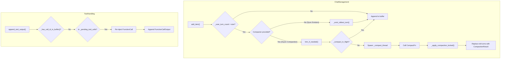
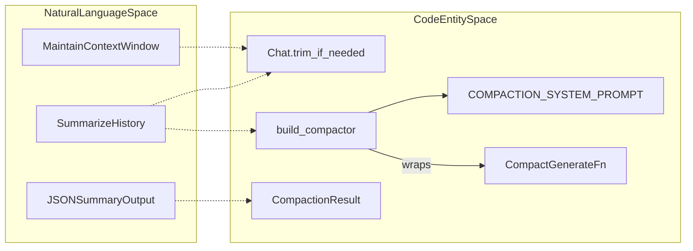

<!-- source: DeepWiki mcp.deepwiki.com · repo huggingface/speech-to-speech · extra page Chat History and Conversation Compaction · fetched 2026-10-26 -->

# Chat History and Conversation Compaction

Relevant source files

The following files were used as context for generating this wiki page:

- [src/speech_to_speech/LLM/chat.py](src/speech_to_speech/LLM/chat.py)
- [src/speech_to_speech/LLM/compaction_prompt.py](src/speech_to_speech/LLM/compaction_prompt.py)
- [tests/test_chat.py](tests/test_chat.py)
- [tests/test_chat_turn_order.py](tests/test_chat_turn_order.py)

This page covers the `Chat` management subsystem in `src/speech_to_speech/LLM/chat.py` [src/speech_to_speech/LLM/chat.py:1-1248]() and conversation compaction via `src/speech_to_speech/LLM/compaction_prompt.py` [src/speech_to_speech/LLM/compaction_prompt.py:1-181](). Together, these modules manage bounded conversation history, turn-based eviction, tool call reinjection, image stripping, turn ordering, and asynchronous background history summarization using the LLM.

---

## The Chat Class and Bounded History

The `Chat` class [src/speech_to_speech/LLM/chat.py:93-139]() manages bounded conversation state to prevent context window overflows and out-of-memory (OOM) errors during long-running streaming sessions. 

### Core Attributes and Data Structures
*   **Buffer**: Stores a list of `SupportedItem` objects [src/speech_to_speech/LLM/chat.py:73-79](), which include system, user, and assistant messages, function calls, and function call outputs.
*   **System Messages**: Stored separately in `init_chat_message` [src/speech_to_speech/LLM/chat.py:113]() and excluded from the sliding buffer.
*   **Thread Safety**: All mutations, trims, and serializations are protected by a re-entrant-safe `threading.Lock` (`_lock`) [src/speech_to_speech/LLM/chat.py:133]() and controlled via internal `_locked` helper methods.
*   **Pending Tool Calls**: Tracks unresolved function calls using `_pending_tool_calls` and `_ordered_pending_call_ids` [src/speech_to_speech/LLM/chat.py:118-122]().

### Turn-Based Eviction and Tool Reinjection
When the user turn count exceeds the configured `size` parameter [src/speech_to_speech/LLM/chat.py:111](), history bounding takes effect:
1.  **Synchronous Eviction**: When `compactor=None`, the oldest complete turn (starting from the oldest user message up to the boundary of the next user message) is popped in place [src/speech_to_speech/LLM/chat.py:142-158]().
2.  **Orphaned Tool Result Protection**: If a function call is evicted but its result arrives later, `append_tool_output` checks pending records and re-injects the missing `FunctionCall` item back into the buffer to preserve schema validity [src/speech_to_speech/LLM/chat.py:118-122]().
3.  **Image Stripping**: The `strip_images` method removes `input_image` content parts from older user messages while retaining text transcripts to conserve token capacity.

**Chat History Management Flow**

Sources: [src/speech_to_speech/LLM/chat.py:93-139](), [src/speech_to_speech/LLM/chat.py:142-158]()

---

## Conversation Compaction via compaction_prompt.py

When an asynchronous compactor is configured, older history is summarized rather than dropped. This is implemented via `src/speech_to_speech/LLM/compaction_prompt.py` [src/speech_to_speech/LLM/compaction_prompt.py:1-181]().

### Interfaces and Types
*   **`CompactGenerateFn`**: A backend-agnostic text generation signature defined as `Callable[[str, str], str]` taking `(system_prompt, user_prompt)` and returning the generated response text [src/speech_to_speech/LLM/compaction_prompt.py:27]().
*   **`CompactFn`**: A callable signature `Callable[[ResponseInputParam], CompactionResult]` [src/speech_to_speech/LLM/chat.py:82]() that converts a history snapshot into a `CompactionResult` containing `user_summary` and `assistant_summary` fields [src/speech_to_speech/LLM/chat.py:58-63]().

### Compaction Execution Flow
1.  **Snapshot Generation**: `Chat` captures a history snapshot under lock containing system instructions, old messages, and pending function states.
2.  **Transcript Rendering**: `_render_transcript` turns the raw parameter list into a readable plain-text transcript, ignoring system prompts while preserving tool calls and outputs [src/speech_to_speech/LLM/compaction_prompt.py:69-109]().
3.  **Model Prompting**: The transcript is formatted into `COMPACTION_USER_TEMPLATE` [src/speech_to_speech/LLM/compaction_prompt.py:56-62]() and evaluated against `COMPACTION_SYSTEM_PROMPT` [src/speech_to_speech/LLM/compaction_prompt.py:33-54]() using single-flight background threading (`_compact_thread`) [src/speech_to_speech/LLM/chat.py:135]().
4.  **JSON Extraction**: `_extract_json` parses the model output, handling markdown fences and loose JSON blocks robustly [src/speech_to_speech/LLM/compaction_prompt.py:115-131]().

**Compaction Entity Mapping**

Sources: [src/speech_to_speech/LLM/chat.py:82-90](), [src/speech_to_speech/LLM/compaction_prompt.py:27-62](), [src/speech_to_speech/LLM/compaction_prompt.py:139-156]()

---

## Key Methods and Operations Summary

The following table details the primary methods exposed by `Chat` for history and turn management:

| Method / Attribute | Role / Purpose | Source Location |
| :--- | :--- | :--- |
| `Chat.__init__` | Initializes buffer limits, lock primitives, and background event flags. | [src/speech_to_speech/LLM/chat.py:111-139]() |
| `Chat.add_item` | Appends a conversation item, validates IDs, and triggers trimming. | [src/speech_to_speech/LLM/chat.py:237-271]() |
| `Chat.append_tool_output` | Adds function outputs and handles re-injection of evicted calls. | [src/speech_to_speech/LLM/chat.py:172-235]() |
| `Chat.strip_images` | Strips base64 or URL image contents from older messages. | [src/speech_to_speech/LLM/chat.py:273-290]() |
| `Chat.trim_if_needed` | Evaluates size thresholds and kicks off synchronous eviction or background compaction. | [src/speech_to_speech/LLM/chat.py:313-350]() |
| `build_compactor` | Factory creating a `CompactFn` wrapped around `CompactGenerateFn`. | [src/speech_to_speech/LLM/compaction_prompt.py:139-180]() |

Sources: [src/speech_to_speech/LLM/chat.py:111-350](), [src/speech_to_speech/LLM/compaction_prompt.py:139-180]()

---

