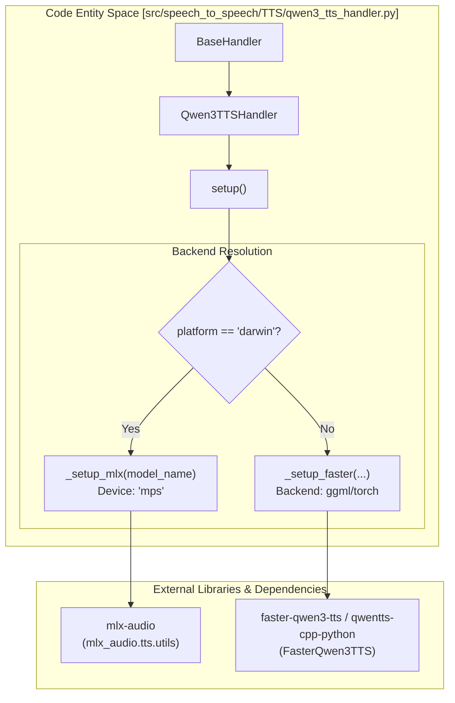
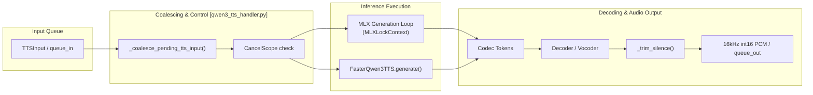

<!-- source: DeepWiki mcp.deepwiki.com · repo huggingface/speech-to-speech · extra page Qwen3 TTS Handler · fetched 2026-10-26 -->

# Qwen3 TTS Handler

Relevant source files

The following files were used as context for generating this wiki page:

- [src/speech_to_speech/TTS/README.md](src/speech_to_speech/TTS/README.md)
- [src/speech_to_speech/TTS/kokoro_handler.py](src/speech_to_speech/TTS/kokoro_handler.py)
- [src/speech_to_speech/TTS/qwen3_tts_handler.py](src/speech_to_speech/TTS/qwen3_tts_handler.py)
- [src/speech_to_speech/arguments_classes/qwen3_tts_arguments.py](src/speech_to_speech/arguments_classes/qwen3_tts_arguments.py)
- [src/speech_to_speech/arguments_classes/realtime_server_arguments.py](src/speech_to_speech/arguments_classes/realtime_server_arguments.py)
- [tests/test_qwen3_tts_handler_backend.py](tests/test_qwen3_tts_handler_backend.py)
- [tests/test_tts_input_coalescing.py](tests/test_tts_input_coalescing.py)

## Purpose and Scope

The Qwen3 TTS Handler implements text-to-speech synthesis using the Qwen3-TTS model family within the speech-to-speech pipeline. It features a dual-backend architecture designed for high performance across different hardware platforms: it utilizes `mlx-audio` for native acceleration on Apple Silicon and `faster-qwen3-tts` (`qwentts-cpp` or torch/CUDA graph backends) for optimized CUDA/CPU execution on other platforms [src/speech_to_speech/TTS/qwen3_tts_handler.py:4-6]().

Key capabilities:
- **Dual-Backend Support**: Automatic selection of `mlx` (macOS) or `faster_qwen3_tts` (Linux/Windows) [src/speech_to_speech/TTS/qwen3_tts_handler.py:164]().
- **Three Generation Modes**: Supports Voice Cloning (reference audio or cached `.spk`/`.rvq`), Custom Voice (preset speakers), and Voice Design (instruction-based prompts) [src/speech_to_speech/TTS/qwen3_tts_handler.py:101-105]().
- **GGML and MLX Quantization**: Support for GGUF quantization (`BF16`, `Q8_0`, `Q4_K_M`, `F32`) via `faster-qwen3-tts` [src/speech_to_speech/TTS/qwen3_tts_handler.py:55]() and MLX quantization variants (`bf16`, `4bit`, `6bit`, `8bit`) on Apple Silicon [src/speech_to_speech/TTS/qwen3_tts_handler.py:54]().
- **Reference Audio Caching**: Automatically precomputes and caches speaker embeddings (`.spk`) and acoustic codes (`.rvq`) for GGML voice cloning [src/speech_to_speech/TTS/README.md:96]().
- **Streaming Architecture & Input Coalescing**: Low-latency audio generation with configurable chunk sizes (`streaming_chunk_size`) and sentence coalescing (`_coalesce_pending_tts_input`) [src/speech_to_speech/TTS/qwen3_tts_handler.py:165]().
- **Real-time Metrics**: Tracking of Time-to-First-Audio (TTFA) and Real-Time Factor (RTF).

Sources: [src/speech_to_speech/TTS/qwen3_tts_handler.py:1-105](), [src/speech_to_speech/arguments_classes/qwen3_tts_arguments.py:1-134]()

## Architecture Overview

### Class Structure and Backend Selection

The `Qwen3TTSHandler` class inherits from `BaseHandler` [src/speech_to_speech/TTS/qwen3_tts_handler.py:93]() and manages the lifecycle of model setup, configuration normalization, reference audio processing, and audio token generation. During `setup()`, it inspects the operating platform (`sys.platform`) to choose between `mlx` (Apple Silicon) and `faster_qwen3_tts` (CUDA/CPU) [src/speech_to_speech/TTS/qwen3_tts_handler.py:164]().

Title: "Qwen3TTSHandler Backend Selection Flow"

Sources: [src/speech_to_speech/TTS/qwen3_tts_handler.py:93-180](), [tests/test_qwen3_tts_handler_backend.py:22-48]()

### Data Flow: Text to Audio

The handler accepts `TTSInput` messages from the input queue (`queue_in`), coalesces adjacent sentences to form meaningful utterance blocks via `_coalesce_pending_tts_input()`, checks response cancellation via `CancelScope`, generates discrete codec tokens, decodes them into PCM frames, trims any leading/trailing silence via `_trim_silence()`, and emits `AudioOutput` chunks to `queue_out`.

Title: "Qwen3 TTS Processing and Data Flow"

Sources: [src/speech_to_speech/TTS/qwen3_tts_handler.py:322-445](), [src/speech_to_speech/TTS/qwen3_tts_handler.py:493-522](), [tests/test_tts_input_coalescing.py:19-32]()

## Generation Modes

Qwen3-TTS supports three primary generation modes depending on the model variant and arguments supplied [src/speech_to_speech/TTS/qwen3_tts_handler.py:101-105]():

1. **Voice Cloning**: Requires a reference audio file (`ref_audio`) and its transcription (`ref_text`), or precomputed `.spk` and `.rvq` files [src/speech_to_speech/TTS/README.md:143-160](). On Apple Silicon, raw audio is resampled using `soundfile`. On CUDA/CPU, raw reference audio is automatically encoded and cached as `.spk` speaker embeddings and `.rvq` acoustic codes inside `ref_cache_dir` [src/speech_to_speech/TTS/README.md:96](). Setting `xvec_only=True` bypasses ICL conditioning and uses x-vector speaker embedding only [src/speech_to_speech/arguments_classes/qwen3_tts_arguments.py:93-98]().
2. **Custom Voice**: Uses preset speakers (e.g., `Aiden`) with CustomVoice models [src/speech_to_speech/TTS/qwen3_tts_handler.py:47](). If left unset, the handler defaults to the first available speaker [src/speech_to_speech/arguments_classes/qwen3_tts_arguments.py:83-88]().
3. **Voice Design**: Uses a natural language instruction (`instruct`) to steer the generated voice characteristics on VoiceDesign models [src/speech_to_speech/arguments_classes/qwen3_tts_arguments.py:89-92]().

Sources: [src/speech_to_speech/TTS/qwen3_tts_handler.py:524-540](), [src/speech_to_speech/arguments_classes/qwen3_tts_arguments.py:61-92](), [src/speech_to_speech/TTS/README.md:93-102]()

## MLX Optimizations (Apple Silicon)

On Apple Silicon (`darwin`), the handler integrates with `mlx-audio` [src/speech_to_speech/TTS/qwen3_tts_handler.py:4-4]():
- **Quantization Mapping**: Automatically maps HuggingFace `Qwen/...` model names to `mlx-community/...` quantized variants (defaulting to `6bit` if unspecified, or supporting `bf16`, `4bit`, `6bit`, and `8bit`) [src/speech_to_speech/TTS/qwen3_tts_handler.py:48](), [src/speech_to_speech/arguments_classes/qwen3_tts_arguments.py:109-114]().
- **Thread Safety**: Uses `MLXLockContext` to prevent concurrent MPS buffer contention during streaming audio generation [src/speech_to_speech/TTS/qwen3_tts_handler.py:42](), [src/speech_to_speech/TTS/qwen3_tts_handler.py:356]().
- **Streaming Chunks**: Enforces a default streaming chunk size of 4 codec steps on MLX (compared to 8 on CUDA/faster backend) [src/speech_to_speech/TTS/qwen3_tts_handler.py:50-51]().

Sources: [src/speech_to_speech/TTS/qwen3_tts_handler.py:42-51](), [src/speech_to_speech/TTS/qwen3_tts_handler.py:356-380](), [tests/test_qwen3_tts_handler_backend.py:22-71]()

## Implementation Details

### Input Coalescing
To avoid choppy audio artifacts caused by fine-grained sentence fragments from the LLM, `_coalesce_pending_tts_input()` inspects `queue_in` and aggregates pending `TTSInput` sentences into a single continuous prompt string until a control message (`SESSION_END`, `PIPELINE_END`), an `EndOfResponse`, or an `AssistantOutputEvent` (such as a tool call) is reached [src/speech_to_speech/TTS/qwen3_tts_handler.py:322-340](), [tests/test_tts_input_coalescing.py:19-80]().

### Silence Trimming and Token Budgeting
- **Silence Trimming**: `_trim_silence()` strips leading and trailing silence from the generated PCM arrays based on amplitude thresholds before output emission [src/speech_to_speech/TTS/qwen3_tts_handler.py:493-522]().
- **Token Caps**: Max new tokens are bounded by `max_new_tokens` (default `1536`), scaled dynamically against estimated utterance length to prevent runaways [src/speech_to_speech/arguments_classes/qwen3_tts_arguments.py:125-130]().

### Warmup and Parity Mode
- **Warmup**: Executes a dummy inference forward pass during setup to compile CUDA graphs or warm up MLX weights [src/speech_to_speech/TTS/qwen3_tts_handler.py:288-320]().
- **Parity Mode**: Disables CUDA-graph streaming paths on CUDA when `parity_mode=True` to prioritize stability over peak throughput [src/speech_to_speech/arguments_classes/qwen3_tts_arguments.py:99-102]().

Sources: [src/speech_to_speech/TTS/qwen3_tts_handler.py:288-340](), [src/speech_to_speech/TTS/qwen3_tts_handler.py:493-522](), [tests/test_tts_input_coalescing.py:19-80]()

## Configuration Reference

### Qwen3TTSHandlerArguments

| Argument | Default | Description |
| :--- | :--- | :--- |
| `qwen3_tts_model_name` | `Qwen/Qwen3-TTS-12Hz-1.7B-CustomVoice` | Hugging Face Hub ID or local path. Auto-mapped on Apple Silicon [src/speech_to_speech/arguments_classes/qwen3_tts_arguments.py:7-11](). |
| `qwen3_tts_device` | `cuda` | Preferred device (`cuda`, `cpu`, `mps`, `auto`) [src/speech_to_speech/arguments_classes/qwen3_tts_arguments.py:13-17](). |
| `qwen3_tts_backend` | `ggml` | faster-qwen3-tts backend (`ggml` or `torch`) on non-macOS platforms [src/speech_to_speech/arguments_classes/qwen3_tts_arguments.py:31-36](). |
| `qwen3_tts_ggml_quantization` | `BF16` | GGUF quantization (`BF16`, `Q8_0`, `Q4_K_M`, `F32`) [src/speech_to_speech/arguments_classes/qwen3_tts_arguments.py:37-42](). |
| `qwen3_tts_mlx_quantization` | `6bit` | MLX quantization override (`bf16`, `4bit`, `6bit`, `8bit`) on macOS [src/speech_to_speech/arguments_classes/qwen3_tts_arguments.py:109-114](). |
| `qwen3_tts_ref_audio` | `None` | Path to reference audio for voice cloning [src/speech_to_speech/arguments_classes/qwen3_tts_arguments.py:61-66](). |
| `qwen3_tts_speaker` | `Aiden` | Speaker name for CustomVoice models [src/speech_to_speech/arguments_classes/qwen3_tts_arguments.py:83-88](). |
| `qwen3_tts_streaming_chunk_size` | `None` | Codec steps per chunk (defaults to 8 on Faster, 4 on MLX) [src/speech_to_speech/arguments_classes/qwen3_tts_arguments.py:119-124](). |
| `qwen3_tts_max_new_tokens` | `1536` | Upper token cap for generation [src/speech_to_speech/arguments_classes/qwen3_tts_arguments.py:125-130](). |

Sources: [src/speech_to_speech/arguments_classes/qwen3_tts_arguments.py:7-134]()

## Benchmarking

Performance can be evaluated using `scripts/benchmark_tts.py`, which measures:
- **TTFC (Time to First Chunk)** / **TTFA**: Latency until the first audio block is yielded.
- **RTF (Real-Time Factor)**: Ratio of generated audio duration to total inference time.
- **Warmup Latency**: Time required for model initialization and dummy pass execution [src/speech_to_speech/TTS/README.md:180-189]().

Sources: [src/speech_to_speech/TTS/README.md:180-189]()

---

