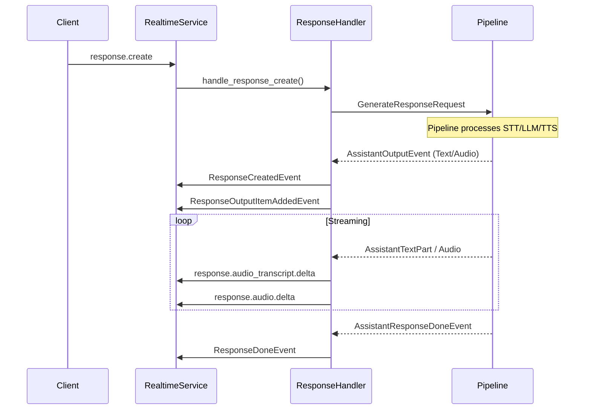
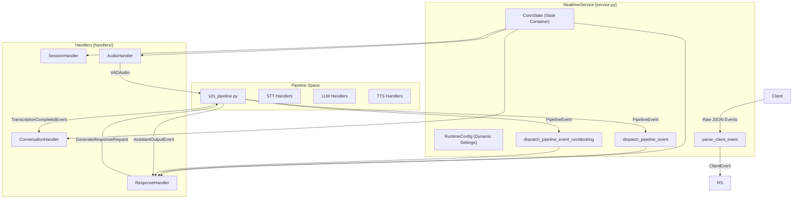

<!-- source: DeepWiki mcp.deepwiki.com · repo huggingface/speech-to-speech · extra page RealtimeService and Connection State · fetched 2026-10-26 -->

# RealtimeService and Connection State

Relevant source files

The following files were used as context for generating this wiki page:

- [src/speech_to_speech/api/openai_realtime/input_state.py](src/speech_to_speech/api/openai_realtime/input_state.py)
- [src/speech_to_speech/api/openai_realtime/service.py](src/speech_to_speech/api/openai_realtime/service.py)
- [tests/openai_realtime/realtime_contract.py](tests/openai_realtime/realtime_contract.py)
- [tests/openai_realtime/test_realtime_protocol_contract.py](tests/openai_realtime/test_realtime_protocol_contract.py)
- [tests/openai_realtime/test_realtime_service.py](tests/openai_realtime/test_realtime_service.py)
- [tests/test_demo_input_transcription.py](tests/test_demo_input_transcription.py)

The `RealtimeService` is the central coordinator for the OpenAI-compatible Realtime API implementation. It manages the lifecycle of client connections, maintains session-specific state, and bridges the high-level Realtime protocol events with the underlying `s2s_pipeline` execution.

## Overview

`RealtimeService` orchestrates four specialized handlers to manage different aspects of the Realtime session:
*   **`SessionHandler`**: Manages session configuration and tool definitions. [src/speech_to_speech/api/openai_realtime/service.py:54]()
*   **`AudioHandler`**: Handles incoming PCM audio buffering and VAD events. [src/speech_to_speech/api/openai_realtime/service.py:50]()
*   **`ConversationHandler`**: Manages the conversation history and manual item creation. [src/speech_to_speech/api/openai_realtime/service.py:51]()
*   **`ResponseHandler`**: Controls the response lifecycle, including generation requests and output streaming. [src/speech_to_speech/api/openai_realtime/service.py:52]()

The service maintains a `ConnState` object for every active connection, ensuring that multiple concurrent sessions (WebRTC or WebSocket) remain isolated.

Sources: [src/speech_to_speech/api/openai_realtime/service.py:49-54](), [src/speech_to_speech/api/openai_realtime/service.py:184-193]()

---

## ConnState Lifecycle and Session Management

Every connection is assigned a unique `session_id` and `conversation_id`. The `ConnState` object tracks the state of the current response, pending items, and usage metrics. [src/speech_to_speech/api/openai_realtime/service.py:189-193]()

### State Transitions
1.  **Registration**: `register()` initializes a new `ConnState` and `RuntimeConfig`. It generates a `session_id` and `conversation_id`. [src/speech_to_speech/api/openai_realtime/service.py:270-280]()
2.  **Update**: `handle_session_update()` modifies the `RuntimeConfig` which dynamically reconfigures the pipeline (e.g., changing voices or VAD thresholds). [src/speech_to_speech/api/openai_realtime/service.py:328-340]()
3.  **Tombstoning**: When a session is unregistered, it is marked as "tombstoned" to allow in-flight events to be gracefully discarded rather than causing errors. [src/speech_to_speech/api/openai_realtime/service.py:313-326]()

### Speculative Turn Tracking
The service uses a `SpeculativeTurnTracker` to handle the race conditions between client-side audio and server-side responses. It tracks `response_key` identifiers to ensure that if a user interrupts (barge-in), the server can correctly discard stale audio or text segments that belong to a cancelled generation. [src/speech_to_speech/api/openai_realtime/service.py:200-201]()

Sources: [src/speech_to_speech/api/openai_realtime/service.py:184-201](), [src/speech_to_speech/api/openai_realtime/service.py:270-340](), [speech_to_speech/pipeline/speculative_turns.py:1-20]()

---

## RealtimeService Internals

### `parse_client_event`
This method is responsible for deserializing raw client messages (dictionaries) into their corresponding Pydantic `ClientEvent` models. It uses a lookup dictionary `_EVENT_TYPE_TO_MODEL` to map event types to their Pydantic classes, ensuring type-safe parsing and validation. [src/speech_to_speech/api/openai_realtime/service.py:342-357]() If parsing fails, it logs the error and returns a `RealtimeErrorEvent`. [src/speech_to_speech/api/openai_realtime/service.py:358-365]()

### `dispatch_pipeline_event` and Non-Blocking Variant
The `dispatch_pipeline_event` method processes `PipelineEvent` objects originating from the core speech-to-speech pipeline. It routes these events to the appropriate internal handlers (`AudioHandler`, `ConversationHandler`, `ResponseHandler`, `SessionHandler`) based on their type. [src/speech_to_speech/api/openai_realtime/service.py:412-419]() This method is blocking, meaning it waits for the handler to process the event.

A non-blocking variant, `dispatch_pipeline_event_nonblocking`, is also available. It places the event into a queue (`_pipeline_event_queue`) for asynchronous processing by a dedicated thread, preventing the pipeline from blocking on Realtime API event emission. [src/speech_to_speech/api/openai_realtime/service.py:421-426]()

### Stale Turn Filtering
The `RealtimeService` actively filters out events related to stale turns. When a user barges in or a turn is otherwise cancelled, the `SpeculativeTurnTracker` is updated. Events arriving from the pipeline that belong to a `response_key` that is no longer active are silently discarded by the handlers. This prevents outdated information from being sent to the client. For example, `ResponseHandler._is_stale_response` checks if a response key is still valid. [src/speech_to_speech/api/openai_realtime/handlers/response.py:162-165]()

### Deferred Items
The `ConversationHandler` manages deferred items. If a `conversation.item.create` event arrives while a response is actively being generated, the item might be temporarily held back (`_deferred_items`) to maintain conversational coherence and ensure items are processed in the correct order relative to the ongoing response. [src/speech_to_speech/api/openai_realtime/handlers/conversation.py:20-60]()

### Usage Metrics Roll-up
`UsageMetrics` tracks various counters like `input_tokens`, `output_tokens`, `audio_duration_s`, `responses_completed`, `responses_cancelled`, `tool_calls`, and `turns`. [src/speech_to_speech/api/openai_realtime/service.py:142-155]() These per-response metrics are accumulated into `GlobalUsageMetrics` at the end of each response lifecycle, providing server-wide statistics. The `__iadd__` method facilitates this roll-up. [src/speech_to_speech/api/openai_realtime/service.py:157-161]()

### Protocol Contract Tests
The `RealtimeService` adheres to a strict protocol contract, which is validated by a comprehensive suite of tests in `tests/openai_realtime/test_realtime_service.py` and `tests/openai_realtime/test_realtime_protocol_contract.py`. These tests ensure that every public method behaves as expected and that the emitted OpenAI Realtime events conform to the specified types, attributes, and state transitions. [tests/openai_realtime/test_realtime_service.py:1-5](), [tests/openai_realtime/test_realtime_protocol_contract.py:1-17]() The `realtime_contract.py` module provides shared assertions like `assert_openai_schema` and `assert_response_lifecycle_contract` to validate event schemas and ordering rules. [tests/openai_realtime/realtime_contract.py:59-114]()

Sources: [src/speech_to_speech/api/openai_realtime/service.py:90-98](), [src/speech_to_speech/api/openai_realtime/service.py:142-161](), [src/speech_to_speech/api/openai_realtime/service.py:342-365](), [src/speech_to_speech/api/openai_realtime/service.py:412-426](), [src/speech_to_speech/api/openai_realtime/handlers/conversation.py:20-60](), [src/speech_to_speech/api/openai_realtime/handlers/response.py:162-165](), [tests/openai_realtime/test_realtime_service.py:1-5](), [tests/openai_realtime/test_realtime_protocol_contract.py:1-17](), [tests/openai_realtime/realtime_contract.py:59-114]()

---

## Response Lifecycle and ResponseHandler

The `ResponseHandler` manages the complex transition from a `response.create` event to a fully streamed assistant response.

### Response Lifecycle Diagram
The following diagram maps the Realtime protocol events to the internal `ResponseHandler` logic.

Title: Realtime Response Event Flow

Sources: [src/speech_to_speech/api/openai_realtime/handlers/response.py:51-135](), [src/speech_to_speech/api/openai_realtime/service.py:530-560]()

### Provisional Items and Rollback
When the server detects a turn (VAD), it may need to "rollback" or truncate the current response. The `ResponseHandler` manages `provisional` items—items that have been sent to the client but might be invalidated by a barge-in. [src/speech_to_speech/api/openai_realtime/handlers/response.py:107-115]()

### Prefetch Transactions
To minimize latency, the system uses `ResponsePrefetchTransaction`. If the server predicts a response is needed (e.g., after a `SpeechStoppedEvent`), it starts generating before the formal `response.create` arrives. [src/speech_to_speech/pipeline/messages.py:74-75]()
*   **Adoption**: If the client's `response.create` matches the prefetch parameters, the transaction is "adopted." [src/speech_to_speech/api/openai_realtime/handlers/response.py:137-145]()
*   **Discard**: If the parameters differ (e.g., different instructions), the prefetch is discarded and a fresh generation starts. [src/speech_to_speech/api/openai_realtime/handlers/response.py:147-150]()

### Out-of-Band (OOB) Responses
OOB responses are internal system responses (like error notifications or tool-call follow-ups) that do not increment the standard conversation turn counter. They are handled via `is_out_of_band()` checks to ensure they don't disrupt the user-visible conversation flow. [src/speech_to_speech/api/openai_realtime/handlers/response.py:97-105]()

Sources: [src/speech_to_speech/api/openai_realtime/handlers/response.py:51-160](), [src/speech_to_speech/pipeline/messages.py:74-75]()

---

## Audio and Conversation Handling

### AudioHandler
The `AudioHandler` processes `input_audio_buffer.append` events. It resamples incoming audio to the 16kHz mono format required by the pipeline. [src/speech_to_speech/api/openai_realtime/service.py:380-410]()
*   **Buffering**: Audio is accumulated in `ConnState.audio_remainder` until a full chunk (512 samples) is ready for the pipeline. [src/speech_to_speech/api/openai_realtime/service.py:380-410]()
*   **VAD Integration**: It translates pipeline `SpeechStartedEvent` and `SpeechStoppedEvent` into Realtime `input_audio_buffer.speech_started/stopped` events. [src/speech_to_speech/api/openai_realtime/handlers/audio.py:10-50]()

### ConversationHandler
Manages the `Chat` object which stores the history. It handles `conversation.item.create` events, allowing clients to inject system messages, tool outputs, or manual user text. [src/speech_to_speech/api/openai_realtime/handlers/conversation.py:20-60]()
*   **Deferred Items**: Items created while a response is in progress may be deferred to ensure sequential consistency. [src/speech_to_speech/api/openai_realtime/handlers/conversation.py:20-60]()

Sources: [src/speech_to_speech/api/openai_realtime/handlers/audio.py:1-60](), [src/speech_to_speech/api/openai_realtime/handlers/conversation.py:1-80]()

---

## Metrics and Accounting

The `UsageMetrics` class tracks performance and token consumption per response and globally. [src/speech_to_speech/api/openai_realtime/service.py:142-155]()

| Metric | Description | Code Reference |
| :--- | :--- | :--- |
| `input_tokens` | Total tokens processed by LLM | [src/speech_to_speech/api/openai_realtime/service.py:143]() |
| `output_tokens` | Total tokens generated by LLM | [src/speech_to_speech/api/openai_realtime/service.py:144]() |
| `audio_duration_s` | Seconds of audio generated by TTS | [src/speech_to_speech/api/openai_realtime/service.py:145]() |
| `responses_completed` | Count of successful responses | [src/speech_to_speech/api/openai_realtime/service.py:146]()
| `responses_cancelled` | Count of cancelled responses | [src/speech_to_speech/api/openai_realtime/service.py:147]()
| `tool_calls` | Count of tool calls made | [src/speech_to_speech/api/openai_realtime/service.py:148]()
| `turns` | Count of conversational turns | [src/speech_to_speech/api/openai_realtime/service.py:149]()

Metrics are rolled up from the per-response `UsageMetrics` into the `GlobalUsageMetrics` at the end of every response lifecycle in `_end_response`. [src/speech_to_speech/api/openai_realtime/handlers/response.py:81-95]()

Sources: [src/speech_to_speech/api/openai_realtime/service.py:142-167](), [src/speech_to_speech/api/openai_realtime/handlers/response.py:77-95]()

---

## System Architecture Mapping

Title: RealtimeService Component Mapping

Sources: [src/speech_to_speech/api/openai_realtime/service.py:49-54](), [src/speech_to_speech/api/openai_realtime/service.py:184-193](), [src/speech_to_speech/api/openai_realtime/service.py:342-365](), [src/speech_to_speech/api/openai_realtime/service.py:412-426]()

---

