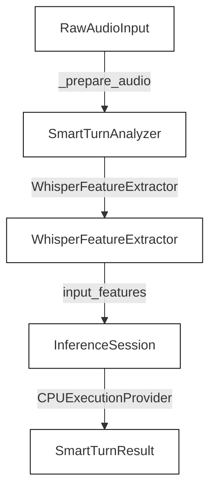
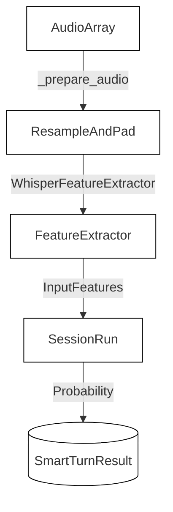
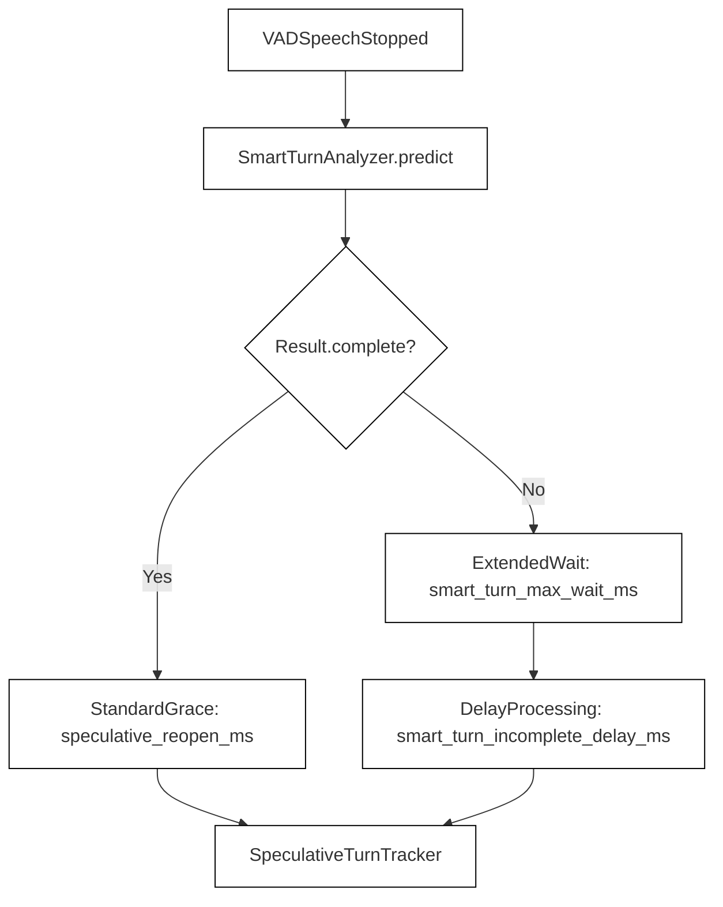

<!-- source: DeepWiki mcp.deepwiki.com · repo huggingface/speech-to-speech · extra page Smart Turn Endpointing · fetched 2026-10-26 -->

# Smart Turn Endpointing

Relevant source files

The following files were used as context for generating this wiki page:

- [src/speech_to_speech/VAD/smart_turn.py](src/speech_to_speech/VAD/smart_turn.py)
- [src/speech_to_speech/VAD/vad_handler.py](src/speech_to_speech/VAD/vad_handler.py)
- [src/speech_to_speech/arguments_classes/vad_arguments.py](src/speech_to_speech/arguments_classes/vad_arguments.py)
- [src/speech_to_speech/pipeline/speculative_turns.py](src/speech_to_speech/pipeline/speculative_turns.py)
- [tests/test_smart_turn.py](tests/test_smart_turn.py)
- [tests/test_speculative_turns.py](tests/test_speculative_turns.py)

## Purpose and Scope

Smart Turn endpointing complements conventional Voice Activity Detection (VAD) by evaluating the acoustic and linguistic content of completed user utterances. Rather than processing every incoming audio frame, the `SmartTurnAnalyzer` is invoked exclusively after Silero VAD detects a speech-to-silence boundary. By running a quantized ONNX model (smart-turn v3.2), it classifies whether an utterance represents a complete conversational turn or an incomplete pause (e.g., when a user is pausing to think mid-sentence). This prevents premature assistant responses, extends grace windows, and orchestrates speculative turn reopening via `SpeculativeTurnTracker`.

Sources:
- `src/speech_to_speech/VAD/smart_turn.py:1-7` ()
- `src/speech_to_speech/VAD/vad_handler.py:109-122` ()

---

## 1. Smart Turn Architecture and ONNX Inference

The core inference logic is implemented in `SmartTurnAnalyzer` (`src/speech_to_speech/VAD/smart_turn.py`), which loads a CPU-optimized ONNX model (`smart-turn-v3.2-cpu.onnx`) from Hugging Face (`pipecat-ai/smart-turn-v3`) or a local path. 

### Key Classes and Functions
- `SmartTurnAnalyzer`: Manages the ONNX `InferenceSession`, Whisper feature extractor, and execution options. It enforces a strict `CPUExecutionProvider` configuration with single inter-op and configurable intra-op threads (`cpu_count`).
- `SmartTurnResult`: A frozen dataclass storing prediction outputs: `complete` (boolean flag), `probability` (float confidence), and `inference_ms` (execution latency).

*Figure 1: Natural Language Space to Code Entity Space mapping for `SmartTurnAnalyzer` processing.*

Sources:
- `src/speech_to_speech/VAD/smart_turn.py:27-86` ()

---

## 2. Feature Extraction and Audio Preparation

Before running inference, `SmartTurnAnalyzer._prepare_audio` normalizes raw audio arrays. It validates mono 1-D shape, resamples audio if the incoming sample rate differs from `MODEL_SAMPLE_RATE` (16,000 Hz) using `scipy.signal.resample_poly`, and pads or truncates the array to fit exactly `MAX_AUDIO_SECONDS` (8 seconds, or 128,000 samples).

The prepared audio tensor is passed to `WhisperFeatureExtractor` with `return_tensors="np"`, `padding="max_length"`, and `do_normalize=True`. The extracted log-Mel filterbank features are fed into the ONNX model, producing a scalar probability score evaluated against `threshold` (default `0.5`).

*Figure 2: Data flow from raw audio bytes to model evaluation inside `SmartTurnAnalyzer.predict`.*

Sources:
- `src/speech_to_speech/VAD/smart_turn.py:103-154` ()

---

## 3. Turn Timing, Grace Windows, and Incomplete Delays

When Silero VAD flags a speech stop, `VADHandler` delegates turn evaluation to `SmartTurnAnalyzer`. Based on the resulting `SmartTurnResult`, the handler determines the speculative turn parameters:

- **Complete Turn**: If `complete=True` (probability > threshold), the system uses standard speculative grace windows (e.g., `speculative_reopen_ms`, default 800 ms) allowing quick assistant response commitment while remaining open to barge-in.
- **Incomplete Turn**: If `complete=False`, the system extends the grace window up to `smart_turn_max_wait_ms` (default 2000 ms) and applies an `smart_turn_incomplete_delay_ms` (default 600 ms). This delay postpones expensive STT and LLM execution, allowing resumed speech to invalidate the turn revision via `SpeculativeTurnTracker` before heavy downstream processing begins.

*Figure 3: Turn timing adjustment flow in `VADHandler` based on `SmartTurnResult` completeness.*

Sources:
- `src/speech_to_speech/VAD/vad_handler.py:106-127` ()
- `src/speech_to_speech/pipeline/speculative_turns.py:159-180` ()
- `tests/test_smart_turn.py:44-70` ()

---

## 4. CLI Arguments and Configuration

Smart Turn behavior is fully configurable via `VADHandlerArguments` (`src/speech_to_speech/arguments_classes/vad_arguments.py`). The associated CLI flags expose control over thresholds, model paths, and CPU threading:

| Argument | Type | Default | Description |
| :--- | :--- | :--- | :--- |
| `--smart_turn` | `bool` | `True` | Enables Smart Turn v3.2 classification after Silero VAD finalizes a turn. Pass `--no_smart_turn` to disable. |
| `--smart_turn_model_path` | `str \| None` | `None` | Optional path to a local CPU ONNX model file. Defaults to downloading `smart-turn-v3.2-cpu.onnx`. |
| `--smart_turn_threshold` | `float` | `0.5` | Completion probability threshold. Higher values require higher confidence before declaring a turn complete. |
| `--smart_turn_max_wait_ms` | `int` | `2000` | Speculative reopen grace window used when an incomplete turn is detected. |
| `--smart_turn_incomplete_delay_ms` | `int` | `600` | Delay applied to STT and LLM execution on incomplete turns to allow barge-in cancellation. |
| `--smart_turn_cpu_count` | `int` | `1` | Number of CPU threads allocated to ONNX Runtime inference sessions. |

Sources:
- `src/speech_to_speech/arguments_classes/vad_arguments.py:98-131` ()

---

