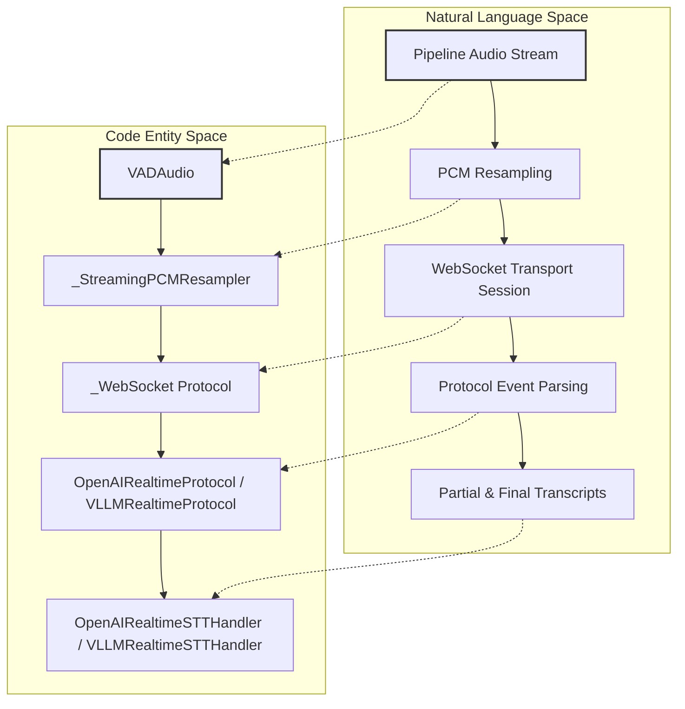
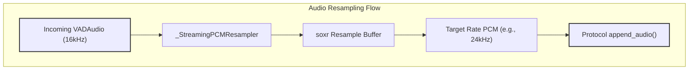
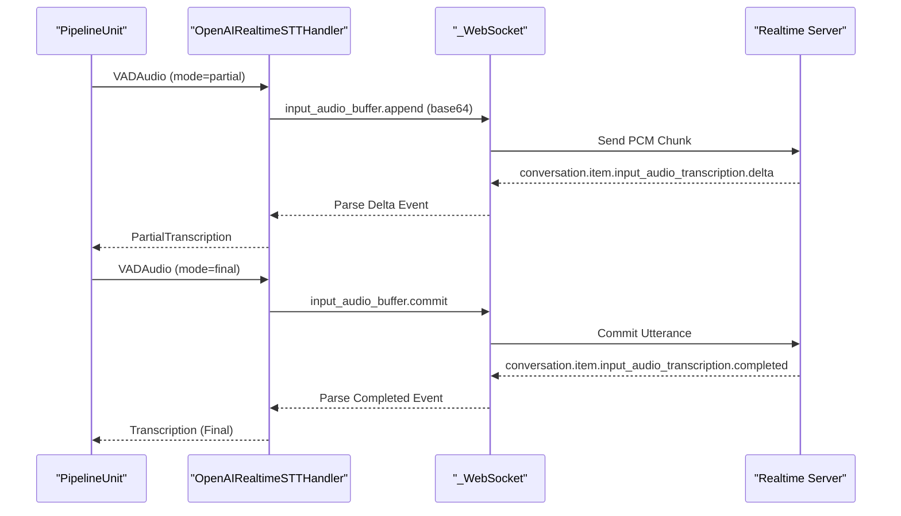

<!-- source: DeepWiki mcp.deepwiki.com · repo huggingface/speech-to-speech · extra page Streaming Realtime STT Handlers · fetched 2026-10-26 -->

# Streaming Realtime STT Handlers

Relevant source files

The following files were used as context for generating this wiki page:

- [src/speech_to_speech/STT/streaming_handler.py](src/speech_to_speech/STT/streaming_handler.py)
- [src/speech_to_speech/arguments_classes/openai_realtime_stt_arguments.py](src/speech_to_speech/arguments_classes/openai_realtime_stt_arguments.py)
- [src/speech_to_speech/arguments_classes/vllm_realtime_stt_arguments.py](src/speech_to_speech/arguments_classes/vllm_realtime_stt_arguments.py)
- [tests/test_streaming_stt_handler.py](tests/test_streaming_stt_handler.py)

## Purpose and Scope

This page details the implementation of stateful streaming Speech-to-Text (STT) handlers within the speech-to-speech framework [src/speech_to_speech/STT/streaming_handler.py:1-1078](). These handlers bridge the pipeline's local voice activity detection (VAD) audio stream with remote WebSocket-based Realtime APIs (such as the OpenAI Realtime API and vLLM's experimental Realtime transcription API). Key aspects covered include WebSocket session management, PCM audio resampling via `soxr` [src/speech_to_speech/STT/streaming_handler.py:16-16](), turn start/commit lifecycle boundaries, protocol event parsing, timeouts, and argument configuration dataclasses [src/speech_to_speech/arguments_classes/openai_realtime_stt_arguments.py:1-36](), [src/speech_to_speech/arguments_classes/vllm_realtime_stt_arguments.py:1-32]().

Sources: [src/speech_to_speech/STT/streaming_handler.py:1-1078](), [src/speech_to_speech/arguments_classes/openai_realtime_stt_arguments.py:1-36](), [src/speech_to_speech/arguments_classes/vllm_realtime_stt_arguments.py:1-32]()

---

## Architecture of Stateful Streaming STT

The streaming STT subsystem maintains a persistent WebSocket connection to a remote Realtime server. It ingests pipeline audio frames (`VADAudio`), resamples them to match the target server's required sample rate, packages them into protocol-specific JSON/binary frames, and translates incoming server messages back into pipeline transcription events (`PartialTranscription`, `Transcription`, `TranscriptionFailure`) [tests/test_streaming_stt_handler.py:21-21]().

Sources: [src/speech_to_speech/STT/streaming_handler.py:1-1078](), [tests/test_streaming_stt_handler.py:1-2080]()

---

## Protocol Abstractions

To support multiple server dialects without duplicating connection logic, the codebase defines a `StreamingSTTProtocol` interface [src/speech_to_speech/STT/streaming_handler.py:55-70]() and concrete implementations for OpenAI [src/speech_to_speech/STT/streaming_handler.py:73-172]() and vLLM [src/speech_to_speech/STT/streaming_handler.py:175-230]().

### Protocol Interface

| Method / Property | Return Type | Description |
| :--- | :--- | :--- |
| `name` | `str` | Identifier string for logging and diagnostics [src/speech_to_speech/STT/streaming_handler.py:56-56]() |
| `requires_session_updated` | `bool` | Indicates if the server requires an explicit `session.updated` acknowledgment [src/speech_to_speech/STT/streaming_handler.py:57-57]() |
| `session_update()` | `dict[str, Any]` | Generates the initial session configuration payload [src/speech_to_speech/STT/streaming_handler.py:59-59]() |
| `start_utterance()` | `dict[str, Any] \| None` | Optional payload sent when speech segment begins [src/speech_to_speech/STT/streaming_handler.py:61-61]() |
| `append_audio(audio)` | `dict[str, Any]` | Packages raw PCM bytes for transmission [src/speech_to_speech/STT/streaming_handler.py:63-63]() |
| `finish_utterance()` | `dict[str, Any]` | Commits the active audio buffer (end of turn) [src/speech_to_speech/STT/streaming_handler.py:65-65]() |
| `discard_utterance()` | `dict[str, Any] \| None` | Clears or cancels the current audio buffer [src/speech_to_speech/STT/streaming_handler.py:67-67]() |
| `parse_event(event)` | `_ProtocolEvent` | Normalizes incoming wire events into internal `_ProtocolEvent` structures [src/speech_to_speech/STT/streaming_handler.py:69-69]() |

### Concrete Protocols

*   **`OpenAIRealtimeProtocol`**: Configures transcription sessions for OpenAI's endpoint (`openai-realtime`), defaulting to 24kHz audio input rates, supporting `input_audio_buffer.append`, `input_audio_buffer.commit`, and `input_audio_buffer.clear` [src/speech_to_speech/STT/streaming_handler.py:73-172]().
*   **`VLLMRealtimeProtocol`**: Targets vLLM's experimental Realtime API (`vllm-realtime`), requiring 16kHz PCM audio and distinct commit flags (`final: false` vs `final: true`) [src/speech_to_speech/STT/streaming_handler.py:175-230]().

Sources: [src/speech_to_speech/STT/streaming_handler.py:55-230]()

---

## Audio Resampling via `soxr`

Pipeline audio arrives at `PIPELINE_SAMPLE_RATE` (16,000 Hz) [src/speech_to_speech/STT/streaming_handler.py:26-26](), whereas hosted APIs (e.g., OpenAI Realtime) may require alternative rates like 24,000 Hz [src/speech_to_speech/arguments_classes/openai_realtime_stt_arguments.py:25-28](). The `_StreamingPCMResampler` class handles stateful sample-rate conversion using the `soxr` library to avoid clipping or temporal artifacts across audio chunk boundaries [src/speech_to_speech/STT/streaming_handler.py:16-16]().

Sources: [src/speech_to_speech/STT/streaming_handler.py:16-26]()

---

## Turn Management, Boundaries, and Timeouts

The streaming handlers interact closely with turn management boundaries (`VADAudio` chunks tagged with `mode="partial"` vs `mode="final"`) [tests/test_streaming_stt_handler.py:102-108]() and `SpeculativeTurnTracker` [src/speech_to_speech/STT/streaming_handler.py:21-21]().

Sources: [src/speech_to_speech/STT/streaming_handler.py:1-1078](), [tests/test_streaming_stt_handler.py:1-2080]()

### Timeout and Error Handling
*   **Connection Timeout**: Bounded by `connect_timeout` (default 10s) during WebSocket handshake and session negotiation [src/speech_to_speech/arguments_classes/openai_realtime_stt_arguments.py:29-32](), [src/speech_to_speech/arguments_classes/vllm_realtime_stt_arguments.py:25-28]().
*   **Final Transcription Timeout**: Bounded by `final_timeout` (default 60s) when waiting for the terminal commit acknowledgment from the server [src/speech_to_speech/arguments_classes/openai_realtime_stt_arguments.py:33-36](), [src/speech_to_speech/arguments_classes/vllm_realtime_stt_arguments.py:29-32]().
*   **Sanitized Errors**: Remote failures are caught and wrapped in `StreamingTranscriptionError` to prevent raw server exception leakage [src/speech_to_speech/STT/streaming_handler.py:30-32]().

Sources: [src/speech_to_speech/STT/streaming_handler.py:30-32](), [src/speech_to_speech/arguments_classes/openai_realtime_stt_arguments.py:29-36](), [src/speech_to_speech/arguments_classes/vllm_realtime_stt_arguments.py:25-32]()

---

## Argument Classes

Configuration options for each streaming STT backend are encapsulated in dedicated dataclasses processed via `HfArgumentParser`.

### `OpenAIRealtimeSTTHandlerArguments`
Defined in `src/speech_to_speech/arguments_classes/openai_realtime_stt_arguments.py` [src/speech_to_speech/arguments_classes/openai_realtime_stt_arguments.py:1-36]():
*   `openai_realtime_stt_base_url`: WebSocket base URL (default `wss://api.openai.com/v1`) [src/speech_to_speech/arguments_classes/openai_realtime_stt_arguments.py:9-12]().
*   `openai_realtime_stt_api_key`: Optional bearer token (falls back to `OPENAI_API_KEY` environment variable) [src/speech_to_speech/arguments_classes/openai_realtime_stt_arguments.py:13-16]().
*   `openai_realtime_stt_model`: Model identifier (default `gpt-live-transcribe`) [src/speech_to_speech/arguments_classes/openai_realtime_stt_arguments.py:17-20]().
*   `openai_realtime_stt_language`: Optional language hint [src/speech_to_speech/arguments_classes/openai_realtime_stt_arguments.py:21-24]().
*   `openai_realtime_stt_audio_sample_rate`: Sample rate (default `24000`) [src/speech_to_speech/arguments_classes/openai_realtime_stt_arguments.py:25-28]().
*   `openai_realtime_stt_connect_timeout`: Connection timeout in seconds (default `10.0`) [src/speech_to_speech/arguments_classes/openai_realtime_stt_arguments.py:29-32]().
*   `openai_realtime_stt_final_timeout`: Final commit timeout in seconds (default `60.0`) [src/speech_to_speech/arguments_classes/openai_realtime_stt_arguments.py:33-36]().

### `VLLMRealtimeSTTHandlerArguments`
Defined in `src/speech_to_speech/arguments_classes/vllm_realtime_stt_arguments.py` [src/speech_to_speech/arguments_classes/vllm_realtime_stt_arguments.py:1-32]():
*   `vllm_realtime_stt_base_url`: WebSocket base URL including `/v1` (default `ws://localhost:8000/v1`) [src/speech_to_speech/arguments_classes/vllm_realtime_stt_arguments.py:9-12]().
*   `vllm_realtime_stt_api_key`: Optional bearer token [src/speech_to_speech/arguments_classes/vllm_realtime_stt_arguments.py:13-16]().
*   `vllm_realtime_stt_model`: Model identifier (default `Qwen/Qwen3-ASR-1.7B`) [src/speech_to_speech/arguments_classes/vllm_realtime_stt_arguments.py:17-20]().
*   `vllm_realtime_stt_audio_sample_rate`: PCM sample rate (default `16000`) [src/speech_to_speech/arguments_classes/vllm_realtime_stt_arguments.py:21-24]().
*   `vllm_realtime_stt_connect_timeout`: Connection timeout in seconds (default `10.0`) [src/speech_to_speech/arguments_classes/vllm_realtime_stt_arguments.py:25-28]().
*   `vllm_realtime_stt_final_timeout`: Final commit timeout in seconds (default `60.0`) [src/speech_to_speech/arguments_classes/vllm_realtime_stt_arguments.py:29-32]().

Sources: [src/speech_to_speech/arguments_classes/openai_realtime_stt_arguments.py:1-36](), [src/speech_to_speech/arguments_classes/vllm_realtime_stt_arguments.py:1-32]()

---

