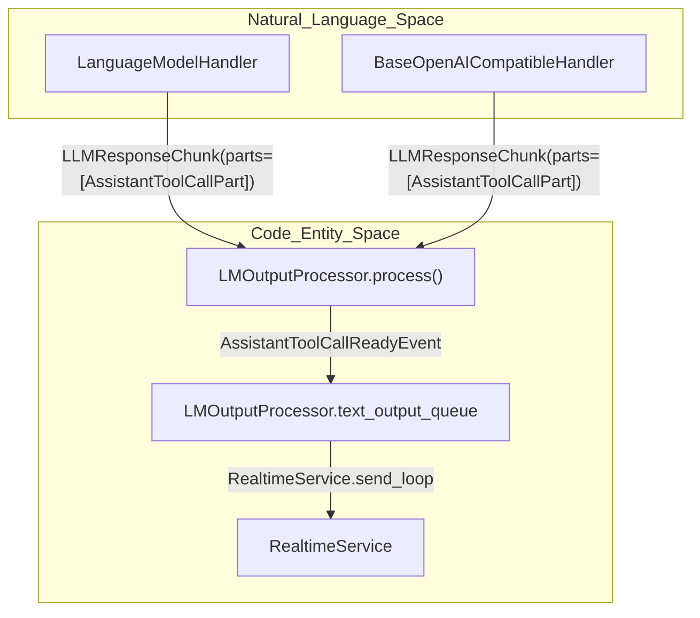
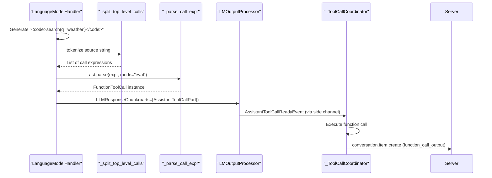

<!-- source: DeepWiki mcp.deepwiki.com · repo huggingface/speech-to-speech · extra page Tool Calling · fetched 2026-10-26 -->

# Tool Calling

Relevant source files

The following files were used as context for generating this wiki page:

- [src/speech_to_speech/LLM/lm_output_processor.py](src/speech_to_speech/LLM/lm_output_processor.py)
- [src/speech_to_speech/LLM/tool_call/function_call.py](src/speech_to_speech/LLM/tool_call/function_call.py)
- [src/speech_to_speech/LLM/tool_call/signature_from_schema.py](src/speech_to_speech/LLM/tool_call/signature_from_schema.py)
- [src/speech_to_speech/LLM/tool_call/tool_prompt.py](src/speech_to_speech/LLM/tool_call/tool_prompt.py)
- [src/speech_to_speech/LLM/voice_prompt.py](src/speech_to_speech/LLM/voice_prompt.py)
- [src/speech_to_speech/pipeline/events.py](src/speech_to_speech/pipeline/events.py)
- [src/speech_to_speech/pipeline/messages.py](src/speech_to_speech/pipeline/messages.py)
- [tests/test_lm_output_processor.py](tests/test_lm_output_processor.py)
- [tests/test_voice_prompt.py](tests/test_voice_prompt.py)
- [tests/tool_call/test_function_parser.py](tests/tool_call/test_function_parser.py)
- [tests/tool_call/test_signature_from_schema.py](tests/tool_call/test_signature_from_schema.py)

## Purpose and Scope
This page details the tool calling architecture within the speech-to-speech codebase. It covers both cloud-based native tool calling through OpenAI-compatible APIs and local LLM tool calling via code-block injection. It documents schema translation (`signature_from_schema`), AST-based parsing (`function_call.py`), sequence and side-channel extraction via `LMOutputProcessor`, and client-side tool execution coordination.

---

## 1. Overview of Tool Calling Paths

The speech-to-speech system bifurcates tool execution into two primary execution models based on the active backend configuration:

1. **Native Path**: Utilized by remote and OpenAI-compatible API language model handlers (e.g., `BaseOpenAICompatibleHandler`), leveraging the underlying API's native `tools` and `tool_choice` schema parameters directly.
2. **Local/Code Path**: Utilized by local handlers (e.g., `LanguageModelHandler`), injecting a structured system prompt that instructs models to output Python-style function calls enclosed within explicit delimiters (e.g., `<code>` tags). These are intercepted and parsed before reaching the text-to-speech (TTS) pipeline.

### Architectural Data Flow

The following diagram bridges the natural language space where the model generates textual tool representations to the code entity space where internal components process them.

**Natural Language to Code Entity Space: LLM Tool Flow**

Sources: [src/speech_to_speech/LLM/lm_output_processor.py:179-190](), [src/speech_to_speech/pipeline/events.py:124-140](), [src/speech_to_speech/pipeline/messages.py:127-146]()

---

## 2. Local LLM Tool Calling and Code-Block Injection

For local models lacking native tool-calling interfaces, the framework relies on dynamic prompt injection and AST parsing housed under `src/speech_to_speech/LLM/tool_call/`.

### Schema and Signature Translation
Tools are modeled via `FunctionTool` [src/speech_to_speech/LLM/tool_call/function_tool.py:13](). To supply local models with accurate syntax guidelines, `signature_from_schema` converts JSON Schema properties into Python `inspect.Signature` objects [src/speech_to_speech/LLM/tool_call/signature_from_schema.py:79-124]().
- `_annotation_from_spec` maps JSON Schema types (`string`, `number`, `boolean`, `integer`, `object`, `array`, `null`, `enum`, `anyOf`, `oneOf`) to Python type annotations such as `str`, `float`, `int`, `list`, `Literal`, and `Union` [src/speech_to_speech/LLM/tool_call/signature_from_schema.py:23-76]().
- `FunctionTool.to_code_prompt()` renders these into clean Python-style definitions included in system prompts [src/speech_to_speech/LLM/tool_call/function_tool.py:34]().

### Prompt Construction
The system prompt builder `build_tool_system_prompt` injects available tools and enforces syntactic constraints [src/speech_to_speech/LLM/tool_call/tool_prompt.py:76-97]().
- **Delimiters**: Defaults to `<code>` (`ENTER_CODE`) and `</code>` (`END_CODE`) blocks [src/speech_to_speech/LLM/tool_call/tool_prompt.py:18-19]().
- **Argument Rules**: Requires named arguments only, quoted strings, and omission of optional arguments instead of null placeholders [src/speech_to_speech/LLM/tool_call/tool_prompt.py:42-42]().
- **Order Preservation**: Instructs the model to keep every tool call in a separate block while preserving the intended text and tool interleaving order [src/speech_to_speech/LLM/tool_call/tool_prompt.py:43-43]().

Sources: [src/speech_to_speech/LLM/tool_call/function_tool.py:13](), [src/speech_to_speech/LLM/tool_call/signature_from_schema.py:23-124](), [src/speech_to_speech/LLM/tool_call/tool_prompt.py:18-97]()

---

## 3. Parsing and Execution Architecture

Extraction of structured function calls from raw generated text streams is handled by `src/speech_to_speech/LLM/tool_call/function_call.py`.

### Tokenization and AST Parsing
1. **Top-Level Splitting**: `_split_top_level_calls` uses Python's built-in `tokenize` module to walk source tokens and track parenthesis depth, correctly managing nested structures, strings containing `)` characters, tuples, and dictionaries [src/speech_to_speech/LLM/tool_call/function_call.py:36-85]().
2. **AST Evaluation**: `_parse_call_expr` invokes `ast.parse(expr, mode="eval")` to convert expressions into valid Python AST nodes, extracting target function names (`_extract_function_name`) and literal arguments (`_literal_from_ast`) into an ordered dictionary [src/speech_to_speech/LLM/tool_call/function_call.py:117-178]().
3. **Validation**: `FunctionToolCall.to_realtime_function_tool_call` cleans up positional placeholders (`__arg_n__`) and validates parameters against known `FunctionTool` definitions [src/speech_to_speech/LLM/tool_call/function_call.py:191-208]().

### Tool Parsing Pipeline

**Natural Language to Code Entity Space: Execution Pipeline**

Sources: [src/speech_to_speech/LLM/tool_call/function_call.py:36-85](), [src/speech_to_speech/LLM/tool_call/function_call.py:117-178](), [src/speech_to_speech/LLM/lm_output_processor.py:179-191]()

---

## 4. LMOutputProcessor Integration

`LMOutputProcessor` acts as an event multiplexer, taking mixed text and tool chunks from LLM handlers and routing them appropriately [src/speech_to_speech/LLM/lm_output_processor.py:42-49]().

| Feature | Implementation Role | Code Reference |
| :--- | :--- | :--- |
| **Part Sequencing** | Assigns monotonic `output_sequence` counters to parts to preserve model generation order. | [src/speech_to_speech/LLM/lm_output_processor.py:180-181]() |
| **Side-Channel Dispatch** | Emits `AssistantToolCallReadyEvent` to `text_output_queue`, enabling client-side tool invocation concurrently with TTS audio generation for preceding text. | [src/speech_to_speech/LLM/lm_output_processor.py:185-191]() |
| **Stale Turn Filtering** | Integrates with `SpeculativeTurnTracker` to drop tool calls and responses associated with stale or barged-in conversational turns. | [src/speech_to_speech/LLM/lm_output_processor.py:92-96](), [src/speech_to_speech/LLM/lm_output_processor.py:168-174]() |
| **Generation Finalization** | Yields `ResponseGenerationDoneEvent` and `AssistantResponseDoneEvent` upon completion of an LLM turn. | [src/speech_to_speech/LLM/lm_output_processor.py:72-90](), [src/speech_to_speech/LLM/lm_output_processor.py:140-155]() |

Sources: [src/speech_to_speech/LLM/lm_output_processor.py:42-191](), [src/speech_to_speech/pipeline/events.py:124-178]()

---

## 5. Client-Side Execution

In client runtime modes (`talk` or `local`), the `_ToolCallCoordinator` handles response handling:
1. **Sequencing Verification**: Orders incoming `AssistantToolCallReadyEvent` items using their `output_sequence` property.
2. **Execution**: Dispatches arguments to registered client-side Python executables.
3. **Response Relay**: Submits tool outputs back to the realtime server via `conversation.item.create` events containing `function_call_output` payloads.

Sources: [src/speech_to_speech/pipeline/events.py:137-153]()

---

