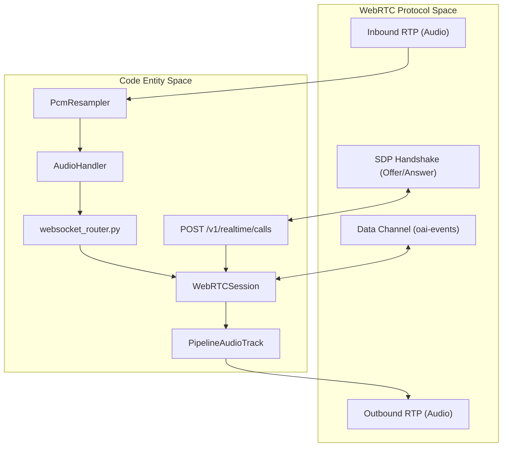
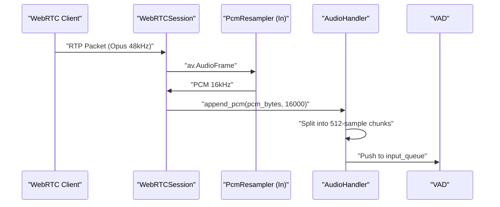

<!-- source: DeepWiki mcp.deepwiki.com · repo huggingface/speech-to-speech · extra page WebRTC Transport · fetched 2026-10-26 -->

# WebRTC Transport

<details>
<summary>Relevant source files</summary>

The following files were used as context for generating this wiki page:

- [src/speech_to_speech/api/openai_realtime/handlers/audio.py](src/speech_to_speech/api/openai_realtime/handlers/audio.py)
- [src/speech_to_speech/api/openai_realtime/webrtc_session.py](src/speech_to_speech/api/openai_realtime/webrtc_session.py)
- [src/speech_to_speech/api/openai_realtime/websocket_router.py](src/speech_to_speech/api/openai_realtime/websocket_router.py)
- [src/speech_to_speech/baseHandler.py](src/speech_to_speech/baseHandler.py)
- [tests/openai_realtime/test_webrtc.py](tests/openai_realtime/test_webrtc.py)
- [tests/openai_realtime/test_websocket_router.py](tests/openai_realtime/test_websocket_router.py)

</details>


The WebRTC transport provides a low-latency, resilient communication layer for the Realtime API, utilizing RTP for media streaming and Data Channels for control signaling. Unlike the WebSocket transport, which encapsulates audio in JSON frames, WebRTC treats audio as a native media stream, allowing for better jitter management and standardized echo cancellation on the client side.

## Overview and Data Flow

The WebRTC implementation relies on `aiortc` for the peer connection lifecycle and `PyAV` (av) for audio resampling and encoding. The transport uses a specialized session class, `WebRTCSession`, which implements the `SessionTransport` interface used by the `websocket_router` send loop [src/speech_to_speech/api/openai_realtime/webrtc_session.py:156-163]().

### Communication Channels
1.  **Media Tracks**: Audio is transmitted via RTP. Inbound audio from the client is typically Opus at 48kHz, which the server resamples to 16kHz PCM for the pipeline [src/speech_to_speech/api/openai_realtime/webrtc_session.py:3-5](). Outbound audio is paced at 48kHz by the server [src/speech_to_speech/api/openai_realtime/webrtc_session.py:39-41]().
2.  **Data Channel (`oai-events`)**: All OpenAI Realtime API JSON events are exchanged over a dedicated data channel named `oai-events` [src/speech_to_speech/api/openai_realtime/webrtc_session.py:42-42]().

### Entity Association: Code to Protocol
The following diagram maps the WebRTC protocol concepts to the specific classes and functions in the codebase.

**WebRTC Component Mapping**

Sources: [src/speech_to_speech/api/openai_realtime/webrtc_session.py:1-12](), [src/speech_to_speech/api/openai_realtime/handlers/audio.py:31-32](), [src/speech_to_speech/api/openai_realtime/transports.py:29-32]()

## Connection Handshake (SDP)

The connection is established via a standard WebRTC-HTTP Egress Protocol (WHEP)-like handshake.
1.  **Client Offer**: The client sends an HTTP `POST` request to `/v1/realtime/calls` containing the SDP offer.
2.  **ICE Configuration**: The server builds an `RTCConfiguration` using the `SPEECH_TO_SPEECH_ICE_SERVERS` environment variable [src/speech_to_speech/api/openai_realtime/webrtc_session.py:51-68]().
3.  **Server Answer**: The server creates a `RTCPeerConnection`, adds a `PipelineAudioTrack`, and returns the SDP answer in the HTTP response body.
4.  **Connect Timeout**: A negotiated session must reach the "connected" state within `CONNECT_TIMEOUT_S` (default 30 seconds) or the allocated `PipelineUnit` is released to prevent resource leaks [src/speech_to_speech/api/openai_realtime/webrtc_session.py:48-48]().

## Implementation Details

### Audio Processing Pipeline
The WebRTC transport handles resampling and pacing differently than WebSockets to accommodate the 48kHz RTP standard.

| Component | Role | Logic |
| :--- | :--- | :--- |
| `PcmResampler` | Resampling | Uses `av.AudioResampler` to convert between 48kHz (WebRTC) and 16kHz (Pipeline). Stateful to avoid boundary artifacts [src/speech_to_speech/api/openai_realtime/webrtc_session.py:71-78](). |
| `PipelineAudioTrack` | Pacing | Inherits from `MediaStreamTrack`. Paces delivery of 20ms frames (960 samples at 48kHz) against the wall clock [src/speech_to_speech/api/openai_realtime/webrtc_session.py:100-109](). |
| `AudioHandler` | Chunking | Shared logic that splits resampled PCM into 512-sample chunks (32ms) required by the VAD [src/speech_to_speech/api/openai_realtime/handlers/audio.py:137-149](). |

### The `WebRTCSession` Class
The `WebRTCSession` acts as the glue between `aiortc` and the `RealtimeService`.

*   **`send_events`**: Serializes JSON events and pushes them to the `oai-events` data channel [src/speech_to_speech/api/openai_realtime/webrtc_session.py:228-232]().
*   **`send_audio_chunk`**: Resamples pipeline PCM to 48kHz and writes it to the `PipelineAudioTrack` buffer [src/speech_to_speech/api/openai_realtime/webrtc_session.py:234-239]().
*   **`discard_pending_audio`**: Flushes the `PipelineAudioTrack` buffer. This is critical for barge-in, as it silences audio already queued for playback on the server [src/speech_to_speech/api/openai_realtime/webrtc_session.py:241-242]().

**Data Flow: Audio Ingestion**

Sources: [src/speech_to_speech/api/openai_realtime/webrtc_session.py:214-222](), [src/speech_to_speech/api/openai_realtime/handlers/audio.py:137-149]()

## Differences from WebSocket Transport

The WebRTC transport diverges from the standard OpenAI WebSocket protocol in several key ways due to the nature of media streaming.

1.  **Event Restrictions**: Clients cannot use `input_audio_buffer.append` or `input_audio_buffer.commit` over WebRTC; audio is instead streamed continuously via the RTP track [tests/openai_realtime/test_webrtc.py:7-9]().
2.  **Server-Side Pacing**: In WebSocket mode, the server sends audio as fast as it is generated (`response.audio.delta`). In WebRTC, the server paces the audio to real-time via `PipelineAudioTrack.recv()` [src/speech_to_speech/api/openai_realtime/webrtc_session.py:129-142]().
3.  **No `response.audio.delta`**: Because audio travels over RTP, the server does not emit `response.audio.delta` events on the data channel [src/speech_to_speech/api/openai_realtime/transports.py:106-109]().
4.  **Barge-in Handling**: Interruption requires calling `discard_pending_audio()` to clear the server's RTP track buffer, whereas WebSockets rely on the client to flush its own playback buffer [src/speech_to_speech/api/openai_realtime/transports.py:48-54]().

## Configuration

### ICE Servers
ICE servers are configured via the `SPEECH_TO_SPEECH_ICE_SERVERS` environment variable. It expects a JSON array of `RTCIceServer` dictionaries:

```bash
export SPEECH_TO_SPEECH_ICE_SERVERS='[{"urls": "stun:stun.l.google.com:19302"}]'
```
Sources: [src/speech_to_speech/api/openai_realtime/webrtc_session.py:43-43](), [src/speech_to_speech/api/openai_realtime/webrtc_session.py:51-68]()

### Timeouts
*   **`ICE_GATHERING_TIMEOUT_S`**: 5.0s. Time allowed for the server to gather local ICE candidates [src/speech_to_speech/api/openai_realtime/webrtc_session.py:44-44]().
*   **`CONNECT_TIMEOUT_S`**: 30.0s. Time allowed for the peer connection to transition to the `connected` state after the SDP exchange [src/speech_to_speech/api/openai_realtime/webrtc_session.py:48-48]().

Sources: [src/speech_to_speech/api/openai_realtime/webrtc_session.py:44-48]()

---

