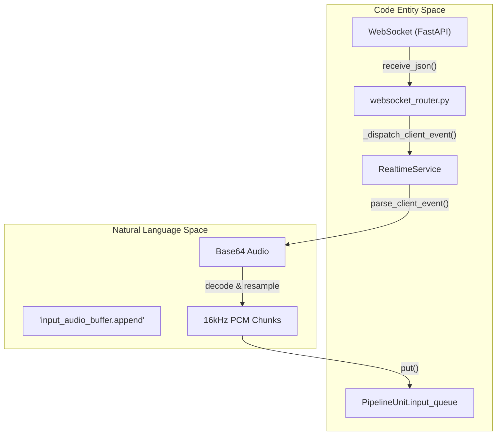
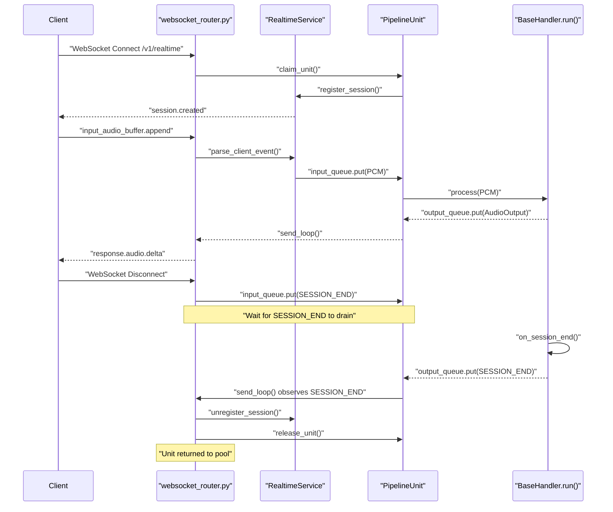

<!-- source: DeepWiki mcp.deepwiki.com · repo huggingface/speech-to-speech · extra page WebSocket Transport · fetched 2026-10-26 -->

# WebSocket Transport

Relevant source files

The following files were used as context for generating this wiki page:

- [src/speech_to_speech/api/openai_realtime/transports.py](src/speech_to_speech/api/openai_realtime/transports.py)
- [src/speech_to_speech/api/openai_realtime/websocket_router.py](src/speech_to_speech/api/openai_realtime/websocket_router.py)
- [src/speech_to_speech/baseHandler.py](src/speech_to_speech/baseHandler.py)
- [tests/openai_realtime/test_websocket_router.py](tests/openai_realtime/test_websocket_router.py)

The WebSocket transport implements the primary communication layer for the OpenAI-compatible Realtime API. It provides a bidirectional, full-duplex connection over a single TCP socket, carrying both control signaling (JSON events) and streaming media (base64-encoded PCM audio). This transport is exposed via the `/v1/realtime` endpoint and is designed for low-latency voice interactions.

## Protocol Overview

The transport utilizes the standard OpenAI Realtime API event protocol. All communication consists of JSON messages (events) with a `type` field identifying the message purpose.

### Session Lifecycle
1.  **Connection**: The client establishes a WebSocket connection to `/v1/realtime` [src/speech_to_speech/api/openai_realtime/websocket_router.py:657-664]().
2.  **Initialization**: The server immediately emits a `session.created` event containing default session configuration [tests/openai_realtime/test_websocket_router.py:146-149]().
3.  **Configuration**: The client may send a `session.update` event to configure VAD parameters, voices, or instructions [src/speech_to_speech/api/openai_realtime/websocket_router.py:21-21]().
4.  **Interaction**:
    *   **Input**: Client streams audio via `input_audio_buffer.append` [src/speech_to_speech/api/openai_realtime/websocket_router.py:15-15]().
    *   **Output**: Server streams audio via `response.audio.delta` and text via `response.text.delta`.
5.  **Termination**: The session ends when the WebSocket is closed, triggering the `PipelineUnit` release and quarantine logic [src/speech_to_speech/api/openai_realtime/websocket_router.py:72-85]().

### Audio Format
Audio is transmitted as 16kHz, mono, 16-bit signed PCM (Little Endian). In the WebSocket transport, this raw binary data is base64-encoded and wrapped in JSON events.

**Sources:** [src/speech_to_speech/api/openai_realtime/websocket_router.py](), [tests/openai_realtime/test_websocket_router.py]()

## WebSocketTransport Implementation

The `WebSocketTransport` class implements the `SessionTransport` interface, abstracting the FastAPI `WebSocket` object for the pipeline's send loop.

### Key Class: `WebSocketTransport`
Defined in [src/speech_to_speech/api/openai_realtime/transports.py:83-115]().

*   **`send_events(events)`**: Iterates through a list of `ServerEvent` objects, serializes them to JSON using `model_dump()`, and sends them over the socket [src/speech_to_speech/api/openai_realtime/transports.py:92-95](). It uses an `asyncio.Lock` to ensure atomic event delivery [src/speech_to_speech/api/openai_realtime/transports.py:90]().
*   **`send_audio_chunk(service, session_id, pcm)`**: Encapsulates raw PCM bytes into a `response.audio.delta` event via the `RealtimeService` and dispatches it [src/speech_to_speech/api/openai_realtime/transports.py:97-104]().
*   **`discard_pending_audio()`**: A no-op for WebSockets. Unlike WebRTC, which buffers and paces audio on the server, WebSocket audio is delivered as fast as possible to the client, making client-side buffer management responsible for barge-in truncation [src/speech_to_speech/api/openai_realtime/transports.py:106-109]().

### System Data Flow: WebSocket to Pipeline

The following diagram illustrates how a WebSocket event is ingested and transformed into pipeline-compatible data.

**Sources:** [src/speech_to_speech/api/openai_realtime/transports.py](), [src/speech_to_speech/api/openai_realtime/websocket_router.py]()

## Session Lifecycle and Event Handling

The `websocket_router.py` manages the connection lifecycle and coordinates between the FastAPI event loop and the synchronous pipeline threads.

### Connection Handling
When a client connects to `realtime_endpoint`, the server attempts to claim a `PipelineUnit` from the pool [src/speech_to_speech/api/openai_realtime/websocket_router.py:657-664](). If the pool is exhausted, it returns a `session_limit_reached` error [tests/openai_realtime/test_websocket_router.py:161](). The server also negotiates subprotocols, prioritizing "realtime" for browser SDKs [tests/openai_realtime/test_websocket_router.py:160-168]().

### The Send Loop
Once a session is established, a dedicated `send_loop` task is spawned. This task monitors the `PipelineUnit.output_queue` and `text_output_queue` for data generated by the backend handlers [src/speech_to_speech/api/openai_realtime/websocket_router.py:348-356]().

*   **Audio Batching**: To reduce overhead, small audio chunks are batched up to `MAX_AUDIO_BATCH_BYTES` (6400 bytes) before being sent as a single WebSocket message [src/speech_to_speech/api/openai_realtime/websocket_router.py:70, 508-518]().
*   **Output Gating**: The loop checks if a response has been cancelled or if the output is blocked (e.g., during a barge-in) before sending audio to the client [src/speech_to_speech/api/openai_realtime/websocket_router.py:465-475]().

### Event Dispatch Logic
Client events are routed through `_dispatch_client_event`, which maps JSON `type` fields to specific handler methods in `RealtimeService` [src/speech_to_speech/api/openai_realtime/websocket_router.py:270-305]().

| Client Event | Handler Method | Action |
| :--- | :--- | :--- |
| `session.update` | `SessionHandler.handle_session_update` | Updates `RuntimeConfig` for the session. |
| `input_audio_buffer.append` | `AudioHandler.handle_audio_append` | Decodes base64, resamples, and enqueues PCM. |
| `response.create` | `ResponseHandler.handle_response_create` | Manually triggers a new LLM generation. |
| `response.cancel` | `ResponseHandler.handle_response_cancel` | Triggers `CancelScope` to stop current generation. |

### Session Cleanup and Quarantine
Upon disconnection, the server enqueues a `SESSION_END` control message [src/speech_to_speech/api/openai_realtime/websocket_router.py:724-726](). The `PipelineUnit` is not immediately returned to the pool; it enters a **Quarantine** state until the `SESSION_END` message has propagated through all handlers (STT → LLM → TTS) and reached the output queue [src/speech_to_speech/api/openai_realtime/websocket_router.py:72-85](). This prevents "cross-session leaks" where late output from a previous user might be sent to a new user who claims the same unit. The `_simulate_session_end_drain` helper in tests demonstrates this process [tests/openai_realtime/test_websocket_router.py:120-135]().

**Sources:** [src/speech_to_speech/api/openai_realtime/websocket_router.py](), [src/speech_to_speech/api/openai_realtime/service.py](), [src/speech_to_speech/api/openai_realtime/transports.py](), [src/speech_to_speech/baseHandler.py](), [tests/openai_realtime/test_websocket_router.py]()

---

