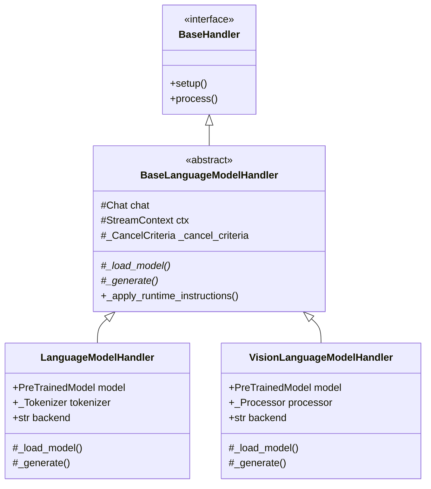
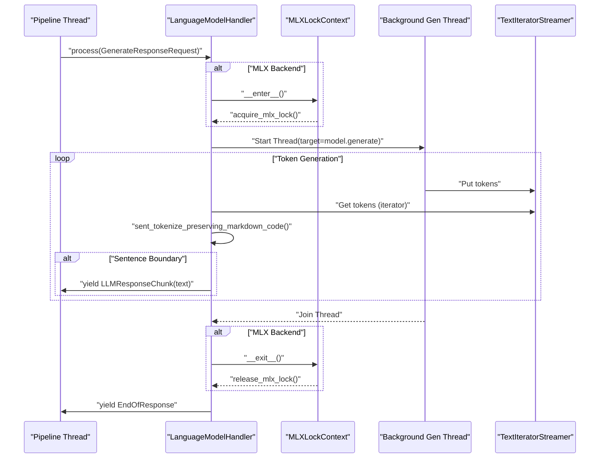

<!-- source: DeepWiki mcp.deepwiki.com · repo huggingface/speech-to-speech · extra page Local Model Handlers (Transformers and MLX) · fetched 2026-10-26 -->

# Local Model Handlers (Transformers and MLX)

Relevant source files

The following files were used as context for generating this wiki page:

- [src/speech_to_speech/LLM/README.md](src/speech_to_speech/LLM/README.md)
- [src/speech_to_speech/LLM/base_openai_compatible_language_model.py](src/speech_to_speech/LLM/base_openai_compatible_language_model.py)
- [src/speech_to_speech/LLM/language_model.py](src/speech_to_speech/LLM/language_model.py)
- [src/speech_to_speech/STT/base_stt_handler.py](src/speech_to_speech/STT/base_stt_handler.py)
- [src/speech_to_speech/arguments_classes/facebookmms_tts_arguments.py](src/speech_to_speech/arguments_classes/facebookmms_tts_arguments.py)
- [src/speech_to_speech/arguments_classes/language_model_arguments.py](src/speech_to_speech/arguments_classes/language_model_arguments.py)
- [src/speech_to_speech/arguments_classes/language_model_base_arguments.py](src/speech_to_speech/arguments_classes/language_model_base_arguments.py)
- [src/speech_to_speech/utils/mlx_lock.py](src/speech_to_speech/utils/mlx_lock.py)
- [tests/test_responses_api_language_model.py](tests/test_responses_api_language_model.py)
- [tests/test_stt_stale_filter.py](tests/test_stt_stale_filter.py)

## Purpose and Scope

This document provides detailed technical information about local language model handlers (`LanguageModelHandler` and `VisionLanguageModelHandler`), which process text transcripts and multimodal inputs using either Hugging Face's `transformers` library or Apple's `mlx-lm` / `mlx-vlm` backends. It covers asynchronous streaming via `TextIteratorStreamer`, mid-generation cancellation via `_CancelCriteria`, global MLX lock and cache management for Apple Silicon, automatic sentence tokenization, and unspeechable token filtering.

Sources: [src/speech_to_speech/LLM/language_model.py:107-163](), [src/speech_to_speech/LLM/language_model.py:185-195]()

## Architecture and Class Hierarchy

The system uses an abstract base class hierarchy (`BaseLanguageModelHandler`) inheriting from `BaseHandler` to unify text-only and vision-language model execution across both PyTorch (`transformers`) and Apple Silicon (`mlx` / `mlx-vlm`) backends.

### Entity Mapping Diagram

Sources: [src/speech_to_speech/LLM/language_model.py:97-195](), [src/speech_to_speech/LLM/language_model.py:330-360](), [src/speech_to_speech/LLM/language_model.py:463-510]()

## Transformers vs. MLX/MLX-VLM Backends

The handler determines the execution backend via the `backend` configuration parameter (`"transformers"` or `"mlx"` / `"mlx-lm"` / `"mlx-vlm"`).

- **Transformers Backend**: Loads models using `AutoModelForCausalLM.from_pretrained` (or `AutoModelForImageTextToText` for VLMs) with PyTorch dtypes (`float16`, `bfloat16`, or `float32`) on CUDA or CPU devices [src/speech_to_speech/LLM/language_model.py:180-195]().
- **MLX Backend**: Utilizes `mlx_lm.load` or `mlx_vlm.load` when `HAS_MLX` or `HAS_MLX_VLM` are available, executing quantized weights efficiently on Apple Silicon Unified Memory (`mps` or `mlx`) [src/speech_to_speech/LLM/language_model.py:74-93]().

Sources: [src/speech_to_speech/LLM/language_model.py:74-93](), [src/speech_to_speech/LLM/language_model.py:180-195]()

## Threading, Streaming, and MLX Lock Management

To prevent blocking the speech pipeline during generation, local language model handlers execute inference in a background thread while streaming tokens via `TextIteratorStreamer` (for transformers) or generator functions (for MLX).

### MLX Lock and Cache Management
When running MLX models on Apple Silicon, concurrent access to Metal resources across different pipeline stages (STT, LLM, TTS) is serialized using `MLXLockContext` to prevent GPU memory faults or MMU resets [src/speech_to_speech/utils/mlx_lock.py:1-179]().

### Data Flow Diagram

Sources: [src/speech_to_speech/LLM/language_model.py:320-430](), [src/speech_to_speech/utils/mlx_lock.py:159-179]()

## Interruption and Cancel Criteria

Barge-in handling (when a user interrupts the assistant mid-speech) is implemented via `_CancelCriteria`, which subclasses transformers `StoppingCriteria` [src/speech_to_speech/LLM/language_model.py:114-128]().

- **`_CancelCriteria`**: Maintains an internal `_cancelled` flag that is checked at each token generation step by `model.generate()` [src/speech_to_speech/LLM/language_model.py:114-128]().
- **`CancelScope`**: Coordinates cancellation signals across the pipeline threads, invoking `cancel()` on the criteria to abort token generation immediately [src/speech_to_speech/LLM/language_model.py:58](), [src/speech_to_speech/LLM/language_model.py:183]().

Sources: [src/speech_to_speech/LLM/language_model.py:114-128](), [src/speech_to_speech/LLM/language_model.py:183]()

## Sentence Tokenization and Unspeechable Token Filtering

Generated text chunks undergo rigorous sanitization and sentence boundary detection before being passed to downstream TTS handlers:

1. **Sentence Tokenization**: Uses `sent_tokenize_preserving_markdown_code` to split text into sentences while protecting code blocks and punctuation [src/speech_to_speech/LLM/utils.py:47-48]().
2. **Batching**: The `stream_batch_sentences` configuration parameter determines how many sentences are accumulated before yielding an `LLMResponseChunk` [src/speech_to_speech/LLM/language_model.py:187]().
3. **Unspeechable Token Filtering**: `remove_unspeechable` strips visual-only characters, markdown symbols, or emojis that could cause artifacts in audio synthesis [src/speech_to_speech/LLM/utils.py:45]().
4. **Tool and Thought Extraction**: Internal thought blocks (`enable_thinking`) and function call markers (`ENTER_CODE` / `END_CODE`) are filtered out of the audio path [src/speech_to_speech/LLM/language_model.py:46-48](), [src/speech_to_speech/LLM/language_model.py:186]().

Sources: [src/speech_to_speech/LLM/utils.py:45-48](), [src/speech_to_speech/LLM/language_model.py:186-187]()

## Summary of Key Functions and Classes

| Class / Function | Role | File Reference |
| :--- | :--- | :--- |
| `BaseLanguageModelHandler` | Abstract base handling chat history, prompt construction, and streaming iteration. | [src/speech_to_speech/LLM/language_model.py:164-195]() |
| `LanguageModelHandler` | Causal LM handler supporting transformers and mlx-lm backends. | [src/speech_to_speech/LLM/language_model.py:330-462]() |
| `VisionLanguageModelHandler` | Multimodal VLM handler supporting image-text inputs and processors. | [src/speech_to_speech/LLM/language_model.py:463-510]() |
| `_CancelCriteria` | Stopping criteria for interrupting transformer generation. | [src/speech_to_speech/LLM/language_model.py:114-128]() |
| `StreamContext` | Mutable accumulator tracking tokens, sentences, and generation metadata. | [src/speech_to_speech/LLM/language_model.py:130-163]() |
| `MLXLockContext` | Context manager serializing Apple Silicon Metal execution across handlers. | [src/speech_to_speech/utils/mlx_lock.py:159-179]() |

Sources: [src/speech_to_speech/LLM/language_model.py:114-510](), [src/speech_to_speech/utils/mlx_lock.py:159-179]()

---

