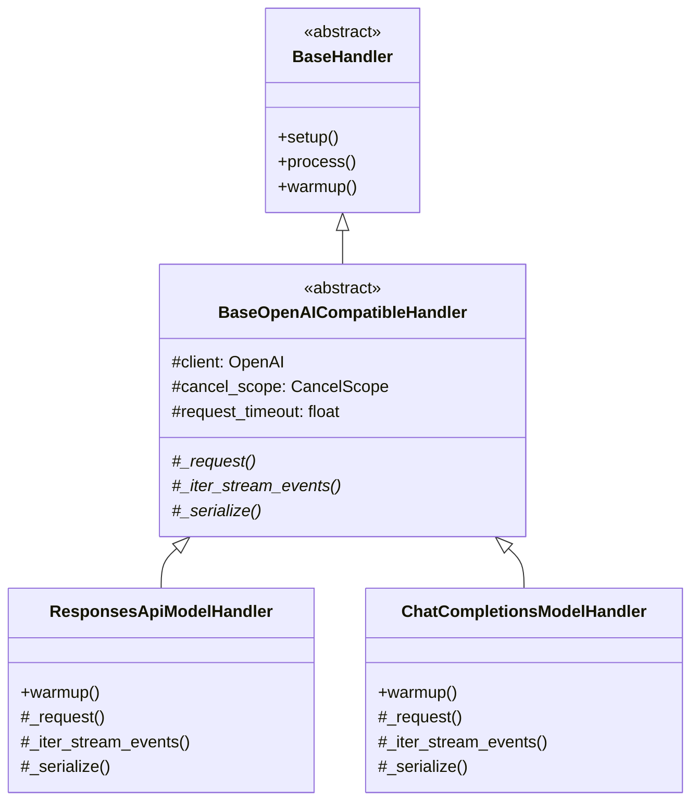
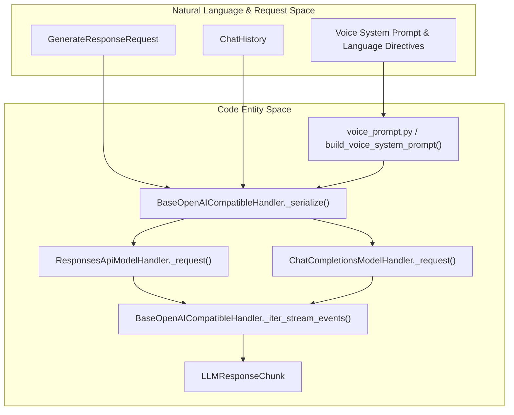
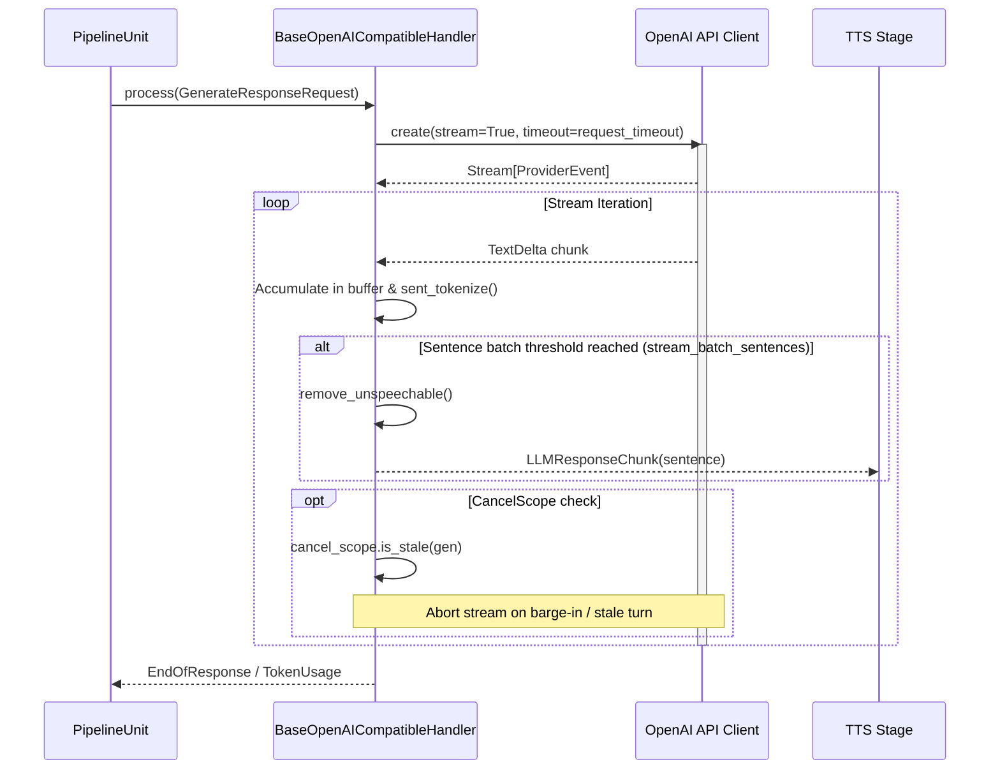

<!-- source: DeepWiki mcp.deepwiki.com · repo huggingface/speech-to-speech · extra page OpenAI-Compatible API Language Model Handlers · fetched 2026-10-26 -->

# OpenAI-Compatible API Language Model Handlers

Relevant source files

The following files were used as context for generating this wiki page:

- [src/speech_to_speech/LLM/chat_completions_language_model.py](src/speech_to_speech/LLM/chat_completions_language_model.py)
- [src/speech_to_speech/LLM/responses_api_language_model.py](src/speech_to_speech/LLM/responses_api_language_model.py)
- [src/speech_to_speech/LLM/utils.py](src/speech_to_speech/LLM/utils.py)
- [src/speech_to_speech/arguments_classes/chat_completions_language_model_arguments.py](src/speech_to_speech/arguments_classes/chat_completions_language_model_arguments.py)
- [src/speech_to_speech/arguments_classes/responses_api_language_model_arguments.py](src/speech_to_speech/arguments_classes/responses_api_language_model_arguments.py)
- [tests/test_chat_completions_backend.py](tests/test_chat_completions_backend.py)
- [tests/test_llm_utils.py](tests/test_llm_utils.py)

The OpenAI-compatible API Language Model Handlers provide remote language model integration for the speech-to-speech pipeline via the OpenAI client SDK. The core architecture centers around the abstract base class `BaseOpenAICompatibleHandler`, which implements protocol translation, event normalisation, cancellation scoping, prefetch transaction handling, and conversation compaction [src/speech_to_speech/LLM/base_openai_compatible_language_model.py:40-100](). Two primary concrete subclasses implement remote endpoint interactions: `ResponsesApiModelHandler` targeting `/v1/responses` endpoints [src/speech_to_speech/LLM/responses_api_language_model.py:43](), and `ChatCompletionsModelHandler` targeting standard `/v1/chat/completions` endpoints [src/speech_to_speech/LLM/chat_completions_language_model.py:36]().

## Component Architecture and Implementation Hierarchy

The system establishes a normalised provider event abstraction so that distinct remote API payloads (such as `ResponseTextDeltaEvent` or `ChatCompletionChunk`) map into unified internal representations (`TextDelta`, `AssistantMessage`, `ToolCall`, and `Usage`).

Sources: [src/speech_to_speech/LLM/base_openai_compatible_language_model.py:40-98](), [src/speech_to_speech/LLM/responses_api_language_model.py:43-178](), [src/speech_to_speech/LLM/chat_completions_language_model.py:36-181]()

The following diagram bridges natural language configuration and invocation concepts (Natural Language Space) to the actual classes, methods, and modules handling request dispatch and normalisation (Code Entity Space).

Sources: [src/speech_to_speech/LLM/base_openai_compatible_language_model.py:255-300](), [src/speech_to_speech/LLM/responses_api_language_model.py:129-170](), [src/speech_to_speech/LLM/chat_completions_language_model.py:139-181]()

## BaseOpenAICompatibleHandler and Event Normalisation

`BaseOpenAICompatibleHandler` manages the overarching lifecycle of remote API calls within the pipeline framework [src/speech_to_speech/LLM/base_openai_compatible_language_model.py:40-100](). When `process(request)` is invoked, it validates cancellation state via `CancelScope`, serialises the active conversation, applies system prompts, dispatches the request to the client SDK, and iterates over incoming stream events [src/speech_to_speech/LLM/base_openai_compatible_language_model.py:317-360]().

Event normalisation converts provider-native streaming objects into internal dataclasses:
- `TextDelta`: Encapsulates incremental textual content generated by the model [src/speech_to_speech/LLM/base_openai_compatible_language_model.py:25-28]().
- `ToolCall`: Represents structured function tool invocations requested by the model [src/speech_to_speech/LLM/base_openai_compatible_language_model.py:25-28]().
- `AssistantMessage`: Represents the complete assembled assistant response content [src/speech_to_speech/LLM/base_openai_compatible_language_model.py:22-28]().
- `Usage`: Captures token consumption statistics (`input_tokens`, `output_tokens`) [src/speech_to_speech/LLM/base_openai_compatible_language_model.py:27]().

Sources: [src/speech_to_speech/LLM/base_openai_compatible_language_model.py:22-38](), [src/speech_to_speech/LLM/base_openai_compatible_language_model.py:317-360]()

## Concrete Handlers: ResponsesApiModelHandler and ChatCompletionsModelHandler

### ResponsesApiModelHandler (`/v1/responses`)
`ResponsesApiModelHandler` implements endpoints adhering to the OpenAI Realtime-style Responses API specification [src/speech_to_speech/LLM/responses_api_language_model.py:43]().
- **Serialization**: Utilizes `active_chat.to_responses_api_chat()` [src/speech_to_speech/LLM/responses_api_language_model.py:151-152]().
- **Streaming Events**: Processes `ResponseTextDeltaEvent` for text deltas and `ResponseOutputItemDoneEvent` containing `ResponseFunctionToolCall` objects, generating unique call identifiers via `_generate_id("call")` [src/speech_to_speech/LLM/responses_api_language_model.py:178-186]().
- **Compaction**: Implements `_build_compaction_generate_fn()` to issue summary requests directly through `client.responses.create()` [src/speech_to_speech/LLM/responses_api_language_model.py:84-111]().

### ChatCompletionsModelHandler (`/v1/chat/completions`)
`ChatCompletionsModelHandler` interfaces with standard chat completion routers such as vLLM and remote OpenAI-compatible proxies [src/speech_to_speech/LLM/chat_completions_language_model.py:36]().
- **Tool Transformation**: `_to_chat_tools()` converts flat Responses-API tool structures into the nested format expected by Chat Completions [src/speech_to_speech/LLM/chat_completions_language_model.py:43-64]().
- **Tool Choice Mapping**: `_to_chat_tool_choice()` ensures forced-function parameter objects map correctly [src/speech_to_speech/LLM/chat_completions_language_model.py:67-83]().
- **Multimodal Content Parts**: `_to_chat_content_part()` converts text, image URLs, and audio inputs into `ChatCompletionContentPartParam` representations [src/speech_to_speech/LLM/chat_completions_language_model.py:96-136]().

Sources: [src/speech_to_speech/LLM/responses_api_language_model.py:43-186](), [src/speech_to_speech/LLM/chat_completions_language_model.py:36-181]()

## Streaming, Prefetch Transactions, and Timeouts

To optimize latency (specifically Time-to-First-Audio, TTFA), the handlers employ advanced streaming and buffering mechanics:

Sources: [src/speech_to_speech/LLM/base_openai_compatible_language_model.py:317-385]()

- **Prefetch Transactions**: A `ResponsePrefetchTransaction` allows the pipeline to initiate speculative LLM requests before speech-to-text finalization is complete [src/speech_to_speech/LLM/base_openai_compatible_language_model.py:118](). If a prefetch transaction becomes invalid due to intervening user input, the handler aborts the underlying network stream immediately [src/speech_to_speech/LLM/base_openai_compatible_language_model.py:330-335]().
- **Timeouts**: Requests enforce `request_timeout` (defaulting typically to 20 seconds) passed directly into the OpenAI client SDK options [src/speech_to_speech/LLM/base_openai_compatible_language_model.py:163](). Warmup calls utilize `WARMUP_MAX_RETRIES` to ensure connection readiness [src/speech_to_speech/LLM/base_openai_compatible_language_model.py:21]().

Sources: [src/speech_to_speech/LLM/base_openai_compatible_language_model.py:118-125](), [src/speech_to_speech/LLM/base_openai_compatible_language_model.py:317-385]()

## Thinking Mode, Out-of-Band Responses, and LLM Utilities (`LLM/utils.py`)

- **Thinking Suppression**: Controlled via `disable_thinking` and `reasoning_effort`. For models supporting provider-side reasoning (such as Together Qwen3.5), it injects `chat_template_kwargs.enable_thinking=false` into `extra_body` or configures `reasoning` payloads to prevent reasoning tokens from inflating TTFA [src/speech_to_speech/LLM/base_openai_compatible_language_model.py:161](), [src/speech_to_speech/LLM/responses_api_language_model.py:47-63]().
- **Out-of-Band Responses**: Detects when generated content is out-of-band (e.g., system-level acknowledgements or tool return executions) and suppresses downstream audio generation to avoid vocalizing internal state [src/speech_to_speech/LLM/base_openai_compatible_language_model.py:252-253]().
- **LLM Utility Helpers (`src/speech_to_speech/LLM/utils.py`)**:
  - `remove_unspeechable(text)`: Strips out non-speechable characters, emojis, and unpronounceable symbols while preserving Unicode punctuation across languages [src/speech_to_speech/LLM/utils.py:127-136]().
  - `remove_markdown(text)`: Strips markdown headings, bullets, and emphasis formatting once complete sentences are formed [src/speech_to_speech/LLM/utils.py:114-124]().
  - `sent_tokenize_preserving_markdown_code(text, tokenizer)`: Tokenizes text into sentences without splitting inline or fenced code blocks [src/speech_to_speech/LLM/utils.py:99-111]().
  - `resolve_auto_language(code)`: Resolves auto language flags (e.g., `sv-auto`) into language codes and human-readable names [src/speech_to_speech/LLM/utils.py:139-160]().
  - `WHISPER_LANGUAGE_TO_LLM_LANGUAGE`: Maps STT language codes to language names for prompt injection [src/speech_to_speech/LLM/utils.py:146-182]().

Sources: [src/speech_to_speech/LLM/base_openai_compatible_language_model.py:161-253](), [src/speech_to_speech/LLM/utils.py:1-182]()

## Argument Classes and Configuration

The handlers are configured via dedicated argument dataclasses inheriting from `LanguageModelBaseArguments`:
- `ResponsesApiLanguageModelHandlerArguments`: Defines `responses_api_base_url`, `responses_api_api_key`, `responses_api_stream`, `responses_api_disable_thinking`, `responses_api_reasoning_effort`, `responses_api_audio_max_tokens`, `responses_api_audio_temperature`, `responses_api_audio_content_type`, and `responses_api_audio_history_turns` [src/speech_to_speech/arguments_classes/responses_api_language_model_arguments.py:8-67]().
- `ChatCompletionsLanguageModelHandlerArguments`: Inherits connection fields from Responses-API arguments while overriding reasoning defaults to ensure provider compatibility [src/speech_to_speech/arguments_classes/chat_completions_language_model_arguments.py:10-29]().

| Argument | Type | Default | Description |
| :--- | :--- | :--- | :--- |
| `responses_api_base_url` | `Optional[str]` | `None` | Base URL for the OpenAI-compatible API endpoint [src/speech_to_speech/arguments_classes/responses_api_language_model_arguments.py:20-23]() |
| `responses_api_api_key` | `Optional[str]` | `None` | API key used for authentication [src/speech_to_speech/arguments_classes/responses_api_language_model_arguments.py:16-19]() |
| `responses_api_stream` | `bool` | `True` | Enables streaming transmission for low-latency delivery [src/speech_to_speech/arguments_classes/responses_api_language_model_arguments.py:24-30]() |
| `responses_api_disable_thinking` | `bool` | `True` | Disables provider-side thinking/reasoning modes [src/speech_to_speech/arguments_classes/responses_api_language_model_arguments.py:31-37]() |
| `responses_api_audio_history_turns` | `int` | `1` | Number of recent completed audio user turns retained in conversation history [src/speech_to_speech/arguments_classes/responses_api_language_model_arguments.py:61-67]() |

Sources: [src/speech_to_speech/arguments_classes/responses_api_language_model_arguments.py:8-67](), [src/speech_to_speech/arguments_classes/chat_completions_language_model_arguments.py:10-29]()

---

