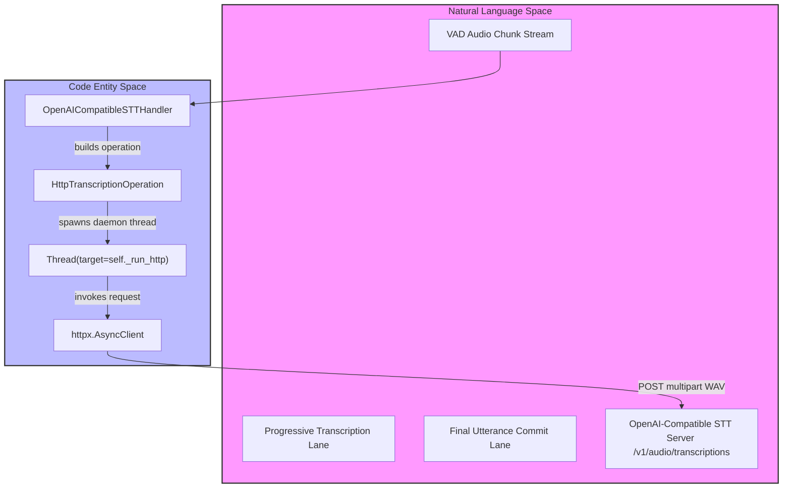
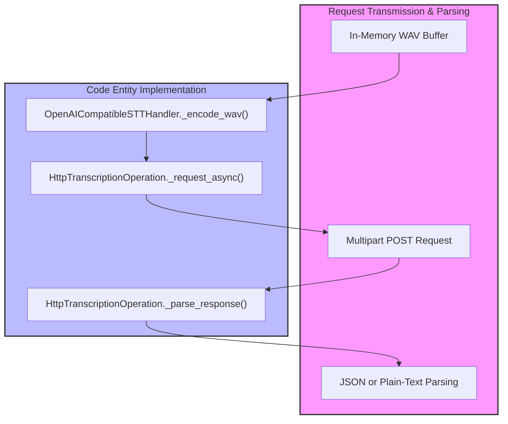

<!-- source: DeepWiki mcp.deepwiki.com · repo huggingface/speech-to-speech · extra page OpenAI-Compatible HTTP STT Handler · fetched 2026-10-26 -->

# OpenAI-Compatible HTTP STT Handler

Relevant source files

The following files were used as context for generating this wiki page:

- [docs/openai-compatible-stt.md](docs/openai-compatible-stt.md)
- [src/speech_to_speech/STT/openai_compatible_handler.py](src/speech_to_speech/STT/openai_compatible_handler.py)
- [src/speech_to_speech/arguments_classes/openai_stt_arguments.py](src/speech_to_speech/arguments_classes/openai_stt_arguments.py)
- [tests/test_openai_stt_handler.py](tests/test_openai_stt_handler.py)
- [tests/test_openai_stt_lifecycle.py](tests/test_openai_stt_lifecycle.py)

This page documents the OpenAI-compatible HTTP Speech-to-Text (STT) handler (`OpenAICompatibleSTTHandler`) and its underlying request execution primitives (`HttpTranscriptionOperation`). This backend delegates speech recognition to an external HTTP server while managing voice activity detection (VAD), conversational turns, session fencing, and transcription queuing locally [docs/openai-compatible-stt.md:3-6]().

---

## 1. Core Architecture and Component Mapping

The HTTP STT handler bridges pipeline audio frames to remote HTTP transcription endpoints via multipart WAV uploads [docs/openai-compatible-stt.md:11-14](). The subsystem is structured around `OpenAICompatibleSTTHandler`, which inherits from `BaseSTTHandler` [src/speech_to_speech/STT/openai_compatible_handler.py:30-30](), and `HttpTranscriptionOperation`, which encapsulates a single cancellable HTTP request transaction [src/speech_to_speech/STT/openai_compatible_handler.py:54-56]().

*Sources: [src/speech_to_speech/STT/openai_compatible_handler.py:30-78](), [docs/openai-compatible-stt.md:3-14]()*

---

## 2. WAV Encoding and HTTP Request Lifecycle

When audio chunks arrive from the VAD stage, the handler encodes them into mono 16kHz PCM16 WAV buffers before dispatch [docs/openai-compatible-stt.md:11-14](). WAV byte serialization is implemented via `OpenAICompatibleSTTHandler._encode_wav` [src/speech_to_speech/STT/openai_compatible_handler.py:168-176]().

HTTP transmission is performed asynchronously within an isolated event loop running on a dedicated daemon thread (`stt-http-reader`) [src/speech_to_speech/STT/openai_compatible_handler.py:77-97](). `HttpTranscriptionOperation.run()` manages this thread boundary, polling for cancellation flags and returning a completed `HttpTranscriptionResult` dataclass [src/speech_to_speech/STT/openai_compatible_handler.py:54-88]().

The payload structure adapts depending on the selected model identifier:
* Standard models send a singular `language` parameter [src/speech_to_speech/STT/openai_compatible_handler.py:157-161]().
* The `gpt-transcribe` model uses the plural `languages[]` contract [src/speech_to_speech/STT/openai_compatible_handler.py:158-159]().
* Response handling parses standard JSON `text`/`language` fields or reads plain-text formats depending on `--openai_stt_response_format` [docs/openai-compatible-stt.md:64-70](), [tests/test_openai_stt_handler.py:133-166]().

*Sources: [src/speech_to_speech/STT/openai_compatible_handler.py:73-176](), [docs/openai-compatible-stt.md:11-14](), [tests/test_openai_stt_handler.py:133-176]()*

---

## 3. Concurrency, Cancellation, and Fencing

To ensure real-time responsiveness and avoid blocking pipeline shutdown or session teardown, the handler implements robust request lifecycle controls:

* **Progressive vs. Final Lanes**: Progressive requests operate on a best-effort basis where only the latest waiting cumulative window is retained per pipeline [docs/openai-compatible-stt.md:89-93](). Final requests maintain strict turn ordering [docs/openai-compatible-stt.md:81-83]().
* **Pending-Request Bounds**: Each pipeline retains at most eight pending final requests [docs/openai-compatible-stt.md:83-84](). If the queue reaches capacity, excess final requests receive a sanitized `TranscriptionFailure` without triggering network overhead [docs/openai-compatible-stt.md:84-86]().
* **Cancellation Scopes**: Requests are wrapped in `anyio.CancelScope` instances linked via thread-safe transport locks, allowing immediate interruption across connection establishment, upload, and response reading phases [src/speech_to_speech/STT/openai_compatible_handler.py:112-146](), [docs/openai-compatible-stt.md:104-107]().
* **Session Generation Fencing**: Results and failures carry a session generation stamp checked atomically with queue publication to prevent stale completions from surfacing after teardown or session reuse [docs/openai-compatible-stt.md:97-100]().

*Sources: [src/speech_to_speech/STT/openai_compatible_handler.py:112-146](), [docs/openai-compatible-stt.md:81-110]()*

---

## 4. Configuration Arguments

The handler configuration is defined by `OpenAICompatibleSTTHandlerArguments` [src/speech_to_speech/arguments_classes/openai_stt_arguments.py:6-38]():

| Argument | Default | Description |
| :--- | :--- | :--- |
| `openai_stt_base_url` | `"http://localhost:8000/v1"` | Base URL of the OpenAI-compatible server, including `/v1` [src/speech_to_speech/arguments_classes/openai_stt_arguments.py:9-12]() |
| `openai_stt_api_key` | `None` | Optional bearer token (`OPENAI_API_KEY` fallback for OpenAI hosted endpoints) [src/speech_to_speech/arguments_classes/openai_stt_arguments.py:13-19]() |
| `openai_stt_model` | `"nvidia/parakeet-tdt-0.6b-v3"` | Model identifier sent to transcription endpoints [src/speech_to_speech/arguments_classes/openai_stt_arguments.py:20-26]() |
| `openai_stt_language` | `None` | Optional ISO language hint sent with transcription requests [src/speech_to_speech/arguments_classes/openai_stt_arguments.py:27-30]() |
| `openai_stt_response_format` | `"json"` | Response format adapter (`json` or `text`) [src/speech_to_speech/arguments_classes/openai_stt_arguments.py:31-34]() |
| `openai_stt_timeout` | `60.0` | HTTP request timeout in seconds [src/speech_to_speech/arguments_classes/openai_stt_arguments.py:35-38]() |

*Sources: [src/speech_to_speech/arguments_classes/openai_stt_arguments.py:6-38]()*

---

